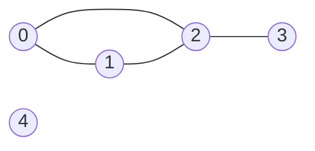
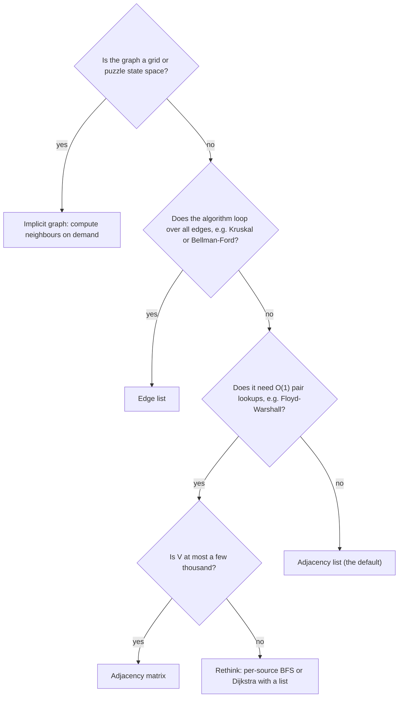

## Introduction

Many problems are about **things and the connections between them**. Cities joined by roads. Users who follow other users. Courses that must be taken before other courses. Web pages that link to other pages. Cells of a maze that you can step between. Each of these has the same shape: a collection of items, and a collection of pairs of items that are related. That shape is called a **graph**.

Graphs matter because once you see a problem as a graph, a large toolbox opens up. "What is the fewest number of flights from Delhi to Lisbon?" is a shortest-path question. "Can every course be finished, or is there a circular prerequisite?" is a cycle question. "Which servers stay reachable if this cable is cut?" is a connectivity question. The algorithms that answer these — breadth-first search, depth-first search, Dijkstra, topological sort, union-find — are taught in the lessons that follow this one.

Every one of those algorithms starts by asking the same practical question: *how is the graph stored?* An algorithm that needs "give me all the neighbours of vertex 7" runs fast with one storage layout and painfully slowly with another. An algorithm that needs "is there an edge between 7 and 9?" prefers a different layout. Choosing the wrong one is a common reason for a correct solution to exceed its time limit or run out of memory. This lesson teaches the vocabulary, the three standard **representations** — adjacency list, adjacency matrix and edge list — and how to choose between them. It ends with two problems that are really about representation: computing which vertices can reach which (transitive closure), and deciding whether a graph with given vertex degrees can exist at all.

## Before you start

- **ArrayList and arrays of arrays** — building a `List<List<Integer>>` and an `int[][]`. See [[a1-arraylist]].
- **HashMap** — for graphs whose vertices are strings or sparse ids. See [[a1-hashmap]].
- **Big-O notation** — the lesson derives costs such as O(V + E) and O(V²). See [[a1-big-o]] and [[a1-space-complexity]].
- **Trees** (helpful, not required) — a tree is a special graph, so if you know [[a6-binary-trees]] you already know one graph family.

## The intuition

Imagine you are organising a small conference and want to record who knows whom. There are three natural ways to write it down.

You could give each person a card listing the people they know. To find Priya's acquaintances you pick up her card and read it. Cards for sociable people are long, cards for shy people are short, and nobody wastes ink writing down people they do not know. That is an **adjacency list**.

You could draw a big grid with every attendee along the top and down the side, and tick the box where row "Priya" meets column "Tom" if they know each other. Checking whether two specific people know each other is instant — find the box. But a conference of 1,000 people needs a million boxes, nearly all of them empty. That is an **adjacency matrix**.

Or you could keep a single sheet of paper and write one line per acquaintance: "Priya – Tom", "Tom – Ana", and so on. It is the easiest thing to write as introductions happen, and the easiest to sort, but finding everyone Priya knows means reading the whole sheet. That is an **edge list**.

All three record exactly the same information. They differ only in which questions are cheap to answer. That is the whole idea of this lesson: **the right representation is the one that makes your algorithm's most frequent operation cheap**.

## What a graph is

A **graph** G consists of a set of **vertices** V (also called nodes) and a set of **edges** E, where each edge connects two vertices. We write G = (V, E). By convention, the letters V and E are also used for the *counts*: "O(V + E)" means "proportional to the number of vertices plus the number of edges".

Here is a small graph used through the rest of this lesson. Five people, numbered 0 to 4, and four friendships:



Vertex 4 has no edges. It is still part of the graph — an **isolated vertex** — and forgetting about such vertices is a classic bug, because they never appear in the list of edges you are given.

In code, vertices are almost always numbered `0` to `n - 1` so they can be used as array indices. When a problem numbers them `1` to `n`, you either subtract one when reading input or allocate `n + 1` slots and ignore slot `0`. When vertices are names ("JFK", "alice@example.com"), you either map each name to an integer id first or store the graph in a `HashMap`.

## Directed, Undirected, Weighted & Unweighted {#a8-graph-types}

Graphs come in a few basic types, and identifying the type is the first step in solving any graph problem, because it changes both how you store the edges and which algorithms are valid.

### Undirected and directed

In an **undirected graph**, an edge has no direction: if 0 is connected to 1, then 1 is connected to 0. Friendship on a social network, two-way roads, and cables between servers are undirected. An undirected edge is written {u, v} or u – v.

In a **directed graph** (or **digraph**), each edge goes *from* one vertex *to* another, written u → v. Following someone on a social network, one-way streets, "course A is a prerequisite of course B", and "page A links to page B" are directed. The edge 0 → 1 tells you nothing about 1 → 0.

The practical difference shows up the moment you store an edge. For an undirected edge you record it in both directions, so that a traversal starting from either end can see it. For a directed edge you record it once:

```java
adj.get(u).add(v);                 // directed: u -> v only
if (!directed) adj.get(v).add(u);  // undirected: also v -> u
```

Getting this wrong is one of the most common graph bugs. Storing a prerequisite edge in both directions creates cycles that do not exist, so a course-schedule check would report "impossible" for a perfectly valid schedule. Storing a friendship in only one direction makes half the graph unreachable from the other half.

### Unweighted and weighted

In an **unweighted graph**, an edge either exists or it does not, and every edge "costs" the same. In a **weighted graph**, each edge carries a number — a distance, a travel time, a price, a capacity. Weights change which algorithms apply. With no weights (or all weights equal), the shortest path is the one with the fewest edges, and breadth-first search finds it ([[a8-bfs-shortest-unweighted]]). With non-negative weights you need Dijkstra's algorithm ([[a8-dijkstra]]); with negative weights, Bellman-Ford ([[a8-bellman-ford]]).

Storing a weighted edge means storing the pair (neighbour, weight) instead of just the neighbour. A frequent bug is to store weighted input in a `List<List<Integer>>`, which silently throws the weights away.

### Simple graphs, self-loops and multigraphs

A **simple graph** has no self-loops and at most one edge between any pair of vertices. A **self-loop** is an edge from a vertex to itself (u – u). A **multigraph** allows several **parallel edges** between the same pair — two different roads from town A to town B, perhaps with different lengths. Most interview problems describe simple graphs, but you should check: parallel edges and self-loops break some algorithms (the undirected cycle check in [[a8-cycle-undirected]], for example, must treat a parallel edge as a cycle), and when only the cheapest of several parallel edges matters you may want to keep just that one.

### Special families you will meet

A few kinds of graph have their own names because they come up constantly:

| Family | Definition | Where it appears |
|---|---|---|
| **Tree** | Connected, undirected, no cycles | Hierarchies, file systems, spanning trees |
| **Forest** | Undirected, no cycles (a set of trees) | Union-find structures, DFS forests |
| **DAG** (Directed Acyclic Graph) | Directed, no directed cycles | Dependencies, build systems, schedules |
| **Bipartite graph** | Vertices split into two groups, every edge crosses between groups | Matching jobs to workers ([[a8-bipartite]]) |
| **Complete graph** | An edge between every pair of vertices | Worst cases for density |
| **Implicit graph** | Edges are computed on demand, never stored | Grids, puzzle states, word ladders |

The last row deserves emphasis. In a grid problem such as "count the islands", every cell is a vertex and each cell is joined to its up, down, left and right neighbours. You never build an adjacency list for it; you compute the neighbours with a small array of direction offsets whenever you need them. Puzzle problems work the same way: each state of the puzzle is a vertex, and the legal moves from a state are its edges. Recognising an implicit graph is a key interview skill, covered further in [[a8-grid-as-graph]].

### Reading the type off a problem statement

| Problem says | Vertices | Edges | Type |
|---|---|---|---|
| "Course `b` must be taken before course `a`" | Courses | `b → a` | Directed, unweighted |
| "It takes `t` minutes for a signal to travel from `u` to `v`" | Network nodes | `u → v` weight `t` | Directed, weighted |
| "Cities connected by two-way roads of length `d`" | Cities | `u – v` weight `d` | Undirected, weighted |
| "Grid of land `1` and water `0`" | Land cells | Adjacent land cells | Undirected, implicit |
| "Change one letter at a time to reach the target word" | Words | Words differing by one letter | Undirected, implicit |

Write the type down before you write any code. It decides the insertion rule, the weight storage, and the shortlist of algorithms.

## Degree, Path, Cycle & Connectivity Terms {#a8-graph-terminology}

Graph problems use a small, precise vocabulary. Interviewers and problem statements assume you know it, and many algorithm proofs depend on these exact definitions, so it is worth learning them carefully once.

### Adjacency and degree

Two vertices are **adjacent** (or **neighbours**) if an edge joins them. The edge is **incident** to both of its endpoints.

The **degree** of a vertex in an undirected graph, written deg(v), is the number of edges incident to it; a self-loop counts twice because it touches the vertex at both ends. In the five-person graph above, deg(2) = 3 (friends with 0, 1 and 3) and deg(4) = 0.

In a directed graph, degree splits in two. The **out-degree** of v is the number of edges leaving v, and the **in-degree** is the number arriving. A vertex with in-degree 0 is a **source** (nothing points to it), and a vertex with out-degree 0 is a **sink**. In-degrees power Kahn's topological sort ([[a8-topo-kahn]]): a course with in-degree 0 has no unmet prerequisites and can be taken now.

### The handshake lemma

Every edge has two ends. So if you add up the degrees of all vertices, every edge is counted exactly twice:

> **Handshake lemma:** in any undirected graph, the sum of all degrees equals 2E.

For a directed graph the corresponding fact is that the sum of out-degrees and the sum of in-degrees each equal E, because each edge leaves exactly one vertex and enters exactly one. This program checks both on small inputs:

```java title="Degrees.java"
import java.util.*;

public class Degrees {
    public static void main(String[] args) {
        int n = 5;
        // Directed "follows" graph: u -> v means u follows v.
        int[][] edges = {{0, 1}, {0, 2}, {1, 2}, {2, 0}, {3, 2}};

        int[] out = new int[n];
        int[] in = new int[n];
        for (int[] e : edges) {
            out[e[0]]++;
            in[e[1]]++;
        }
        System.out.println("out-degree: " + Arrays.toString(out));
        System.out.println("in-degree:  " + Arrays.toString(in));
        System.out.println("sum out = " + Arrays.stream(out).sum()
                + ", sum in = " + Arrays.stream(in).sum() + ", E = " + edges.length);

        // Treat the same pairs as undirected friendships (2->0 duplicates 0->2).
        int[][] undirected = {{0, 1}, {0, 2}, {1, 2}, {3, 2}};
        int[] deg = new int[n];
        for (int[] e : undirected) {
            deg[e[0]]++;
            deg[e[1]]++;
        }
        System.out.println("degree:     " + Arrays.toString(deg)
                + ", sum = " + Arrays.stream(deg).sum() + " = 2 * " + undirected.length);
    }
}
```

```output
out-degree: [2, 1, 1, 1, 0]
in-degree:  [1, 1, 3, 0, 0]
sum out = 5, sum in = 5, E = 5
degree:     [2, 2, 3, 1, 0], sum = 8 = 2 * 4
```

The lemma has useful consequences. The sum of degrees is always even, so the number of vertices with odd degree is always even — which means a list of degrees with an odd total can never describe a real graph (see [[a8-graph-from-degrees]]). It also explains why traversing an adjacency list costs O(V + E): scanning every vertex's neighbour list reads 2E entries in total for an undirected graph, which is O(E).

### Walks, paths and cycles

A **walk** is a sequence of vertices where each consecutive pair is joined by an edge: 0, 1, 2, 0, 1 is a walk in our graph. Its **length** is the number of edges it uses (here 4). A **path** is a walk that never repeats a vertex: 3, 2, 1 is a path. (Some textbooks call this a "simple path" and use "path" for walk; in interviews, "path" nearly always means no repeated vertices.)

A **cycle** is a path that returns to its start: 0, 1, 2, 0 is a cycle of length 3. In an undirected simple graph a cycle needs at least three distinct vertices — going 0, 1, 0 just walks back along the same edge, and is not a cycle. A graph with no cycles is **acyclic**. In a directed graph, a cycle must follow edge directions; 0 → 1 → 2 → 0 is a directed cycle, but if the last edge were 0 → 2 instead, the three edges would form no directed cycle even though they form a triangle on paper. That distinction is why directed and undirected cycle detection use different algorithms ([[a8-cycle-detection]]).

The **distance** between two vertices is the length of a shortest path between them. In the five-person graph, the distance from 0 to 3 is 2 (0 – 2 – 3).

### Connectivity

An undirected graph is **connected** if there is a path between every pair of vertices. If it is not, it falls apart into **connected components** — maximal groups of vertices that can all reach each other. Our five-person graph has two components: {0, 1, 2, 3} and {4}. Counting components is one of the first things BFS and DFS are used for ([[a8-connected-components]]), and "loop over every vertex and start a traversal from each unvisited one" is the standard way to make sure no component is missed.

For directed graphs there are two notions. A digraph is **strongly connected** if every vertex can reach every other following the arrows. It is **weakly connected** if it would be connected after ignoring the directions. A digraph's maximal strongly connected groups are its **strongly connected components** (SCCs), found by Kosaraju's or Tarjan's algorithm ([[a8-scc]]).

### Sparse, dense and the limits on E

A simple undirected graph on V vertices has at most V(V − 1)/2 edges (one per pair), and a simple directed graph at most V(V − 1). So E is always O(V²). A graph is called **dense** when E is close to that maximum and **sparse** when E is much smaller — typically a small multiple of V. Most real graphs are sparse: a social network with a billion users does not have anywhere near a billion-squared friendships. Sparse versus dense is the main input to choosing a representation, as you will see shortly.

One more fact connects graphs to trees. A **tree** on V vertices has exactly V − 1 edges. For an undirected graph, any two of these three properties imply the third: *connected*, *acyclic*, *has exactly V − 1 edges*. Interview problems such as "Graph Valid Tree" are built on it: check that there are exactly n − 1 edges and that the graph is connected, and acyclicity follows.

## Adjacency List (Default CP Choice) {#a8-adjacency-list}

An **adjacency list** stores, for every vertex, the list of its neighbours. It is the default representation for interviews and competitive programming (CP), because the operation almost every graph algorithm repeats — "for each neighbour of u" — costs exactly as much as the number of neighbours, and the memory used is proportional to the size of the graph.

### Building one in Java

The usual Java shape is `List<List<Integer>>`: an outer list indexed by vertex, holding an inner list of neighbour ids.

```java title="AdjacencyListDemo.java"
import java.util.*;

public class AdjacencyListDemo {

    static List<List<Integer>> build(int n, int[][] edges, boolean directed) {
        List<List<Integer>> adj = new ArrayList<>(n);
        for (int i = 0; i < n; i++) adj.add(new ArrayList<>()); // isolated vertices too
        for (int[] e : edges) {
            adj.get(e[0]).add(e[1]);
            if (!directed) adj.get(e[1]).add(e[0]);              // store both directions
        }
        return adj;
    }

    record Edge(int to, int weight) {}

    static List<List<Edge>> buildWeighted(int n, int[][] edges) {
        List<List<Edge>> adj = new ArrayList<>(n);
        for (int i = 0; i < n; i++) adj.add(new ArrayList<>());
        for (int[] e : edges) adj.get(e[0]).add(new Edge(e[1], e[2])); // directed u -> v
        return adj;
    }

    public static void main(String[] args) {
        int n = 5;
        int[][] edges = {{0, 1}, {0, 2}, {1, 2}, {2, 3}};
        List<List<Integer>> und = build(n, edges, false);
        List<List<Integer>> dir = build(n, edges, true);
        for (int u = 0; u < n; u++) {
            System.out.println(u + ": undirected " + und.get(u) + "  directed " + dir.get(u));
        }

        int[][] roads = {{0, 1, 7}, {0, 2, 3}, {2, 1, 2}};
        List<List<Edge>> w = buildWeighted(3, roads);
        System.out.println("weighted 0: " + w.get(0));
        System.out.println("has edge 2-3? " + und.get(2).contains(3)
                + ", has edge 1-3? " + und.get(1).contains(3));
    }
}
```

```output
0: undirected [1, 2]  directed [1, 2]
1: undirected [0, 2]  directed [2]
2: undirected [0, 1, 3]  directed [3]
3: undirected [2]  directed []
4: undirected []  directed []
weighted 0: [Edge[to=1, weight=7], Edge[to=2, weight=3]]
has edge 2-3? true, has edge 1-3? false
```

Walk through `build`. The first loop creates one empty list per vertex *before* reading any edge. This matters for two reasons: `adj.get(u)` would throw `IndexOutOfBoundsException` if slot `u` did not exist, and isolated vertices such as 4 must still have a (empty) list so that later code can loop over all `n` vertices safely. The second loop reads each edge once and appends one or two entries. In the undirected output, every edge shows up twice — 0 – 1 appears in both 0's list and 1's list — while the directed output has exactly one entry per edge.

For weights, the inner list holds a small `record` with the neighbour and the weight. Many solutions use `int[]{to, weight}` instead; it is shorter to type and avoids defining a class, at the cost of readability (`e[0]` and `e[1]` say less than `e.to()` and `e.weight()`).

### Cost of each operation

- **Space: O(V + E).** There are V inner lists, and the lists together hold E entries (directed) or 2E entries (undirected). Both are O(V + E).
- **Build time: O(V + E).** V list creations plus a constant amount of work per edge. `ArrayList.add` is amortised O(1).
- **Iterate the neighbours of u: O(deg(u)).** You read exactly the entries that exist. Over a whole traversal this sums to O(V + E), by the handshake lemma.
- **Check whether edge u – v exists: O(deg(u)).** `contains` scans the list. This is the representation's weak spot.

If a problem needs both fast neighbour iteration and fast edge checks, a common hybrid is `List<Set<Integer>>`: each vertex gets a `HashSet` of neighbours, giving O(1) average-time edge checks while keeping O(deg(u)) iteration, at the cost of more memory per entry. Using a set also removes duplicate edges automatically, which is either a feature or a bug depending on whether the problem allows parallel edges.

### Variants you will meet

**Map-based adjacency.** When vertices are strings or large, scattered ids, use a `Map` from vertex to its neighbour list:

```java title="MapGraph.java"
import java.util.*;

public class MapGraph {
    public static void main(String[] args) {
        String[][] flights = {{"JFK", "LHR"}, {"JFK", "CDG"}, {"LHR", "FRA"}, {"CDG", "FRA"}};
        Map<String, List<String>> adj = new TreeMap<>();   // TreeMap only for stable printing
        for (String[] f : flights) {
            adj.computeIfAbsent(f[0], k -> new ArrayList<>()).add(f[1]);
            adj.computeIfAbsent(f[1], k -> new ArrayList<>());   // register sinks too
        }
        System.out.println(adj);
        System.out.println(adj.getOrDefault("SFO", List.of()));
    }
}
```

```output
{CDG=[FRA], FRA=[], JFK=[LHR, CDG], LHR=[FRA]}
[]
```

`computeIfAbsent` creates the list the first time a vertex is seen. The second call registers the destination even though it has no outgoing flights; without it, FRA would be missing from the key set and a loop over "all vertices" would skip it. In production code a `HashMap` is the normal choice; the `TreeMap` here only makes the printed order predictable.

**Object nodes.** Some problems hand you the graph as objects: a `Node` class with a `List<Node> neighbors` field. This is still an adjacency list — each node carries its own neighbour list — but there are no integer ids, so a visited set must be a `Set<Node>` or `Map<Node, ...>`. [[a8-clone-graph]] is the classic example.

**Compressed sparse row (CSR).** A `List<List<Integer>>` stores every neighbour as a boxed `Integer` object inside a separately allocated `ArrayList`, which costs several times the 4 bytes a raw `int` would need and scatters the data across the heap. For graphs with millions of edges, competitive programmers and high-performance libraries pack the whole adjacency list into two flat arrays:

```java title="Csr.java"
import java.util.*;

public class Csr {
    public static void main(String[] args) {
        int n = 5;
        int[][] edges = {{0, 1}, {0, 2}, {1, 2}, {2, 3}};   // directed u -> v

        int[] start = new int[n + 1];             // start[u]..start[u+1]-1 index u's edges
        for (int[] e : edges) start[e[0] + 1]++;  // count out-degrees, shifted by one
        for (int u = 0; u < n; u++) start[u + 1] += start[u];   // prefix sums

        int[] to = new int[edges.length];
        int[] fill = Arrays.copyOf(start, n);     // next free slot for each vertex
        for (int[] e : edges) to[fill[e[0]]++] = e[1];

        System.out.println("start = " + Arrays.toString(start));
        System.out.println("to    = " + Arrays.toString(to));
        for (int u = 0; u < n; u++) {
            StringBuilder sb = new StringBuilder(u + ":");
            for (int i = start[u]; i < start[u + 1]; i++) sb.append(' ').append(to[i]);
            System.out.println(sb);
        }
    }
}
```

```output
start = [0, 2, 3, 4, 4, 4]
to    = [1, 2, 2, 3]
0: 1 2
1: 2
2: 3
3:
4:
```

The neighbours of `u` sit in `to[start[u]]` up to `to[start[u + 1] - 1]`. Building it is a counting sort of the edges by source vertex: count each vertex's out-degree, turn the counts into starting offsets with a prefix sum, then drop each edge into the next free slot. The result uses exactly V + 1 + E integers and is very cache-friendly to scan. The price is that it is static — adding an edge later means rebuilding. You will rarely need CSR in an interview, but knowing it exists explains how routing engines and graph libraries handle graphs with hundreds of millions of edges.

## Adjacency Matrix {#a8-adjacency-matrix}

An **adjacency matrix** stores a graph on V vertices as a V × V table. Entry `[u][v]` says whether there is an edge from u to v — `true`/`false` (or `1`/`0`) for an unweighted graph, or the weight for a weighted one. For an undirected graph the matrix is symmetric: `[u][v]` and `[v][u]` always hold the same value.

### Building one in Java

For a weighted graph you need a value meaning "no edge". Zero does not work when zero-weight edges are possible, so a large sentinel called `INF` is used. It is set to about half of `Integer.MAX_VALUE` so that adding two `INF` values — which happens in shortest-path code like Floyd-Warshall — does not overflow into a negative number.

```java title="AdjacencyMatrixDemo.java"
import java.util.*;

public class AdjacencyMatrixDemo {
    static final int INF = Integer.MAX_VALUE / 2;   // halved so INF + INF does not overflow

    public static void main(String[] args) {
        int n = 4;
        int[][] edges = {{0, 1, 5}, {0, 2, 9}, {1, 2, 2}, {2, 3, 1}};

        int[][] w = new int[n][n];
        for (int i = 0; i < n; i++) {
            Arrays.fill(w[i], INF);
            w[i][i] = 0;                          // distance from a vertex to itself
        }
        for (int[] e : edges) {
            w[e[0]][e[1]] = e[2];
            w[e[1]][e[0]] = e[2];                 // undirected: keep the matrix symmetric
        }

        for (int[] row : w) {
            StringBuilder sb = new StringBuilder();
            for (int x : row) sb.append(String.format("%4s", x == INF ? "-" : x));
            System.out.println(sb);
        }
        System.out.println("weight(1,2) = " + w[1][2] + ", edge 0-3? " + (w[0][3] != INF));

        // Neighbour scan must look at every column, even in a sparse row.
        List<Integer> nbrs = new ArrayList<>();
        for (int v = 0; v < n; v++) if (v != 3 && w[3][v] != INF) nbrs.add(v);
        System.out.println("neighbours of 3: " + nbrs);
    }
}
```

```output
   0   5   9   -
   5   0   2   -
   9   2   0   1
   -   -   1   0
weight(1,2) = 2, edge 0-3? false
neighbours of 3: [2]
```

The diagonal is set to `0` because this matrix is being prepared as a distance table, where the cost of staying put is zero. For a plain "is there an edge" matrix you would leave the diagonal `false` unless the graph has self-loops. Notice how the symmetric layout makes the undirected nature visible: row 1 and column 1 are identical.

### Cost of each operation

- **Space: Θ(V²)**, regardless of how many edges exist. A graph with 10,000 vertices and 20,000 edges still allocates 100 million cells.
- **Edge check and weight lookup: O(1).** One array access, `w[u][v]`. This is the matrix's great strength.
- **Iterate the neighbours of u: Θ(V).** You must scan the whole row, including every empty cell. Vertex 3 above has one neighbour, but finding it took four reads.
- **Add or remove an edge: O(1).** Set or clear one cell (two for undirected).

The neighbour-scan cost is what makes matrices a poor fit for traversals on sparse graphs. A BFS or DFS scans each vertex's neighbours once, so on a matrix it costs Θ(V²) instead of O(V + E). For V = 100,000 that is 10¹⁰ operations — far too slow — even if the graph has only 200,000 edges.

### How big is too big?

Do the arithmetic before allocating. HotSpot stores each element of a `boolean[]` in one byte, and an `int` takes four:

| V | Cells (V²) | `boolean[V][V]` | `int[V][V]` |
|---|---|---|---|
| 500 | 250,000 | about 0.25 MB | about 1 MB |
| 5,000 | 25 million | about 25 MB | about 100 MB |
| 20,000 | 400 million | about 400 MB | about 1.6 GB |
| 100,000 | 10 billion | about 10 GB | about 40 GB |

Typical judges allow 256 MB, so an `int` matrix is comfortable up to a few thousand vertices and impossible at a hundred thousand. As a rule of thumb, reach for a matrix when V is at most a few thousand *and* the algorithm genuinely benefits from it.

### When the matrix is the natural choice

Some algorithms are written in terms of the matrix and would gain nothing from a list. Floyd-Warshall ([[a8-floyd-warshall]]) computes all-pairs shortest paths with three nested loops over a distance matrix. Warshall's transitive closure ([[a8-transitive-closure]]) does the same for reachability. Dense graphs — where most pairs are connected — cost Θ(V²) under any representation, so the matrix's simplicity wins. And the matrix has a neat algebraic property: if A is the 0/1 adjacency matrix, the entry `[i][j]` of the matrix power Aᵏ counts the walks of exactly k edges from i to j, which is the basis of [[a8-count-walks-k-edges]].

## Edge List {#a8-edge-list}

An **edge list** is the simplest representation: an array or list with one entry per edge, each entry holding its endpoints and, if needed, its weight. It is usually how graphs arrive — LeetCode's `int[][] edges` and most input files are edge lists — and some algorithms use it directly without ever building anything else.

The defining property of an edge list is that it is organised around *edges*, not vertices. That makes it bad at vertex-centred questions and good at edge-centred ones. "What are the neighbours of u?" requires scanning every edge: O(E). "Is there an edge u – v?" is also O(E). But "process all edges in order of weight" is a sort followed by a scan, and "look at every edge once" is a plain loop with no overhead.

```java title="EdgeListDemo.java"
import java.util.*;

public class EdgeListDemo {
    record Edge(int u, int v, int w) {}

    public static void main(String[] args) {
        int n = 4;
        List<Edge> edges = new ArrayList<>(List.of(
                new Edge(0, 1, 4), new Edge(1, 2, 1), new Edge(0, 2, 3),
                new Edge(2, 3, 2), new Edge(1, 3, 5)));

        // Kruskal's first step: process edges cheapest first.
        edges.sort(Comparator.comparingInt(Edge::w));
        System.out.println(edges);

        // Bellman-Ford's inner loop is a plain scan of the list.
        int[] dist = {0, Integer.MAX_VALUE, Integer.MAX_VALUE, Integer.MAX_VALUE};
        for (int round = 0; round < n - 1; round++) {
            for (Edge e : edges) {
                if (dist[e.u()] != Integer.MAX_VALUE && dist[e.u()] + e.w() < dist[e.v()]) {
                    dist[e.v()] = dist[e.u()] + e.w();
                }
            }
        }
        System.out.println("directed distances from 0: " + Arrays.toString(dist));

        // Converting to an adjacency list when neighbour queries are needed: O(V + E).
        List<List<int[]>> adj = new ArrayList<>();
        for (int i = 0; i < n; i++) adj.add(new ArrayList<>());
        for (Edge e : edges) adj.get(e.u()).add(new int[]{e.v(), e.w()});
        System.out.println("out-edges of 1: " + adj.get(1).size());
    }
}
```

```output
[Edge[u=1, v=2, w=1], Edge[u=2, v=3, w=2], Edge[u=0, v=2, w=3], Edge[u=0, v=1, w=4], Edge[u=1, v=3, w=5]]
directed distances from 0: [0, 4, 3, 5]
out-edges of 1: 2
```

The program shows the two algorithms that are happiest with an edge list. **Kruskal's minimum spanning tree** ([[a8-mst-kruskal]]) sorts all edges by weight and then considers them cheapest first, using union-find to skip edges that would form a cycle; it never asks for a vertex's neighbours, so an adjacency list would only get in the way. **Bellman-Ford** ([[a8-bellman-ford]]) repeatedly "relaxes" every edge — tries to improve the distance to `v` through `u` — for V − 1 rounds; each round is one pass over the list. The `dist[e.u()] != Integer.MAX_VALUE` guard prevents adding a weight to "infinity" and overflowing.

The last part shows the usual workflow when an algorithm needs neighbour iteration: read the edge list, convert it to an adjacency list in O(V + E), and work from that.

Costs, for reference: O(E) space; O(1) to append an edge; O(E) to find neighbours or test for an edge; O(E log E) to sort. With the `record` version, each edge is a separate object; for very large inputs, three parallel `int[]` arrays (`from`, `to`, `weight`) avoid that overhead.

## Choosing Matrix vs List vs Edge List {#a8-when-to-use-representation}

Choosing a representation means matching it to the operations your algorithm performs most often and to the memory you have. This section brings the three together so the decision becomes mechanical.

### The operations side by side

| Operation | Adjacency list | Adjacency matrix | Edge list |
|---|---|---|---|
| Space | O(V + E) | Θ(V²) | O(E) |
| Iterate neighbours of u | O(deg(u)) | Θ(V) | O(E) |
| Is there an edge u – v? | O(deg(u)), or O(1) average with a set | O(1) | O(E) |
| Add an edge | O(1) amortised | O(1) | O(1) amortised |
| Full traversal (BFS/DFS) | O(V + E) | Θ(V²) | O(V · E) if used directly |
| Sort edges by weight | Collect first, then O(E log E) | Θ(V²) to collect | O(E log E) |

Read the table by asking what your algorithm does in its innermost loop. BFS, DFS, Dijkstra, Prim, topological sort and most other traversal-based algorithms repeat "for each neighbour", so they want an adjacency list. Floyd-Warshall and transitive closure repeat "look up the pair (i, j)", so they want a matrix. Kruskal and Bellman-Ford repeat "for each edge", so they want an edge list.

### A decision procedure



Constraints usually make the decision for you. If the problem says `n ≤ 10⁵` and `edges.length ≤ 2 × 10⁵`, a matrix is out on memory alone and the intended solution runs in O(V + E) or O((V + E) log V) on an adjacency list. If it says `n ≤ 100` or `n ≤ 400`, an O(V³) matrix algorithm is probably intended or at least allowed. The constraint-to-algorithm habit is covered in more depth in [[a8-constraint-driven-choice]].

### Worked translations

Here is the reasoning on three common problems:

- **Course Schedule** — `numCourses ≤ 2000`, `prerequisites[i] = [a, b]` meaning b before a. Directed graph, traversal-based algorithm (topological sort or cycle detection). Build `adj.get(b).add(a)` only. Adjacency list.
- **Network Delay Time** — `n ≤ 100`, `times[i] = [u, v, w]`. Directed, weighted, single-source shortest paths with non-negative weights. Dijkstra on an adjacency list of `(v, w)` pairs is standard; with `n ≤ 100`, Floyd-Warshall on a matrix would also pass, which is worth mentioning in an interview as an alternative.
- **Min Cost to Connect All Points** — up to 1,000 points, every pair connected with weight equal to the Manhattan distance. The graph is complete, so E ≈ 500,000. Prim's algorithm with an O(V²) array-based scan, working straight from the coordinates (an implicit dense graph), beats building and sorting half a million edges for Kruskal.

### Pitfalls the choice can cause

Converting back and forth wastes time and invites bugs; build the representation the main algorithm needs, once. Watch for 1-indexed input when allocating, since an edge `[n, 1]` needs a list at index `n`. And never assume every vertex appears in the edge list — always allocate all `n` slots so isolated vertices exist.

```quiz
Q: A problem has n = 100,000 vertices and 150,000 undirected edges, and you must run BFS from vertex 0. Which representation should you use?
- [ ] Adjacency matrix, because edge lookups are O(1)
- [x] Adjacency list, because BFS iterates neighbours and the graph is sparse
- [ ] Edge list, because it uses the least memory
- [ ] It makes no difference; BFS is O(V + E) on all of them
> BFS repeatedly iterates over a vertex's neighbours. An adjacency list makes that O(deg(u)), so BFS is O(V + E). A matrix would need 10^10 cells (about 10 GB even as booleans) and Θ(V) per neighbour scan. An edge list would need an O(E) scan per vertex. BFS is only O(V + E) on an adjacency list.

Q: Why is an edge list the natural input for Kruskal's algorithm?
- [ ] It supports O(1) neighbour lookups
- [ ] It automatically removes cycles
- [x] Kruskal processes edges in weight order and never asks for a vertex's neighbours
- [ ] It is the only representation that can store weights
> Kruskal sorts all edges by weight and considers them one by one, using union-find to reject edges that would create a cycle. Sorting a flat list of edges is exactly what it needs. Adjacency lists and matrices can store weights too, but they organise data around vertices, which Kruskal does not use.

Q: In an undirected graph, the degrees of the vertices are 3, 2, 2, 2 and 1. How many edges does it have?
- [ ] 10
- [x] 5
- [ ] 4
- [ ] It cannot be determined from degrees alone
> By the handshake lemma, the sum of degrees is twice the number of edges. 3 + 2 + 2 + 2 + 1 = 10, so E = 5. Answering 10 forgets that each edge is counted at both of its endpoints.
```

## Transitive Closure {#a8-transitive-closure}

The **transitive closure** of a directed graph answers one question for every ordered pair of vertices: *can i reach j by following edges?* It is usually stored as a V × V Boolean matrix `reach`, where `reach[i][j]` is `true` exactly when there is a path of one or more edges from i to j. The name comes from relations in mathematics: a relation is transitive if "a relates to b" and "b relates to c" always imply "a relates to c", and the closure is what you get by adding every such implied pair.

### Why you would want it

Some questions ask about reachability many times. "Is module A a (direct or indirect) dependency of module B?" "Can user X see user Y's data through a chain of shared folders?" "Does task 7 have to finish before task 12 can start?" If you answer each query with a fresh BFS, every query costs O(V + E). If you precompute the closure once, every query is a single O(1) lookup. The closure is the right tool when the graph is small, the queries are many, and the graph does not change.

### The naive approach

The straightforward method is to run a BFS or DFS from every vertex and record what it reaches. Each traversal is O(V + E), so the total is O(V · (V + E)). For a sparse graph that is roughly O(V²) and is often the best method. For a dense graph, where E is close to V², it becomes O(V³) — and there is a simpler algorithm with the same cost.

### Warshall's algorithm: building paths one intermediate at a time

Warshall's algorithm (1962) computes the closure with three nested loops over the matrix. It is the Boolean version of Floyd-Warshall, and understanding its invariant makes Floyd-Warshall easy later.

Number the vertices 0 to V − 1. Define a path's **intermediate vertices** as all the vertices on it other than its two ends. The algorithm grows the set of vertices that are *allowed* to appear as intermediates, one vertex at a time:

> **Invariant:** after processing k = 0, 1, …, m, `reach[i][j]` is `true` exactly when there is a path from i to j whose intermediate vertices all come from {0, 1, …, m}.

Before any processing, no intermediates are allowed, so `reach` is just the adjacency matrix: a direct edge is the only kind of path with no intermediates. Now suppose the invariant holds for {0, …, k − 1} and we add vertex k. A path from i to j using intermediates from {0, …, k} either avoids k — in which case `reach[i][j]` is already `true` — or passes through k. If it passes through k, we can cut it at k into a path from i to k and a path from k to j, and neither half uses k as an intermediate, because a path never repeats a vertex. Both halves are already recorded. So the update is:

```text
reach[i][j] = reach[i][j] OR (reach[i][k] AND reach[k][j])
```

After the last vertex has been added, every vertex is allowed as an intermediate, so `reach` describes all paths.

Two details are worth understanding rather than memorising. First, **k must be the outer loop**. The invariant is about which intermediates are allowed; the inner loops apply one new intermediate to every pair. Putting k inside would use partially updated information in the wrong order and can miss paths. Second, the update can be done **in place** in one matrix. During round k, row k and column k never change — `reach[k][j]` becomes `reach[k][j] OR (reach[k][k] AND reach[k][j])`, which equals `reach[k][j]`, and the same argument works for `reach[i][k]` — so the values the round reads are stable.

```java title="TransitiveClosure.java"
import java.util.*;

public class TransitiveClosure {

    /** reach[i][j] becomes true iff there is a path of one or more edges from i to j. */
    static boolean[][] closure(boolean[][] adj) {
        int n = adj.length;
        boolean[][] reach = new boolean[n][];
        for (int i = 0; i < n; i++) reach[i] = adj[i].clone();   // paths with no intermediates

        for (int k = 0; k < n; k++) {             // allow k as an intermediate vertex
            for (int i = 0; i < n; i++) {
                if (!reach[i][k]) continue;       // i cannot get to k: row i gains nothing
                for (int j = 0; j < n; j++) {
                    if (reach[k][j]) reach[i][j] = true;
                }
            }
        }
        return reach;
    }

    static void print(boolean[][] m) {
        for (boolean[] row : m) {
            StringBuilder sb = new StringBuilder();
            for (boolean b : row) sb.append(b ? " 1" : " 0");
            System.out.println(sb);
        }
    }

    public static void main(String[] args) {
        int n = 4;
        int[][] edges = {{0, 1}, {1, 2}, {2, 0}, {2, 3}};
        boolean[][] adj = new boolean[n][n];
        for (int[] e : edges) adj[e[0]][e[1]] = true;

        print(closure(adj));
        System.out.println("---");

        // Without the cycle 2 -> 0, nothing can return to its own start.
        boolean[][] dag = new boolean[n][n];
        dag[0][1] = dag[1][2] = dag[2][3] = true;
        print(closure(dag));
    }
}
```

```output
 1 1 1 1
 1 1 1 1
 1 1 1 1
 0 0 0 0
---
 0 1 1 1
 0 0 1 1
 0 0 0 1
 0 0 0 0
```

The `if (!reach[i][k]) continue;` line is the Boolean form of the update: when i cannot reach k, routing through k adds nothing for any j, so the whole inner loop is skipped. When i can reach k, row i absorbs everything in row k.

### Dry run

Trace the first graph: edges 0 → 1, 1 → 2, 2 → 0, 2 → 3. Each row of the table shows which rows changed in that round.

| Round | Rows that can reach k | Change | Rows after the round (as sets of reachable vertices) |
|---|---|---|---|
| start | — | adjacency only | 0: {1}, 1: {2}, 2: {0, 3}, 3: {} |
| k = 0 | 2 | row 2 absorbs row 0 = {1} | 0: {1}, 1: {2}, 2: {0, 1, 3}, 3: {} |
| k = 1 | 0, 2 | rows 0 and 2 absorb row 1 = {2} | 0: {1, 2}, 1: {2}, 2: {0, 1, 2, 3}, 3: {} |
| k = 2 | 0, 1, 2 | rows 0 and 1 absorb row 2 | 0: {0, 1, 2, 3}, 1: {0, 1, 2, 3}, 2: {0, 1, 2, 3}, 3: {} |
| k = 3 | 0, 1, 2 | row 3 is empty, nothing changes | unchanged |

Look at the diagonal. In the first graph, `reach[0][0]` is `true` because 0 → 1 → 2 → 0 is a cycle. In the DAG, the diagonal stays `false`, because no vertex lies on a cycle. So the closure also tells you, for free, which vertices sit on a directed cycle. If a problem wants the **reflexive** transitive closure ("every vertex reaches itself by a path of zero edges"), set the diagonal to `true` afterwards.

### Complexity

The three loops run V times each, and the body is O(1), so the time is **O(V³)**. The matrix takes **Θ(V²)** space. For V = 500 that is 125 million simple steps — fine. For V = 5,000 it is over 10¹¹, which is too slow.

A standard speed-up packs each row into machine words. Because row i simply ORs in row k, you can store rows as bitsets and OR 64 columns at a time:

```java title="BitClosure.java"
import java.util.*;

public class BitClosure {
    static BitSet[] closure(BitSet[] adj) {
        int n = adj.length;
        BitSet[] reach = new BitSet[n];
        for (int i = 0; i < n; i++) reach[i] = (BitSet) adj[i].clone();
        for (int k = 0; k < n; k++)
            for (int i = 0; i < n; i++)
                if (reach[i].get(k)) reach[i].or(reach[k]);   // 64 columns per machine word
        return reach;
    }

    public static void main(String[] args) {
        int n = 4;
        BitSet[] adj = new BitSet[n];
        for (int i = 0; i < n; i++) adj[i] = new BitSet(n);
        adj[0].set(1); adj[1].set(2); adj[2].set(0); adj[2].set(3);
        for (BitSet row : closure(adj)) System.out.println(row);
    }
}
```

```output
{0, 1, 2, 3}
{0, 1, 2, 3}
{0, 1, 2, 3}
{}
```

`java.util.BitSet` stores bits in a `long[]`, so `or` processes 64 columns per operation and the running time becomes about V³/64 word operations. The asymptotic class is still O(V³), but the constant drops enough to handle a few thousand vertices.

### Choosing a method

For small V (up to a few hundred) or dense graphs, Warshall is the simplest correct choice. For large sparse graphs, one BFS per source is faster at O(V · (V + E)) and uses an adjacency list. If the graph has cycles, you can also shrink it first: every vertex in a strongly connected component reaches exactly the same set, so computing the closure on the condensation DAG ([[a8-condensation-dag]]) and expanding back can save a lot of work.

## Graph from Given Degrees of Vertices {#a8-graph-from-degrees}

This problem runs representation in reverse. Instead of being given a graph and asked for its degrees, you are given a list of numbers — the **degree sequence** — and asked: *is there a simple undirected graph whose vertices have exactly these degrees?* If there is, the sequence is called **graphic**, and you may also be asked to build such a graph. It appears as a GeeksforGeeks classic, as a sanity check for synthetic test-data generators, and in network modelling, where researchers generate random graphs that match the degree distribution of a real network.

### Simple necessary conditions

Two checks rule out many sequences immediately:

1. **The sum must be even.** By the handshake lemma, the degrees add up to 2E.
2. **No degree can exceed n − 1.** In a simple graph a vertex can be adjacent to at most every other vertex, and there are n − 1 of them.

Both are necessary, but they are not enough. Consider [3, 3, 1, 1] on four vertices. The sum is 8, which is even, and the largest degree, 3, equals n − 1. Yet no such graph exists: each of the two degree-3 vertices must be adjacent to all three others, so both of the remaining vertices are adjacent to *both* degree-3 vertices and have degree at least 2 — not 1. We need a real test.

### The greedy idea: Havel–Hakimi

The **Havel–Hakimi algorithm** (Havel 1955, Hakimi 1962) gives one. Take the vertex with the largest remaining degree d. It needs d neighbours. Connect it to the d vertices with the next-largest remaining degrees, subtract 1 from each of their degrees, and remove the vertex. Repeat on the smaller problem. If at some point a vertex needs more partners than are available — some degree would go negative — the sequence is not graphic. If everything reaches zero, it is, and the edges you added form a valid graph.

Why is it safe to connect the largest degree to the *next largest*, rather than to some other set? The theorem behind the algorithm says that if the sequence is graphic at all, then some realisation has the top vertex adjacent to the d next-largest vertices. The proof is an exchange argument. Suppose in some valid graph the top vertex v is adjacent to a low-degree vertex x but not to a higher-degree vertex y. Because y has at least as high a degree as x, and x has one neighbour (v) that y lacks, y must have some neighbour z that x lacks. Swap the edges: remove v – x and y – z, add v – y and x – z. Every degree is unchanged, and v is now adjacent to the higher-degree vertex. Repeating such swaps reaches a graph where v's neighbours are exactly the top d, so committing to that choice never turns a "yes" into a "no".

Connecting to the next-largest is also the intuitive choice: high-degree vertices have the most demand left, so serving them first prevents them from being stranded later with too few partners.

### Implementation

This version both decides and constructs. It returns the list of edges, or `null` when the sequence is not graphic.

```java title="HavelHakimi.java"
import java.util.*;

public class HavelHakimi {

    /** Returns the edges of a simple graph with these degrees, or null if none exists. */
    static List<int[]> construct(int[] degrees) {
        int n = degrees.length;
        long sum = 0;
        for (int d : degrees) {
            if (d < 0 || d > n - 1) return null;   // a vertex has at most n - 1 neighbours
            sum += d;
        }
        if (sum % 2 != 0) return null;            // handshake lemma: the sum must be even

        int[] rem = degrees.clone();
        Integer[] order = new Integer[n];
        List<int[]> edges = new ArrayList<>();
        while (true) {
            for (int i = 0; i < n; i++) order[i] = i;
            // Largest remaining degree first.
            Arrays.sort(order, (a, b) -> rem[b] - rem[a]);
            int u = order[0];
            int d = rem[u];
            if (d == 0) return edges;             // every demand satisfied
            rem[u] = 0;
            for (int i = 1; i <= d; i++) {        // connect u to the next d largest
                int v = order[i];
                if (rem[v] == 0) return null;     // not enough partners left
                rem[v]--;
                edges.add(new int[]{u, v});
            }
        }
    }

    static String show(List<int[]> edges) {
        if (edges == null) return "not graphic";
        StringBuilder sb = new StringBuilder();
        for (int[] e : edges) sb.append(e[0]).append('-').append(e[1]).append(' ');
        return sb.toString().trim();
    }

    public static void main(String[] args) {
        System.out.println(show(construct(new int[]{3, 3, 2, 2, 2})));
        System.out.println(show(construct(new int[]{3, 3, 1, 1})));
        System.out.println(show(construct(new int[]{2, 2, 2})));
        System.out.println(show(construct(new int[]{3, 2, 1})));
    }
}
```

```output
0-1 0-2 0-3 1-4 1-2 3-4
not graphic
0-1 0-2 1-2
not graphic
```

The method sorts vertex *indices* by remaining degree rather than sorting the degrees themselves, so it can remember which vertex is which and report real edges. Each round takes the vertex `u` with the largest remaining demand, sets its demand to zero, and connects it to the next `d` vertices. Why does `rem[v] == 0` mean failure? The order is sorted, so if the i-th candidate already has demand zero, every later candidate does too, and `u` cannot find enough partners. Because `u` is zeroed and never chosen again, and edges only join `u` to vertices with remaining demand, the construction never creates a self-loop or a duplicate edge — the result is always a simple graph.

### Dry run on [3, 3, 2, 2, 2]

| Round | Remaining demands (vertex: demand) | Chosen u, d | Edges added | After |
|---|---|---|---|---|
| 1 | 0:3, 1:3, 2:2, 3:2, 4:2 | 0, 3 | 0–1, 0–2, 0–3 | 0:0, 1:2, 2:1, 3:1, 4:2 |
| 2 | 1:2, 4:2, 2:1, 3:1, 0:0 | 1, 2 | 1–4, 1–2 | 1:0, 4:1, 2:0, 3:1 |
| 3 | 3:1, 4:1, others 0 | 3, 1 | 3–4 | all 0 |
| 4 | all 0 | — | — | graphic |

Check the answer: vertex 0 touches 1, 2, 3 (degree 3); vertex 1 touches 0, 4, 2 (degree 3); vertices 2, 3 and 4 each have degree 2. The sequence [3, 3, 1, 1] fails in round 2: after vertex 0 connects to 1, 2 and 3, the demands are 1:2, 2:0, 3:0, and vertex 1 needs two partners but finds only zeros. [3, 2, 1] is rejected before the loop, because 3 > n − 1 = 2.

### Complexity

Every round zeroes the demand of at least one vertex that had positive demand, so there are at most n rounds. Each round sorts n indices in O(n log n). Total time is **O(n² log n)**, and space is **O(n)** plus the output edges, of which there are sum/2. Because degrees are integers below n, a counting sort (bucketing vertices by demand) brings each round down to O(n) and the total to O(n²).

### Related results

The **Erdős–Gallai theorem** gives a test without construction: a non-increasing sequence d₁ ≥ d₂ ≥ … ≥ dₙ with an even sum is graphic if and only if, for every k from 1 to n, d₁ + … + dₖ ≤ k(k − 1) + min(dₖ₊₁, k) + … + min(dₙ, k). The left side is the total demand of the top k vertices; the right side is the most that demand can be met — at most k(k − 1) from edges among themselves, and from each other vertex at most one edge per top vertex and at most its own degree. With prefix sums, the whole check runs in O(n log n) including the sort.

A few variants change the answer. If **multiple edges are allowed but not self-loops**, a sequence is realisable if and only if its sum is even and the largest degree is at most the sum of the others. If self-loops are also allowed, an even sum is enough. For **trees**, a sequence of n ≥ 2 positive integers is the degree sequence of some tree exactly when it sums to 2(n − 1). For **directed graphs** with given in- and out-degrees, the analogous greedy is the Kleitman–Wang algorithm. Always check which kind of graph the problem means before choosing a test.

```quiz
Q: After Warshall's algorithm runs on a directed graph, reach[v][v] is true. What does that tell you?
- [ ] v has a self-loop and nothing else
- [x] v lies on a directed cycle (possibly a self-loop)
- [ ] The algorithm set the diagonal to true by default
- [ ] v is a source vertex
> reach[v][v] is true only when there is a path of one or more edges from v back to itself, which is exactly a directed cycle through v. A self-loop is the special case of a cycle of length one. The non-reflexive algorithm starts from the adjacency matrix, so it never sets the diagonal by default.

Q: Why must k be the outermost loop in Warshall's algorithm?
- [ ] It makes the loops run faster because of caching
- [x] The invariant adds one allowed intermediate vertex at a time, and every pair must be updated with that vertex before the next one is added
- [ ] Java requires the loop variable used in two indices to be outermost
- [ ] It does not matter; any loop order gives the same result
> The correctness argument says: after round k, reach[i][j] covers every path whose intermediates come from {0..k}. That only holds if round k finishes updating all pairs before round k+1 begins. With k inside, a pair would be finalised before all the paths it depends on had been discovered, and some reachable pairs can be missed.

Q: Is the degree sequence [4, 4, 4, 1, 1] graphic for a simple graph?
- [ ] Yes, the sum 14 is even and every degree is at most n - 1 = 4
- [x] No; Havel–Hakimi fails because the degree-1 vertices cannot absorb enough edges
- [ ] No, because the sum is odd
- [ ] Yes, Havel–Hakimi builds it in two rounds
> The quick conditions pass, but they are not sufficient. Havel–Hakimi: the first 4 connects to all others, leaving [3, 3, 0, 0]. The next 3 needs three partners but only one other vertex has positive demand, so it fails. Each degree-4 vertex must touch every other vertex, so the two degree-1 vertices would each need degree 3.
```

## How it works internally

It helps to picture what each representation looks like in the Java heap, because memory layout explains the performance differences that big-O hides.

A `List<List<Integer>>` is an `ArrayList` holding references to V separate `ArrayList` objects. Each of those holds an internal `Object[]` of references, and each reference points to an `Integer` object (Java caches `Integer` values from −128 to 127, so small ids share objects, but larger ids each get their own). Iterating neighbours therefore means following a reference to the inner list, then to its array, then to each `Integer` — three hops per neighbour, often to scattered memory locations. That is why `List<List<Integer>>` is convenient but not fast, and why CSR's two flat `int[]` arrays can traverse the same graph several times faster.

An `int[][]` matrix is an array of V row arrays. Each row is contiguous, so scanning a row is a tight, cache-friendly loop — which is why Floyd-Warshall's inner loop over j is fast despite the O(V³) total. But Java allocates and zero-initialises every one of the V² cells up front, so even an empty 20,000-vertex `int` matrix occupies about 1.6 GB before you store a single edge.

An edge list of `record` objects is an `ArrayList` of references to small objects, each with its own header. Sorting it moves references, not the objects. Parallel primitive arrays avoid the per-object header and are what high-performance code uses for very large edge sets.

## In real systems

**Social networks and recommendation.** Social graphs have billions of vertices and are extremely sparse, so they are stored as adjacency lists, sharded across many machines by vertex id. Questions like "people you may know" are short traversals from one vertex, which is exactly what adjacency lists serve well.

**Routing and maps.** Road networks are sparse (a junction connects to a handful of roads) and static between updates, so routing engines typically store them in compact CSR-style arrays and run variants of Dijkstra over them.

**Dependency resolution.** Build tools (Gradle, Maven, Bazel) and package managers (npm, pip) model packages as vertices and "depends on" as directed edges. They store adjacency per package, run topological sort to choose an order, and run cycle detection to reject circular dependencies. Questions like "does this change affect that module?" are reachability queries — a transitive closure question.

**Databases.** Relational databases usually store graphs as edge lists — a table with `from_id` and `to_id` columns — and answer traversal queries with recursive SQL (`WITH RECURSIVE`), building adjacency on the fly through an index on `from_id`. Native graph databases such as Neo4j instead store each vertex's adjacent edges with the vertex itself, so following an edge does not need an index lookup.

**Scientific computing.** Sparse matrices in numerical libraries are stored in the same CSR format shown above. A sparse matrix and a weighted directed graph are the same data, viewed differently.

## Trade-offs and alternatives

The three representations are not the only options, and the best choice sometimes combines them.

| Representation | Strength | Weakness | Use it for |
|---|---|---|---|
| Adjacency list | O(V + E) space, fast neighbour iteration | O(deg) edge check | Almost all traversals |
| List of hash sets | O(1) average edge check and fast iteration | More memory per edge | Many edge-existence checks on a sparse graph |
| Adjacency matrix | O(1) edge check, simple code | Θ(V²) space and neighbour scan | Small or dense graphs, Floyd-Warshall, closure |
| Edge list | Simplest, sortable, compact | O(E) for any vertex question | Kruskal, Bellman-Ford, input parsing |
| CSR arrays | Compact and fast to scan | Static; rebuild to modify | Very large static graphs |
| Implicit graph | No memory for edges at all | Neighbours recomputed each time | Grids, puzzles, state spaces |

It is perfectly normal to hold two representations at once — for example, an edge list for Kruskal's sort plus a union-find structure, or an adjacency list for traversal plus a `HashSet` of encoded pairs `u * n + v` for fast edge checks. Just build each one once, from the input, and keep them consistent.

## Common mistakes

> [!MISTAKE] Adding a directed edge in both directions
> Copying an undirected template into a directed problem turns `b → a` into a two-way edge. Course Schedule then reports cycles that are not there. Decide "directed or undirected?" from the statement before writing the insertion loop.

**Allocating lists only for vertices that appear in edges.** Isolated vertices never appear in the input edges, but they are still vertices. Always create all `n` lists up front, and loop over all `n` when counting components.

**Off-by-one with 1-indexed input.** If vertices are numbered `1..n`, `new ArrayList<>(n)` with `n` lists has no slot `n`. Either subtract one on input or allocate `n + 1` lists.

**Losing the weights.** Storing weighted edges in `List<List<Integer>>` discards the weights. Use `List<List<int[]>>` or a small `record`.

**Using a matrix for a large sparse graph.** `new int[100_000][100_000]` asks for about 40 GB and fails with `OutOfMemoryError`. Check V before choosing a matrix.

**Choosing a bad "no edge" value.** In a weighted matrix, `0` is ambiguous when zero-weight edges exist, and `Integer.MAX_VALUE` overflows when you add a weight to it. Use `Integer.MAX_VALUE / 2` or a `long` matrix, and guard additions.

**Ignoring duplicate edges and self-loops.** If the input may contain the same edge twice, an adjacency list will store it twice, which can double-count degrees or break a "visited neighbour that is not my parent" cycle check. Deduplicate with a set when the problem treats the graph as simple.

## Interview perspective

Representation is rarely the whole question, but it is the first thing you do in every graph question, and interviewers notice whether you do it deliberately.

> [!INTERVIEW] Narrate the modelling step
> "The vertices are the courses and each prerequisite pair `[a, b]` is a directed edge from b to a. n is up to 2,000 and there are up to 5,000 edges, so the graph is sparse; I'll build an adjacency list in O(V + E) and run a topological sort on it."

Questions you should be ready for:

- **Adjacency list or matrix — when would you choose each?** List for sparse graphs and anything traversal-based: O(V + E) space and O(deg) neighbour iteration. Matrix for small or dense graphs and algorithms that look up pairs, such as Floyd-Warshall: O(1) edge checks but Θ(V²) memory and Θ(V) per neighbour scan.
- **How do you store weights?** As (neighbour, weight) pairs in the list, or as the cell value in a matrix with a safe "infinity" sentinel.
- **What is the space of an adjacency list for an undirected graph?** O(V + E): V lists holding 2E entries.
- **How would you model a grid?** As an implicit graph: each cell is a vertex, neighbours come from a direction array, and nothing is pre-built.
- **How many edges can a simple graph have?** V(V − 1)/2 undirected, V(V − 1) directed.
- **Precompute reachability for many queries?** Transitive closure with Warshall in O(V³), or BFS from every vertex in O(V(V + E)) for sparse graphs.
- **Can these degrees form a graph?** Check the even sum and the n − 1 bound, then run Havel–Hakimi; mention Erdős–Gallai as the non-constructive test.

A common follow-up is "what if the vertices are strings?" — answer with a `HashMap<String, List<String>>`, or by assigning each string an integer id first so the rest of the code can use arrays.

## Practice

1. **Build and print.** Given `n` and an `int[][] edges` that may be directed or undirected, build the adjacency list and print each vertex's neighbours. Test with an isolated vertex and with 1-indexed input.
2. **Find the Center of Star Graph.** A star with n vertices has one centre joined to every other vertex. Find it in O(1) using what you know about degrees.
3. **Find the Town Judge.** Use in-degrees and out-degrees only — no adjacency list is needed.
4. **Convert representations.** Write functions converting between edge list, adjacency list and adjacency matrix, and state the time complexity of each conversion.
5. **Graph Valid Tree.** Use the "connected, acyclic, V − 1 edges" fact to decide whether `n` vertices and a list of edges form a tree.
6. **Transitive closure.** Compute it for a 6-vertex graph by hand with Warshall, then with BFS from every vertex, and confirm the matrices match.
7. **Degree sequences.** By hand, decide whether [4, 3, 3, 2, 2], [5, 5, 4, 3, 2, 1] and [3, 3, 3, 3] are graphic. Then write the Erdős–Gallai check and compare it with Havel–Hakimi on random inputs.

The DSA explorer lists matching problems under this topic; good starting points are *Find the Town Judge*, *Find Center of Star Graph*, *Course Schedule* and *Network Delay Time*.

## Quick revision {#quick-revision}

- Graph G = (V, E). Identify **directed or undirected**, **weighted or unweighted**, simple or multi, explicit or implicit before coding.
- Undirected edge → store both directions. Directed → one direction. Weighted → store (neighbour, weight).
- Degree = incident edges (in/out for digraphs). **Handshake lemma:** sum of degrees = 2E.
- Path: no repeated vertices. Cycle: path back to start (needs ≥ 3 vertices in a simple undirected graph). Component: maximal mutually reachable group.
- Tree: connected + acyclic + V − 1 edges (any two imply the third). E ≤ V(V − 1)/2 undirected.
- **Adjacency list:** O(V + E) space, O(deg) neighbours, O(deg) edge check. The default.
- **Adjacency matrix:** Θ(V²) space, O(1) edge check, Θ(V) neighbours. Use for V up to a few thousand, dense graphs, Floyd-Warshall, closure.
- **Edge list:** O(E) space, sortable. Use for Kruskal and Bellman-Ford; convert to a list for traversals.
- Grids and puzzles are implicit graphs: compute neighbours with direction offsets.
- **Transitive closure (Warshall):** `reach[i][j] |= reach[i][k] && reach[k][j]`, k outermost, O(V³), in place. Diagonal true ⇔ vertex on a cycle. BitSet rows cut the constant by about 64.
- **Graphic sequence:** even sum and max ≤ n − 1 are necessary, not sufficient. **Havel–Hakimi:** connect the largest demand to the next d largest, repeat; O(n² log n).

| Operation | List | Matrix | Edge list |
|---|---|---|---|
| Space | O(V + E) | Θ(V²) | O(E) |
| Neighbours of u | O(deg u) | Θ(V) | O(E) |
| Edge u – v? | O(deg u) | O(1) | O(E) |
| BFS / DFS | O(V + E) | Θ(V²) | poor |

## Key takeaways {#key-takeaways}

- A graph is vertices plus edges; the first step of any graph problem is to name the vertices, the edges, the direction and the weights.
- The three representations hold the same information but make different operations cheap: lists make neighbour iteration cheap, matrices make pair lookups cheap, edge lists make whole-edge processing cheap.
- Choose by the algorithm's innermost loop and the constraints. Sparse graphs and traversals mean an adjacency list; small V and pair lookups mean a matrix; sorting or scanning all edges means an edge list.
- The handshake lemma (sum of degrees = 2E) explains why traversals over adjacency lists are O(V + E) and gives an instant parity check on degree sequences.
- Warshall's algorithm computes all-pairs reachability by allowing one new intermediate vertex per round, in O(V³) time and O(V²) space.
- Havel–Hakimi decides whether a degree sequence is graphic by greedily satisfying the largest demand first, and the exchange argument shows that this greed never loses a solution.
