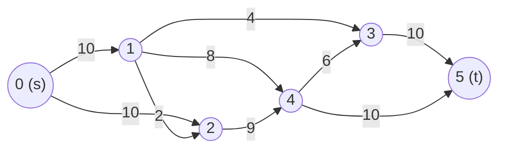
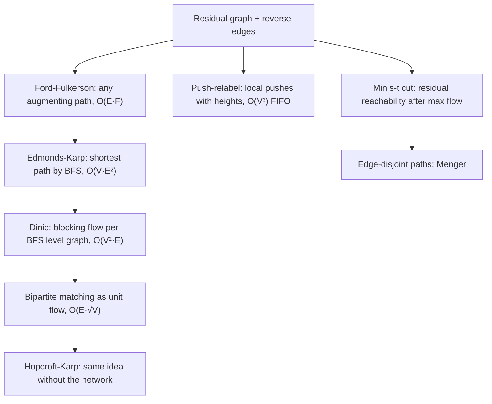

## Introduction

A water company has a reservoir, a city, and a network of pipes between them. Every pipe has a **capacity**: the most water it can carry per second. Water can split at a junction and merge again later, but it cannot be created or lost on the way. How many litres per second can reach the city?

That is the **maximum flow problem**. The same shape appears wherever something limited moves through a network: data through links with fixed bandwidth, trucks along roads with a daily limit, passengers through connecting flights with a fixed number of seats. And, less visibly, it appears in problems that have nothing flowing in them at all. Assigning workers to jobs, counting how many links must fail before two servers lose contact, deciding which teams are mathematically eliminated from a league, and separating the foreground of a photo from its background are all solved by building a flow network and running a max-flow algorithm.

The theory has one central result, the **max-flow min-cut theorem**: the most you can push from the source to the sink equals the smallest total capacity you would have to cut to separate them. Every algorithm in this lesson either computes a maximum flow, uses one to find a minimum cut, or uses the same augmenting-path idea for matching.

This lesson builds the ideas in order. It starts with the vocabulary and with a small example that shows why the obvious greedy method fails. That leads to the **residual graph**, which is the key idea behind every algorithm here. Then it covers four algorithms for maximum flow, the minimum cut, three problems that reduce to flow (edge-disjoint paths, bipartite matching and channel assignment), the Hopcroft-Karp matching algorithm, and Karger's randomised algorithm for the *global* minimum cut, which works without flows at all.

Max flow is an advanced topic. It is rare in general software interviews and common in competitive programming and in operations-research work. What carries over everywhere is the modelling skill: noticing that "assign", "separate" or "how many independent routes" is really a flow question.

## Before you start

- **BFS and DFS** — every algorithm here searches a graph for a path. See [[a8-bfs]] and [[a8-dfs]].
- **Adjacency lists** — storing edges per vertex, including objects that hold extra data such as capacity. See [[a8-graph-representation]] and [[a8-adjacency-list]].
- **Bipartite graphs** — the two-sided graphs on which matching is defined. See [[a8-bipartite]].
- **Union-Find** — used for Karger's algorithm. See [[a8-union-find]].
- **Recursion** — Dinic and Hopcroft-Karp use recursive DFS. See [[a1-recursion]].

## The intuition

Think of the pipes again. A first attempt at a plan is to find any route from the reservoir to the city and push as much water along it as its narrowest pipe allows. Then find another route through the pipes that still have room, and repeat until no route has room left.

That plan is close to correct, but it has a flaw: an early route can use pipes badly and block better routes that come later. A real engineer who notices this would *reroute*: take some water off one pipe and send it another way. The algorithms in this lesson automate that rerouting. They keep a record of how much flow could be *taken back* from each pipe, and they treat "take flow back from pipe `a → b`" as if it were a pipe `b → a`. Once undoing is one more kind of move, the simple plan becomes correct: keep finding routes until none is left.

The other half of the picture is the bottleneck. If you draw a line across the network that separates the reservoir from the city, every drop of water has to cross that line. So the flow can never be more than the total capacity of the pipes crossing the line from the reservoir's side. The theorem at the centre of this lesson says that the best flow always meets the tightest such line exactly.

## Flow networks: the vocabulary

A **flow network** is a directed graph with two special vertices: the **source** `s`, where flow starts, and the **sink** `t`, where it ends. Each edge `u → v` has a non-negative **capacity** `c(u, v)`. A **flow** assigns each edge an amount `f(u, v)` that satisfies two rules:

- **Capacity constraint:** `0 ≤ f(u, v) ≤ c(u, v)`. An edge never carries more than it can hold.
- **Flow conservation:** at every vertex other than `s` and `t`, the total flow coming in equals the total flow going out. Nothing is stored or leaked at a junction.

The **value** of a flow is the net amount leaving the source, which by conservation is the same as the net amount arriving at the sink. The maximum flow problem asks for a flow of the largest possible value.

Here is the network used through most of this lesson. Vertex `0` is the source and vertex `5` is the sink. Each label is a capacity.



The source can emit 20 units (10 + 10), and the sink can absorb 20 units (10 + 10). The answer will turn out to be 19, and the reason is visible once you know where to look: everything leaving vertex 2 must use the edge `2 → 4` with capacity 9, and everything entering vertex 1 must use `0 → 1` with capacity 10. Those two edges together can carry only 19.

An undirected edge with capacity `c` means flow may go either way, up to `c`. It is modelled as two directed edges, `u → v` and `v → u`, each with capacity `c`.

## Why pushing flow greedily fails

Take a tiny network: `s → a` (1), `s → b` (1), `a → b` (1), `a → t` (1), `b → t` (1). The maximum flow is clearly 2: send one unit along `s → a → t` and one along `s → b → t`.

Now run the greedy plan, and suppose the first route it finds is `s → a → b → t`. It pushes 1 unit, which fills `s → a`, `a → b` and `b → t`.

| Edge | Capacity | Flow after the first route |
|---|---|---|
| `s → a` | 1 | 1 (full) |
| `s → b` | 1 | 0 |
| `a → b` | 1 | 1 (full) |
| `a → t` | 1 | 0 |
| `b → t` | 1 | 1 (full) |

Is there another route with room on every edge? From `s` the only edge with room is `s → b`. From `b` the only way forward is `b → t`, which is full. The greedy plan stops at 1, half the true maximum.

The problem is the unit on `a → b`. It should have gone `a → t`. A correct algorithm needs a way to say "the unit that went from `a` to `b` should go elsewhere" — and it needs to discover this *without* trying every possible order of routes, which would take exponential time.

## The residual graph and augmenting paths

The fix is to describe the network not by its capacities but by what you can still *change*. For the current flow `f`, the **residual capacity** of an edge `u → v` has two parts:

- **Forward room:** `c(u, v) − f(u, v)`, how much more can be pushed along the edge.
- **Undo room:** `f(v, u)`, how much flow currently on the opposite edge `v → u` could be cancelled. Cancelling flow on `v → u` has the same effect on conservation as pushing flow from `u` to `v`.

The **residual graph** contains an edge `u → v` wherever the residual capacity is positive. An edge that exists only because of undo room is a **reverse edge** (or back edge). An **augmenting path** is any path from `s` to `t` in the residual graph. Its **bottleneck** is the smallest residual capacity on it, and pushing that much along the path — adding to forward edges, cancelling on reverse ones — produces a valid flow whose value is larger by the bottleneck.

Back to the tiny network. After the first route, the residual graph has `s → b` (forward room 1), `b → t`? No, that is full. But `a → b` carries 1 unit, so there is a reverse edge `b → a` with undo room 1. And `a → t` still has forward room 1. So the residual graph contains the path `s → b → a → t`. Pushing 1 unit along it means: one more unit on `s → b`, *cancel* the unit on `a → b`, one more unit on `a → t`. The resulting flow is `s → a → t` plus `s → b → t`, value 2. The algorithm rerouted the bad first choice by itself.

In code, every edge is stored together with a **partner** edge in the opposite direction. The partner starts with residual capacity 0. Pushing `x` units along an edge subtracts `x` from its residual capacity and adds `x` to its partner's. That one rule handles both forward pushes and cancellations, so the algorithms never need to distinguish them.

> [!IMPORTANT] The one idea to remember
> Every max-flow algorithm works on the residual graph, not on the original. Reverse edges are what let an algorithm undo an earlier bad decision, and without them the result can be far from optimal.

## Cuts and the max-flow min-cut theorem

An **s-t cut** splits the vertices into two groups: `S`, which contains `s`, and `T`, which contains `t`. Its **capacity** is the sum of capacities of edges that go *from* `S` *to* `T`. Edges going from `T` back to `S` are not counted.

**Every flow is at most every cut.** Any unit of flow starts in `S` and ends in `T`, so it must cross from `S` to `T` at least once. The net amount crossing is exactly the flow's value, and it cannot exceed the capacity of the edges going that way. So the value of any flow is at most the capacity of any cut. In the running example, the cut `S = {0, 2}` has capacity `c(0,1) + c(2,4) = 10 + 9 = 19`, so no flow can exceed 19.

The **max-flow min-cut theorem** (Ford and Fulkerson, 1956) says the bound is tight: **the value of a maximum flow equals the capacity of a minimum cut.** The proof also explains why augmenting-path algorithms are correct. Suppose the residual graph has no path from `s` to `t`. Let `S` be the set of vertices reachable from `s` in the residual graph, and `T` the rest. Then:

- Every original edge from `S` to `T` must be full. If it had room, its endpoint in `T` would be reachable.
- Every original edge from `T` to `S` must carry zero flow. If it carried flow, its reverse edge would make its tail in `T` reachable.

So the flow crossing from `S` to `T` equals the full capacity of the cut, and nothing comes back. The flow's value equals this cut's capacity. Since no flow can beat any cut, this flow is maximum and this cut is minimum. In short: **no augmenting path means the flow is maximum**, and the vertices you can still reach form a minimum cut.

There is one more consequence, the **integrality theorem**: if all capacities are integers, there is a maximum flow in which every edge carries an integer amount, and augmenting-path algorithms find one. Every bottleneck is a difference of integers, so the flow stays integral throughout. This is what makes the reductions to matching and disjoint paths work — a flow of "half a worker" never appears.

```quiz
Q: A network's edges out of the source have total capacity 50, and the edges into the sink have total capacity 30. What can you conclude about the maximum flow?
- [ ] It is exactly 30
- [x] It is at most 30
- [ ] It is at least 50
- [ ] It is exactly 50
> The set S = all vertices except t is a cut whose capacity is the sum of edges into t, 30. Every flow is bounded by every cut, so the maximum is at most 30. It may be smaller if a tighter cut exists in the middle of the network, as in the running example, where both ends allow 20 but the answer is 19.

Q: Why does the residual graph contain an edge v → u when the original edge u → v carries flow?
- [ ] So that the graph becomes undirected
- [ ] Because flow conservation requires a cycle
- [x] It represents cancelling some of the flow on u → v, which lets a later path reroute it
- [ ] It doubles the capacity of every edge
> Pushing along the reverse edge reduces the flow on u → v. That is how an algorithm corrects an early choice, such as the unit sent along a → b in the tiny example, without backtracking.
```

## Ford-Fulkerson / Edmonds-Karp {#a8-ford-fulkerson}

**Ford-Fulkerson** is the simplest maximum-flow method: start with zero flow, and while the residual graph has an augmenting path, push the path's bottleneck along it. When no augmenting path remains, the max-flow min-cut argument above shows the flow is maximum. It is called a *method* rather than an algorithm because it does not say *how* to find the path. **Edmonds-Karp** is the version that always chooses a *shortest* augmenting path, found with BFS, and that one choice gives it a running time that does not depend on the capacities.

### The procedure

1. Build the residual graph: every edge `u → v` with capacity `c` gets a partner `v → u` with residual capacity 0.
2. Search for a path from `s` to `t` using only edges with residual capacity greater than 0.
3. If there is none, stop: the total pushed so far is the maximum flow.
4. Otherwise find the bottleneck `δ`, the smallest residual capacity on the path.
5. For every edge on the path, subtract `δ` from its residual capacity and add `δ` to its partner's.
6. Add `δ` to the total and go back to step 2.

### Edmonds-Karp in Java

The program stores each edge as an object with a reference to its partner, which keeps the residual update to two lines. The BFS records, for each vertex, the edge used to reach it, so the path can be walked backwards from `t`.

```java title="EdmondsKarp.java"
import java.util.*;

public class EdmondsKarp {
    static class Edge {
        final int to;
        long cap;                 // residual capacity: how much more can still go this way
        Edge rev;                 // partner edge in the opposite direction
        Edge(int to, long cap) { this.to = to; this.cap = cap; }
    }

    final List<List<Edge>> adj = new ArrayList<>();

    EdmondsKarp(int n) {
        for (int i = 0; i < n; i++) adj.add(new ArrayList<>());
    }

    void addEdge(int u, int v, long c) {
        Edge fwd = new Edge(v, c), back = new Edge(u, 0);  // reverse starts empty
        fwd.rev = back;
        back.rev = fwd;
        adj.get(u).add(fwd);
        adj.get(v).add(back);
    }

    long maxFlow(int s, int t) {
        int n = adj.size();
        long flow = 0;
        while (true) {
            Edge[] via = new Edge[n];                    // edge used to first reach each vertex
            ArrayDeque<Integer> queue = new ArrayDeque<>();
            queue.add(s);
            boolean[] seen = new boolean[n];
            seen[s] = true;
            while (!queue.isEmpty() && !seen[t]) {      // BFS: shortest augmenting path
                int u = queue.poll();
                for (Edge e : adj.get(u)) {
                    if (e.cap > 0 && !seen[e.to]) {
                        seen[e.to] = true;
                        via[e.to] = e;
                        queue.add(e.to);
                    }
                }
            }
            if (!seen[t]) return flow;                   // no augmenting path: flow is maximum

            long push = Long.MAX_VALUE;                  // bottleneck = smallest residual
            for (int v = t; v != s; v = via[v].rev.to) push = Math.min(push, via[v].cap);

            List<Integer> path = new ArrayList<>();
            for (int v = t; v != s; v = via[v].rev.to) {
                via[v].cap -= push;                      // use up forward capacity
                via[v].rev.cap += push;                  // record that it can be undone
                path.add(0, v);
            }
            path.add(0, s);
            System.out.println("augment " + path + " by " + push);
            flow += push;
        }
    }

    public static void main(String[] args) {
        // s = 0, t = 5; each row is {from, to, capacity}
        int[][] edges = {{0, 1, 10}, {0, 2, 10}, {1, 2, 2}, {1, 3, 4}, {1, 4, 8},
                         {2, 4, 9}, {3, 5, 10}, {4, 3, 6}, {4, 5, 10}};
        EdmondsKarp g = new EdmondsKarp(6);
        for (int[] e : edges) g.addEdge(e[0], e[1], e[2]);
        System.out.println("max flow = " + g.maxFlow(0, 5));
    }
}
```

```output
augment [0, 1, 3, 5] by 4
augment [0, 1, 4, 5] by 6
augment [0, 2, 4, 5] by 4
augment [0, 2, 4, 3, 5] by 5
max flow = 19
```

A few details matter. The partner edge is created with capacity 0, so it does not exist in the residual graph until flow is pushed forward. `via[v].rev.to` is the vertex the edge came from, because the partner of `u → v` points back to `u`; that is how the loop walks from `t` back to `s`. Capacities are `long` because the total flow is a sum of many capacities and can overflow `int` even when each capacity fits. The BFS stops as soon as `t` is reached, which does not change the result but saves work.

### Dry run

| Round | Augmenting path | Residual capacities on the path | Bottleneck | Total |
|---|---|---|---|---|
| 1 | 0 → 1 → 3 → 5 | 10, 4, 10 | 4 | 4 |
| 2 | 0 → 1 → 4 → 5 | 6, 8, 10 | 6 | 10 |
| 3 | 0 → 2 → 4 → 5 | 10, 9, 4 | 4 | 14 |
| 4 | 0 → 2 → 4 → 3 → 5 | 6, 5, 6, 6 | 5 | 19 |
| 5 | none | — | — | 19 |

Each round BFS finds a path with the fewest edges. Round 1 uses three edges; after round 3 every three-edge path is blocked (`0 → 1` and `4 → 5` are full, `1 → 3` is full), so round 4 needs four edges. After round 4, `0 → 1` and `2 → 4` are both full. From `0` the only residual edge goes to `2` (1 unit of room left), and from `2` nothing has room: `2 → 4` is full and the edge `1 → 2` carries no flow to undo. The search fails, the algorithm stops, and the set it could reach, `{0, 2}`, is exactly the minimum cut of capacity 19 found earlier.

### Why the choice of path matters: complexity

With integer capacities, every augmentation raises the flow by at least 1, so plain Ford-Fulkerson performs at most `F` augmentations, where `F` is the maximum flow value. Each search is O(V + E). The bound is **O(E · F)** (taking `E ≥ V − 1`), which is fine when `F` is small and terrible when it is large.

The classic bad case has four vertices: `s → a` and `s → b` with capacity 1,000,000, `a → t` and `b → t` with capacity 1,000,000, and a middle edge `a → b` with capacity 1. An unlucky search can alternate between `s → a → b → t` and `s → b → a → t`, where the second path uses the reverse of the middle edge. Each of those paths has bottleneck 1, so reaching the answer of 2,000,000 takes 2,000,000 augmentations, although two augmentations (`s → a → t` and `s → b → t`) would do. The running time depends on the size of the numbers rather than the size of the graph. With irrational capacities, Ford-Fulkerson may not terminate at all, and the flow values can converge to something less than the maximum.

Edmonds-Karp (1972) removes the dependence on `F`. Two facts drive the analysis:

1. The BFS distance from `s` to any vertex in the residual graph never decreases from one augmentation to the next.
2. Each augmentation **saturates** at least one edge on its path — the bottleneck edge, whose residual capacity drops to 0. For that edge `u → v` to be used again, flow must first be pushed back along `v → u`, which can only happen on a later shortest path, and by then the distance to `u` has grown by at least 2. Distances are at most `V`, so each edge can be the bottleneck at most about `V / 2` times.

With `2E` residual edges, each saturated O(V) times, there are O(V · E) augmentations. Each BFS costs O(E). So Edmonds-Karp runs in **O(V · E²)** time, whatever the capacities. Space is **O(V + E)** for the edge objects and the BFS arrays.

The bound assumes adjacency lists. With an adjacency matrix, as some textbook versions use, each BFS scans a full row per vertex and costs O(V²), which makes the total O(V³ · E).

### The DFS version

Replacing BFS with DFS gives classic Ford-Fulkerson. It is shorter to write, and its O(E · F) bound is acceptable when the answer is small — for example, in matching, where `F` is at most the number of vertices.

```java title="FordFulkerson.java"
import java.util.*;

public class FordFulkerson {
    static class Edge {
        final int to;
        long cap;
        Edge rev;
        Edge(int to, long cap) { this.to = to; this.cap = cap; }
    }

    final List<List<Edge>> adj = new ArrayList<>();
    int augmentations = 0;

    FordFulkerson(int n) { for (int i = 0; i < n; i++) adj.add(new ArrayList<>()); }

    void addEdge(int u, int v, long c) {
        Edge fwd = new Edge(v, c), back = new Edge(u, 0);
        fwd.rev = back;
        back.rev = fwd;
        adj.get(u).add(fwd);
        adj.get(v).add(back);
    }

    // Depth-first search for any augmenting path; pushes its bottleneck on the way back.
    long dfs(int u, int t, long limit, boolean[] seen) {
        if (u == t) return limit;
        seen[u] = true;
        for (Edge e : adj.get(u)) {
            if (e.cap > 0 && !seen[e.to]) {
                long got = dfs(e.to, t, Math.min(limit, e.cap), seen);
                if (got > 0) {
                    e.cap -= got;
                    e.rev.cap += got;
                    return got;
                }
            }
        }
        return 0;
    }

    long maxFlow(int s, int t) {
        long flow = 0, got;
        while ((got = dfs(s, t, Long.MAX_VALUE, new boolean[adj.size()])) > 0) {
            flow += got;
            augmentations++;
        }
        return flow;
    }

    public static void main(String[] args) {
        int[][] edges = {{0, 1, 10}, {0, 2, 10}, {1, 2, 2}, {1, 3, 4}, {1, 4, 8},
                         {2, 4, 9}, {3, 5, 10}, {4, 3, 6}, {4, 5, 10}};
        FordFulkerson g = new FordFulkerson(6);
        for (int[] e : edges) g.addEdge(e[0], e[1], e[2]);
        System.out.println("max flow = " + g.maxFlow(0, 5) + " after " + g.augmentations
                + " augmenting paths");
    }
}
```

```output
max flow = 19 after 5 augmenting paths
```

The recursion carries `limit`, the bottleneck so far, down the path. When it reaches `t`, the bottleneck is returned and each frame updates its own edge on the way back up. The `seen` array is fresh for every search, because what is reachable changes after each augmentation. On this network DFS needs one more augmentation than BFS. The difference is small here, but on adversarial inputs it is the difference between O(V · E²) and a running time proportional to the answer.

### Edge cases

- **`s == t`** makes the problem meaningless. Reject it, or define the answer as 0 or infinity explicitly.
- **Parallel edges** between the same pair of vertices need no special handling: each gets its own edge object and partner.
- **An edge into `s` or out of `t`** never helps, but it does no harm either: a shortest augmenting path never revisits `s`.
- **Unreachable sink** gives flow 0 after a single failed search.

## Dinic's Algorithm {#a8-dinic}

**Dinic's algorithm** (Yefim Dinitz, 1970; "Dinic" is the common spelling) is the standard fast maximum-flow algorithm in practice and in competitive programming. Edmonds-Karp runs a full BFS for every single augmenting path. Dinic runs one BFS and then pushes flow along *many* shortest paths before running BFS again.

### Level graphs and blocking flows

Run a BFS from `s` in the residual graph and record `level[v]`, the number of residual edges on a shortest path to `v`. The **level graph** keeps only the residual edges that go from one level to the next: `u → v` with `level[v] == level[u] + 1`. Every `s`-to-`t` path in the level graph is a shortest augmenting path.

A **blocking flow** in the level graph is a flow that leaves every `s`-to-`t` path in the level graph with at least one full edge. It is not necessarily a maximum flow of the level graph. It only ensures that no shortest path is left with room. Dinic finds a blocking flow with repeated DFS, then rebuilds the levels. Each such round is a **phase**.

Why does this help? After a blocking flow, every remaining augmenting path must be *longer* than before: the shortest ones are all blocked, and the reverse edges created during the phase go from level `i + 1` to level `i`, which cannot make paths shorter. The distance from `s` to `t` therefore grows by at least 1 every phase. It is at most `V − 1`, so there are at most `V − 1` phases.

### The current-arc trick

Within a phase, a DFS might explore an edge, find that it leads to a dead end, and then explore it again in the next DFS. To avoid this, each vertex keeps a pointer `next[u]` to the first of its edges that might still be useful. When an edge is found to be useless for this phase — full, not going one level deeper, or leading to a dead end — the pointer moves past it permanently. That pointer is the **current arc**, and it is what bounds the cost of a phase.

### Implementation

This class is reused by later sections of this lesson, so it also stores each edge's original capacity and has a method that returns the source side of the minimum cut.

```java title="Dinic.java"
import java.util.*;

public class Dinic {
    static class Edge {
        final int from, to;
        final long original;      // capacity given by the caller (0 for reverse edges)
        long cap;                 // residual capacity
        Edge rev;                 // the partner edge in the opposite direction
        Edge(int from, int to, long cap) {
            this.from = from; this.to = to; this.original = cap; this.cap = cap;
        }
        long flow() { return original - cap; }
    }

    final List<List<Edge>> adj = new ArrayList<>();
    private final int[] level, next;

    Dinic(int n) {
        for (int i = 0; i < n; i++) adj.add(new ArrayList<>());
        level = new int[n];
        next = new int[n];
    }

    Edge addEdge(int u, int v, long c) {
        Edge fwd = new Edge(u, v, c), back = new Edge(v, u, 0);
        fwd.rev = back;
        back.rev = fwd;
        adj.get(u).add(fwd);
        adj.get(v).add(back);
        return fwd;
    }

    long maxFlow(int s, int t) {
        long flow = 0;
        while (buildLevels(s, t)) {               // one phase per level graph
            Arrays.fill(next, 0);
            long pushed;
            while ((pushed = push(s, t, Long.MAX_VALUE)) > 0) flow += pushed;
        }
        return flow;
    }

    // BFS over residual edges; level[v] = fewest residual edges from s to v.
    private boolean buildLevels(int s, int t) {
        Arrays.fill(level, -1);
        ArrayDeque<Integer> queue = new ArrayDeque<>();
        level[s] = 0;
        queue.add(s);
        while (!queue.isEmpty()) {
            int u = queue.poll();
            for (Edge e : adj.get(u)) {
                if (e.cap > 0 && level[e.to] < 0) {
                    level[e.to] = level[u] + 1;
                    queue.add(e.to);
                }
            }
        }
        return level[t] >= 0;
    }

    // Send up to `limit` units from u to t using only edges that go one level deeper.
    private long push(int u, int t, long limit) {
        if (u == t) return limit;
        for (; next[u] < adj.get(u).size(); next[u]++) {   // resume where we stopped
            Edge e = adj.get(u).get(next[u]);
            if (e.cap > 0 && level[e.to] == level[u] + 1) {
                long got = push(e.to, t, Math.min(limit, e.cap));
                if (got > 0) {
                    e.cap -= got;
                    e.rev.cap += got;
                    return got;
                }
            }
        }
        return 0;                                          // dead end for this phase
    }

    // After maxFlow: vertices still reachable from s in the residual graph.
    boolean[] sourceSide(int s) {
        boolean[] seen = new boolean[adj.size()];
        ArrayDeque<Integer> stack = new ArrayDeque<>();
        stack.push(s);
        seen[s] = true;
        while (!stack.isEmpty()) {
            int u = stack.pop();
            for (Edge e : adj.get(u)) {
                if (e.cap > 0 && !seen[e.to]) {
                    seen[e.to] = true;
                    stack.push(e.to);
                }
            }
        }
        return seen;
    }

    public static void main(String[] args) {
        int[][] edges = {{0, 1, 10}, {0, 2, 10}, {1, 2, 2}, {1, 3, 4}, {1, 4, 8},
                         {2, 4, 9}, {3, 5, 10}, {4, 3, 6}, {4, 5, 10}};
        Dinic g = new Dinic(6);
        for (int[] e : edges) g.addEdge(e[0], e[1], e[2]);
        System.out.println("max flow = " + g.maxFlow(0, 5));
        for (List<Edge> list : g.adj)
            for (Edge e : list)
                if (e.original > 0)
                    System.out.println(e.from + " -> " + e.to + "  " + e.flow() + "/" + e.original);
    }
}
```

```output
max flow = 19
0 -> 1  10/10
0 -> 2  9/10
1 -> 2  0/2
1 -> 3  4/4
1 -> 4  6/8
2 -> 4  9/9
3 -> 5  9/10
4 -> 3  5/6
4 -> 5  10/10
```

The output lists the final flow on every original edge as `flow/capacity`. Check conservation at vertex 4: 6 units arrive from 1 and 9 from 2, which is 15, and 5 leave to 3 and 10 to `t`, also 15.

Notice how `push` returns as soon as it has sent something, without incrementing `next[u]`. The edge it used may still have room, so the next DFS should try it again. When the recursive call returns 0, the loop increments `next[u]`, and that edge is never looked at again this phase. That asymmetry is the whole current-arc trick.

### Dry run

On the running example, Dinic needs two phases.

| Phase | `level[0..5]` | Paths pushed | Amounts |
|---|---|---|---|
| 1 | `[0, 1, 1, 2, 2, 3]` | 0→1→3→5, 0→1→4→5, 0→2→4→5 | 4, 6, 4 |
| 2 | `[0, 3, 1, 3, 2, 4]` | 0→2→4→3→5 | 5 |
| 3 | `t` unreachable | — | stop at 19 |

In phase 1, all three-edge paths are pushed without rebuilding the BFS, where Edmonds-Karp needed three separate searches. In phase 2, the distance to `t` has grown to 4. Vertex 1 now has level 3: it can no longer be reached directly, because `0 → 1` is full, but it is reachable from 4 through the reverse edge of `1 → 4`, which carries 6 units. That reverse edge happens not to be on the path used, but it shows how reverse edges reshape the level graph from phase to phase.

### Complexity derivation

- **Phases:** at most `V − 1`, because the `s`-`t` distance strictly grows and cannot exceed `V − 1`.
- **One phase:** the BFS is O(E). Each DFS either reaches `t` or retreats. A DFS that reaches `t` follows at most `V` edges and saturates at least one, which is then skipped for the rest of the phase, so there are at most `E` successful searches costing O(V) each. Every retreat moves some current-arc pointer forward, and pointers move at most `E` times in total. One phase is therefore O(V · E).
- **Total: O(V² · E).** Space is O(V + E).

The general bound hides how fast Dinic is in practice, and on special networks it is provably better. With all capacities equal to 1, it runs in O(E · min(√E, V^(2/3))). On **unit networks**, where every vertex other than `s` and `t` has either one incoming edge of capacity 1 or one outgoing edge of capacity 1 — exactly the networks built for bipartite matching — it runs in **O(E · √V)**, the same bound as Hopcroft-Karp.

> [!NOTE] Recursion depth
> The DFS recursion depth is at most the current `s`-`t` distance, which is below `V`. For graphs with hundreds of thousands of vertices in a long chain, the default Java thread stack may overflow. Run the solver in a `Thread` created with a larger stack size, or write the DFS iteratively.

## Push-Relabel Algorithm {#a8-push-relabel}

The **push-relabel** algorithm (Goldberg and Tarjan, 1980s) finds a maximum flow without ever looking for an augmenting path. Instead it floods the network from the source and lets each vertex pass along whatever it cannot keep. It is the basis of many fast production solvers.

### Preflows, excess and heights

Push-relabel relaxes flow conservation. A **preflow** lets a vertex receive *more* than it sends. The difference is the vertex's **excess**. A vertex other than `s` and `t` with positive excess is **active**, and the algorithm's job is to make every vertex inactive. When that happens, the preflow is a real flow.

To decide where excess should go, each vertex has a **height** (or label). Flow only moves *downhill*, one step at a time: an edge `u → v` is **admissible** when it has residual capacity and `height[u] == height[v] + 1`. The algorithm has two operations:

- **Push:** if `u` is active and has an admissible edge `u → v`, send `min(excess[u], residual(u, v))` along it.
- **Relabel:** if `u` is active and has no admissible edge, raise `height[u]` to one more than the lowest neighbour reachable by a residual edge. Now at least one edge is admissible.

The algorithm starts by setting `height[s] = V`, every other height to 0, and **saturating every edge out of `s`**: those neighbours begin with excess. Then it pushes and relabels until no vertex is active. The flow value is the excess at `t`.

### Why it is correct

Two invariants hold throughout:

1. **Heights never drop more than 1 along a residual edge:** for every residual edge `u → v`, `height[u] ≤ height[v] + 1`. Pushes only use edges that go exactly one step down, and relabel only raises a vertex as far as this allows.
2. **There is never a residual path from `s` to `t`.** A path with `k` edges can drop at most `k` in height by invariant 1. A simple path has at most `V − 1` edges, but it would need to drop from `height[s] = V` to `height[t] = 0`, a drop of `V`. That is impossible.

Invariant 2 is why the source starts at height `V`. When the algorithm stops, the preflow is a flow (no excess anywhere) and the residual graph has no augmenting path, so by the max-flow min-cut theorem the flow is maximum. Excess that cannot reach `t` is not lost: vertices holding it are relabelled until they rise above `V`, at which point they can push it back to `s`. A vertex with excess always has a residual path back to `s` (the flow that brought the excess can be undone), so a relabel always finds a neighbour.

### Implementation and trace

This version uses a capacity matrix, which makes the code short, and processes active vertices in first-in, first-out order (the **FIFO** variant). Each active vertex is **discharged**: it pushes and relabels until its excess is zero.

```java title="PushRelabel.java"
import java.util.*;

public class PushRelabel {
    /** FIFO push-relabel on an adjacency matrix of capacities. */
    static long maxFlow(long[][] cap, int s, int t) {
        int n = cap.length;
        long[][] res = new long[n][n];                 // residual capacities
        for (int u = 0; u < n; u++) res[u] = cap[u].clone();
        int[] height = new int[n];
        long[] excess = new long[n];
        ArrayDeque<Integer> active = new ArrayDeque<>();

        height[s] = n;                                 // s starts high above everyone
        for (int v = 0; v < n; v++) {                  // saturate every edge out of s
            long c = res[s][v];
            if (c == 0) continue;
            res[s][v] -= c;
            res[v][s] += c;
            excess[v] += c;
            excess[s] -= c;
            if (v != t) active.add(v);
        }

        while (!active.isEmpty()) {
            int u = active.poll();
            // Discharge u: push to lower neighbours, relabel when stuck, until no excess.
            while (excess[u] > 0) {
                boolean pushed = false;
                for (int v = 0; v < n && excess[u] > 0; v++) {
                    if (res[u][v] > 0 && height[u] == height[v] + 1) {     // admissible
                        long d = Math.min(excess[u], res[u][v]);
                        res[u][v] -= d;
                        res[v][u] += d;
                        excess[u] -= d;
                        excess[v] += d;
                        System.out.println("push " + d + " " + u + "->" + v);
                        if (v != s && v != t && excess[v] == d) active.add(v);  // newly active
                        pushed = true;
                    }
                }
                if (!pushed) {                         // relabel: 1 + lowest residual neighbour
                    int min = Integer.MAX_VALUE;
                    for (int v = 0; v < n; v++)
                        if (res[u][v] > 0) min = Math.min(min, height[v]);
                    height[u] = min + 1;
                    System.out.println("relabel " + u + " to " + height[u]);
                }
            }
        }
        return excess[t];
    }

    public static void main(String[] args) {
        // s = 0, a = 1, b = 2, t = 3
        long[][] cap = new long[4][4];
        cap[0][1] = 4; cap[0][2] = 2; cap[1][2] = 3; cap[1][3] = 1; cap[2][3] = 4;
        System.out.println("max flow = " + maxFlow(cap, 0, 3));
    }
}
```

```output
relabel 1 to 1
push 3 1->2
push 1 1->3
relabel 2 to 1
push 4 2->3
relabel 2 to 2
push 1 2->1
relabel 1 to 3
push 1 1->2
relabel 2 to 4
push 1 2->1
relabel 1 to 5
push 1 1->0
max flow = 5
```

The network has `s → a` (4), `s → b` (2), `a → b` (3), `a → t` (1) and `b → t` (4). The source sends out 6 units at the start, but only 5 can reach `t`, so one unit must come back. Read the trace with that in mind:

1. `a` holds 4 units and every neighbour is at height 0, so it relabels to 1, then pushes 3 to `b` and 1 to `t`.
2. `b` now holds 5 units. It relabels to 1 and pushes 4 to `t`, which fills `b → t`. One unit is stuck.
3. The stuck unit bounces between `a` and `b`. Each bounce forces a relabel, so the two vertices climb: `b` to 2, `a` to 3, `b` to 4, `a` to 5.
4. At height 5, `a` is one above the source (height 4), so the edge back to `s` — the undo room of the original 4 units — becomes admissible, and the unit returns to `s`.

The bouncing in step 3 is the main weakness of the basic algorithm, and real implementations add two heuristics to cut it short. **Global relabelling** periodically recomputes every height as the exact BFS distance to `t` (or to `s`) in the residual graph. The **gap heuristic** notices when no vertex has some height `h`; every vertex above `h` can then no longer reach `t`, so it can be lifted straight above `V`.

### Complexity

Heights never exceed `2V − 1`, which bounds the relabels at O(V²) in total. Saturating pushes are O(V · E). The non-saturating pushes dominate, and their count depends on the order in which active vertices are processed:

| Variant | Time |
|---|---|
| Generic (any order) | O(V² · E) |
| FIFO queue of active vertices | O(V³) |
| Highest-label first | O(V² · √E) |

The matrix version above spends O(V) scanning each row, which fits the O(V³) FIFO bound; adjacency lists with a current-arc pointer per vertex are used for sparse graphs. Push-relabel works locally, one vertex at a time, so it suits dense graphs and parallel implementations. Augmenting-path methods like Dinic are usually simpler to write and are the common choice in contests.

## Minimum s–t Cut in a Flow Network {#a8-min-st-cut}

A **minimum s-t cut** is the cheapest set of edges whose removal leaves no path from `s` to `t`, where "cheapest" means the smallest total capacity. It answers questions such as "which links should an attacker cut to isolate this server most cheaply?" or "which few dependencies, if they failed, would disconnect this service from its database?". By the max-flow min-cut theorem, its capacity equals the maximum flow, and the proof of the theorem tells you how to find the edges.

### Extracting the cut

1. Run any max-flow algorithm to completion.
2. From `s`, search the **residual** graph, following only edges with residual capacity greater than 0. Call the reachable set `S`.
3. The cut consists of the **original** edges `u → v` with `u` in `S` and `v` not in `S`.

`t` cannot be in `S`, because that would be an augmenting path. Every original edge leaving `S` is full, or its far end would be reachable. So the capacities of the cut edges add up to exactly the max flow.

```java title="MinCut.java"
import java.util.*;

public class MinCut {
    public static void main(String[] args) {
        int[][] edges = {{0, 1, 10}, {0, 2, 10}, {1, 2, 2}, {1, 3, 4}, {1, 4, 8},
                         {2, 4, 9}, {3, 5, 10}, {4, 3, 6}, {4, 5, 10}};
        Dinic g = new Dinic(6);
        for (int[] e : edges) g.addEdge(e[0], e[1], e[2]);
        long flow = g.maxFlow(0, 5);
        boolean[] inS = g.sourceSide(0);           // residual reachability from s

        List<Integer> sSide = new ArrayList<>(), tSide = new ArrayList<>();
        for (int v = 0; v < inS.length; v++) (inS[v] ? sSide : tSide).add(v);
        System.out.println("max flow = " + flow);
        System.out.println("S = " + sSide + ", T = " + tSide);

        long cutCapacity = 0;
        for (int[] e : edges) {                     // ORIGINAL edges that leave S
            if (inS[e[0]] && !inS[e[1]]) {
                System.out.println("cut edge " + e[0] + " -> " + e[1] + " (capacity " + e[2] + ")");
                cutCapacity += e[2];
            }
        }
        System.out.println("cut capacity = " + cutCapacity);
    }
}
```

```output
max flow = 19
S = [0, 2], T = [1, 3, 4, 5]
cut edge 0 -> 1 (capacity 10)
cut edge 2 -> 4 (capacity 9)
cut capacity = 19
```

Compile it together with `Dinic.java` from the previous section (`javac Dinic.java MinCut.java`). The output confirms the bottleneck spotted at the start: the edges `0 → 1` and `2 → 4`. The edge `1 → 2` goes from `T` into `S`, so it is not part of the cut and its capacity is not counted.

### Details that trip people up

**Not every full edge is a cut edge.** In the final flow above, `1 → 3`, `2 → 4`, `4 → 5` and `0 → 1` are all full, with a total of 33. Only the full edges that leave the reachable set form the cut. Collecting all saturated edges is a common bug.

**The minimum cut need not be unique.** The residual search from `s` gives the minimum cut whose `S` side is as *small* as possible. Searching backwards from `t` (along edges with residual capacity *into* `t`) gives the one whose `T` side is as small as possible. If they differ, there are several minimum cuts.

**Vertex cuts.** To find the fewest *vertices* whose removal separates `s` from `t`, split each vertex `v` into `v_in → v_out` with capacity 1, give every original edge infinite capacity, and cut. The same splitting trick appears in the next section.

**Undirected graphs.** Model each undirected edge as two directed edges with the same capacity. The cut is then the set of undirected edges with one end in `S` and the other in `T`.

### Where min cuts are used

Min cut problems often have no flow in their statement. In **project selection**, each project has a profit, each required tool has a cost, and you must choose a set of projects together with every tool they need. Connect `s` to each project with its profit, each tool to `t` with its cost, and each project to its tools with infinite capacity. The best net profit is the total profit minus the min cut. In **image segmentation**, pixels are vertices, `s` stands for "foreground" and `t` for "background", edge capacities encode how strongly each pixel prefers each label and how much neighbouring pixels want the same label, and the min cut is the best labelling. Both are classic examples of the modelling skill this topic trains.

## Maximum Edge-Disjoint Paths {#a8-max-edge-disjoint-paths}

Two paths are **edge-disjoint** if they share no edge (they may share vertices). The question "how many edge-disjoint paths are there from `s` to `t`?" measures how robust a connection is: with `k` such paths, any `k − 1` link failures still leave a route. It is answered by a max flow in which **every edge has capacity 1**.

### Why unit-capacity flow counts paths

With capacity 1, each edge carries flow 0 or 1 in an integral max flow. Starting from `s` and following edges that carry flow, you always reach `t` (conservation guarantees there is a way out of every vertex you enter), and you can peel off one path per unit of flow, each using its own edges. Conversely, `k` edge-disjoint paths give a flow of value `k`. So the maximum number of edge-disjoint paths equals the max flow.

Combined with max-flow min-cut, this gives **Menger's theorem** (1927): the maximum number of edge-disjoint `s`-`t` paths equals the minimum number of edges whose removal disconnects `t` from `s`. Robustness can be measured in two ways — by counting independent routes or by counting the failures that break the connection — and they always give the same number.

### Implementation with path extraction

```java title="EdgeDisjointPaths.java"
import java.util.*;

public class EdgeDisjointPaths {
    public static void main(String[] args) {
        int n = 6, s = 0, t = 5;
        int[][] links = {{0, 1}, {0, 2}, {0, 3}, {1, 2}, {1, 4}, {2, 4}, {3, 2}, {4, 5}, {2, 5}};
        Dinic g = new Dinic(n);
        for (int[] e : links) g.addEdge(e[0], e[1], 1);       // every edge usable once
        System.out.println("edge-disjoint paths = " + g.maxFlow(s, t));

        // Peel paths off the flow: follow edges that carry one unit, using each once.
        Set<Dinic.Edge> used = new HashSet<>();
        while (true) {
            List<Integer> path = new ArrayList<>(List.of(s));
            int u = s;
            while (u != t) {
                Dinic.Edge step = null;
                for (Dinic.Edge e : g.adj.get(u))
                    if (e.original > 0 && e.flow() == 1 && !used.contains(e)) { step = e; break; }
                if (step == null) break;                       // no unused flow leaves u
                used.add(step);
                u = step.to;
                int seenAt = path.indexOf(u);
                if (seenAt >= 0) path.subList(seenAt + 1, path.size()).clear();  // cut a loop
                else path.add(u);
            }
            if (u != t) break;
            System.out.println("path " + path);
        }
    }
}
```

```output
edge-disjoint paths = 2
path [0, 1, 4, 5]
path [0, 2, 5]
```

Compile it with `Dinic.java`. Three edges leave `s`, but only two (`4 → 5` and `2 → 5`) enter `t`, so the answer is 2, and the min cut is exactly those two edges.

The extraction loop walks from `s` along edges that carry one unit of flow and that it has not used yet. A max flow can contain a **cycle** of flow that is not part of any path. If the walk enters one and comes back to a vertex already on the path, the `indexOf` check cuts the loop out, so every printed path is simple. The paths are edge-disjoint because each flow edge is used once.

### Variations

**Undirected graphs.** Add both `u → v` and `v → u` with capacity 1. A max flow might send a unit each way across the same undirected edge. Those two units cancel: replacing them with nothing keeps conservation and the flow value, so the count is still right. Cancel such pairs before extracting paths.

**Vertex-disjoint paths.** Paths that share no vertex other than `s` and `t` need **vertex splitting**: replace each vertex `v` by `v_in` and `v_out` joined by an edge of capacity 1, send every edge entering `v` into `v_in` and every edge leaving `v` out of `v_out`. Now a vertex can carry at most one path. Do not split `s` and `t`, or the answer will be capped at 1.

**Complexity.** The answer is at most the out-degree of `s`, so even plain Ford-Fulkerson does at most `V − 1` augmentations at O(E) each, which is O(V · E). Dinic on unit capacities is O(E · min(√E, V^(2/3))).

```quiz
Q: You need the most paths from s to t that share no intermediate vertex. Which network is correct?
- [ ] Every edge has capacity 1
- [x] Split each vertex v other than s and t into v_in → v_out with capacity 1, and give the original edges capacity 1 (or more)
- [ ] Every vertex has capacity 1, including s and t
- [ ] Every edge has infinite capacity
> Edge capacities only stop paths from sharing edges; two paths can still pass through the same vertex on different edges. The internal edge v_in → v_out with capacity 1 is what limits a vertex to one path. Splitting s and t too would cap the whole answer at 1.
```

## Bipartite Matching via Flow {#a8-bipartite-matching-flow}

A **matching** in a graph is a set of edges no two of which share a vertex. In a **bipartite** graph — left vertices on one side, right vertices on the other, edges only between sides — a matching pairs some left vertices with distinct right vertices. **Maximum bipartite matching** asks for the largest such set: assign as many applicants as possible to jobs they qualify for, with at most one applicant per job and one job per applicant.

### Why greedy matching fails

Take four people and four jobs:

| Person | Can do |
|---|---|
| Ana | Backend, Frontend |
| Ben | Backend |
| Cai | Frontend, Data |
| Dev | Data, DevOps |

A greedy pass in order gives Ana her first choice, Backend. Then Ben, who can only do Backend, gets nothing. A perfect assignment exists — Ana to Frontend, Ben to Backend, Cai to Data, Dev to DevOps — but greedy cannot find it, because it never moves Ana once she is placed. This is the same failure as greedy flow, and it has the same fix.

### The reduction

Build a flow network:

- an edge `s → person` with capacity 1 for every person (each person takes at most one job),
- an edge `person → job` with capacity 1 for every pair that is allowed,
- an edge `job → t` with capacity 1 for every job (each job gets at most one person).

By the integrality theorem, there is an integral maximum flow. In it, each person sends at most one unit and each job receives at most one unit, so the `person → job` edges carrying flow form a matching. Any matching gives a flow of the same value in the same way. **Maximum flow equals maximum matching**, and the matched pairs are the saturated middle edges.

```java title="MatchingFlow.java"
import java.util.*;

public class MatchingFlow {
    public static void main(String[] args) {
        String[] people = {"Ana", "Ben", "Cai", "Dev"};
        String[] jobs = {"Backend", "Frontend", "Data", "DevOps"};
        int[][] canDo = {{0, 1}, {0}, {1, 2}, {2, 3}};      // canDo[person] = job indices

        int L = people.length, R = jobs.length;
        int s = 0, t = L + R + 1;                            // people 1..L, jobs L+1..L+R
        Dinic g = new Dinic(L + R + 2);
        for (int i = 0; i < L; i++) g.addEdge(s, 1 + i, 1);  // each person takes <= 1 job
        for (int j = 0; j < R; j++) g.addEdge(1 + L + j, t, 1); // each job gets <= 1 person
        List<Dinic.Edge> middle = new ArrayList<>();         // person -> job edges
        for (int i = 0; i < L; i++)
            for (int j : canDo[i]) middle.add(g.addEdge(1 + i, 1 + L + j, 1));

        System.out.println("matching size = " + g.maxFlow(s, t));
        for (Dinic.Edge e : middle)
            if (e.flow() == 1)                               // saturated edge = chosen pair
                System.out.println(people[e.from - 1] + " -> " + jobs[e.to - 1 - L]);
    }
}
```

```output
matching size = 4
Ana -> Frontend
Ben -> Backend
Cai -> Data
Dev -> DevOps
```

Compile it with `Dinic.java`. Watching Dinic's phases shows the reverse edges doing the rerouting. Phase 1 has every person at level 1 and every job at level 2. It matches Ana to Backend, Cai to Frontend and Dev to Data, then Ben is blocked because Backend is taken. Phase 2 finds one long augmenting path:

```text
s → Ben → Backend ⇢ Ana → Frontend ⇢ Cai → Data ⇢ Dev → DevOps → t
```

Each solid arrow is a forward edge that becomes matched, and each dashed arrow `⇢` is a reverse edge that *unmatches* a pair. Ben takes Backend, Ana moves to Frontend, Cai moves to Data and Dev moves to DevOps — a chain of four reassignments discovered by one search.

### Augmenting paths in matching language

That path alternates between unmatched and matched edges, and it starts and ends at free vertices. In matching terms, an **alternating path** uses non-matching and matching edges in turn, and an **augmenting path** is an alternating path whose two ends are both unmatched. Flipping every edge on an augmenting path — matched becomes unmatched and the reverse — grows the matching by exactly one. **Berge's theorem** says a matching is maximum exactly when no augmenting path exists. This is max-flow min-cut in matching form, and it is the basis of all matching algorithms.

The simplest direct algorithm, often called **Kuhn's algorithm**, runs a DFS from each free left vertex looking for an augmenting path. That is O(V · E) and short to write. Hopcroft-Karp, in the next section, finds many augmenting paths per round and improves this to O(E · √V).

### Two theorems you should know

**Hall's marriage theorem.** Every left vertex can be matched if and only if every set `X` of left vertices has at least `|X|` neighbours in total. If Dev could only do Data, then Ana, Ben, Cai and Dev together could do only three jobs, so one of them must go unmatched. When a perfect matching fails, the min cut points to such a set.

**Kőnig's theorem.** In a bipartite graph, the size of a maximum matching equals the size of a **minimum vertex cover** — the fewest vertices that touch every edge. The cover can be read off the min cut. It follows that the largest set of vertices with no edges between them (a maximum independent set) has size `V −` maximum matching. Neither equality holds in general graphs, which is why matching in non-bipartite graphs needs Edmonds' more complex blossom algorithm.

### Complexity

The flow value is at most `min(L, R)`, so Ford-Fulkerson with DFS is O(V · E). Dinic on this unit network is O(E · √V).

## Hopcroft–Karp Maximum Matching {#a8-hopcroft-karp}

**Hopcroft-Karp** (1973) is the standard algorithm for maximum bipartite matching. It works directly on the bipartite graph, with no flow network, and runs in **O(E · √V)**. It is Dinic's idea applied to matching: instead of one augmenting path per search, it finds a **maximal set of vertex-disjoint shortest augmenting paths** in each round, then flips all of them.

### One phase

1. **BFS from all free left vertices at once.** Their distance is 0. From a left vertex `u`, look at each right neighbour `v`. If `v` is free, an augmenting path of this length exists. If `v` is matched to some left vertex `w`, then `w` is at distance `dist[u] + 1`. The search alternates naturally: it crosses an unmatched edge to the right, then the matched edge back to the left. Stop expanding beyond the first layer at which a free right vertex appears.
2. **DFS from each free left vertex**, moving only to left vertices exactly one layer deeper, and accepting a free right vertex only at the shortest length. When the DFS reaches one, it flips the path's edges on the way back. A vertex where the DFS fails is marked dead for the rest of the phase, so the paths found are vertex-disjoint and no vertex is explored twice.
3. Repeat phases until the BFS finds no free right vertex.

### Implementation

```java title="HopcroftKarp.java"
import java.util.*;

public class HopcroftKarp {
    static final int FREE = -1, INF = Integer.MAX_VALUE;
    final List<List<Integer>> adj;          // adj[u] = right vertices that left vertex u likes
    final int[] matchL, matchR, dist;
    int phases = 0;
    private int shortest;                    // length (in left layers) of the shortest augmenting path

    HopcroftKarp(int nLeft, int nRight) {
        adj = new ArrayList<>();
        for (int i = 0; i < nLeft; i++) adj.add(new ArrayList<>());
        matchL = new int[nLeft];
        matchR = new int[nRight];
        dist = new int[nLeft];
    }

    void addEdge(int u, int v) { adj.get(u).add(v); }

    int maxMatching() {
        Arrays.fill(matchL, FREE);
        Arrays.fill(matchR, FREE);
        int size = 0;
        while (bfs()) {                                   // one phase per BFS layering
            phases++;
            for (int u = 0; u < adj.size(); u++)
                if (matchL[u] == FREE && dfs(u)) size++;
        }
        return size;
    }

    // Layer left vertices by alternating-path distance from the free left vertices.
    // Returns true if some free right vertex is reachable (an augmenting path exists).
    private boolean bfs() {
        ArrayDeque<Integer> queue = new ArrayDeque<>();
        for (int u = 0; u < adj.size(); u++) {
            dist[u] = matchL[u] == FREE ? 0 : INF;
            if (dist[u] == 0) queue.add(u);
        }
        shortest = INF;                                   // layer where a free right vertex appears
        while (!queue.isEmpty()) {
            int u = queue.poll();
            if (dist[u] >= shortest) continue;            // longer than the shortest path: ignore
            for (int v : adj.get(u)) {
                int w = matchR[v];
                if (w == FREE) {
                    if (shortest == INF) shortest = dist[u] + 1;
                } else if (dist[w] == INF) {              // cross v's matched edge back to the left
                    dist[w] = dist[u] + 1;
                    queue.add(w);
                }
            }
        }
        return shortest != INF;
    }

    // Find a shortest augmenting path from u that follows the BFS layers, and flip it.
    private boolean dfs(int u) {
        for (int v : adj.get(u)) {
            int w = matchR[v];
            boolean found = w == FREE
                    ? dist[u] + 1 == shortest                 // path ends here at the right length
                    : dist[w] == dist[u] + 1 && dfs(w);       // follow the layers deeper
            if (found) {
                matchL[u] = v;                            // flip: u-v becomes matched
                matchR[v] = u;
                return true;
            }
        }
        dist[u] = INF;                                    // dead end: skip u for the rest of the phase
        return false;
    }

    public static void main(String[] args) {
        String[] people = {"Ana", "Ben", "Cai", "Dev"};
        String[] jobs = {"Backend", "Frontend", "Data", "DevOps"};
        int[][] canDo = {{0, 1}, {0}, {1, 2}, {2, 3}};
        HopcroftKarp hk = new HopcroftKarp(people.length, jobs.length);
        for (int u = 0; u < canDo.length; u++)
            for (int v : canDo[u]) hk.addEdge(u, v);
        System.out.println("matching size = " + hk.maxMatching() + " in " + hk.phases + " phases");
        for (int u = 0; u < people.length; u++)
            System.out.println(people[u] + " -> " + jobs[hk.matchL[u]]);
    }
}
```

```output
matching size = 4 in 2 phases
Ana -> Frontend
Ben -> Backend
Cai -> Data
Dev -> DevOps
```

`dist` is kept only for left vertices. A right vertex's layer is implied by the left vertex it is reached from, and a matched right vertex always leads to exactly one left vertex, its partner. Phase 1 is the same as Dinic's: all four people are free and at distance 0, three of them get a job directly, and Ben's DFS fails. Phase 2 starts its BFS from Ben, the only free person, and finds the same four-reassignment chain as the flow version. The recursive `dfs` flips pairs on the way back out: `matchL[u] = v` overwrites `u`'s old partner, which a deeper call has already handed to someone else.

Setting `dist[u] = INF` on failure matters for speed. Without it, a later DFS in the same phase could explore the same dead end again, and the O(E) cost per phase would no longer hold.

### Why O(E · √V)

Each phase costs O(E): one BFS, and DFS work in which every edge is examined a constant number of times because dead vertices are skipped. The length of the shortest augmenting path increases with every phase. After `√V` phases, every remaining augmenting path is longer than `√V`. The difference between the current matching and a maximum one consists of vertex-disjoint augmenting paths. Each of them has more than `√V` vertices and there are only `V` vertices, so fewer than `√V` such paths remain, and each later phase finds at least one. That is at most `2√V` phases, or **O(E · √V)** in total. The algorithm handled a random graph with 50,000 vertices on each side and 300,000 edges in 10 phases when tested for this lesson.

### When to use which

| Approach | Time | Use it when |
|---|---|---|
| Kuhn (DFS per left vertex) | O(V · E) | Small graphs; shortest to write in an interview |
| Flow network + Dinic | O(E · √V) | You already have a Dinic implementation, or need extra constraints such as capacities above 1 |
| Hopcroft-Karp | O(E · √V) | Large pure matching problems; lower constant factor than building a flow network |
| Hungarian algorithm or min-cost flow | O(V³) and up | Edges have costs and you want the cheapest perfect matching |

## Channel Assignment Problem {#a8-channel-assignment}

The **channel assignment problem** is a matching problem dressed up as networking. There are `M` transmitter stations and `N` receiver stations, and a matrix where entry `(i, j)` is the number of packets transmitter `i` has waiting for receiver `j`. In one time slot, each transmitter can send only one packet and each receiver can receive only one. Which transmitter should send to which receiver so that the most packets go through in the next slot?

### Recognising the matching

Make a bipartite graph with transmitters on the left, receivers on the right, and an edge `i — j` whenever entry `(i, j)` is positive. A choice of channels for one slot is a set of edges in which no transmitter and no receiver appears twice — a matching. The number of packets sent equals the size of the matching. So the answer is a **maximum bipartite matching**. The packet *counts* do not matter for a single slot; only whether they are non-zero.

```java title="ChannelAssignment.java"
public class ChannelAssignment {
    public static void main(String[] args) {
        // packets[i][j] = packets transmitter i has waiting for receiver j
        int[][] packets = {
            {0, 2, 0, 0},
            {3, 0, 1, 0},
            {2, 4, 0, 0},
        };
        int m = packets.length, n = packets[0].length;
        HopcroftKarp hk = new HopcroftKarp(m, n);
        for (int i = 0; i < m; i++)
            for (int j = 0; j < n; j++)
                if (packets[i][j] > 0) hk.addEdge(i, j);   // a channel i -> j is useful

        System.out.println("packets sent this slot = " + hk.maxMatching());
        for (int i = 0; i < m; i++)
            if (hk.matchL[i] != HopcroftKarp.FREE)
                System.out.println("T" + i + " -> R" + hk.matchL[i]);
    }
}
```

```output
packets sent this slot = 3
T0 -> R1
T1 -> R2
T2 -> R0
```

Compile it with `HopcroftKarp.java`. Transmitter 0 can only reach receiver 1, so the others must work around it: transmitter 2 takes receiver 0, leaving transmitter 1 to use receiver 2. Receiver 3 has no packets waiting and stays idle. The same answer comes from the flow network of the previous section.

### Scheduling every packet

A natural follow-up asks how many slots are needed to deliver *all* packets. Think of each packet as its own edge, so a pair with 3 packets has three parallel edges. Each slot delivers a matching, so the question is how few matchings the edges can be split into. A station involved in `d` packets needs at least `d` slots, so the answer is at least the largest row or column sum of the matrix. **Kőnig's edge-colouring theorem** says that for bipartite graphs this bound is always achievable. In the matrix above, transmitter 2 has 6 packets and receiver 1 also has 6, so exactly 6 slots are needed. Bipartite structure is what makes this exact. In non-bipartite graphs more colours can be needed: a triangle has maximum degree 2 but needs 3 slots, and for simple graphs Vizing's theorem limits the extra to one.

### A different problem with the same name

In wireless network design, "channel assignment" (or frequency assignment) usually means something else: give each transmitter a frequency so that transmitters close enough to interfere get different frequencies, using as few frequencies as possible. That is **graph colouring** of the interference graph, and finding the minimum number of colours is NP-hard. The practical method is greedy: visit transmitters in some order and give each the smallest frequency not used by an already-coloured neighbour. A vertex has at most `Δ` neighbours (`Δ` is the maximum degree), so greedy never needs more than `Δ + 1` frequencies. Visiting high-degree vertices first (the Welsh-Powell order) usually helps.

To keep greedy colouring at O(V + E), mark the colours of a vertex's neighbours in a shared array and clear only those entries afterwards. Allocating a fresh `boolean[V]` for every vertex quietly makes it O(V²). See [[a8-graph-coloring]] for colouring itself. When a problem says "channel assignment", check which version it means: one time slot with a packet matrix is matching; non-interfering frequencies is colouring.

## Karger's Algorithm (Min Cut) {#a8-kargers-algorithm}

**Karger's algorithm** (David Karger, 1993) finds a **global minimum cut** of an undirected graph: the fewest edges whose removal splits the graph into two parts, *with no fixed `s` and `t`*. It is a randomised algorithm. Each run is fast and finds the minimum cut only with some probability, so it is repeated enough times to make failure very unlikely. It is the classic example of a Monte Carlo algorithm.

A global min cut measures how well connected a whole network is: the minimum number of links whose failure partitions it. You could find it with flows by fixing `s` and running a max flow to every other vertex `t`, which takes `V − 1` max-flow computations. Karger's approach is simpler.

### Contraction

To **contract** an edge `u — v`, merge `u` and `v` into one super-vertex. Edges from either of them to other vertices now come from the super-vertex. Edges between `u` and `v` become self-loops and are thrown away. Parallel edges are kept, so the graph becomes a **multigraph**.

One trial of Karger's algorithm: while more than two super-vertices remain, pick a remaining (non-self-loop) edge uniformly at random and contract it. When two super-vertices are left, the edges between them form a cut of the original graph. Return its size.

The key observation is that contracting an edge **never creates a smaller cut**: every cut of the contracted graph is also a cut of the original. A trial returns the minimum cut exactly when it never contracts one of the min cut's edges.

### Why it works often enough

Let the minimum cut have `k` edges. Every vertex has degree at least `k` (otherwise cutting that one vertex off would be smaller), so a graph with `n` vertices has at least `n · k / 2` edges. The chance that a random edge belongs to the min cut is at most `k / (n · k / 2) = 2 / n`. The same holds after each contraction, with `n` replaced by the current number of vertices. The chance that the min cut survives all the way down to two vertices is at least

```text
(1 - 2/n)(1 - 2/(n-1)) ... (1 - 2/3) = (n-2)/n · (n-3)/(n-1) · ... · 1/3 = 2 / (n(n-1))
```

because the product telescopes. One trial succeeds with probability at least `1 / C(n, 2)`, small but not tiny. Repeating `T` independent trials and keeping the smallest cut fails only if every trial fails, which has probability at most `(1 − 2/(n(n−1)))^T`. With `T = C(n, 2) · ln n` trials, that is at most `1/n`.

The bound is tight. On a cycle of `n` vertices, every pair of edges is a minimum cut, there are `C(n, 2)` of them, and a trial finds each one with equal probability. A side result of the proof: since each specific min cut is found with probability at least `1 / C(n, 2)`, and these events are disjoint, **no graph has more than `C(n, 2)` distinct minimum cuts**.

### Implementation

Contracting edges in a random order is the same as choosing a uniformly random remaining edge at each step, so one trial is: shuffle the edges, then union their endpoints in that order with Union-Find, skipping edges whose endpoints are already together (self-loops), until two groups remain. This is Kruskal's algorithm on a random edge order.

```java title="Karger.java"
import java.util.*;

public class Karger {
    static int[] parent;

    static int find(int x) {
        while (parent[x] != x) x = parent[x] = parent[parent[x]];   // path halving
        return x;
    }

    /** One trial: contract random edges until two super-vertices remain; return the cut size. */
    static int contractOnce(int n, List<int[]> edges, Random rnd) {
        parent = new int[n];
        for (int i = 0; i < n; i++) parent[i] = i;
        List<int[]> order = new ArrayList<>(edges);
        Collections.shuffle(order, rnd);     // random order = random choice among remaining edges
        int groups = n;
        for (int[] e : order) {
            if (groups == 2) break;
            int a = find(e[0]), b = find(e[1]);
            if (a == b) continue;            // both ends already merged: a self-loop now, skip
            parent[a] = b;                   // contract the edge
            groups--;
        }
        int crossing = 0;
        for (int[] e : edges) if (find(e[0]) != find(e[1])) crossing++;
        return crossing;
    }

    public static void main(String[] args) {
        // Two tightly knit clusters {0,1,2,3} and {4,5,6,7} joined by two links.
        List<int[]> edges = new ArrayList<>();
        for (int base : new int[]{0, 4})
            for (int i = base; i < base + 4; i++)
                for (int j = i + 1; j < base + 4; j++) edges.add(new int[]{i, j});
        edges.add(new int[]{3, 4});
        edges.add(new int[]{2, 5});
        int n = 8, trials = 100;

        Random rnd = new Random(42);         // fixed seed so the run is repeatable
        int best = Integer.MAX_VALUE, hits = 0;
        int[] results = new int[trials];
        for (int t = 0; t < trials; t++) results[t] = contractOnce(n, edges, rnd);
        for (int c : results) best = Math.min(best, c);
        for (int c : results) if (c == best) hits++;
        System.out.println("smallest cut found = " + best);
        System.out.println("trials that found it = " + hits + " / " + trials);
    }
}
```

```output
smallest cut found = 2
trials that found it = 20 / 100
```

The exact count of 20 depends on the random sequence. With the fixed seed 42, `java.util.Random` and `Collections.shuffle` give this result on any standard JDK. A different seed gives a different count. The theory promises a success rate of at least `2/(8 · 7) = 1/28`, about 3.6 percent, so the observed 20 percent is well above the worst case. Graphs with one clear bottleneck, like these two clusters, are much easier than cycles.

If the graph is disconnected, the loop runs out of edges with more than two groups left, and the count of crossing edges is 0, which is the correct minimum cut. Implementations that instead keep drawing random edges until two groups remain will loop forever on a disconnected graph, because every remaining edge is a self-loop.

### Cost and better variants

One trial costs O(E) for the shuffle plus near-linear Union-Find work, and O(V² log V) trials are needed for high confidence, so plain Karger costs about O(V² · E · log V) and is slow on large graphs. Two improvements are worth knowing by name:

- **Karger-Stein** (1996) contracts only down to about `n / √2` vertices, then recurses twice on independent copies. The early contractions are the safe ones, so sharing them raises the success probability to about `1 / log n` per run. The total is O(V² log³ V) for high confidence.
- **Stoer-Wagner** (1997) is a deterministic global min-cut algorithm for weighted undirected graphs, running in O(V · E + V² log V). Use it when you need a guaranteed answer.

Karger's algorithm finds a *global* min cut and works only on undirected graphs. If a problem names `s` and `t`, use max flow.

```quiz
Q: Why does a single Karger trial never return a cut smaller than the true minimum?
- [ ] Because it repeats until it finds the minimum
- [x] Because every cut in a contracted graph corresponds to a cut of the original graph with the same edges crossing it
- [ ] Because contraction always removes the largest edge first
- [ ] Because self-loops are counted as part of the cut
> Contraction only merges vertices; the two final super-vertices define a split of the original vertices, and the edges between them are exactly the original edges crossing that split. So every trial returns a real cut, which can be larger than the minimum but never smaller. The only risk is that it misses the minimum, which is why the trial is repeated.
```

## How the algorithms relate

All the flow algorithms in this lesson rest on the same two facts: flow can be undone through reverse edges, and when no augmenting path remains, the flow is maximum and the reachable set gives a minimum cut. They differ in how they find augmenting flow.



The modelling step is usually harder than the algorithm. Most flow problems in practice are a choice of what the vertices and the capacities mean, followed by a call to a solver you already trust.

## In real systems

**Libraries.** Production code rarely implements max flow by hand. Google OR-Tools provides max-flow and min-cost-flow solvers, the Boost Graph Library for C++ has Edmonds-Karp, push-relabel and Boykov-Kolmogorov implementations, and Python's NetworkX has `maximum_flow`, `minimum_cut` and bipartite matching functions. Linear-programming solvers handle flow problems too, because max flow is a linear program whose constraint matrix guarantees integral solutions.

**Computer vision.** Image segmentation and stereo matching were long solved with graph cuts: a min s-t cut on a grid graph of pixels. The Boykov-Kolmogorov max-flow algorithm was designed for exactly these grid-shaped graphs.

**Assignment and scheduling.** Assigning reviewers to papers, students to project slots, or tasks to machines with limited capacity is flow with capacities above 1 on the source and sink edges. When assignments have costs or preferences, the same networks are solved with min-cost flow or the Hungarian algorithm instead.

**Network reliability.** The number of edge-disjoint or vertex-disjoint paths between two data centres measures how many independent failures the connection survives. Menger's theorem guarantees that this count equals the minimum number of failures that disconnect them. Global min cut, computed with Stoer-Wagner or Karger, gives the same measure for a whole network.

**Sports and logistics puzzles.** The classic "baseball elimination" problem — can a team still finish first, given the remaining games? — is a max-flow problem, as is checking whether a set of supplies and demands can be met through a transport network with limited routes.

## Trade-offs and alternatives

| Algorithm | Time | Strength | Weakness |
|---|---|---|---|
| Ford-Fulkerson (DFS) | O(E · F) | Shortest code; fine when the answer is small | Can be extremely slow when capacities are large |
| Edmonds-Karp | O(V · E²) | Simple and independent of capacities | One BFS per path; slow on big graphs |
| Dinic | O(V² · E); O(E · √V) on unit networks | Fast in practice; standard in contests | Recursive DFS; a little more code |
| Push-relabel (FIFO / highest label) | O(V³) / O(V² · √E) | Excellent on dense graphs; parallelises well | Needs heuristics to be fast; harder to debug |
| Hopcroft-Karp | O(E · √V) | Best simple choice for pure bipartite matching | Only for matching |
| Karger | O(V² log V) trials | Very simple global min cut | Randomised; slow for high confidence |
| Stoer-Wagner | O(V · E + V² log V) | Deterministic global min cut | Undirected graphs only |

A short rule: for a contest or an interview, Dinic handles almost every max-flow problem, and Hopcroft-Karp or Kuhn handles matching. For production, use a library. Write Edmonds-Karp when you need code that is easy to verify.

## Common mistakes

> [!MISTAKE] Forgetting reverse edges
> Pushing flow along paths in the original graph, without residual reverse edges, is greedy and gives wrong answers, as the four-vertex example showed. Every edge needs a partner with residual capacity 0, and every push must add to the partner.

**Sharing one edge object for both directions of an undirected edge.** It is tempting to add `u → v` and use its partner as `v → u` with capacity `c`. That works only if you set the partner's capacity to `c` too, and then the "flow" on each direction is no longer `original − cap`. The safest approach is two separate edges, each with its own partner, and cancelling opposite flows afterwards if you need paths.

**Using `int` for the total flow.** Each capacity may fit in `int`, but the total of many can pass 2,147,483,647. Use `long` for flows and bottlenecks, and initialise the bottleneck with `Long.MAX_VALUE`.

**Reading the cut from saturated edges.** The min cut is the set of original edges from the residual-reachable set to the rest. Many full edges are not part of it.

**Assuming DFS Ford-Fulkerson is fast.** Its running time grows with the answer. With capacities up to 10⁹ it can run for billions of iterations. Use BFS (Edmonds-Karp) or Dinic.

**Resetting the current-arc pointers at the wrong time.** In Dinic, `next[]` must be reset once per phase, after each BFS — not after each DFS, which brings back the repeated work, and not never, which stops the algorithm early with a wrong answer.

**Splitting `s` and `t` in vertex-disjoint problems.** Only internal vertices are split. Giving the source a capacity of 1 caps the answer at 1.

**Using Karger for an s-t cut, or on a directed graph.** Karger finds the global minimum over all splits of an undirected graph. A specific `s` and `t`, or directed edges, need max flow.

## Interview perspective

Max flow seldom appears in general software-engineering interviews, and when it does, the interviewer usually cares about the model rather than the algorithm's internals. The strongest signal is recognising a hidden flow or matching problem and explaining why the reduction is correct.

> [!INTERVIEW] What a strong answer sounds like
> "This is an assignment problem with at most one item per person and one person per item, so it's bipartite matching. I'll connect the source to each person with capacity 1, each person to the items they can take with capacity 1, and each item to the sink with capacity 1. Integrality gives a 0/1 flow, so the saturated middle edges are a matching, and max flow equals max matching. With Hopcroft-Karp that's O(E√V)."

Questions you should be able to answer:

- **Why are reverse edges needed?** To undo earlier flow. Give the four-vertex example where greedy gets 1 and the answer is 2.
- **State max-flow min-cut and sketch the proof.** Flow ≤ any cut; when no augmenting path exists, the reachable set's outgoing edges are full and incoming ones empty, so flow = that cut.
- **Why is Edmonds-Karp polynomial while Ford-Fulkerson is not?** Shortest augmenting paths make residual distances non-decreasing, each edge is a bottleneck O(V) times, so there are O(VE) augmentations.
- **What does Dinic add?** Level graphs and blocking flows, so one BFS supports many augmentations; at most V − 1 phases.
- **How do you find the cut edges?** Residual reachability from `s` after max flow.
- **How do you handle vertex capacities?** Split each vertex into `in → out` with the vertex's capacity.
- **Maximum matching in a general (non-bipartite) graph?** The flow reduction fails; Edmonds' blossom algorithm is needed. Knowing this boundary is a good sign.

Common follow-ups include adding capacities greater than 1 (a person can take two shifts: give `s → person` capacity 2), adding costs (min-cost flow), and asking for the actual paths or pairs rather than the count.

## Practice

1. **Reverse edges by hand.** On the four-vertex network `s → a`, `s → b`, `a → b`, `a → t`, `b → t` (all capacity 1), draw the residual graph after the bad first path and find the augmenting path that uses the reverse edge.
2. **Edmonds-Karp to Dinic.** Run both on the running example with counters and compare how many BFS calls each makes.
3. **Min cut by inspection.** For the push-relabel network (`s → a` 4, `s → b` 2, `a → b` 3, `a → t` 1, `b → t` 4), find a cut of capacity 5 without running code, then confirm it with residual reachability.
4. **Vertex-disjoint paths.** Modify `EdgeDisjointPaths` to count paths that share no internal vertex, using vertex splitting.
5. **Project selection.** Given project profits, tool costs and which tools each project needs, compute the best total profit with one min cut.
6. **Multi-shift matching.** Each worker can take up to `k_i` shifts and each shift needs `d_j` workers. Model it as flow and decide whether all shifts can be filled.
7. **Global min cut two ways.** Compute it with Karger (enough trials) and with `V − 1` max flows from a fixed vertex, and check that the answers agree.

The DSA explorer lists the matching problems under this topic. Good starting points are *Download Speed* (max flow), *Police Chase* (min cut), *School Dance* (bipartite matching) and *Distinct Routes* (edge-disjoint paths) on CSES.

## Quick revision {#quick-revision}

- Flow network: directed graph, source `s`, sink `t`, capacities; a flow obeys capacity limits and conservation at every vertex except `s` and `t`.
- Residual capacity of `u → v` = unused forward capacity + flow on `v → u` that can be cancelled. Store each edge with a partner; a push subtracts from the edge and adds to the partner.
- Augmenting path = `s`-`t` path in the residual graph; push its bottleneck.
- Max-flow min-cut: max flow value = min cut capacity. No augmenting path ⇔ flow is maximum. Integer capacities ⇒ an integer max flow exists.
- Ford-Fulkerson (any path) O(E · F); Edmonds-Karp (BFS shortest path) O(V · E²); Dinic (level graph + blocking flow + current arc) O(V² · E), O(E√V) on unit networks.
- Push-relabel: preflow, excess, heights; push downhill by exactly 1; relabel to 1 + lowest residual neighbour; `height[s] = V` keeps `t` unreachable from `s`. FIFO O(V³).
- Min s-t cut: after max flow, `S` = residual-reachable from `s`; the cut is the original edges from `S` to the rest.
- Edge-disjoint paths: unit capacities; Menger says count = minimum edges to disconnect. Vertex-disjoint: split vertices, not `s` and `t`.
- Bipartite matching: `s → left` (1), `left → right` (1), `right → t` (1); saturated middle edges are the pairs. Augmenting path alternates unmatched and matched edges.
- Hopcroft-Karp: BFS layers from all free left vertices, DFS for vertex-disjoint shortest augmenting paths, O(√V) phases, O(E√V).
- Hall: perfect left matching iff every left set `X` has ≥ `|X|` neighbours. Kőnig: max matching = min vertex cover in bipartite graphs.
- Channel assignment (packet matrix, one slot) = maximum bipartite matching. All packets need max row/column sum slots. Frequency assignment = graph colouring, NP-hard, greedy ≤ Δ + 1.
- Karger: contract random edges to two super-vertices; success ≥ 2 / (n(n−1)); repeat O(n² log n) times; global min cut of undirected graphs only.

## Key takeaways {#key-takeaways}

- Reverse edges in the residual graph are what let flow algorithms correct earlier choices; without them, path-by-path pushing is greedy and can be badly wrong.
- The max flow always equals the min cut, and the residual-reachable set after a max flow tells you exactly which edges form that cut.
- How you choose augmenting paths decides the running time: any path depends on the answer's size, shortest paths give O(V · E²), and Dinic's blocking flows give O(V² · E) with excellent practical speed.
- Matching, disjoint paths, vertex capacities, project selection and channel assignment are all max flow or min cut once the network is modelled correctly; the modelling is the real skill.
- Hopcroft-Karp is the dedicated O(E√V) algorithm for bipartite matching, and Kőnig's and Hall's theorems explain what a maximum matching tells you.
- Karger's random contraction is a simple Monte Carlo method for the global minimum cut of an undirected graph; it needs many trials, and Stoer-Wagner is the deterministic alternative.
