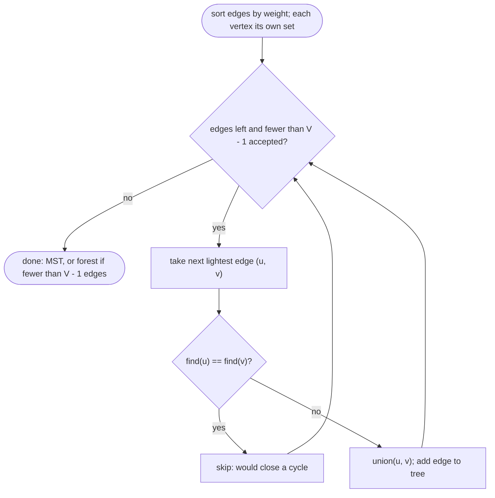
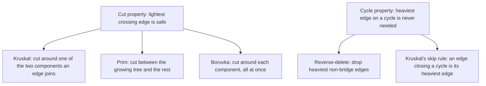

## Introduction

A city council wants to connect six neighbourhoods with fibre-optic cable. Engineers have surveyed which pairs of neighbourhoods can be linked directly and what each link would cost. Every neighbourhood must be able to reach every other one, possibly through others, and the council wants to spend as little as possible. Which links should be built?

Two observations shape the answer. First, the chosen links should contain **no cycle**: if three links form a loop, removing the most expensive one still leaves everything connected, and saves money. Second, the links must **connect everything**. A set of edges that connects all vertices without forming a cycle is a **spanning tree**, and the cheapest one is a **minimum spanning tree (MST)**.

The remarkable fact about MSTs is that simple greedy algorithms find them. Greedy choices fail for most optimisation problems — taking the cheapest step first does not give the shortest route on a map — but here they provably work. **Kruskal's algorithm** sorts all edges by weight and takes each one unless it would close a cycle, using the Union-Find structure to test that in near-constant time. **Prim's algorithm** grows a single tree from one vertex, always adding the cheapest edge that reaches a new vertex. Both run in O(E log E) or better.

MSTs appear in network design (cables, pipes, roads, power lines), in clustering (stop Kruskal early and the pieces are clusters), as the backbone of approximation algorithms for hard problems such as the travelling salesman problem, and in interviews as "Min Cost to Connect All Points" and "Connecting Cities With Minimum Cost". This lesson starts with the theory that makes greedy correct, then builds Kruskal and Prim in depth, then covers Borůvka's and reverse-delete algorithms, counting spanning trees, the minimum-product variant and applications.

## Before you start

- **Union-Find (Disjoint Set Union)** — `find` and `union` with path compression and union by size or rank, in near-constant amortised time. Kruskal is built on it. See [[a8-union-find]].
- **Undirected cycle detection** — why adding an edge between two vertices already connected creates a cycle. See [[a8-cycle-undirected]].
- **Priority queues** — `offer` and `poll` in O(log n), used by Prim. See [[a7-priority-queues]].
- **Graph representations** — edge lists for Kruskal, adjacency lists or matrices for Prim. See [[a8-graph-representation]].
- **Dijkstra's algorithm** — helpful for contrast, since Prim looks similar but solves a different problem. See [[a8-dijkstra]].

## The intuition

Think of building the cable network as a contractor who is paid per metre and wants to do the least work. A sensible contractor reasons: "The cheapest link anywhere in the city is surely worth building — there is no cheaper way to join those two neighbourhoods." Then: "The next cheapest link is worth building too, unless the two neighbourhoods it joins are already connected through links I have built; in that case it would be wasted money." Repeat until everything is connected. That is Kruskal's algorithm.

A different contractor starts at the depot and only ever extends the network outward: "Of all the links from neighbourhoods I have already wired to ones I have not, build the cheapest." That is Prim's algorithm.

Both contractors make locally greedy decisions and never undo one. The reason neither ever regrets a decision is a single fact called the **cut property**: whenever you split the vertices into two groups, the cheapest edge crossing between the groups belongs to some minimum spanning tree. The next section proves it, and every algorithm in this lesson is that fact applied in a different order.

## Spanning Tree vs MST {#a8-spanning-tree-basics}

A **spanning tree** of a connected, undirected graph is a subset of its edges that connects all of its vertices and contains no cycle. A **minimum spanning tree (MST)** is a spanning tree whose total edge weight is as small as possible among all spanning trees. The difference matters: a graph usually has a huge number of spanning trees, and the MST is the cheapest of them. This section builds the facts about trees that MST algorithms rely on, then proves the two properties that make greedy algorithms correct.

### What makes a set of edges a spanning tree

For a graph with `V` vertices, the following statements about a set `T` of edges are equivalent — any two of the first three imply the third:

- `T` connects all `V` vertices.
- `T` contains no cycle.
- `T` has exactly `V − 1` edges.

And a tree has two structural facts you will use constantly: between any two vertices there is **exactly one** path in the tree; adding any edge not in the tree creates **exactly one** cycle; removing any tree edge splits the tree into **exactly two** pieces.

Here is a small graph with four vertices and five edges: `0-1 (1)`, `1-2 (2)`, `2-3 (1)`, `3-0 (4)`, `0-2 (3)`. Some of its spanning trees:

| Spanning tree | Edges | Total weight |
|---|---|---|
| A | `0-1`, `1-2`, `2-3` | 1 + 2 + 1 = 4 |
| B | `0-1`, `0-2`, `2-3` | 1 + 3 + 1 = 5 |
| C | `0-1`, `1-2`, `3-0` | 1 + 2 + 4 = 7 |
| D | `3-0`, `0-2`, `1-2` | 4 + 3 + 2 = 9 |

Each has 3 = V − 1 edges, connects all four vertices and contains no cycle. Tree A is the MST. The graph has eight spanning trees in total (the count is computed in [[a8-total-spanning-trees]]); trying all of them is fine for four vertices, but a complete graph on `n` vertices has `n^(n−2)` spanning trees — `10⁸` for `n = 10` — so enumeration is hopeless in general.

A graph that is not connected has no spanning tree. The natural generalisation is a **minimum spanning forest**: an MST of each connected component. Every algorithm in this lesson produces one when run on a disconnected graph, as long as it does not assume connectivity.

### The cut property

A **cut** is a split of the vertices into two non-empty groups `S` and `V − S`. An edge **crosses** the cut if it has one endpoint in each group.

> **Cut property.** For any cut, if `e` is a crossing edge of minimum weight, then some MST contains `e`. If `e` is the *unique* lightest crossing edge, every MST contains it.

**Proof (exchange argument).** Take any MST `T`. If `e = (u, v)` is in `T`, we are done. Otherwise, add `e` to `T`; this creates exactly one cycle. That cycle crosses the cut at `e` (from `u`'s side to `v`'s side), and since it returns to where it started it must cross back at least once, through some other edge `f` of `T` that also crosses the cut. Remove `f`. The result `T' = T + e − f` is still a spanning tree (we broke the only cycle), and its weight is `weight(T) + w(e) − w(f)`. Since `e` is a lightest crossing edge, `w(e) ≤ w(f)`, so `T'` is no heavier than `T` — it is also an MST, and it contains `e`.

Every greedy MST algorithm is this argument applied repeatedly: Kruskal's cut separates the two components an edge joins; Prim's cut separates the growing tree from everything else; Borůvka's cut separates one component from the rest.

### The cycle property

> **Cycle property.** For any cycle, if `e` is the unique heaviest edge on it, then no MST contains `e`.

**Proof.** Suppose an MST `T` contains `e`. Removing `e` splits `T` into two pieces, which defines a cut. The rest of the cycle is a path between `e`'s endpoints, so it crosses this cut at some edge `f ≠ e`, and `w(f) < w(e)`. Then `T − e + f` is a spanning tree that is strictly lighter, contradicting minimality.

The cycle property is the justification for "skip an edge that would close a cycle" in Kruskal — such an edge is the heaviest on the cycle it closes, since every other edge on that cycle was accepted earlier — and for the reverse-delete algorithm in [[a8-reverse-delete-mst]].

### Uniqueness

If all edge weights are distinct, the MST is **unique**: for every edge, either it is the unique lightest edge across some cut (and must be in every MST) or the unique heaviest edge on some cycle (and is in none). With equal weights there may be several MSTs, but **all of them have the same total weight** and, in fact, the same multiset of edge weights. That is why Kruskal and Prim may return different edge sets on the same graph but always agree on the total.

### MST versus shortest-path tree

An MST minimises the **total** weight of the network. A **shortest-path tree** from a source (the `parent` tree Dijkstra builds) minimises each vertex's **distance from the source**. They are different trees. Take a triangle `0-1 (2)`, `1-2 (2)`, `0-2 (3)`:

| Tree | Edges | Total weight | Distance 0 → 2 inside the tree |
|---|---|---|---|
| MST | `0-1`, `1-2` | 4 | 4 |
| Shortest-path tree from 0 | `0-1`, `0-2` | 5 | 3 |

The MST is cheaper to build, but a message from 0 to 2 travels further. Which tree you want depends on whether you pay once to build (MST) or every time you travel (shortest paths). Interviewers ask this question often.

### Other facts worth knowing

**Negative weights are fine.** Unlike Dijkstra, MST algorithms only *compare* weights; they never add them along paths. A negative weight is a very attractive edge, nothing more. Adding the same constant to every weight does not change which tree is minimum, because every spanning tree has exactly `V − 1` edges and shifts by the same amount.

**Maximum spanning tree.** Negate every weight, or sort in descending order; the same algorithms then find the spanning tree of maximum total weight.

**Bottleneck property.** For any two vertices, the path between them in an MST minimises the largest edge weight along the path, among all paths in the graph. So an MST answers "what is the smallest maximum edge I must cross from `u` to `v`?" for every pair at once.

```quiz
Q: A connected graph has 7 vertices. How many edges does each of its spanning trees have?
- [ ] 7
- [x] 6
- [ ] It depends on how many edges the graph has
- [ ] At most 6; some spanning trees have fewer
> Any tree on V vertices has exactly V - 1 edges: fewer cannot connect all vertices, and more would create a cycle. So every spanning tree of a 7-vertex graph has 6 edges, regardless of the original graph's size.

Q: Which statement about an MST and Dijkstra's shortest-path tree from vertex 0 is true?
- [ ] They are always the same tree
- [ ] The MST gives the shortest distance from 0 to every vertex
- [x] The MST minimises the total weight of the tree, while the shortest-path tree minimises each vertex's distance from 0, so they can differ
- [ ] The shortest-path tree always has a smaller total weight
> In the triangle 0-1 (2), 1-2 (2), 0-2 (3), the MST {0-1, 1-2} weighs 4 but routes 0 to 2 over distance 4, while the shortest-path tree {0-1, 0-2} weighs 5 and reaches 2 at distance 3. Each tree wins on its own objective.

Q: In the cut-property proof, why must the cycle created by adding e to T contain another edge that crosses the cut?
- [ ] Because T has V - 1 edges
- [x] Because the cycle crosses from one side of the cut to the other at e and must return to its start, so it crosses again
- [ ] Because e is the lightest edge in the graph
- [ ] Because every edge of a cycle crosses every cut
> A cycle is a closed walk. If it goes from S to V - S across e, it has to come back to S somewhere, and that return crossing is a different edge f of T. Swapping f for e keeps the tree connected and does not increase the weight.
```

## The problem and the naive approach

Formally: given a connected, undirected graph with `V` vertices, `E` edges and a weight on each edge, find a set of edges that connects all vertices with minimum total weight. With non-negative weights, the cheapest connecting set never needs a cycle — dropping any edge of a cycle keeps everything connected without raising the cost — so it can always be taken to be a spanning tree. (With negative weights the problem is still defined as the cheapest *tree*.)

**Enumerate all spanning trees.** Correct, but the number of spanning trees grows exponentially: `n^(n−2)` for complete graphs. Even 20 vertices give about 2.6 × 10²³ trees.

**Greedy is the better idea.** The cut property says the lightest edge across *any* cut is safe to take. So we never need to search; we need an order of choosing cuts that is cheap to compute. Kruskal chooses cuts implicitly by processing edges globally from lightest to heaviest. Prim chooses the cut "current tree versus the rest" and needs a priority queue to find its lightest crossing edge.

## Kruskal's algorithm

**Kruskal's algorithm** (Joseph Kruskal, 1956) processes edges from lightest to heaviest and adds each edge unless its endpoints are already connected by edges chosen so far.

1. Sort all edges by weight, ascending.
2. Start with every vertex in its own component.
3. For each edge `(u, v)` in sorted order: if `u` and `v` are in different components, accept the edge and merge the components; otherwise skip it.
4. Stop after `V − 1` accepted edges (or when the edges run out).

**Why it is correct.** When Kruskal accepts `(u, v)`, consider the cut between `u`'s current component and everything else. Every edge lighter than `(u, v)` has already been processed; those that cross this cut would have been accepted and merged `u`'s component with something — so no lighter edge crosses this cut. `(u, v)` is a lightest crossing edge, and the cut property says it belongs to some MST. A rejected edge joins two vertices already connected by lighter-or-equal accepted edges, so it is a heaviest edge on a cycle and is never needed.

**Why Union-Find.** The only question step 3 asks is "are `u` and `v` already in the same component?", and the only update is "merge two components". That is exactly the interface of the Union-Find (Disjoint Set Union) structure from [[a8-union-find]], with near-constant amortised cost per operation. A BFS per edge would also answer the question, but at O(V + E) each, which is far too slow.

```java title="Kruskal.java"
import java.util.*;

public class Kruskal {
    record Edge(int u, int v, int w) {}

    static final class DSU {
        private final int[] parent, size;
        DSU(int n) {
            parent = new int[n];
            size = new int[n];
            for (int i = 0; i < n; i++) { parent[i] = i; size[i] = 1; }
        }
        int find(int x) {
            while (parent[x] != x) {
                parent[x] = parent[parent[x]];       // path halving
                x = parent[x];
            }
            return x;
        }
        boolean union(int a, int b) {
            int ra = find(a), rb = find(b);
            if (ra == rb) return false;              // already connected: edge would close a cycle
            if (size[ra] < size[rb]) { int t = ra; ra = rb; rb = t; }
            parent[rb] = ra;                         // attach the smaller tree under the larger
            size[ra] += size[rb];
            return true;
        }
    }

    // Returns the MST edges; fewer than n - 1 edges means the graph is disconnected.
    static List<Edge> mst(int n, List<Edge> edges) {
        List<Edge> sorted = new ArrayList<>(edges);
        sorted.sort(Comparator.comparingInt(Edge::w));   // stable: ties keep input order
        DSU dsu = new DSU(n);
        List<Edge> tree = new ArrayList<>();
        for (Edge e : sorted) {
            boolean accepted = dsu.union(e.u(), e.v());
            System.out.printf("  %d-%d (w=%d): %s%n", e.u(), e.v(), e.w(),
                    accepted ? "accept" : "reject, would close a cycle");
            if (accepted) {
                tree.add(e);
                if (tree.size() == n - 1) break;           // a spanning tree is complete
            }
        }
        return tree;
    }

    public static void main(String[] args) {
        List<Edge> edges = List.of(
            new Edge(0, 1, 4), new Edge(0, 2, 3), new Edge(1, 2, 1), new Edge(1, 3, 2),
            new Edge(2, 3, 4), new Edge(3, 4, 2), new Edge(4, 5, 6), new Edge(3, 5, 5),
            new Edge(2, 4, 7));
        List<Edge> tree = mst(6, edges);
        long total = 0;
        for (Edge e : tree) total += e.w();
        System.out.println("MST edges: " + tree.size() + ", total weight " + total);
    }
}
```

```output
  1-2 (w=1): accept
  1-3 (w=2): accept
  3-4 (w=2): accept
  0-2 (w=3): accept
  0-1 (w=4): reject, would close a cycle
  2-3 (w=4): reject, would close a cycle
  3-5 (w=5): accept
MST edges: 5, total weight 13
```

The `DSU` class uses **union by size** (attach the smaller tree under the larger) and **path halving** (each `find` makes every other node on its path skip to its grandparent), which together give the near-constant amortised bound; [[a8-dsu-path-compression]] explains why. `union` returns `false` when the endpoints already share a root — that boolean is the whole cycle test. The sort copies the input so the caller's list is not reordered, and `List.sort` is stable, so equal weights keep their input order; any tie order gives a valid MST with the same total.

### Dry run

The graph has six vertices and nine edges. After sorting: `1-2 (1)`, `1-3 (2)`, `3-4 (2)`, `0-2 (3)`, `0-1 (4)`, `2-3 (4)`, `3-5 (5)`, `4-5 (6)`, `2-4 (7)`.

| Edge | Components before | Same component? | Action | Components after |
|---|---|---|---|---|
| `1-2 (1)` | {0} {1} {2} {3} {4} {5} | no | accept | {0} {1,2} {3} {4} {5} |
| `1-3 (2)` | | no | accept | {0} {1,2,3} {4} {5} |
| `3-4 (2)` | | no | accept | {0} {1,2,3,4} {5} |
| `0-2 (3)` | | no | accept | {0,1,2,3,4} {5} |
| `0-1 (4)` | | yes | reject | unchanged |
| `2-3 (4)` | | yes | reject | unchanged |
| `3-5 (5)` | | no | accept | {0,1,2,3,4,5} |

Five accepted edges make a spanning tree of six vertices, so the loop stops; `4-5 (6)` and `2-4 (7)` are never examined. The rejected edge `0-1 (4)` would have closed the cycle `0-1-2-0`, on which it is the heaviest edge; `2-3 (4)` would have closed `2-3-1-2`. Total weight: 1 + 2 + 2 + 3 + 5 = 13.



### Complexity derivation

**Time.** Sorting `E` edges costs O(E log E). The loop performs at most `E` iterations, each with two `find` calls and possibly one union: O(E · α(V)), where α is the inverse Ackermann function, at most 4 for any input that fits in memory. Sorting dominates, so Kruskal runs in **O(E log E)**. Since `E ≤ V²`, `log E ≤ 2 log V`, so this is the same as O(E log V). If the edges arrive already sorted, or weights are small integers that can be counting-sorted, Kruskal is almost linear.

**Space.** O(V) for the DSU arrays, plus O(E) for the sorted copy of the edges.

### Edge cases

- **Disconnected graph.** The loop ends with fewer than `V − 1` accepted edges. The accepted edges form a minimum spanning forest; whether to return it or report failure depends on the problem.
- **Self-loops** are rejected automatically (`find(u) == find(u)`). **Parallel edges** are fine: the cheaper one is processed first, and the second is rejected as a cycle.
- **Total weight overflow.** `V − 1` edges with weights up to 10⁹ overflow an `int`; accumulate the total in a `long`.
- **One vertex.** Zero edges are needed; the loop never accepts anything, and `0 == V − 1` holds.

## MST — Prim {#a8-mst-prim}

**Prim's algorithm** builds a minimum spanning tree by growing a single tree from a starting vertex: at each step it adds the cheapest edge connecting a vertex already in the tree to a vertex not yet in it. It was described by Vojtěch Jarník in 1930 and rediscovered by Robert Prim in 1957 and Edsger Dijkstra in 1959, so you will also see it called the Jarník or Prim-Jarník algorithm. Where Kruskal looks at all edges globally, Prim works locally from a growing frontier, which makes it a good fit for adjacency lists, adjacency matrices and graphs whose edges are never listed explicitly.

### Why it is correct

At every step, the vertices already in the tree form one side of a cut and all other vertices form the other side. Prim picks the lightest edge crossing that cut, so by the cut property ([[a8-spanning-tree-basics]]) the edge belongs to some MST consistent with the edges chosen so far. After `V − 1` steps, the tree spans every vertex and is an MST. The start vertex does not matter: every vertex must be in the tree, and the argument holds from any of them.

### The priority-queue implementation

Finding the lightest crossing edge by scanning all edges would cost O(E) per step. A min-heap keeps the candidate edges ordered by weight. Java's `PriorityQueue` has no decrease-key operation, so we use the same **lazy deletion** idea as Dijkstra ([[a8-dijkstra-priority-queue]]): push a new entry whenever a vertex gets a new candidate edge, and when an entry is polled for a vertex already in the tree, skip it as stale.

```java title="Prim.java"
import java.util.*;

public class Prim {
    // adj.get(u) holds {v, w}. Returns total MST weight, or -1 if the graph is disconnected.
    static long mst(List<List<int[]>> adj, int start) {
        int n = adj.size();
        boolean[] inTree = new boolean[n];
        // Heap entries are {weight, vertex, from}: the cheapest known edge into vertex.
        PriorityQueue<int[]> pq = new PriorityQueue<>((a, b) -> Integer.compare(a[0], b[0]));
        pq.add(new int[]{0, start, -1});
        long total = 0;
        int taken = 0;
        while (!pq.isEmpty() && taken < n) {
            int[] top = pq.poll();
            int w = top[0], u = top[1];
            if (inTree[u]) continue;                       // stale: u joined via a cheaper edge
            inTree[u] = true;
            taken++;
            total += w;
            if (top[2] != -1) System.out.printf("  add %d-%d (w=%d)%n", top[2], u, w);
            for (int[] e : adj.get(u)) {
                if (!inTree[e[0]]) pq.add(new int[]{e[1], e[0], u});
            }
        }
        return taken == n ? total : -1;
    }

    public static void main(String[] args) {
        int n = 6;
        int[][] edges = {{0, 1, 4}, {0, 2, 3}, {1, 2, 1}, {1, 3, 2}, {2, 3, 4},
                         {3, 4, 2}, {4, 5, 6}, {3, 5, 5}, {2, 4, 7}};
        List<List<int[]>> adj = new ArrayList<>();
        for (int i = 0; i < n; i++) adj.add(new ArrayList<>());
        for (int[] e : edges) {                            // undirected: store both directions
            adj.get(e[0]).add(new int[]{e[1], e[2]});
            adj.get(e[1]).add(new int[]{e[0], e[2]});
        }
        System.out.println("total from 0: " + mst(adj, 0));
        System.out.println("total from 5: " + mst(adj, 5));
    }
}
```

```output
  add 0-2 (w=3)
  add 2-1 (w=1)
  add 1-3 (w=2)
  add 3-4 (w=2)
  add 3-5 (w=5)
total from 0: 13
  add 5-3 (w=5)
  add 3-1 (w=2)
  add 1-2 (w=1)
  add 3-4 (w=2)
  add 2-0 (w=3)
total from 5: 13
```

The start vertex enters with weight 0 and no parent, so it contributes nothing to the total. Each heap entry stores the parent (`from`) as well, so the tree's edges can be printed or returned. The comparator uses `Integer.compare` rather than `a[0] - b[0]`; subtraction overflows when weights are large or negative and silently breaks the heap order. The same graph as the Kruskal example gives the same total, 13, from either start vertex, although the edges are added in a different order.

### Dry run from vertex 0

| Step | Polled entry | Action | Entries pushed (weight, vertex) |
|---|---|---|---|
| 1 | (0, 0) | add 0 | (4, 1), (3, 2) |
| 2 | (3, 2) from 0 | add 2 | (1, 1), (4, 3), (7, 4) |
| 3 | (1, 1) from 2 | add 1 | (2, 3) |
| 4 | (2, 3) from 1 | add 3 | (2, 4), (5, 5) |
| 5 | (2, 4) from 3 | add 4 | (6, 5) |
| 6 | (4, 1) | stale, 1 already in tree | — |
| 7 | (4, 3) | stale | — |
| 8 | (5, 5) from 3 | add 5; all 6 vertices taken | — |

Steps 6 and 7 show lazy deletion at work: vertex 1 was first offered at weight 4 (from 0) but joined at weight 1 (from 2), leaving an outdated entry in the heap that is skipped when it surfaces.

### Complexity derivation

Each undirected edge is stored twice in the adjacency list and can cause at most two pushes, so the heap receives O(E) entries. Each push and poll costs O(log E) = O(log V) (because `E ≤ V²`). Total: **O(E log V)** time and **O(V + E)** space for the adjacency list, the heap and `inTree`. An "eager" version that keeps at most one heap entry per vertex with an indexed priority queue achieves the same O(E log V) with O(V) heap space, and a Fibonacci heap gives O(E + V log V) in theory.

### The O(V²) array version for dense graphs

When the graph is dense (E close to V²) or the edges are implicit — every pair of points is connected — the heap is a liability: it would hold O(V²) entries. Instead keep an array `best[v]` = cheapest known edge from the tree to `v`, and at each step scan all vertices for the minimum. That is O(V) per step, O(V²) in total, with no heap and no edge list. This is the method of choice for "Min Cost to Connect All Points", where `n ≤ 1000` points are joined by Manhattan distance and the complete graph has about 500,000 edges.

```java title="ConnectPoints.java"
public class ConnectPoints {
    // Prim on the implicit complete graph: O(V^2) time, O(V) extra space, no edge list.
    static int minCostConnectPoints(int[][] points) {
        int n = points.length;
        int[] best = new int[n];                  // cheapest edge from the tree to each vertex
        boolean[] inTree = new boolean[n];
        java.util.Arrays.fill(best, Integer.MAX_VALUE);
        best[0] = 0;
        int total = 0;
        for (int step = 0; step < n; step++) {
            int u = -1;
            for (int v = 0; v < n; v++) {         // pick the closest vertex outside the tree
                if (!inTree[v] && (u == -1 || best[v] < best[u])) u = v;
            }
            inTree[u] = true;
            total += best[u];
            for (int v = 0; v < n; v++) {         // u is in the tree now: offer its edges
                if (!inTree[v]) {
                    int d = Math.abs(points[u][0] - points[v][0])
                          + Math.abs(points[u][1] - points[v][1]);
                    if (d < best[v]) best[v] = d;
                }
            }
        }
        return total;
    }

    public static void main(String[] args) {
        System.out.println(minCostConnectPoints(new int[][]{{0, 0}, {2, 2}, {3, 10}, {5, 2}, {7, 0}}));
        System.out.println(minCostConnectPoints(new int[][]{{3, 12}, {-2, 5}, {-4, 1}}));
    }
}
```

```output
20
18
```

For 1,000 points this does about two million simple steps, while Kruskal would have to build and sort 499,500 edges. The array version assumes the graph is connected (a complete graph always is); for a general dense matrix, stop and report failure if the chosen `best[u]` is still infinity.

### Prim is not Dijkstra

The code looks almost identical to Dijkstra's, which causes a classic bug. Dijkstra's heap key is the **total distance from the source**, `dist[u] + w`. Prim's heap key is the **single edge weight** `w`. Using `dist[u] + w` in Prim builds a shortest-path tree, not an MST — in the triangle example of [[a8-spanning-tree-basics]] it would choose the edge `0-2 (3)` over `1-2 (2)`. Prim also works with negative weights, which Dijkstra does not.

```quiz
Q: In lazy Prim, the heap returns the entry (4, vertex 1), but vertex 1 is already in the tree. What should happen?
- [ ] Add the edge anyway, since it was the cheapest entry
- [x] Skip it; vertex 1 joined earlier through a cheaper edge, and adding this one would create a cycle
- [ ] Replace vertex 1's tree edge with this one
- [ ] Stop the algorithm, because the heap is inconsistent
> Java's PriorityQueue cannot update an entry's key, so outdated entries remain after a vertex joins via a cheaper edge. An entry for a vertex already in the tree describes an edge between two tree vertices, which would close a cycle; it must be discarded.

Q: You change Prim's heap key from w to dist[u] + w. What does the algorithm now compute?
- [ ] The same MST, a little faster
- [x] A shortest-path tree from the start vertex, which in general is not an MST
- [ ] A maximum spanning tree
- [ ] Nothing useful; it no longer terminates
> With the key dist[u] + w the algorithm is Dijkstra, which minimises each vertex's distance from the start. The resulting parent tree can have a larger total weight than the MST, as the triangle 0-1 (2), 1-2 (2), 0-2 (3) shows.
```

## Prim vs Kruskal {#a8-prim-vs-kruskal}

**Prim vs Kruskal** is the choice between the two standard MST algorithms. Both are greedy, both rely on the cut property, and on a connected graph both return a spanning tree of the same minimum total weight — possibly with different edges when weights tie. They differ in what they look at each step and what data structure they need, and that difference decides which one fits a problem.

| | Kruskal | Prim (binary heap) | Prim (array scan) |
|---|---|---|---|
| Grows | A forest of components that merge | One tree from a start vertex | One tree from a start vertex |
| Each step picks | The globally lightest unprocessed edge | The lightest edge leaving the tree | The closest vertex outside the tree |
| Data structure | Sorted edge list + Union-Find | Adjacency list + min-heap | Weight matrix or implicit edges + arrays |
| Time | O(E log E) | O(E log V) | O(V²) |
| Extra space | O(V) + sorted edges | O(V + E) | O(V) |
| Disconnected input | Returns a minimum spanning forest | Covers only the start's component | Covers only the start's component |
| Natural input | Edge list | Adjacency list | Dense matrix, points in the plane |

**Choose Kruskal** when the input is already an edge list, the graph is sparse, edges are pre-sorted or have small integer weights, or you also need connectivity information during the process (for example, "which edge first connects these two groups?"). It also produces a forest naturally when the graph is disconnected, and stopping it early gives clusters ([[a8-mst-applications]]).

**Choose heap Prim** when the graph is stored as an adjacency list and is sparse to moderately dense, or when you only need the tree for one component.

**Choose array Prim** when the graph is dense or complete, especially when edges are implicit (computed from coordinates). On a complete graph with `V = 1,000`, array Prim does about 10⁶ steps; Kruskal must create and sort about 5 × 10⁵ edges, using far more memory.

The asymptotic difference between O(E log E) and O(E log V) is only a constant factor, since `log E ≤ 2 log V`. In practice the decision is about representation and density, not about the logarithm. Borůvka's algorithm ([[a8-boruvka-mst]]) is a third option, attractive mainly for parallel and distributed settings.

## Minimum Cost to Connect All Cities {#a8-connect-all-cities}

**Minimum Cost to Connect All Cities** (also known as "Connecting Cities With Minimum Cost") is the canonical MST interview problem: there are `n` cities numbered 1 to `n` and a list of possible two-way connections `[city1, city2, cost]`; return the minimum total cost to connect every city, or −1 if it is impossible. It is an MST problem dressed in words: "every city reachable from every other" means a connected spanning subgraph, and "minimum total cost" means the cheapest one, which never contains a cycle.

### Recognising the pattern

The phrases to listen for are "connect all", "every pair can reach each other", "minimum total cost/length/wire", combined with an undirected cost per link. If the cost is paid **per use** (travel time between two specific places), it is a shortest-path problem instead. If the question is "can everything be connected at all?", it is plain connectivity ([[a8-connected-components]]).

### Solution with Kruskal

```java title="ConnectCities.java"
import java.util.*;

public class ConnectCities {
    static int[] parent;

    static int find(int x) {
        while (parent[x] != x) { parent[x] = parent[parent[x]]; x = parent[x]; }
        return x;
    }

    // Cities are numbered 1..n. connections[i] = {city1, city2, cost}, usable both ways.
    static int minimumCost(int n, int[][] connections) {
        parent = new int[n + 1];                      // index 0 unused: cities start at 1
        for (int i = 0; i <= n; i++) parent[i] = i;
        int[][] sorted = connections.clone();         // do not reorder the caller's array
        Arrays.sort(sorted, Comparator.comparingInt(c -> c[2]));
        int cost = 0, used = 0;
        for (int[] c : sorted) {
            int a = find(c[0]), b = find(c[1]);
            if (a == b) continue;                     // already connected
            parent[a] = b;
            cost += c[2];
            if (++used == n - 1) return cost;         // every city is connected
        }
        return n == 1 ? 0 : -1;                       // ran out of roads first
    }

    public static void main(String[] args) {
        System.out.println(minimumCost(3, new int[][]{{1, 2, 5}, {1, 3, 6}, {2, 3, 1}}));
        System.out.println(minimumCost(4, new int[][]{{1, 2, 3}, {3, 4, 4}}));
        System.out.println(minimumCost(1, new int[][]{}));
    }
}
```

```output
6
-1
0
```

In the first case, Kruskal takes `2-3 (1)`, then `1-2 (5)`, and skips `1-3 (6)`, for a total of 6. In the second, after both roads are used only two components exist ({1, 2} and {3, 4}), so the answer is −1. The single-city case needs no roads at all, which is why the final line returns 0 rather than −1 when `n == 1`. The early `return` as soon as `n − 1` edges are accepted is both an optimisation and the success test.

Three details are easy to get wrong in an interview. The cities are **1-indexed**, so the DSU needs `n + 1` slots. The connectivity check is "did we accept `n − 1` edges?", not "did we process all edges?". And `clone()` on a 2-D array copies only the outer array; that is enough here because sorting reorders the outer array without modifying the inner rows. This compact DSU uses path halving but no union by size, which is O(log n) amortised per operation — fine for interview constraints; add union by size for the near-constant bound.

### Variations

- **Min Cost to Connect All Points**: the graph is complete and implicit; use the O(V²) Prim from [[a8-mst-prim]].
- **Optimize Water Distribution in a Village**: each house can either build its own well (cost `wells[i]`) or connect by pipe. Add a virtual vertex 0 representing "the water source", with an edge `0 – i` of weight `wells[i]`, and find the MST of the enlarged graph. The virtual-vertex trick turns a "choose per-vertex options" problem into a pure MST.
- **Some edges already built**: union their endpoints first (cost 0), then run Kruskal on the remaining edges.

## Borůvka's Algorithm for MST {#a8-boruvka-mst}

**Borůvka's algorithm** finds a minimum spanning tree in rounds: in each round, every component finds its cheapest edge to a different component, and all those edges are added at once, merging components. It is the oldest MST algorithm — Otakar Borůvka published it in 1926 to design an electricity network for Moravia — and it has become important again because each round's work is independent per component, which makes it the natural basis for parallel and distributed MST algorithms.

### How it works

1. Start with every vertex as its own component.
2. In each **phase**: for every component, find the lightest edge with exactly one endpoint inside it.
3. Add all of those edges (skipping any that now join two vertices already in the same component) and merge the components they connect.
4. Repeat until one component remains, or until no component has an outgoing edge (the graph is disconnected).

Each chosen edge is the lightest edge across the cut "this component versus the rest", so the cut property makes it safe.

### Why ties need a consistent rule

Adding several edges at once is safe only if the choices cannot form a cycle. Picture a triangle with three equal weights. If each vertex breaks ties its own way — vertex 0 picks `0-1`, vertex 1 picks `1-2`, vertex 2 picks `2-0` — all three edges are chosen and form a cycle. The fix is a **single global order**: compare by weight, and break ties by edge index. Under a strict total order, every component's choice is "the lightest edge leaving it", and those choices can never form a cycle. The code below also re-checks `find` before each union, which handles the common case of two components choosing the same edge.

```java title="Boruvka.java"
import java.util.*;

public class Boruvka {
    static int[] parent;

    static int find(int x) {
        while (parent[x] != x) { parent[x] = parent[parent[x]]; x = parent[x]; }
        return x;
    }

    // Edge i "is lighter than" edge j if its weight is smaller, or equal with a smaller
    // index. This strict total order is what keeps equal weights from forming a cycle.
    static boolean lighter(int[][] edges, int i, int j) {
        return edges[i][2] < edges[j][2] || (edges[i][2] == edges[j][2] && i < j);
    }

    static long mst(int n, int[][] edges) {
        parent = new int[n];
        for (int i = 0; i < n; i++) parent[i] = i;
        int components = n;
        long total = 0;
        int phase = 0;
        while (components > 1) {
            int[] cheapest = new int[n];               // per component root: best edge index
            Arrays.fill(cheapest, -1);
            for (int i = 0; i < edges.length; i++) {
                int a = find(edges[i][0]), b = find(edges[i][1]);
                if (a == b) continue;                  // internal edge: ignore
                if (cheapest[a] == -1 || lighter(edges, i, cheapest[a])) cheapest[a] = i;
                if (cheapest[b] == -1 || lighter(edges, i, cheapest[b])) cheapest[b] = i;
            }
            boolean merged = false;
            phase++;
            for (int r = 0; r < n; r++) {
                int i = cheapest[r];
                if (i == -1) continue;
                int a = find(edges[i][0]), b = find(edges[i][1]);
                if (a == b) continue;                  // both ends picked the same edge
                parent[a] = b;
                total += edges[i][2];
                components--;
                merged = true;
                System.out.printf("  phase %d: add %d-%d (w=%d)%n", phase, edges[i][0], edges[i][1], edges[i][2]);
            }
            if (!merged) break;                        // disconnected: a forest is the best
        }
        return total;
    }

    public static void main(String[] args) {
        int[][] edges = {{0, 1, 1}, {1, 2, 5}, {2, 3, 2}, {3, 4, 6}, {4, 5, 3}, {5, 0, 7}};
        System.out.println("total " + mst(6, edges));
    }
}
```

```output
  phase 1: add 0-1 (w=1)
  phase 1: add 2-3 (w=2)
  phase 1: add 4-5 (w=3)
  phase 2: add 1-2 (w=5)
  phase 2: add 3-4 (w=6)
total 17
```

The graph is a ring of six vertices. In phase 1, vertices 0 and 1 both choose `0-1 (1)` (added once; the second attempt finds them already merged), 2 and 3 choose `2-3 (2)`, 4 and 5 choose `4-5 (3)`. Three components remain: {0, 1}, {2, 3}, {4, 5}. In phase 2, {0, 1} and {2, 3} both choose `1-2 (5)` — cheaper than `5-0 (7)` and `3-4 (6)` — and {4, 5} chooses `3-4 (6)`. That leaves one component, and the heaviest ring edge, `5-0 (7)`, is the one left out, exactly as the cycle property predicts.

### Complexity

Every component with an outgoing edge merges with at least one other in each phase, so the number of components at least **halves** per phase. That gives at most ⌈log₂ V⌉ phases. Each phase scans all edges with `find` calls: O(E · α(V)). Total: **O(E log V)** time, O(V) extra space. Sequentially that matches Kruskal and Prim; the advantage is that the per-phase scan can be split across processors, and the number of phases is small. Borůvka phases are also used as a preprocessing step inside the fastest known MST algorithms, because a few phases shrink the vertex count quickly.

## Reverse Delete Algorithm for MST {#a8-reverse-delete-mst}

The **reverse-delete algorithm** finds an MST by working backwards from the full graph: consider edges from **heaviest to lightest**, and delete each one unless deleting it would disconnect the graph. What survives is a minimum spanning tree. Kruskal described it in the same 1956 paper as his main algorithm. It is rarely the fastest choice, but it is the clearest demonstration of the cycle property, and it shows up in exam and interview questions as "the reverse of Kruskal".

### Why it is correct

When the algorithm considers edge `e = (u, v)`, every heavier edge has already been processed. If removing `e` leaves `u` and `v` connected, there is another path between them made only of edges that are still present — and every edge still present is either lighter than `e` or equal to it (heavier ones have already been deleted or kept as necessary). So `e` is a heaviest edge on a cycle, and by the cycle property ([[a8-spanning-tree-basics]]) it can be dropped without losing optimality. If removing `e` would disconnect `u` from `v`, `e` is currently a **bridge**, and it must stay. At the end no cycle remains, the graph is still connected, and the result is an MST.

```java title="ReverseDelete.java"
import java.util.*;

public class ReverseDelete {
    // Returns the total weight of a minimum spanning forest.
    static long reverseDelete(int n, int[][] edges) {
        Integer[] order = new Integer[edges.length];
        for (int i = 0; i < order.length; i++) order[i] = i;
        Arrays.sort(order, (a, b) -> Integer.compare(edges[b][2], edges[a][2]));  // heaviest first
        boolean[] removed = new boolean[edges.length];
        long total = 0;
        for (int i : order) {
            removed[i] = true;                         // try deleting edge i
            if (connected(n, edges, removed, edges[i][0], edges[i][1])) {
                System.out.printf("  delete %d-%d (w=%d)%n", edges[i][0], edges[i][1], edges[i][2]);
            } else {
                removed[i] = false;                    // it was a bridge: keep it
                total += edges[i][2];
            }
        }
        return total;
    }

    // BFS over the edges not yet removed: is t reachable from s?
    static boolean connected(int n, int[][] edges, boolean[] removed, int s, int t) {
        List<List<Integer>> adj = new ArrayList<>();
        for (int i = 0; i < n; i++) adj.add(new ArrayList<>());
        for (int i = 0; i < edges.length; i++) {
            if (removed[i]) continue;
            adj.get(edges[i][0]).add(edges[i][1]);
            adj.get(edges[i][1]).add(edges[i][0]);
        }
        boolean[] seen = new boolean[n];
        Deque<Integer> queue = new ArrayDeque<>(List.of(s));
        seen[s] = true;
        while (!queue.isEmpty()) {
            int u = queue.poll();
            if (u == t) return true;
            for (int v : adj.get(u)) if (!seen[v]) { seen[v] = true; queue.add(v); }
        }
        return false;
    }

    public static void main(String[] args) {
        int[][] edges = {{0, 1, 4}, {0, 2, 3}, {1, 2, 1}, {1, 3, 2}, {2, 3, 4},
                         {3, 4, 2}, {4, 5, 6}, {3, 5, 5}, {2, 4, 7}};
        System.out.println("total " + reverseDelete(6, edges));
    }
}
```

```output
  delete 2-4 (w=7)
  delete 4-5 (w=6)
  delete 0-1 (w=4)
  delete 2-3 (w=4)
total 13
```

On the graph from the Kruskal section, the four deleted edges are exactly the four edges Kruskal did not use (`0-1`, `2-3`, and the two it never reached), and the total is the same 13. The connectivity test asks only whether the deleted edge's own endpoints are still connected, rather than whether the whole graph is; that makes the method correct on disconnected graphs too, where it returns a minimum spanning forest. A version that checks "is the whole graph connected?" breaks there, because every deletion would look harmful.

### Complexity

Sorting costs O(E log E). Each of the `E` edges triggers a BFS that rebuilds the adjacency list and visits up to O(V + E) items, so the total is **O(E · (V + E))** — quadratic in the size of the graph, far slower than Kruskal. Specialised dynamic-connectivity structures can answer "are `u` and `v` still connected after this deletion?" much faster, but they are complex and rarely worth it. Learn reverse-delete for the insight — the cycle property in action — and use Kruskal or Prim in practice.

## Total Spanning Trees {#a8-total-spanning-trees}

**Counting spanning trees** asks how many different spanning trees a graph has — not the cheapest one, but all of them. The count measures how redundant a network is (more spanning trees means more ways to stay connected when links fail), appears in physics and chemistry, and is a standard question in combinatorics interviews and contests. Remarkably, the answer comes from a determinant, computed in O(V³) time, even though the number itself can be astronomically large.

### Small cases and Cayley's formula

A tree has exactly one spanning tree (itself). A cycle of `n` vertices has `n` (delete any one edge). A complete graph `K_n` has **`n^(n−2)`** spanning trees — **Cayley's formula**: `K₃` has 3, `K₄` has 16, `K₆` has 1,296. Counting by hand quickly becomes impossible for general graphs.

### The matrix-tree theorem

The **Laplacian matrix** `L` of an undirected graph is a `V × V` matrix with:

- `L[i][i]` = degree of vertex `i` (number of edges at `i`, counting parallel edges separately, ignoring self-loops);
- `L[i][j]` = −(number of edges between `i` and `j`) for `i ≠ j`.

**Kirchhoff's matrix-tree theorem** (1847) states: delete any one row and the same-numbered column of `L`; the **determinant** of the remaining `(V − 1) × (V − 1)` matrix equals the number of spanning trees. For a triangle, `L` has 2 on the diagonal and −1 elsewhere; deleting row and column 0 leaves `[[2, −1], [−1, 2]]`, whose determinant is 4 − 1 = 3. A disconnected graph gives determinant 0, as it should.

### Computing the determinant exactly

Ordinary Gaussian elimination in `double` introduces rounding errors, and for larger graphs the count has more digits than a `double` can represent exactly, so rounding the result does not reliably give the right integer. The **Bareiss algorithm** is a fraction-free variant of elimination in which every division is exact, so it can run on integers.

```java title="CountSpanningTrees.java"
import java.util.*;

public class CountSpanningTrees {
    // Matrix-tree theorem: the number of spanning trees equals the determinant of the
    // Laplacian with one row and the matching column removed.
    static long count(int n, int[][] edges) {
        if (n == 1) return 1;
        long[][] lap = new long[n][n];
        for (int[] e : edges) {
            int u = e[0], v = e[1];
            if (u == v) continue;                     // self-loops never appear in a tree
            lap[u][u]++; lap[v][v]++;
            lap[u][v]--; lap[v][u]--;                 // parallel edges add up
        }
        long[][] m = new long[n - 1][n - 1];          // drop row 0 and column 0
        for (int i = 1; i < n; i++)
            for (int j = 1; j < n; j++) m[i - 1][j - 1] = lap[i][j];
        return bareissDeterminant(m);
    }

    // Fraction-free Gaussian elimination: every division below is exact, so integer
    // arithmetic gives the exact determinant (as long as values fit in a long).
    static long bareissDeterminant(long[][] a) {
        int n = a.length;
        long sign = 1, prevPivot = 1;
        for (int k = 0; k < n - 1; k++) {
            if (a[k][k] == 0) {                       // find a row with a non-zero pivot
                int swap = k + 1;
                while (swap < n && a[swap][k] == 0) swap++;
                if (swap == n) return 0;              // singular: graph is disconnected
                long[] t = a[k]; a[k] = a[swap]; a[swap] = t;
                sign = -sign;
            }
            for (int i = k + 1; i < n; i++) {
                for (int j = k + 1; j < n; j++) {
                    a[i][j] = (a[i][j] * a[k][k] - a[i][k] * a[k][j]) / prevPivot;
                }
            }
            prevPivot = a[k][k];
        }
        return sign * a[n - 1][n - 1];
    }

    static int[][] complete(int n) {
        List<int[]> es = new ArrayList<>();
        for (int i = 0; i < n; i++) for (int j = i + 1; j < n; j++) es.add(new int[]{i, j});
        return es.toArray(new int[0][]);
    }

    public static void main(String[] args) {
        System.out.println("triangle:      " + count(3, new int[][]{{0, 1}, {1, 2}, {0, 2}}));
        System.out.println("square:        " + count(4, new int[][]{{0, 1}, {1, 2}, {2, 3}, {3, 0}}));
        System.out.println("K4:            " + count(4, complete(4)));
        System.out.println("K6:            " + count(6, complete(6)));
        System.out.println("disconnected:  " + count(4, new int[][]{{0, 1}, {2, 3}}));
        System.out.println("double edge:   " + count(3, new int[][]{{0, 1}, {0, 1}, {1, 2}}));
    }
}
```

```output
triangle:      3
square:        4
K4:            16
K6:            1296
disconnected:  0
double edge:   2
```

The results match the hand counts: a triangle has 3, a 4-cycle has 4, and the complete graphs follow Cayley's formula (4² = 16, 6⁴ = 1,296). With a doubled edge between 0 and 1, the two parallel edges count as different trees, giving 2. The implementation was also checked against brute-force enumeration (try every subset of `V − 1` edges, keep the acyclic ones) on 3,000 random multigraphs. The six-vertex graph used in the Kruskal example has 55 spanning trees.

**Complexity.** Building the Laplacian is O(V + E); elimination is **O(V³)**. The intermediate values in Bareiss are themselves determinants of sub-matrices, so they stay exact but can grow large; with `long`, this works for small graphs. For large graphs, problems usually ask for the count modulo a prime such as 10⁹ + 7, and you run ordinary Gaussian elimination in modular arithmetic, dividing by multiplying with modular inverses; for exact big counts use `BigInteger`.

### Weighted version

Replace each `−1` in the Laplacian by `−w(u, v)` and each degree by the sum of incident weights. The determinant then equals the sum, over all spanning trees, of the **product** of their edge weights. With all weights equal to 1, that is the plain count.

## Minimum Product Spanning Tree {#a8-minimum-product-spanning-tree}

A **minimum product spanning tree** is a spanning tree whose edge weights have the smallest possible **product** rather than the smallest sum. The problem arises when edge weights are multiplicative — failure probabilities of independent links, attenuation factors, exchange ratios — so that the cost of a network is a product. With positive weights, the answer turns out to be the ordinary MST, and understanding why teaches something general about greedy MST algorithms.

### The logarithm argument

For positive numbers, `log(a · b) = log a + log b`, and `log` is strictly increasing. So minimising `w₁ · w₂ · … · w_{V−1}` is the same as minimising `log w₁ + log w₂ + … + log w_{V−1}`: an ordinary MST with weights `log w`. That is the standard textbook reduction.

Now look at what Kruskal actually does with those log weights: it sorts them. Because `log` is strictly increasing, sorting by `log w` gives **exactly the same order** as sorting by `w`. Kruskal never adds weights — it only compares them — so its output depends only on the order of the weights. **The MST computed on the original weights is already a minimum product spanning tree.** The same is true for any strictly increasing transformation of the weights: squaring positive weights, adding a constant, taking square roots.

This only holds for **positive** weights. If a weight is zero, any tree containing that edge has product zero; Kruskal still picks the lightest edges first, so with non-negative weights the MST is still optimal. If weights can be negative, the sign of the product depends on how many negative edges are used, and the problem changes completely.

### Computing the product without losing precision

The real difficulty is the product itself. Four weights near 10⁹ multiply to about 10³⁶, far beyond `long`. A common shortcut in reference code is to sum `Math.log(w)` and return `Math.exp(sum)`, but a `double` carries only about 15–17 significant digits:

```java title="MinProductTree.java"
import java.math.BigInteger;
import java.util.*;

public class MinProductTree {
    // Weights must be positive. Kruskal only compares weights, and log is increasing,
    // so sorting by w gives exactly the same order as sorting by log(w).
    static List<int[]> tree(int n, int[][] edges) {
        int[][] sorted = edges.clone();
        Arrays.sort(sorted, Comparator.comparingLong(e -> e[2]));
        int[] parent = new int[n];
        for (int i = 0; i < n; i++) parent[i] = i;
        List<int[]> chosen = new ArrayList<>();
        for (int[] e : sorted) {
            int a = find(parent, e[0]), b = find(parent, e[1]);
            if (a != b) { parent[a] = b; chosen.add(e); }
        }
        return chosen;
    }

    static int find(int[] p, int x) {
        while (p[x] != x) { p[x] = p[p[x]]; x = p[x]; }
        return x;
    }

    public static void main(String[] args) {
        int[][] edges = {
            {0, 1, 999_999_937}, {1, 2, 999_999_929}, {2, 3, 999_999_893},
            {3, 4, 999_999_883}, {0, 4, 1_000_000_007}, {1, 3, 1_000_000_009}};
        List<int[]> t = tree(5, edges);
        BigInteger exact = BigInteger.ONE;
        double logSum = 0;
        long mod = 1_000_000_007L, modProduct = 1;
        for (int[] e : t) {
            exact = exact.multiply(BigInteger.valueOf(e[2]));
            logSum += Math.log(e[2]);
            modProduct = modProduct * e[2] % mod;
        }
        System.out.println("exact product:   " + exact);
        System.out.printf("exp(sum of logs): %.0f%n", Math.exp(logSum));
        System.out.println("product mod 1e9+7: " + modProduct);
    }
}
```

```output
exact product:   999999642000047007997320502055997487
exp(sum of logs): 999999642000038700000000000000000000
product mod 1e9+7: 77182560
```

The tree uses the four lightest edges, which form a path `0-1-2-3-4`. The exact product has 36 digits; the `exp(log)` value agrees only in the first 14 and is wrong after that. So: choose the tree with plain Kruskal on the original weights, then compute the product with `BigInteger` if you need it exactly, modulo a prime if the problem asks for that, or as a sum of logarithms only when an approximate magnitude is enough (comparing two products, for example). The modular multiplication stays inside `long` because both factors are below 10⁹ + 7, so their product is below about 10¹⁸.

## Applications of Minimum Spanning Tree {#a8-mst-applications}

**Applications of minimum spanning trees** fall into three groups: designing networks where a one-time construction cost is minimised, grouping data into clusters by cutting the most expensive links, and approximating harder optimisation problems for which an MST gives a provable bound. This section explains each with the reasoning that connects it to MST properties.

### Network design

The original motivation. Laying cable, pipes, roads or power lines to connect a set of sites at minimum total length is literally an MST when any two sites can be joined directly and the cost is paid once. Borůvka's 1926 work was about an electrical grid. In practice, engineers add redundancy afterwards — an MST has no spare links, so a single failure disconnects it — but the MST is the cost baseline.

A tempting example that is **not** an MST: the Ethernet Spanning Tree Protocol (STP) does build a loop-free spanning tree over switches, but each switch keeps its lowest-cost path to an elected root bridge. That is a shortest-path tree to the root, not a minimum-total-weight tree.

### Clustering

Run Kruskal but **stop when `k` components remain**. The components are clusters, and this is exactly **single-linkage hierarchical clustering**. The result maximises the **spacing** — the smallest distance between two points in different clusters — over all ways to form `k` clusters: the next edge Kruskal would have added is the closest cross-cluster pair, and any other clustering must separate two points that Kruskal joined with an edge no longer than that.

```java title="Clustering.java"
import java.util.*;

public class Clustering {
    static int[] parent;

    static int find(int x) {
        while (parent[x] != x) { parent[x] = parent[parent[x]]; x = parent[x]; }
        return x;
    }

    public static void main(String[] args) {
        int[] x = {1, 2, 4, 10, 11, 20, 23};          // 1-D points; distance = |x[i] - x[j]|
        int n = x.length, k = 3;
        List<int[]> edges = new ArrayList<>();
        for (int i = 0; i < n; i++)
            for (int j = i + 1; j < n; j++) edges.add(new int[]{i, j, Math.abs(x[i] - x[j])});
        edges.sort(Comparator.comparingInt(e -> e[2]));

        parent = new int[n];
        for (int i = 0; i < n; i++) parent[i] = i;
        int components = n, spacing = -1;
        for (int[] e : edges) {
            int a = find(e[0]), b = find(e[1]);
            if (a == b) continue;
            if (components == k) { spacing = e[2]; break; }   // next merge would cross clusters
            parent[a] = b;
            components--;
        }
        Map<Integer, List<Integer>> clusters = new TreeMap<>();
        for (int i = 0; i < n; i++) clusters.computeIfAbsent(find(i), r -> new ArrayList<>()).add(x[i]);
        System.out.println("clusters: " + clusters.values());
        System.out.println("spacing:  " + spacing);
    }
}
```

```output
clusters: [[1, 2, 4], [10, 11], [20, 23]]
spacing:  6
```

The seven points fall into three groups, and the closest pair in different groups is 4 and 10, at distance 6. Single linkage is fast and finds clusters of any shape, but it suffers from **chaining**: a thin line of points can join two clusters that should stay apart. Image segmentation uses the same idea on pixel graphs — the Felzenszwalb–Huttenlocher method processes edges between neighbouring pixels in increasing weight order, Kruskal-style, with an adaptive rule for when to merge regions.

### Approximation algorithms

**Travelling salesman (metric).** The travelling salesman problem ([[a8-traveling-salesman]]) is NP-hard, but when distances obey the triangle inequality an MST gives a guaranteed approximation. Removing one edge from the optimal tour leaves a spanning tree, so `MST ≤ OPT`. Walk around the MST (each edge twice, cost `2 · MST`) and skip already-visited cities; shortcuts never increase cost under the triangle inequality. The result is a tour of cost at most `2 · OPT`. Christofides' algorithm improves this to 1.5 by adding a minimum-weight matching.

**Steiner trees.** Connecting a chosen subset of vertices (possibly through others) at minimum cost is NP-hard; the MST of the shortest-path distances between the chosen vertices gives a 2-approximation.

### Bottleneck questions

Because the MST path between two vertices minimises the heaviest edge on the path ([[a8-spanning-tree-basics]]), MSTs answer "what is the lowest possible maximum height, weight, or latency on a route from `u` to `v`?" for every pair. Problems such as "Path With Minimum Effort" and "Swim in Rising Water" can be solved by Kruskal: add edges in increasing order until the source and target are connected; the last edge added is the answer.

### Other uses

**Maze generation.** Randomised Kruskal — shuffle the walls between grid cells and remove a wall whenever it separates two different regions — produces a "perfect" maze with exactly one path between any two cells. **Critical and pseudo-critical edges** ("Find Critical and Pseudo-Critical Edges in Minimum Spanning Tree"): an edge is critical if excluding it increases the MST weight, and pseudo-critical if forcing it in keeps the MST weight unchanged; both are tested by re-running Kruskal with the edge excluded or forced.

```quiz
Q: Kruskal with ties broken arbitrarily and Prim from vertex 3 are run on the same connected graph, which has several equal weights. What must be true?
- [ ] They return exactly the same set of edges
- [x] They return trees with the same total weight, possibly with different edges
- [ ] Prim's tree is lighter, because it starts from a specific vertex
- [ ] Kruskal's tree is lighter, because it looks at edges globally
> Both are correct MST algorithms, and every MST of a graph has the same total weight (in fact the same multiset of edge weights). When weights tie, several MSTs can exist, so the edge sets may differ. With all weights distinct, the MST is unique and both would return it.

Q: A problem asks for the spanning tree whose edge weights (all positive) have the smallest product. What is the simplest correct approach?
- [ ] Prim with the heap key equal to the running product
- [ ] Kruskal on weights log(w), because Kruskal cannot handle products
- [x] Ordinary Kruskal on the original weights, since log is increasing and Kruskal depends only on the order of the weights
- [ ] Enumerate all spanning trees, because products are not compatible with greedy choices
> Minimising the product equals minimising the sum of logarithms, and since log is strictly increasing, sorting by log(w) gives the same order as sorting by w. Kruskal only compares weights, so it returns the same tree either way. Running Kruskal on log weights is also correct, but unnecessary.

Q: Borůvka's algorithm needs a consistent tie-breaking rule. What goes wrong without one?
- [ ] The algorithm needs more than log V phases
- [ ] It returns a tree with more than V - 1 edges, but the weight is still minimal
- [x] Components can pick different equal-weight edges that together form a cycle when added in the same phase
- [ ] Nothing; ties never matter for MST algorithms
> In a triangle of equal weights, if each vertex breaks ties differently, the three choices are 0-1, 1-2 and 2-0, a cycle. Ordering edges by (weight, index) makes every component's choice the unique lightest edge leaving it, and such choices cannot form a cycle.
```

## How it works internally

All the algorithms in this lesson differ only in which cut they use to justify each edge:



Kruskal's performance depends on its Union-Find. Path compression or halving flattens the trees so that later `find` calls are short, and union by size or rank keeps trees shallow even before compression; together they give O(α(V)) amortised per operation ([[a8-union-find]]). Without them, `find` can take O(V) on a degenerate chain and Kruskal degrades to O(E · V).

Prim's performance depends on the heap. Each stale entry costs a poll but no other work, so lazy Prim does at most O(E) polls; eager Prim with an indexed heap avoids the duplicates at the cost of a more complex data structure. The O(V²) array version wins when E is close to V² because it replaces E heap operations with V² array reads, which are cache-friendly and branch-predictable.

## In real systems

**Infrastructure planning.** Utility, telecom and transport planners use MST computations to estimate the minimum cost to connect sites, then add redundant links for reliability. The MST is the lower bound against which redundant designs are priced.

**Machine learning and data analysis.** Single-linkage clustering is implemented with MST algorithms in libraries such as SciPy; HDBSCAN, a widely used density-based clustering method, builds an MST over a transformed distance and extracts clusters from it.

**Computer vision.** Graph-based image segmentation (Felzenszwalb–Huttenlocher) processes pixel edges in sorted order with a Union-Find structure, the same machinery as Kruskal.

**Approximation and heuristics.** MST lower bounds are used inside branch-and-bound solvers for routing problems, and the MST-doubling tour is a common starting solution for TSP heuristics.

**Parallel graph processing.** Distributed graph frameworks implement Borůvka-style MST because each phase is a parallel "find the cheapest outgoing edge per component" step followed by component contraction.

## Trade-offs and alternatives

| Algorithm | Time | Extra space | Strengths | Weaknesses |
|---|---|---|---|---|
| Kruskal | O(E log E) | O(V) + edges | Simple with an edge list; forest for free; stop early for clustering | Must sort all edges; poor on dense or implicit graphs |
| Prim (heap) | O(E log V) | O(V + E) | Adjacency lists; one component; no global sort | Stale heap entries; needs both directions stored |
| Prim (array) | O(V²) | O(V) | Dense or implicit complete graphs | Slow on sparse graphs |
| Borůvka | O(E log V) | O(V) | Parallelisable; few phases | Needs careful tie-breaking; more code |
| Reverse-delete | O(E · (V + E)) naive | O(V + E) | Illustrates the cycle property | Much slower |

MSTs are the right model only when the cost is paid once per edge and every vertex must be connected. If costs are paid per trip, use shortest paths ([[a8-dijkstra]]). If only some vertices must be connected, the problem is a Steiner tree, which is NP-hard. If the graph is directed and every vertex must be reachable from a root, the analogue is a minimum arborescence (Chu-Liu/Edmonds algorithm), and Kruskal and Prim do not apply.

## Common mistakes

> [!MISTAKE] Using Dijkstra's key in Prim
> Pushing `dist[u] + w` instead of `w` turns Prim into Dijkstra and builds a shortest-path tree. The heap key must be the weight of the single edge that would join the vertex to the tree.

**Forgetting the connectivity check.** Kruskal on a disconnected graph quietly returns a forest. If the problem wants −1 for "impossible", check that exactly `V − 1` edges were accepted. Lazy Prim must check that all `V` vertices were taken.

**Storing undirected edges once for Prim.** An adjacency list must contain each undirected edge in both directions; otherwise some vertices are never reached from the start. Kruskal, by contrast, should see each undirected edge once (duplicates are harmless but waste time).

**Comparator overflow.** `(a, b) -> a[0] - b[0]` overflows when weights are large or negative. Use `Integer.compare` or `Comparator.comparingInt`.

**`int` totals.** `V − 1` weights of up to 10⁹ overflow `int`; use `long` for the total.

**Off-by-one with 1-indexed vertices.** Allocate `n + 1` DSU slots when vertices are numbered from 1.

**Assuming MSTs need non-negative weights.** They do not; only shortest-path algorithms care about signs.

**Confusing MST with shortest paths.** An MST does not give shortest routes between vertices. Read whether the cost is paid once (build) or per journey (travel).

## Interview perspective

MST questions test two things: whether you recognise the model behind the story ("connect everything at minimum one-time cost"), and whether you can write a clean Union-Find or heap-based Prim without bugs. Being able to justify the greedy choice with the cut property is the strongest signal.

> [!INTERVIEW] Justifying the greedy choice
> "Kruskal takes edges in increasing order and skips any edge whose endpoints are already connected. When it accepts an edge, no lighter edge crosses the cut around its endpoint's component — those would already have merged it — so the edge is a lightest crossing edge, and the cut property says some MST contains it. A skipped edge would be the heaviest on a cycle, so no MST needs it."

Questions to prepare:

- **Kruskal or Prim?** Edge list or sparse: Kruskal. Adjacency list: heap Prim. Dense or implicit complete graph: O(V²) Prim. Both give the same total weight.
- **Prove Kruskal is correct.** Cut property with the exchange argument.
- **Is the MST unique?** Yes if all weights are distinct; otherwise the total weight is unique but the edges may not be.
- **MST versus shortest-path tree?** Give the triangle counterexample.
- **What if the graph is disconnected?** Kruskal yields a minimum spanning forest; return −1 if a single tree is required.
- **Maximum spanning tree?** Sort descending, or negate weights.
- **An edge's weight decreases / a new edge is added.** Add the edge to the MST, creating one cycle, and remove the heaviest edge on that cycle — O(V) with a path search in the tree.
- **Critical and pseudo-critical edges.** Re-run Kruskal excluding or forcing each edge and compare totals.

A frequent follow-up: *"Min Cost to Connect All Points has 1,000 points. Kruskal or Prim?"* Kruskal must build and sort about 500,000 edges; array Prim does about 10⁶ steps with O(V) memory. Either passes, but explaining why O(V²) Prim fits a complete graph shows you understand the trade-off.

## Practice

1. **Connecting Cities With Minimum Cost.** Kruskal with a 1-indexed DSU; return −1 when disconnected.
2. **Min Cost to Connect All Points.** Solve it with O(V²) Prim, then with Kruskal, and compare running time and memory.
3. **Optimize Water Distribution in a Village.** Use a virtual vertex for wells.
4. **Find Critical and Pseudo-Critical Edges in MST.** Re-run Kruskal with each edge excluded and forced.
5. **Path With Minimum Effort.** Solve it with Kruskal over grid edges sorted by height difference, stopping when the corners connect.
6. **Count spanning trees modulo 10⁹ + 7.** Implement Gaussian elimination modulo a prime and check Cayley's formula for `n = 10`.
7. **k-clustering.** Given points and `k`, return the maximum possible spacing.

The DSA explorer lists the matching problems under this topic; CSES *Road Reparation* is a direct MST exercise.

## Quick revision {#quick-revision}

- Spanning tree: connects all `V` vertices, no cycle, exactly `V − 1` edges. MST: minimum total weight. Disconnected graph → minimum spanning forest.
- Cut property: the lightest edge crossing any cut is in some MST (exchange argument). Cycle property: the unique heaviest edge on a cycle is in no MST.
- Distinct weights → unique MST. All MSTs share the same total weight. Negative weights are fine. Max spanning tree: sort descending.
- MST ≠ shortest-path tree (triangle 2, 2, 3). MST paths minimise the maximum edge (bottleneck).
- Kruskal: sort edges, Union-Find, accept if `find(u) != find(v)`, stop at `V − 1`. O(E log E) time, O(V) DSU.
- Prim: grow one tree; min-heap of `(edge weight, vertex)`; skip vertices already in the tree. O(E log V). Dense/implicit graphs: O(V²) array scan.
- Prim's key is the edge weight, not `dist + w`.
- Borůvka: each component adds its cheapest outgoing edge per phase; components at least halve; O(E log V); break ties by (weight, index).
- Reverse-delete: heaviest first, delete unless it disconnects its endpoints; O(E · (V + E)) naive.
- Count spanning trees: determinant of the Laplacian minus one row and column (Kirchhoff); `K_n` has `n^(n−2)` (Cayley). Use exact (Bareiss, modular or BigInteger) arithmetic.
- Minimum product (positive weights): the ordinary MST, since Kruskal depends only on weight order; compute the product with BigInteger or modulo, not `exp(Σ log)`.
- Applications: network design, single-linkage clustering (stop at `k` components), 2-approximation for metric TSP and Steiner tree, bottleneck paths, maze generation.

## Key takeaways {#key-takeaways}

- A minimum spanning tree is the cheapest way to connect every vertex when each edge is paid for once; it is a different object from a shortest-path tree.
- Greedy works for MSTs because of the cut property: the lightest edge across any split is always safe, and the heaviest edge on any cycle is never needed.
- Kruskal sorts edges and uses Union-Find to skip cycle-forming edges; Prim grows one tree with a priority queue; both reach the same minimum total weight.
- Pick the algorithm by representation and density: edge list or sparse → Kruskal, adjacency list → heap Prim, dense or implicit complete graph → O(V²) Prim, parallel → Borůvka.
- MST algorithms only compare weights, so negative weights, increasing transformations and the minimum-product variant need no special handling.
- The MST family reaches far: counting trees with a determinant, clustering by stopping Kruskal early, and approximating NP-hard routing problems.
