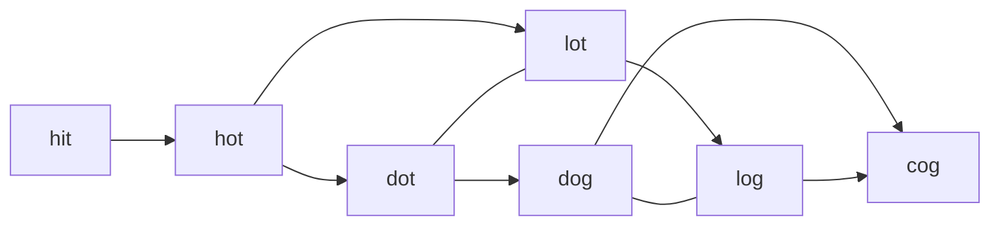
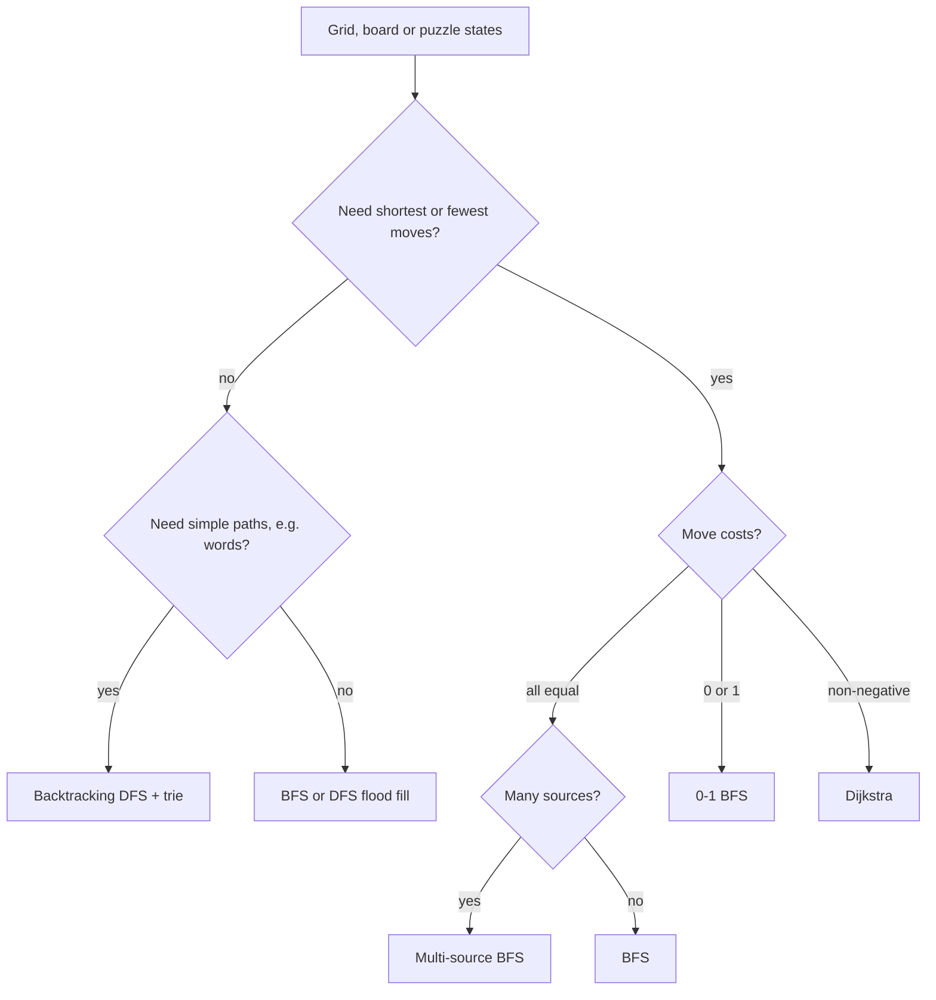

## Introduction

A fire starts in three rooms of a building at the same moment. Every minute it spreads to the rooms next door. For each room, how many minutes until the fire arrives? You could simulate each fire separately and keep the earliest arrival per room, but that repeats the same work three times — and with a thousand fires, a thousand times.

**Multi-source breadth-first search (BFS)** answers the question in one pass. Instead of starting BFS from one node, you put *all* the starting nodes into the queue at distance 0 and run ordinary BFS from there. The wavefronts from every source expand together, and the first wave to reach a node is, by construction, the one from the nearest source. One traversal, O(V + E) time, no matter how many sources there are.

The technique is the centre of a larger family. Most "grid" interview problems — count the islands, fill a region with a colour, find the shortest path through a maze, find which cells drain to both oceans — are BFS or DFS on a graph that is never written down as a graph: the cells are the vertices and adjacency is implied by position. Puzzles go one step further: in Word Ladder the vertices are words, in the water-jug puzzle they are pairs of jug levels, in Snakes and Ladders they are board squares after a dice roll. Recognising the hidden graph and choosing the right traversal is the real skill, and this lesson builds it step by step:

1. How to treat a grid as a graph ([[a8-grid-as-graph]]).
2. Multi-source BFS itself, with a proof and a full dry run, then its two signature problems: [[a8-rotten-oranges]] and [[a8-pacific-atlantic]].
3. Region problems: [[a8-flood-fill]] and [[a8-number-of-islands]].
4. Shortest paths on grids and implicit state graphs: [[a8-shortest-path-binary-matrix]], [[a8-steps-by-knight]], [[a8-snakes-and-ladders]], [[a8-word-ladder]] and [[a8-water-jug]].
5. What to do when moves have cost 0 or 1: [[a8-0-1-bfs]].
6. A grid problem where BFS is the wrong tool: [[a8-boggle]].

## Before you start

- **BFS on an adjacency list** — the queue, the visited check, and why BFS finds shortest paths in unweighted graphs. This lesson builds directly on [[a8-bfs]].
- **DFS** — recursive and iterative depth-first search, used for flood fill and backtracking. See [[a8-dfs]].
- **2D arrays** — indexing `grid[r][c]`, rows versus columns. See [[a2-matrix]].
- **Queues and deques in Java** — `ArrayDeque` with `add`/`poll`, and `addFirst`/`addLast`/`pollFirst` for the deque used in 0-1 BFS. See [[a5-queue]] and [[a5-deque]].
- **Big-O for graphs** — what O(V + E) means. See [[a1-time-complexity]].

## The intuition

Drop one pebble into a still pond and a ring spreads outward; every point on the ring is the same distance from where the pebble landed. That ring is a BFS layer: layer 0 is the pebble, layer 1 is everything one step away, layer 2 everything two steps away, and so on. BFS visits layers in order, which is why the first time it reaches a point is via a shortest route.

Now drop five pebbles at the same instant. Five rings spread at the same speed. Where two rings meet, they stop each other — a point already reached by one ring is not "reached again" by a later one. When the pond is covered, every point has been claimed by the ring that got there first, which is the ring from the **nearest** pebble. That is multi-source BFS: the queue holds the rings of all sources at once, and because they all advance one step per layer, no ring can overtake another.

The analogy stops working in one place. Real ripples pass through each other; BFS waves do not. A cell is claimed once, by the first wave, and never updated — that is exactly what makes the algorithm linear.

## Grid as a Graph {#a8-grid-as-graph}

A **grid graph** is a graph whose vertices are the cells of a 2D grid and whose edges connect cells that are next to each other. You almost never build it explicitly. Instead you keep the grid as it is and compute a cell's neighbours on demand from its coordinates. This is called an **implicit graph**: the edges exist only as a rule ("the cell above, below, left and right, if inside the grid and not a wall"), not as stored lists.

### Why model a grid as a graph at all

Once you see a grid as a graph, every graph algorithm becomes available to it. "Can I walk from the entrance to the exit?" is reachability. "How many separate lakes are there?" is counting connected components. "What is the fewest moves to the exit?" is an unweighted shortest path, which BFS solves. Without the graph view, each of these looks like a new puzzle; with it, they are the same few algorithms with a different neighbour rule.

### Vertices, edges and their counts

For a grid with `R` rows and `C` columns, there are `V = R · C` vertices. With **4-directional adjacency** (up, down, left, right) each cell has at most 4 neighbours, so the number of edges is at most `2 · R · C` (each edge is shared by two cells). With **8-directional adjacency** (adding the four diagonals) each cell has at most 8. Either way `E = O(R · C)`, so a full BFS or DFS over a grid costs **O(R · C)** time. That is why grid problems with up to a few million cells are routinely solved by traversal.

| Movement rule | Offsets `(dr, dc)` | Used in |
|---|---|---|
| 4-directional | `(1,0) (-1,0) (0,1) (0,-1)` | Islands, flood fill, rotting oranges, most mazes |
| 8-directional | the four above plus `(1,1) (1,-1) (-1,1) (-1,-1)` | Shortest path in binary matrix, Boggle, Minesweeper |
| Knight | `(±2,±1)` and `(±1,±2)` | Steps by knight |

Read the problem statement carefully for which rule applies: "adjacent" usually means 4-directional, "8-directionally connected" or "including diagonals" means 8.

### Direction arrays and the bounds check

Neighbour generation is written with a **direction array**: a list of row and column offsets that you loop over. For each offset you compute the candidate cell, discard it if it falls off the grid, discard it if it is blocked or already visited, and otherwise process it. The bounds check must come *before* any array access — reading `grid[-1][0]` throws `ArrayIndexOutOfBoundsException`.

The program below computes the BFS distance from the top-left corner to every open cell of a small maze. It shows every ingredient of grid BFS in one place.

```java title="GridAsGraph.java"
import java.util.ArrayDeque;
import java.util.Arrays;

public class GridAsGraph {
    // Row and column offsets for the four orthogonal moves: down, up, right, left.
    static final int[] DR = {1, -1, 0, 0};
    static final int[] DC = {0, 0, 1, -1};

    static int[][] distancesFrom(char[][] grid, int sr, int sc) {
        int rows = grid.length, cols = grid[0].length;
        int[][] dist = new int[rows][cols];
        for (int[] row : dist) Arrays.fill(row, -1);   // -1 = not reached yet

        ArrayDeque<Integer> queue = new ArrayDeque<>();
        dist[sr][sc] = 0;
        queue.add(sr * cols + sc);                      // encode (r, c) as one int

        while (!queue.isEmpty()) {
            int id = queue.poll();
            int r = id / cols, c = id % cols;           // decode
            for (int k = 0; k < 4; k++) {
                int nr = r + DR[k], nc = c + DC[k];
                if (nr < 0 || nr >= rows || nc < 0 || nc >= cols) continue; // off the grid
                if (grid[nr][nc] == '#' || dist[nr][nc] != -1) continue;     // wall or seen
                dist[nr][nc] = dist[r][c] + 1;
                queue.add(nr * cols + nc);
            }
        }
        return dist;
    }

    public static void main(String[] args) {
        char[][] grid = {
            "S..#".toCharArray(),
            ".#..".toCharArray(),
            "...#".toCharArray(),
            "#.#.".toCharArray(),
        };
        int[][] dist = distancesFrom(grid, 0, 0);
        for (int r = 0; r < grid.length; r++) {
            StringBuilder sb = new StringBuilder();
            for (int c = 0; c < grid[0].length; c++) {
                String cell = grid[r][c] == '#' ? "#" : dist[r][c] == -1 ? "-" : "" + dist[r][c];
                sb.append(String.format("%3s", cell));
            }
            System.out.println(sb);
        }
    }
}
```

```output
  0  1  2  #
  1  #  3  4
  2  3  4  #
  #  4  #  -
```

Three design choices in this code are worth understanding, because you will make them in every grid problem.

**Encoding a cell as one integer.** `r * cols + c` maps each cell to a unique number between `0` and `R · C − 1`, and `id / cols`, `id % cols` map it back. This lets the queue hold `Integer`s instead of `int[]` objects, and lets you use a 1D `visited` or `parent` array if you prefer. Storing `new int[]{r, c}` in the queue is equally correct and often easier to read; the rest of this lesson uses that form. Make sure you multiply by the number of **columns**, not rows — on a non-square grid the wrong one produces collisions.

**One array for distance and visited.** `dist[r][c] == -1` means "not reached". Setting the distance at the moment a cell is discovered both records the answer and prevents the cell from being added again. A separate `boolean[][] visited` works too; what matters is that you mark a cell when you **enqueue** it, not when you dequeue it (more on this in Common mistakes).

**Unreachable cells keep their sentinel.** The cell at the bottom right is open but enclosed by walls, so it prints `-`. Many problems ask you to report exactly these cells, or return `-1` if the target is among them.

> [!TIP] Modifying the grid as the visited mark
> Overwriting cells (turning land `'1'` into water `'0'`, or fresh oranges into rotten ones) saves the O(R · C) memory of a separate visited array. It is fine in interviews when you say so, but it destroys the input. In production code, or when the caller needs the grid afterwards, use a separate array or restore the cells.

### Beyond grids: implicit state graphs

The same idea works when the "cells" are not positions at all. Any problem where you have **states** and **moves** between them defines a graph: a state is a vertex, a legal move is an edge. In [[a8-word-ladder]] a state is a word and a move changes one letter; in [[a8-water-jug]] a state is the pair of jug levels and a move is fill, empty or pour; in [[a8-snakes-and-ladders]] a state is a board square and a move is a dice roll. If every move costs the same, the fewest moves from the start state to a goal state is a BFS shortest path. You generate neighbours from the state, exactly as the direction array generates them from `(r, c)`.

## The problem: distance to the nearest source

Here is the problem multi-source BFS solves, stated generally. You are given a graph (often a grid) and a set of **source** vertices. For every vertex, find the number of edges on a shortest path to *any* source — its distance to the nearest one. Walls and Gates (distance from every room to the nearest gate), 01 Matrix (distance from every cell to the nearest `0`) and As Far from Land as Possible are all this problem.

### The naive approaches and why they are slow

The first idea is to run BFS from every vertex until it hits a source. On a grid with `N = R · C` cells, each search can explore O(N) cells, so the total is **O(N²)**. For a 1000 × 1000 grid that is 10¹² steps — far too slow.

The second idea is better: run one BFS from each of the `k` sources and keep, for each vertex, the minimum distance seen. That costs **O(k · (V + E))**. It is fine for three sources and hopeless when a quarter of the grid is sources, because then `k` is proportional to `N` and you are back to O(N²).

### Deriving the better idea

Look at what the second approach computes: for each vertex, `min over sources s of dist(s, v)`. Imagine adding one extra, imaginary vertex — a **super-source** `S` — with an edge from `S` to every real source. A shortest path from `S` to `v` must start with one of those edges and then continue as a shortest path from that source to `v`. So

```text
dist(S, v) = 1 + min over sources s of dist(s, v)
```

which means a *single* BFS from `S` answers the question for every vertex at once. Now trace what that BFS does. Its first step pops `S` and enqueues every real source at distance 1. From then on it is plain BFS. If you skip the imaginary vertex and start with all the sources already in the queue, labelled distance 0 instead of 1, you get exactly the same traversal with every distance shifted by one — which is what we want.

That is the whole algorithm: **seed the queue with every source at distance 0, then run ordinary BFS.**

```mermaid title="Seeding all sources equals BFS from a virtual super-source"
flowchart LR
    S(("S (virtual)")) --> A["source 1"]
    S --> B["source 2"]
    S --> C["source 3"]
    A --> X["cells at distance 1"]
    B --> X
    C --> X
    X --> Y["cells at distance 2"]
```

### Why the first visit is the nearest source: the queue invariant

The super-source argument proves correctness by reduction. It also helps to see directly why BFS order is preserved. The invariant is:

> At every moment, the distances of the vertices in the queue are non-decreasing from head to tail, and the head and tail differ by at most 1.

Initially every queued vertex has distance 0, so it holds. Each step pops the head, with some distance `d`, and appends neighbours with distance `d + 1`. Before the pop, the queue looked like `d, …, d, d+1, …, d+1` (or all `d`); appending more `d + 1` values at the tail keeps that shape. Therefore vertices leave the queue in non-decreasing order of distance. When a vertex `v` is first discovered from `u`, every vertex with a smaller distance than `dist[u]` has already been processed; if `v` had a shorter route, one of those earlier vertices would have discovered it first. So the first label is final.

Notice why the sources must be seeded **before** the loop starts. If you added a source later — say, while processing layer 2 — it would enter the queue behind distance-2 vertices with distance 0, breaking the sorted order, and cells near it would already carry wrong, larger labels.

### The procedure

1. Create `dist` filled with `-1` (meaning unvisited).
2. For every source: set `dist = 0` and enqueue it. Skip duplicates.
3. While the queue is not empty: poll `u`; for each neighbour `v` with `dist[v] == -1`, set `dist[v] = dist[u] + 1` and enqueue `v`.
4. Vertices still at `-1` cannot be reached from any source.

## Worked example: distance to the nearest gate

The grid below has gates `G`, walls `#` and rooms `.`. We want each room's distance to the nearest gate, with `-1` for rooms that no gate can reach.

```java title="NearestGate.java"
import java.util.ArrayDeque;
import java.util.Arrays;

public class NearestGate {
    static final int[] DR = {1, -1, 0, 0};
    static final int[] DC = {0, 0, 1, -1};

    /** dist[r][c] = steps to the nearest 'G', or -1 for walls and unreachable rooms. */
    static int[][] nearestGate(char[][] grid) {
        int rows = grid.length, cols = grid[0].length;
        int[][] dist = new int[rows][cols];
        for (int[] row : dist) Arrays.fill(row, -1);
        ArrayDeque<int[]> queue = new ArrayDeque<>();

        // Seed every gate at distance 0 before the loop starts.
        for (int r = 0; r < rows; r++) {
            for (int c = 0; c < cols; c++) {
                if (grid[r][c] == 'G') {
                    dist[r][c] = 0;
                    queue.add(new int[]{r, c});
                }
            }
        }

        while (!queue.isEmpty()) {
            int[] cur = queue.poll();
            int r = cur[0], c = cur[1];
            for (int k = 0; k < 4; k++) {
                int nr = r + DR[k], nc = c + DC[k];
                if (nr < 0 || nr >= rows || nc < 0 || nc >= cols) continue;
                if (grid[nr][nc] == '#' || dist[nr][nc] != -1) continue;
                dist[nr][nc] = dist[r][c] + 1;   // first visit = nearest gate
                queue.add(new int[]{nr, nc});
            }
        }
        return dist;
    }

    public static void main(String[] args) {
        char[][] grid = {
            "G..#.".toCharArray(),
            ".#...".toCharArray(),
            "...#G".toCharArray(),
            "##.#.".toCharArray(),
            "..#..".toCharArray(),
        };
        int[][] dist = nearestGate(grid);
        for (int r = 0; r < grid.length; r++) {
            StringBuilder sb = new StringBuilder();
            for (int c = 0; c < grid[0].length; c++) {
                String cell = grid[r][c] == '#' ? "#" : "" + dist[r][c];
                sb.append(String.format("%3s", cell));
            }
            System.out.println(sb);
        }
    }
}
```

```output
  0  1  2  #  2
  1  #  3  2  1
  2  3  4  #  0
  #  #  5  #  1
 -1 -1  #  3  2
```

The only difference from single-source BFS is the seeding loop. Everything inside `while` is unchanged — which is the point: multi-source BFS is not a new algorithm, it is a new initial state for an old one.

### Dry run, layer by layer

Gates are at `(0,0)` and `(2,4)`. Directions are tried in the order down, up, right, left. Each row of the table is one BFS layer — all cells with the same distance.

| Layer (distance) | Cells discovered in this layer | Discovered from |
|---|---|---|
| 0 | `(0,0)`, `(2,4)` | seeded |
| 1 | `(1,0)`, `(0,1)`, `(3,4)`, `(1,4)` | `(0,0)` gives the first two; `(2,4)` the last two |
| 2 | `(2,0)`, `(0,2)`, `(4,4)`, `(0,4)`, `(1,3)` | one step from layer 1 |
| 3 | `(2,1)`, `(1,2)`, `(4,3)` | `(1,2)` is reached from `(0,2)`; `(1,3)` also touches it but finds it already labelled |
| 4 | `(2,2)` | from `(2,1)` |
| 5 | `(3,2)` | from `(2,2)` |

Look at `(1,2)`. It is three steps from the left gate (`(0,0) → (0,1) → (0,2) → (1,2)`) and also three steps from the right gate (`(2,4) → (1,4) → (1,3) → (1,2)`). Whichever wave arrives first labels it 3, and the second wave sees `dist != -1` and stops. Both are correct because both are 3 — the invariant guarantees that no wave can reach a cell with a *smaller* distance after it has been labelled.

The cells `(4,0)` and `(4,1)` never enter the queue: the walls at `(3,0)`, `(3,1)` and `(4,2)` cut them off. They keep `-1`.

### Complexity derivation

**Time.** Seeding scans the grid once: O(V). In the BFS loop, each vertex is enqueued at most once, because it is enqueued only when its `dist` changes from `-1`, which happens once. When a vertex is dequeued, we look at each of its edges once. Summed over all vertices, that is O(E) edge checks. Total: **O(V + E)**, which on a grid is **O(R · C)**. Crucially, this does not depend on the number of sources.

**Space.** `dist` takes O(V). The queue holds at most V entries. Total **O(V)**, or O(R · C) on a grid.

### Edge cases

- **No sources at all.** The queue starts empty, the loop never runs, and every cell stays `-1`. Decide whether that is the right answer for the problem.
- **Every cell is a source.** Every distance is 0, and the loop does V polls with no discoveries.
- **Duplicate sources** (a source listed twice in an input list). Without a guard it is enqueued twice; harmless for correctness but wasteful. Skip a source whose `dist` is already 0.
- **Weighted moves.** If moving between cells has different costs, BFS layers no longer correspond to distance. Seed all sources into Dijkstra's priority queue instead — see [[a8-dijkstra]] — or, if every cost is 0 or 1, use [[a8-0-1-bfs]].

### Level-by-level processing

Sometimes you need to know when one layer ends and the next begins — for example, "how many minutes until everything is covered", where each layer is one minute. Instead of storing distances, you can process the queue in rounds: record `size = queue.size()` at the start of a round, poll exactly `size` vertices, and increment a counter after the round. Everything polled in one round belongs to the same layer, because by the invariant the queue holds exactly one layer at the start of each round. [[a8-rotten-oranges]] below uses this form.

```quiz
Q: A grid has 1,000,000 cells, of which 200,000 are sources. What is the time complexity of multi-source BFS compared with running a separate BFS from each source?
- [ ] Both are O(R · C), because BFS is linear
- [x] Multi-source BFS is O(R · C); separate BFS runs are O(k · R · C), here about 200,000 times more work
- [ ] Multi-source BFS is O(k + R · C · log k) because the sources must be sorted
- [ ] Separate runs are faster because each stops as soon as it finds a source
> Seeding all sources costs O(k) and the single traversal enqueues each cell once, so the total is O(R · C) regardless of k. Separate runs repeat a full traversal per source. No sorting is needed: all sources share distance 0, so their order in the queue does not matter.

Q: Why must all sources be in the queue before the BFS loop begins?
- [ ] Java's ArrayDeque cannot grow once polling has started
- [ ] So that the sources are processed in sorted order of coordinates
- [x] A source added later would sit behind larger distances, breaking the sorted-by-distance order that makes the first label final
- [ ] It makes no difference; sources can be added whenever they are found
> BFS relies on the queue holding distances d then d+1 in order. A distance-0 source inserted behind distance-2 cells is processed too late, and cells near it may already have been labelled with larger, wrong distances.
```

## Rotten Oranges / Multi-source Spread {#a8-rotten-oranges}

**Rotten Oranges** is the textbook multi-source spread problem. A grid holds `0` (empty), `1` (a fresh orange) and `2` (a rotten orange). Every minute, each fresh orange that is 4-directionally adjacent to a rotten one becomes rotten. Return the number of minutes until no fresh orange remains, or `-1` if some fresh orange can never rot.

### Why it is multi-source BFS

All rotten oranges start spreading at minute 0, simultaneously. The minute at which a fresh orange rots is its distance to the *nearest* initially rotten orange, so the rotten oranges are the sources. The answer is the largest such distance over all fresh oranges — the time when the last one rots — or `-1` if any fresh orange is unreachable because empty cells wall it off.

A beginner's first attempt is often a **simulation**: scan the whole grid each minute, rot every fresh orange next to a rotten one, and repeat until nothing changes. That is correct but costs O(R · C) per minute, and the number of minutes can itself be O(R · C) (picture one rotten orange at the end of a long snake-shaped line of fresh ones), giving O((R · C)²). BFS touches each orange once.

There is also a trap in the simulation: if you rot oranges in place while scanning, an orange that rotted this minute can rot its neighbour in the same minute, making the spread too fast. BFS rounds avoid this naturally — oranges rotted in this round are only processed in the next round.

### The algorithm

1. Scan the grid: enqueue every rotten orange and count the fresh ones.
2. While the queue is not empty **and** fresh oranges remain, process one round (one minute): poll exactly the current queue size; rot each fresh neighbour, decrement the fresh count, and enqueue it. Then add one minute.
3. If the fresh count is 0, return the minutes; otherwise return `-1`.

```java title="RottingOranges.java"
import java.util.ArrayDeque;

public class RottingOranges {
    static final int[] DR = {1, -1, 0, 0};
    static final int[] DC = {0, 0, 1, -1};

    /** 0 = empty, 1 = fresh, 2 = rotten. Returns minutes until no fresh orange, or -1. */
    static int orangesRotting(int[][] grid) {
        int rows = grid.length, cols = grid[0].length;
        ArrayDeque<int[]> queue = new ArrayDeque<>();
        int fresh = 0;
        for (int r = 0; r < rows; r++) {
            for (int c = 0; c < cols; c++) {
                if (grid[r][c] == 2) queue.add(new int[]{r, c});
                else if (grid[r][c] == 1) fresh++;
            }
        }

        int minutes = 0;
        // Stop as soon as nothing fresh is left: an extra round would add a minute
        // in which nothing happens.
        while (!queue.isEmpty() && fresh > 0) {
            int roundSize = queue.size();          // everything that rotted last minute
            for (int i = 0; i < roundSize; i++) {
                int[] cur = queue.poll();
                for (int k = 0; k < 4; k++) {
                    int nr = cur[0] + DR[k], nc = cur[1] + DC[k];
                    if (nr < 0 || nr >= rows || nc < 0 || nc >= cols) continue;
                    if (grid[nr][nc] != 1) continue;
                    grid[nr][nc] = 2;              // marking it rotten doubles as "visited"
                    fresh--;
                    queue.add(new int[]{nr, nc});
                }
            }
            minutes++;
        }
        return fresh == 0 ? minutes : -1;
    }

    public static void main(String[] args) {
        System.out.println(orangesRotting(new int[][]{{2, 1, 1}, {1, 1, 0}, {0, 1, 1}}));
        System.out.println(orangesRotting(new int[][]{{2, 1, 1}, {0, 1, 1}, {1, 0, 1}}));
        System.out.println(orangesRotting(new int[][]{{0, 2}}));
        System.out.println(orangesRotting(new int[][]{{2, 1, 1, 1, 2}}));
    }
}
```

```output
4
-1
0
2
```

### Dry run of the first grid

```text
2 1 1
1 1 0
0 1 1
```

| Minute | Oranges that rot | Fresh left | Queue at end of round |
|---|---|---|---|
| start | — | 6 | `(0,0)` |
| 1 | `(1,0)`, `(0,1)` | 4 | `(1,0)`, `(0,1)` |
| 2 | `(1,1)`, `(0,2)` | 2 | `(1,1)`, `(0,2)` |
| 3 | `(2,1)` | 1 | `(2,1)` |
| 4 | `(2,2)` | 0 | `(2,2)` |

The loop stops because `fresh` is 0, and returns 4. Note that `(2,2)` is still in the queue — without the `fresh > 0` condition, the loop would run a fifth round in which nothing rots, and return 5. That is the most common off-by-one in this problem.

The other three cases each test one edge. In the second grid, the orange at `(2,0)` is separated from every rotten orange by empty cells, so `fresh` never reaches 0 and the answer is `-1`. In `[[0, 2]]` there is nothing fresh, so the loop never runs and the answer is 0 — not `-1`. And `[2, 1, 1, 1, 2]` shows the simultaneous spread: the middle orange is two minutes from *each* end, so the answer is 2. A single-source BFS from the left orange would wrongly report 4.

### Complexity

Every cell is scanned once during setup, and every orange enters the queue at most once (only when it turns from 1 to 2), with four neighbour checks each. Time **O(R · C)**; space **O(R · C)** for the queue in the worst case.

### Variations

The same shape — "many things spread at once; when is everything covered?" — appears as fire spreading through a forest, infection in a population grid, and "Map of Highest Peak", where water cells are sources and land heights are their distances. A harder variant gives two spreading processes, such as a person escaping a fire: run multi-source BFS from the fires first to compute when each cell burns, then BFS the person and only allow entering a cell strictly before the fire arrives.

## Pacific Atlantic Water Flow {#a8-pacific-atlantic}

**Pacific Atlantic Water Flow** gives a grid of heights. The Pacific Ocean touches the top and left edges; the Atlantic touches the bottom and right edges. Rain falling on a cell flows to a 4-directional neighbour whose height is **less than or equal to** the current height, and flows into an ocean from any cell on that ocean's edge. Return every cell from which water can reach *both* oceans.

### The naive approach

The direct reading is: for each cell, run a BFS that follows downhill-or-level moves and check whether it reaches both oceans. Each search can explore the whole grid, so the total is O((R · C)²). For a 200 × 200 grid that is 1.6 × 10⁹ steps — too slow, and most of the work is repeated, since neighbouring cells share most of their downhill paths.

### Reverse the direction

The key idea is to ask the question backwards. Instead of "where can water from this cell go?", ask "which cells can send water *to* this ocean?". A cell can drain into the Pacific if it is on the Pacific edge, or if it is next to a cell that can drain into the Pacific and is at least as high as that cell. So start from every Pacific edge cell at once — multi-source — and move **uphill or level**: from a cell of height `h`, step to a neighbour of height `≥ h`. Every cell this search reaches can drain into the Pacific. Do the same from the Atlantic edges. The answer is the intersection.

Each of the two searches is O(R · C), so the whole algorithm is O(R · C). Reversing edge direction to turn "many sources, one target" into "one multi-source search" is a pattern worth remembering; it also appears in "Surrounded Regions" (start from the border `O`s to find which ones are *not* surrounded) and "Number of Enclaves".

```java title="PacificAtlantic.java"
import java.util.ArrayDeque;
import java.util.ArrayList;
import java.util.List;

public class PacificAtlantic {
    static final int[] DR = {1, -1, 0, 0};
    static final int[] DC = {0, 0, 1, -1};

    static List<List<Integer>> pacificAtlantic(int[][] heights) {
        int rows = heights.length, cols = heights[0].length;
        boolean[][] pacific = new boolean[rows][cols];
        boolean[][] atlantic = new boolean[rows][cols];
        ArrayDeque<int[]> pq = new ArrayDeque<>(), aq = new ArrayDeque<>();

        // Sources: every cell touching each ocean. Pacific = top row + left column,
        // Atlantic = bottom row + right column. Mark on enqueue so corners go in once.
        for (int r = 0; r < rows; r++) {
            seed(pq, pacific, r, 0);
            seed(aq, atlantic, r, cols - 1);
        }
        for (int c = 0; c < cols; c++) {
            seed(pq, pacific, 0, c);
            seed(aq, atlantic, rows - 1, c);
        }
        climb(heights, pq, pacific);
        climb(heights, aq, atlantic);

        List<List<Integer>> answer = new ArrayList<>();
        for (int r = 0; r < rows; r++)
            for (int c = 0; c < cols; c++)
                if (pacific[r][c] && atlantic[r][c]) answer.add(List.of(r, c));
        return answer;
    }

    private static void seed(ArrayDeque<int[]> q, boolean[][] seen, int r, int c) {
        if (seen[r][c]) return;
        seen[r][c] = true;
        q.add(new int[]{r, c});
    }

    // Reverse the flow: from an ocean cell, water could have come from any neighbour
    // that is at least as high, so we walk "uphill or level".
    private static void climb(int[][] h, ArrayDeque<int[]> q, boolean[][] seen) {
        while (!q.isEmpty()) {
            int[] cur = q.poll();
            for (int k = 0; k < 4; k++) {
                int nr = cur[0] + DR[k], nc = cur[1] + DC[k];
                if (nr < 0 || nr >= h.length || nc < 0 || nc >= h[0].length) continue;
                if (seen[nr][nc] || h[nr][nc] < h[cur[0]][cur[1]]) continue;
                seen[nr][nc] = true;
                q.add(new int[]{nr, nc});
            }
        }
    }

    public static void main(String[] args) {
        int[][] heights = {
            {1, 2, 2, 3, 5},
            {3, 2, 3, 4, 4},
            {2, 4, 5, 3, 1},
            {6, 7, 1, 4, 5},
            {5, 1, 1, 2, 4},
        };
        System.out.println(pacificAtlantic(heights));
        System.out.println(pacificAtlantic(new int[][]{{1}}));
    }
}
```

```output
[[0, 4], [1, 3], [1, 4], [2, 2], [3, 0], [3, 1], [4, 0]]
[[0, 0]]
```

### Walking through one cell

Take the centre cell `(2,2)` with height 5. The Pacific search reaches it like this: it starts from `(0,2)` (height 2, top edge), climbs to `(1,2)` (height 3, since 3 ≥ 2), then to `(2,2)` (5 ≥ 3). Read forwards, that is a valid drainage path: water at height 5 flows down to 3, then to 2, then off the top edge. The Atlantic search reaches it from `(2,4)` (height 1, right edge) via `(2,3)` (height 3 ≥ 1) then `(2,2)` (5 ≥ 3). So `(2,2)` is in both sets.

Compare `(1,1)`, height 2. It sits on the Pacific side, but every route to the Atlantic must pass through a lower cell and then climb — water cannot do that, and the reversed Atlantic search, which only climbs, never reaches it.

A one-cell grid touches all four edges, so its only cell is in both sets. Corner cells such as `(0, cols-1)` touch both oceans directly: the top edge is Pacific and the right edge is Atlantic, so they are always in the answer — `(0,4)` and `(4,0)` above.

### Complexity and the comparison operator

Each search marks every cell at most once and checks four neighbours, so time is **O(R · C)** and space O(R · C) for the two boolean grids and queues. Watch the comparison: the problem says water flows to a neighbour of height `≤` the current one, so the reversed search moves to neighbours of height `≥`. Using `>` would wrongly block flat plateaus. DFS works equally well here; the choice of BFS or DFS does not matter for reachability, only the direction of the edges does.

## Flood Fill {#a8-flood-fill}

**Flood fill** starts from one cell and visits every cell connected to it that shares some property — usually the same colour — then changes them all. It is the "paint bucket" tool in an image editor, and the "reveal empty region" step when you click a blank square in Minesweeper. Formally it is reachability from one source in a grid graph where edges only connect cells of the same colour.

### The problem

Given an image as a grid of integers, a starting pixel `(sr, sc)` and a new colour, recolour the starting pixel and every pixel 4-directionally connected to it through pixels of the *original* colour. Return the modified image.

### The algorithm

Remember the original colour `old = image[sr][sc]`. Then run BFS or DFS from `(sr, sc)`, stepping only onto neighbours whose colour is `old`, and recolour each pixel as you visit it. Recolouring doubles as the visited mark: a recoloured pixel no longer has colour `old`, so it will not be visited again.

That trick has one hole. If the new colour equals `old`, recolouring changes nothing, every pixel still looks unvisited, and the search loops forever (BFS) or overflows the stack (DFS). The fix is a guard at the top: if `old == color`, return the image unchanged — it is already the right colour.

```java title="FloodFill.java"
import java.util.ArrayDeque;
import java.util.Arrays;

public class FloodFill {
    static final int[] DR = {1, -1, 0, 0};
    static final int[] DC = {0, 0, 1, -1};

    static int[][] floodFill(int[][] image, int sr, int sc, int color) {
        int old = image[sr][sc];
        if (old == color) return image;   // without this guard the loop never ends
        int rows = image.length, cols = image[0].length;

        ArrayDeque<int[]> queue = new ArrayDeque<>();
        image[sr][sc] = color;            // recolouring is the visited mark
        queue.add(new int[]{sr, sc});
        while (!queue.isEmpty()) {
            int[] cur = queue.poll();
            for (int k = 0; k < 4; k++) {
                int nr = cur[0] + DR[k], nc = cur[1] + DC[k];
                if (nr < 0 || nr >= rows || nc < 0 || nc >= cols) continue;
                if (image[nr][nc] != old) continue;
                image[nr][nc] = color;
                queue.add(new int[]{nr, nc});
            }
        }
        return image;
    }

    // The recursive version: shorter, but its depth can reach rows * cols.
    static void fillRecursive(int[][] image, int r, int c, int old, int color) {
        if (r < 0 || r >= image.length || c < 0 || c >= image[0].length) return;
        if (image[r][c] != old) return;
        image[r][c] = color;
        for (int k = 0; k < 4; k++) fillRecursive(image, r + DR[k], c + DC[k], old, color);
    }

    public static void main(String[] args) {
        int[][] image = {{1, 1, 1}, {1, 1, 0}, {1, 0, 1}};
        System.out.println(Arrays.deepToString(floodFill(image, 1, 1, 2)));

        int[][] again = {{1, 1, 1}, {1, 1, 0}, {1, 0, 1}};
        fillRecursive(again, 1, 1, again[1][1], 2);
        System.out.println(Arrays.deepToString(again));

        int[][] same = {{0, 0, 0}, {0, 0, 0}};
        System.out.println(Arrays.deepToString(floodFill(same, 0, 0, 0)));
    }
}
```

```output
[[2, 2, 2], [2, 2, 0], [2, 0, 1]]
[[2, 2, 2], [2, 2, 0], [2, 0, 1]]
[[0, 0, 0], [0, 0, 0]]
```

In the first image, starting at the centre `(1,1)` whose colour is 1, the fill spreads to every connected 1 — the top row, the left column and the centre. The `1` at the bottom-right corner `(2,2)` is *not* recoloured: its only neighbours are `(1,2)` and `(2,1)`, both 0, so it is not 4-directionally connected to the start. Diagonal contact does not count unless the problem says 8-directional.

### BFS or DFS?

Both visit exactly the same set of pixels, so the result is identical; only the order differs. The recursive DFS is the shortest code and is what many people write first. Its weakness is **recursion depth**: in the worst case (a large region shaped like a long snake, or one big solid block) the recursion can be as deep as the number of pixels in the region. Each Java call uses a stack frame, and the default thread stack holds only some thousands to tens of thousands of frames, depending on the JVM, platform and the size of each frame. In a test for this lesson (OpenJDK with default settings on macOS), a recursive fill of an all-land 200 × 200 grid — only 40,000 cells — threw `StackOverflowError`, while the BFS version handled 3000 × 3000. Use BFS, or DFS with an explicit `ArrayDeque` stack (see [[a8-iterative-dfs]]), whenever the region can be large.

### Complexity

Each pixel in the region is recoloured once and enqueued once, with four neighbour checks. Time is **O(size of region)**, which is O(R · C) in the worst case. Space is O(R · C) in the worst case for the queue (or recursion stack).

### Where it leads

Flood fill is the building block for the next section: counting islands is "flood fill from every unvisited land cell and count how many fills you start". Measuring the largest region ([[a8-largest-region]]) is the same with a counter inside the fill.

## Number of Islands {#a8-number-of-islands}

**Number of Islands** asks: given a grid of `'1'` (land) and `'0'` (water), count the islands, where an island is a maximal group of land cells connected 4-directionally. In graph terms, it asks for the number of **connected components** among the land cells (see [[a8-connected-components]]).

### Deriving the algorithm

Scan the grid cell by cell. When you meet a land cell that no earlier search has reached, you have found a new island — count it — and then flood fill from it to mark every cell of that island as visited, so that none of them is counted again. When the scan finishes, the count is the number of islands.

Why is each island counted exactly once? Each island is counted at least once, because the scan eventually reaches one of its cells. And it is counted at most once, because the first time the scan touches any of its cells, the flood fill marks *all* of its cells, so the scan never finds an unmarked cell of that island again.

```java title="NumberOfIslands.java"
import java.util.ArrayDeque;

public class NumberOfIslands {
    static final int[] DR = {1, -1, 0, 0};
    static final int[] DC = {0, 0, 1, -1};

    static int numIslands(char[][] grid) {
        int rows = grid.length, cols = grid[0].length, islands = 0;
        for (int r = 0; r < rows; r++) {
            for (int c = 0; c < cols; c++) {
                if (grid[r][c] == '1') {    // land nobody has claimed yet: a new island
                    islands++;
                    sink(grid, r, c);
                }
            }
        }
        return islands;
    }

    // BFS flood fill that turns the whole island to water so it is never counted again.
    private static void sink(char[][] grid, int sr, int sc) {
        ArrayDeque<int[]> queue = new ArrayDeque<>();
        grid[sr][sc] = '0';
        queue.add(new int[]{sr, sc});
        while (!queue.isEmpty()) {
            int[] cur = queue.poll();
            for (int k = 0; k < 4; k++) {
                int nr = cur[0] + DR[k], nc = cur[1] + DC[k];
                if (nr < 0 || nr >= grid.length || nc < 0 || nc >= grid[0].length) continue;
                if (grid[nr][nc] != '1') continue;
                grid[nr][nc] = '0';
                queue.add(new int[]{nr, nc});
            }
        }
    }

    static char[][] parse(String... rows) {
        char[][] g = new char[rows.length][];
        for (int i = 0; i < rows.length; i++) g[i] = rows[i].toCharArray();
        return g;
    }

    public static void main(String[] args) {
        System.out.println(numIslands(parse("11000", "11000", "00100", "00011")));
        System.out.println(numIslands(parse("11110", "11010", "11000", "00000")));
        System.out.println(numIslands(parse("101", "010", "101")));
        // A 3000 x 3000 all-land grid: a recursive DFS would need ~9 million frames.
        char[][] big = new char[3000][3000];
        for (char[] row : big) java.util.Arrays.fill(row, '1');
        System.out.println(numIslands(big));
    }
}
```

```output
3
1
5
1
```

### Dry run of the first grid

```text
1 1 0 0 0
1 1 0 0 0
0 0 1 0 0
0 0 0 1 1
```

| Scan reaches | Cell is | Action | Islands |
|---|---|---|---|
| `(0,0)` | land | count, sink `(0,0) (1,0) (0,1) (1,1)` | 1 |
| `(0,1)` … `(2,1)` | water (some sunk) | skip | 1 |
| `(2,2)` | land | count, sink `(2,2)` alone | 2 |
| `(2,3)` … `(3,2)` | water | skip | 2 |
| `(3,3)` | land | count, sink `(3,3) (3,4)` | 3 |
| `(3,4)` | water (sunk) | skip | 3 |

The third test, a checkerboard `101 / 010 / 101`, gives 5: the cells touch only diagonally, which does not connect them under 4-directional adjacency. Under 8-directional adjacency the same grid would be a single island — another reason to read the adjacency rule carefully.

### Complexity

The outer scan visits each of the `R · C` cells once. Across *all* flood fills, each land cell is sunk exactly once and checks four neighbours. So the total time is **O(R · C)**, not O(R · C) per island — a common mistake when analysing nested loops that call a search. Space is O(R · C) in the worst case for the BFS queue; the visited state costs nothing extra because the grid itself is overwritten.

### Alternatives

**Recursive DFS** is the most common interview answer and is fine for small grids, but has the stack-depth problem described in [[a8-flood-fill]]: the 3000 × 3000 all-land case above would overflow it. **Union-Find** ([[a8-union-find]], [[a8-dsu-on-grids]]) treats each land cell as a set, unions each land cell with its land neighbours, and counts the distinct roots. It is slightly more code but shines in the follow-up "Number of Islands II", where land is added one cell at a time and you must report the island count after each addition — re-running BFS each time would be O(R · C) per update, while Union-Find handles each addition in nearly constant amortised time.

### Variations

Max Area of Island (count cells inside the fill and keep the maximum), Number of Closed Islands and Number of Enclaves (islands that do not touch the border — flood fill from the border first, then count what remains), Count Sub Islands, and Number of Distinct Islands (record each island's shape relative to its first cell, then put the shapes in a set). All of them are this scan-and-fill skeleton with a small change inside the fill.

```quiz
Q: A 1000 x 1000 grid contains 50,000 islands. What is the time complexity of the scan-and-flood-fill algorithm?
- [ ] O(50,000 · R · C), because each island triggers a full search
- [x] O(R · C), because every cell is scanned once and every land cell is sunk once across all fills
- [ ] O((R · C)²), because there are two nested loops plus a search
- [ ] O(R · C · log(R · C)), because of the queue operations
> A flood fill costs time proportional to the island it fills, not to the whole grid. Summed over all islands, the fills touch each land cell once, and the scan touches each cell once, so the total is linear in the grid size. ArrayDeque operations are O(1) amortised, so there is no log factor.

Q: Which input makes a recursive DFS island counter most likely to throw StackOverflowError?
- [ ] A grid of many tiny one-cell islands
- [ ] A grid that is entirely water
- [x] A large grid that is entirely land
- [ ] A grid with a single row
> Recursion depth grows with the number of cells one fill can chain through. Many tiny islands keep each fill shallow, and an all-water grid never recurses. A single huge island lets the recursion go hundreds of thousands of frames deep. A single long row can also go deep, but only as deep as its length, whereas a large all-land grid allows depth proportional to all R · C cells.
```

## Shortest Path in Binary Matrix {#a8-shortest-path-binary-matrix}

**Shortest Path in Binary Matrix** gives an `n × n` grid of `0` (open) and `1` (blocked). Find the length of the shortest clear path from the top-left cell to the bottom-right cell, moving **8-directionally** (including diagonals) through open cells only. The length is the number of *cells* on the path, including both ends. Return `-1` if no path exists.

### Why BFS, and why not DFS

Every move costs the same — one step — so this is an unweighted shortest path, which is exactly what BFS computes: the first time BFS reaches the target, it has done so through the fewest possible moves. DFS can also find *a* path, but the first path it finds depends on the direction order and is usually not the shortest. To get the shortest with DFS you would have to explore all paths, which is exponential. "Shortest", "fewest moves" or "minimum steps" with equal-cost moves is the signal for BFS.

### Details that decide correctness

- **Blocked start or end.** If `grid[0][0]` or `grid[n-1][n-1]` is 1, no path exists. Check before starting.
- **Counting cells, not moves.** The start cell already counts as length 1. A 1 × 1 grid containing `0` has answer 1.
- **Eight directions.** Forgetting the diagonals is the most common wrong answer.
- **Early exit.** Return when the target is *dequeued* (or when it is discovered — both are correct in BFS, because its distance is final the moment it is labelled).

```java title="BinaryMatrix.java"
import java.util.ArrayDeque;

public class BinaryMatrix {
    // All eight neighbours: the four sides and the four diagonals.
    static final int[] DR = {1, 1, 1, 0, 0, -1, -1, -1};
    static final int[] DC = {1, 0, -1, 1, -1, 1, 0, -1};

    /** Number of cells on the shortest clear path from top-left to bottom-right, or -1. */
    static int shortestPathBinaryMatrix(int[][] grid) {
        int n = grid.length;
        if (grid[0][0] != 0 || grid[n - 1][n - 1] != 0) return -1;
        int[][] dist = new int[n][n];      // 0 = unvisited; otherwise cells on the path
        ArrayDeque<int[]> queue = new ArrayDeque<>();
        dist[0][0] = 1;                    // the path length counts the start cell
        queue.add(new int[]{0, 0});

        while (!queue.isEmpty()) {
            int[] cur = queue.poll();
            int r = cur[0], c = cur[1];
            if (r == n - 1 && c == n - 1) return dist[r][c];
            for (int k = 0; k < 8; k++) {
                int nr = r + DR[k], nc = c + DC[k];
                if (nr < 0 || nr >= n || nc < 0 || nc >= n) continue;
                if (grid[nr][nc] != 0 || dist[nr][nc] != 0) continue;
                dist[nr][nc] = dist[r][c] + 1;
                queue.add(new int[]{nr, nc});
            }
        }
        return -1;
    }

    public static void main(String[] args) {
        System.out.println(shortestPathBinaryMatrix(new int[][]{{0, 1}, {1, 0}}));
        System.out.println(shortestPathBinaryMatrix(new int[][]{{0, 0, 0}, {1, 1, 0}, {1, 1, 0}}));
        System.out.println(shortestPathBinaryMatrix(new int[][]{{1, 0, 0}, {1, 1, 0}, {1, 1, 0}}));
        System.out.println(shortestPathBinaryMatrix(new int[][]{{0}}));
    }
}
```

```output
2
4
-1
1
```

In the first grid the only route is the diagonal from `(0,0)` to `(1,1)` — two cells. With only four directions, the answer would be `-1`. In the second, the path runs along the top row and down the right column: `(0,0) → (0,1) → (1,2) → (2,2)`, using one diagonal to cut a corner, for 4 cells. The third has a blocked start, and the fourth is the single-cell case.

Here `dist` stores the path length so far and uses 0 for "unvisited", which works because every visited cell has length at least 1. This leaves the input grid untouched — a small courtesy that matters when the caller reuses it.

### Complexity

There are `n²` cells, each enqueued at most once with eight neighbour checks: time **O(n²)**, space **O(n²)**.

### Variations and the next step up

If you also need the path itself, store a parent for each cell when it is discovered and walk back from the target (see [[a8-bfs-shortest-unweighted]]). If some cells are cheap and some expensive, BFS no longer works — use [[a8-0-1-bfs]] for costs of 0 and 1, and [[a8-dijkstra]] for general non-negative costs. A* search, which adds a distance-to-goal estimate to Dijkstra, is what game engines typically use on large maps; with an admissible heuristic it returns the same shortest length while usually exploring fewer cells. "Shortest Path in a Grid with Obstacles Elimination" extends the state to `(r, c, eliminations left)` — the grid-as-graph idea applied to a richer state.

## Steps by Knight {#a8-steps-by-knight}

**Steps by Knight** asks for the minimum number of moves a chess knight needs to go from one square to another on an `N × N` board. A knight moves in an L-shape: two squares in one direction and one square perpendicular, giving up to eight moves from any square. In the common formulation, positions are 1-indexed.

### Modelling it

Each square is a vertex; there is an edge between two squares if a knight can jump from one to the other. Every jump counts as one move, so the minimum number of moves is an unweighted shortest path — BFS from the knight's square, stopping when the target is dequeued. The only difference from an ordinary grid BFS is the direction array: eight L-shaped offsets instead of four orthogonal ones. Walls do not exist; the only constraint is staying on the board.

```java title="KnightSteps.java"
import java.util.ArrayDeque;

public class KnightSteps {
    static final int[] DR = {2, 2, -2, -2, 1, 1, -1, -1};
    static final int[] DC = {1, -1, 1, -1, 2, -2, 2, -2};

    /** Positions are 1-indexed on an n x n board. Returns the minimum knight moves, or -1. */
    static int minSteps(int n, int[] knight, int[] target) {
        int[][] dist = new int[n + 1][n + 1];
        for (int[] row : dist) java.util.Arrays.fill(row, -1);
        ArrayDeque<int[]> queue = new ArrayDeque<>();
        dist[knight[0]][knight[1]] = 0;
        queue.add(knight);

        while (!queue.isEmpty()) {
            int[] cur = queue.poll();
            if (cur[0] == target[0] && cur[1] == target[1]) return dist[cur[0]][cur[1]];
            for (int k = 0; k < 8; k++) {
                int r = cur[0] + DR[k], c = cur[1] + DC[k];
                if (r < 1 || r > n || c < 1 || c > n || dist[r][c] != -1) continue;
                dist[r][c] = dist[cur[0]][cur[1]] + 1;
                queue.add(new int[]{r, c});
            }
        }
        return -1;   // only possible on boards too small for the knight to move
    }

    public static void main(String[] args) {
        System.out.println(minSteps(6, new int[]{4, 5}, new int[]{1, 1}));
        System.out.println(minSteps(8, new int[]{1, 1}, new int[]{8, 8}));
        System.out.println(minSteps(8, new int[]{1, 1}, new int[]{2, 2}));
        System.out.println(minSteps(3, new int[]{1, 1}, new int[]{2, 2}));
    }
}
```

```output
3
6
4
-1
```

The first case, from `(4,5)` to `(1,1)` on a 6 × 6 board, takes three moves — for example `(4,5) → (2,4) → (3,2) → (1,1)`. Corner to opposite corner on a standard 8 × 8 board takes six.

The third case surprises people: `(1,1)` to `(2,2)` is one diagonal step away, yet the knight needs **four** moves. On an unbounded board, reaching a diagonal neighbour takes only two moves, but those routes pass through squares with coordinate 0 or less, which do not exist when you start in a corner. The board edge is part of the graph, and BFS accounts for it automatically — a closed-form formula for knight distance would have to handle these edge cases specially. The last case shows a 3 × 3 board where the centre square has no knight moves at all, so it is unreachable.

The arrays are sized `n + 1` so that 1-indexed coordinates can be used directly; row and column 0 are simply never touched. Converting to 0-indexed coordinates at the start is equally valid — choose one convention and apply it consistently, since mixing them is a classic off-by-one source.

### Complexity

There are `N²` squares, each enqueued once, with eight move checks: time **O(N²)**, space **O(N²)**. For a single query on a huge board, **bidirectional BFS** — searching from both ends and stopping when the frontiers meet — typically explores far fewer squares, since each side only needs to go about half the distance. On an *infinite* board (the "Minimum Knight Moves" variant), you cannot allocate the board; use a `HashSet` of visited coordinates, and note that by symmetry you can map the target into the first quadrant.

## Snakes and Ladders {#a8-snakes-and-ladders}

**Snakes and Ladders** asks for the minimum number of dice rolls to get from square 1 to square `n²` on an `n × n` board. From square `s` you roll a die and move to any of `s + 1` through `s + 6` (not beyond `n²`) — you choose the outcome, as if you controlled the die. If you land on the bottom of a ladder or the head of a snake, you must move to its other end. The classic coding version encodes the board as a grid where `-1` means a plain square and any other value is the destination of the snake or ladder on that square.

### It is a shortest path, not a game

Since you may choose each roll, the question is "what is the fewest moves from square 1 to square `n²`?" Each square is a vertex. From square `s` there are up to six edges, one per roll, each leading either to `s + roll` or — if that square has a snake or ladder — to its destination. Every edge counts as one roll, so BFS from square 1 gives the answer. A greedy "always roll 6" or "always take the ladder" strategy fails: sometimes a smaller roll lands on a long ladder, and sometimes taking a ladder leads to a square from which a snake is unavoidable.

### The two details that make it tricky

**Board numbering.** Square 1 is the bottom-left cell. Labels run left to right along the bottom row, then right to left along the row above, alternating direction each row — a zig-zag called *boustrophedon* order. Converting labels to `(row, col)` with arithmetic is error-prone, so the cleanest approach is to flatten the board once into an array `jump[label]` that holds each square's snake or ladder destination.

**No chaining.** In the standard problem statement, if a ladder's top lands on the bottom of another ladder (or a snake's head), you do **not** follow the second one in the same move. You apply at most one jump per roll. That is why the code below does `next = jump[next]` once, with an `if`, not in a `while` loop.

```java title="SnakesAndLadders.java"
import java.util.ArrayDeque;
import java.util.Arrays;

public class SnakesAndLadders {
    /** LeetCode 909 board: -1 = plain square, otherwise the square a snake/ladder leads to. */
    static int snakesAndLadders(int[][] board) {
        int n = board.length, last = n * n;

        // Flatten the zig-zag board into jump[label]: label 1 is bottom-left, labels run
        // left-to-right on the bottom row, then right-to-left on the next, and so on.
        int[] jump = new int[last + 1];
        int label = 1;
        for (int row = n - 1, k = 0; row >= 0; row--, k++) {
            boolean leftToRight = k % 2 == 0;
            for (int i = 0; i < n; i++) {
                int col = leftToRight ? i : n - 1 - i;
                jump[label++] = board[row][col];
            }
        }

        int[] moves = new int[last + 1];
        Arrays.fill(moves, -1);
        ArrayDeque<Integer> queue = new ArrayDeque<>();
        moves[1] = 0;
        queue.add(1);
        while (!queue.isEmpty()) {
            int sq = queue.poll();
            if (sq == last) return moves[sq];
            for (int roll = 1; roll <= 6 && sq + roll <= last; roll++) {
                int next = sq + roll;
                if (jump[next] != -1) next = jump[next];   // take it once; never chain
                if (moves[next] != -1) continue;
                moves[next] = moves[sq] + 1;
                queue.add(next);
            }
        }
        return -1;
    }

    public static void main(String[] args) {
        int[][] board = {
            {-1, -1, -1, -1, -1, -1},
            {-1, -1, -1, -1, -1, -1},
            {-1, -1, -1, -1, -1, -1},
            {-1, 35, -1, -1, 13, -1},
            {-1, -1, -1, -1, -1, -1},
            {-1, 15, -1, -1, -1, -1},
        };
        System.out.println(snakesAndLadders(board));
        System.out.println(snakesAndLadders(new int[][]{{-1, -1}, {-1, 3}}));
    }
}
```

```output
4
1
```

### Tracing the 6 × 6 board

Flattening gives three jumps: square 2 has a ladder to 15 (bottom row, second cell), square 14 has a ladder to 35 (third row from the bottom, reading right to left, so the `35` at column 1 is label 14), and square 17 has a snake to 13. The BFS finds this four-roll route:

| Roll | From | Lands on | Jump | Now at |
|---|---|---|---|---|
| 1 | 1 | 2 | ladder to 15 | 15 |
| 2 | 15 | 17 | snake to 13 | 13 |
| 3 | 13 | 14 | ladder to 35 | 35 |
| 4 | 35 | 36 | — | 36 |

The second roll looks like a mistake — deliberately landing on a snake — but it is the only way onto square 14's ladder in time. That is the sort of route a greedy strategy never finds and BFS finds automatically, because it considers every roll from every square in order of the number of rolls used.

The visited check is on the square you end up on *after* the jump. Marking the square you rolled onto before the jump would be wrong: two different squares can lead to the same destination, and a square with a ladder is never actually occupied.

### Complexity

There are `n²` squares, each enqueued at most once, with six rolls each: time **O(n²)**, space **O(n²)** for the jump and move arrays.

## Word Ladder {#a8-word-ladder}

**Word Ladder** gives a start word, an end word and a dictionary. A ladder is a sequence of words from start to end in which each consecutive pair differs by exactly one letter and every word after the start is in the dictionary. Return the number of words in the shortest ladder, or 0 if none exists. For example, `hit → hot → dot → dog → cog` has 5 words.

### The hidden graph

Each word is a vertex. Two words are joined by an edge if they differ in exactly one position. The shortest ladder is the shortest path from the start word to the end word, every edge costs one step, so BFS solves it. The difficulty is not the search — it is **generating neighbours efficiently**.

The naive way compares the current word with every dictionary word to see whether they differ by one letter. With `N` words of length `L`, that is O(N · L) per word, and O(N² · L) for the whole BFS. With 5,000 words that is 25 million comparisons times `L`.

The better way generates candidates instead of comparing: for each of the `L` positions, try each of the 26 letters, and check whether the resulting word is in a `HashSet` of dictionary words. That is `26 · L` candidates per word, each costing O(L) to build and hash, so O(26 · L²) per word and **O(N · L²)** in total, independent of how the words relate. When the dictionary is large and words are short, this is far faster.



### The algorithm

Put the dictionary in a `HashSet` called `unvisited`. Start BFS from the start word. For each polled word, generate every one-letter change and try to **remove** it from `unvisited`: `Set.remove` returns `true` only if the word was present, so a single call both tests membership and marks the word visited. Record a parent pointer for each newly reached word so the ladder itself can be printed.

```java title="WordLadder.java"
import java.util.*;

public class WordLadder {
    /** Returns the words of one shortest ladder from begin to end, or an empty list. */
    static List<String> ladder(String begin, String end, List<String> wordList) {
        Set<String> unvisited = new HashSet<>(wordList);
        if (!unvisited.contains(end)) return List.of();
        Map<String, String> parent = new HashMap<>();
        ArrayDeque<String> queue = new ArrayDeque<>();
        queue.add(begin);
        unvisited.remove(begin);

        while (!queue.isEmpty()) {
            String word = queue.poll();
            if (word.equals(end)) break;
            char[] chars = word.toCharArray();
            for (int i = 0; i < chars.length; i++) {
                char original = chars[i];
                for (char ch = 'a'; ch <= 'z'; ch++) {
                    if (ch == original) continue;
                    chars[i] = ch;
                    String next = new String(chars);
                    // remove() both tests membership and marks the word visited.
                    if (unvisited.remove(next)) {
                        parent.put(next, word);
                        queue.add(next);
                    }
                }
                chars[i] = original;
            }
        }
        if (!parent.containsKey(end) && !begin.equals(end)) return List.of();
        LinkedList<String> path = new LinkedList<>();
        for (String w = end; w != null; w = parent.get(w)) path.addFirst(w);
        return path;
    }

    public static void main(String[] args) {
        List<String> words = List.of("hot", "dot", "dog", "lot", "log", "cog");
        List<String> path = ladder("hit", "cog", words);
        System.out.println(path + " length " + path.size());
        List<String> none = ladder("hit", "cog", List.of("hot", "dot", "dog", "lot", "log"));
        System.out.println(none + " length " + none.size());
    }
}
```

```output
[hit, hot, dot, dog, cog] length 5
[] length 0
```

### Layer by layer

| Layer | Words | How they were reached |
|---|---|---|
| 1 | `hit` | start |
| 2 | `hot` | change `i` to `o` |
| 3 | `dot`, `lot` | change `h` in `hot` |
| 4 | `dog`, `log` | change `t` in `dot` and in `lot` |
| 5 | `cog` | change `d` in `dog` (`log` would also work) |

When `log` is processed in layer 4, it generates `cog` too — but `cog` was already removed from `unvisited` when `dog` reached it, so it is not added twice. That is why marking on discovery matters even more here than on grids: in a dense word graph, many words share neighbours.

The start word does not have to be in the dictionary, but the end word does — the early `contains` check returns immediately if it is missing. The problem asks for the number of *words*, which is the number of edges plus one; the parent-chain length gives it directly.

### Complexity

Each word is dequeued at most once. For each, we build `25 · L` candidate strings (skipping the original letter), each costing O(L) to create and hash. Time **O(N · L²)** where `N` is the dictionary size; space **O(N · L)** for the set, the queue and the parent map.

### Faster variants

**Bidirectional BFS** runs one search from the start and one from the end, always expanding the smaller frontier, and stops when they meet. If each word has about `b` neighbours and the ladder has length `d`, a one-sided search explores on the order of `b^d` words and a two-sided one about `2 · b^(d/2)` — often a dramatic saving. **Wildcard buckets** precompute, for each pattern like `h*t`, the list of words matching it; neighbours are then the other words in the word's `L` buckets. Word Ladder II, which asks for *all* shortest ladders, needs BFS to build a layered parent graph followed by DFS to enumerate paths. The related topic [[a8-shortest-chain-target-word]] covers the same idea in its GeeksforGeeks formulation.

## Water Jug Problem {#a8-water-jug}

The **Water Jug Problem** gives two jugs with capacities `x` and `y` litres, no markings, and an unlimited water supply. The allowed operations are: fill a jug completely, empty a jug completely, or pour from one jug into the other until the first is empty or the second is full. The question is whether you can measure exactly `target` litres — and, in the minimum-steps version, how few operations it takes. (Formulations differ: some ask for `target` litres in *one* jug, others allow it to be the total in both. The code below uses "in either jug".)

### States and moves

The jugs have no markings, so the only things you can know are how much each jug holds. A **state** is the pair `(a, b)`: `a` litres in the first jug and `b` in the second, with `0 ≤ a ≤ x` and `0 ≤ b ≤ y`. There are `(x + 1) · (y + 1)` states. From each state there are six moves:

| Operation | New state |
|---|---|
| Fill jug A | `(x, b)` |
| Fill jug B | `(a, y)` |
| Empty jug A | `(0, b)` |
| Empty jug B | `(a, 0)` |
| Pour A into B | move `p = min(a, y − b)`: `(a − p, b + p)` |
| Pour B into A | move `p = min(b, x − a)`: `(a + p, b − p)` |

Each operation counts as one step, so the minimum number of steps from `(0, 0)` to any state with `a == target` or `b == target` is a BFS shortest path in this state graph. This is the purest example of an implicit graph: nothing about it looks like a graph until you name the states.

```java title="WaterJug.java"
import java.util.*;

public class WaterJug {
    /**
     * Minimum operations to get exactly target litres in either jug, or -1.
     * A state (a, b) is how much each jug holds; each operation is one edge.
     */
    static int minSteps(int capA, int capB, int target) {
        int[][] dist = new int[capA + 1][capB + 1];
        for (int[] row : dist) Arrays.fill(row, -1);
        int[][][] parent = new int[capA + 1][capB + 1][];
        ArrayDeque<int[]> queue = new ArrayDeque<>();
        dist[0][0] = 0;
        queue.add(new int[]{0, 0});

        while (!queue.isEmpty()) {
            int[] s = queue.poll();
            int a = s[0], b = s[1];
            if (a == target || b == target) {
                printPath(parent, a, b);
                return dist[a][b];
            }
            int pourAB = Math.min(a, capB - b);   // how much fits when pouring A into B
            int pourBA = Math.min(b, capA - a);
            int[][] next = {
                {capA, b}, {a, capB},             // fill A, fill B
                {0, b}, {a, 0},                   // empty A, empty B
                {a - pourAB, b + pourAB},         // pour A -> B
                {a + pourBA, b - pourBA},         // pour B -> A
            };
            for (int[] t : next) {
                if (dist[t[0]][t[1]] != -1) continue;
                dist[t[0]][t[1]] = dist[a][b] + 1;
                parent[t[0]][t[1]] = new int[]{a, b};
                queue.add(t);
            }
        }
        return -1;
    }

    static void printPath(int[][][] parent, int a, int b) {
        LinkedList<String> path = new LinkedList<>();
        for (int[] s = {a, b}; s != null; s = parent[s[0]][s[1]]) {
            path.addFirst("(" + s[0] + "," + s[1] + ")");
        }
        System.out.println(String.join(" -> ", path));
    }

    static int gcd(int x, int y) { return y == 0 ? x : gcd(y, x % y); }

    public static void main(String[] args) {
        System.out.println(minSteps(4, 3, 2));
        System.out.println(minSteps(3, 5, 4));
        System.out.println(minSteps(2, 6, 5));
        // Shortcut test: target reachable in one jug iff target <= max cap and gcd divides it.
        System.out.println(5 <= 6 && 5 % gcd(2, 6) == 0);
    }
}
```

```output
(0,0) -> (0,3) -> (3,0) -> (3,3) -> (4,2)
4
(0,0) -> (0,5) -> (3,2) -> (0,2) -> (2,0) -> (2,5) -> (3,4)
6
-1
false
```

With jugs of 4 and 3 litres, the BFS finds a 4-step route to 2 litres: fill the 3-litre jug, pour it into the 4-litre jug, fill the 3-litre jug again, and pour until the 4-litre jug is full — leaving 2 litres in the small jug. The 3-and-5 case is the famous puzzle from the film *Die Hard with a Vengeance*, which needs 6 steps to measure 4 litres. Jugs of 2 and 6 litres can never produce 5.

### The number-theory shortcut

Why can 2 and 6 never make 5? Every operation keeps both jug levels as multiples of `gcd(x, y)` — filling adds a full capacity, emptying removes everything, and pouring moves an amount that is a difference of multiples. Since `gcd(2, 6) = 2`, every reachable level is even. The converse also holds, by Bézout's identity: every multiple of the gcd that fits in the jugs is reachable. So for the yes/no question:

- `target` litres in one jug is possible exactly when `target ≤ max(x, y)` and `target % gcd(x, y) == 0`.
- `target` as the total of both jugs is possible exactly when `target ≤ x + y` and `target % gcd(x, y) == 0`.

These conditions were checked against the BFS for all capacities from 1 to 11. When an interviewer asks only "is it possible?", the O(log min(x, y)) gcd test is the expected optimal answer; BFS is needed when they ask for the minimum number of steps or the sequence of operations.

### Complexity

There are `(x + 1) · (y + 1)` states with six moves each, so BFS is **O(x · y)** time and space. That is fine for capacities in the thousands. For capacities near 10⁹ the state space is too large to allocate — another reason the gcd test matters. If you must search a large state space, store visited states in a `HashSet<Long>` packing `(a, b)` into one `long` instead of a 2D array, so memory grows only with the states actually reached.

## 0-1 BFS (Deque) {#a8-0-1-bfs}

**0-1 BFS** finds shortest paths in a graph where every edge weight is either 0 or 1. It uses a double-ended queue (deque): when an edge of weight 0 improves a vertex's distance, the vertex goes to the **front**; when an edge of weight 1 improves it, the vertex goes to the **back**. The result is Dijkstra's answer in O(V + E) time, without a priority queue.

### Where 0/1 weights come from

Many grid problems have two kinds of moves: free ones and costly ones. "Minimum Obstacle Removal to Reach Corner" lets you walk through empty cells for free and through obstacles at a cost of one removal each. "Minimum Cost to Make at Least One Valid Path in a Grid" has an arrow in each cell; following the arrow is free, and changing direction costs 1. In both, the answer is a shortest path where each edge costs 0 or 1.

Plain BFS fails here because it counts *edges*, not *weight*: a path through three free cells has weight 0 but BFS would rank it behind a one-edge path of weight 1. Dijkstra works, in O((V + E) log V), but uses a heap for a job that needs only two priority levels.

### Why the deque works

Dijkstra processes vertices in order of distance. The deque keeps the same order cheaply. The invariant is analogous to BFS's:

> The distances in the deque are non-decreasing from front to back, and the front and back differ by at most 1.

Suppose the front vertex `u` has distance `d`. Then every distance in the deque is `d` or `d + 1`. Relaxing a 0-edge gives a neighbour distance `d` — the smallest value present — so it belongs at the front. Relaxing a 1-edge gives `d + 1` — the largest value present — so it belongs at the back. Both insertions keep the deque sorted, so the deque always pops the smallest distance, exactly as Dijkstra's heap would.

One difference from BFS: a vertex can be improved after it has been inserted. It might first get distance `d + 1` through a 1-edge and later `d` through a 0-edge. So instead of a visited flag, 0-1 BFS uses Dijkstra's **relaxation test** — insert only if `dist[u] + w < dist[v]` — and tolerates a stale copy of `v` remaining in the deque; when the stale copy is popped, none of its edges improve anything.

### Dry run on a tiny graph

Take an undirected graph with edges `A–B` weight 1, `A–C` weight 0, `C–B` weight 0, `B–D` weight 1, `C–D` weight 1, adjacency lists in that order, source `A`.

| Step | Pop | Relaxations | Deque after (front → back) | Distances A, B, C, D |
|---|---|---|---|---|
| 0 | — | `dist[A] = 0` | `A` | 0, ∞, ∞, ∞ |
| 1 | `A` (0) | `B` = 1 to back; `C` = 0 to front | `C, B` | 0, 1, 0, ∞ |
| 2 | `C` (0) | `B` improves to 0, to front; `D` = 1 to back | `B, B, D` | 0, 0, 0, 1 |
| 3 | `B` (0) | `D`: 0 + 1 is not less than 1 | `B, D` | 0, 0, 0, 1 |
| 4 | `B` (stale) | nothing improves | `D` | 0, 0, 0, 1 |
| 5 | `D` (1) | nothing improves | empty | 0, 0, 0, 1 |

Step 2 is the interesting one: `B` was first given distance 1 directly from `A`, then improved to 0 via the free route `A → C → B`. The old copy of `B` stays in the deque and is harmlessly re-processed in step 4.

### Implementation: minimum obstacles to remove

In this grid, `1` is an obstacle. Moving into an empty cell costs 0; moving into an obstacle costs 1 (you remove it). The answer is the minimum number of removals to get from the top-left to the bottom-right.

```java title="ZeroOneBfs.java"
import java.util.ArrayDeque;
import java.util.Arrays;

public class ZeroOneBfs {
    static final int[] DR = {1, -1, 0, 0};
    static final int[] DC = {0, 0, 1, -1};

    /** grid[r][c] = 1 is an obstacle. Minimum obstacles to remove to reach the far corner. */
    static int minimumObstacles(int[][] grid) {
        int rows = grid.length, cols = grid[0].length;
        int[][] dist = new int[rows][cols];
        for (int[] row : dist) Arrays.fill(row, Integer.MAX_VALUE);
        ArrayDeque<int[]> deque = new ArrayDeque<>();
        dist[0][0] = 0;
        deque.addFirst(new int[]{0, 0});

        while (!deque.isEmpty()) {
            int[] cur = deque.pollFirst();
            int r = cur[0], c = cur[1];
            for (int k = 0; k < 4; k++) {
                int nr = r + DR[k], nc = c + DC[k];
                if (nr < 0 || nr >= rows || nc < 0 || nc >= cols) continue;
                int w = grid[nr][nc];                 // entering an obstacle costs 1
                if (dist[r][c] + w >= dist[nr][nc]) continue;
                dist[nr][nc] = dist[r][c] + w;
                // Weight 0 keeps the cell in the current distance layer (front);
                // weight 1 puts it in the next layer (back).
                if (w == 0) deque.addFirst(new int[]{nr, nc});
                else deque.addLast(new int[]{nr, nc});
            }
        }
        return dist[rows - 1][cols - 1];
    }

    public static void main(String[] args) {
        System.out.println(minimumObstacles(new int[][]{{0, 1, 1}, {1, 1, 0}, {1, 1, 0}}));
        System.out.println(minimumObstacles(new int[][]{
            {0, 1, 0, 0, 0}, {0, 1, 0, 1, 0}, {0, 0, 0, 1, 0}}));
        System.out.println(minimumObstacles(new int[][]{
            {0, 1, 0, 0}, {0, 1, 1, 0}, {0, 0, 1, 0}}));
    }
}
```

```output
2
0
1
```

In the second grid a winding path of empty cells exists (down the left column, across the bottom, up through column 2, along the top, down the right), so no removals are needed even though that path is long — exactly the case plain BFS would get wrong by preferring shorter paths through obstacles. In the third grid, the best route goes down the left column and along the bottom, removing only the obstacle at `(2,2)`.

`dist` starts at `Integer.MAX_VALUE`, and the comparison `dist[r][c] + w >= dist[nr][nc]` cannot overflow because `dist[r][c]` is always a real, small distance when `(r, c)` is popped.

### Complexity

Each vertex can enter the deque more than once, but only when its distance strictly decreases. With weights 0 and 1, a vertex's tentative distance is at most one more than the current front's when it is first set, so it can drop at most once afterwards. Every deque operation is O(1), and each pop scans the vertex's edges. Total time **O(V + E)**; space **O(V)**. Compared with Dijkstra's O((V + E) log V), that saves the log factor, which matters on grids with millions of cells.

### When it does not apply

The two-level trick needs weights in exactly `{0, 1}` (or any `{0, c}`, by scaling). For small integer weights `0..k`, **Dial's algorithm** ([[a8-dials-algorithm]]) generalises it with `k + 1` buckets. For arbitrary non-negative weights, use [[a8-dijkstra]]; for negative weights, Bellman-Ford. Multi-source 0-1 BFS works exactly like multi-source BFS: push every source to the deque at distance 0 before starting.

```quiz
Q: In 0-1 BFS, why is a vertex reached through a weight-0 edge pushed to the front of the deque?
- [ ] Because weight-0 edges are processed in reverse order
- [x] Its distance equals the current minimum in the deque, so the front keeps the deque sorted by distance
- [ ] To avoid visiting it twice
- [ ] Because ArrayDeque.addLast is slower than addFirst
> The front vertex has the minimum distance d, and every queued distance is d or d+1. A 0-edge gives the neighbour distance d, so it must be processed before any d+1 vertex; the front is the only place that keeps the order sorted. Both deque ends are O(1).

Q: A grid has cells that cost 0, 1 or 2 to enter. Which algorithm is correct and efficient?
- [ ] Plain BFS, because the weights are small
- [ ] 0-1 BFS, pushing weight-2 edges to the back
- [x] Dijkstra, or Dial's algorithm with three buckets
- [ ] DFS that keeps the minimum cost found
> With three weight levels the deque can no longer hold all queued distances within one of each other, so pushing a d+2 vertex to the back can place it ahead of d+1 vertices added later and break the order. Dijkstra handles any non-negative weights; Dial's bucket queue handles small integer weights in linear time.
```

## Boggle (All Words in a Board) {#a8-boggle}

**Boggle** gives a grid of letters and a dictionary. Find every dictionary word that can be formed by a path of adjacent cells, where adjacency is 8-directional (including diagonals) in the classic GeeksforGeeks version, and **no cell may be used twice within one word**. The LeetCode version, "Word Search II", uses 4-directional adjacency; the algorithm is the same.

### Why this is not a BFS problem

Boggle sits in this module because it is a grid problem, but it is the one where BFS is the wrong tool. BFS answers "what is reachable?" and "how far?", and it marks each cell visited *once for the whole search*. Boggle asks about **paths**: the same cell can be used in many different words, and in different positions of different paths — only not twice within one path. That requires a visited mark that is set when a cell joins the current path and cleared when the search backs out of it. That is **backtracking**, a DFS that undoes its choices ([[a9-grid-search]]).

### Naive approach and its cost

For each dictionary word, start a DFS from every cell looking for that word. With `W` words of length up to `L` on an `R × C` board, each search can branch up to 8 ways at the first step and 7 thereafter (one direction leads back), so the cost is roughly O(W · R · C · 8 · 7^(L−1)). With thousands of words, most of that work is repeated: words sharing a prefix (`GEEK`, `GEEKS`, `GEEZ`) re-explore the same paths.

### The trie idea

Build a **trie** ([[a12-trie]]) of all dictionary words, then run *one* backtracking DFS from each cell, walking the trie in step with the board. At each cell, move to the trie child for that letter. If there is no child, no dictionary word starts with the current path, so stop immediately — this prefix pruning is what makes the search fast. If the trie node marks the end of a word, record the word. Each board path is explored once for all words together.

```java title="Boggle.java"
import java.util.*;

public class Boggle {
    static final int[] DR = {-1, -1, -1, 0, 0, 1, 1, 1};
    static final int[] DC = {-1, 0, 1, -1, 1, -1, 0, 1};

    static class TrieNode {
        TrieNode[] next = new TrieNode[26];
        String word;            // non-null when a dictionary word ends here
    }

    static List<String> findWords(char[][] board, String[] dictionary) {
        TrieNode root = new TrieNode();
        for (String w : dictionary) {
            TrieNode cur = root;
            for (char ch : w.toCharArray()) {
                int i = ch - 'A';
                if (cur.next[i] == null) cur.next[i] = new TrieNode();
                cur = cur.next[i];
            }
            cur.word = w;
        }
        List<String> found = new ArrayList<>();
        for (int r = 0; r < board.length; r++)
            for (int c = 0; c < board[0].length; c++)
                dfs(board, r, c, root, found);
        Collections.sort(found);
        return found;
    }

    private static void dfs(char[][] b, int r, int c, TrieNode parent, List<String> found) {
        char ch = b[r][c];
        if (ch == '#') return;                       // already on the current path
        TrieNode node = parent.next[ch - 'A'];
        if (node == null) return;                    // no word starts with this path
        if (node.word != null) {
            found.add(node.word);
            node.word = null;                        // report each word once
        }
        b[r][c] = '#';                               // choose
        for (int k = 0; k < 8; k++) {
            int nr = r + DR[k], nc = c + DC[k];
            if (nr >= 0 && nr < b.length && nc >= 0 && nc < b[0].length) {
                dfs(b, nr, nc, node, found);         // explore
            }
        }
        b[r][c] = ch;                                // un-choose
    }

    public static void main(String[] args) {
        char[][] board = {
            {'G', 'I', 'Z'},
            {'U', 'E', 'K'},
            {'Q', 'S', 'E'},
        };
        String[] dictionary = {"GEEKS", "FOR", "QUIZ", "GO", "SEEK", "GEEZ"};
        System.out.println(findWords(board, dictionary));
    }
}
```

```output
[GEEKS, QUIZ, SEEK]
```

### Reading the code

`GEEKS` is found along `G(0,0) → E(1,1) → E(2,2) → K(1,2) → S(2,1)`, using a diagonal at every step except one. `QUIZ` goes `Q(2,0) → U(1,0) → I(0,1) → Z(0,2)`. `GEEZ` is not found: the board has only two `E`s, at `(1,1)` and `(2,2)`, and the `Z` at `(0,2)` is not adjacent to `(2,2)`. A path would have to reuse a cell, which the `'#'` mark forbids.

The **choose / explore / un-choose** structure is the heart of it. Writing `'#'` into the cell marks it as part of the current path, so the recursion cannot step back onto it. Restoring the letter after exploring all eight directions releases the cell for *other* paths. If you forgot the restore, the first word found would permanently block its cells, and words sharing letters with it would be missed.

Setting `node.word = null` after recording a word prevents it being reported twice when it can be formed along two different paths. A common further optimisation removes trie nodes whose subtree has no words left, so later searches stop even earlier.

### Complexity

Building the trie costs O(total letters in the dictionary). The search starts from each of the `R · C` cells and, in the worst case, explores every path of length up to `L`, the longest word: O(R · C · 8 · 7^(L−1)). The trie does not improve that worst case, but in practice it prunes almost every branch after a few letters, because few letter sequences are prefixes of real words. Space is O(total letters) for the trie plus O(L) recursion depth — shallow, unlike flood fill, because paths are bounded by word length.

## Recognising the pattern

When you meet an unseen problem, ask these questions in order.

| Question | If yes |
|---|---|
| Is there a grid, board, or a set of states with moves between them? | Model it as a graph; write the neighbour function first |
| Do you need reachability, regions or counts of regions? | BFS or DFS flood fill; count fills for components |
| Do you need the fewest moves, all moves costing the same? | BFS from the start; stop when the target is dequeued |
| Are there many starting points, and you need the distance to the nearest, or the time until everything is covered? | Multi-source BFS: seed all sources at distance 0 |
| Is the condition about reaching a boundary or target from many cells? | Reverse the edges and search from the target(s) |
| Do moves cost 0 or 1? | 0-1 BFS with a deque |
| Do moves have arbitrary non-negative costs? | Dijkstra |
| Do you need paths where a cell cannot repeat within a path, such as forming words? | Backtracking DFS, with a trie for many words |



## In real systems

**Image editing and computer vision.** The paint-bucket tool is flood fill. Connected-component labelling — finding and numbering separate blobs in a black-and-white image, a routine step in document scanning and object detection — is the island-counting problem; production libraries use optimised scan-based variants, but the graph model is the same. Distance transforms, which compute each pixel's distance to the nearest edge or object, are multi-source BFS in their simplest (city-block or chessboard metric) form.

**Games and robotics.** Tile-based games run BFS on the grid to move units and to compute "danger maps" — distance from every tile to the nearest enemy — which is multi-source BFS. A common technique, often called a flow field, runs one BFS *from the goal* so that every unit on the map can follow decreasing distance to it; that is the same reversal used in Pacific Atlantic. Robots navigating an occupancy grid use BFS, Dijkstra or A* depending on whether movement costs vary.

**Facility location and networks.** "Which warehouse is closest to each address?" on a road graph with unit or equal edge costs is multi-source BFS, and recording which source claimed each node partitions the graph into regions — a discrete Voronoi diagram. With real road distances the same idea runs as multi-source Dijkstra.

**Simulation.** Epidemic models on grids, forest-fire spread and flood simulations are multi-source spreads. When spread speed varies by terrain, the model becomes a weighted shortest path.

**Puzzles and planning.** Solvers for sliding puzzles, Rubik's-cube-style problems and many AI planning tasks are BFS (or its informed variants) over implicit state graphs — the water-jug pattern at a much larger scale.

## Trade-offs and alternatives

| Approach | Time | When to use | Limitation |
|---|---|---|---|
| BFS | O(V + E) | Fewest moves with equal costs; reachability | Wrong for weighted moves |
| Multi-source BFS | O(V + E) | Nearest of many sources; simultaneous spread | Sources must all start at the same time and cost |
| DFS flood fill (recursive) | O(V + E) | Regions and components on small inputs | Stack overflow on large regions; no shortest paths |
| Iterative DFS / BFS fill | O(V + E) | Regions on large inputs | Slightly more code |
| Union-Find | about O(V + E) | Components, especially with edges added over time | Cannot answer distances |
| 0-1 BFS | O(V + E) | Shortest path with costs 0 or 1 | Only two weight levels |
| Dijkstra | O((V + E) log V) | Arbitrary non-negative costs; multi-source via seeding | Log factor; no negative weights |
| Backtracking DFS | exponential worst case | Simple paths: word search, Boggle | Needs pruning (trie) to be practical |

**Memory** is often the binding constraint on large grids: an `int[][]` distance array for a 10,000 × 10,000 grid is 400 MB. Reusing the input grid as the visited mark, using `byte` or `boolean` arrays, or encoding cells as single `int`s in the queue all reduce it.

**Multi-source BFS assumes equal start times and equal step costs.** If sources start at different times (a fire that ignites at minute 5), seed them into Dijkstra with their start times as initial distances — or, for integer start times, add each source to the BFS queue only when the layer number reaches its start time.

## Common mistakes

> [!MISTAKE] Marking visited when dequeuing instead of when enqueuing
> If a cell is marked only when it is polled, several neighbours can add it to the queue before that happens. On a grid each cell can be added up to four times, and in dense graphs far more, which turns linear BFS into a memory blow-up or a timeout. In 0-1 BFS and Dijkstra, the relaxation test plays this role instead. Mark (or set the distance) at the moment you call `add`.

**Running BFS from each source.** Correct, but O(k · (V + E)). If the question is about the nearest of several sources, seed them all into one queue.

**Off-by-one in level counting.** In Rotten Oranges, looping while the queue is non-empty, without also checking that fresh oranges remain, counts one extra minute after the last orange rots. Decide precisely what the counter means — "rounds that rotted something" — and stop when that is no longer possible. Similarly, Shortest Path in Binary Matrix counts cells, so the start has length 1, not 0.

**Forgetting unreachable targets.** Return `-1` (or the problem's equivalent) when fresh oranges remain, when the target cell was never reached, or when the end word is not in the dictionary. Initialise distances to a sentinel such as `-1` so unreachable cells are distinguishable from distance 0.

**Bounds check after the array access.** `if (grid[nr][nc] == 1 && nr >= 0 …)` throws before the bounds are checked. Put the bounds test first; Java's `&&` and `||` short-circuit, so a failing bounds test protects the access that follows.

**Rows and columns swapped.** `grid.length` is the number of rows and `grid[0].length` the number of columns. Encoding a cell as `r * rows + c` instead of `r * cols + c` produces collisions on non-square grids, and loops that use the wrong bound skip cells or crash only on non-square inputs — which is why your square test cases pass.

**Wrong adjacency.** Using 4 directions when the problem says 8 (Shortest Path in Binary Matrix, Boggle), or the reverse (Number of Islands), changes the answer silently.

**Flood fill with the same colour.** If the new colour equals the old one, the recolour-as-visited trick never marks anything. Return early.

**Recursion depth.** Recursive DFS on a large region can throw `StackOverflowError`. Use BFS or an explicit stack when regions can be large.

**Using plain BFS for weighted moves.** BFS counts edges. If some moves cost more than others, use 0-1 BFS or Dijkstra.

## Interview perspective

Interviewers use grid problems to test whether you can model a problem cleanly and write bug-free traversal code under time pressure. They expect you to name the graph (what are the vertices and edges?), state the algorithm and its complexity before coding, mark visited at enqueue time, and handle the boundary cases without being prompted.

> [!INTERVIEW] What a strong answer to Rotten Oranges sounds like
> "Each rotten orange is a source, and they all spread at once, so this is multi-source BFS. I'll enqueue every rotten orange and count fresh ones, then process the queue one level at a time — each level is a minute. I mark oranges rotten when I enqueue them so nothing is added twice. I stop when no fresh oranges remain, and return -1 if some are left. Every cell is processed once, so it's O(R · C) time and space."

Questions you should be ready for:

- **Why not run BFS from each rotten orange?** That is O(k · R · C). One queue with all sources is equivalent to BFS from a virtual super-source, so a single O(R · C) pass gives each cell its distance to the nearest source.
- **Why does seeding all sources not break BFS's shortest-path guarantee?** The queue still holds distances in non-decreasing order with a spread of at most one, so vertices are processed in distance order and the first label is final.
- **Number of Islands: DFS or BFS?** Both are O(R · C). Mention that recursive DFS can overflow the stack on huge grids, and that Union-Find suits the dynamic version where land is added over time.
- **How would you return the actual path?** Store a parent for each cell when it is first discovered, then walk back from the target.
- **What changes if moves have costs?** Costs of 0 or 1 → 0-1 BFS with a deque; general non-negative costs → Dijkstra; multi-source in either case by seeding all sources at distance 0.
- **Word Ladder: how do you generate neighbours?** Try all 26 letters at each position and look the result up in a hash set — O(26 · L) candidates per word instead of comparing against all N words. Follow-up: bidirectional BFS.
- **Water jug: can you do better than BFS?** For the yes/no question, yes — check `target % gcd(x, y) == 0` and the capacity bound.
- **Why is Boggle backtracking rather than BFS?** Cells may be reused across different words but not within a path, so the visited mark must be undone when backing out. A trie prunes paths that are not prefixes of any word.

## Practice

Work through these in order. The first group drills the template; the later ones require modelling.

1. **01 Matrix.** For each cell, the distance to the nearest `0`. Identify the sources before writing code.
2. **Walls and Gates / As Far from Land as Possible.** Two more nearest-source problems; in the second, return the maximum distance.
3. **Rotting Oranges.** Write it without looking, then test the three edge cases: nothing fresh, an unreachable orange, and two rotten oranges at opposite ends.
4. **Flood Fill, Number of Islands, Max Area of Island.** Write each with BFS, then rewrite one with an explicit stack.
5. **Surrounded Regions.** Use the border-first reversal from Pacific Atlantic.
6. **Pacific Atlantic Water Flow.** Explain in one sentence why the reversed search climbs uphill.
7. **Shortest Path in Binary Matrix, then Nearest Exit from Entrance in Maze.** Practise counting cells versus moves.
8. **Snakes and Ladders.** Write the label-to-cell flattening first and test it alone.
9. **Open the Lock.** States are 4-digit strings; moves turn one wheel up or down; some states are forbidden.
10. **Word Ladder.** Then try bidirectional BFS on the same input.
11. **Minimum Obstacle Removal to Reach Corner, then Minimum Cost to Make at Least One Valid Path in a Grid.** 0-1 BFS on grids.
12. **Shortest Bridge.** Flood fill one island to find its cells, then multi-source BFS from all of them to the other island.
13. **Word Search II (Boggle).** Build the trie, then add pruning of exhausted trie nodes.

The DSA explorer lists the matching problems under this topic and under [[a8-bfs]].

## Quick revision {#quick-revision}

- Grid as graph: cells are vertices; neighbours come from a direction array plus a bounds check. V = R · C, E = O(R · C), so a full traversal is O(R · C).
- 4-directional vs 8-directional vs knight moves: read the problem; it changes the answer.
- Encode a cell as `r * cols + c`; decode with `/ cols` and `% cols`.
- Mark visited (or set `dist`) when enqueuing, never only when dequeuing.
- Multi-source BFS: seed every source at distance 0 before the loop, then plain BFS. Equivalent to BFS from a virtual super-source. O(V + E) regardless of the number of sources.
- First label is final because the queue holds distances d…d, d+1…d+1 in order.
- Level-by-level loop (`size = queue.size()`) gives time steps; in Rotten Oranges loop only while fresh oranges remain, and return -1 if any are left.
- Pacific Atlantic: reverse the flow — multi-source from each ocean's border, move to neighbours with height ≥ current, intersect.
- Flood fill: guard `old == color`; recolouring is the visited mark. Islands: scan, count, flood fill each new land cell — O(R · C) total.
- Recursive DFS can overflow on large regions; use BFS or an explicit stack.
- Binary Matrix: 8 directions, path length counts cells, check blocked start and end.
- Knight: BFS with eight L-shaped offsets; board edges matter (corner to diagonal neighbour is 4 moves on 8 × 8).
- Snakes and Ladders: flatten the zig-zag board; apply at most one jump per roll; mark the square after the jump.
- Word Ladder: neighbours by trying 26 letters per position against a HashSet; `remove` marks visited; O(N · L²).
- Water jug: states `(a, b)`, six moves, BFS for minimum steps; yes/no answer is `target % gcd(x, y) == 0` plus the capacity bound.
- 0-1 BFS: deque, weight 0 → front, weight 1 → back, relax with `<`; O(V + E).
- Boggle: backtracking DFS with a trie; mark the cell on the path, explore, restore.

| Problem | Graph | Algorithm | Time |
|---|---|---|---|
| Nearest source / Rotten Oranges | grid, 4-dir | multi-source BFS | O(R · C) |
| Pacific Atlantic | grid, reversed edges | two multi-source BFS | O(R · C) |
| Flood Fill / Islands | grid, same-colour edges | BFS/DFS fill | O(R · C) |
| Binary Matrix | grid, 8-dir | BFS | O(n²) |
| Steps by Knight | board, knight moves | BFS | O(N²) |
| Snakes and Ladders | squares, dice rolls | BFS | O(n²) |
| Word Ladder | words, one-letter changes | BFS | O(N · L²) |
| Water Jug | jug states, 6 operations | BFS | O(x · y) |
| Obstacle removal | grid, 0/1 costs | 0-1 BFS | O(R · C) |
| Boggle | grid paths, 8-dir | backtracking + trie | exponential in L |

## Key takeaways {#key-takeaways}

- Most grid and puzzle problems are graph problems in disguise: name the vertices (cells, words, jug states) and the edges (moves), then pick a standard traversal.
- Multi-source BFS is ordinary BFS with every source seeded at distance 0; it computes the distance to the nearest source for every vertex in one O(V + E) pass.
- BFS gives fewest moves only when every move costs the same; for costs of 0 or 1 use a deque (0-1 BFS), and for general non-negative costs use Dijkstra.
- Mark visited when you enqueue, check bounds before indexing, and decide exactly what your distance or minute counter means.
- Reversing the direction of the search — from the targets back to the cells — turns many-source questions like Pacific Atlantic into a single multi-source search.
- Region problems (flood fill, islands) are linear in the grid size overall; prefer BFS or an explicit stack over recursion when regions can be large.
- When paths may not reuse a cell but different paths may share cells, as in Boggle, you need backtracking DFS, not BFS.
