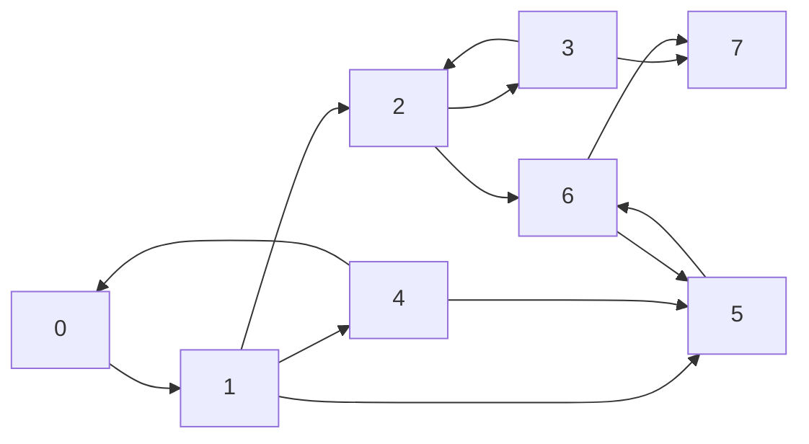
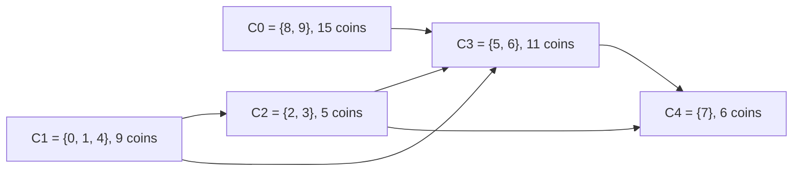
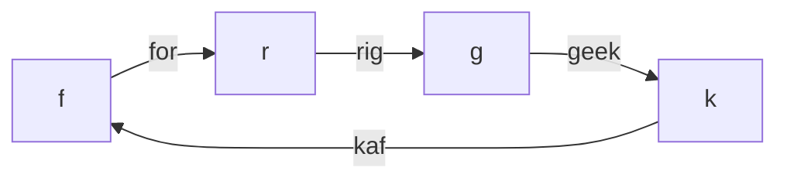

## Introduction

Imagine the "follows" graph of a social network. Ana follows Ben, Ben follows Cy, and Cy follows Ana, so news posted by any of the three can reach the other two by reposting. Dee follows Ana, but nobody follows Dee. News from Dee can reach the trio, but nothing the trio posts can ever reach Dee. The trio forms a closed circle of influence; Dee sits outside it on her own.

That circle is a **strongly connected component (SCC)**: a largest possible set of vertices in a directed graph in which every vertex can reach every other vertex by following edges in their direction. In the example the SCCs are `{Ana, Ben, Cy}` and `{Dee}`. A vertex that is not on any cycle, like Dee, is an SCC on its own.

SCCs matter because they are where the *cycles* of a directed graph live, and cycles are what make directed graphs hard. Topological order, longest paths and dynamic programming all need a graph without cycles ([[a8-topological-sorting]]). Real graphs — call graphs, module dependencies, web links, state machines — usually have cycles. Finding the SCCs lets you collapse each cycle-tangle into a single node, and what is left is always a **directed acyclic graph (DAG)**. Every DAG technique then works again, one level up.

Engineers use SCCs to find circular dependencies between packages, to compute which states of a program can loop forever, to group mutually recursive functions in a compiler, and to solve the 2-satisfiability problem that shows up in scheduling and configuration. In interviews, SCCs appear as "find all strongly connected components", as the hidden step in problems that need DP on a graph with cycles, and as follow-ups to cycle detection.

This lesson teaches two classic linear-time algorithms — **Kosaraju's** (two depth-first searches) and **Tarjan's** (one depth-first search with low-link values) — then the **condensation DAG** they produce, and finally two problems that sit in the same module: counting walks of exactly `k` edges, and chaining words into a circle.

## Before you start

You need:

- **Depth-first search, with discovery and finishing order** — what it means for a vertex to *finish*, and the DFS tree. See [[a8-dfs]].
- **Directed cycle detection** — the idea that a vertex still "on the recursion stack" is special. See [[a8-cycle-detection]].
- **Topological sorting** — what a DAG is and why reverse finishing order is a topological order. See [[a8-topological-sorting]].
- **Graph representation** — adjacency lists and the adjacency matrix. See [[a8-graph-representation]].

All code is Java 21 and runs as shown.

## The intuition

Think of a city whose streets are all one-way. Some neighbourhoods are well designed: from any corner inside them you can drive to any other corner inside them. Those neighbourhoods are the SCCs. Between neighbourhoods there may be one-way streets too — but if you could drive from neighbourhood A to B *and* from B back to A, then A and B would really be one neighbourhood. So the streets *between* neighbourhoods can only ever lead "downhill": once you leave a neighbourhood, you can never return to it.

That "downhill" structure is the whole story. Shrink each neighbourhood to a dot, keep the one-way streets between them, and you get a map with no cycles at all — a DAG. Every directed graph is a DAG of SCCs.

The algorithms in this lesson both exploit a consequence of that picture. Somewhere there must be a neighbourhood with no streets *leaving* it — a **sink** neighbourhood. If you start driving inside a sink neighbourhood, you can explore everything reachable and you will collect exactly that neighbourhood and nothing else, because there is no exit. The hard part is *finding* a vertex in a sink without knowing the neighbourhoods in advance. Kosaraju uses DFS finishing times to find one; Tarjan detects the moment DFS has finished one.

## Definitions and basic facts

Two vertices `u` and `v` are **mutually reachable** if there is a directed path from `u` to `v` and one from `v` to `u`. Every vertex is mutually reachable with itself (the empty path). Mutual reachability is an **equivalence relation**: it is reflexive, symmetric by definition, and transitive — if `u ⇄ v` and `v ⇄ w`, you can go `u → v → w` and `w → v → u`. An equivalence relation splits a set into disjoint classes, and the classes of mutual reachability are exactly the SCCs. Two consequences follow immediately:

- **Every vertex is in exactly one SCC.** The SCCs partition the vertices, and the partition is unique — it does not depend on any algorithm or traversal order.
- **Every directed cycle lies entirely inside one SCC**, because all its vertices can reach each other around the cycle.

A graph is **strongly connected** when it has a single SCC. A single vertex with no cycle through it is a **trivial SCC** of size one. A size-one SCC with a self-loop `v → v` does contain a cycle; this distinction matters when a problem asks "which vertices lie on a cycle?" — the answer is the vertices in SCCs of size at least two, plus vertices with self-loops.

Do not confuse SCCs with **weakly connected components**, which ignore edge direction: `0 → 1` is one weakly connected component but two SCCs. Weak components are found with ordinary undirected traversal or union-find ([[a8-connected-components]]); SCCs need the algorithms below.

Here is the graph used throughout the lesson. It has 8 vertices and 13 edges.



Its SCCs are `{0, 1, 4}` (cycle `0 → 1 → 4 → 0`), `{2, 3}`, `{5, 6}` and `{7}`. Check one non-obvious claim: is `2` in the same SCC as `1`? `1 → 2` exists, but nothing leads from `{2, 3, 5, 6, 7}` back to `{0, 1, 4}`, so no.

### The naive approach and why it is slow

The definition suggests an algorithm: for every vertex `s`, run a BFS or DFS to compute everything `s` can reach. Then `u` and `v` are in the same SCC exactly when each appears in the other's reachable set. Each search costs O(V + E), and there are V of them, so this is **O(V · (V + E))** time and O(V²) memory for the reachability table. For a graph with 100,000 vertices and 500,000 edges that is around 6 × 10¹⁰ operations — far too slow.

A slightly better idea runs only two searches per vertex: from `s`, find everything `s` reaches (forward search), and everything that reaches `s` (a search on the graph with all edges reversed). The intersection is `s`'s SCC; mark it and skip its members later. That is O(V + E) per *component* rather than per vertex, but on a graph with many small SCCs — such as a DAG, where every SCC has size one — it degrades to O(V · (V + E)) again.

Both linear-time algorithms below keep the "search the reversed graph" idea from this second attempt, but arrange the searches so that each vertex and each edge is processed a constant number of times in total.

## Kosaraju's Algorithm (2× DFS) {#a8-kosaraju}

**Kosaraju's algorithm** finds all strongly connected components of a directed graph with two depth-first searches. The first DFS runs on the original graph and records the order in which vertices finish. The second runs on the **transpose** (the graph with every edge reversed), starting vertices in *decreasing* finishing time; every tree that this second search builds is exactly one SCC. It runs in O(V + E) time. The algorithm is credited to S. Rao Kosaraju (1978, unpublished) and was published by Micha Sharir in 1981, which is why some books call it the Kosaraju–Sharir algorithm.

### Deriving the idea

Recall the intuition: a search started inside a **sink SCC** — one with no edges leaving it — collects exactly that SCC. Remove it, and some other SCC becomes a sink; repeat. The problem is finding a sink without knowing the SCCs.

DFS finishing times almost give it to us, but for the wrong end. The key fact is:

> **Finishing-time lemma.** If there is an edge from SCC `C` to a different SCC `C′`, then the largest finishing time in `C` is greater than the largest finishing time in `C′`.

Why? Consider the first vertex of `C ∪ C′` that DFS enters.

- If it is a vertex `x` in `C`, then at that moment all of `C` and `C′` is unvisited and reachable from `x` (through `C`, then the edge into `C′`). DFS does not finish `x` until everything reachable through unvisited vertices has finished, so every vertex of `C′` finishes before `x`. The maximum in `C` is at least `x`'s finish, which beats everything in `C′`.
- If it is a vertex `y` in `C′`, then DFS explores everything reachable from `y`. Nothing in `C` is reachable from `C′` — if it were, `C` and `C′` would be one SCC. So all of `C′` finishes while `C` is still completely unvisited, and `C`'s vertices finish later.

Either way, `C` wins. Follow this along the edges of the DAG of SCCs and you get: **the vertex that finishes last belongs to a source SCC** — one with no incoming edges from other SCCs.

A source of `G` is not what we wanted; we wanted a sink. Here is the trick: **reverse every edge**. The transpose `Gᵀ` has exactly the same SCCs as `G` (a path `u → v` in `G` is a path `v → u` in `Gᵀ`, so mutual reachability is unchanged), but every edge between SCCs flips. A source SCC of `G` becomes a sink SCC of `Gᵀ`. So a DFS on `Gᵀ` started at the last-finished vertex collects exactly its SCC.

After removing that SCC, the remaining vertex with the largest finishing time is again in an SCC whose only incoming `G`-edges come from SCCs already removed. In `Gᵀ`, those edges point to already-assigned vertices, which the second search skips. So it again collects exactly one SCC. Induction finishes the proof.

### The procedure

1. Run DFS over the whole graph `G` (restarting from every unvisited vertex). Append each vertex to a list `finishOrder` when its call **finishes**.
2. Build the transpose `Gᵀ` by adding `v → u` for every edge `u → v`.
3. Walk `finishOrder` from the end (largest finishing time first). For each vertex not yet assigned to a component, run a search on `Gᵀ` from it; every unassigned vertex it reaches gets the current component id. Then increase the id.

### Implementation

```java title="Kosaraju.java"
import java.util.*;

public class Kosaraju {
    static List<List<Integer>> adj, rev;
    static boolean[] visited;
    static List<Integer> finishOrder = new ArrayList<>();
    static int[] comp;

    // Pass 1: ordinary DFS on G, recording each vertex when it FINISHES.
    static void orderDfs(int u) {
        visited[u] = true;
        for (int v : adj.get(u)) {
            if (!visited[v]) orderDfs(v);
        }
        finishOrder.add(u);
    }

    // Pass 2: DFS on the reversed graph; everything it reaches is one SCC.
    static void collect(int u, int id, List<Integer> members) {
        comp[u] = id;
        members.add(u);
        for (int v : rev.get(u)) {
            if (comp[v] == -1) collect(v, id, members);
        }
    }

    static List<List<Integer>> scc(int n, int[][] edges) {
        adj = new ArrayList<>();
        rev = new ArrayList<>();
        for (int i = 0; i < n; i++) { adj.add(new ArrayList<>()); rev.add(new ArrayList<>()); }
        for (int[] e : edges) {
            adj.get(e[0]).add(e[1]);
            rev.get(e[1]).add(e[0]);       // every edge flipped
        }
        visited = new boolean[n];
        for (int s = 0; s < n; s++) {
            if (!visited[s]) orderDfs(s);
        }
        comp = new int[n];
        Arrays.fill(comp, -1);
        List<List<Integer>> components = new ArrayList<>();
        for (int i = n - 1; i >= 0; i--) {   // decreasing finish time
            int s = finishOrder.get(i);
            if (comp[s] != -1) continue;
            List<Integer> members = new ArrayList<>();
            collect(s, components.size(), members);
            components.add(members);
        }
        return components;
    }

    public static void main(String[] args) {
        int[][] edges = {
            {0, 1}, {1, 2}, {1, 4}, {1, 5}, {2, 3}, {2, 6}, {3, 2},
            {3, 7}, {4, 0}, {4, 5}, {5, 6}, {6, 5}, {6, 7}
        };
        List<List<Integer>> sccs = scc(8, edges);
        System.out.println("finish order: " + finishOrder);
        for (int c = 0; c < sccs.size(); c++) {
            System.out.println("SCC " + c + ": " + sccs.get(c));
        }
        System.out.println("comp[] = " + Arrays.toString(comp));
    }
}
```

```output
finish order: [7, 3, 5, 6, 2, 4, 1, 0]
SCC 0: [0, 4, 1]
SCC 1: [2, 3]
SCC 2: [6, 5]
SCC 3: [7]
comp[] = [0, 0, 1, 1, 0, 2, 2, 3]
```

The first pass is the plain DFS from [[a8-dfs]] with one line added at the postorder hook. The transpose is built in the same loop as the graph, so it costs nothing extra in code. The second pass uses `comp[v] == -1` as its visited test, which is what makes it skip vertices that belong to SCCs already collected. Note that the components come out in **topological order of the condensation**: `{0,1,4}` has edges into later components, and `{7}` is last.

### Dry run

**Pass 1** starts at 0 and follows neighbours in list order:

| Event | Call stack after the event | `finishOrder` |
|---|---|---|
| enter 0, 1, 2, 3 | 0 1 2 3 | |
| 3 sees 2 (visited); enter 7 | 0 1 2 3 7 | |
| 7 has no edges: finish 7 | 0 1 2 3 | 7 |
| 3 done: finish 3 | 0 1 2 | 7 3 |
| 2 → 6, enter 6; 6 → 5, enter 5 | 0 1 2 6 5 | 7 3 |
| 5 sees 6 (visited): finish 5 | 0 1 2 6 | 7 3 5 |
| 6 sees 7 (visited): finish 6 | 0 1 2 | 7 3 5 6 |
| finish 2 | 0 1 | 7 3 5 6 2 |
| 1 → 4, enter 4; 4 sees 0, 5: finish 4 | 0 1 | 7 3 5 6 2 4 |
| 1 sees 5: finish 1, then finish 0 | — | 7 3 5 6 2 4 1 0 |

**Pass 2** runs on the transpose, whose lists are `rev[0] = [4]`, `rev[1] = [0]`, `rev[2] = [1, 3]`, `rev[3] = [2]`, `rev[4] = [1]`, `rev[5] = [1, 4, 6]`, `rev[6] = [2, 5]`, `rev[7] = [3, 6]`.

| Next in decreasing finish order | Already assigned? | Search on `Gᵀ` collects |
|---|---|---|
| 0 | no | 0 → 4 → 1 (1's only reverse edge goes back to 0): `{0, 4, 1}` |
| 1, 4 | yes | — |
| 2 | no | 2 → 3 (2's other reverse edge goes to 1, already taken): `{2, 3}` |
| 6 | no | 6 → 5 (2 and the 1, 4 behind 5 are taken): `{6, 5}` |
| 5, 3 | yes | — |
| 7 | no | `{7}` (3 and 6 are taken) |

Look at how the search from 2 behaves. In `Gᵀ`, 2 has an edge to 1, which would lead into the first component — but that component is already assigned, so the search stops there. This is exactly the "sink after removal" argument in action.

### Complexity

Pass 1 visits every vertex once and examines every edge once: O(V + E). Building the transpose touches every edge once: O(E). Pass 2 again assigns every vertex once and examines every reversed edge once: O(V + E). Total **O(V + E)** time.

Space: the transpose is a second copy of the graph, O(V + E); `visited`, `comp` and `finishOrder` are O(V); the recursion stack can reach depth V. So **O(V + E)** extra space.

### Variant: iterative Kosaraju

Recursive DFS needs one stack frame per level, and a long path or a big cycle can be hundreds of thousands of levels deep. On a default JVM the recursive version above throws `StackOverflowError` on a single cycle through one million vertices (tested on OpenJDK 26 with default settings; the exact limit depends on the JVM and thread stack size). The iterative version replaces recursion with an explicit stack ([[a8-iterative-dfs]]).

Two observations make it short. Pass 1 needs a true postorder, so each stack entry must remember which neighbour to try next. Pass 2 needs only *reachability* in `Gᵀ` restricted to unassigned vertices, so **any traversal works there — even BFS**.

```java title="KosarajuIterative.java"
import java.util.*;

public class KosarajuIterative {
    // Returns comp[v]; ids are in topological order of the condensation.
    static int[] scc(int n, int[][] edges) {
        int[][] adj = toCsr(n, edges, false), rev = toCsr(n, edges, true);
        // Pass 1: postorder without recursion. next[u] remembers which
        // neighbour u should try next when control returns to it.
        int[] order = new int[n], next = new int[n], stack = new int[n];
        boolean[] visited = new boolean[n];
        int finished = 0;
        for (int s = 0; s < n; s++) {
            if (visited[s]) continue;
            int top = 0;
            stack[top++] = s;
            visited[s] = true;
            while (top > 0) {
                int u = stack[top - 1];
                if (next[u] < adj[u].length) {
                    int v = adj[u][next[u]++];
                    if (!visited[v]) { visited[v] = true; stack[top++] = v; }
                } else {
                    order[finished++] = u;           // all neighbours done: u finishes
                    top--;
                }
            }
        }
        // Pass 2: any traversal works here, so use a plain BFS on the reverse graph.
        int[] comp = new int[n];
        Arrays.fill(comp, -1);
        int[] queue = new int[n];
        int c = 0;
        for (int i = n - 1; i >= 0; i--) {
            int s = order[i];
            if (comp[s] != -1) continue;
            int head = 0, tail = 0;
            queue[tail++] = s;
            comp[s] = c;
            while (head < tail) {
                int u = queue[head++];
                for (int v : rev[u]) {
                    if (comp[v] == -1) { comp[v] = c; queue[tail++] = v; }
                }
            }
            c++;
        }
        return comp;
    }

    // Compact adjacency arrays; reversed = true flips every edge.
    static int[][] toCsr(int n, int[][] edges, boolean reversed) {
        int[] deg = new int[n];
        for (int[] e : edges) deg[reversed ? e[1] : e[0]]++;
        int[][] g = new int[n][];
        for (int i = 0; i < n; i++) g[i] = new int[deg[i]];
        int[] fill = new int[n];
        for (int[] e : edges) {
            int from = reversed ? e[1] : e[0], to = reversed ? e[0] : e[1];
            g[from][fill[from]++] = to;
        }
        return g;
    }

    public static void main(String[] args) {
        int[][] edges = {
            {0, 1}, {1, 2}, {1, 4}, {1, 5}, {2, 3}, {2, 6}, {3, 2},
            {3, 7}, {4, 0}, {4, 5}, {5, 6}, {6, 5}, {6, 7}
        };
        System.out.println(Arrays.toString(scc(8, edges)));

        // One cycle through a million vertices: DFS goes a million levels deep.
        int n = 1_000_000;
        int[][] cycle = new int[n][];
        for (int i = 0; i < n; i++) cycle[i] = new int[]{i, (i + 1) % n};
        int[] comp = scc(n, cycle);
        System.out.println("cycle of " + n + ": comp[0]=" + comp[0] + " comp[n-1]=" + comp[n - 1]);
    }
}
```

```output
[0, 0, 1, 1, 0, 2, 2, 3]
cycle of 1000000: comp[0]=0 comp[n-1]=0
```

The `next[u]` array is the important detail. A vertex stays on the stack until every neighbour has been tried, and only then is it popped and appended to `order`. A shortcut that pushes all neighbours at once and appends a vertex when it is first popped produces a *preorder*, which breaks the finishing-time lemma.

## Tarjan's Algorithm for SCC (1× DFS) {#a8-tarjan-scc}

**Tarjan's algorithm** finds all strongly connected components in a single depth-first search, without building the reversed graph. It gives each vertex a **discovery time** and a **low-link** value, keeps the vertices of not-yet-finished components on an explicit stack, and recognises the first-discovered vertex of each SCC — its **root** — at the moment DFS finishes it. At that moment, the root and everything above it on the stack form exactly one SCC. It runs in O(V + E) time and was published by Robert Tarjan in 1972.

### Deriving the idea

Run DFS and look at any SCC `C`. Let `r` be the first vertex of `C` that DFS enters. At that moment, every other vertex of `C` is unvisited and reachable from `r` through `C`, so by the white-path property of DFS ([[a8-cycle-detection]] explains it) every vertex of `C` becomes a **descendant** of `r` in the DFS tree and finishes before `r` does. So each SCC occupies a connected piece of the DFS tree hanging below its root.

If we could recognise roots, we could peel components off as DFS returns: when `r` finishes, its SCC is "everything in `r`'s subtree that has not already been peeled off into a deeper SCC". A stack captures that set neatly. Push each vertex when it is discovered; when a root finishes, pop down to it. Vertices of deeper SCCs were popped earlier, when their own roots finished.

How do we recognise a root? A vertex `u` is *not* a root exactly when something in its subtree can climb back to a vertex discovered before `u` that is still in the open (unpopped) part of the stack — because then `u` can reach that earlier vertex, which can reach `u` through the tree, so they share an SCC whose root is higher. This suggests tracking the earliest such vertex.

### Discovery time and low-link

- `disc[u]` is the **discovery time**: a counter value assigned when DFS first enters `u` (0, 1, 2, …).
- `low[u]` is the **low-link**: the smallest discovery time of a vertex that is still on the stack and reachable from `u`'s subtree using tree edges plus edges that jump to on-stack vertices.

The update rules follow from the definition. When `u` examines an edge `u → v`:

| Situation | Meaning | Update |
|---|---|---|
| `v` unvisited | tree edge; recurse first | `low[u] = min(low[u], low[v])` — whatever `v`'s subtree can reach, `u` can reach too |
| `v` visited and **on the stack** | `v` is in an SCC that is still open, so it may share `u`'s SCC | `low[u] = min(low[u], disc[v])` |
| `v` visited and **not on the stack** | `v`'s SCC was already completed and popped | ignore the edge |

After all edges, **`u` is a root exactly when `low[u] == disc[u]`**: nothing in its subtree reaches anything earlier that is still open. Then pop the stack until `u` comes off; those vertices are one SCC.

Why ignore edges to popped vertices? If `v` was popped, its SCC is complete. If `v` could reach `u`, then — since `u` reaches `v` through this edge — they would be in the same SCC, and `v` could not have been popped while `u` was still running. So `v` cannot reach `u`, and the edge says nothing about `u`'s SCC. Treating it as a back edge would drag `low[u]` down to an unrelated component and merge things that are not strongly connected.

### Implementation

```java title="TarjanScc.java"
import java.util.*;

public class TarjanScc {
    static List<List<Integer>> adj;
    static int[] disc, low, comp;
    static boolean[] onStack;
    static Deque<Integer> stack = new ArrayDeque<>();
    static int timer = 0, sccCount = 0;
    static List<List<Integer>> components = new ArrayList<>();

    static void dfs(int u) {
        disc[u] = low[u] = timer++;
        stack.push(u);
        onStack[u] = true;
        for (int v : adj.get(u)) {
            if (disc[v] == -1) {                 // tree edge
                dfs(v);
                low[u] = Math.min(low[u], low[v]);
            } else if (onStack[v]) {             // edge into the still-open part
                low[u] = Math.min(low[u], disc[v]);
            }
            // else: v's SCC is already closed and cannot reach u; ignore the edge
        }
        if (low[u] == disc[u]) {                 // u is the root of an SCC
            List<Integer> members = new ArrayList<>();
            int x;
            do {
                x = stack.pop();
                onStack[x] = false;
                comp[x] = sccCount;
                members.add(x);
            } while (x != u);
            components.add(members);
            sccCount++;
        }
    }

    static List<List<Integer>> scc(int n, int[][] edges) {
        adj = new ArrayList<>();
        for (int i = 0; i < n; i++) adj.add(new ArrayList<>());
        for (int[] e : edges) adj.get(e[0]).add(e[1]);
        disc = new int[n];
        low = new int[n];
        comp = new int[n];
        onStack = new boolean[n];
        Arrays.fill(disc, -1);
        for (int s = 0; s < n; s++) {
            if (disc[s] == -1) dfs(s);
        }
        return components;
    }

    public static void main(String[] args) {
        int[][] edges = {
            {0, 1}, {1, 2}, {1, 4}, {1, 5}, {2, 3}, {2, 6}, {3, 2},
            {3, 7}, {4, 0}, {4, 5}, {5, 6}, {6, 5}, {6, 7}
        };
        List<List<Integer>> sccs = scc(8, edges);
        for (int c = 0; c < sccs.size(); c++) {
            System.out.println("SCC " + c + ": " + sccs.get(c));
        }
        System.out.println("disc = " + Arrays.toString(disc));
        System.out.println("low  = " + Arrays.toString(low));
    }
}
```

```output
SCC 0: [7]
SCC 1: [5, 6]
SCC 2: [3, 2]
SCC 3: [4, 1, 0]
disc = [0, 1, 2, 3, 7, 6, 5, 4]
low  = [0, 0, 2, 2, 0, 5, 5, 4]
```

`disc` doubles as the visited array (`-1` means unvisited), and `onStack` makes the "is `v` still open?" test O(1). A `java.util.Deque` used through `push`/`pop` behaves as a stack. Notice the output order: `{7}` first and `{0, 1, 4}` last. **Tarjan emits SCCs in reverse topological order** of the condensation — a component is completed only after every component it can reach — which is the opposite of Kosaraju.

### Dry run

The DFS visits neighbours in list order. "Stack" is Tarjan's explicit stack, not the call stack.

| Step | Event | `disc` / `low` changes | Stack | SCC emitted |
|---|---|---|---|---|
| 1 | enter 0, 1, 2, 3 | disc = low = 0, 1, 2, 3 | 0 1 2 3 | |
| 2 | 3 → 2: 2 is on the stack | `low[3] = min(3, disc[2]) = 2` | 0 1 2 3 | |
| 3 | 3 → 7: enter 7 | disc[7] = low[7] = 4 | 0 1 2 3 7 | |
| 4 | 7 finishes, `low == disc` | | 0 1 2 3 | `{7}` |
| 5 | back in 3: `low[3] = min(2, 4)`; 3 finishes, 2 ≠ 3 | low[3] = 2 | 0 1 2 3 | |
| 6 | back in 2: `low[2] = min(2, 2)`; 2 → 6: enter 6, then 5 | disc[6] = 5, disc[5] = 6 | 0 1 2 3 6 5 | |
| 7 | 5 → 6: on the stack | `low[5] = 5`; 5 finishes, 5 ≠ 6 | 0 1 2 3 6 5 | |
| 8 | back in 6: `low[6] = 5`; 6 → 7: 7 is **not** on the stack, ignore | | 0 1 2 3 6 5 | |
| 9 | 6 finishes, `low == disc == 5` | | 0 1 2 3 | `{5, 6}` |
| 10 | back in 2: `low[2] = min(2, 5) = 2`; 2 finishes, `low == disc` | | 0 1 | `{3, 2}` |
| 11 | back in 1; 1 → 4: enter 4; 4 → 0 on stack | disc[4] = 7, `low[4] = 0` | 0 1 4 | |
| 12 | 4 → 5: not on stack, ignore; 4 finishes, 0 ≠ 7 | | 0 1 4 | |
| 13 | back in 1: `low[1] = 0`; 1 → 5 ignored; 1 finishes, 0 ≠ 1 | | 0 1 4 | |
| 14 | back in 0: `low[0] = 0`; 0 finishes, `low == disc` | | — | `{4, 1, 0}` |

Step 8 is the one to study. When 6 examines `6 → 7`, vertex 7 is visited but already popped. If the code treated it as a back edge, `low[6]` would become `min(5, disc[7] = 4) = 4`, 6 would no longer look like a root, and `{5, 6}` would be wrongly merged into the component of 2. Step 12 is the same situation for `4 → 5`.

### Why `low` is compared with `disc`, and a note on `low[v]`

When `u` sees an on-stack vertex `v`, the standard rule uses `disc[v]`. Some implementations write `low[u] = min(low[u], low[v])` there instead. For **SCCs** this also gives correct components: `low[v]` still points to an on-stack vertex in the same open region, so root detection is unaffected (we checked this against a brute-force reachability test on 200,000 random graphs). It is **not** safe in the related articulation-point algorithm for undirected graphs ([[a8-articulation-tarjan]]), so get used to writing `disc[v]` and you will never mix them up.

### Complexity

Each vertex is discovered once, pushed once and popped once: O(V). Each edge is examined once, from its tail, with O(1) work: O(E). Total **O(V + E)** time. Space: `disc`, `low`, `comp`, `onStack` and the stack are O(V); the recursion depth is at most V. No transpose is built, so the extra space is **O(V)** on top of the input graph.

Like Kosaraju, the recursive version can overflow the Java call stack on deep graphs. An iterative Tarjan is possible — keep, per stack frame, the vertex and the index of its next neighbour, and perform the `low[parent] = min(low[parent], low[child])` update when a child's frame is popped — but it is fiddlier than iterative Kosaraju. The same frame technique is shown in full for bridges in [[a8-critical-connections]].

## Kosaraju vs Tarjan {#a8-kosaraju-vs-tarjan}

Kosaraju's and Tarjan's algorithms solve the same problem — partition a directed graph into its strongly connected components — in the same O(V + E) time. They differ in how many passes they make, how much memory they need, what order they emit components in, and how easy they are to get right. Choosing between them is mostly a matter of what you need afterwards.

| | Kosaraju | Tarjan |
|---|---|---|
| DFS passes | 2 (one on `G`, one on `Gᵀ`) | 1 |
| Extra graph | Builds the transpose: O(V + E) extra memory | None: O(V) extra memory |
| Per-vertex state | visited flag, finish order, component id | `disc`, `low`, `onStack`, component id |
| Component order | **Topological** order of the condensation | **Reverse topological** order |
| Hardest part to get right | Processing pass 2 in *decreasing* finish order on the *transpose* | The three-way edge rule, especially ignoring popped vertices |
| Making it iterative | Easy: pass 2 can be BFS | Harder: needs explicit frames with a child-to-parent `low` update |
| Edges traversed | Each edge twice (once in each pass) | Each edge once |

**Correctness depends on different facts.** Kosaraju relies on the finishing-time lemma: the last-finished vertex lies in a source SCC. Tarjan relies on the fact that each SCC hangs below its first-discovered vertex in the DFS tree and that `low[u] == disc[u]` identifies that vertex. Both arguments use the same underlying DFS property — a vertex finishes only after everything reachable through unvisited vertices — which is why both run in linear time.

**Output order matters more than people expect.** If you next want to process the condensation in topological order (DP from sources to sinks), Kosaraju's ids are already in that order. If you want to process sinks first — for example, to compute "how much can be reached from here" bottom-up — Tarjan's emission order is exactly what you want, and you can do the DP inside the pop loop. The 2-SAT assignment rule below is written in terms of whichever order your algorithm produces.

**In practice**, Tarjan is usually somewhat faster because it reads each edge once and does not allocate a second graph, and it is the algorithm most libraries use. Kosaraju is easier to explain and to make iterative. In an interview, either is fully acceptable; pick the one you can write without bugs and be ready to say why the other also works. There are also **path-based** algorithms (for example Gabow's, 2000) that replace `low` values with a second stack; they have the same O(V + E) bound and are rarely asked about.

### Testing either one

SCC bugs often produce *plausible* output — the right number of components on simple inputs and a silent merge on harder ones. The reliable way to test is to compare against the slow definition on many small random graphs:

```java title="CompareWithDefinition.java (fragment)"
// reach[a][b] from a BFS out of every vertex; O(V * (V + E)) but fine for V <= 10.
for (int a = 0; a < n; a++)
    for (int b = 0; b < n; b++) {
        boolean sameScc = reach[a][b] && reach[b][a];
        if ((comp[a] == comp[b]) != sameScc) throw new AssertionError(a + " " + b);
    }
```

This fragment sits inside a loop that generates random graphs with up to ten vertices, runs both algorithms, and checks every pair. A test like this catches the classic mistakes — a missing `onStack` check, a pass 2 in the wrong order — within a few hundred random graphs.

```quiz
Q: In Kosaraju's algorithm, why does the second pass run on the reversed graph?
- [ ] Because reversing the edges makes the graph acyclic
- [x] Because the last-finished vertex lies in a source SCC of G, which becomes a sink SCC in the reversed graph, so a search from it cannot leak into other components
- [ ] Because DFS on the original graph cannot visit every vertex
- [ ] Because reversing edges changes which vertices are mutually reachable
> The finishing-time lemma puts the latest-finishing vertex in an SCC with no incoming edges from other SCCs. A search on G from there could run into other components; on the transpose that SCC has no outgoing inter-component edges, so the search collects exactly it. Reversal never changes mutual reachability, which is why the SCCs are the same in both graphs.

Q: During Tarjan's algorithm, u finds an edge u → v where v is visited but no longer on the stack. What should happen?
- [ ] Set low[u] = min(low[u], disc[v]), as for any visited vertex
- [ ] Set low[u] = min(low[u], low[v])
- [x] Nothing: v's SCC is already complete and v cannot reach u
- [ ] Push v back onto the stack
> A popped vertex belongs to a finished SCC. If it could reach u, it would share u's SCC and would not have been popped yet. Using its discovery time would lower low[u] and merge two separate components; in the lesson's graph, edge 6 → 7 would merge {5, 6} into {2, 3}.

Q: You need SCC ids in topological order of the condensation and you have Tarjan's ids 0..c-1. What is the simplest fix?
- [ ] Run Kosaraju as well
- [x] Use c - 1 - id, because Tarjan numbers components in reverse topological order
- [ ] Sort the components by size
- [ ] Nothing; Tarjan's ids are already topological
> Tarjan completes a component only after every component reachable from it, so the first id is a sink. Reversing the numbering gives a topological order directly.
```

## Condensation Graph (SCC → DAG) {#a8-condensation-dag}

The **condensation** of a directed graph — also called its component graph or quotient graph — has one vertex per strongly connected component, and an edge from component `A` to component `B` whenever some original edge goes from a vertex in `A` to a vertex in `B` (with `A ≠ B`). The condensation of any directed graph is always a **DAG**. That single fact is why SCCs are useful: once you have the components, every DAG tool — topological order, DAG dynamic programming, source and sink counting — applies to a graph that originally had cycles.

### Why the condensation has no cycles

Suppose the condensation had a cycle `A → B → … → A` through two or more components. Then any vertex of `A` could reach any vertex of `B` (through the cycle's edges and inside each component, where everything is mutually reachable), and vice versa. So `A` and `B` would be mutually reachable and would be one SCC — contradicting that they are different components. Edges inside a component are dropped, so there are no self-loops either.

### Building it

Given `comp[v]` from Kosaraju or Tarjan, one pass over the edges builds the DAG. Two details matter. First, skip edges with `comp[u] == comp[v]`; they would be self-loops. Second, many original edges can map onto the same component pair (in the example, both `1 → 5` and `4 → 5` go from `{0,1,4}` to `{5,6}`), so either deduplicate with a set or accept parallel edges if your later algorithm tolerates them. Counting in-degrees for sources, for instance, needs deduplication or it will over-count.

The program below extends the lesson's graph with a second source component `{8, 9}` and gives every vertex a number of coins. It answers three typical questions:

1. What does the condensation look like?
2. How many edges must be added to make the whole graph strongly connected?
3. Walking along edges and revisiting vertices freely, what is the most coins you can collect if each vertex's coins can be taken once?

```java title="Condensation.java"
import java.util.*;

public class Condensation {
    static List<List<Integer>> adj = new ArrayList<>(), rev = new ArrayList<>();
    static boolean[] visited;
    static int[] comp;
    static List<Integer> finishOrder = new ArrayList<>();

    static void orderDfs(int u) {
        visited[u] = true;
        for (int v : adj.get(u)) if (!visited[v]) orderDfs(v);
        finishOrder.add(u);
    }

    static void collect(int u, int id) {
        comp[u] = id;
        for (int v : rev.get(u)) if (comp[v] == -1) collect(v, id);
    }

    public static void main(String[] args) {
        int n = 10;
        int[][] edges = {
            {0, 1}, {1, 2}, {1, 4}, {1, 5}, {2, 3}, {2, 6}, {3, 2},
            {3, 7}, {4, 0}, {4, 5}, {5, 6}, {6, 5}, {6, 7},
            {8, 9}, {9, 8}, {9, 5}                 // a second source component
        };
        long[] coins = {3, 1, 4, 1, 5, 9, 2, 6, 7, 8};
        for (int i = 0; i < n; i++) { adj.add(new ArrayList<>()); rev.add(new ArrayList<>()); }
        for (int[] e : edges) { adj.get(e[0]).add(e[1]); rev.get(e[1]).add(e[0]); }

        // Kosaraju: ids come out in topological order of the condensation.
        visited = new boolean[n];
        for (int s = 0; s < n; s++) if (!visited[s]) orderDfs(s);
        comp = new int[n];
        Arrays.fill(comp, -1);
        int c = 0;
        for (int i = n - 1; i >= 0; i--) {
            int s = finishOrder.get(i);
            if (comp[s] == -1) collect(s, c++);
        }

        // Build the condensation: one node per SCC, one edge per distinct crossing.
        List<Set<Integer>> dag = new ArrayList<>();
        for (int i = 0; i < c; i++) dag.add(new TreeSet<>());
        long[] weight = new long[c];
        for (int u = 0; u < n; u++) {
            weight[comp[u]] += coins[u];
            for (int v : adj.get(u)) {
                if (comp[u] != comp[v]) dag.get(comp[u]).add(comp[v]);  // set drops repeats
            }
        }
        System.out.println("comp[] = " + Arrays.toString(comp));
        for (int i = 0; i < c; i++) {
            System.out.println("C" + i + " weight " + weight[i] + " -> " + dag.get(i));
        }

        // Sources (in-degree 0) and sinks (out-degree 0) of the DAG.
        int[] indeg = new int[c];
        for (int i = 0; i < c; i++) for (int j : dag.get(i)) indeg[j]++;
        int sources = 0, sinks = 0;
        for (int i = 0; i < c; i++) {
            if (indeg[i] == 0) sources++;
            if (dag.get(i).isEmpty()) sinks++;
        }
        int toAdd = c == 1 ? 0 : Math.max(sources, sinks);
        System.out.println("sources=" + sources + " sinks=" + sinks + " edges to add=" + toAdd);

        // DAG DP: best[i] = most coins collectable starting in component i.
        // Ids are topological, so process them from last to first.
        long[] best = new long[c];
        long answer = 0;
        for (int i = c - 1; i >= 0; i--) {
            long after = 0;
            for (int j : dag.get(i)) after = Math.max(after, best[j]);
            best[i] = weight[i] + after;
            answer = Math.max(answer, best[i]);
        }
        System.out.println("best[] = " + Arrays.toString(best) + " answer = " + answer);
    }
}
```

```output
comp[] = [1, 1, 2, 2, 1, 3, 3, 4, 0, 0]
C0 weight 15 -> [3]
C1 weight 9 -> [2, 3]
C2 weight 5 -> [3, 4]
C3 weight 11 -> [4]
C4 weight 6 -> []
sources=2 sinks=1 edges to add=2
best[] = [32, 31, 22, 17, 6] answer = 32
```



Walk through the three answers.

**The DAG.** Ten vertices and sixteen edges collapse to five nodes and six edges. The cycles `0 → 1 → 4 → 0`, `2 ⇄ 3`, `5 ⇄ 6` and `8 ⇄ 9` have all disappeared inside their nodes.

**Coins.** Inside an SCC you can wander freely and come back, so entering a component means you can collect *all* of its coins. Between components you can only move downhill. So the question becomes "heaviest path in a DAG", which is a one-pass DP in reverse topological order: `best[i] = weight[i] + max(best[j])` over the component's successors ([[a8-dag-dp]], [[a8-longest-path-dag]]). Starting in `C1` gives `9 + 5 + 11 + 6 = 31`; starting in `C0` gives `15 + 11 + 6 = 32`. On the original graph, this DP is impossible to write directly because the cycles would make `best` depend on itself. The condensation removes exactly that obstacle.

**Edges to add.** A DAG with `s` sources and `t` sinks needs at least `max(s, t)` new edges to become strongly connected: each source needs a new incoming edge and each sink a new outgoing one, and one new edge can serve at most one of each. A classic result (Eswaran and Tarjan, 1976) shows that `max(s, t)` edges always suffice when the condensation has more than one node; with one node the answer is 0. Here `max(2, 1) = 2`, for example `7 → 0` and `7 → 8`. Count an isolated component as both a source and a sink.

### Recognising condensation problems

The signal is a directed graph with cycles plus a question that would be easy on a DAG:

- "Maximum value collectable along a walk" or "longest path where revisiting is allowed" — collapse SCCs, sum their values, run DAG DP.
- "Minimum number of starting points so that everything is reached" — the number of source components (one start in each). On a DAG this is the number of vertices with in-degree 0.
- "Which vertices can reach every other vertex?" — such vertices exist only if the condensation has exactly one source; then they are the members of that source component.
- "Can every vertex reach every other?" — exactly one SCC.
- Reachability queries on a graph with cycles — answer them on the condensation, which is smaller and acyclic ([[a8-transitive-closure]]).

Complexity: computing SCCs is O(V + E), and building the condensation is one more O(V + E) pass (with a hash set for deduplication, expected O(1) per edge; the `TreeSet` used above adds a log factor that is irrelevant at this size). DAG DP on it is O(V + E).

## Application: 2-SAT

The best-known use of SCCs outside graph problems is **2-satisfiability (2-SAT)**. You have Boolean variables and a list of constraints, each saying "at least one of these two conditions holds" — for example "Ana or Ben must attend", "if Ana attends then Cy attends" (which is "Ana does not attend, or Cy attends"), "Ben and Cy will not both attend" (which is "not Ben, or not Cy"). Is there an assignment of true/false that satisfies every clause, and if so, what is one?

With three literals per clause (3-SAT) the problem is NP-complete. With two it is solvable in linear time, and the method is SCCs.

**The implication graph.** Make two vertices per variable: `x` and `¬x`. A clause `(a ∨ b)` is equivalent to two implications — if `a` is false, `b` must be true, and if `b` is false, `a` must be true — so add edges `¬a → b` and `¬b → a`. A path from `p` to `q` means "if `p` is true, `q` is forced to be true".

**Unsatisfiable exactly when** some variable `x` has `x` and `¬x` in the same SCC. Then `x` forces `¬x` and `¬x` forces `x`, so neither value works. Conversely, if no variable has that problem, a satisfying assignment exists and can be read off the components.

**Choosing values.** Set `x` true exactly when `x`'s component comes **after** `¬x`'s component in topological order of the condensation. Intuitively, choose the literal that is "further downstream": if there is a path `x → … → ¬x`, then `x` is upstream, so it must be false, and the rule picks `¬x`. With Tarjan's ids, which are reverse topological, "later in topological order" means a *smaller* id; with Kosaraju's ids it means a larger one.

```java title="TwoSat.java"
import java.util.*;

public class TwoSat {
    // Literal encoding: 2*i means "x_i is true", 2*i + 1 means "x_i is false".
    static int not(int lit) { return lit ^ 1; }

    static List<List<Integer>> adj;
    static int[] disc, low, comp;
    static boolean[] onStack;
    static Deque<Integer> stack;
    static int timer, sccCount;

    static void dfs(int u) {
        disc[u] = low[u] = timer++;
        stack.push(u);
        onStack[u] = true;
        for (int v : adj.get(u)) {
            if (disc[v] == -1) { dfs(v); low[u] = Math.min(low[u], low[v]); }
            else if (onStack[v]) low[u] = Math.min(low[u], disc[v]);
        }
        if (low[u] == disc[u]) {
            int x;
            do { x = stack.pop(); onStack[x] = false; comp[x] = sccCount; } while (x != u);
            sccCount++;
        }
    }

    // Each clause {a, b} means (a OR b). Returns an assignment, or null if none exists.
    static boolean[] solve(int vars, int[][] clauses) {
        int n = 2 * vars;
        adj = new ArrayList<>();
        for (int i = 0; i < n; i++) adj.add(new ArrayList<>());
        for (int[] c : clauses) {
            adj.get(not(c[0])).add(c[1]);   // if a is false, b must be true
            adj.get(not(c[1])).add(c[0]);   // if b is false, a must be true
        }
        disc = new int[n]; low = new int[n]; comp = new int[n];
        onStack = new boolean[n]; stack = new ArrayDeque<>();
        timer = 0; sccCount = 0;
        Arrays.fill(disc, -1);
        for (int u = 0; u < n; u++) if (disc[u] == -1) dfs(u);

        boolean[] value = new boolean[vars];
        for (int i = 0; i < vars; i++) {
            if (comp[2 * i] == comp[2 * i + 1]) return null;   // x implies not-x and back
            // Tarjan numbers SCCs in reverse topological order, so the smaller id is
            // the one later in topological order: choose that literal to be true.
            value[i] = comp[2 * i] < comp[2 * i + 1];
        }
        return value;
    }

    static int lit(int var, boolean positive) { return 2 * var + (positive ? 0 : 1); }

    public static void main(String[] args) {
        // Variables: 0 = Ana attends, 1 = Ben attends, 2 = Cy attends.
        int[][] party = {
            {lit(0, true), lit(1, true)},     // Ana or Ben must come
            {lit(0, false), lit(2, true)},    // if Ana comes, Cy comes
            {lit(1, false), lit(2, false)},   // Ben and Cy will not both come
        };
        System.out.println(Arrays.toString(solve(3, party)));

        int[][] impossible = {
            {lit(0, true), lit(1, true)}, {lit(0, true), lit(1, false)},
            {lit(0, false), lit(1, true)}, {lit(0, false), lit(1, false)},
        };
        System.out.println(Arrays.toString(solve(2, impossible)));
    }
}
```

```output
[true, false, true]
null
```

Ana and Cy attend and Ben does not: Ana-or-Ben holds, Ana implies Cy holds, and Ben and Cy are not both there. The second instance demands every combination of `x₀` and `x₁` be avoided, so `x₀` and `¬x₀` end up in one SCC and the solver returns `null`. We checked this solver against brute force over all assignments on 100,000 random formulas. The graph has `2·vars` vertices and `2·clauses` edges, so 2-SAT runs in **O(vars + clauses)**.

2-SAT shows up whenever every decision is binary and every rule involves at most two decisions: placing labels on a map so they do not overlap (each label above or below its point), assigning each of several items to one of two time slots with pairwise conflicts, or choosing one orientation per component in a circuit layout.

## Count Walks with Exactly K Edges {#a8-count-walks-k-edges}

Given a directed graph, a source `u`, a destination `v` and a number `k`, **count the walks from `u` to `v` that use exactly `k` edges**. A **walk** may repeat vertices and edges — `0 → 2 → 0 → 1` is a valid walk — unlike a **path**, which visits each vertex at most once. Counting walks is a short dynamic program, and for very large `k` it becomes repeated multiplication of the adjacency matrix. It sits in this module because walks can only revisit vertices by going around cycles, and every cycle lives inside a strongly connected component.

### The example graph

We use a small directed graph with edges `0 → 1`, `0 → 2`, `1 → 2`, `1 → 3`, `2 → 0`, `2 → 3`, `3 → 1`. Its adjacency lists are `[[1, 2], [2, 3], [0, 3], [1]]`. The question: how many walks of exactly `k` edges go from 0 to 3?

For `k = 2` there are two: `0 → 1 → 3` and `0 → 2 → 3`. For `k = 3` there is one: `0 → 1 → 2 → 3`. By `k = 5` there are six, and the count keeps growing because the graph has cycles.

### Naive approach: enumerate

The obvious method is recursion: from `u`, try every outgoing edge and count walks of `k − 1` edges from there. With out-degree `d` this explores up to `dᵏ` walks — **O(dᵏ)** time. With `d = 3` and `k = 30` that is about 2 × 10¹⁴ calls. The waste is obvious once you notice that the recursion asks the same question — "how many walks of `j` edges from `w` to `v`?" — over and over.

### Dynamic programming over steps

Let `ways_j[w]` be the number of walks from the source to `w` with exactly `j` edges. A walk with `j` edges ending at `w` is a walk with `j − 1` edges ending at some predecessor `p`, followed by the edge `p → w`. So:

- `ways_0[source] = 1` (the empty walk) and `ways_0[w] = 0` for every other `w`.
- `ways_j[w] = Σ ways_{j−1}[p]` over all edges `p → w`.

Equivalently, push forward: for every edge `p → w`, add `ways_{j−1}[p]` to `ways_j[w]`. After `k` rounds, `ways_k[target]` is the answer.

Here is the table from source 0 on the example graph. Column `w` holds `ways_j[w]`.

| `j` | to 0 | to 1 | to 2 | to 3 |
|---|---|---|---|---|
| 0 | 1 | 0 | 0 | 0 |
| 1 | 0 | 1 | 1 | 0 |
| 2 | 1 | 0 | 1 | 2 |
| 3 | 1 | 3 | 1 | 1 |
| 4 | 1 | 2 | 4 | 4 |
| 5 | 4 | 5 | 3 | 6 |

Check one cell: `ways_3[1] = 3` because vertex 1's predecessors are 0 and 3, and `ways_2[0] + ways_2[3] = 1 + 2`. Each round costs O(V + E), so this is **O(k · (V + E))** time and O(V) space (only two rows are needed at a time). It answers one source but every destination.

### Matrix powers

Let `A` be the adjacency matrix, `A[i][j] = 1` if there is an edge `i → j` ([[a8-adjacency-matrix]]). Then **`(Aᵏ)[i][j]` is the number of walks from `i` to `j` with exactly `k` edges.** The reason is the definition of matrix multiplication: `(A²)[i][j] = Σₘ A[i][m] · A[m][j]`, which counts, for each possible middle vertex `m`, the edges `i → m → j`. By induction, `(Aᵏ)[i][j] = Σₘ (Aᵏ⁻¹)[i][m] · A[m][j]` — the DP recurrence above, done for every source at once.

Computing `Aᵏ` by multiplying `k` times costs O(k · V³), worse than the DP for one source. But matrix multiplication is associative, so we can use **binary exponentiation**: `A⁸ = ((A²)²)²` needs three multiplications, not seven. Write `k` in binary; square the base once per bit and multiply it into the result when the bit is 1. That is about `2 log₂ k` multiplications, each O(V³): **O(V³ log k)** time and O(V²) space. For `k = 10¹⁸` that is about 120 multiplications.

Counts grow exponentially with `k` in a graph with cycles, so they overflow `long` quickly — on this four-vertex graph the unreduced count of 0 → 3 walks first turns negative at `k = 86`. Problems therefore ask for the answer modulo a prime such as 1,000,000,007. Reduce after every multiply-add: both factors are below the modulus, so their product is below (10⁹ + 7)² ≈ 1.0 × 10¹⁸, and adding a value below the modulus still fits in a `long` (maximum about 9.2 × 10¹⁸).

```java title="CountWalks.java"
import java.util.*;

public class CountWalks {
    static final long MOD = 1_000_000_007L;

    // Brute force: try every walk. O(d^k) for out-degree d; only for checking.
    static long brute(int[][] adj, int u, int target, int k) {
        if (k == 0) return u == target ? 1 : 0;
        long total = 0;
        for (int v : adj[u]) total += brute(adj, v, target, k - 1);
        return total;
    }

    // DP over steps: ways[v] = number of walks of the current length from src to v.
    // O(k * (V + E)) time, O(V) space.
    static long dp(int[][] adj, int src, int target, int k) {
        int n = adj.length;
        long[] ways = new long[n];
        ways[src] = 1;                                     // the empty walk
        for (int step = 1; step <= k; step++) {
            long[] next = new long[n];
            for (int u = 0; u < n; u++) {
                if (ways[u] == 0) continue;
                for (int v : adj[u]) next[v] = (next[v] + ways[u]) % MOD;
            }
            ways = next;
        }
        return ways[target];
    }

    // Matrix power: (A^k)[i][j] counts i -> j walks with exactly k edges.
    // O(V^3 log k) time, answers every pair at once, and handles huge k.
    static long[][] power(long[][] a, long k) {
        int n = a.length;
        long[][] result = new long[n][n];
        for (int i = 0; i < n; i++) result[i][i] = 1;     // A^0 = identity
        while (k > 0) {
            if ((k & 1) == 1) result = multiply(result, a);
            a = multiply(a, a);
            k >>= 1;
        }
        return result;
    }

    static long[][] multiply(long[][] a, long[][] b) {
        int n = a.length;
        long[][] c = new long[n][n];
        for (int i = 0; i < n; i++)
            for (int m = 0; m < n; m++) {
                if (a[i][m] == 0) continue;
                for (int j = 0; j < n; j++) {
                    c[i][j] = (c[i][j] + a[i][m] * b[m][j]) % MOD;  // both < MOD: fits in long
                }
            }
        return c;
    }

    public static void main(String[] args) {
        int[][] adj = {{1, 2}, {2, 3}, {0, 3}, {1}};   // 0->1, 0->2, 1->2, 1->3, 2->0, 2->3, 3->1
        long[][] matrix = new long[4][4];
        for (int u = 0; u < 4; u++) for (int v : adj[u]) matrix[u][v] = 1;

        for (int k = 1; k <= 5; k++) {
            System.out.println("k=" + k + "  0->3 walks: brute=" + brute(adj, 0, 3, k)
                + " dp=" + dp(adj, 0, 3, k) + " matrix=" + power(matrix, k)[0][3]);
        }
        System.out.println("k=10^18 mod p: " + power(matrix, 1_000_000_000_000_000_000L)[0][3]);
    }
}
```

```output
k=1  0->3 walks: brute=0 dp=0 matrix=0
k=2  0->3 walks: brute=2 dp=2 matrix=2
k=3  0->3 walks: brute=1 dp=1 matrix=1
k=4  0->3 walks: brute=4 dp=4 matrix=4
k=5  0->3 walks: brute=6 dp=6 matrix=6
k=10^18 mod p: 824853222
```

The three methods agree for small `k`, which is how you should test any walk-counting code. The last line is out of reach for the DP (10¹⁸ rounds) but takes the matrix version under a millisecond. In `multiply`, the loop order `i, m, j` makes the innermost loop read `b[m]` and write `c[i]` sequentially, which is cache-friendly in Java's row-major arrays, and skipping zero entries helps on sparse graphs.

### Choosing a method

| Method | Time | Use when |
|---|---|---|
| Enumeration | O(dᵏ) | Only to test the others on tiny inputs |
| Step DP | O(k · (V + E)) | One source, `k` up to about 10⁶–10⁷ |
| Matrix power | O(V³ log k) | Huge `k`, or every pair at once, with `V` up to a few hundred |

### Variations

- **Does any walk of exactly `k` edges exist?** Use the same multiplication with Boolean AND/OR instead of times/plus. Nothing overflows.
- **Walks of at most `k` edges.** A tempting shortcut adds a self-loop at every vertex and computes `(A + I)ᵏ`. That **over-counts**: a walk of `j < k` edges is counted once for every way to place the `k − j` "stay" steps, so on the example graph it reports 7 walks of at most 3 edges from 0 to 3 when the truth is 3. The correct trick builds the `2V × 2V` block matrix `M = [[A, I], [0, I]]`; the top-right block of `Mᵏ⁺¹` equals `I + A + A² + … + Aᵏ`.
- **Weighted: cheapest walk with exactly `k` edges.** Replace (×, +) with (+, min) — the "min-plus" product. Each product is still O(V³), and the same exponentiation applies, because min-plus multiplication is also associative.
- **Walks that must avoid repeating vertices** (paths) are a much harder problem; matrix powers do not handle them.

### The connection to SCCs

Walk counts for large `k` are governed by the SCC structure. A walk can revisit a vertex only by going around a cycle, and cycles exist only inside SCCs of size at least two (or at self-loops). So the total number of walks from `u` to `v`, summed over all lengths, is **finite exactly when no cyclic SCC lies on any route from `u` to `v`**. In the example the whole graph is one SCC, which is why the counts never stop growing. In a DAG, `Aᵏ` becomes the zero matrix once `k ≥ V`.

## Array of Strings Chained to Form a Circle {#a8-string-chain-circle}

Given an array of words, decide whether they can **all** be arranged in a circle so that the last letter of each word equals the first letter of the next word — including from the last word back to the first. For `["for", "geek", "rig", "kaf"]` the answer is yes: `for → rig → geek → kaf → for` works, because `r`, `g`, `k` and `f` line up. For `["abc", "cde"]` the answer is no. The efficient solution models the words as edges of a small directed graph and asks whether that graph has a directed Euler circuit, which needs strong connectivity — the subject of this lesson.

### Naive approach

Try every ordering of the words and check each one. With `n` words there are `(n − 1)!` circular orders to try, so 15 words already mean about 87 billion orders. Backtracking with pruning helps on random inputs but has the same exponential worst case.

### The modelling step

The key is choosing what to make a vertex. Making each *word* a vertex, with an edge when one word can follow another, turns the question into "is there a cycle through every vertex exactly once?" — a Hamiltonian cycle, which is NP-hard in general ([[a8-euler-vs-hamiltonian]]).

Instead, make each **letter** a vertex and each **word** a directed edge from its first letter to its last letter. `"for"` becomes `f → r`, `"geek"` becomes `g → k`. Now a circular arrangement of all words is a closed walk that uses **every edge exactly once** — an **Euler circuit** — because consecutive words share the letter where one edge ends and the next begins. Euler circuits, unlike Hamiltonian cycles, can be checked in linear time.



### When a directed Euler circuit exists

A directed graph has an Euler circuit exactly when:

1. **Every vertex has in-degree equal to out-degree.** Each time the circuit enters a letter, it must leave it again, so entries and exits pair up.
2. **All edges belong to a single strongly connected component.** The circuit is one closed walk, so every vertex with edges must be reachable from every other.

Condition 2 can be weakened in a way that simplifies the code. **In a graph where every vertex is balanced, every edge lies on a directed cycle**: start at the edge `u → v` and keep walking along unused edges; because every vertex you enter has an unused exit (balance), you can only get stuck back at `u`. Since every edge is on a cycle, both endpoints of every edge are in the same SCC — so each *weakly* connected piece is automatically strongly connected. Therefore, once condition 1 holds, it is enough to check that a single traversal from one letter, following edge directions, reaches every letter that has edges. A full Kosaraju or Tarjan run would also work but is unnecessary.

Degree balance alone is not enough: `["ab", "ba", "cd", "dc"]` is perfectly balanced but forms two separate loops, `a ⇄ b` and `c ⇄ d`, which cannot be walked as one circle.

### Implementation

```java title="WordCircle.java"
import java.util.*;

public class WordCircle {
    // Letters are vertices; each word is a directed edge first letter -> last letter.
    static boolean canFormCircle(String[] words) {
        if (words.length == 0) return false;
        List<List<Integer>> adj = new ArrayList<>();
        for (int i = 0; i < 26; i++) adj.add(new ArrayList<>());
        int[] in = new int[26], out = new int[26];
        for (String w : words) {
            int a = w.charAt(0) - 'a', b = w.charAt(w.length() - 1) - 'a';
            adj.get(a).add(b);
            out[a]++;
            in[b]++;
        }
        // Condition 1: every letter is entered as often as it is left.
        for (int c = 0; c < 26; c++) {
            if (in[c] != out[c]) return false;
        }
        // Condition 2: every letter that has words is reachable from one of them.
        int start = words[0].charAt(0) - 'a';
        boolean[] seen = new boolean[26];
        Deque<Integer> stack = new ArrayDeque<>();
        stack.push(start);
        seen[start] = true;
        while (!stack.isEmpty()) {
            int u = stack.pop();
            for (int v : adj.get(u)) {
                if (!seen[v]) { seen[v] = true; stack.push(v); }
            }
        }
        for (int c = 0; c < 26; c++) {
            if (out[c] > 0 && !seen[c]) return false;
        }
        return true;
    }

    public static void main(String[] args) {
        String[][] tests = {
            {"geek", "king"},
            {"for", "geek", "rig", "kaf"},
            {"aab", "bac", "aaa", "cda"},
            {"abc", "cde"},
            {"ab", "ba", "cd", "dc"},
            {"aba"},
        };
        for (String[] t : tests) {
            System.out.println(Arrays.toString(t) + " -> " + canFormCircle(t));
        }
    }
}
```

```output
[geek, king] -> true
[for, geek, rig, kaf] -> true
[aab, bac, aaa, cda] -> true
[abc, cde] -> false
[ab, ba, cd, dc] -> false
[aba] -> true
```

Go through the cases. `["geek", "king"]` gives `g → k` and `k → g`: balanced and connected. `["aab", "bac", "aaa", "cda"]` gives `a → b`, `b → c`, `a → a`, `c → a`; the self-loop `"aaa"` adds one to both `in[a]` and `out[a]`, so it never breaks balance, and the circle is `aab → bac → cda → aaa`. `["abc", "cde"]` fails condition 1 (`a` is left once and never entered). `["ab", "ba", "cd", "dc"]` passes condition 1 and fails condition 2. A single word like `"aba"` forms a circle with itself because it starts and ends with the same letter.

The search starts from the first letter of `words[0]`, which is guaranteed to have an outgoing edge. Checking `out[c] > 0` in the final loop is enough because, after balance, `in[c] > 0` implies `out[c] > 0`. We tested this function against brute force over every ordering on 200,000 random small inputs.

**Complexity.** Reading the words is O(n) (only the first and last characters are used, so word length does not matter beyond the input itself). The graph has at most 26 vertices and `n` edges, so the traversal is O(26 + n). Total **O(n)** time and O(n) space for the adjacency lists — or O(1) extra if you keep only degree counts and a 26 × 26 adjacency matrix.

### Producing the actual circle and other variants

To output an ordering rather than yes/no, run **Hierholzer's algorithm** on the letter graph, recording which word each edge came from ([[a8-hierholzer-algorithm]], [[a8-euler-circuit-directed]]). If the words need only form a **chain** (an open sequence, not a circle), the condition relaxes to an Euler *path*: at most one letter with `out − in = 1` (the start), at most one with `in − out = 1` (the end), every other letter balanced, and all edges connected ([[a8-euler-path]]). The same model solves "reconstruct a string from all its length-k pieces" problems such as De Bruijn sequences, where pieces become edges between their overlapping prefixes and suffixes.

```quiz
Q: In the word-circle problem, why make letters the vertices and words the edges, rather than the other way round?
- [ ] Because there are fewer letters than words, so it uses less memory
- [x] Because using every word once then becomes an Euler circuit, which is checkable in linear time, while words-as-vertices needs a Hamiltonian cycle, which is NP-hard
- [ ] Because words cannot be vertices in a directed graph
- [ ] Because it removes the need to check connectivity
> Placing each word exactly once is the "use every edge once" condition of an Euler circuit when words are edges. Making words vertices instead asks for a cycle through every vertex exactly once, a Hamiltonian cycle, for which no polynomial algorithm is known. Connectivity must still be checked in the Euler formulation.

Q: The counts of walks with exactly k edges from 0 to 3 keep growing with k in the example graph. Which fact about the graph explains this?
- [ ] The graph has more edges than vertices
- [ ] Vertex 3 has an outgoing edge
- [x] A cyclic strongly connected component lies on the routes from 0 to 3, so walks can loop arbitrarily often
- [ ] The adjacency matrix is not symmetric
> Walks revisit vertices only by going around cycles, and cycles live inside SCCs. Here the whole graph is one SCC with several cycles, so longer walks keep appearing. In a DAG, the counts become 0 once k reaches V.

Q: Why is `(A + I)^k` wrong for counting walks with at most k edges?
- [ ] It counts only walks of exactly k edges
- [x] Each shorter walk is counted once per way of placing the extra "stay" steps, so it is over-counted
- [ ] It ignores walks of length 0
- [ ] It overflows sooner than A^k
> Expanding (A + I)^k gives the sum of C(k, j) * A^j, so a walk with j edges is counted C(k, j) times. Use the block matrix [[A, I], [0, I]] and read the top-right block of its (k + 1)-th power instead.
```

## In real systems

**Dependency analysis.** Build tools and module systems report circular dependencies by finding SCCs of size greater than one. Java's module system rejects cyclic `requires` relationships at compile time; analysis tools for codebases (for example, those that enforce layered architecture) compute SCCs of the class or package dependency graph and list each tangle as one unit to refactor. Reporting the whole SCC is more useful than reporting one cycle, because breaking one cycle may leave others in the same tangle.

**Compilers.** Mutually recursive functions form SCCs of the call graph. Compilers and type checkers process the call graph's condensation bottom-up so that callees are analysed before callers, and each SCC is analysed as a unit. Type inference in Haskell, for example, splits bindings into strongly connected groups of mutually recursive definitions and infers types one group at a time.

**Program analysis and model checking.** Given a state machine, a state that can loop forever without reaching an accepting state lies in a cyclic SCC. Model checkers that verify "something good eventually happens" look for reachable cyclic SCCs that violate the property. Garbage collectors that use reference counting have the mirror problem: a cycle of objects referencing each other never drops to zero, and cycle collectors find such groups.

**Web and social graphs.** Studies of the web's link structure describe it in terms of one giant SCC, the pages that link into it, and the pages it links out to. Ranking algorithms such as PageRank have to treat sink SCCs specially (a random surfer can get trapped in them), which is one reason they add random jumps.

**Constraint solving.** 2-SAT solvers appear inside larger systems — schedulers that place each job in one of two slots, label placement in mapping software, and as subroutines in SAT solvers that handle binary clauses separately because they can be propagated with implication graphs.

## Trade-offs and alternatives

| Need | Tool | Cost |
|---|---|---|
| Only "is there a cycle?" | Three-colour DFS or Kahn's algorithm ([[a8-cycle-detection]]) | O(V + E), simpler than SCCs |
| Components ignoring direction | BFS/DFS or union-find ([[a8-connected-components]]) | O(V + E) |
| All SCCs, one pass, low memory | Tarjan | O(V + E) time, O(V) extra |
| All SCCs, simplest to explain or make iterative | Kosaraju | O(V + E) time and extra space |
| Reachability between all pairs | Condensation, then closure on the DAG ([[a8-transitive-closure]]) | depends on DAG size |
| SCCs while edges are being added | Incremental algorithms or periodic recomputation | beyond interview scope |

The main limitation of both linear algorithms is that they are **static**: they compute SCCs of a fixed graph. If edges arrive over time, you either recompute or use more complex incremental data structures. Union-find, which handles incremental *undirected* connectivity so well, does not work for SCCs, because merging depends on edges in both directions.

Use SCCs when cycles block a DAG technique or when the question is literally about mutual reachability. Do not use them when a simpler question is being asked: detecting whether any cycle exists, or finding components of an undirected graph.

## Common mistakes

> [!MISTAKE] Treating any visited neighbour as a back edge in Tarjan
> The update `low[u] = min(low[u], disc[v])` applies only when `v` is **on the stack**. A visited, popped vertex belongs to a finished component that cannot reach `u`. Forgetting the `onStack` check merges separate components; in the lesson's graph the edge `6 → 7` would pull `{5, 6}` into the component of `{2, 3}`.

**Running Kosaraju's second pass in the wrong order or on the wrong graph.** Pass 2 must take vertices in *decreasing* finishing time *and* search the *transpose*. Searching the original graph from vertex 0 in the example reaches all eight vertices and reports one giant component. Searching the transpose in *increasing* finishing order starts at 7, whose reverse edges lead to 3 and 6 and from there to everything — again one component.

**Using preorder instead of postorder.** Kosaraju's lemma is about *finishing* times. Recording a vertex when it is first discovered, or using an iterative DFS that does not keep a vertex on the stack until all its neighbours are done, produces a different order and wrong components.

**Confusing SCCs with weakly connected components.** In `0 → 1 → 2`, there is one weakly connected component and three SCCs. If a problem says "groups where everyone can reach everyone along directed edges", it means SCCs.

**Applying directed SCC algorithms to undirected graphs.** In an undirected graph, every edge works both ways, so the "SCCs" are just the connected components and the machinery is wasted. The undirected analogues of interesting structure are bridges and articulation points ([[a8-bridges]], [[a8-articulation-points]]).

**Not resetting state between test cases.** Static `timer`, `stack` and `components` fields carry over between calls. Reset them, or wrap the algorithm in an object created per graph.

**Stack overflow on large inputs.** A recursive DFS on a graph with a long path or a large cycle can exceed the default Java thread stack. Use the iterative Kosaraju shown above, or run the recursive code on a thread created with a large stack size.

**Forgetting to deduplicate condensation edges.** Several original edges can connect the same pair of components. If you compute in-degrees on the condensation without deduplicating, a component may look like it has two parents when it has one, which breaks source/sink counts.

## Interview perspective

SCC questions come in three forms: direct ("return all SCCs" or "count them"), hidden (DP or reachability on a graph with cycles, where the intended first step is the condensation), and conceptual follow-ups after a cycle-detection question.

> [!INTERVIEW] What a strong answer sounds like
> "Mutual reachability is an equivalence relation, so the SCCs partition the vertices, and collapsing them gives a DAG. I'll use Tarjan: one DFS with discovery times and low-links, and a stack of vertices whose components are still open. An edge to an on-stack vertex lowers `low`; an edge to a popped vertex is ignored because that component can't reach back. When `low[u] == disc[u]`, u is the first vertex of its SCC, so I pop down to u. Every vertex and edge is handled once, so it's O(V + E)."

Questions you should be able to answer:

- **Why does Kosaraju reverse the graph?** The last-finished vertex is in a source SCC; reversing turns it into a sink, so the search cannot leak. Reversal does not change the SCCs.
- **What does `low[u]` mean?** The earliest discovery time of an on-stack vertex reachable from `u`'s DFS subtree; `u` is an SCC root exactly when `low[u] == disc[u]`.
- **Why is the condensation a DAG?** A cycle between components would make them mutually reachable, hence one component.
- **In what order do the algorithms emit components?** Kosaraju: topological. Tarjan: reverse topological.
- **How does 2-SAT use SCCs?** Implication graph with `¬a → b` and `¬b → a` per clause; unsatisfiable iff some `x` and `¬x` share an SCC; otherwise pick the literal whose component is later in topological order.
- **Minimum edges to make a graph strongly connected?** `max(sources, sinks)` of the condensation, or 0 if it is already one SCC.

Follow-ups to anticipate: *"Can you do it iteratively?"* (yes; describe iterative Kosaraju, with BFS for pass 2). *"Which vertices lie on some cycle?"* (vertices in SCCs of size at least two, plus self-loops). *"What changes for an undirected graph?"* (SCCs become connected components; the interesting structure is bridges and articulation points).

## Practice

1. **Count SCCs.** Implement both algorithms and assert that they produce the same partition on 1,000 random graphs with up to 10 vertices, compared against the reachability definition.
2. **Vertices on cycles.** Return every vertex that lies on at least one directed cycle. Handle self-loops.
3. **Largest SCC.** Return the size of the largest SCC and its members, in O(V + E).
4. **Mother vertex.** Find a vertex from which every other vertex is reachable, or report none. Use the condensation's sources, then simplify: the last-finished vertex of a single DFS pass is the only candidate.
5. **Maximum coins on a walk.** Each vertex has a value; collect the most value along any walk from vertex `s`, taking each vertex's value once.
6. **Make it strongly connected.** Return the minimum number of edges to add, and one set of edges that achieves it for the case of a single source and a single sink.
7. **2-SAT.** Solve "assign each of n people to morning or afternoon so that m pairwise constraints of the form 'not both in the same slot' or 'at least one in the morning' hold".
8. **Walks.** Count walks of exactly `k ≤ 10¹⁸` edges between two vertices modulo 10⁹ + 7, then adapt the code to count walks of *at most* `k` edges with the block-matrix trick.
9. **Word circle and word chain.** Implement both the circle (Euler circuit) and chain (Euler path) versions, then output an actual ordering with Hierholzer's algorithm.

The DSA explorer lists matching problems under this topic; look for *Strongly Connected Components (Kosaraju)*, *Find Eventual Safe States* (which is about vertices that cannot reach a cycle), *Longest Cycle in a Graph*, and *Circle of Strings*.

## Quick revision {#quick-revision}

- SCC: maximal set of vertices that are pairwise mutually reachable along directed edges. SCCs partition the vertices uniquely; every cycle lies inside one SCC.
- Naive: one search per vertex, O(V · (V + E)). Both standard algorithms are O(V + E).
- **Kosaraju:** DFS on `G` recording finish order → build `Gᵀ` → in decreasing finish order, each search on `Gᵀ` over unassigned vertices is one SCC. Works because the last-finished vertex lies in a source SCC of `G`, which is a sink in `Gᵀ`. Ids come out topological. Pass 2 can be BFS.
- **Tarjan:** one DFS; `disc[u] = low[u] = timer++`; push `u`. Tree edge → recurse, `low[u] = min(low[u], low[v])`. On-stack `v` → `low[u] = min(low[u], disc[v])`. Popped `v` → ignore. If `low[u] == disc[u]`, pop to `u`: one SCC. Ids come out reverse topological.
- Kosaraju: 2 passes, transpose needed, easy to make iterative. Tarjan: 1 pass, O(V) extra, onStack subtlety.
- Condensation: one node per SCC, deduplicated edges between different SCCs; always a DAG. Use it for DAG DP, reachability, source/sink counts. Edges to make strongly connected: `max(sources, sinks)` (0 if one SCC).
- 2-SAT: clause `(a ∨ b)` → edges `¬a → b`, `¬b → a`. Unsatisfiable iff `x` and `¬x` share an SCC. Set `x` true iff `comp[x]` is later in topological order than `comp[¬x]` (Tarjan: smaller id).
- Walks with exactly `k` edges: step DP O(k(V + E)); `(Aᵏ)[i][j]` via binary exponentiation O(V³ log k); reduce modulo a prime. At most `k`: block matrix `[[A, I], [0, I]]`, not `(A + I)ᵏ`.
- Word circle: letters are vertices, words are edges first → last; answer is "Euler circuit exists": every letter balanced and all edges reachable from one start (balanced + weakly connected ⇒ strongly connected).

| | Kosaraju | Tarjan |
|---|---|---|
| Passes | 2 | 1 |
| Extra space | O(V + E) | O(V) |
| Output order | topological | reverse topological |
| Key condition | decreasing finish order on `Gᵀ` | `low[u] == disc[u]` with on-stack rule |

## Key takeaways {#key-takeaways}

- Every directed graph is a DAG of strongly connected components; collapsing SCCs removes all cycles and makes DAG techniques usable.
- Kosaraju finds a source component through finishing times and turns it into a sink by reversing edges; Tarjan detects each component's first vertex with `low[u] == disc[u]`.
- In Tarjan, only edges to vertices still on the stack may lower `low`; edges into finished components must be ignored.
- Both algorithms are O(V + E); they differ in passes, memory, output order and ease of writing iteratively.
- 2-SAT, "maximum value along a walk", "minimum edges to make strongly connected" and many reachability questions are SCC problems in disguise.
- Walks with exactly `k` edges are counted by step DP or by powers of the adjacency matrix; cycles inside SCCs are what make the counts grow.
- Chaining words into a circle is an Euler circuit on a 26-letter graph: balance every letter and check that all edges are connected.
