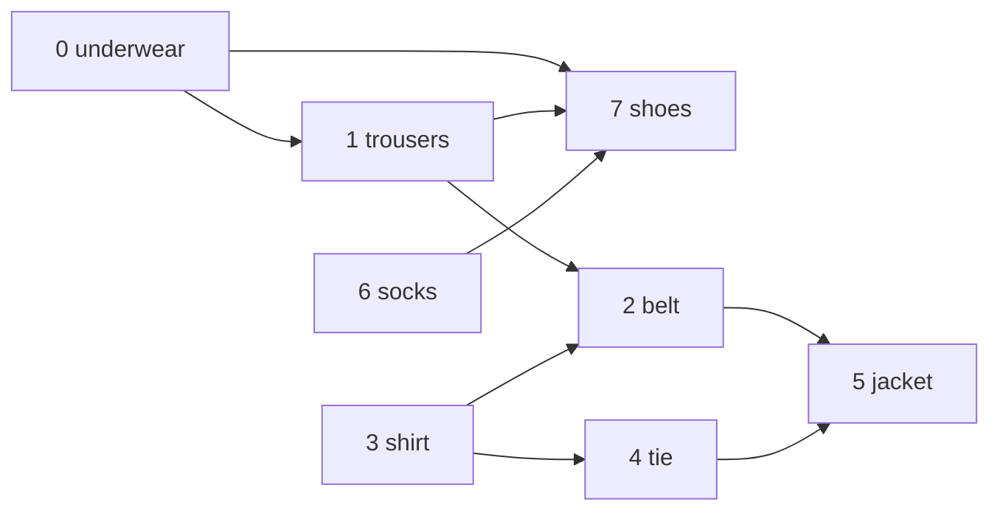

## Introduction

Getting dressed in the morning has rules. Underwear goes on before trousers. Trousers go on before the belt and before shoes. Socks go on before shoes. The shirt goes on before the belt and the tie, and both of those before the jacket. Nobody has trouble getting dressed, yet the rules do not say *what to do first*; they only say what must come before what. Turning a set of "A before B" rules into one complete sequence that obeys all of them is called **topological sorting**.

In graph terms, each item is a vertex and each rule "A before B" is a directed edge `A → B`. A **topological order** (or topological sort) is a listing of all the vertices in which every edge goes from an earlier vertex to a later one. For the clothes, "underwear, shirt, socks, trousers, tie, belt, shoes, jacket" is one valid order; "socks, underwear, trousers, shoes, shirt, belt, tie, jacket" is another.

Software is full of these rules. A build tool must compile a library before the code that uses it. A package manager must install a dependency before the package that needs it. A spreadsheet must recompute a cell before the cells whose formulas read it. A university degree plan must schedule prerequisites before the courses that require them. A data pipeline scheduler such as Apache Airflow runs a task only after every upstream task has succeeded. Each of these is a directed graph of dependencies, and each needs a topological order — or a clear error when no order exists.

That last point matters. If the rules contain a cycle — A before B, B before C, C before A — no order can satisfy them. So a topological sort algorithm always doubles as a cycle detector, which links this lesson to [[a8-cycle-detection]].

A topological order is also the key that unlocks fast algorithms on **directed acyclic graphs (DAGs)**. Once vertices are in topological order, every edge points forward, so you can process vertices left to right knowing that everything feeding into a vertex has already been handled. That single fact gives linear-time shortest paths, longest paths, path counting and a whole family of dynamic programs.

This lesson teaches:

- [[a8-topo-kahn]] — the queue-based method that repeatedly takes a vertex with no remaining prerequisites.
- [[a8-topo-dfs]] — the depth-first method that reverses the order in which vertices finish.
- [[a8-topo-departure-time]] — the same DFS method expressed with explicit arrival and departure timestamps.
- [[a8-course-schedule]] — the canonical interview application, plus dependency ordering in general.
- [[a8-all-topological-sorts]] — listing (and counting) every valid order.
- [[a8-max-edges-keep-dag]] — how many edges can be added to a DAG without creating a cycle.
- [[a8-shortest-path-dag]] and [[a8-longest-path-dag]] — single-pass path algorithms that work even with negative weights.
- [[a8-dag-dp]] — the general pattern behind them: dynamic programming in topological order.
- [[a8-find-itinerary]] — reconstructing a trip from a pile of tickets, and why the harder version needs an Euler-path algorithm instead.

## Before you start

- **Directed graphs and adjacency lists.** `adj.get(u)` lists the targets of `u`'s outgoing edges. See [[a8-adjacency-list]] and [[a8-graph-types]].
- **Indegree** — the number of edges pointing into a vertex. See [[a8-graph-terminology]].
- **BFS and queues** for Kahn's algorithm. See [[a8-bfs]].
- **DFS and recursion** for the finishing-time method. See [[a8-dfs]] and [[a1-recursion]].
- **Directed cycle detection**, especially the white/gray/black colours. See [[a8-cycle-detection]]. This lesson re-explains the parts it uses.
- **Priority queues**, for the lexicographically-smallest order and the itinerary problem. See [[a1-priorityqueue]].
- **Basic dynamic programming** helps for the DAG DP section. See [[a11-memoization]].

## The intuition

Imagine the dressing rules written on cards, one card per item, each listing what must already be on. Spread the cards on a table. Any card whose list is empty can be done right now — underwear, shirt and socks. Pick one, put it on, and cross that item off every other card. Now trousers and the tie have empty lists too. Keep going: at each step, choose any card whose list is empty. You never get stuck, because the rules are consistent, and when the table is clear you have dressed in a valid order. That is Kahn's algorithm.

Now imagine the opposite approach: start from the *last* thing that could be done and work backwards. Ask "what must happen before the jacket?" — the belt and tie. "Before the belt?" — trousers and shirt. "Before the trousers?" — underwear. Follow these chains to the bottom, and write an item down only once everything it depends on is written. That is the DFS method, run on the reversed rules; in the standard version, we follow edges forward and write each item down once everything that depends on it is done, then read the list backwards.

Both pictures share one invariant: **an item is placed only when its relationship to everything it is constrained by is settled.** They just settle it from opposite ends.

## What a topological order is, and when one exists

A **topological order** of a directed graph `G` is a sequence containing every vertex exactly once such that for every edge `u → v`, `u` appears before `v`.

**A topological order exists if and only if the graph is a DAG.** One direction is short: if the graph has a cycle `v₁ → v₂ → … → vₖ → v₁`, then any order would need `v₁` before `v₂` before … before `vₖ` before `v₁`, which puts `v₁` before itself. The other direction is constructive: every non-empty DAG has a vertex with no incoming edges (proved in [[a8-cycle-directed-bfs-kahn]]), so put it first, remove it, and repeat on the smaller DAG. That construction *is* Kahn's algorithm.

**The order is usually not unique.** Whenever two vertices have no path between them in either direction, either can come first. The dressing graph has hundreds of valid orders. An order is unique exactly when every pair of consecutive vertices in it is joined by an edge — that is, when the DAG contains a path through all its vertices (a **Hamiltonian path**). This matters in practice: if a problem expects "the" order, it must either guarantee uniqueness or specify a tie-break, such as "smallest label first".

Some quick consequences worth remembering:

- The first vertex of any topological order has indegree 0 (a **source**); the last has outdegree 0 (a **sink**).
- A topological order is a **linear extension** of the dependency relation: it adds enough "before" decisions to turn a partial order into a total one.
- Reversing every edge reverses every topological order.



## Kahn's Algorithm (BFS + Indegree) {#a8-topo-kahn}

Kahn's algorithm builds a topological order by repeatedly removing a vertex that has **no remaining incoming edges** — a vertex whose prerequisites are all done — and appending it to the output. Removing it decrements the indegree of each vertex it points to, and any vertex whose count drops to zero becomes ready. If every vertex gets removed, the output is a valid topological order; if the process stops early, the graph has a cycle. It was published by Arthur Kahn in 1962 and is the most common way to topologically sort in practice.

### Deriving it

The naive approach is to try orders: generate permutations and check each one. With `V` vertices there are `V!` permutations — 3.6 million for ten vertices — so that is hopeless.

A smarter naive approach is to repeatedly scan all vertices for one with no incoming edges from unplaced vertices, place it, and scan again. Each scan costs O(V + E) and there are `V` scans, so O(V · (V + E)). It works, but it rechecks the same vertices over and over.

Kahn's improvement is bookkeeping. Keep `indeg[v]` = number of incoming edges from vertices not yet placed. Placing `u` can only change the counts of `u`'s direct successors, and only by one each. So instead of rescanning, decrement those counts and notice the exact moment a count hits zero. Vertices that are ready wait in a queue. Each vertex and edge is now handled a constant number of times.

### The procedure

1. Compute `indeg[v]` for every vertex by scanning every edge once.
2. Put every vertex with `indeg == 0` into a queue.
3. While the queue is not empty: remove a vertex `u`, append it to the order, and for each edge `u → v` decrement `indeg[v]`; if it becomes 0, add `v` to the queue.
4. If the order contains all `V` vertices, return it. Otherwise the graph has a cycle — return an empty result or report an error.

**The invariant**: a vertex enters the queue only when every one of its predecessors is already in the output. Therefore, when it is output, every edge into it comes from an earlier vertex — which is exactly the definition of a topological order.

### Implementation

```java title="Kahn.java"
import java.util.*;

public class Kahn {

    // Returns a topological order, or an empty list if the graph has a cycle.
    static List<Integer> topoSort(List<List<Integer>> adj) {
        int n = adj.size();
        int[] indeg = new int[n];
        for (List<Integer> out : adj) for (int v : out) indeg[v]++;

        ArrayDeque<Integer> ready = new ArrayDeque<>();
        for (int u = 0; u < n; u++) if (indeg[u] == 0) ready.offer(u);

        List<Integer> order = new ArrayList<>();
        while (!ready.isEmpty()) {
            int u = ready.poll();
            order.add(u);                              // every prerequisite of u is done
            for (int v : adj.get(u)) {
                if (--indeg[v] == 0) ready.offer(v);   // u was v's last missing prerequisite
            }
        }
        return order.size() == n ? order : List.of(); // leftovers mean a cycle
    }

    static List<List<Integer>> graph(int n, int[][] edges) {
        List<List<Integer>> adj = new ArrayList<>();
        for (int i = 0; i < n; i++) adj.add(new ArrayList<>());
        for (int[] e : edges) adj.get(e[0]).add(e[1]);
        return adj;
    }

    public static void main(String[] args) {
        // 0 underwear, 1 trousers, 2 belt, 3 shirt, 4 tie, 5 jacket, 6 socks, 7 shoes
        int[][] dressing = {
            {0, 1}, {0, 7}, {1, 2}, {1, 7}, {3, 2}, {3, 4}, {2, 5}, {4, 5}, {6, 7}};
        System.out.println(topoSort(graph(8, dressing)));
        System.out.println(topoSort(graph(3, new int[][] {{0, 1}, {1, 2}, {2, 0}})));
    }
}
```

```output
[0, 3, 6, 1, 4, 2, 7, 5]
[]
```

The first result reads: underwear, shirt, socks, trousers, tie, belt, shoes, jacket — a valid way to dress. The second graph is a 3-cycle, so no vertex ever reaches indegree 0, the queue starts empty, and the method returns an empty list.

`ArrayDeque` is Java's recommended general-purpose queue; it is faster than `LinkedList` and rejects `null`. The expression `--indeg[v] == 0` decrements first, then compares, so `v` joins the queue exactly once — at the moment its last predecessor is output.

### Dry run on the dressing graph

Initial indegrees: underwear 0, trousers 1, belt 2, shirt 0, tie 1, jacket 2, socks 0, shoes 3.

| Step | Output `u` | Indegree updates | Queue afterwards |
|---|---|---|---|
| start | — | — | [0, 3, 6] |
| 1 | 0 underwear | trousers 1 → 0 (enqueue), shoes 3 → 2 | [3, 6, 1] |
| 2 | 3 shirt | belt 2 → 1, tie 1 → 0 (enqueue) | [6, 1, 4] |
| 3 | 6 socks | shoes 2 → 1 | [1, 4] |
| 4 | 1 trousers | belt 1 → 0 (enqueue), shoes 1 → 0 (enqueue) | [4, 2, 7] |
| 5 | 4 tie | jacket 2 → 1 | [2, 7] |
| 6 | 2 belt | jacket 1 → 0 (enqueue) | [7, 5] |
| 7 | 7 shoes | — | [5] |
| 8 | 5 jacket | — | [] |

Eight vertices output, so the graph is a DAG and `[0, 3, 6, 1, 4, 2, 7, 5]` is valid. Notice that shoes had to wait for three different prerequisites; its count went 3 → 2 → 1 → 0 across steps 1, 3 and 4, and only the last decrement released it.

### Complexity

Computing indegrees touches each edge once: O(E), plus O(V) to initialise. Each vertex is enqueued exactly once (when its count hits zero) and dequeued once, so queue work is O(V). When a vertex is dequeued, its outgoing edges are scanned once, so all decrements together cost O(E). Total: **O(V + E)** time. The `indeg` array, queue and output list hold at most `V` entries each, so **O(V)** auxiliary space beyond the graph.

### Three useful variants

**Smallest order in dictionary order.** Replace the `ArrayDeque` with a `PriorityQueue<Integer>`, so that among all ready vertices the smallest label is always taken next. That produces the **lexicographically smallest** topological order. Each queue operation now costs O(log V), so the total is O(V log V + E). Be careful about what this guarantees: it minimises the sequence in dictionary order. It does *not* guarantee that vertex 0 appears as early as possible — with the single edge `2 → 0` on three vertices, the smallest order is `[1, 2, 0]`, while the order that puts 0 earliest is `[2, 0, 1]`. Problems asking for the second property need a different trick (process the reversed graph with a max-heap and reverse the result).

**Levels, or rounds.** Instead of a single queue, process all currently-ready vertices as one *round*, collecting the vertices they release into the next round. Every vertex in a round can run in parallel. The number of rounds equals the number of vertices on the longest path, which is the minimum number of semesters to finish a degree when any number of courses can be taken per semester, or the minimum number of parallel stages for a build.

**Uniqueness.** If the queue ever holds two or more vertices, there was a free choice, so more than one order exists. If it never does, the order is unique.

```java title="KahnVariants.java"
import java.util.*;

public class KahnVariants {

    // Smallest order in dictionary order: always take the smallest ready vertex.
    static List<Integer> smallestOrder(List<List<Integer>> adj) {
        int n = adj.size();
        int[] indeg = new int[n];
        for (List<Integer> out : adj) for (int v : out) indeg[v]++;
        PriorityQueue<Integer> ready = new PriorityQueue<>();
        for (int u = 0; u < n; u++) if (indeg[u] == 0) ready.offer(u);
        List<Integer> order = new ArrayList<>();
        while (!ready.isEmpty()) {
            int u = ready.poll();
            order.add(u);
            for (int v : adj.get(u)) if (--indeg[v] == 0) ready.offer(v);
        }
        return order.size() == n ? order : List.of();
    }

    // Groups vertices into rounds: everything in a round can run in parallel.
    static List<List<Integer>> levels(List<List<Integer>> adj) {
        int n = adj.size();
        int[] indeg = new int[n];
        for (List<Integer> out : adj) for (int v : out) indeg[v]++;
        List<Integer> current = new ArrayList<>();
        for (int u = 0; u < n; u++) if (indeg[u] == 0) current.add(u);
        List<List<Integer>> rounds = new ArrayList<>();
        int done = 0;
        while (!current.isEmpty()) {
            rounds.add(current);
            done += current.size();
            List<Integer> next = new ArrayList<>();
            for (int u : current) {
                for (int v : adj.get(u)) if (--indeg[v] == 0) next.add(v);
            }
            current = next;
        }
        return done == n ? rounds : List.of();
    }

    // The order is unique exactly when there is never more than one ready vertex.
    static boolean uniqueOrder(List<List<Integer>> adj) {
        int n = adj.size();
        int[] indeg = new int[n];
        for (List<Integer> out : adj) for (int v : out) indeg[v]++;
        ArrayDeque<Integer> ready = new ArrayDeque<>();
        for (int u = 0; u < n; u++) if (indeg[u] == 0) ready.offer(u);
        int count = 0;
        while (!ready.isEmpty()) {
            if (ready.size() > 1) return false;        // a free choice exists
            int u = ready.poll();
            count++;
            for (int v : adj.get(u)) if (--indeg[v] == 0) ready.offer(v);
        }
        return count == n;                             // a cycle has no order at all
    }

    public static void main(String[] args) {
        int[][] dressing = {
            {0, 1}, {0, 7}, {1, 2}, {1, 7}, {3, 2}, {3, 4}, {2, 5}, {4, 5}, {6, 7}};
        List<List<Integer>> adj = Kahn.graph(8, dressing);
        System.out.println("smallest " + smallestOrder(adj));
        System.out.println("rounds   " + levels(adj));
        System.out.println("unique?  " + uniqueOrder(adj));
        System.out.println("chain unique? "
            + uniqueOrder(Kahn.graph(3, new int[][] {{0, 1}, {1, 2}, {0, 2}})));
    }
}
```

```output
smallest [0, 1, 3, 2, 4, 5, 6, 7]
rounds   [[0, 3, 6], [1, 4], [2, 7], [5]]
unique?  false
chain unique? true
```

(`KahnVariants` reuses the `graph` helper from `Kahn.java`; compile the two files together.) The rounds say you can dress in four "parallel" steps if you had several pairs of hands: underwear, shirt and socks together; then trousers and tie; then belt and shoes; then the jacket. The last graph, `0 → 1 → 2` plus a shortcut `0 → 2`, has exactly one order because its edges include a path through every vertex.

## Topological Sort via DFS + Stack {#a8-topo-dfs}

The DFS method produces a topological order by running depth-first search and recording each vertex at the moment it **finishes** — after every vertex reachable from it has been fully explored. Pushing finished vertices onto a stack and then reading the stack from top to bottom gives the reverse of the finishing order, which is a valid topological order. This is also called **reverse postorder**. With white/gray/black colours, the same DFS detects a cycle for free.

### Why reverse finishing order works

Take any edge `u → v` and look at the moment DFS examines it while exploring `u`. There are three possibilities for `v`:

- **`v` is white (unvisited).** DFS recurses into `v` right now, and `v` finishes before control returns to `u`. So `v` finishes first.
- **`v` is black (finished).** Then `v` already finished. Again `v` finishes first.
- **`v` is gray (on the current recursion path).** Then `v` is an ancestor of `u`, and `u → v` closes a cycle. In a DAG this cannot happen.

So in a DAG, **every edge `u → v` has `v` finishing before `u`**. List vertices in *decreasing* finishing time and every edge points forward. That is the whole proof.

Notice what the proof does *not* use: it does not matter which vertex DFS starts from, or in what order neighbours are visited. Any DFS that covers every vertex gives a valid order, though different choices give different orders.

### Why preorder is wrong

A tempting shortcut is to output vertices when DFS *enters* them (preorder). It fails. With edges `0 → 1` and `2 → 1`, DFS from 0 enters 0, then 1, then (from the outer loop) 2, giving `[0, 1, 2]` — but `2 → 1` requires 2 before 1. Preorder only respects edges along the DFS tree, not edges arriving from other branches. Finishing time respects all of them, because of the three-case argument above.

### Implementation

```java title="TopoDfs.java"
import java.util.*;

public class TopoDfs {
    static final int WHITE = 0, GRAY = 1, BLACK = 2;

    // Returns a topological order, or an empty list if the graph has a cycle.
    static List<Integer> topoSort(List<List<Integer>> adj) {
        int n = adj.size();
        int[] color = new int[n];
        Deque<Integer> stack = new ArrayDeque<>();
        for (int s = 0; s < n; s++) {
            if (color[s] == WHITE && !dfs(s, adj, color, stack)) return List.of();
        }
        return new ArrayList<>(stack);   // iterates from the top: last finished first
    }

    // Returns false if a cycle is found below u.
    static boolean dfs(int u, List<List<Integer>> adj, int[] color, Deque<Integer> stack) {
        color[u] = GRAY;
        for (int v : adj.get(u)) {
            if (color[v] == GRAY) return false;                       // back edge
            if (color[v] == WHITE && !dfs(v, adj, color, stack)) return false;
        }
        color[u] = BLACK;
        stack.push(u);                   // u finishes after everything it points to
        return true;
    }

    public static void main(String[] args) {
        int[][] dressing = {
            {0, 1}, {0, 7}, {1, 2}, {1, 7}, {3, 2}, {3, 4}, {2, 5}, {4, 5}, {6, 7}};
        System.out.println(topoSort(Kahn.graph(8, dressing)));
        System.out.println(topoSort(Kahn.graph(3, new int[][] {{0, 1}, {1, 2}, {2, 0}})));
    }
}
```

```output
[6, 3, 4, 0, 1, 7, 2, 5]
[]
```

Socks, shirt, tie, underwear, trousers, shoes, belt, jacket — different from Kahn's order and equally valid. `ArrayDeque.push` adds to the front, and copying the deque into an `ArrayList` iterates from the front, so the list starts with the vertex that finished last. If you use a plain `List` and `add` on finish instead, remember to `Collections.reverse` it at the end; forgetting that reversal is the most common bug in this method.

### Dry run

DFS starts from 0 and visits neighbours in the order they appear in the edge list.

| Event | Gray path | Finished so far (in order) |
|---|---|---|
| enter 0, enter 1, enter 2, enter 5 | 0, 1, 2, 5 | — |
| 5 has no edges: finish 5 | 0, 1, 2 | 5 |
| 2 done: finish 2 | 0, 1 | 5, 2 |
| from 1, enter 7; finish 7 | 0, 1 | 5, 2, 7 |
| 1 done: finish 1 | 0 | 5, 2, 7, 1 |
| 0's edge to 7: black, skip; finish 0 | — | 5, 2, 7, 1, 0 |
| outer loop: enter 3; 3 → 2 black; enter 4; 4 → 5 black; finish 4 | 3 | 5, 2, 7, 1, 0, 4 |
| finish 3 | — | 5, 2, 7, 1, 0, 4, 3 |
| outer loop: enter 6; 6 → 7 black; finish 6 | — | 5, 2, 7, 1, 0, 4, 3, 6 |

Reversing the finishing order gives `[6, 3, 4, 0, 1, 7, 2, 5]`. Check one edge that crosses DFS trees: `3 → 2`. Vertex 2 finished second, vertex 3 seventh, so 3 comes before 2 in the reversed list, as required.

### Complexity and the recursion caveat

Each vertex changes colour twice and each edge is examined once: **O(V + E)** time. The colour array and the stack are O(V), and so is the recursion depth in the worst case, giving **O(V)** auxiliary space. As with all recursive DFS in Java, a chain of tens of thousands of vertices can throw `StackOverflowError`; use Kahn or an iterative DFS (shown in [[a8-cycle-directed-dfs]]) for large inputs.

### When to prefer DFS over Kahn

The DFS method is the natural choice when you are already running DFS for another reason, or when you need finishing order itself. Kosaraju's strongly connected components algorithm ([[a8-kosaraju]]) uses exactly this finishing-order stack in its first pass. Memoised recursion over a DAG — "compute the answer for `u` from the answers of its successors" — is also DFS postorder in disguise, as [[a8-dag-dp]] shows. Kahn is the natural choice when you want levels, a lexicographic tie-break, the set of blocked vertices on failure, or no recursion.

## Topological Sort Using Departure Time of Vertex {#a8-topo-departure-time}

This is the DFS method from [[a8-topo-dfs]] written with explicit timestamps. A global clock ticks once whenever DFS **arrives** at a vertex and once whenever it **departs** (finishes) a vertex. Each vertex therefore gets an arrival time and a departure time. In a DAG, every edge `u → v` satisfies `departure[u] > departure[v]`, so listing vertices in decreasing departure time gives a topological order. Departure times are just finishing times under another name; the value of this formulation is that the times are numbers you can store, compare and reuse.

### Arrival, departure and nesting

Run DFS with a counter `time` starting at 0. On entering `u`, set `arrival[u] = time++`. After all of `u`'s edges are explored, set `departure[u] = time++`. The interval `[arrival[u], departure[u]]` is the span of time during which `u` is gray, and these intervals have a strict structure: for any two vertices, their intervals are either **nested** (one is a descendant of the other in the DFS forest) or **disjoint** (neither is). They never partially overlap, because a recursive call that starts inside `u`'s call must also end inside it.

Combined with the colour argument from the DFS method, that gives the edge rules:

| Edge `u → v` | Relationship of intervals | `departure[u]` vs `departure[v]` |
|---|---|---|
| Tree or forward edge (`v` is a descendant) | `v`'s interval nested inside `u`'s | `departure[u] > departure[v]` |
| Cross edge (`v` finished earlier, different branch) | disjoint, `v`'s comes first | `departure[u] > departure[v]` |
| Back edge (`v` is an ancestor — a cycle) | `u`'s nested inside `v`'s | `departure[u] < departure[v]` |

In a DAG there are no back edges, so the first two rows cover every edge. Sorting by decreasing departure time is therefore a topological order. If you find an edge with `departure[u] < departure[v]` after the DFS, the graph has a cycle — a convenient after-the-fact check.

### Implementation

Departure times are distinct integers in the range `[0, 2V)`, so sorting them needs no comparison sort: put each vertex into an array slot indexed by its departure time, then read the array from the end. That keeps the whole method O(V + E).

```java title="DepartureTime.java"
import java.util.*;

public class DepartureTime {
    static List<List<Integer>> adj;
    static int[] arrival, departure;
    static boolean[] visited;
    static int time = 0;

    static void dfs(int u) {
        visited[u] = true;
        arrival[u] = time++;
        for (int v : adj.get(u)) if (!visited[v]) dfs(v);
        departure[u] = time++;
    }

    public static void main(String[] args) {
        int n = 6;
        int[][] edges = {{5, 2}, {5, 0}, {4, 0}, {4, 1}, {2, 3}, {3, 1}};
        adj = new ArrayList<>();
        for (int i = 0; i < n; i++) adj.add(new ArrayList<>());
        for (int[] e : edges) adj.get(e[0]).add(e[1]);

        arrival = new int[n];
        departure = new int[n];
        visited = new boolean[n];
        for (int s = 0; s < n; s++) if (!visited[s]) dfs(s);

        for (int u = 0; u < n; u++) {
            System.out.println(u + ": arrival " + arrival[u] + ", departure " + departure[u]);
        }

        // Departure times are distinct values in [0, 2n), so index an array by them.
        int[] byTime = new int[2 * n];
        Arrays.fill(byTime, -1);
        for (int u = 0; u < n; u++) byTime[departure[u]] = u;
        List<Integer> order = new ArrayList<>();
        for (int t = 2 * n - 1; t >= 0; t--) if (byTime[t] != -1) order.add(byTime[t]);
        System.out.println("order " + order);

        for (int[] e : edges) {                        // every edge must point "down" in time
            if (departure[e[0]] <= departure[e[1]]) System.out.println("violated " + e[0]);
        }
    }
}
```

```output
0: arrival 0, departure 1
1: arrival 2, departure 3
2: arrival 4, departure 7
3: arrival 5, departure 6
4: arrival 8, departure 9
5: arrival 10, departure 11
order [5, 4, 2, 3, 1, 0]
```

This DFS uses only a `visited` array, so it assumes the input is a DAG; the final loop verifies that assumption and printed nothing, so every edge satisfied the departure rule. The outer loop started at 0, which has no outgoing edges, so 0 arrived at time 0 and departed at time 1 — vertices are not discovered in topological order, and they do not need to be. Vertex 2's interval `[4, 7]` contains vertex 3's `[5, 6]` because 3 was discovered from 2. The edge `5 → 2` is a tree edge: `11 > 7`. The edge `4 → 0` is a cross edge to an earlier tree: `9 > 1`.

### Complexity and where timestamps are reused

DFS is O(V + E); filling and reading the `2V`-slot array is O(V). Total **O(V + E)** time and **O(V)** space.

Arrival and departure times are a general DFS tool, not only a sorting trick. With them you can answer "is `x` an ancestor of `y` in the DFS tree?" in O(1) by checking interval containment, classify edges after the fact, and — in undirected graphs — compute the low-link values used for bridges and articulation points ([[a8-bridges-tarjan]], [[a8-articulation-tarjan]]).

## Course Schedule / Dependency Ordering {#a8-course-schedule}

The **Course Schedule** problems are the standard interview form of topological sorting. You are given `numCourses` courses labelled `0` to `n − 1` and a list of pairs `prerequisites[i] = [a, b]`, meaning "you must take course `b` before course `a`". *Course Schedule* (LeetCode 207) asks whether it is possible to finish every course; *Course Schedule II* (LeetCode 210) asks for one valid order, or an empty array if none exists. Underneath, both ask: is this dependency graph a DAG, and if so, what is a topological order? The same modelling applies to any dependency-ordering problem — builds, package installs, migration scripts, task pipelines.

### Modelling: get the edge direction right

The single most important step is choosing the edge direction. Make edges point from **what must happen first** to **what depends on it**: for the pair `[a, b]`, add the edge `b → a`. With that convention, a topological order of the graph is directly a valid course order, and indegree means "number of unmet prerequisites".

If you build `a → b` instead, the graph is the reverse of the intended one. For *Course Schedule I* the answer is still right — a reversed cycle is still a cycle — which is why this bug often survives the first problem and then produces backwards orders in the second. Write the convention as a comment next to the line that adds edges.

### Implementation

```java title="CourseSchedule.java"
import java.util.*;

public class CourseSchedule {

    // LeetCode 210: prerequisites[i] = {a, b} means "take b before a" (edge b -> a).
    static int[] findOrder(int numCourses, int[][] prerequisites) {
        List<List<Integer>> next = new ArrayList<>();
        for (int i = 0; i < numCourses; i++) next.add(new ArrayList<>());
        int[] missing = new int[numCourses];          // unmet prerequisites per course
        for (int[] p : prerequisites) {
            next.get(p[1]).add(p[0]);
            missing[p[0]]++;
        }
        ArrayDeque<Integer> ready = new ArrayDeque<>();
        for (int c = 0; c < numCourses; c++) if (missing[c] == 0) ready.offer(c);

        int[] order = new int[numCourses];
        int taken = 0;
        while (!ready.isEmpty()) {
            int c = ready.poll();
            order[taken++] = c;
            for (int d : next.get(c)) if (--missing[d] == 0) ready.offer(d);
        }
        return taken == numCourses ? order : new int[0];
    }

    // LeetCode 207 is the same loop with only the count.
    static boolean canFinish(int numCourses, int[][] prerequisites) {
        return findOrder(numCourses, prerequisites).length == numCourses;
    }

    public static void main(String[] args) {
        int[][] pre = {{1, 0}, {2, 0}, {3, 1}, {3, 2}};
        System.out.println(Arrays.toString(findOrder(4, pre)));
        System.out.println(canFinish(2, new int[][] {{1, 0}, {0, 1}}));
        System.out.println(Arrays.toString(findOrder(3, new int[0][])));
    }
}
```

```output
[0, 1, 2, 3]
false
[0, 1, 2]
```

The first input says 1 and 2 need 0, and 3 needs both 1 and 2; `[0, 2, 1, 3]` would be equally valid, and LeetCode accepts any valid order. The second input is a two-course cycle — each requires the other — so no course ever becomes ready. The third has no prerequisites at all, so every course is ready immediately; a correct solution handles this without special cases. Course numbers with no edges still have to appear in the output, which is why the adjacency list is sized by `numCourses` rather than by the courses that appear in pairs.

Naming the indegree array `missing` and the adjacency list `next` is deliberate: in an interview, domain names make the edge direction self-checking.

### Recognising dependency ordering in disguise

Many problems are this one with different words. The signal is a set of pairwise "X must come before Y" constraints and a request to produce, validate or optimise a sequence.

- **Parallel Courses** (minimum number of semesters): Kahn by levels, as in [[a8-topo-kahn]]. The answer is the number of rounds.
- **Build order / package install order**: projects and dependencies; return an order or report a cycle.
- **Sequence Reconstruction**: is a given sequence the *only* topological order? Check that the queue never holds more than one vertex and that the result equals the sequence.
- **Sort Items by Groups Respecting Dependencies**: two levels of topological sort — groups, then items within each group.
- **Alien Dictionary**: derive the ordering constraints yourself from sorted data, below.

### Alien Dictionary: deriving the edges

In *Alien Dictionary* you get a list of words sorted in an unknown alphabet and must return a letter order consistent with it. The trick is extracting constraints. Compare each pair of *adjacent* words: the first position where they differ tells you that the first word's letter comes before the second word's letter in the alphabet — and nothing after that position tells you anything. If no position differs and the first word is longer (such as `"abc"` before `"ab"`), the input is invalid, because a proper prefix must sort first.

```java title="AlienDictionary.java"
import java.util.*;

public class AlienDictionary {

    // Returns one letter order consistent with the sorted word list, or "" if none exists.
    static String alienOrder(String[] words) {
        Map<Character, Set<Character>> next = new TreeMap<>();
        Map<Character, Integer> indeg = new TreeMap<>();
        for (String w : words) {
            for (char c : w.toCharArray()) {
                next.putIfAbsent(c, new TreeSet<>());
                indeg.putIfAbsent(c, 0);
            }
        }
        for (int i = 0; i + 1 < words.length; i++) {
            String a = words[i], b = words[i + 1];
            int len = Math.min(a.length(), b.length());
            int j = 0;
            while (j < len && a.charAt(j) == b.charAt(j)) j++;
            if (j == len) {
                if (a.length() > b.length()) return "";   // "abc" before "ab" is impossible
                continue;                                  // a prefix of b: no information
            }
            // Only the first differing letter tells us anything.
            if (next.get(a.charAt(j)).add(b.charAt(j))) {
                indeg.merge(b.charAt(j), 1, Integer::sum);
            }
        }
        ArrayDeque<Character> ready = new ArrayDeque<>();
        for (var e : indeg.entrySet()) if (e.getValue() == 0) ready.offer(e.getKey());
        StringBuilder order = new StringBuilder();
        while (!ready.isEmpty()) {
            char c = ready.poll();
            order.append(c);
            for (char d : next.get(c)) if (indeg.merge(d, -1, Integer::sum) == 0) ready.offer(d);
        }
        return order.length() == indeg.size() ? order.toString() : "";
    }

    public static void main(String[] args) {
        System.out.println(alienOrder(new String[] {"wrt", "wrf", "er", "ett", "rftt"}));
        System.out.println("[" + alienOrder(new String[] {"z", "x", "z"}) + "]");
        System.out.println("[" + alienOrder(new String[] {"abc", "ab"}) + "]");
    }
}
```

```output
wertf
[]
[]
```

From `wrt`/`wrf` we learn `t → f`; from `wrf`/`er`, `w → e`; from `er`/`ett`, `r → t`; from `ett`/`rftt`, `e → r`. Chaining gives `w → e → r → t → f`. The second input implies `z → x` and `x → z`, a cycle, so no alphabet works. The third is the prefix trap. Two details prevent subtle bugs: every letter that appears anywhere becomes a vertex (even letters with no constraints must be in the output), and a duplicate constraint is added only once, because `Set.add` returns `false` for a repeat — otherwise the indegree would be counted twice for one edge and the letter would never be released. Sorted maps are used only to make the output deterministic.

### Complexity

Building the graph is O(V + E) for courses and prerequisites, and Kahn is O(V + E), so Course Schedule I and II are **O(V + E)** time and O(V + E) space including the adjacency list. For Alien Dictionary, comparing adjacent words costs O(total characters `C`), and the graph has at most 26 letters (or `U` distinct characters), so the whole thing is O(C + U²) in the worst case and O(C) for a fixed alphabet.

## All Topological Sorts of a DAG {#a8-all-topological-sorts}

This problem asks for **every** valid topological order of a DAG, not just one. It is solved by **backtracking**: at each step, try every vertex that is currently ready (indegree 0 and not yet used), place it, update indegrees, recurse to complete the order, and then undo the choice and try the next ready vertex. Each complete sequence is a different valid order. The number of orders can be enormous, so the running time depends on the size of the output.

### Why backtracking over Kahn's choices

Kahn's algorithm makes a choice every time more than one vertex is ready, and every valid order is produced by *some* sequence of those choices — the first vertex of any valid order is ready at the start, the second is ready once the first is removed, and so on. So the set of all orders is exactly the set of all ways to make Kahn's choices. Backtracking explores that choice tree systematically: try a choice, explore everything below it, undo it, and try the next.

Undoing must restore *all* state: the vertex is marked unused, removed from the current path, and every indegree that was decremented is incremented again. Forgetting any one of these corrupts every later branch.

### Implementation, plus a counting method

```java title="AllTopoSorts.java"
import java.util.*;

public class AllTopoSorts {
    static List<List<Integer>> adj;
    static int[] indeg;
    static boolean[] used;
    static List<Integer> path = new ArrayList<>();
    static List<List<Integer>> all = new ArrayList<>();

    static void backtrack() {
        if (path.size() == adj.size()) {
            all.add(new ArrayList<>(path));          // copy: path keeps changing
            return;
        }
        for (int u = 0; u < adj.size(); u++) {
            if (used[u] || indeg[u] != 0) continue;  // only vertices that are ready now
            used[u] = true;                          // choose u
            path.add(u);
            for (int v : adj.get(u)) indeg[v]--;
            backtrack();                             // explore every completion
            for (int v : adj.get(u)) indeg[v]++;     // undo, in reverse
            path.remove(path.size() - 1);
            used[u] = false;
        }
    }

    // Counts orders without listing them: dp[mask] = orders of the vertex set "mask".
    static long countOrders(List<List<Integer>> adj) {
        int n = adj.size();
        int[] predMask = new int[n];                 // bit p set if p -> u
        for (int p = 0; p < n; p++) for (int u : adj.get(p)) predMask[u] |= 1 << p;
        long[] dp = new long[1 << n];
        dp[0] = 1;
        for (int mask = 0; mask < (1 << n); mask++) {
            if (dp[mask] == 0) continue;
            for (int u = 0; u < n; u++) {
                boolean free = (mask & (1 << u)) == 0 && (predMask[u] & ~mask) == 0;
                if (free) dp[mask | (1 << u)] += dp[mask];   // place u next
            }
        }
        return dp[(1 << n) - 1];
    }

    public static void main(String[] args) {
        int n = 6;
        int[][] edges = {{5, 2}, {5, 0}, {4, 0}, {4, 1}, {2, 3}, {3, 1}};
        adj = new ArrayList<>();
        for (int i = 0; i < n; i++) adj.add(new ArrayList<>());
        for (int[] e : edges) adj.get(e[0]).add(e[1]);
        indeg = new int[n];
        for (int[] e : edges) indeg[e[1]]++;
        used = new boolean[n];

        backtrack();
        for (List<Integer> order : all) System.out.println(order);
        System.out.println(all.size() + " orders; bitmask DP count = " + countOrders(adj));
    }
}
```

```output
[4, 5, 0, 2, 3, 1]
[4, 5, 2, 0, 3, 1]
[4, 5, 2, 3, 0, 1]
[4, 5, 2, 3, 1, 0]
[5, 2, 3, 4, 0, 1]
[5, 2, 3, 4, 1, 0]
[5, 2, 4, 0, 3, 1]
[5, 2, 4, 3, 0, 1]
[5, 2, 4, 3, 1, 0]
[5, 4, 0, 2, 3, 1]
[5, 4, 2, 0, 3, 1]
[5, 4, 2, 3, 0, 1]
[5, 4, 2, 3, 1, 0]
13 orders; bitmask DP count = 13
```

At the start only 4 and 5 are ready, so every order begins with one of them. After choosing 4, only 5 is ready (0 and 1 still wait on 5 and 3), so the first four orders all begin `4, 5`. Because the loop tries ready vertices in increasing label order, the orders come out in dictionary order, and the first one is the lexicographically smallest order. The `new ArrayList<>(path)` copy is essential: storing `path` itself would store six references to one list that ends up empty.

### Counting without listing

If a problem asks only *how many* orders exist, listing them is wasteful. `countOrders` uses **bitmask dynamic programming** ([[a11-bitmask-dp]]): `dp[mask]` is the number of ways to order the set of vertices in `mask` as a valid prefix. A vertex `u` outside `mask` can be placed next exactly when all its predecessors are in `mask`, which is the bit test `(predMask[u] & ~mask) == 0`. Each state is extended by every placeable vertex, and `dp[full]` is the answer. This costs **O(2^V · V)** time and O(2^V) memory — feasible up to about 20–25 vertices — regardless of how many orders exist. Counting linear extensions of a general partial order is known to be #P-complete, so no polynomial algorithm is expected for large `V`.

### Complexity of enumeration

Each complete order takes `V` levels of recursion, and each level scans up to `V` vertices and updates their edges, so producing one order costs O(V² + E) in the simple implementation above; the total is **O(K · (V² + E))** for `K` orders, plus O(V · K) to store them. `K` can be as large as `V!` — a graph with no edges has every permutation as a valid order — so enumeration is only feasible for small graphs or graphs with many constraints. The recursion itself uses O(V) stack depth and O(V) state.

## Maximum Edges That Can Be Added to a DAG {#a8-max-edges-keep-dag}

Given a DAG with `V` vertices and `E` edges, this problem asks for the maximum number of new directed edges that can be added without creating a cycle — and usually to list them. The answer is **`V(V − 1)/2 − E`**: fix any topological order, and add an edge from every vertex to every later vertex that it does not already point to. A complete set of "forward" edges in one total order is the most edges any DAG on `V` vertices can have.

### Why `V(V − 1)/2` is the ceiling

A simple DAG cannot have a self-loop (a cycle of length 1) or both `u → v` and `v → u` (a cycle of length 2). So each unordered pair of distinct vertices contributes at most one edge, and there are `V(V − 1)/2` unordered pairs. No DAG can exceed that.

The ceiling is reachable. Take any topological order `t₀, t₁, …, t_{V−1}` and add every edge `tᵢ → tⱼ` with `i < j`. Every edge points forward in the same order, so the order is still a valid topological order and the graph is still a DAG. That graph has exactly one edge per pair: `V(V − 1)/2`. (Such a graph is called a **transitive tournament**.)

Since the original edges already point forward in the chosen order, none of them is "backwards", and the number of new edges is `V(V − 1)/2 − E`. The count does not depend on *which* topological order you choose, though the list of new edges does.

### Why adding a backward edge would break it

Suppose you added an edge `tⱼ → tᵢ` with `i < j` that goes against the order. After adding all forward edges, `tᵢ → tⱼ` is present, so `tᵢ → tⱼ → tᵢ` is a cycle. So once all forward edges are in place, no further edge is possible — the count is maximum, not just large.

### Implementation

```java title="MaxEdgesDag.java"
import java.util.*;

public class MaxEdgesDag {

    // Lists every edge that can be added while keeping the graph a DAG.
    static List<int[]> addableEdges(int n, int[][] edges) {
        List<List<Integer>> adj = new ArrayList<>();
        for (int i = 0; i < n; i++) adj.add(new ArrayList<>());
        boolean[][] has = new boolean[n][n];
        for (int[] e : edges) {
            adj.get(e[0]).add(e[1]);
            has[e[0]][e[1]] = true;
        }
        List<Integer> order = Kahn.topoSort(adj);
        if (order.isEmpty() && n > 0) throw new IllegalArgumentException("not a DAG");

        List<int[]> added = new ArrayList<>();
        for (int i = 0; i < n; i++) {
            for (int j = i + 1; j < n; j++) {
                int u = order.get(i), v = order.get(j);   // u comes before v
                if (!has[u][v]) added.add(new int[] {u, v});
            }
        }
        return added;
    }

    public static void main(String[] args) {
        int n = 5;
        int[][] edges = {{0, 1}, {1, 2}, {0, 3}, {3, 2}, {4, 2}};
        List<int[]> added = addableEdges(n, edges);
        for (int[] e : added) System.out.println(e[0] + " -> " + e[1]);
        long max = (long) n * (n - 1) / 2;
        System.out.println("added " + added.size() + " = " + max + " - " + edges.length);
    }
}
```

```output
0 -> 4
0 -> 2
4 -> 1
4 -> 3
1 -> 3
added 5 = 10 - 5
```

Kahn produced the order `[0, 4, 1, 3, 2]`. Walking every pair in that order and skipping existing edges yields five new edges, matching `10 − 5`. Notice `0 → 2`: there was already a path `0 → 1 → 2`, but not the direct edge, so it can be added. The same graph with a different topological order — say `[4, 0, 3, 1, 2]` — would produce a different list of five edges, such as `4 → 0` instead of `0 → 4`.

### Complexity and pitfalls

Topological sorting is O(V + E), and checking all `V(V − 1)/2` pairs is O(V²), which is also the size of the output in the worst case, so the method is **O(V²)** time. The `boolean[][]` matrix uses O(V²) space; for sparse graphs with large `V`, a `HashSet` of encoded pairs uses O(E) instead.

Compute the count with `long`: `V * (V − 1) / 2` overflows `int` once `V` exceeds 46,341, because the product passes `Integer.MAX_VALUE` before the division. And if the input may contain duplicate edges, count distinct edges for `E`, or the subtraction undercounts.

## Shortest Path in a DAG {#a8-shortest-path-dag}

This algorithm finds the shortest distance from a source vertex to every other vertex in a **weighted DAG** in O(V + E) time — faster than Dijkstra's algorithm, and correct even when some edge weights are **negative**. It processes vertices in topological order and relaxes each vertex's outgoing edges once. Because every edge points forward in that order, a vertex's distance is already final by the time it is processed.

### From general shortest paths to one pass

In a general graph, shortest-path algorithms have to work to discover the right order in which to finalise vertices. **Dijkstra's algorithm** ([[a8-dijkstra]]) uses a priority queue to always finalise the closest unfinished vertex, which costs O((V + E) log V) and breaks when weights are negative. **Bellman-Ford** ([[a8-bellman-ford]]) gives up on finding an order and simply relaxes every edge `V − 1` times, costing O(V · E).

A DAG hands us the right order for free. Every path into a vertex `v` passes only through vertices that come before `v` in topological order. So if we process vertices in that order and **relax** each outgoing edge — for edge `u → v` with weight `w`, if `dist[u] + w < dist[v]` then set `dist[v] = dist[u] + w` — then by the time we reach `v`, every edge into `v` has already been relaxed from a vertex whose distance was final. One pass suffices.

**Invariant**: when vertex `u` is processed, `dist[u]` equals the true shortest distance from the source. It holds for the source (0) and for vertices before the source (unreachable, infinity). For any other vertex, every predecessor came earlier, was final when processed, and relaxed its edge into `u`; the shortest path to `u` arrives through one of those edges, so `dist[u]` holds its length.

Negative weights do not disturb this argument at all: it never assumed that distances grow along a path. What negative weights break in general graphs is the possibility of negative cycles, and a DAG has no cycles.

### The procedure

1. Compute a topological order (Kahn or DFS).
2. Set `dist[source] = 0` and every other `dist` to infinity.
3. For each vertex `u` in topological order: if `dist[u]` is infinity, skip it (unreachable). Otherwise relax every outgoing edge `u → v`, recording `parent[v] = u` on improvement.
4. `dist[v]` is the answer for every `v`; follow `parent` links backwards to recover paths.

### Implementation

The example is a six-vertex DAG with two negative edges. The source is vertex 1; vertex 0 comes before it in every topological order and cannot be reached.

```java title="DagShortestPath.java"
import java.util.*;

public class DagShortestPath {
    record Edge(int to, int w) {}
    static final long INF = Long.MAX_VALUE / 4;

    static long[] dist;
    static int[] parent;

    static void shortestFrom(int src, List<List<Edge>> adj) {
        int n = adj.size();
        int[] indeg = new int[n];                      // Kahn for the order
        for (List<Edge> out : adj) for (Edge e : out) indeg[e.to()]++;
        ArrayDeque<Integer> ready = new ArrayDeque<>();
        for (int u = 0; u < n; u++) if (indeg[u] == 0) ready.offer(u);
        List<Integer> order = new ArrayList<>();
        while (!ready.isEmpty()) {
            int u = ready.poll();
            order.add(u);
            for (Edge e : adj.get(u)) if (--indeg[e.to()] == 0) ready.offer(e.to());
        }
        if (order.size() != n) throw new IllegalArgumentException("graph has a cycle");

        dist = new long[n];
        parent = new int[n];
        Arrays.fill(dist, INF);
        Arrays.fill(parent, -1);
        dist[src] = 0;
        for (int u : order) {
            if (dist[u] == INF) continue;              // unreachable: nothing to relax
            for (Edge e : adj.get(u)) {
                if (dist[u] + e.w() < dist[e.to()]) {  // relax u -> v
                    dist[e.to()] = dist[u] + e.w();
                    parent[e.to()] = u;
                }
            }
        }
    }

    static List<Integer> path(int v) {
        LinkedList<Integer> p = new LinkedList<>();
        for (int x = v; x != -1; x = parent[x]) p.addFirst(x);
        return p;
    }

    public static void main(String[] args) {
        int n = 6;
        int[][] edges = {{0, 1, 5}, {0, 2, 3}, {1, 2, 2}, {1, 3, 6}, {2, 3, 7},
                         {2, 4, 4}, {2, 5, 2}, {3, 4, -1}, {3, 5, 1}, {4, 5, -2}};
        List<List<Edge>> adj = new ArrayList<>();
        for (int i = 0; i < n; i++) adj.add(new ArrayList<>());
        for (int[] e : edges) adj.get(e[0]).add(new Edge(e[1], e[2]));

        shortestFrom(1, adj);
        for (int v = 0; v < n; v++) {
            System.out.println(v + ": " + (dist[v] == INF ? "unreachable" : dist[v] + " via " + path(v)));
        }
    }
}
```

```output
0: unreachable
1: 0 via [1]
2: 2 via [1, 2]
3: 6 via [1, 3]
4: 5 via [1, 3, 4]
5: 3 via [1, 3, 4, 5]
```

The shortest route to 5 is not the one with the fewest edges: `1 → 2 → 5` costs 4, but `1 → 3 → 4 → 5` costs `6 − 1 − 2 = 3`. The negative edges make the longer route cheaper, and the algorithm finds it without any special handling.

Two defensive details matter. `INF` is `Long.MAX_VALUE / 4`, not `Long.MAX_VALUE`, so that adding a weight to it cannot overflow — and the `continue` for unreachable vertices means it is never added to anyway. Without that skip, an unreachable vertex with a negative outgoing edge would "improve" its neighbour to `INF − 2`, a fake distance.

### Dry run

The topological order from Kahn is `[0, 1, 2, 3, 4, 5]`.

| Process | `dist[u]` | Relaxations | `dist` afterwards (vertices 0–5) |
|---|---|---|---|
| start | — | source 1 set to 0 | [∞, 0, ∞, ∞, ∞, ∞] |
| 0 | ∞ | skipped: unreachable | [∞, 0, ∞, ∞, ∞, ∞] |
| 1 | 0 | `1 → 2` = 2, `1 → 3` = 6 | [∞, 0, 2, 6, ∞, ∞] |
| 2 | 2 | `2 → 3` = 9 (no), `2 → 4` = 6, `2 → 5` = 4 | [∞, 0, 2, 6, 6, 4] |
| 3 | 6 | `3 → 4` = 5 (better), `3 → 5` = 7 (no) | [∞, 0, 2, 6, 5, 4] |
| 4 | 5 | `4 → 5` = 3 (better) | [∞, 0, 2, 6, 5, 3] |
| 5 | 3 | no outgoing edges | [∞, 0, 2, 6, 5, 3] |

Each edge was examined exactly once. Vertex 5's distance improved twice — first to 4 via 2, then to 3 via 4 — but both improvements happened before vertex 5 itself was processed, which is what the invariant promises.

### Complexity and comparison

Topological sort is O(V + E); the relaxation pass looks at each vertex once and each edge once, O(V + E). Total **O(V + E)** time and **O(V)** extra space for `dist`, `parent`, `indeg` and the order.

| Algorithm | Graphs | Negative edges | Time |
|---|---|---|---|
| BFS | Unweighted | — | O(V + E) |
| DAG relaxation | DAGs only | Allowed | O(V + E) |
| Dijkstra | Any | Not allowed | O((V + E) log V) |
| Bellman-Ford | Any | Allowed; detects negative cycles | O(V · E) |

If you are not certain the input is a DAG, check: the Kahn order's size doubles as the test, as in the code above.

## Longest Path in a DAG {#a8-longest-path-dag}

This problem asks for the path with the **largest** total weight — from a given source, or anywhere in the graph. In a general graph that is a famously hard problem, but in a DAG it is solved in O(V + E) by the same topological-order relaxation as shortest paths, with `max` in place of `min`. Its most important application is the **critical path** of a project: the longest chain of dependent tasks determines the earliest possible finish time.

### Why it is hard in general and easy in a DAG

In a general graph, "longest simple path" is **NP-hard**: if you could solve it quickly, you could decide whether a graph has a Hamiltonian path (a simple path of length `V − 1` through every vertex), which is NP-complete. The difficulty comes from cycles — the path must avoid revisiting vertices, and keeping track of which vertices were used is what explodes. Simply negating the weights and running Bellman-Ford does not help, because positive cycles become negative cycles, which Bellman-Ford can detect but not route around.

A DAG has no cycles, so every path is automatically simple, and the "which vertices have I used?" problem disappears. The shortest-path invariant carries over unchanged: process vertices in topological order, and every path into `v` is fully accounted for before `v` is processed. Two equivalent implementations:

- relax with `if (dist[u] + w > dist[v]) dist[v] = dist[u] + w`, initialising unreachable vertices to **negative** infinity; or
- negate every weight, run the shortest-path algorithm, and negate the results. Negation is safe here precisely because there are no cycles to become negative.

### From a source, or anywhere

- **From a source `s`**: `dist[s] = 0`, everything else negative infinity, skip vertices still at negative infinity. On the graph from the shortest-path section with source 1, the longest distances are `[unreachable, 0, 2, 9, 8, 10]` — for example `1 → 2 → 3 → 5` gives `2 + 7 + 1 = 10`.
- **Anywhere** (the longest path in the whole DAG): initialise every `dist` to 0, meaning "a path may start here", and take the maximum over all vertices at the end. With all weights non-negative, you can equivalently start only from sources.

### Critical path: longest path with task durations

In project scheduling, tasks have durations and dependencies. A task can start only when all its prerequisites have finished, so the **earliest finish** of task `v` is `duration[v] + max(earliest finish of each prerequisite)`. The project's minimum duration is the largest finish time, and the chain of tasks that produces it is the **critical path** — delaying any task on it delays the whole project, while tasks off it have slack. This is the Critical Path Method (CPM) used in project-management tools. Here the weights sit on vertices instead of edges, which changes only the formula.

```java title="CriticalPath.java"
import java.util.*;

public class CriticalPath {
    public static void main(String[] args) {
        String[] task = {"design", "database", "backend", "frontend", "testing", "deploy"};
        int[] days =    {3,        2,          5,         4,          3,         1};
        int[][] edges = {{0, 1}, {0, 3}, {1, 2}, {0, 2}, {2, 4}, {3, 4}, {4, 5}};
        int n = task.length;

        List<List<Integer>> adj = new ArrayList<>();
        for (int i = 0; i < n; i++) adj.add(new ArrayList<>());
        int[] indeg = new int[n];
        for (int[] e : edges) { adj.get(e[0]).add(e[1]); indeg[e[1]]++; }

        // finish[v] = earliest day v can be done = days[v] + latest finish among its prerequisites
        long[] finish = new long[n];
        int[] critical = new int[n];               // the prerequisite that finishes last
        Arrays.fill(critical, -1);
        ArrayDeque<Integer> ready = new ArrayDeque<>();
        for (int u = 0; u < n; u++) if (indeg[u] == 0) { finish[u] = days[u]; ready.offer(u); }
        int processed = 0;
        while (!ready.isEmpty()) {
            int u = ready.poll();
            processed++;
            for (int v : adj.get(u)) {
                if (finish[u] + days[v] > finish[v]) {    // longest, so ">" instead of "<"
                    finish[v] = finish[u] + days[v];
                    critical[v] = u;
                }
                if (--indeg[v] == 0) ready.offer(v);      // all of v's prerequisites seen
            }
        }
        if (processed != n) throw new IllegalStateException("dependency cycle");

        int last = 0;
        for (int v = 0; v < n; v++) if (finish[v] > finish[last]) last = v;
        LinkedList<String> path = new LinkedList<>();
        for (int v = last; v != -1; v = critical[v]) path.addFirst(task[v]);
        System.out.println("finish days " + Arrays.toString(finish));
        System.out.println("project takes " + finish[last] + " days");
        System.out.println("critical path " + path);
    }
}
```

```output
finish days [3, 5, 10, 7, 13, 14]
project takes 14 days
critical path [design, database, backend, testing, deploy]
```

This version fuses the topological sort and the relaxation into one Kahn loop. That is valid because a vertex is dequeued only after all its predecessors have been dequeued, and each predecessor relaxed its edge into it at that time — so when `u` is dequeued, `finish[u]` is final, and relaxing from it is safe.

Read the result as a schedule. Design takes days 1–3. Backend needs both design and the database; the database finishes on day 5, later than design, so backend runs days 6–10. Frontend finishes on day 7, but testing must wait for backend, so testing runs days 11–13 and deploy finishes on day 14. Frontend is off the critical path: it has 3 days of slack, so it could slip from day 7 to day 10 without delaying anything. Speeding up the frontend team would not shorten the project; speeding up the database or backend would.

### Complexity

Exactly the same as shortest paths in a DAG: **O(V + E)** time, **O(V)** extra space. Keep using `long` for accumulated weights, and keep the cycle check — a dependency cycle in a project plan means the plan is impossible, and the longest path is undefined.

## DAG Dynamic Programming {#a8-dag-dp}

**DAG dynamic programming** is the general pattern behind shortest and longest paths in a DAG: define a value for each vertex that depends only on the values of its predecessors (or successors), and compute the values in topological order (or reverse topological order) so that every value you need is already final. Counting paths, finding the longest increasing route through a grid, the minimum cost to reach a node, the number of ways to reach a state — all are DAG DP. In fact every dynamic program can be viewed this way: the states are vertices, "state A is needed to compute state B" is an edge, and the requirement that a DP has no circular dependencies is exactly the requirement that this graph is a DAG.

### The recipe

1. **Define the state**: what does `dp[v]` mean? ("number of paths from the source to `v`", "longest path starting at `v`".)
2. **Write the recurrence over edges**: `dp[v]` combines `dp[u]` over all edges `u → v` (pull from predecessors) or `dp[w]` over all edges `v → w` (pull from successors).
3. **Choose the order**: predecessor-based recurrences go in topological order; successor-based ones go in reverse topological order — which is exactly the order in which a memoised DFS finishes.
4. **Set base cases**: sources, sinks, or the starting vertex.

The two evaluation styles are interchangeable:

| Style | How the order is obtained | Good when |
|---|---|---|
| Bottom-up (tabulation) | Explicit topological sort, then a loop | The graph is given explicitly; you want no recursion |
| Top-down (memoisation) | DFS with a memo table; postorder is the order | The graph is implicit (grids, states) and you only need part of it |

### Example 1: counting paths

How many different paths lead from vertex `s` to vertex `t`? Let `ways[v]` be the number of paths from `s` to `v`. Every path to `v` ends with some edge `u → v`, and the paths ending that way are in one-to-one correspondence with paths to `u`, so `ways[v] = Σ ways[u]` over all edges `u → v`, with `ways[s] = 1`. Path counts grow exponentially with graph size, so problems ask for the answer modulo a prime such as 1,000,000,007.

### Example 2: Longest Increasing Path in a Matrix

In *Longest Increasing Path in a Matrix* (LeetCode 329), you may move up, down, left or right to a strictly larger neighbour, and want the longest such path. No graph is given, but there is one: cells are vertices, and there is an edge from each cell to every strictly larger neighbour. Because values strictly increase along every edge, you can never return to a cell — **the graph is a DAG** — so `longest[cell] = 1 + max(longest[neighbour])` over larger neighbours is a valid recurrence. A memoised DFS evaluates it without ever building the graph.

```java title="DagDp.java"
import java.util.*;

public class DagDp {
    static final long MOD = 1_000_000_007L;

    // ways[v] = number of distinct paths from src to v, processed in topological order.
    static long countPaths(int n, int[][] edges, int src, int dst) {
        List<List<Integer>> adj = new ArrayList<>();
        for (int i = 0; i < n; i++) adj.add(new ArrayList<>());
        int[] indeg = new int[n];
        for (int[] e : edges) { adj.get(e[0]).add(e[1]); indeg[e[1]]++; }

        long[] ways = new long[n];
        ways[src] = 1;                                   // the empty path
        ArrayDeque<Integer> ready = new ArrayDeque<>();
        for (int u = 0; u < n; u++) if (indeg[u] == 0) ready.offer(u);
        while (!ready.isEmpty()) {
            int u = ready.poll();                        // ways[u] is final now
            for (int v : adj.get(u)) {
                ways[v] = (ways[v] + ways[u]) % MOD;     // every path to u extends to v
                if (--indeg[v] == 0) ready.offer(v);
            }
        }
        return ways[dst];
    }

    // LeetCode 329: cells are vertices, edges go to strictly larger neighbours.
    static int longestIncreasingPath(int[][] m) {
        int rows = m.length, cols = m[0].length;
        int[][] memo = new int[rows][cols];             // 0 = not computed yet
        int best = 0;
        for (int r = 0; r < rows; r++)
            for (int c = 0; c < cols; c++) best = Math.max(best, longestFrom(r, c, m, memo));
        return best;
    }

    static final int[][] DIRS = {{1, 0}, {-1, 0}, {0, 1}, {0, -1}};

    static int longestFrom(int r, int c, int[][] m, int[][] memo) {
        if (memo[r][c] != 0) return memo[r][c];
        int best = 1;                                    // the cell on its own
        for (int[] d : DIRS) {
            int nr = r + d[0], nc = c + d[1];
            if (nr >= 0 && nr < m.length && nc >= 0 && nc < m[0].length && m[nr][nc] > m[r][c]) {
                best = Math.max(best, 1 + longestFrom(nr, nc, m, memo));
            }
        }
        return memo[r][c] = best;
    }

    public static void main(String[] args) {
        int[][] edges = {{0, 1}, {0, 2}, {1, 3}, {2, 3}, {3, 4}, {1, 4}, {2, 4}};
        System.out.println("paths 0 -> 4: " + countPaths(5, edges, 0, 4));
        int[][] matrix = {{9, 9, 4}, {6, 6, 8}, {2, 1, 1}};
        System.out.println("longest increasing path: " + longestIncreasingPath(matrix));
    }
}
```

```output
paths 0 -> 4: 4
longest increasing path: 4
```

The four paths from 0 to 4 are `0-1-3-4`, `0-1-4`, `0-2-3-4` and `0-2-4`. In the table: `ways[1] = ways[2] = 1`, `ways[3] = 1 + 1 = 2`, and `ways[4] = ways[3] + ways[1] + ways[2] = 4`. For the matrix, the longest increasing path is `1 → 2 → 6 → 9` (bottom-middle, bottom-left, middle-left, top-left), of length 4.

In the matrix code, `memo[r][c] == 0` means "not computed", which works because every real answer is at least 1. The recursion never needs a cycle check because strictly increasing values make cycles impossible — if the problem allowed equal values (`>=`), the graph could have cycles and the memoised recursion would loop between two equal neighbours. That observation is the heart of DAG DP: **before memoising a recursion over a graph, convince yourself the dependency graph is acyclic.**

### Complexity

Each vertex's value is computed once, and computing it scans its edges once: **O(V + E)** time, plus the topological sort if done explicitly (also O(V + E)). Space is O(V) for the DP table, plus O(V) recursion depth for the memoised version. For the matrix, `V = rows × cols` and `E ≤ 4V`, so O(rows × cols).

### Recognising DAG DP

Look for a quantity defined over states where moving from one state to another never comes back: values strictly increase, time moves forward, an index only grows, or the problem gives a DAG directly. Classic examples include the number of paths in a grid moving only right and down ([[a11-grid-dp]]), the longest increasing subsequence (an edge from `i` to `j` when `i < j` and `a[i] < a[j]`, see [[a11-lis]]), the **multistage graph** shortest path ([[a8-multistage-graph]]), and "minimum time to finish all jobs" with dependencies. The reverse direction also helps: if a recursion with memoisation is infinite-looping, the dependency graph has a cycle and the problem needs a genuine shortest-path algorithm instead.

## Find Itinerary from a List of Tickets {#a8-find-itinerary}

Given a pile of one-way tickets, each a pair `(from, to)`, this problem asks you to reconstruct the trip — the order in which the tickets were used. It comes in two versions with very different difficulty. In the **simple version**, each city is departed from at most once and the tickets form a single chain with no repeated cities; the answer is found by locating the starting city (the one nobody flies *into*) and following tickets. In the **harder version**, *Reconstruct Itinerary* (LeetCode 332), cities may repeat and the route may loop back on itself; you must use every ticket exactly once, start at `JFK`, and return the lexicographically smallest valid route. That version is an **Euler path** problem and needs Hierholzer's algorithm.

### The simple version: a chain

If every city appears at most once as a departure and once as a destination, the tickets form a path graph, and the trip is that path's unique topological order. The start is the only city with indegree 0 — it appears as a departure but never as a destination. Put the tickets in a `HashMap` from departure to destination, find the start with a set of destinations, and follow the map.

```java title="ChainItinerary.java"
import java.util.*;

public class ChainItinerary {

    // Each city is left at most once and the tickets form a single route with no repeats.
    static List<String> itinerary(Map<String, String> tickets) {
        Set<String> destinations = new HashSet<>(tickets.values());
        String start = null;
        for (String from : tickets.keySet()) {
            if (!destinations.contains(from)) start = from;   // nobody flies here: indegree 0
        }
        if (start == null) throw new IllegalArgumentException("tickets form a loop");

        List<String> route = new ArrayList<>();
        for (String city = start; city != null; city = tickets.get(city)) route.add(city);
        if (route.size() != tickets.size() + 1) throw new IllegalArgumentException("not one route");
        return route;
    }

    public static void main(String[] args) {
        Map<String, String> tickets = new HashMap<>();
        tickets.put("Chennai", "Bengaluru");
        tickets.put("Mumbai", "Delhi");
        tickets.put("Goa", "Chennai");
        tickets.put("Delhi", "Goa");
        System.out.println(String.join(" -> ", itinerary(tickets)));
    }
}
```

```output
Mumbai -> Delhi -> Goa -> Chennai -> Bengaluru
```

Mumbai is a departure but never a destination, so it is the start. Following the map gives the trip in O(n) time and space for `n` tickets. The final size check catches inputs that are not a single chain — for example two separate chains, which would leave tickets unused.

### Why the harder version is not a topological sort

Once cities can repeat, the ticket graph can contain cycles — `JFK → NRT → JFK` — so it has no topological order at all. What we want instead is a route that uses **every edge exactly once**, which is the definition of an **Euler path** ([[a8-euler-path]]). An Euler path in a directed graph exists when the graph's edges are connected and every vertex has equal in- and out-degree, except possibly one start vertex with one extra outgoing edge and one end vertex with one extra incoming edge. The problem guarantees that a valid itinerary exists.

The lexicographic requirement creates a trap. The obvious greedy approach — always fly to the alphabetically smallest unused destination — can get stuck. With tickets `JFK → KUL`, `JFK → NRT`, `NRT → JFK`, greedy flies `JFK → KUL` first (since "KUL" < "NRT") and is stranded in Kuala Lumpur with two tickets unused. The correct answer is `JFK → NRT → JFK → KUL`.

### Hierholzer's algorithm with smallest-first choices

**Hierholzer's algorithm** ([[a8-hierholzer-algorithm]]) fixes the trap without backtracking. Walk greedily, always taking the smallest unused ticket. When you reach an airport with no unused tickets left, that airport must be the *end* of the remaining trip, so add it to the *front* of the answer and step back to the previous airport, which may still have unused tickets that form a detour loop. Detours get spliced in automatically because airports are added to the answer only when they are finished — a postorder, just like the DFS topological sort, and for the same reason: an airport is placed only after everything that must come after it is placed.

```java title="ReconstructItinerary.java"
import java.util.*;

public class ReconstructItinerary {

    // LeetCode 332: use every ticket once, start at JFK, smallest route in dictionary order.
    static List<String> findItinerary(List<List<String>> tickets) {
        Map<String, PriorityQueue<String>> out = new HashMap<>();
        for (List<String> t : tickets) {
            out.computeIfAbsent(t.get(0), k -> new PriorityQueue<>()).offer(t.get(1));
        }
        LinkedList<String> route = new LinkedList<>();
        Deque<String> stack = new ArrayDeque<>();
        stack.push("JFK");
        while (!stack.isEmpty()) {
            PriorityQueue<String> next = out.get(stack.peek());
            if (next != null && !next.isEmpty()) {
                stack.push(next.poll());          // use the smallest unused ticket
            } else {
                route.addFirst(stack.pop());      // stuck: this airport ends the rest of the trip
            }
        }
        return route;
    }

    public static void main(String[] args) {
        System.out.println(findItinerary(List.of(
            List.of("MUC", "LHR"), List.of("JFK", "MUC"),
            List.of("SFO", "SJC"), List.of("LHR", "SFO"))));
        System.out.println(findItinerary(List.of(
            List.of("JFK", "KUL"), List.of("JFK", "NRT"), List.of("NRT", "JFK"))));
        System.out.println(findItinerary(List.of(
            List.of("JFK", "SFO"), List.of("JFK", "ATL"), List.of("SFO", "ATL"),
            List.of("ATL", "JFK"), List.of("ATL", "SFO"))));
    }
}
```

```output
[JFK, MUC, LHR, SFO, SJC]
[JFK, NRT, JFK, KUL]
[JFK, ATL, JFK, SFO, ATL, SFO]
```

Trace the trap case. The stack starts as `[JFK]`. JFK's smallest ticket is KUL, so push KUL. KUL has no tickets: pop it and put it at the front of the route — `[KUL]`. Back at JFK, the remaining ticket is NRT: push NRT, then NRT's ticket to JFK: push JFK. This JFK has no tickets left: pop it, route `[JFK, KUL]`. NRT is now empty: route `[NRT, JFK, KUL]`. The original JFK is empty: route `[JFK, NRT, JFK, KUL]`. The dead end KUL was pushed to the *end* of the route, and the NRT loop was spliced in before it.

The `PriorityQueue` gives each airport its destinations in alphabetical order, and duplicate tickets (the same pair twice) are kept as separate entries, which is required — each ticket must be used once. The explicit stack avoids recursion depth issues; a recursive version (`visit(airport)`: while it has tickets, `visit(poll())`; then `addFirst(airport)`) is equivalent and often shorter in interviews.

### Complexity

Building the map inserts `E` tickets into priority queues, O(E log E) in the worst case. Each ticket is polled once and each airport visit is pushed and popped once per ticket, so the walk is O(E log E) including heap operations. Space is **O(E)** for the map, stack and route. The simple chain version is O(n) time and space.

## How the pieces fit

| Problem | Core idea | Time |
|---|---|---|
| One topological order | Kahn (queue of indegree-0 vertices) or reverse DFS finishing order | O(V + E) |
| Smallest order in dictionary order | Kahn with a min-heap | O(V log V + E) |
| Parallel rounds / minimum semesters | Kahn level by level | O(V + E) |
| Is the order unique? | Kahn's queue never holds two vertices | O(V + E) |
| Can all courses be finished? | Kahn count equals `V` | O(V + E) |
| All orders | Backtracking over ready vertices | O(K · (V² + E)) for `K` orders |
| Count all orders | Bitmask DP over vertex subsets | O(2^V · V) |
| Max edges keeping a DAG | `V(V − 1)/2 − E`, list forward pairs of a topological order | O(V²) |
| Shortest / longest path in a DAG | Relax edges in topological order | O(V + E) |
| Any DP over a DAG | Topological order or memoised DFS | O(V + E) |
| Itinerary using every ticket once | Hierholzer with min-heaps (Euler path) | O(E log E) |

## In real systems

**Build systems.** Make, Gradle, Bazel and Maven model targets or modules as a DAG and build in topological order. Parallel builds use exactly the "rounds" idea: anything whose dependencies are finished can start, so the critical path through the graph bounds how fast a build can be no matter how many cores you have.

**Package managers.** Installing a package means installing its dependencies first. Package managers resolve versions first (a separate, harder problem) and then install or link in an order that respects the dependency graph, reporting cycles where the ecosystem forbids them.

**Workflow orchestration.** Apache Airflow describes pipelines literally as DAGs of tasks; its scheduler runs a task once all upstream tasks have succeeded, and rejects a DAG definition that contains a cycle. Terraform similarly walks its resource graph so that independent resources are created in parallel and dependent ones in order.

**Spreadsheets and reactive UIs.** When a cell changes, a spreadsheet recalculates the cells that depend on it in topological order, so that each formula sees up-to-date inputs. Reactive frameworks that track derived values face the same problem of updating dependents in a consistent order.

**Compilers.** Instruction scheduling, the order of static initialisation, and many data-flow analyses operate on DAGs, and longest path through a dependency DAG estimates the minimum execution time of a block of instructions.

**Project management.** The Critical Path Method behind Gantt-chart tools is the longest-path-in-a-DAG algorithm, run forwards for earliest times and backwards for latest times, with slack as the difference.

## Trade-offs and alternatives

**Kahn versus DFS.** Both are O(V + E) and both detect cycles. Kahn is iterative (no stack overflow), gives levels and lexicographic control almost for free, and reports which vertices are blocked when it fails. DFS is shorter to write when you already have DFS code, its finishing order feeds directly into strongly connected components and memoised DP, and it can identify the cycle itself via the gray vertex. In Java, with inputs up to 10⁵ vertices or more, prefer Kahn or an iterative DFS.

**When the graph is not a DAG.** A topological order does not exist, but useful structure often does: collapse each strongly connected component into a single vertex, and the resulting **condensation** is always a DAG ([[a8-condensation-dag]]). Many "dependency graph with cycles" problems become DAG problems on the condensation.

**Single-source paths.** On a DAG, the topological-order relaxation beats Dijkstra and Bellman-Ford in both speed and generality (negative weights allowed). Off a DAG, use the general algorithms; see [[a8-shortest-path-decision]].

**Enumeration versus counting.** Listing all orders is output-sensitive and explodes quickly; when only the number is needed, bitmask DP is exponential in `V` but independent of the count, and nothing polynomial is known in general.

## Common mistakes

> [!MISTAKE] Building prerequisite edges backwards
> For `[a, b]` meaning "take `b` before `a`", the edge is `b → a`. Building `a → b` still detects cycles correctly, which hides the bug until you return an order — and then every order is reversed. Name your arrays (`next`, `missing`) so the direction reads correctly.

**Not checking the count.** Returning Kahn's partial order without comparing its size to `V` silently produces an "order" that omits the vertices stuck in a cycle.

**Forgetting isolated vertices.** Vertices with no edges must still appear in the order. Size the graph by the number of vertices, not by the vertices mentioned in the edge list.

**Reading DFS finishing order forwards.** Postorder puts each vertex *after* everything it points to. The topological order is the *reverse*. Using preorder is also wrong.

**Two colours in the DFS method.** A DFS topological sort that uses only `visited` will happily return a sequence for a cyclic graph. Use gray to detect back edges, or verify the result afterwards.

**Overflow in path DP.** Using `Integer.MAX_VALUE` as infinity and adding a weight wraps around to a negative number. Use `long` with `Long.MAX_VALUE / 4`, and skip unreachable vertices rather than relaxing from them.

**Assuming a unique answer.** Unless the problem fixes a tie-break, many orders are valid. Do not compare your output to a single expected order when testing; check that every edge points forward.

**Greedy itinerary.** Always taking the smallest destination without Hierholzer's postorder gets stranded on dead ends.

## Interview perspective

Topological sort is one of the highest-frequency graph topics. Interviewers expect you to recognise it from words like *prerequisite*, *depends on*, *must come before*, *build order* or *schedule*, to choose an algorithm deliberately, and to handle cycles.

> [!INTERVIEW] What a strong answer sounds like
> "Each pair says `b` must come before `a`, so I'll add an edge `b → a` and count indegrees. Any course with indegree zero can be taken now, so I'll put those in a queue, and every time I take one I decrement its dependents and enqueue any that hit zero. If I take all `n` courses, the order I took them in is valid; if I get fewer, the remaining ones are blocked by a cycle and I return an empty array. Each course and each edge is handled once, so it's O(V + E)."

Questions to be ready for:

- **Why does Kahn's count detect cycles?** Every non-empty DAG has an indegree-0 vertex; vertices on or after a cycle never reach zero.
- **Why is reverse postorder a valid order?** For every edge `u → v` in a DAG, `v` finishes before `u` — whether `v` was white or black when the edge was examined.
- **Return the smallest order lexicographically.** Min-heap in Kahn; mention the O(log V) factor.
- **Minimum number of semesters.** Kahn by levels; the answer is the number of levels, which equals the vertex count of the longest path.
- **Is there exactly one valid order?** The queue never holds two vertices.
- **Longest path in a graph.** NP-hard in general; linear in a DAG by topological-order DP.
- **Shortest path with negative weights.** If it is a DAG, one pass in topological order; otherwise Bellman-Ford.
- **Alien Dictionary edge cases.** Only adjacent words, only the first differing letter, the prefix rule, letters with no constraints, duplicate edges.

```quiz
Q: Kahn's algorithm on a graph with 10 vertices outputs 7 vertices and the queue becomes empty. What should the function return for "find a valid order"?
- [ ] The 7 vertices, since they are correctly ordered
- [ ] The 7 vertices followed by the remaining 3 in any order
- [x] An empty result or an error, because the graph has a cycle and no valid order exists
- [ ] Restart Kahn from one of the remaining vertices
> The 3 remaining vertices never reached indegree 0, which happens only when they lie on a cycle or downstream of one. No ordering of all 10 vertices can satisfy every edge, so any non-empty answer would be wrong. Appending the leftovers in any order would violate at least one edge on the cycle.

Q: In the DFS method, why is the topological order the *reverse* of the finishing order?
- [ ] Because DFS visits vertices from the end of the graph
- [x] Because for every edge `u → v` in a DAG, `v` finishes before `u`, so `u` must be listed first
- [ ] Because the stack in Java iterates in reverse
- [ ] Because preorder would list them in the right order already
> When DFS examines `u → v`, `v` is either white (it is explored and finishes inside `u`'s call) or black (it already finished). Gray would mean a cycle. Either way `v` finishes first, so listing by decreasing finishing time puts `u` before `v`. Preorder fails on edges that arrive from other branches.

Q: Why can shortest paths in a DAG handle negative edge weights when Dijkstra cannot?
- [ ] DAG algorithms take absolute values of the weights
- [ ] Negative weights are not allowed in DAGs
- [x] Processing in topological order guarantees all edges into a vertex are relaxed before it is used, without assuming distances only grow
- [ ] They run Bellman-Ford internally
> Dijkstra finalises the closest vertex on the assumption that later edges cannot make a path cheaper, which negative edges violate. The DAG method never makes that assumption: topological order alone guarantees every predecessor is final first. The only thing negative weights could cause is a negative cycle, and a DAG has no cycles.

Q: A DAG has 6 vertices and 4 edges. What is the maximum number of edges that can be added while keeping it acyclic?
- [ ] 26
- [ ] 15
- [x] 11
- [ ] 2
> A DAG on 6 vertices can have at most one edge per unordered pair, 6 × 5 / 2 = 15, achieved by all forward edges of a topological order. The existing 4 edges already point forward in some topological order, so 15 − 4 = 11 can be added. 26 would count ordered pairs (6 × 5 = 30) minus 4, which would create 2-cycles.

Q: Why does always taking the alphabetically smallest destination fail for Reconstruct Itinerary, and what fixes it?
- [ ] It is too slow; a hash map fixes it
- [x] It can walk into a dead end with tickets unused; Hierholzer's postorder places dead ends at the end of the route
- [ ] It ignores duplicate tickets; a set fixes it
- [ ] Itineraries must be topologically sorted instead
> With JFK→KUL, JFK→NRT, NRT→JFK, greedy flies to KUL first and is stranded. Hierholzer's algorithm still explores smallest-first, but adds an airport to the front of the route only when it has no tickets left, so the dead end KUL ends up last and the NRT loop is spliced in before it. A topological sort is impossible because the ticket graph has a cycle.
```

## Practice

1. **Course Schedule I and II.** Solve both with Kahn, then solve II with DFS colours and compare the orders.
2. **Parallel Courses.** Return the minimum number of semesters, or −1 if impossible. Then add a limit of `k` courses per semester and explain why the level method is no longer optimal (that version needs bitmask DP for small `n`).
3. **Smallest order.** Return the lexicographically smallest topological order, and construct an input where it differs from the order that places vertex 0 as early as possible.
4. **Alien Dictionary.** Implement it, including the prefix rule, and test with letters that never appear in any constraint.
5. **All orders.** Print every topological order of a small DAG, then count them with bitmask DP and check the two agree.
6. **Longest path.** Given a weighted DAG, find the longest path anywhere in it and print the vertices on it.
7. **Number of paths.** Count paths from `s` to `t` modulo 1,000,000,007 in a DAG with up to 10⁵ edges.
8. **Longest Increasing Path in a Matrix.** Solve it with memoised DFS, then explain why the same code would loop forever if equal neighbours were allowed.
9. **Reconstruct Itinerary.** Implement Hierholzer recursively and iteratively.

The DSA explorer lists the matching problems under this topic; start with *Course Schedule*, *Course Schedule II*, *Alien Dictionary*, *Parallel Courses* and *Reconstruct Itinerary*.

## Quick revision {#quick-revision}

- Topological order: every edge `u → v` has `u` before `v`. Exists ⇔ the graph is a DAG. Usually not unique; unique ⇔ a Hamiltonian path exists.
- Kahn: indegrees → queue all zeros → pop, output, decrement successors, enqueue new zeros. Output size < `V` ⇒ cycle. O(V + E).
- Kahn variants: min-heap = lexicographically smallest (O(V log V + E)); process by levels = parallel rounds, count = longest path's vertices; queue size ≥ 2 ever ⇒ not unique.
- DFS: push on finish (postorder), output reversed. Gray neighbour ⇒ cycle. Preorder is wrong. O(V + E), recursion depth O(V).
- Departure time: `arrival`/`departure` counters; DAG edge ⇒ `departure[u] > departure[v]`; sort by departure descending (array of size `2V`).
- Course Schedule: `[a, b]` ⇒ edge `b → a`; `canFinish` = Kahn count == `n`; include courses with no edges.
- Alien Dictionary: adjacent words only, first differing letter only, longer word first with equal prefix ⇒ invalid, dedupe edges.
- All orders: backtrack over ready vertices, undo indegrees; `K` orders cost O(K · (V² + E)); count with bitmask DP O(2^V · V).
- Max edges to add: `V(V − 1)/2 − E` (use `long`); list forward pairs of a topological order.
- DAG shortest path: topo order, relax each edge once, skip `INF`; negative weights fine; O(V + E).
- DAG longest path: same with `max` (or negate weights); NP-hard in general graphs; critical path = longest path with task durations.
- DAG DP: state per vertex, recurrence over edges, evaluate in topo order or by memoised DFS; check the dependency graph is acyclic.
- Itinerary: chain version = start at indegree-0 city and follow; LeetCode 332 = Euler path, Hierholzer with min-heaps, add to front when stuck, O(E log E).

## Key takeaways {#key-takeaways}

- A topological order lists a DAG's vertices so every edge points forward; it exists exactly when the graph has no directed cycle, so every topological sort is also a cycle check.
- Kahn's algorithm repeatedly takes a vertex with no unmet prerequisites; the DFS method reverses finishing order. Both are O(V + E), and the choice depends on whether you want levels and no recursion (Kahn) or DFS-based follow-ups (DFS).
- Most interview problems are about modelling: decide what a vertex is and which way edges point, then the algorithm is standard.
- Processing a DAG in topological order makes shortest paths, longest paths, path counts and other DPs a single linear pass — with negative weights allowed.
- Enumerating every order is backtracking over Kahn's choices and can be exponential; counting them uses bitmask DP.
- When a "dependency" problem has cycles — such as reusing every ticket in an itinerary — it is no longer a topological sort; recognise when the problem has become an Euler path or a strongly-connected-components problem instead.
