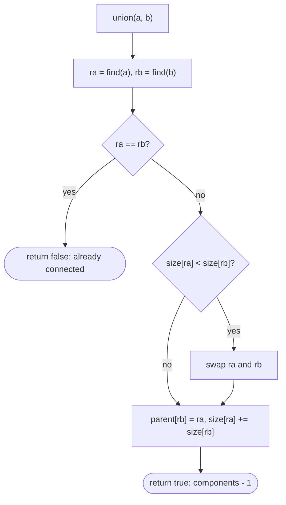

## Introduction

A social app adds friendships one at a time, and after each one it needs to answer: "are Alice and Bob now in the same friend network?" and "how many separate networks are there?" A BFS after every new friendship would answer correctly, but each run costs O(V + E), and with millions of users and edges arriving constantly that is far too slow.

**Union-Find**, also called **Disjoint Set Union (DSU)**, is a data structure built for exactly this. It maintains a collection of **disjoint sets** — groups that never overlap, so every element is in exactly one — and supports two operations:

- **find(x)** — return a **representative** of the set containing `x`. Two elements are in the same set exactly when `find` returns the same representative for both.
- **union(a, b)** — merge the set containing `a` with the set containing `b`.

With two simple optimisations, path compression and union by rank (or size), any sequence of `m` operations on `n` elements runs in O(m · α(n)) time, where α is the inverse Ackermann function. α grows so slowly that it is at most 4 for any input that could physically exist, so each operation is effectively constant time.

Union-Find shows up wherever groups merge over time. Kruskal's minimum spanning tree algorithm uses it to reject edges that would form a cycle. Image-processing libraries use it to merge pixel labels. Type checkers that infer types unify type variables with it. And in interviews it solves a family of problems — "Redundant Connection", "Accounts Merge", "Number of Islands II", "Satisfiability of Equality Equations" — that are awkward with BFS or DFS.

This lesson builds the structure from the naive version up, teaches each optimisation as its own technique, and then applies it to grids and to dynamic connectivity.

## Before you start

- **Connected components** — what a component is and how BFS/DFS count them. Union-Find answers the same question incrementally. See [[a8-connected-components]].
- **Arrays and recursion** — the whole structure is two `int[]` arrays and a short recursive (or looping) method. See [[a1-recursion]].
- **Amortised analysis** (helpful) — the idea that an expensive operation can be paid for by many cheap ones. See [[a1-time-complexity]].
- **Graph basics** — vertices, edges, undirected graphs. See [[a8-graph-representation]].

## The intuition

Picture a school where students form clubs, and clubs can merge. Each club has a **leader**. To find out whether two students are in the same club, ask each one "who is your club's leader?" and compare the answers.

The school does not keep a central list of every club's members — updating that list on every merge would be expensive. Instead, every student remembers one person: whoever they were told to report to. A leader reports to themselves. To find your leader, ask the person you report to, who asks the person *they* report to, and so on, until someone says "I am the leader".

Merging two clubs is then cheap: one leader agrees to report to the other. Every member of the first club now reaches the new leader through their old one, without anyone else being told.

That is Union-Find. The "reports to" relation is a **parent pointer**, each club is a tree, the leader is the tree's **root**, and asking up the chain is `find`. The two optimisations in this lesson address the obvious weakness: chains of "ask the next person" can get long. **Path compression** says that once you have found the leader, everyone you asked along the way should remember the leader directly. **Union by rank or size** says that when two clubs merge, the smaller or shallower club's leader should report to the other, so chains grow as slowly as possible.

## The representation: a forest of parent pointers

Number the elements `0` to `n − 1`. Store one array:

- `parent[x]` — the element `x` points to. If `parent[x] == x`, then `x` is a **root**, and it represents its set.

Initially every element is its own set: `parent[i] = i`. The structure is a **forest** — a set of trees — where each tree is one set and its root is the representative.

```java
int find(int x) {
    while (parent[x] != x) x = parent[x];   // climb until the root
    return x;
}

void union(int a, int b) {
    int ra = find(a), rb = find(b);
    if (ra != rb) parent[ra] = rb;          // one root now points at the other
}
```

These two methods are the naive Union-Find, written as members of a class holding the `parent` array. Three details matter. `union` links **roots**, never the original elements: writing `parent[a] = b` would detach `a` from its own set and leave the rest of that set behind. `union` checks `ra != rb` first, because linking a root to itself is harmless but linking it into its own subtree would create a cycle in the "tree". And the representative of a set is not fixed — it changes when sets merge — so never store a `find` result and assume it stays valid after later unions.

### Why the naive version is slow

Nothing stops the trees from becoming long chains. Call `union(0, 1)`, `union(1, 2)`, `union(2, 3)`, … in that order. Each call links the current root under the next element, producing the chain `0 → 1 → 2 → … → n−1`. Now `find(0)` walks `n − 1` pointers. Repeat `find(0)` `n` times and the total is about `n²` steps — the experiment later in this lesson measures nearly ten billion pointer hops for `n = 100,000`.

The cost of `find` is the depth of the element in its tree. Both optimisations attack that depth: path compression shortens paths *after* they are walked, and union by rank or size prevents tall trees from being built in the first place.

```mermaid title="Naive linking can build a chain; each find walks the whole path"
flowchart LR
    A0["0"] --> A1["1"] --> A2["2"] --> A3["3"] --> A4["4 (root)"]
```

## Path Compression {#a8-dsu-path-compression}

**Path compression** is an optimisation of `find`: after locating the root of `x`, make every node on the path from `x` to the root point *directly* at the root. The next `find` on any of those nodes then takes one step. Compression changes only the shape of the tree, never which set an element belongs to, because every node on the path already had that root as its representative.

### The recursive version

```java
int find(int x) {
    if (parent[x] != x) parent[x] = find(parent[x]);   // re-point x at the root on the way back
    return parent[x];
}
```

Read it as: "if `x` is not a root, find the root of my parent, make that my parent, and return it." The recursion descends to the root, then, as each call returns, assigns the root to `parent[x]` for every `x` on the path. One line of change turns the naive `find` into a compressing one.

### Seeing it work

The program below builds the chain `0 → 1 → 2 → 3 → 4 → 5` directly and shows the parent array before and after different `find` variants.

```java title="PathCompression.java"
import java.util.Arrays;

public class PathCompression {

    // Recursive: simplest to write; recursion depth equals the path length.
    static int findRecursive(int[] parent, int x) {
        if (parent[x] != x) parent[x] = findRecursive(parent, parent[x]);
        return parent[x];
    }

    // Two-pass iterative: first locate the root, then re-point every node on the path.
    static int findTwoPass(int[] parent, int x) {
        int root = x;
        while (parent[root] != root) root = parent[root];
        while (parent[x] != root) {
            int next = parent[x];
            parent[x] = root;
            x = next;
        }
        return root;
    }

    // Path halving: one pass; every node on the path jumps to its grandparent.
    static int findHalving(int[] parent, int x) {
        while (parent[x] != x) {
            parent[x] = parent[parent[x]];
            x = parent[x];
        }
        return x;
    }

    static int[] chain(int n) {             // 0 -> 1 -> 2 -> ... -> n-1 (root)
        int[] parent = new int[n];
        for (int i = 0; i < n; i++) parent[i] = Math.min(i + 1, n - 1);
        return parent;
    }

    public static void main(String[] args) {
        int[] p = chain(6);
        System.out.println("before          " + Arrays.toString(p));
        findRecursive(p, 0);
        System.out.println("recursive find  " + Arrays.toString(p));

        p = chain(6);
        findTwoPass(p, 0);
        System.out.println("two-pass find   " + Arrays.toString(p));

        p = chain(6);
        findHalving(p, 0);
        System.out.println("halving, once   " + Arrays.toString(p));
        findHalving(p, 0);
        System.out.println("halving, twice  " + Arrays.toString(p));

        p = chain(6);
        findRecursive(p, 2);
        System.out.println("find(2) only    " + Arrays.toString(p));
    }
}
```

```output
before          [1, 2, 3, 4, 5, 5]
recursive find  [5, 5, 5, 5, 5, 5]
two-pass find   [5, 5, 5, 5, 5, 5]
halving, once   [2, 2, 4, 4, 5, 5]
halving, twice  [4, 2, 4, 4, 5, 5]
find(2) only    [1, 2, 5, 5, 5, 5]
```

Full compression (recursive or two-pass) flattens the whole path in one call: every node from 0 to 4 now points at 5. The last line shows that only the nodes *on the walked path* are compressed — `find(2)` re-points 2, 3 and 4, while 0 and 1, which were below 2, keep their old pointers. They will be compressed when someone calls `find` on them.

### Three ways to compress

| Variant | How | Passes | Notes |
|---|---|---|---|
| Recursive full compression | `parent[x] = find(parent[x])` | 1 down, 1 back (stack) | Shortest code; recursion depth = path length |
| Two-pass full compression | find root, then re-point the path | 2 loops | No recursion; same result as recursive |
| Path halving | `parent[x] = parent[parent[x]]` while climbing | 1 loop | Each node jumps to its grandparent; paths halve per call |
| Path splitting | every node points to its grandparent (not only alternate ones) | 1 loop | Same guarantees as halving |

Halving and splitting compress less per call — the output shows halving cutting the path from five pointers to three — but they need no second pass and no recursion. Combined with union by rank or size, Tarjan and van Leeuwen showed in 1984 that all of these variants achieve the same O(α(n)) amortised bound, so the choice is about code style. Path halving is popular in competitive programming because it is a three-line loop.

### When recursion becomes a problem

The recursive `find` recurses once per node on the path. With union by rank or size, paths are never longer than log₂ n (about 17 for 100,000 elements), so recursion is perfectly safe. *Without* union by rank or size, the first `find` on a long chain recurses all the way down:

```java title="RecFind.java"
public class RecFind {
    static int[] parent;
    static int find(int x) { return parent[x] == x ? x : (parent[x] = find(parent[x])); }
    public static void main(String[] a) {
        for (int n : new int[]{1_000, 10_000, 100_000}) {
            parent = new int[n];
            for (int i = 0; i < n; i++) parent[i] = i;
            for (int i = 0; i + 1 < n; i++) parent[find(i)] = find(i + 1);   // naive linking
            try { System.out.println(n + ": root = " + find(0)); }
            catch (StackOverflowError e) { System.out.println(n + ": StackOverflowError"); }
        }
    }
}
```

```output
1000: root = 999
10000: root = 9999
100000: StackOverflowError
```

(Run on JDK 26 with the default thread stack; the exact threshold depends on the stack size.) The fix is either to also use union by rank or size — which you should do anyway — or to use the two-pass or halving `find`, which never recurse.

### Complexity of path compression alone

Path compression without any union rule still gives an amortised bound of O(log n) per operation over a long sequence. The intuition is that an expensive `find` flattens the path it walked, so it pays in advance for many cheap future finds on those nodes. A single operation can still be O(n) — the first `find` on a freshly built chain is — which is why we speak of *amortised* cost: averaged over the whole sequence, not guaranteed per call.

## Union by Rank {#a8-dsu-union-by-rank}

**Union by rank** is a rule for `union`: when merging two trees, attach the root of the *shorter* tree under the root of the *taller* one. Each root stores a **rank**, which starts at 0 for a one-element set and is an upper bound on the tree's height. Attaching a shorter tree under a taller root does not increase the taller tree's height, so height grows only when two trees of *equal* rank merge — and then by exactly one.

### The rule

```java
boolean union(int a, int b) {
    int ra = find(a), rb = find(b);
    if (ra == rb) return false;                     // already in the same set
    if (rank[ra] < rank[rb]) { int t = ra; ra = rb; rb = t; }   // make ra the taller root
    parent[rb] = ra;                                // shorter tree hangs below
    if (rank[ra] == rank[rb]) rank[ra]++;           // a tie: the merged tree is one taller
    return true;
}
```

This method sits in a class with `parent` and `rank` arrays, both of length `n`, with `parent[i] = i` and `rank[i] = 0` initially. The swap normalises the order so that only one linking line is needed. Returning `boolean` costs nothing and tells the caller whether a merge happened — which is how Kruskal's algorithm and "Redundant Connection" detect an edge that closes a cycle.

### Watching rank and height

To see rank equal height exactly, this program uses union by rank with a non-compressing `find`.

```java title="UnionByRank.java"
import java.util.Arrays;

public class UnionByRank {
    final int[] parent, rank;

    UnionByRank(int n) {
        parent = new int[n];
        rank = new int[n];                  // a one-node tree has height 0
        for (int i = 0; i < n; i++) parent[i] = i;
    }

    int find(int x) {                       // no compression here, so rank == height
        while (parent[x] != x) x = parent[x];
        return x;
    }

    boolean union(int a, int b) {
        int ra = find(a), rb = find(b);
        if (ra == rb) return false;
        if (rank[ra] < rank[rb]) { int t = ra; ra = rb; rb = t; }  // ra has the larger rank
        parent[rb] = ra;                    // shorter tree goes under the taller root
        if (rank[ra] == rank[rb]) rank[ra]++;   // only a tie makes the tree taller
        return true;
    }

    int height(int root) {
        int h = 0;
        for (int v = 0; v < parent.length; v++) {
            int d = 0, x = v;
            while (parent[x] != x) { x = parent[x]; d++; }
            if (x == root) h = Math.max(h, d);
        }
        return h;
    }

    public static void main(String[] args) {
        UnionByRank d = new UnionByRank(8);
        int[][] ops = {{0, 1}, {2, 3}, {0, 2}, {4, 5}, {6, 7}, {4, 6}, {0, 4}, {7, 3}};
        for (int[] op : ops) {
            boolean merged = d.union(op[0], op[1]);
            int r = d.find(op[0]);
            System.out.printf("union(%d, %d) %-6s root=%d rank=%d height=%d%n",
                    op[0], op[1], merged ? "merged" : "skip", r, d.rank[r], d.height(r));
        }
        System.out.println("parent = " + Arrays.toString(d.parent));

        // Check the bound on random workloads: a root of rank r has at least 2^r nodes.
        java.util.Random rnd = new java.util.Random(1);
        int n = 1 << 16, maxRank = 0;
        UnionByRank big = new UnionByRank(n);
        for (int i = 0; i < 4 * n; i++) big.union(rnd.nextInt(n), rnd.nextInt(n));
        for (int r : big.rank) maxRank = Math.max(maxRank, r);
        System.out.println("n = " + n + ", log2(n) = 16, largest rank after random unions = " + maxRank);
    }
}
```

```output
union(0, 1) merged root=0 rank=1 height=1
union(2, 3) merged root=2 rank=1 height=1
union(0, 2) merged root=0 rank=2 height=2
union(4, 5) merged root=4 rank=1 height=1
union(6, 7) merged root=6 rank=1 height=1
union(4, 6) merged root=4 rank=2 height=2
union(0, 4) merged root=0 rank=3 height=3
union(7, 3) skip   root=0 rank=3 height=3
parent = [0, 0, 0, 2, 0, 4, 4, 6]
n = 65536, log2(n) = 16, largest rank after random unions = 6
```

The first eight lines are the worst case for union by rank: every merge is between two trees of equal rank, which is the only way rank grows. Even so, 8 elements reach rank 3 = log₂ 8, no more. The last merge, `union(7, 3)`, finds both elements already under root 0 and does nothing. On 65,536 elements with random unions the largest rank was only 6, well under the bound of 16; random merges rarely pair equal ranks.

### Why height never exceeds log₂ n

Claim: **a root of rank `r` has at least `2^r` elements in its tree.**

- A new element has rank 0 and a tree of `1 = 2⁰` element.
- A root's rank increases from `r` to `r + 1` only when it absorbs another root of rank `r`. Both trees had at least `2^r` elements, so the merged tree has at least `2^(r+1)`.
- Merging with a smaller-rank tree adds elements without changing rank, which only helps.

Since a tree cannot have more than `n` elements, `2^r ≤ n`, so `r ≤ log₂ n`. Without compression, rank equals height, so every `find` follows at most log₂ n pointers. **Union by rank alone gives O(log n) worst-case time per operation** — not amortised, every single call.

### Rank after path compression

Path compression shortens trees but never updates ranks, so once both are used, rank is only an **upper bound** on height, not the height itself. That is fine: the algorithm only needs rank to decide which root goes on top, and the analysis that gives the α(n) bound works with these upper bounds. Do not try to "fix" ranks during compression — it costs time and gains nothing.

## Union by Size {#a8-dsu-union-by-size}

**Union by size** is the alternative linking rule: each root stores the number of elements in its set, and `union` attaches the root of the *smaller* set under the root of the *larger* one, then adds the sizes. It gives the same height guarantee as union by rank, and it has a practical bonus — the size of any element's set is available as `size[find(x)]`, which many problems ask for directly.

### The rule and a demonstration

```java title="UnionBySize.java"
public class UnionBySize {
    final int[] parent, size;
    int largest = 1;

    UnionBySize(int n) {
        parent = new int[n];
        size = new int[n];
        for (int i = 0; i < n; i++) { parent[i] = i; size[i] = 1; }
    }

    int find(int x) {
        if (parent[x] != x) parent[x] = find(parent[x]);
        return parent[x];
    }

    boolean union(int a, int b) {
        int ra = find(a), rb = find(b);
        if (ra == rb) return false;
        if (size[ra] < size[rb]) { int t = ra; ra = rb; rb = t; }   // ra: the bigger set
        parent[rb] = ra;
        size[ra] += size[rb];          // only the surviving root's size is kept up to date
        largest = Math.max(largest, size[ra]);
        return true;
    }

    public static void main(String[] args) {
        UnionBySize d = new UnionBySize(10);
        int[][] links = {{0, 1}, {2, 3}, {4, 5}, {3, 5}, {6, 7}, {8, 9}, {1, 9}, {2, 4}, {7, 0}};
        for (int[] e : links) {
            boolean merged = d.union(e[0], e[1]);
            System.out.printf("link %d-%d  %-6s size of %d's group = %d, largest = %d%n",
                    e[0], e[1], merged ? "merged" : "skip", e[0], d.size[d.find(e[0])], d.largest);
        }
    }
}
```

```output
link 0-1  merged size of 0's group = 2, largest = 2
link 2-3  merged size of 2's group = 2, largest = 2
link 4-5  merged size of 4's group = 2, largest = 2
link 3-5  merged size of 3's group = 4, largest = 4
link 6-7  merged size of 6's group = 2, largest = 4
link 8-9  merged size of 8's group = 2, largest = 4
link 1-9  merged size of 1's group = 4, largest = 4
link 2-4  skip   size of 2's group = 4, largest = 4
link 7-0  merged size of 7's group = 6, largest = 6
```

Because sets only grow, the largest size can be maintained with one `Math.max` per successful union — no scan needed. Notice that `size[x]` is read as `size[find(x)]`. When a root is attached under another, its own `size` entry is left stale; only roots carry correct sizes.

### Why size also bounds height by log₂ n

Follow one element `x`. Its depth increases by one only when its root is attached under another root — and under union by size, that happens only when `x`'s set is the smaller (or equal) one. The merged set is then at least twice the size of `x`'s old set. A set can double at most log₂ n times before it holds all `n` elements, so `x`'s depth is at most log₂ n. As with rank, union by size alone gives O(log n) per operation, and combined with path compression the amortised cost drops to O(α(n)).

### Rank or size?

| | Union by rank | Union by size |
|---|---|---|
| Stored per root | upper bound on height | number of elements |
| Grows on | merging equal ranks (+1) | every merge (sum) |
| Value range | at most log₂ n (fits in a `byte`) | up to n |
| Gives set sizes for free | no | yes |
| Complexity with compression | O(α(n)) amortised | O(α(n)) amortised |

In practice, choose **size** unless you have a reason not to: it is equally fast and answers "how big is this group?", "what is the largest group?" and "how many pairs are connected?" (sum of `size·(size−1)/2` over roots) without extra work. Rank is the classic textbook choice, used in CLRS, and needs slightly less memory. Mixing them — comparing sizes but incrementing ranks — is a common bug that silently loses the guarantee.

```quiz
Q: After `find(x)` with full path compression, what has changed?
- [ ] x has moved to a different set
- [x] Every node on the path from x to the root now points directly to the root; set membership is unchanged
- [ ] The root's rank has been reduced to match the new height
- [ ] Every node in x's tree now points directly to the root
> Compression re-points only the nodes on the walked path, and every one of them already had that root as its representative, so no element changes set. Nodes not on the path keep their pointers, and ranks are deliberately left as upper bounds.

Q: Under union by rank, a root has rank 5. What is the minimum number of elements in its tree?
- [ ] 5
- [ ] 6
- [x] 32
- [ ] 120
> Rank increases from r to r + 1 only when two rank-r trees merge, so by induction a rank-r root has at least 2^r elements. 2^5 = 32. This is why rank, and therefore height, can never exceed log2 n.

Q: Which implementation keeps the O(log n) height guarantee?
- [ ] Compare sizes to choose the new root, but increment rank on ties
- [ ] Always attach the root of the first argument under the second
- [x] Attach the root of the smaller set under the root of the larger set and add the sizes
- [ ] Attach the larger set under the smaller set so the small set's root stays stable
> Union by size works because an element's depth grows only when its set at least doubles. Mixing rules, fixed-direction linking, or attaching large under small can all build tall trees.
```

## Putting it together

Here is the version to memorise: path compression in `find`, union by size in `union`, plus a component counter and the helper queries most problems need.

```java title="UnionFind.java"
import java.util.Arrays;

public class UnionFind {
    private final int[] parent;
    private final int[] size;     // size[r] is meaningful only while r is a root
    private int components;

    UnionFind(int n) {
        parent = new int[n];
        size = new int[n];
        components = n;
        for (int i = 0; i < n; i++) {
            parent[i] = i;            // every element starts as its own one-element set
            size[i] = 1;
        }
    }

    /** Root of x's set. Path compression: every node on the path is re-pointed at the root. */
    int find(int x) {
        if (parent[x] != x) parent[x] = find(parent[x]);
        return parent[x];
    }

    /** Merges the sets of a and b. Returns false if they were already in the same set. */
    boolean union(int a, int b) {
        int ra = find(a), rb = find(b);
        if (ra == rb) return false;
        if (size[ra] < size[rb]) { int t = ra; ra = rb; rb = t; }   // ra is the larger set
        parent[rb] = ra;              // hang the smaller tree under the larger root
        size[ra] += size[rb];
        components--;
        return true;
    }

    boolean connected(int a, int b) { return find(a) == find(b); }
    int sizeOf(int x)               { return size[find(x)]; }
    int components()                { return components; }
    String parents()                { return Arrays.toString(parent); }

    public static void main(String[] args) {
        UnionFind uf = new UnionFind(8);
        int[][] friendships = {{0, 1}, {2, 3}, {1, 3}, {4, 5}, {6, 7}, {5, 7}, {0, 3}};
        for (int[] f : friendships) {
            boolean merged = uf.union(f[0], f[1]);
            System.out.printf("union(%d, %d) %-6s components=%d parent=%s%n",
                    f[0], f[1], merged ? "merged" : "skip", uf.components(), uf.parents());
        }
        System.out.println("connected(0, 2) = " + uf.connected(0, 2));
        System.out.println("connected(0, 4) = " + uf.connected(0, 4));
        System.out.println("sizeOf(6)       = " + uf.sizeOf(6));
    }
}
```

```output
union(0, 1) merged components=7 parent=[0, 0, 2, 3, 4, 5, 6, 7]
union(2, 3) merged components=6 parent=[0, 0, 2, 2, 4, 5, 6, 7]
union(1, 3) merged components=5 parent=[0, 0, 0, 2, 4, 5, 6, 7]
union(4, 5) merged components=4 parent=[0, 0, 0, 2, 4, 4, 6, 7]
union(6, 7) merged components=3 parent=[0, 0, 0, 2, 4, 4, 6, 6]
union(5, 7) merged components=2 parent=[0, 0, 0, 2, 4, 4, 4, 6]
union(0, 3) skip   components=2 parent=[0, 0, 0, 0, 4, 4, 4, 6]
connected(0, 2) = true
connected(0, 4) = false
sizeOf(6)       = 4
```

### Dry run

| Step | Operation | Roots found | Decision | Effect |
|---|---|---|---|---|
| 1 | `union(0, 1)` | 0, 1 | equal sizes, keep 0 | `parent[1] = 0`, size[0] = 2 |
| 2 | `union(2, 3)` | 2, 3 | equal sizes, keep 2 | `parent[3] = 2`, size[2] = 2 |
| 3 | `union(1, 3)` | 0 (via 1), 2 (via 3) | equal sizes, keep 0 | `parent[2] = 0`, size[0] = 4 |
| 4–6 | same pattern on 4…7 | | | root 4 with size 4 |
| 7 | `union(0, 3)` | 0, and 0 (3 → 2 → 0) | same root | return `false`; compression sets `parent[3] = 0` |

Step 7 is the interesting one. Finding 3's root walks `3 → 2 → 0`, so path compression re-points 3 directly at 0 — visible in the last parent array — even though no merge happens. A `union` that returns `false` means the edge connects two elements that were *already* connected: in graph terms, it closes a cycle. Vertex 7 still points to 6 rather than to root 4 because nothing has called `find(7)` yet.

### How much the optimisations matter

The difference between the four combinations is easiest to see by counting how many parent pointers all the `find` calls follow. The program below runs two workloads on 100,000 elements: the adversarial chain from earlier (`union(i, i + 1)` for every `i`, then `find(0)` 100,000 times), and 200,000 random operations.

```java title="DsuExperiment.java"
import java.util.*;

public class DsuExperiment {
    static int[] parent, rank;
    static long hops;                       // parent pointers followed by all finds
    static boolean compress, byRank;

    static int find(int x) {
        int root = x;
        while (parent[root] != root) { root = parent[root]; hops++; }
        while (compress && x != root) { int next = parent[x]; parent[x] = root; x = next; }
        return root;
    }

    static void union(int a, int b) {
        int ra = find(a), rb = find(b);
        if (ra == rb) return;
        if (!byRank) { parent[ra] = rb; return; }        // naive: first root under second
        if (rank[ra] < rank[rb]) { int t = ra; ra = rb; rb = t; }
        parent[rb] = ra;
        if (rank[ra] == rank[rb]) rank[ra]++;
    }

    static long run(int n, int[][] ops, boolean pc, boolean r) {
        compress = pc; byRank = r; hops = 0;
        parent = new int[n]; rank = new int[n];
        for (int i = 0; i < n; i++) parent[i] = i;
        for (int[] op : ops) { if (op[0] == 0) union(op[1], op[2]); else find(op[1]); }
        return hops;
    }

    static void report(String title, int n, int[][] ops) {
        System.out.println(title);
        System.out.printf("  neither      %12d%n", run(n, ops, false, false));
        System.out.printf("  compression  %12d%n", run(n, ops, true, false));
        System.out.printf("  rank         %12d%n", run(n, ops, false, true));
        System.out.printf("  both         %12d%n", run(n, ops, true, true));
    }

    public static void main(String[] args) {
        int n = 100_000;
        int[][] chain = new int[2 * n - 1][];             // union(i, i+1) ..., then find(0) n times
        for (int i = 0; i < n - 1; i++) chain[i] = new int[]{0, i, i + 1};
        for (int i = n - 1; i < 2 * n - 1; i++) chain[i] = new int[]{1, 0};
        report("Chain workload, pointer hops:", n, chain);

        Random rnd = new Random(42);                       // fixed seed: same ops every run
        int[][] mixed = new int[2 * n][];
        for (int i = 0; i < 2 * n; i++) {
            mixed[i] = rnd.nextBoolean() ? new int[]{0, rnd.nextInt(n), rnd.nextInt(n)}
                                         : new int[]{1, rnd.nextInt(n)};
        }
        report("Random workload, pointer hops:", n, mixed);
    }
}
```

```output
Chain workload, pointer hops:
  neither        9999900000
  compression        199998
  rank                99998
  both                99998
Random workload, pointer hops:
  neither         334481278
  compression        510759
  rank               280809
  both               193498
```

The naive structure follows almost ten billion pointers on the chain — exactly `100,000 × 99,999`, because every `find(0)` walks the whole chain. Either optimisation alone removes nearly all of that. On the random workload each optimisation alone cuts the work by about three orders of magnitude, and the combination is best. Counting hops rather than timing makes the result deterministic: `java.util.Random` with a fixed seed produces the same operations on every JVM.

## How it works internally

### The α(n) bound

With both path compression and union by rank (or size), Robert Tarjan proved in 1975 that any sequence of `m` operations on `n` elements takes O(m · α(n)) time, and later work showed this is optimal for this kind of structure. α is the **inverse Ackermann function**. The Ackermann function grows faster than any tower of exponentials — its fourth level is already a number with far more digits than there are atoms in the observable universe — so its inverse grows correspondingly slowly: **α(n) ≤ 4 for every n you could ever store**. This is why Union-Find operations are described as "effectively constant time", while being careful not to call them O(1): mathematically, α(n) is unbounded, but grows absurdly slowly.

The intuition for why the two optimisations combine so well: union by rank guarantees that trees are at most logarithmically tall *before* any compression, and path compression ensures that each long path is paid for once and then flattened. The proof tracks how far each node's rank is below its parent's rank and charges each pointer hop either to the operation or to a node whose "rank gap" grows — and a gap can only grow a very small number of times before it is huge.

### Memory and constant factors

The whole structure is two `int` arrays of length `n` — 8 bytes per element, contiguous in memory. There are no objects per element, no hashing and no pointers to chase across the heap, which makes Union-Find one of the fastest structures in practice, not only in theory. If the elements are not integers `0..n-1` (strings such as email addresses, or sparse coordinates), map them to ids first with a `HashMap`, then run the array-based structure on the ids.

### What Union-Find cannot do

It cannot **split** a set or **delete** an edge: once two sets are merged, path compression has rewritten pointers throughout the tree, and there is no record of which merge connected what. It cannot list the members of a set without scanning all elements (or maintaining separate member lists). And it knows nothing about paths: it can say that `u` and `v` are connected but not *how*. For a path, use BFS or DFS. These limits shape the dynamic connectivity patterns later in this lesson.



## DSU on Grids {#a8-dsu-on-grids}

**DSU on grids** means running Union-Find over the cells of a 2D grid: each cell becomes an element, and neighbouring cells that belong together (land next to land, open next to open) are unioned. It is the right tool when the grid *changes* — cells become land or open up one at a time — and you must report connectivity after each change. A BFS flood fill after every change would cost O(R · C) per update; Union-Find handles each new cell with at most four unions.

### Mapping cells to ids

Union-Find works on integers `0..n-1`, so number the cells in **row-major** order:

```text
id = r * cols + c          r = id / cols          c = id % cols
```

For a grid with `cols = 3`, cell `(1, 2)` is id 5 and id 7 is cell `(2, 1)`. Use the number of *columns* as the multiplier — using rows instead is a classic bug that only shows up on non-square grids, where two different cells get the same id.

### Number of Islands II: land appears one cell at a time

The grid starts as all water. A list of positions turns cells into land one at a time; after each addition, report the number of islands. The key observation: adding one land cell first creates a new island (count + 1), and then every successful union with an existing neighbouring island merges two islands into one (count − 1). A union that fails means that neighbour was already part of the same island, so nothing changes.

```java title="IslandsOnline.java"
import java.util.*;

public class IslandsOnline {
    static int[] parent, size;

    static int find(int x) {
        while (parent[x] != x) {
            parent[x] = parent[parent[x]];     // path halving
            x = parent[x];
        }
        return x;
    }

    static boolean union(int a, int b) {
        int ra = find(a), rb = find(b);
        if (ra == rb) return false;
        if (size[ra] < size[rb]) { int t = ra; ra = rb; rb = t; }
        parent[rb] = ra;
        size[ra] += size[rb];
        return true;
    }

    /** After each land addition, how many islands exist? */
    static List<Integer> numIslands2(int rows, int cols, int[][] positions) {
        parent = new int[rows * cols];
        size = new int[rows * cols];
        boolean[] land = new boolean[rows * cols];
        int[][] dirs = {{1, 0}, {-1, 0}, {0, 1}, {0, -1}};
        List<Integer> answer = new ArrayList<>();
        int islands = 0;
        for (int[] p : positions) {
            int id = p[0] * cols + p[1];          // row-major cell id
            if (!land[id]) {                      // adding existing land changes nothing
                land[id] = true;
                parent[id] = id;
                size[id] = 1;
                islands++;                        // a new cell starts as its own island
                for (int[] d : dirs) {
                    int nr = p[0] + d[0], nc = p[1] + d[1];
                    if (nr < 0 || nc < 0 || nr >= rows || nc >= cols) continue;
                    int nid = nr * cols + nc;
                    if (land[nid] && union(id, nid)) islands--;   // two islands became one
                }
            }
            answer.add(islands);
        }
        return answer;
    }

    public static void main(String[] args) {
        int[][] positions = {{0, 0}, {0, 1}, {1, 2}, {2, 1}, {1, 1}, {1, 1}};
        System.out.println(numIslands2(3, 3, positions));
    }
}
```

```output
[1, 1, 2, 3, 1, 1]
```

| Add | id | New island | Land neighbours (ids) | Successful unions | Islands |
|---|---|---|---|---|---|
| (0, 0) | 0 | +1 | none | 0 | 1 |
| (0, 1) | 1 | +1 | 0 | 1 | 1 |
| (1, 2) | 5 | +1 | none | 0 | 2 |
| (2, 1) | 7 | +1 | none | 0 | 3 |
| (1, 1) | 4 | +1 | 7, 1, 5 | 3 | 1 |
| (1, 1) again | 4 | already land | — | — | 1 |

Adding `(1, 1)` touches three separate islands, so the count goes from 3 to 4 and back down to 1 after three successful unions. The duplicate position is the edge case that breaks naive solutions: without the `land[id]` check, it would add a phantom island and, because the unions with its neighbours now fail, never remove it.

Elements are initialised only when they become land (`parent[id] = id` inside the `if`), and `find` is only ever called on land cells, so water cells never take part. **Complexity**: O(R · C) to allocate the arrays, then O(α(R · C)) amortised per addition — at most four unions each — for O(R · C + K · α(R · C)) over `K` additions.

### Virtual nodes

Many grid problems ask whether a cell is connected to a *boundary* or a *side* rather than to another cell. The trick is to add one or more **virtual nodes** — extra elements beyond the grid's `R · C` cells that stand for "the top edge", "the border" or "the outside" — and union every qualifying cell with them. One `connected` query against the virtual node then answers a question about a whole side at once.

**Percolation** is the classic example: open cells one at a time in an `n × n` grid and ask whether there is an open path from the top row to the bottom row. Union every top-row cell with a virtual `top` and every bottom-row cell with a virtual `bottom`; the system percolates when `top` and `bottom` are connected.

```java title="Percolation.java"
public class Percolation {
    final int n, top, bottom;
    final int[] parent, size;
    final boolean[] open;

    Percolation(int n) {
        this.n = n;
        top = n * n;                       // two virtual cells beyond the real ones
        bottom = n * n + 1;
        parent = new int[n * n + 2];
        size = new int[n * n + 2];
        open = new boolean[n * n];
        for (int i = 0; i < parent.length; i++) { parent[i] = i; size[i] = 1; }
    }

    int find(int x) {
        while (parent[x] != x) { parent[x] = parent[parent[x]]; x = parent[x]; }
        return x;
    }

    void union(int a, int b) {
        int ra = find(a), rb = find(b);
        if (ra == rb) return;
        if (size[ra] < size[rb]) { int t = ra; ra = rb; rb = t; }
        parent[rb] = ra;
        size[ra] += size[rb];
    }

    void open(int r, int c) {
        int id = r * n + c;
        if (open[id]) return;
        open[id] = true;
        if (r == 0) union(id, top);        // every top-row cell touches the virtual top
        if (r == n - 1) union(id, bottom);
        int[][] dirs = {{1, 0}, {-1, 0}, {0, 1}, {0, -1}};
        for (int[] d : dirs) {
            int nr = r + d[0], nc = c + d[1];
            if (nr >= 0 && nc >= 0 && nr < n && nc < n && open[nr * n + nc]) {
                union(id, nr * n + nc);
            }
        }
    }

    boolean percolates() { return find(top) == find(bottom); }

    public static void main(String[] args) {
        Percolation p = new Percolation(3);
        int[][] cells = {{0, 1}, {1, 1}, {2, 0}, {1, 0}};
        for (int[] c : cells) {
            p.open(c[0], c[1]);
            System.out.println("open (" + c[0] + "," + c[1] + ") -> percolates = " + p.percolates());
        }
    }
}
```

```output
open (0,1) -> percolates = false
open (1,1) -> percolates = false
open (2,0) -> percolates = false
open (1,0) -> percolates = true
```

The last opened cell `(1, 0)` joins the path `(0,1) → (1,1)` from the top with `(2,0)` on the bottom row. Without virtual nodes, answering "does any top cell connect to any bottom cell?" would take `n²` pairwise checks per query; with them it is two `find` calls. The same trick solves "Surrounded Regions" (union every border `O` with a virtual "safe" node; afterwards, flip every `O` not connected to it) and "Regions Cut by Slashes" (split each cell into four triangles and union across the slashes).

### Static grids

For a grid that never changes, a BFS flood fill and Union-Find both run in about O(R · C). Union-Find needs only two unions per cell — with the right and the lower neighbour — because the left and upper pairs were already handled from the other side. BFS is usually simpler for a static grid; reach for Union-Find when the grid changes over time, when you need virtual nodes, or when you want each region's size available through `size[find(id)]` (as in "Making a Large Island", where each 0-cell asks for the sizes of its neighbouring regions).

## Dynamic Connectivity Patterns {#a8-dynamic-connectivity}

**Dynamic connectivity** is the problem of answering "are `u` and `v` connected?" (and often "how many components are there?") while the graph changes. Union-Find solves the version where edges are only **added**; deletions are much harder. Recognising which version a problem really is — and whether you can reorder the work to turn it into the insert-only version — is the skill this section teaches.

### Pattern 1: insert-only, online

Edges arrive one at a time with queries interleaved, and each answer is needed before the next edge arrives. This is exactly the `UnionFind` class above: `union` for each new edge, `connected` or `components()` for each query, O(α(n)) amortised per operation. Typical problems:

- **Redundant Connection** — return the first edge whose `union` returns `false`: it connects two vertices that were already connected, so it closes a cycle.
- **Number of Operations to Make Network Connected** — with `n` computers and `E` cables, the answer is `components − 1` if `E ≥ n − 1`, and `-1` otherwise; extra cables (failed unions) are exactly the ones you can move.
- **Satisfiability of Equality Equations** — union every `a == b`, then check that no `a != b` has both sides in the same set. The order matters: all unions first, then all checks.
- **Kruskal's algorithm** — process edges by increasing weight and keep each edge whose `union` succeeds ([[a8-mst-kruskal]]).

### Pattern 2: deletions, but all known in advance — reverse time

Union-Find cannot delete an edge. But if the entire sequence of deletions is known before you must answer (an **offline** problem), you can process it backwards. Read in reverse, a deletion becomes an insertion. Start from the final graph — the original minus every edge that will ever be deleted — and add the deleted edges back in reverse order, recording the answer *before* each re-insertion.

```java title="ReverseDeletions.java"
import java.util.*;

public class ReverseDeletions {
    static int[] parent;
    static int components;

    static int find(int x) {
        while (parent[x] != x) { parent[x] = parent[parent[x]]; x = parent[x]; }
        return x;
    }

    static void union(int a, int b) {
        int ra = find(a), rb = find(b);
        if (ra != rb) { parent[ra] = rb; components--; }
    }

    /**
     * edges: the starting graph. removals: indices into edges, deleted one at a time.
     * Returns the component count after each removal.
     */
    static int[] componentsAfterRemovals(int n, int[][] edges, int[] removals) {
        parent = new int[n];
        for (int i = 0; i < n; i++) parent[i] = i;
        components = n;

        boolean[] removed = new boolean[edges.length];
        for (int idx : removals) removed[idx] = true;
        for (int i = 0; i < edges.length; i++) {          // the graph after ALL removals
            if (!removed[i]) union(edges[i][0], edges[i][1]);
        }

        int[] answer = new int[removals.length];
        for (int k = removals.length - 1; k >= 0; k--) {
            answer[k] = components;                        // state just after removal k
            int[] e = edges[removals[k]];
            union(e[0], e[1]);                             // undo removal k by adding it back
        }
        return answer;
    }

    public static void main(String[] args) {
        int[][] edges = {{0, 1}, {1, 2}, {2, 0}, {2, 3}, {3, 4}};
        int[] removals = {3, 0, 1};                        // remove 2-3, then 0-1, then 1-2
        System.out.println(Arrays.toString(componentsAfterRemovals(5, edges, removals)));
    }
}
```

```output
[2, 2, 3]
```

The starting graph is a triangle `0–1–2` attached to the path `2–3–4`: one component. Removing `2–3` splits it into two. Removing `0–1` changes nothing, because the triangle stays connected through `1–2–0`. Removing `1–2` then isolates vertex 1, giving three. The backward pass starts from the graph with all three edges gone (components `{0, 2}`, `{1}`, `{3, 4}`: three), records 3 for the last removal, adds `1–2` back, records 2, adds `0–1` back, records 2. This simple union (no rank or size) keeps the code short; use the full version for large inputs. Problems such as "Bricks Falling When Hit" use exactly this reversal.

### Pattern 3: queries with a threshold — sort both and sweep

Some problems ask, for many queries, "are `p` and `q` connected using only edges with weight below `limit`?" Each query sees a different graph, but the graphs are nested: a larger limit allows every edge a smaller limit allows, plus more. So sort the edges by weight, sort the queries by limit, and sweep: before answering each query, union every edge that its limit newly allows. Each edge is unioned once in total.

```java title="LimitedPaths.java"
import java.util.*;

public class LimitedPaths {
    static int[] parent;

    static int find(int x) {
        while (parent[x] != x) { parent[x] = parent[parent[x]]; x = parent[x]; }
        return x;
    }

    /**
     * edges[i] = {u, v, length}; queries[j] = {p, q, limit}.
     * answer[j]: is there a path from p to q using only edges strictly shorter than limit?
     */
    static boolean[] answer(int n, int[][] edges, int[][] queries) {
        parent = new int[n];
        for (int i = 0; i < n; i++) parent[i] = i;
        int[][] sortedEdges = edges.clone();
        Arrays.sort(sortedEdges, Comparator.comparingInt(e -> e[2]));
        Integer[] order = new Integer[queries.length];
        for (int j = 0; j < order.length; j++) order[j] = j;
        Arrays.sort(order, Comparator.comparingInt(j -> queries[j][2]));

        boolean[] result = new boolean[queries.length];
        int next = 0;
        for (int j : order) {                                   // queries by rising limit
            int limit = queries[j][2];
            while (next < sortedEdges.length && sortedEdges[next][2] < limit) {
                int[] e = sortedEdges[next++];                  // allowed from now on
                parent[find(e[0])] = find(e[1]);
            }
            result[j] = find(queries[j][0]) == find(queries[j][1]);
        }
        return result;
    }

    public static void main(String[] args) {
        int[][] edges = {{0, 1, 2}, {1, 2, 4}, {2, 0, 8}, {1, 0, 16}};
        int[][] queries = {{0, 1, 2}, {0, 2, 5}};
        System.out.println(Arrays.toString(answer(3, edges, queries)));

        int[][] edges2 = {{0, 1, 10}, {1, 2, 5}, {2, 3, 9}, {3, 4, 13}};
        int[][] queries2 = {{0, 4, 14}, {1, 4, 13}};
        System.out.println(Arrays.toString(answer(5, edges2, queries2)));
    }
}
```

```output
[false, true]
[true, false]
```

In the first case, the query with limit 2 allows no edge (the shortest has length 2, and the comparison is strict), so 0 and 1 are not connected; the query with limit 5 allows the edges of length 2 and 4, which connect 0, 1 and 2. The answers are stored by original query index (`result[j]`), because the queries were processed out of order — forgetting that is the typical bug. Total cost: O(E log E + Q log Q) for sorting plus near-linear Union-Find work. This is LeetCode's "Checking Existence of Edge Length Limited Paths", and the same sweep underlies "Swim in Rising Water" and Kruskal's algorithm itself.

### Pattern 4: fully dynamic — beyond plain Union-Find

When edges are inserted *and* deleted, with answers needed online, plain Union-Find does not apply. The options, roughly in order of how often they appear:

- **Rollback DSU** — union by rank or size *without* path compression (so each union changes only a couple of array entries), with a stack of changes that can be undone. Each operation is O(log n). Combined with a segment tree over time ("offline dynamic connectivity"), it answers a known sequence of insertions, deletions and queries in O((m log m) · log n). This is a competitive-programming technique; know that it exists.
- **Recompute**: if updates are rare and queries frequent, re-run BFS/DFS labelling after each deletion and answer queries from the labels in O(1).
- **Specialised structures** — the Holm–de Lichtenberg–Thorup structure (2001) maintains fully dynamic connectivity in polylogarithmic amortised time per update. These appear in research and specialised libraries, not in interviews.

### Pattern 5: carrying extra information per set

Because each set has one root, any property of a whole set can live at the root and be combined on `union`: size (as above), the minimum element, a sum of weights, or a flag such as "this group contains a virtual node". A further extension, **weighted** (or potential) Union-Find, stores on each parent pointer a value relative to the parent — for example a ratio (LeetCode's "Evaluate Division") or a parity bit, which lets Union-Find check whether edges can be 2-coloured as they arrive (see [[a8-bipartite]]). Path compression then has to combine the values along the compressed path.

```quiz
Q: Edges are deleted from a graph one at a time, and after each deletion you must report the number of components. The whole deletion list is given up front. What is the efficient approach?
- [ ] Run BFS after every deletion
- [ ] Use Union-Find and call a delete operation for each edge
- [x] Start from the graph with every listed edge removed, then add the edges back in reverse order with Union-Find, recording answers backwards
- [ ] Sort the edges by weight and use Kruskal's algorithm
> Union-Find has no delete operation, but in reverse a deletion is an insertion. Because all deletions are known in advance, the problem is offline, so the reversed sequence of unions answers every query in near-constant time each. BFS after every deletion works but costs O(V + E) per query.

Q: In "Number of Islands II", a newly added land cell has three land neighbours, and two of them already belong to the same island. By how much does the island count change?
- [ ] +1
- [ ] -2
- [x] -1
- [ ] -3
> The new cell adds one island (+1). The first union with a neighbour succeeds (-1). The second neighbour is in the same island as the first, so after that first union it is already connected to the new cell and its union fails (0). The third neighbour's island is different, so that union succeeds (-1). Net change: +1 - 1 - 1 = -1.

Q: Why does the threshold-query technique sort the queries by limit?
- [ ] Union-Find only accepts queries in sorted order
- [x] Graphs for larger limits contain all edges of smaller limits, so sorting lets each edge be unioned once as the limit grows
- [ ] Sorting makes the answers come out in the original order
- [ ] It is needed for path compression to work
> The sets of allowed edges are nested. Processing limits in increasing order turns many separate graphs into one growing graph, which is exactly what insert-only Union-Find handles. The answers must then be written back to each query's original index.
```

## In real systems

**Kruskal's algorithm and clustering.** Minimum spanning trees are built with Union-Find in libraries and network-design tools, and stopping Kruskal's algorithm early, when `k` sets remain, is single-linkage clustering: the remaining sets are the clusters.

**Image processing.** Connected-component labelling in image libraries scans the pixels row by row, gives each foreground pixel a provisional label, records "these labels are equivalent" with Union-Find whenever two labels touch, and resolves the equivalences in a second pass. This is far more cache-friendly than a flood fill on very large images.

**Type inference and unification.** Compilers for languages with type inference, such as those in the ML family, solve "this type variable equals that type" constraints by unifying type variables, and the classic implementation keeps the equivalence classes in a Union-Find structure.

**Entity resolution and account merging.** Records that share an identifier (an email address, phone number or device id) are unioned; each final set is one real-world entity. With records arriving continuously, Union-Find keeps the grouping current without re-processing history.

**Libraries.** The Java standard library has no Union-Find; it is usually written by hand (it is twenty lines). Graph libraries such as JGraphT (`UnionFind`) and Python's NetworkX (`networkx.utils.UnionFind`) provide one, and Boost.Graph offers incremental-components utilities built on it.

## Trade-offs and alternatives

| Need | Best tool | Why |
|---|---|---|
| Components of a fixed graph, plus sizes or members | BFS/DFS | One O(V + E) pass; also gives order and paths |
| Connectivity while edges are only added | Union-Find | O(α(n)) amortised per operation |
| Does this edge close a cycle (undirected)? | Union-Find | `union` returns `false` |
| Deletions known in advance | Union-Find on reversed time | Turns deletions into insertions |
| Deletions online | Rollback DSU, recomputation, or specialised structures | Plain DSU cannot split sets |
| A path between two vertices | BFS/DFS | Union-Find knows *that*, not *how* |
| Directed reachability | BFS/DFS, SCC algorithms | Union-Find models symmetric relations only |

Union-Find's advantages are speed, tiny memory (two `int` arrays) and very short code. Its limits are equally clear: no deletion, no paths, no direction. A directed edge `a → b` does not make `b` reach `a`, but `union` treats the relation as symmetric — so Union-Find detects cycles only in undirected graphs; for directed cycles use DFS colouring or Kahn's algorithm ([[a8-cycle-detection]]).

## Common mistakes

**Linking elements instead of roots.** `parent[a] = b` detaches `a` from its own tree and leaves the rest of its set behind. Always link `find(a)` and `find(b)`.

**Comparing `parent[x]` instead of `find(x)`.** `parent[x]` is only the next pointer up, not the representative. Two elements in the same set can have different parents. Connectivity is `find(a) == find(b)`.

**Recursive `find` without union by rank or size.** The first `find` on a long chain recurses once per node and can throw `StackOverflowError` at around 100,000 elements, as shown above. Use a linking rule, or an iterative `find`.

**Reading `size[x]` or `rank[x]` for a non-root.** Only roots carry up-to-date sizes. Read `size[find(x)]`.

> [!MISTAKE] Decrementing the component count on every union call
> Start with `components = n` and decrement only when `union` actually merges two different sets. Decrementing on every call, including ones where both elements already share a root, counts redundant edges as merges and can drive the count below 1.

**Mixing up 0- and 1-indexed input.** Many problems number vertices from 1. Either allocate `n + 1` elements or subtract 1 from every input, and do it consistently.

**Using Union-Find on a directed graph.** It treats every edge as symmetric, so "connected" means weakly connected at best, and "cycle detected" may be false (`a → b`, `a → c`, `b → c` has no directed cycle, but the third union fails).

**Wrong cell id on non-square grids.** The id is `r * cols + c`. Using `r * rows + c` maps two cells to the same id whenever `rows != cols`.

## Interview perspective

Interviewers use Union-Find problems to see whether you recognise "groups that merge" behind a story (accounts with shared emails, equations, stones in the same row or column) and whether you can write the structure correctly from memory, with both optimisations.

> [!INTERVIEW] What a strong answer sounds like
> "I'll keep a parent array where each set is a tree and the root is the representative. `find` follows parents to the root and compresses the path; `union` links the smaller set's root under the larger one's. With both optimisations, each operation is O(α(n)) amortised — effectively constant. `union` returns false when both are already connected, which is exactly the redundant edge we're looking for."

Questions you should be able to answer:

- **What do path compression and union by rank each guarantee alone?** O(log n) amortised for compression alone; O(log n) worst case per operation for rank or size alone; O(α(n)) amortised together.
- **Why is a rank-r root's tree at least 2^r in size?** Rank grows only when two equal-rank trees merge, so size at least doubles each time rank grows.
- **Rank or size?** Same complexity; size also answers group-size questions.
- **Why can't Union-Find delete an edge?** Compression has rewritten pointers; no record of individual merges remains. Offline deletions can be handled by reversing time; online needs other structures.
- **Union-Find or BFS for counting components?** Same result on a fixed graph; Union-Find when edges arrive over time or for cycle detection in Kruskal.
- **How do you handle string elements?** Map them to integer ids with a `HashMap`, then use the arrays.

Common follow-ups: "return the size of the largest group after each operation" (union by size plus a running maximum), "how many pairs of people are connected?" (sum of `s·(s−1)/2` over roots), and "now the edges have weights and queries have limits" (sort and sweep).

## Practice

1. **Implement** `UnionFind` from memory with path compression and union by size; test it on the friendship example above.
2. **Redundant Connection** — return the edge that closes a cycle.
3. **Number of Provinces** and **Number of Operations to Make Network Connected** — component counting with Union-Find.
4. **Satisfiability of Equality Equations** — unions first, then checks.
5. **Accounts Merge** — map emails to ids, union within each account, group by root.
6. **Number of Islands II** (online grid) and **Surrounded Regions** with a virtual node.
7. **Checking Existence of Edge Length Limited Paths** — sort and sweep.
8. **Most Stones Removed with Same Row or Column** — union each stone's row with its column; the answer is stones minus components.
9. **Evaluate Division** (stretch) — weighted Union-Find with ratios on the edges.

The DSA explorer lists these and more under this topic; Kruskal's algorithm in [[a8-mst-kruskal]] is the natural next application.

## Quick revision {#quick-revision}

- Disjoint sets as a forest: `parent[x] == x` means `x` is a root and represents its set. Initialise `parent[i] = i`.
- `find(x)`: follow parents to the root. `union(a, b)`: link `find(a)` and `find(b)`, never `a` and `b`.
- Same set ⇔ `find(a) == find(b)`. `union` returning `false` ⇒ already connected ⇒ the edge closes a cycle.
- Path compression: `parent[x] = find(parent[x])`; or two-pass; or halving `parent[x] = parent[parent[x]]`. Changes shape, never membership.
- Union by rank: shorter under taller; rank increases only on ties; rank-r root has ≥ 2^r elements ⇒ height ≤ log₂ n.
- Union by size: smaller under larger; add sizes; depth grows only when the set doubles ⇒ ≤ log₂ n; `size[find(x)]` gives set size.
- Alone: O(log n) per operation (amortised for compression, worst-case for rank/size). Together: O(α(n)) amortised, α ≤ 4 in practice.
- Components counter: start at `n`, decrement only on a successful union.
- Grids: `id = r * cols + c`; online islands: +1 per new land, −1 per successful union with a neighbour. Virtual nodes for "connected to a side".
- Dynamic connectivity: insert-only → DSU; offline deletions → reverse time; threshold queries → sort edges and queries, sweep; fully dynamic → rollback DSU or specialised structures.
- Undirected and symmetric only; no deletion; no paths.

## Key takeaways {#key-takeaways}

- Union-Find represents groups as trees of parent pointers; the root is the group's identity, and two elements are connected exactly when their roots match.
- Path compression flattens paths after they are walked; union by rank or size keeps trees from growing tall. Each alone gives O(log n); together they give O(α(n)) amortised, effectively constant.
- Union by size is usually the better default because it gives group sizes for free at the same cost.
- On grids, map cells to `r * cols + c`, and use virtual nodes to ask questions about whole borders.
- Union-Find handles insertions only; turn offline deletions into insertions by reversing time, and turn threshold queries into insertions by sorting.
- Use BFS or DFS instead when you need paths, direction, deletions or a one-off traversal of a fixed graph.
