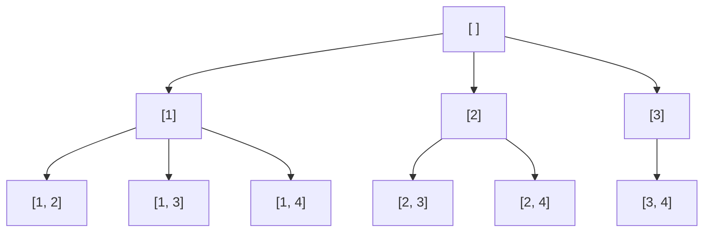

## Introduction

A team lead must pick 2 engineers out of 4 — Asha, Ben, Chen and Dana — to staff an on-call rotation. Picking Asha and Ben is the same team as picking Ben and Asha; only *who* is chosen matters, not the order. How many teams are there? Listing them: AB, AC, AD, BC, BD, CD — six.

Each team is a **combination**: a selection of exactly `k` items from `n`, where order does not matter. The number of combinations is written **C(n, k)** (read "n choose k") and also as the binomial coefficient. It equals n! / (k! · (n − k)!). For the example, 4! / (2! · 2!) = 24 / 4 = 6.

Combinations sit between the two problems you have already met. Like [[a9-subsets]], order does not matter. Unlike subsets, the size is fixed at `k`. Like [[a9-permutations]], each item is used at most once — but where permutations count `[A, B]` and `[B, A]` as two answers, combinations count them as one. The whole technique of this lesson is about generating each unordered group **exactly once** without first generating its reorderings and throwing them away.

You will meet combinations in interview problems ("Combinations", "Combination Sum", "Letter Combinations of a Phone Number" — although, as you will see, the last one is not really about combinations) and in real work whenever something must choose a fixed-size group: a quorum of replicas, a test matrix of `k` features at a time, a panel of reviewers.

## Before you start

- **Subsets and the loop-from-start template** — [[a9-subsets]]. This lesson extends that template with a size limit; reread its "Version 2" section if the `start` parameter is not familiar.
- **Permutations** — [[a9-permutations]], to understand what goes wrong when order is allowed to vary.
- **Recursion and the call stack** — [[a1-recursion]].
- **Big-O notation** — [[a1-big-o]].

## The intuition: always pick in increasing order

The danger in generating combinations is producing the same group in several orders. One simple rule removes it: **list every group in increasing order of its elements**. Every unordered group has exactly one increasing arrangement — `{3, 1}` is written `[1, 3]` and never `[3, 1]`. So if the generator only ever builds increasing sequences, it builds each group exactly once.

Building only increasing sequences is easy: after picking element `j`, the next pick must come from elements greater than `j`. In code, the recursion carries a **start index** meaning "the smallest element still allowed", and after picking `j` it recurses with `start = j + 1`. This is the same rule that the loop-from-start version of subsets uses; the only difference is when to stop and record.

Think of the elements standing in a line, and you walking along it from left to right, tapping people to join the team. You may skip anyone, but you never walk backwards. Once you have tapped `k` people, the team is complete.



The six leaves are the six combinations. Notice there is no branch `[4]` under the root: after picking 4, there is nothing larger to pick, so that branch could never reach size 2. Leaving it out is the pruning step you will meet shortly.

## Why the naive approaches are slow

Two ideas come to mind before the start index, and both waste work.

**Generate all subsets and keep those of size `k`.** This is correct, but it builds all 2ⁿ subsets to keep C(n, k) of them. For n = 20 and k = 2, that is 1,048,576 subsets generated to keep 190.

**Generate ordered selections and remove duplicates.** Using the permutation template but stopping at length `k` produces n! / (n − k)! sequences, and each group appears k! times. For n = 10, k = 5 that is 30,240 sequences for 252 combinations, and you also need a set to filter them.

The start-index rule avoids both: it never builds a sequence out of order, and with pruning it never extends a sequence that cannot reach length `k`.

## The algorithm

The recursive method has four parameters: `n`, `k`, `start` (the smallest number still allowed) and `path` (the numbers chosen so far). Its invariant is:

> `path` is strictly increasing, every number in it is less than `start`, and the call's job is to extend `path` with numbers from `start..n` in every way that reaches size `k`.

The steps follow:

1. If `path.size() == k`, record a copy and return.
2. Let `need = k − path.size()` be the number of picks still required.
3. For each `j` from `start` up to `n − need + 1`: add `j`, recurse with `start = j + 1`, remove `j`.

Step 3's upper bound is the pruning, explained in the next section. The program below can run with or without it and counts the calls, so the effect is measurable.

```java title="Combinations.java"
import java.util.ArrayList;
import java.util.List;

public class Combinations {

    static int calls;                            // counts recursive calls, for comparison

    // Chooses k numbers from 1..n. path is always strictly increasing.
    static void build(int n, int k, int start, List<Integer> path,
                      List<List<Integer>> out, boolean prune) {
        calls++;
        if (path.size() == k) {                  // exactly k chosen: one combination
            out.add(new ArrayList<>(path));
            return;
        }
        int need = k - path.size();
        // With pruning, stop once fewer than `need` numbers remain in j..n.
        int last = prune ? n - need + 1 : n;
        for (int j = start; j <= last; j++) {
            path.add(j);
            build(n, k, j + 1, path, out, prune);  // later picks must be larger than j
            path.remove(path.size() - 1);
        }
    }

    static List<List<Integer>> combine(int n, int k, boolean prune) {
        List<List<Integer>> out = new ArrayList<>();
        calls = 0;
        build(n, k, 1, new ArrayList<>(), out, prune);
        return out;
    }

    public static void main(String[] args) {
        System.out.println(combine(4, 2, true));
        System.out.println("calls with pruning:    " + calls);
        combine(4, 2, false);
        System.out.println("calls without pruning: " + calls);

        combine(20, 18, true);
        System.out.println("n=20, k=18 with pruning:    " + calls);
        List<List<Integer>> big = combine(20, 18, false);
        System.out.println("n=20, k=18 without pruning: " + calls
                + " (" + big.size() + " combinations)");
    }
}
```

```output
[[1, 2], [1, 3], [1, 4], [2, 3], [2, 4], [3, 4]]
calls with pruning:    10
calls without pruning: 11
n=20, k=18 with pruning:    1330
n=20, k=18 without pruning: 1048555 (190 combinations)
```

The method differs from the subsets generator in only two places: it records at size `k` instead of at every call, and its loop has an upper bound. Everything else — the shared `path`, the copy on save, the `remove` after the recursive call — is the same backtracking discipline.

This problem uses the numbers `1..n` directly. When the input is an array `a`, choose indices instead: loop `j` over `start..a.length − 1`, add `a[j]`, and recurse with `j + 1`. The structure does not change.

### Dry run

`combine(4, 2)` with pruning, one row per call:

| Call | `start` | `path` on entry | `need` | Loop range | Result |
|---|---|---|---|---|---|
| 1 | 1 | `[]` | 2 | `j = 1..3` | — |
| 2 | 2 | `[1]` | 1 | `j = 2..4` | — |
| 3 | 3 | `[1, 2]` | — | — | record `[1, 2]` |
| 4 | 4 | `[1, 3]` | — | — | record `[1, 3]` |
| 5 | 5 | `[1, 4]` | — | — | record `[1, 4]` |
| 6 | 3 | `[2]` | 1 | `j = 3..4` | — |
| 7, 8 | 4, 5 | `[2, 3]`, `[2, 4]` | — | — | record both |
| 9 | 4 | `[3]` | 1 | `j = 4..4` | — |
| 10 | 5 | `[3, 4]` | — | — | record `[3, 4]` |

In call 1 the loop stops at 3 because `n − need + 1 = 4 − 2 + 1 = 3`. Without pruning it would also try `j = 4`, entering a call with `path = [4]`, `start = 5`, whose loop range `5..4` is empty — an 11th call that produces nothing.

## Pruning: stop when too few elements remain

At a call that still needs `need` more numbers, picking `j` leaves only the numbers `j + 1 … n` for the remaining `need − 1` picks. That range has `n − j` numbers, so the pick is useful only if `n − j ≥ need − 1`, which rearranges to **`j ≤ n − need + 1`**. Any larger `j` starts a branch that can never reach size `k`.

For small `k` the savings are modest — one call out of 11 above. The savings are dramatic when `k` is close to `n`. For n = 20, k = 18, the unpruned search makes 1,048,555 calls to find 190 combinations: without the bound it explores almost every subset of size up to 18, because it does not realise until the end that most of them are too short. With the bound it makes 1,330 calls. Same answers, roughly 800 times less work.

This is the general idea of **pruning** in backtracking: before entering a branch, check a cheap condition that proves the branch cannot succeed. The condition here is pure counting; other problems use sums, constraints or bounds on the best possible result. [[a9-pruning]] studies the technique on its own.

> [!TIP] Get the bound from the invariant, not from memory
> Off-by-one errors in `n − need + 1` are common, especially when the input is a 0-based array (`a.length − need`). Derive it each time: "after picking `j`, how many elements are left, and how many do I still need?"

## Complexity

**Output size.** There are C(n, k) combinations, each of length `k`, so any method that outputs them all does at least k · C(n, k) work.

**Time.** With pruning, every call the algorithm makes can be completed to at least one combination — that is exactly what the bound guarantees. So every node of the recursion tree is a prefix of some leaf. Each leaf has `k + 1` prefixes (lengths 0 to `k`), so the tree has at most (k + 1) · C(n, k) nodes. Each node does constant work per child plus an O(k) copy at the leaves, giving **O(k · C(n, k))** in total, which matches the output size. Without pruning, the bound fails — as the n = 20, k = 18 run showed, the tree can be thousands of times larger than the output.

**Space.** The recursion is at most `k + 1` levels deep and `path` holds at most `k` numbers, so auxiliary space is **O(k)**, plus Θ(k · C(n, k)) for the output.

How big is C(n, k)? It is largest when `k` is near n/2: C(20, 10) = 184,756 and C(30, 15) = 155,117,520. It is small when `k` is near 0 or `n`: C(30, 2) = 435. So choosing 2 or 3 items from hundreds is easy, while choosing half of 30 items is already too many to list.

## A second view: Pascal's rule

The start-index loop is not the only way to generate combinations. The include/exclude shape from subsets also works: for the number `i`, either it is in the combination (pick `k − 1` more from `i + 1..n`) or it is not (pick `k` from `i + 1..n`). That decision is **Pascal's rule**:

C(n, k) = C(n − 1, k − 1) + C(n − 1, k)

```java title="CombIncEx.java"
import java.util.ArrayList;
import java.util.List;

public class CombIncEx {

    // Pascal's rule: either i is in the combination or it is not.
    static void build(int n, int k, int i, List<Integer> path, List<List<Integer>> out) {
        if (path.size() == k) {
            out.add(new ArrayList<>(path));
            return;
        }
        if (n - i + 1 < k - path.size()) return; // too few numbers left in i..n
        path.add(i);
        build(n, k, i + 1, path, out);           // take i
        path.remove(path.size() - 1);
        build(n, k, i + 1, path, out);           // skip i
    }

    public static void main(String[] args) {
        List<List<Integer>> out = new ArrayList<>();
        build(4, 2, 1, new ArrayList<>(), out);
        System.out.println(out);
    }
}
```

```output
[[1, 2], [1, 3], [1, 4], [2, 3], [2, 4], [3, 4]]
```

The guard `n − i + 1 < k − path.size()` is the same pruning written for this shape: the numbers `i..n` are `n − i + 1` in total, and if that is fewer than the picks still needed, the branch is dead. It also handles running past `n`, because then the count is zero or negative. Both versions produce the same order here because "take" is tried before "skip". The start-index version is more common in interviews because it extends naturally to the problems in [[a9-combination-sum]]; the Pascal view is useful when you need to *count* rather than list, since C(n, k) can be filled into a table with the same rule in O(n · k) time.

```quiz
Q: In the start-index template, why does recursing with `j + 1` (rather than 0 or `start`) prevent duplicate combinations?
- [ ] It makes the recursion shallower
- [x] It forces every path to be strictly increasing, and each unordered group has exactly one increasing arrangement
- [ ] It skips every second element
- [ ] It is only needed when the input has duplicates
> After picking j, only larger elements can follow, so [3, 1] can never be built — only [1, 3]. Since each set of k distinct elements has exactly one increasing order, each combination appears exactly once. Recursing from 0 would allow every order, giving permutations.

Q: You are choosing k = 3 from the numbers 1..10 and the current path is [4]. With pruning, what is the largest number the loop may try next?
- [ ] 10
- [x] 9
- [ ] 8
- [ ] 7
> need = 3 − 1 = 2, so the bound is n − need + 1 = 10 − 2 + 1 = 9. Picking 9 leaves 10 for the last pick; picking 10 leaves nothing, so that branch cannot reach size 3.
```

## Inputs with repeated values

If the input array has equal values — for example, choose 2 from `[3, 1, 3, 2, 1]` — index-based generation produces the same group more than once: `[1, 3]` can be built from either `1` and either `3`, four ways. The fix is the same as for subsets: **sort, then never try the same value twice in one loop**.

```java title="CombineDup.java"
import java.util.ArrayList;
import java.util.Arrays;
import java.util.List;

public class CombineDup {

    static void build(int[] a, int k, int start, List<Integer> path, List<List<Integer>> out) {
        if (path.size() == k) {
            out.add(new ArrayList<>(path));
            return;
        }
        for (int j = start; j < a.length; j++) {
            if (j > start && a[j] == a[j - 1]) continue;  // same value, same level
            if (a.length - j < k - path.size()) break;     // not enough elements left
            path.add(a[j]);
            build(a, k, j + 1, path, out);
            path.remove(path.size() - 1);
        }
    }

    public static void main(String[] args) {
        int[] a = {3, 1, 3, 2, 1};
        Arrays.sort(a);
        List<List<Integer>> out = new ArrayList<>();
        build(a, 2, 0, new ArrayList<>(), out);
        System.out.println(out);
    }
}
```

```output
[[1, 1], [1, 2], [1, 3], [2, 3], [3, 3]]
```

After sorting, the array is `[1, 1, 2, 3, 3]`. The skip rule `j > start && a[j] == a[j − 1]` stops the root call from trying the second `1` as an alternative first element, but the child call with `start = 1` may still pick it as its first option, which is how `[1, 1]` is built. The pruning line uses the 0-based form: positions `j..a.length − 1` hold `a.length − j` elements, and if that is fewer than the picks still needed, every later `j` is worse, so `break` ends the loop instead of `continue`.

## Combinations versus look-alikes

Many problems use the word "combination" loosely. Before coding, decide which of these four shapes you are in, because each needs a different loop.

| Shape | Order matters? | Size | Reuse? | Loop | Count |
|---|---|---|---|---|---|
| Subsets | no | any | no | `j` from `start`, record every call | 2ⁿ |
| Combinations | no | exactly `k` | no | `j` from `start`, record at size `k` | C(n, k) |
| Permutations | yes | `n` (or `k`) | no | `i` from 0, skip used | n! (or n!/(n − k)!) |
| Cartesian product | position-specific | one per slot | — | over the options of the current slot | product of option counts |

The last row deserves an example. **Letter Combinations of a Phone Number** maps each digit to its letters (`2 → abc`, `3 → def`) and asks for every string with one letter per digit. Despite the name, there is no "choose `k` from `n`" here: every position has its own separate set of options, and the answer is one choice per position. That is a **cartesian product**, and the recursion goes position by position.

```java title="LetterCombinations.java"
import java.util.ArrayList;
import java.util.List;

public class LetterCombinations {

    static final String[] KEYS = {
        "", "", "abc", "def", "ghi", "jkl", "mno", "pqrs", "tuv", "wxyz"
    };

    static void build(String digits, int pos, StringBuilder sb, List<String> out) {
        if (pos == digits.length()) {
            out.add(sb.toString());
            return;
        }
        String letters = KEYS[digits.charAt(pos) - '0'];
        for (char ch : letters.toCharArray()) {
            sb.append(ch);
            build(digits, pos + 1, sb, out);
            sb.deleteCharAt(sb.length() - 1);
        }
    }

    static List<String> letterCombinations(String digits) {
        List<String> out = new ArrayList<>();
        if (digits.isEmpty()) return out;        // the problem expects [] here, not [""]
        build(digits, 0, new StringBuilder(), out);
        return out;
    }

    public static void main(String[] args) {
        System.out.println(letterCombinations("23"));
        System.out.println(letterCombinations(""));
    }
}
```

```output
[ad, ae, af, bd, be, bf, cd, ce, cf]
[]
```

The backtracking discipline is identical — append, recurse, delete — but there is no start index and no `used` array, because each position draws from its own alphabet. With up to 4 letters per digit, `d` digits give at most 4ᵈ strings, each built in O(d), so the time is O(d · 4ᵈ). A `StringBuilder` serves as the path; `toString()` is the copy.

## In real systems

**Quorums and replica placement.** A storage system with 5 replicas that needs 3 to agree has C(5, 3) = 10 possible quorums. Reasoning about failure — "which groups of 2 failures leave a quorum?" — means walking through combinations. For small replica counts, engineers literally enumerate them in tests.

**Combinatorial testing.** Testing every combination of 3 options out of 12 configuration flags means C(12, 3) = 220 test configurations — manageable — whereas all subsets would be 4,096. Test generators often iterate over combinations of a fixed size for exactly this reason.

**Feature and model selection.** Data scientists sometimes evaluate every set of `k` features from a small candidate list. It is only viable while C(n, k) stays small, which is why greedy forward selection exists for larger `n`.

## Trade-offs and alternatives

| Approach | Time | Strength | Weakness |
|---|---|---|---|
| Start-index backtracking with pruning | O(k · C(n, k)) | Simple, prunes, extends to sums and constraints | Recursion depth `k` |
| Pascal include/exclude | O(k · C(n, k)) with the guard | Mirrors the counting formula | Slightly more calls than the loop |
| Bitmask filter (`Integer.bitCount(mask) == k`) | O(2ⁿ) | Very short code | Wastes work when C(n, k) ≪ 2ⁿ |
| Iterative next combination | O(k) per step | No recursion, streams results in order | More index bookkeeping |
| Pascal's triangle table | O(n · k) | Counts C(n, k) without listing | Does not produce the combinations |

If you only need the *number* of combinations, never enumerate — compute C(n, k) from Pascal's rule or the factorial formula (with care for overflow; C(n, k) for n = 67 already exceeds a `long` at k = 33).

## Common mistakes

> [!MISTAKE] Recursing from the wrong index
> Recursing with `start` instead of `j + 1` lets the same element be picked again (that is combination sum with reuse, a different problem). Recursing from 0 generates permutations. The next pick must come strictly after `j`.

**Wrong pruning bound.** Using `j <= n − need` for 1-based numbers misses every combination that ends with `n` (for `combine(4, 2)` it drops `[1, 4]`, `[2, 4]` and `[3, 4]`). Test the bound on a tiny case where the last combination uses the last elements.

**Recording before the size is reached.** Copying the subsets template and leaving `out.add` at the top of the method records every partial path, giving all subsets of size up to `k`.

**Saving the live path.** As in every backtracking problem, `out.add(path)` stores a reference that keeps changing. Save `new ArrayList<>(path)`.

**Treating a cartesian product as a combination.** In letter combinations, each digit has its own options; a start index into one shared list makes no sense there.

## Interview perspective

Interviewers ask "Combinations" both directly and as a sub-step, and they watch for two things: whether you can explain why the output has no duplicates, and whether you prune.

> [!INTERVIEW] What to say
> "I'll build each combination in increasing order, so each set appears once. After picking `j` I recurse from `j + 1`. I stop at size `k`. If I still need `need` numbers, `j` can go at most to `n − need + 1`, otherwise there aren't enough numbers left. Each node then leads to a valid answer, so the time is O(k · C(n, k)) and the extra space is O(k)."

Questions to prepare:

- **Combinations vs subsets vs permutations?** Use the table above: fixed size, order irrelevant, no reuse.
- **Derive C(n, k).** Ordered selections n!/(n − k)!, divided by the k! orders of each group.
- **Why is pruning important here?** Without it, for large `k` the search explores most of the 2ⁿ subsets; give the n = 20, k = 18 numbers.
- **Combination Sum III** — choose `k` digits from 1–9 that sum to `n`. Same template with a sum check; see [[a9-combination-sum]].
- **Follow-up: generate the combinations lazily.** Iterative next-combination, or a generator that resumes from the last increasing sequence.

## Practice

1. **Combinations.** Implement `combine(n, k)` with pruning. Test `(4, 2)`, `(1, 1)` and `(5, 5)`.
2. **Count the calls.** Instrument your code and compare pruned and unpruned call counts for `(10, 8)`. Explain the difference.
3. **Combinations of an array with duplicates.** Choose 3 from `[2, 2, 2, 3, 3]`. Predict the distinct results before running.
4. **Letter Combinations of a Phone Number.** Implement it and explain why it is a cartesian product.
5. **Combination Sum III.** Find all sets of 3 distinct digits from 1–9 summing to 9. Add a sum-based prune.

The DSA explorer lists matching problems under this topic; start with *Combinations* and *Letter Combinations of a Phone Number*.

## Quick revision {#quick-revision}

- Combination: `k` items from `n`, order irrelevant; count C(n, k) = n! / (k! · (n − k)!).
- Template: record at `path.size() == k`; loop `j` from `start`; add, recurse with `j + 1`, remove.
- Increasing order guarantees each combination is built exactly once.
- Prune: `j ≤ n − need + 1` (1-based numbers) or `a.length − j ≥ need` (0-based array).
- With pruning: time O(k · C(n, k)), extra space O(k). Without it, large `k` can approach 2ⁿ calls.
- Duplicates: sort; `if (j > start && a[j] == a[j-1]) continue;`.
- Pascal's rule C(n, k) = C(n − 1, k − 1) + C(n − 1, k) is the include/exclude view.
- Letter combinations is a cartesian product: one choice per position, no start index.

## Key takeaways {#key-takeaways}

- Combinations are subsets of a fixed size, so the subsets loop-from-start template applies with a different place to record.
- The start index enforces increasing order, which is what makes each unordered group appear exactly once.
- Counting the elements still available against the picks still needed gives a pruning bound that can cut work by orders of magnitude.
- Repeated values are handled by sorting and skipping equal values tried at the same level.
- Classify the problem first: subsets, combinations, permutations or cartesian product each need a different loop.
