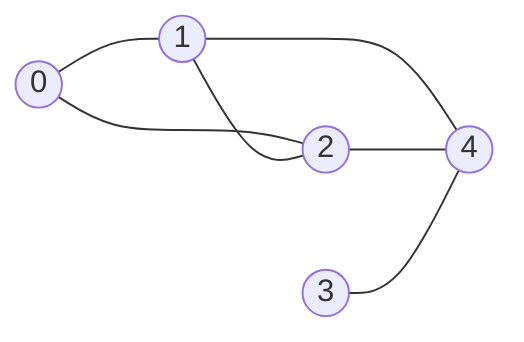
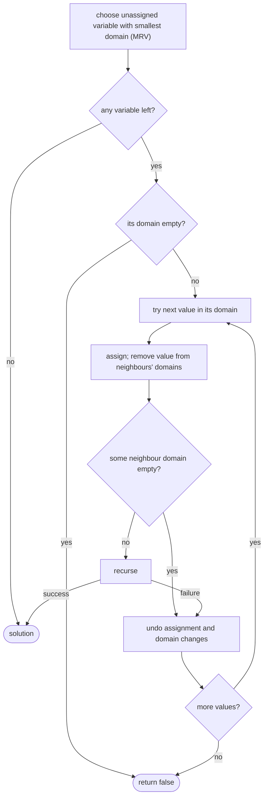

## Introduction

Many problems ask you to fill in a set of blanks so that a list of rules is obeyed. Place eight queens on a chessboard so that none attacks another. Fill a Sudoku grid so that every row, column and 3×3 box contains each digit once. Colour the countries on a map so that neighbours differ. Assign exams to time slots so that no student sits two exams at once. None of these asks for a clever formula; they ask you to *find an assignment that satisfies every rule*.

The most direct method is to generate every complete assignment and test each one. That is hopeless almost immediately. A Sudoku with 51 blank cells has 9⁵¹ ways to fill the blanks — a number with 49 digits. Even eight queens, one per row, gives 8⁸ = 16,777,216 boards to test, of which only 92 are valid.

**Constraint-based backtracking** does something smarter. It fills the blanks one at a time, and after each choice it asks: *does this choice already break a rule with the choices made so far?* If it does, the search abandons that choice immediately and never builds any of the complete assignments that would have started with it. For eight queens, this reduces 19 million recursive calls to 2,057, while still finding all 92 solutions.

This lesson teaches the technique properly: how to describe a problem in terms of **variables**, **domains** and **constraints**; why rejecting a partial assignment early can never lose a solution; how to make each check cost O(1) instead of re-validating the whole board; and how two classic refinements — choosing the most constrained blank first and looking ahead at what a choice rules out — can cut the search by another factor of ten or more. It builds directly on the choose–recurse–undo rhythm from [[a1-recursion]], and it leads into [[a9-pruning]], which generalises "reject early" from rule violations to any provable dead end.

## Before you start

- **Recursion and backtracking basics** — choose, recurse, undo, and why a shared path must be restored. See [[a1-recursion]].
- **Generating subsets and permutations** — the decision tree that backtracking walks. See [[a9-subsets]] and [[a9-permutations]].
- **Big-O for exponential algorithms** — what O(dⁿ) means and why it grows so fast. See [[a1-time-complexity]].
- **Bitwise operators** — `1 << d`, `|`, `&` and `~` are used for compact "already used" sets. See [[a13-bitmasking]] if they are unfamiliar; boolean arrays work too.

## The intuition

Think of doing a Sudoku with a pencil. You do not write a digit in every blank and then check the whole grid at the end. You pick a blank, write a digit that does not already appear in its row, column or box, and move on. If you reach a blank where *no* digit fits, you know one of your earlier pencil marks was wrong, so you rub out the most recent one and try its next option. That rub-out is the **backtrack**.

Two habits make a good human solver fast, and both turn into algorithmic ideas later in this lesson. First, a good solver checks each digit against the rules *as it is written*, not after the grid is full — that is the core of constraint-based backtracking. Second, a good solver starts with the blank that has the fewest possible digits, because a blank with only one option is not a guess at all. That is the **minimum-remaining-values** heuristic.

The picture to hold is a tree. The root is the empty assignment. Each level fills one more blank, and each child is one value for that blank. Plain enumeration walks the whole tree down to every leaf. Constraint-based backtracking cuts off a branch the moment its partial assignment breaks a rule, so entire subtrees disappear without being visited.

## Variables, domains and constraints

Before writing any code, describe the problem in three parts. This description is called a **constraint satisfaction problem (CSP)**.

- **Variables** are the blanks to fill. In Sudoku they are the empty cells; in N-Queens, if you place one queen per row, they are the rows (the value is the queen's column); in graph colouring they are the vertices.
- The **domain** of a variable is the set of values it may take: digits 1–9, column indices `0..n-1`, or the available colours.
- **Constraints** are the rules that restrict which combinations of values are allowed: "all different within a row", "no two queens on a diagonal", "adjacent vertices have different colours", "these items sum to at most 15".

| Problem | Variables | Domain | Constraints |
|---|---|---|---|
| N-Queens ([[a9-n-queens]]) | One per row | Column `0..n-1` | No shared column or diagonal |
| Sudoku | Each empty cell | Digits 1–9 | All different in each row, column and 3×3 box |
| Graph colouring ([[a8-graph-coloring]]) | Each vertex | Colours `0..m-1` | Endpoints of every edge differ |
| Exam timetabling | Each exam | Time slots | Exams sharing a student get different slots; room capacity |
| Palindrome partitioning | Each cut position | Where the next piece ends | Every piece is a palindrome |

Writing this table first is not bureaucracy; it decides your recursion. The variables become the levels of the recursion tree, the domain becomes the `for` loop at each level, and the constraints become the `if` that decides whether to recurse. It also tells you the size of the raw search space — the product of the domain sizes — which tells you how badly you need the checks.

The modelling choice matters. For N-Queens you could make every *square* a yes/no variable, giving 2⁶⁴ assignments for an 8×8 board. Making each *row* a variable whose value is a column builds the "one queen per row" rule into the model itself, shrinking the space to 8⁸ before any check runs. A good model makes some constraints impossible to violate, so they never need to be checked.

## The naive approach: generate, then test

The simplest correct program enumerates every complete assignment and tests the full set of rules at the leaf. For eight queens with one queen per row, that means trying every one of the 8⁸ column choices. Instrumented to count its work, this program makes 19,173,961 recursive calls and tests 16,777,216 complete boards to find the 92 solutions.

Almost all of that work is wasted in an obvious way. Suppose the first two queens are at `(0, 0)` and `(1, 1)` — on the same diagonal. Every one of the 8⁶ = 262,144 boards that start with those two placements is invalid, and generate-and-test builds and checks every one of them. The violation was visible after two decisions; the program waited for eight.

## The key idea: check before you recurse

Constraint-based backtracking moves the test from the leaf to the moment each value is chosen. At every level, for each value in the current variable's domain, it checks the constraints that involve this variable and variables already assigned. Only if they all hold does it assign the value and recurse.

```java title="Skeleton (pseudocode-style Java)"
boolean backtrack(State state) {
    if (state.isComplete()) return true;          // every variable assigned legally
    Variable v = state.chooseUnassigned();
    for (Value val : v.domain()) {
        if (!state.isConsistent(v, val)) continue; // breaks a rule already: skip subtree
        state.assign(v, val);
        if (backtrack(state)) return true;         // found a solution below: stop
        state.unassign(v, val);                    // undo before trying the next value
    }
    return false;                                  // no value works: tell the caller
}
```

Compare this with the generate-and-test version. The leaf no longer needs a full validity test: if every assignment was checked against all earlier ones when it was made, a complete assignment is automatically valid. The `continue` is where the speed comes from — one failed check removes the whole subtree below that value.

With this change, eight queens takes 2,057 calls instead of 19,173,961, and still finds all 92 solutions.

### Why rejecting early is safe

It is worth being precise about why this never loses a solution, because the same reasoning decides which checks you are allowed to make early. The constraints in these problems have a property: **once a partial assignment violates a constraint, every extension of it violates that constraint too.** Two queens on one diagonal stay on that diagonal however the remaining rows are filled. Two neighbouring vertices that share a colour keep sharing it. So no complete solution can lie below a violating partial assignment, and skipping the subtree loses nothing.

That property does not hold for every rule you might want to check. "The chosen numbers sum to *exactly* 10" is not violated by a partial sum of 7 — later choices may add 3. You cannot reject on it until the assignment is complete. What you *can* check early is a weaker, monotone version: if all numbers are positive, "the partial sum is at most 10" must hold at every step, and a partial sum of 12 can be rejected at once. Turning a rule that is only checkable at the end into one that is checkable early is exactly the skill [[a9-pruning]] develops.

> [!IMPORTANT] What "consistent" means
> At each step, check only constraints whose variables are *all assigned*. A constraint that mentions an unassigned variable cannot be judged yet. Checking it anyway — treating an unassigned cell as if it held some default value — rejects valid choices.

### Finding one solution, all solutions or a count

The skeleton returns `boolean` and stops at the first success, which is what Sudoku wants: the puzzle has one answer, and there is no point exploring after finding it. N-Queens often asks for *all* boards or the *number* of boards. Then the method returns `void` (or a count), records a copy of the assignment at each complete leaf, and never returns early. The pruning is identical; only the stopping rule changes. Mixing them up is a common bug: an early `return true` in an "all solutions" problem silently reports only the first one.

## Making each check cheap: incremental constraint state

A correct check can still be slow. The tempting way to ask "can I put 5 in cell (4, 6)?" is to scan row 4, column 6 and the cell's box — 27 reads — or, worse, to re-validate the whole 81-cell board. Done at every node of a search that may visit thousands or millions of nodes, that cost dominates the running time.

The fix is to keep **incremental state**: data structures that summarise what is already used, updated in O(1) on every assign and unassign. For Sudoku, keep one "used digits" set per row, per column and per box. Checking a digit becomes three lookups; placing or removing it becomes three updates.

The sets can be `boolean[9][10]` arrays, but a bitmask is more compact: an `int` in which bit `d` is set when digit `d` is used. `rowUsed[r] | colUsed[c] | boxUsed[b]` then gives, in one expression, every digit that is illegal in cell `(r, c)`.

Which box does a cell belong to? The nine boxes are numbered 0–8 left to right, top to bottom. `r / 3` is the box row (0, 1 or 2) and `c / 3` is the box column, so the box index is `(r / 3) * 3 + c / 3`. Cell `(4, 6)` is in box `1 * 3 + 2 = 5`, the middle-right box.

N-Queens uses the same idea with a different shape of constraint. A queen at `(r, c)` blocks column `c`, the "down-right" diagonal on which `r - c` is constant, and the "down-left" diagonal on which `r + c` is constant. Three boolean arrays — `cols[n]`, `diag[2n - 1]` indexed by `r - c + n - 1`, and `anti[2n - 1]` indexed by `r + c` — make each check O(1). [[a9-n-queens]] builds that solver in full.

The cost of incremental state is discipline: **every update made on assign must be reversed exactly on unassign.** If `place` sets three bits, `unplace` must clear the same three. A forgotten reversal does not crash; it quietly leaves a digit marked as used, and later branches reject legal values.

## Worked example 1: a Sudoku solver

Here is a complete solver. It reads a puzzle with `.` for blanks, fills cells in reading order, and uses the bitmask state just described. It also contains a second search method using the minimum-remaining-values heuristic, explained in the next section, and counts the calls each one makes.

```java title="SudokuSolver.java"
public class SudokuSolver {
    // Bit d of rowUsed[r] is set when digit d already appears in row r.
    private final int[] rowUsed = new int[9], colUsed = new int[9], boxUsed = new int[9];
    private final int[][] grid = new int[9][9];
    long calls = 0;

    SudokuSolver(String[] rows) {
        for (int r = 0; r < 9; r++)
            for (int c = 0; c < 9; c++)
                if (rows[r].charAt(c) != '.') place(r, c, rows[r].charAt(c) - '0');
    }

    private static int box(int r, int c) { return (r / 3) * 3 + c / 3; }

    private int usedAt(int r, int c) {
        return rowUsed[r] | colUsed[c] | boxUsed[box(r, c)];
    }

    private void place(int r, int c, int d) {
        grid[r][c] = d;
        rowUsed[r] |= 1 << d; colUsed[c] |= 1 << d; boxUsed[box(r, c)] |= 1 << d;
    }

    private void unplace(int r, int c, int d) {
        grid[r][c] = 0;
        rowUsed[r] &= ~(1 << d); colUsed[c] &= ~(1 << d); boxUsed[box(r, c)] &= ~(1 << d);
    }

    // Fixed order: always fill the first empty cell in reading order.
    boolean solveInOrder(int cell) {
        calls++;
        while (cell < 81 && grid[cell / 9][cell % 9] != 0) cell++;
        if (cell == 81) return true;                  // no empty cell left: solved
        int r = cell / 9, c = cell % 9, used = usedAt(r, c);
        for (int d = 1; d <= 9; d++) {
            if ((used & (1 << d)) != 0) continue;     // constraint check BEFORE recursing
            place(r, c, d);
            if (solveInOrder(cell + 1)) return true;  // first solution found: stop
            unplace(r, c, d);
        }
        return false;                                 // every digit failed: backtrack
    }

    // MRV: fill the empty cell with the fewest legal digits first.
    boolean solveMrv() {
        calls++;
        int bestR = -1, bestC = -1, fewest = 10;
        for (int r = 0; r < 9; r++)
            for (int c = 0; c < 9; c++) {
                if (grid[r][c] != 0) continue;
                int legal = 9 - Integer.bitCount(usedAt(r, c) & 0b11_1111_1110);
                if (legal < fewest) { fewest = legal; bestR = r; bestC = c; }
            }
        if (bestR == -1) return true;                 // solved
        if (fewest == 0) return false;                // a cell has no legal digit
        int used = usedAt(bestR, bestC);
        for (int d = 1; d <= 9; d++) {
            if ((used & (1 << d)) != 0) continue;
            place(bestR, bestC, d);
            if (solveMrv()) return true;
            unplace(bestR, bestC, d);
        }
        return false;
    }

    void print() {
        for (int[] row : grid) {
            StringBuilder sb = new StringBuilder();
            for (int d : row) sb.append(d);
            System.out.println(sb);
        }
    }

    public static void main(String[] args) {
        String[] easy = {
            "53..7....", "6..195...", ".98....6.",
            "8...6...3", "4..8.3..1", "7...2...6",
            ".6....28.", "...419..5", "....8..79"};
        String[] hard = {
            "8........", "..36.....", ".7..9.2..",
            ".5...7...", "....457..", "...1...3.",
            "..1....68", "..85...1.", ".9....4.."};

        SudokuSolver s = new SudokuSolver(easy);
        s.solveInOrder(0);
        s.print();

        for (String[] puzzle : new String[][] {easy, hard}) {
            SudokuSolver inOrder = new SudokuSolver(puzzle);
            inOrder.solveInOrder(0);
            SudokuSolver mrv = new SudokuSolver(puzzle);
            mrv.solveMrv();
            System.out.println("calls: in order = " + inOrder.calls + ", MRV = " + mrv.calls);
        }
    }
}
```

```output
534678912
672195348
198342567
859761423
426853791
713924856
961537284
287419635
345286179
calls: in order = 4209, MRV = 52
calls: in order = 49559, MRV = 10102
```

Walk through `solveInOrder`. The parameter `cell` is a position from 0 to 80 in reading order, so `cell / 9` is the row and `cell % 9` the column. The `while` loop skips cells that are already filled — the givens, and nothing else, because cells *after* `cell` have not been touched yet. If it runs off the end, every cell holds a digit, and because each digit was checked when it was placed, the grid is a valid solution.

For an empty cell, `usedAt` combines the three masks once, before the loop, and the loop tries only digits whose bit is clear. A legal digit is placed, the search continues from the next cell, and if that call reports success the `true` propagates straight up to `main` without undoing anything — that is why the grid still holds the solution when `print` runs. If the deeper search fails, `unplace` clears the same three bits that `place` set, and the next digit is tried. When all nine fail, the method returns `false`, and the caller undoes *its* digit.

The puzzle labelled `easy` has 30 givens and 51 blanks; the fixed-order search solved it in 4,209 calls. The `hard` puzzle has only 21 givens and needed 49,559. Either way, the result is a tiny fraction of the 9⁵¹ or 9⁶⁰ raw assignments, because almost every wrong digit is rejected by a row, column or box check within a few levels.

## Worked example 2: tracing a dead end in graph colouring

The Sudoku run is too large to trace by hand, so here is a small graph-colouring instance where the search makes a wrong choice and has to undo it. The task is to colour five vertices with three colours (red, green, blue) so that the ends of every edge differ. Vertices 0, 1 and 2 form a triangle; vertex 4 is joined to 1, 2 and 3; vertex 3 is joined only to 4.



```java title="GraphColoring.java"
import java.util.*;

public class GraphColoring {
    static final String[] NAMES = {"red", "green", "blue"};
    static List<List<Integer>> adj = new ArrayList<>();
    static int[] color;

    // Is colour c legal for v, given the vertices coloured so far?
    static boolean consistent(int v, int c) {
        for (int u : adj.get(v)) {
            if (color[u] == c) return false;      // uncoloured neighbours hold -1
        }
        return true;
    }

    static boolean solve(int v, int m) {
        if (v == color.length) return true;       // every vertex has a legal colour
        for (int c = 0; c < m; c++) {
            if (!consistent(v, c)) {
                System.out.println("  vertex " + v + ": " + NAMES[c] + " clashes");
                continue;
            }
            color[v] = c;
            System.out.println("assign vertex " + v + " = " + NAMES[c]);
            if (solve(v + 1, m)) return true;
            color[v] = -1;                        // undo before trying the next colour
            System.out.println("undo   vertex " + v + " = " + NAMES[c]);
        }
        System.out.println("  vertex " + v + ": no colour left, backtrack");
        return false;
    }

    public static void main(String[] args) {
        int n = 5;
        int[][] edges = {{0, 1}, {0, 2}, {1, 2}, {1, 4}, {2, 4}, {3, 4}};
        for (int i = 0; i < n; i++) adj.add(new ArrayList<>());
        for (int[] e : edges) {
            adj.get(e[0]).add(e[1]);
            adj.get(e[1]).add(e[0]);
        }
        color = new int[n];
        Arrays.fill(color, -1);
        if (solve(0, 3)) {
            for (int v = 0; v < n; v++) System.out.println(v + " -> " + NAMES[color[v]]);
        } else {
            System.out.println("not 3-colourable");
        }
    }
}
```

```output
assign vertex 0 = red
  vertex 1: red clashes
assign vertex 1 = green
  vertex 2: red clashes
  vertex 2: green clashes
assign vertex 2 = blue
assign vertex 3 = red
  vertex 4: red clashes
  vertex 4: green clashes
  vertex 4: blue clashes
  vertex 4: no colour left, backtrack
undo   vertex 3 = red
assign vertex 3 = green
assign vertex 4 = red
0 -> red
1 -> green
2 -> blue
3 -> green
4 -> red
```

Notice how `consistent` follows the rule from earlier: it looks at every neighbour, but an uncoloured neighbour holds `-1`, which never equals a real colour, so only already-assigned vertices can cause a clash. The same trace as a table:

| Step | Vertex | Colours tried | Result | Colours so far (0..4) |
|---|---|---|---|---|
| 1 | 0 | red | assigned | R - - - - |
| 2 | 1 | red ✗ (0), green | assigned | R G - - - |
| 3 | 2 | red ✗ (0), green ✗ (1), blue | assigned | R G B - - |
| 4 | 3 | red | assigned (3's only neighbour, 4, is uncoloured) | R G B R - |
| 5 | 4 | red ✗ (3), green ✗ (1), blue ✗ (2) | dead end, return `false` | R G B R - |
| 6 | 3 | undo red, try green | assigned | R G B G - |
| 7 | 4 | red | assigned, solution | R G B G R |

Step 4 is the mistake. Choosing red for vertex 3 was legal *at the time* — nothing coloured touched it — but it removed the last colour vertex 4 could use. Plain backtracking discovers this only after descending to vertex 4 and failing all three colours. On five vertices that costs one extra level; on a real map, a wrong choice made early can be discovered dozens of levels later, after an enormous subtree has been explored. The next two ideas attack exactly that delay.

```quiz
Q: In the graph-colouring trace, why was assigning red to vertex 3 accepted even though it led to a dead end?
- [ ] The consistency check has a bug
- [x] The check only compares against coloured neighbours, and vertex 3's only neighbour (4) was not yet coloured
- [ ] Red is always tried first, so it cannot be rejected
- [ ] Backtracking never rejects a value until the leaf
> Constraint-based backtracking checks constraints whose variables are all assigned. The edge 3–4 could not be judged until 4 was coloured, so red was legal at step 4. Forward checking would have caught it earlier by noticing that 4 had no colours left.

Q: A Sudoku solver re-validates all 81 cells before every placement instead of keeping row, column and box sets. What is the effect?
- [ ] It finds different solutions
- [ ] It explores more branches of the search tree
- [x] It explores the same tree but pays about 81 checks per node instead of 3 lookups
- [ ] It can no longer backtrack
> The decisions are the same, so the tree is the same. Only the cost per node changes. Incremental sets make each check O(1), which matters when the search visits thousands or millions of nodes.
```

## Choosing what to fill next: the MRV heuristic

The skeleton has a line that is easy to overlook: `chooseUnassigned()`. Which blank you fill next does not affect correctness — every order explores a complete tree — but it can change the size of that tree enormously.

The **minimum-remaining-values (MRV)** heuristic, also called "fail first" or "most constrained variable", says: *fill the variable with the fewest legal values left.* There are two reasons it works.

- A variable with **one** legal value is not a guess. Filling it immediately costs nothing and tightens the constraints on its neighbours, often leaving them with one value too. This is how the easy puzzle above was solved by MRV in 52 calls: 51 blanks, each forced, plus the final call that finds no blank left. The search never guessed wrong once.
- A variable with **zero** legal values means the current partial assignment is already dead. MRV finds such a variable before any other, so the dead end is reported immediately rather than after filling unrelated blanks. In `solveMrv`, `fewest == 0` triggers `return false` at once.

On the hard puzzle MRV cut the calls from 49,559 to 10,102. It does not make the worst case better, and each call now scans all 81 cells to find the best one (O(81) instead of O(1) per call), but on any search where wrong guesses are expensive that trade is overwhelmingly worth it.

Two companion heuristics are worth knowing by name. When several variables tie on MRV, the **degree heuristic** breaks the tie in favour of the variable involved in the most constraints with unassigned variables, because assigning it shrinks the most other domains. And once a variable is chosen, the **least-constraining-value** heuristic tries first the value that removes the fewest options from neighbours, which makes it more likely the first branch succeeds. Value ordering only matters when you stop at the first solution; if you must explore every solution, all values get tried anyway.

## Looking ahead: forward checking

MRV picks the variable; **forward checking** looks at the consequences of a choice. When you assign a value to a variable, remove that value from the domain of every unassigned neighbour that it conflicts with. If any neighbour's domain becomes empty, the assignment is doomed, and you undo it immediately instead of descending.

Run that idea on the graph above with the original fixed order. When vertex 3 is set to red, forward checking removes red from vertex 4's remaining colours. Vertex 4 had already lost green (because of 1) and blue (because of 2), so its domain is now empty, and red for vertex 3 is rejected on the spot — no visit to vertex 4 needed.

The program below combines forward checking with MRV. Each vertex keeps a bitmask of colours still possible.

```java title="ForwardChecking.java"
import java.util.*;

public class ForwardChecking {
    static final String[] NAMES = {"red", "green", "blue"};
    static List<List<Integer>> adj = new ArrayList<>();
    static int[] color;
    static int[] domain;            // bit c set = colour c still possible for that vertex

    static boolean solve() {
        // MRV: choose the uncoloured vertex with the fewest remaining colours.
        int v = -1;
        for (int u = 0; u < color.length; u++) {
            if (color[u] != -1) continue;
            if (v == -1 || Integer.bitCount(domain[u]) < Integer.bitCount(domain[v])) v = u;
        }
        if (v == -1) return true;                      // all coloured
        for (int c = 0; c < NAMES.length; c++) {
            if ((domain[v] & (1 << c)) == 0) continue; // already ruled out
            color[v] = c;
            System.out.println("assign vertex " + v + " = " + NAMES[c]);
            int[] saved = domain.clone();              // snapshot so undo is one line
            if (forwardCheck(v, c) && solve()) return true;
            domain = saved;
            color[v] = -1;
            System.out.println("undo   vertex " + v + " = " + NAMES[c]);
        }
        return false;
    }

    // Remove colour c from every uncoloured neighbour; fail if one is left with nothing.
    static boolean forwardCheck(int v, int c) {
        for (int u : adj.get(v)) {
            if (color[u] != -1) continue;
            domain[u] &= ~(1 << c);
            if (domain[u] == 0) {
                System.out.println("  vertex " + u + " has no colour left: reject");
                return false;
            }
        }
        return true;
    }

    public static void main(String[] args) {
        int n = 5;
        int[][] edges = {{0, 1}, {0, 2}, {1, 2}, {1, 4}, {2, 4}, {3, 4}};
        for (int i = 0; i < n; i++) adj.add(new ArrayList<>());
        for (int[] e : edges) {
            adj.get(e[0]).add(e[1]);
            adj.get(e[1]).add(e[0]);
        }
        color = new int[n];
        Arrays.fill(color, -1);
        domain = new int[n];
        Arrays.fill(domain, 0b111);
        solve();
        for (int v = 0; v < n; v++) System.out.println(v + " -> " + NAMES[color[v]]);
    }
}
```

```output
assign vertex 0 = red
assign vertex 1 = green
assign vertex 2 = blue
assign vertex 4 = red
assign vertex 3 = green
0 -> red
1 -> green
2 -> blue
3 -> green
4 -> red
```

There is no undo in this run at all. After 0, 1 and 2 are coloured, forward checking has shrunk vertex 4's domain to `{red}` while vertex 3 still has three colours, so MRV picks 4 before 3. With red fixed on 4, forward checking leaves 3 with green and blue, and green succeeds. The order that caused the dead end in the plain version is never taken.

Two implementation details deserve attention. First, the domain array is **snapshotted** before forward checking and restored on undo. That is the simplest correct way to reverse many small changes; the alternative, recording exactly which bits were removed and adding them back, uses less memory and is what serious solvers do. Second, notice that the constraint check moved: in this version a value is never "checked" against neighbours in a `consistent` method, because any value still in the domain is already known to be consistent with every assigned neighbour. The domains *are* the incremental constraint state.

Forward checking only looks one step ahead: it compares the new assignment with each neighbour individually. Stronger **constraint propagation** keeps going — if a neighbour's domain shrinks to one value, that forced value is propagated to *its* neighbours, and so on. **Arc consistency** algorithms such as AC-3 enforce that for every pair of constrained variables, every value in one domain has some compatible value in the other. In Sudoku terms, the "a cell with only one candidate must take it" and "a digit that fits only one cell of a row must go there" techniques human solvers use are forms of propagation. More propagation means more work per node and fewer nodes; how far to go is an engineering trade-off.



## Complexity

**Time.** With `n` variables and domains of size `d`, the search tree has at most `dⁿ` leaves and about as many internal nodes, so the worst case is **O(dⁿ)** nodes times the cost of the work at each node — O(d) value checks with incremental state, plus O(n) to choose a variable if you use MRV by scanning. This bound is not loose by accident: Sudoku generalised to n²×n² grids, graph colouring with three or more colours, and CSPs in general are NP-complete, so no known algorithm beats exponential time in the worst case. What constraint checks change is the *effective* branching factor. In the eight-queens run, the average node had far fewer than eight legal children, which is why 2,057 calls replaced 19 million.

You can also see from the measurements that the running time of backtracking is hard to predict from the input size alone. Two Sudokus of identical size took 4,209 and 49,559 calls. Saying "exponential in the worst case, fast in practice when constraints are tight, and here is how I measured it" is the honest analysis.

**Space.** The recursion depth equals the number of variables, so the call stack is **O(n)** frames. Incremental state adds the size of its arrays (27 ints for Sudoku). Forward checking with snapshots costs O(n) per level for the copied domain array, so O(n²) in total; recording individual removals reduces that to O(total removals).

## Recognising a constraint-satisfaction problem

When you meet an unfamiliar problem, these signals suggest constraint-based backtracking:

- The answer is an **arrangement or assignment** — a board, a schedule, a colouring, a partition into pieces — rather than a single number.
- There are **rules about how parts relate**: all different, not adjacent, not attacking, must be a palindrome, must not exceed a capacity.
- A **partial** answer can already be seen to break a rule, before the whole answer is built.
- The input is **small** (a 9×9 grid, `n ≤ 12`, a handful of colours), which is the problem setter telling you exponential search is acceptable if it is pruned.

The last signal also tells you when to look elsewhere. If the question asks for a count or an optimum and the same sub-state recurs along many paths — the same remaining capacity, the same set of used items — memoisation or dynamic programming will beat backtracking (see [[a11-memoization]] and [[a11-bitmask-dp]]). Some constraint problems are also secretly easy: colouring a graph with **two** colours is just checking whether it is bipartite, which BFS does in linear time ([[a8-bipartite]]), and ordering tasks with "A before B" constraints is a topological sort ([[a8-topological-sorting]]), not a search.

## In real systems

**Solvers.** Industrial constraint solvers — Google OR-Tools CP-SAT, Choco (a Java library), MiniZinc back ends — are constraint-based backtracking with far stronger propagation, smarter variable ordering and the ability to learn from failures. Boolean satisfiability (SAT) solvers descend from DPLL, which is backtracking over true/false variables plus unit propagation; modern CDCL solvers add *clause learning*, recording why a branch failed so the same combination is never tried again, and *backjumping* straight to the decision that caused the conflict instead of undoing one level at a time. In production you would model the problem and hand it to one of these rather than write your own search, but understanding the basic algorithm is what lets you model well and read their statistics.

**Scheduling and configuration.** Exam and school timetabling, nurse rostering, sports fixtures and product configurators ("this engine is incompatible with that trim") are constraint problems. Their constraints are a mix of hard rules that must hold and soft preferences that should hold, and solvers search for assignments meeting the hard rules while optimising the soft ones.

**Dependency resolution.** Choosing package versions so that every dependency's version range is satisfied is a CSP: variables are packages, domains are their available versions, constraints are the version ranges. pip's resolver since version 20.3 is a backtracking resolver: it picks versions, and when a conflict appears, it backtracks to try older versions. That is why a badly constrained `requirements.txt` can make `pip install` spend minutes "backtracking" — the log message is literally this algorithm.

**Compilers.** Register allocation is modelled as colouring an interference graph in which variables that are live at the same time are adjacent and the colours are machine registers. Because programs can have thousands of variables, compilers use fast colouring *heuristics* and spill variables to memory when they fail, rather than exhaustive backtracking — a good example of choosing a non-exact method when the search space is too large.

## Trade-offs and alternatives

| Approach | Strength | Weakness | Use when |
|---|---|---|---|
| Generate and test | Trivial to write and verify | Explores the entire space | Tiny spaces, or as a brute-force checker for tests |
| Backtracking with constraint checks | Simple, exact, often fast | Exponential worst case; order-sensitive | Interview-sized CSPs: Sudoku, N-Queens, small colourings |
| + MRV and forward checking | Detects dead ends much earlier | More work and memory per node | Larger or harder instances; puzzles with forced moves |
| Dancing Links (Algorithm X) | Very fast for exact-cover problems such as Sudoku and pentomino tiling | Problem must be phrased as exact cover; intricate code | Solving many exact-cover puzzles quickly |
| Dynamic programming | Polynomial or pseudo-polynomial when states repeat | Needs a small state that captures the past | Counting or optimising where sub-states recur |
| Local search (min-conflicts) | Scales to huge instances, such as N-Queens with a million queens | Not guaranteed to find a solution or prove none exists | Very large problems where any good answer is acceptable |
| SAT / CP / ILP solver | Decades of engineering; handles large real instances | Modelling effort; dependency; less transparent | Production scheduling, configuration, verification |

The decision usually comes down to size and guarantees. For an interview problem with small input, a cleanly modelled backtracking search with O(1) checks is expected. For a production timetable with thousands of variables, writing your own search is rarely the right call.

## Common mistakes

**Checking constraints only at the leaf.** The program is correct but explores everything; it is generate-and-test wearing a backtracking costume. The fix is to move each check to the moment its last variable is assigned. A quick self-test: if your base case contains a full-board validation loop, the checks are in the wrong place.

**Incomplete constraints.** A Sudoku check that tests rows and columns but forgets boxes produces grids that look solved but are not. Write the constraint list explicitly from the problem statement before coding, and test with an input that violates each constraint individually.

> [!MISTAKE] Undo that does not mirror the do
> If `place` updates the grid and three masks, `unplace` must reverse all four. A missing reversal leaves stale state — a digit still marked used, a column still blocked — and later branches reject legal values. The program then reports "no solution" for solvable inputs, which is much harder to debug than a crash. Keep the two operations side by side, as in `place`/`unplace` above.

**Shared state that leaks between siblings.** The same bug in another form: modifying a shared array or collection inside the loop and recursing, but restoring it only on some paths (for example, forgetting the restore before an early `continue`). Every path out of the loop body after an assignment must pass through the undo — or return success.

**Treating a directed constraint as symmetric.** Some constraints have a direction: "exam A must be scheduled before exam B", "task X cannot start until task Y finishes". If you only check the rule when assigning A (comparing against B), and B happens to be assigned first, the check never runs. A constraint between two variables must be checked when the *second* of them is assigned, whichever that is, and the comparison must respect the direction — `slot[A] < slot[B]`, not "different".

**Returning early when all solutions are wanted.** `if (solve(...)) return true;` is right for Sudoku and wrong for "list all N-Queens boards". Decide up front whether the problem wants one, all or a count.

**Saving a reference instead of a copy.** When recording solutions, store a copy of the board or path, not the live structure that the search keeps mutating; otherwise every saved solution ends up as the final state of the search.

## Interview perspective

Interviewers use constraint problems — Sudoku Solver, N-Queens, word placement, graph colouring, Palindrome Partitioning — to see whether you can turn a messy statement into a clean search. The strongest candidates do three things before coding: name the variables, domains and constraints; say how each constraint will be checked in O(1); and say whether the search stops at the first solution.

> [!INTERVIEW] What a strong answer sounds like
> "Each empty cell is a variable with domain 1 to 9. The constraints are all-different in rows, columns and boxes, so I'll keep three arrays of bitmasks and check a digit in O(1). I'll fill cells in order, try only legal digits, recurse, and clear the bits when I return. Since the puzzle has one solution I'll stop at the first success. Worst case is exponential, but the checks cut almost every branch within a few levels; if it's still slow, I'd pick the cell with the fewest candidates first."

Questions to be ready for:

- **How is this different from plain backtracking?** Plain backtracking enumerates choices; constraint-based backtracking rejects a choice the moment it conflicts with earlier ones, so invalid subtrees are never built.
- **Why is it correct to reject early?** Because the constraints are monotone: a violated constraint stays violated in every extension, so no solution lies below.
- **How do you check Sudoku validity quickly?** Row, column and box used-sets, box index `(r / 3) * 3 + c / 3`, updated on place and remove.
- **What is MRV and why does it help?** Fill the variable with the fewest legal values first: forced moves cost nothing, and an empty domain is detected immediately.
- **What is forward checking?** After assigning, remove the value from neighbours' domains and backtrack at once if any becomes empty.
- **Follow-up: "What if there are many solutions and you need them all?"** Return `void`, record copies at complete leaves, never return early; the pruning is unchanged.
- **Follow-up: "Can this be solved in polynomial time?"** Not in general — Sudoku and 3-colouring are NP-complete — but special cases can be (2-colouring is bipartite checking).

## Practice

1. **Valid Sudoku checker.** Given a partly filled grid, decide whether it breaks any rule, in one pass with the three bitmask arrays. This is the constraint check on its own.
2. **Sudoku Solver.** Reproduce `solveInOrder` from memory. Then add MRV and compare call counts on the two puzzles above.
3. **N-Queens II.** Count solutions for `n = 1..10` with O(1) column and diagonal checks. Confirm `n = 8` gives 92. See [[a9-n-queens]].
4. **m-colouring.** Decide whether a graph given as an edge list can be coloured with `m` colours. Add forward checking and count how many calls it saves on a random graph.
5. **Palindrome Partitioning.** Return every way to split a string into palindromic pieces. Identify the variable (where the next piece ends) and the constraint (the piece is a palindrome), and check it before recursing.
6. **Word Search ([[a9-grid-search]]).** Explain which part of that problem is a constraint check and which part is the search order.

## Quick revision {#quick-revision}

- Model first: **variables** (blanks), **domains** (allowed values), **constraints** (rules between variables).
- Check each constraint when its last variable is assigned — before recursing — not at the leaf.
- Early rejection is safe because a violated constraint stays violated in every extension.
- Only constraints whose variables are all assigned can be checked; turn "exactly" rules into monotone "at most" checks where possible.
- Keep incremental state (used-sets, bitmasks) for O(1) checks; Sudoku box index is `(r / 3) * 3 + c / 3`; N-Queens diagonals use `r - c` and `r + c`.
- Every assign must be mirrored by an exact unassign.
- One solution → return `boolean` and stop; all/count → `void`, copy at leaves, never stop early.
- MRV: fill the variable with fewest legal values; empty domain → fail immediately.
- Forward checking: after assigning, prune neighbours' domains; any empty → undo now.
- Worst case O(dⁿ) time, O(n) depth; real running time depends on how tight the constraints are.

| Measured on this page | Calls |
|---|---|
| 8-Queens, generate and test (all solutions) | 19,173,961 |
| 8-Queens, check before recursing (all solutions) | 2,057 |
| Sudoku with 51 blanks: in order / MRV | 4,209 / 52 |
| Sudoku with 60 blanks: in order / MRV | 49,559 / 10,102 |

## Key takeaways {#key-takeaways}

- Constraint-based backtracking builds an assignment one variable at a time and refuses any value that already breaks a rule, so whole subtrees of invalid assignments are never explored.
- Describing the problem as variables, domains and constraints decides the recursion: levels, loop and check.
- The speed comes from two places: rejecting early (fewer nodes) and incremental checks (cheaper nodes).
- The order of variables changes the size of the tree; MRV and forward checking find dead ends earlier and often remove guessing entirely.
- Correctness depends on mirrored undo and on only checking constraints whose variables are all assigned.
- The worst case is still exponential — many CSPs are NP-complete — so for large real problems, use a dedicated solver.
