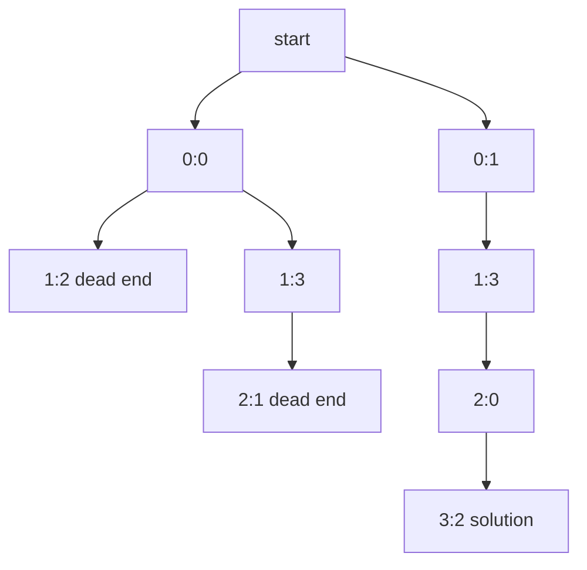

## Introduction

A chess queen attacks every square in its row, its column and both of its diagonals, any distance away. The **N-Queens problem** asks: in how many ways — and in which ways — can you place `n` queens on an `n × n` board so that no two queens attack each other?

For the standard 8 × 8 board there are 92 solutions. For a 4 × 4 board there are exactly two:

```text
. Q . .        . . Q .
. . . Q        Q . . .
Q . . .        . . . Q
. . Q .        . Q . .
```

For 2 × 2 and 3 × 3 there are none, and for every `n` from 4 upward there is at least one.

N-Queens is the textbook example of a **constraint satisfaction problem**: you assign values to variables (a column to each row's queen) subject to constraints (no shared column, no shared diagonal). It looks like a puzzle, but the technique it teaches — make one decision at a time, check constraints immediately, and abandon a partial assignment the moment it breaks a rule — is how Sudoku solvers, timetable schedulers, register allocators and SAT solvers begin. It also shows more clearly than any other problem how much **pruning** can achieve: the naive search space for 8 queens has over four billion boards, and backtracking examines about two thousand partial boards.

This lesson builds on [[a9-permutations]]: you will see that an N-Queens solution is a permutation with an extra rule, and that checking the rule *while* building the permutation, rather than after, is the whole trick.

## Before you start

- **Permutation backtracking** — [[a9-permutations]], especially the `used[]` template. N-Queens is that template with two more `used` arrays.
- **Recursion and undo** — [[a1-recursion]].
- **2D coordinates** — rows and columns of a grid, as in [[a2-matrix]].
- **Bit operations** (only for the bitmask section) — AND, OR, shifts, and `x & -x` for the lowest set bit. See [[a13-bitmasking]].

## From billions of boards to one decision per row

Start with the most naive formulation: choose any `n` of the `n²` squares and check whether the queens attack each other. For n = 8 that is C(64, 8) = 4,426,165,368 candidate boards. Even at a nanosecond each, checking them all takes seconds; for n = 10 it is already hours.

The first insight cuts this enormously. Two queens in the same row attack each other, and there are exactly `n` rows and `n` queens, so **every solution has exactly one queen in each row**. Instead of choosing squares, choose *one column for each row*. That is 8⁸ = 16,777,216 candidates for n = 8.

The second insight: the same argument applies to columns. Every column also holds exactly one queen, so the columns chosen for rows 0 to n − 1 must all be different — they form a **permutation** of `0 … n − 1`. Now there are 8! = 40,320 candidates.

The third insight is what makes it backtracking. Instead of generating complete permutations and then checking diagonals, **check each queen against the ones already placed as soon as it is placed**. If row 2's queen is attacked, nothing placed in rows 3 to 7 can fix that, so the whole subtree below it is skipped. Measured on n = 8, a search that only enforces distinct columns visits 109,601 nodes of its tree; adding the diagonal check at each placement cuts that to 2,057.

| Formulation | Candidates for n = 8 |
|---|---|
| Any 8 squares of 64 | 4,426,165,368 |
| One queen per row | 16,777,216 |
| One per row, distinct columns (permutations) | 40,320 complete boards |
| Backtracking with diagonal checks | 2,057 partial boards visited |

## Detecting diagonal attacks in O(1)

Checking a new queen against every earlier one costs O(n) per placement. A neater way uses the fact that every diagonal can be identified by a single number.

On a "\" diagonal (going down and to the right), each step adds 1 to the row and 1 to the column, so **`row − col` is the same for every square on it**. On a "/" diagonal (going down and to the left), each step adds 1 to the row and subtracts 1 from the column, so **`row + col` is constant**. On a 4 × 4 board:

```text
row - col               row + col
 0 -1 -2 -3              0  1  2  3
 1  0 -1 -2              1  2  3  4
 2  1  0 -1              2  3  4  5
 3  2  1  0              3  4  5  6
```

Squares with the same number share a diagonal. So two queens attack diagonally exactly when their `row − col` values match or their `row + col` values match.

That turns diagonal checks into array lookups. Keep three boolean arrays:

- `colUsed[c]` — some queen is in column `c` (size `n`).
- `diagUsed[row − col + n − 1]` — some queen is on that "\" diagonal. `row − col` ranges from `−(n − 1)` to `n − 1`; adding `n − 1` shifts it into `0 … 2n − 2`, so the array has size `2n − 1`.
- `antiUsed[row + col]` — some queen is on that "/" diagonal. `row + col` ranges from 0 to `2n − 2`, so size `2n − 1`.

A square is safe when all three entries are false, and placing a queen sets all three to true. Rows need no array, because the recursion places exactly one queen per row by construction.

## The algorithm

The recursive method `place(row)` assumes rows `0 … row − 1` already hold non-attacking queens, recorded in the three arrays. Its job is to try every safe column for `row` and, for each, solve the rest.

1. If `row == n`, every row has a queen: record the board.
2. For each column `c` from 0 to `n − 1`: if `c` or either diagonal through `(row, c)` is used, skip it.
3. Otherwise place the queen: record `c` for this row, set the three markers, recurse on `row + 1`, then clear the three markers.

```java title="NQueens.java"
import java.util.ArrayList;
import java.util.Arrays;
import java.util.List;

public class NQueens {

    static int n;
    static int[] queenCol;                       // queenCol[r] = column of the queen in row r
    static boolean[] colUsed, diagUsed, antiUsed;

    static void place(int row, List<List<String>> out) {
        if (row == n) {                          // a queen in every row: a solution
            out.add(render());
            return;
        }
        for (int c = 0; c < n; c++) {
            int d = row - c + n - 1;             // "\" diagonal: row - col is constant
            int a = row + c;                     // "/" diagonal: row + col is constant
            if (colUsed[c] || diagUsed[d] || antiUsed[a]) continue;
            queenCol[row] = c;
            colUsed[c] = diagUsed[d] = antiUsed[a] = true;
            place(row + 1, out);
            colUsed[c] = diagUsed[d] = antiUsed[a] = false;   // undo
        }
    }

    static List<String> render() {
        List<String> board = new ArrayList<>();
        for (int r = 0; r < n; r++) {
            char[] line = new char[n];
            Arrays.fill(line, '.');
            line[queenCol[r]] = 'Q';
            board.add(new String(line));
        }
        return board;
    }

    static List<List<String>> solveNQueens(int size) {
        n = size;
        queenCol = new int[n];
        colUsed = new boolean[n];
        diagUsed = new boolean[2 * n - 1];
        antiUsed = new boolean[2 * n - 1];
        List<List<String>> out = new ArrayList<>();
        place(0, out);
        return out;
    }

    public static void main(String[] args) {
        for (List<String> board : solveNQueens(4)) {
            board.forEach(System.out::println);
            System.out.println();
        }
        System.out.println("n = 8: " + solveNQueens(8).size() + " solutions");
        System.out.println("n = 3: " + solveNQueens(3).size() + " solutions");
    }
}
```

```output
.Q..
...Q
Q...
..Q.

..Q.
Q...
...Q
.Q..

n = 8: 92 solutions
n = 3: 0 solutions
```

The board is stored as `queenCol` — one column per row — rather than as an `n × n` character grid. That has two benefits. Undo needs no board change at all: when row `row` later tries a different column, `queenCol[row]` is simply overwritten. And the full grid of characters is built only in `render`, at the moment a solution is recorded, which is the only time it is needed. The three markers, on the other hand, *must* be cleared after the recursive call, because they are shared with every later branch.

The fields are `static` to keep the method signature short. In code that might be called from several threads, or recursively for different sizes, put them in an object or pass them as parameters instead.

## Dry run on n = 4

Here is every decision the search makes for n = 4 until it finds the first solution. "Attacked" means the column or one of its diagonals is already used.

| Step | Row | Action | Queens placed (row: col) |
|---|---|---|---|
| 1 | 0 | place at col 0 | 0:0 |
| 2 | 1 | cols 0, 1 attacked; place at col 2 | 0:0, 1:2 |
| 3 | 2 | cols 0, 1, 2, 3 all attacked — dead end | 0:0, 1:2 |
| 4 | 1 | remove col 2; place at col 3 | 0:0, 1:3 |
| 5 | 2 | col 0 attacked; place at col 1 | 0:0, 1:3, 2:1 |
| 6 | 3 | all four columns attacked — dead end | 0:0, 1:3, 2:1 |
| 7 | 2 | remove col 1; cols 2, 3 attacked — dead end | 0:0, 1:3 |
| 8 | 1 | remove col 3; no columns left — dead end | 0:0 |
| 9 | 0 | remove col 0; place at col 1 | 0:1 |
| 10 | 1 | cols 0, 1, 2 attacked; place at col 3 | 0:1, 1:3 |
| 11 | 2 | place at col 0 | 0:1, 1:3, 2:0 |
| 12 | 3 | cols 0, 1 attacked; place at col 2 — solution | 0:1, 1:3, 2:0, 3:2 |

Step 3 is the clearest example of pruning. With queens at `(0, 0)` and `(1, 2)`, row 2 is fully attacked: column 0 by the first queen's column, column 1 by the second queen's "/" diagonal (`1 + 2 = 3 = 2 + 1`), column 2 by the second queen's column, and column 3 by the second queen's "\" diagonal (`1 − 2 = −1 = 2 − 3`). The search learns this after placing just two queens and never considers row 3 for that branch. Step 1's choice of column 0 is wrong altogether — no solution has a queen in a corner for n = 4 — and the search proves that after visiting only a handful of nodes.



## Complexity

**Time.** The search tree is a pruned permutation tree, so its size is at most the permutation tree's: fewer than e · n! nodes, with n! as the bound on complete boards. With O(1) conflict checks, each node does O(n) work for its loop, so a safe upper bound is **O(n · n!)**, plus O(n²) to render each of the solutions found. The real count is much smaller because of the diagonal pruning — 2,057 nodes for n = 8 against 109,601 for the unpruned permutation tree — but no simple closed-form formula for the number of nodes is known. Interviewers accept "O(n!) upper bound, much less in practice because of pruning".

**Space.** The recursion is `n` deep, and the arrays use `n + 2(2n − 1)` booleans plus `n` ints, so auxiliary space is **O(n)**. Each recorded board takes O(n²) characters.

The number of solutions grows quickly but irregularly:

| n | 1 | 2 | 3 | 4 | 5 | 6 | 7 | 8 | 9 | 10 | 11 | 12 |
|---|---|---|---|---|---|---|---|---|---|---|---|---|
| Solutions | 1 | 0 | 0 | 2 | 10 | 4 | 40 | 92 | 352 | 724 | 2,680 | 14,200 |

## Counting only: N-Queens II

If the problem asks only for the *number* of solutions, skip building boards: `place` returns 1 when `row == n` and the sum of its children's results otherwise. That removes the O(n²) rendering per solution and all list allocation.

For counting, the fastest simple implementation replaces the three boolean arrays with three integers used as **bitmasks**. Bit `c` of each integer describes column `c` of the *current row*:

- `cols` — bit `c` is set if column `c` already has a queen.
- `diag` — bit `c` is set if a "\" diagonal from an earlier queen passes through column `c` in this row.
- `anti` — bit `c` is set if a "/" diagonal from an earlier queen passes through column `c` in this row.

The free squares of the row are `full & ~(cols | diag | anti)`, where `full` has the lowest `n` bits set. Moving to the next row, every "\" diagonal shifts one column to the right and every "/" diagonal one column to the left, which is a single shift of each mask.

```java title="NQueensBits.java"
public class NQueensBits {

    // cols, diag and anti mark the squares of the current row that are attacked.
    static int count(int n, int cols, int diag, int anti) {
        int full = (1 << n) - 1;
        if (cols == full) return 1;              // every column has a queen
        int total = 0;
        int free = full & ~(cols | diag | anti);
        while (free != 0) {
            int bit = free & -free;              // lowest free square
            free -= bit;
            total += count(n, cols | bit, (diag | bit) << 1, (anti | bit) >> 1);
        }
        return total;
    }

    public static void main(String[] args) {
        StringBuilder sb = new StringBuilder();
        for (int n = 1; n <= 12; n++) {
            sb.append(n).append(':').append(count(n, 0, 0, 0)).append(' ');
        }
        System.out.println(sb.toString().trim());
    }
}
```

```output
1:1 2:0 3:0 4:2 5:10 6:4 7:40 8:92 9:352 10:724 11:2680 12:14200
```

`free & -free` isolates the lowest set bit: in two's complement, `-free` flips every bit above the lowest 1, so the AND leaves only that bit. Subtracting it from `free` removes that square from the candidates. The recursion stops when all `n` columns are filled. Bits shifted beyond column `n − 1` by `<< 1` are harmless because `full &` discards them, and bits shifted below column 0 by `>> 1` simply disappear.

Instead of looping over all `n` columns and testing each, the loop visits only the free ones, and every check is a handful of CPU instructions with no memory access. The algorithm is the same; the constant factor is much smaller. It is the version competitive programmers use, and a good one to mention as a follow-up in interviews.

```quiz
Q: Two queens are at (2, 5) and (6, 1) on a 0-indexed board. Do they attack each other?
- [ ] No, they are in different rows and columns
- [x] Yes, they share a "/" diagonal because 2 + 5 = 6 + 1
- [ ] Yes, they share a "\" diagonal because 2 − 5 = 6 − 1
- [ ] Only if there is no piece between them
> row + col is 7 for both, so they lie on the same "/" diagonal. row − col is −3 and 5, so they are not on the same "\" diagonal. Queens attack along a diagonal at any distance, and N-Queens has no other pieces to block them.

Q: Why does the diagonal array for `row − col` have size 2n − 1 and use the index `row − col + n − 1`?
- [ ] To leave room for a sentinel value
- [x] row − col ranges from −(n − 1) to n − 1, which is 2n − 1 values, and adding n − 1 shifts them to 0 … 2n − 2
- [ ] Because each diagonal needs two entries, one per direction
- [ ] It is a performance trick; size n would also work
> Java arrays cannot have negative indices, so the range −(n−1) … (n−1) is shifted by n − 1. With size n, many diagonals would share an index or go out of bounds, giving wrong answers or exceptions.
```

## Symmetry and very large boards

The board's mirror symmetry halves the counting work. Reflecting any solution left to right gives another solution, and the two have their row-0 queens in mirrored columns. So you can count only the solutions whose first queen is in the left half of row 0 and double the result. When `n` is odd, the middle column of row 0 is its own mirror; count those solutions separately and add them once. Exploiting rotations as well is possible but more intricate.

For finding **one** solution on a large board, backtracking is the wrong tool. Explicit constructions are known that write down a valid placement for every `n ≥ 4` in O(n) time, and local-search heuristics such as **min-conflicts** — start with one queen per row, then repeatedly move a queen that is under attack to the least-attacked square in its row — find solutions for very large boards quickly in practice. Counting all solutions, by contrast, has no known shortcut, which is why exact counts are only known up to roughly n = 27, obtained with massive parallel computation.

## How it works internally

The three arrays (or three masks) are the **constraint state**: a compact summary of everything the placed queens forbid. The key property that makes O(1) checks possible is that each constraint is about a single *line* — a column or a diagonal — and each line can be named by one integer. When constraints have that shape, a `used` array per family of lines replaces scanning earlier choices.

Compare that with [[a9-permutations]]. Its `used[]` array is exactly `colUsed` here; N-Queens adds two more `used` arrays for the diagonal families. That is the general pattern in [[a9-constraint-backtracking]]: each kind of constraint gets a structure that can be checked and updated in O(1), and every update is undone on the way back. Sudoku uses one structure per row, column and 3 × 3 box; graph colouring ([[a8-graph-coloring]]) checks the colours of a vertex's neighbours.

## In real systems

**Constraint solvers.** Industrial constraint-programming and SAT solvers use backtracking with immediate constraint checks at their core, extended with propagation (removing values that are now impossible for future variables) and learning from conflicts. N-Queens is a standard benchmark for them.

**Scheduling and allocation.** Assigning exams to time slots so that no student has two at once, or assigning frequencies to transmitters so that neighbours do not interfere, are constraint problems of the same shape: one variable per item, a set of mutual exclusions, and a search that rejects a partial assignment as soon as it conflicts.

**Teaching and testing search engines.** Because its solution counts are known exactly, N-Queens is used to check that new search implementations — parallel, GPU or bit-parallel — are correct before they are trusted on problems with unknown answers.

## Trade-offs and alternatives

| Approach | Finds | Cost | Use when |
|---|---|---|---|
| Backtracking with boolean arrays | all solutions (boards) | pruned O(n!) | interviews; listing boards |
| Bitmask backtracking | count (or boards) | same tree, much smaller constant | counting; competitive programming |
| Bitmask plus mirror symmetry | count | about half the tree | larger exact counts |
| Explicit construction | one solution | O(n) | any n ≥ 4, one answer needed |
| Min-conflicts local search | one solution | fast in practice, no guarantee | very large n, one answer needed |

## Common mistakes

> [!MISTAKE] Checking only one diagonal direction
> A queen attacks along both diagonals. Tracking only `row − col` misses "/" attacks, and the program prints boards with queens attacking each other. Always keep two diagonal structures.

**Negative indices.** Using `row − col` directly as an array index throws `ArrayIndexOutOfBoundsException` when `col > row`. Offset by `n − 1`.

**Forgetting to clear a marker.** Clearing `colUsed[c]` but not a diagonal marker leaves that diagonal blocked for every later branch, and solutions go missing — often only for larger `n`, which makes the bug hard to spot. Set and clear all three together, ideally on the same line.

**Rebuilding the board for every node.** Keeping a `char[][]` and copying it at each step adds O(n²) per node. Store one column per row and render only at solutions.

**Shifting the bitmasks the wrong way.** If both diagonal masks shift the same direction, the search treats one diagonal family as the other. Verify against the known counts (2 for n = 4, 92 for n = 8).

## Interview perspective

N-Queens is asked to see whether you can design a backtracking search from scratch rather than recall one. The strongest answers start from the constraints, derive the one-per-row decision, and explain the diagonal identities before writing code.

> [!INTERVIEW] A strong walkthrough
> "Each row must hold exactly one queen, so I'll place one queen per row and choose its column. A column is safe if it isn't used and neither diagonal is used; squares on a down-right diagonal share `row − col` and on a down-left diagonal share `row + col`, so three boolean arrays give O(1) checks. I set the three markers, recurse to the next row, and clear them afterwards. The tree is bounded by n! leaves and pruning cuts it much further; space is O(n)."

Questions to prepare:

- **Why one queen per row?** n queens, n rows, and two queens in a row attack each other — so the row of each queen is fixed and only the column is a choice.
- **How do you check diagonals in O(1)?** `row − col` and `row + col` constants with offset arrays.
- **N-Queens II?** Return counts instead of boards; mention the bitmask version.
- **What is the time complexity?** O(n!) upper bound (permutations of columns), with heavy pruning; say honestly that the exact node count has no simple formula.
- **Follow-up: find one solution for n = 1,000,000.** Not by backtracking — use an explicit construction or min-conflicts.

## Practice

1. **N-Queens.** Implement the board-listing version from scratch, without looking, and check n = 4 and n = 8.
2. **N-Queens II.** Return only the count with boolean arrays, then rewrite with bitmasks and compare running times for n = 12.
3. **Instrument the search.** Count nodes with and without the diagonal check for n = 8 and confirm the figures in this lesson.
4. **Symmetry.** Add the mirror-symmetry trick to the bitmask counter and handle odd `n` correctly.
5. **Check a board.** Given a board as strings, decide in O(n²) whether it is a valid N-Queens solution using the same three markers.
6. **Sudoku Solver.** Apply the same idea — one structure per constraint family, set and clear on the way in and out — to a 9 × 9 Sudoku. See [[a9-constraint-backtracking]].

The DSA explorer lists matching problems under this topic; start with *N-Queens* and *N-Queens II*.

## Quick revision {#quick-revision}

- One queen per row; recursion decides the column for row `row`; success at `row == n`.
- Safe square: column unused, `row − col` diagonal unused, `row + col` anti-diagonal unused.
- Arrays: `colUsed[n]`, `diagUsed[2n − 1]` indexed `row − col + n − 1`, `antiUsed[2n − 1]` indexed `row + col`.
- Set all three markers before recursing; clear all three after.
- Store `queenCol[row]`; render the board only when recording a solution.
- Time: O(n!) upper bound, heavy pruning (n = 8: 2,057 nodes vs 109,601 without diagonal checks). Space O(n).
- Counts: n = 4 → 2, 6 → 4, 8 → 92, 10 → 724; n = 2, 3 → 0.
- Bitmask: `free = full & ~(cols | diag | anti)`; `bit = free & -free`; recurse with `cols | bit`, `(diag | bit) << 1`, `(anti | bit) >> 1`.
- One solution for huge n: explicit construction or min-conflicts, not backtracking.

## Key takeaways {#key-takeaways}

- N-Queens is a permutation of columns with diagonal constraints, and checking those constraints at each placement is what makes the search feasible.
- Every diagonal is identified by `row − col` or `row + col`, which turns conflict checks into O(1) array or bit lookups.
- Each constraint family gets its own marker structure, and every marker set before recursing must be cleared after.
- Pruning changes the practical cost by orders of magnitude even though the worst-case bound stays factorial.
- The same design — one decision per variable, constant-time constraint checks, immediate rejection — carries over directly to Sudoku, graph colouring and scheduling.
