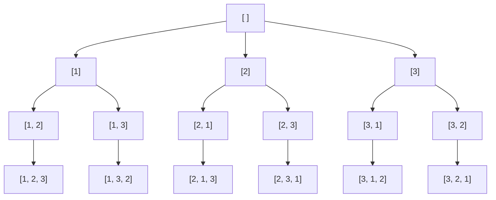

## Introduction

A delivery driver has four stops to make and wants the shortest route that visits all of them. One honest way to find it is to try every order of the stops, add up the distance of each route and keep the best. How many orders are there? Any of the 4 stops can come first; then any of the remaining 3; then either of the last 2; then the final one. That is 4 × 3 × 2 × 1 = 24 routes.

Each of those orders is a **permutation**: an arrangement of all the elements of a collection in a sequence, where the *order matters*. `[1, 2, 3]` and `[3, 1, 2]` contain the same numbers, but they are different permutations. The number of permutations of `n` distinct elements is `n × (n − 1) × … × 1`, written **n!** ("n factorial").

Generating permutations is the second core backtracking problem, after [[a9-subsets]]. It uses the same choose–recurse–undo rhythm, but the decision at each step changes from "is this element in or out?" to "**which of the remaining elements goes in the next position?**". That change is enough to turn 2ⁿ results into n!, which grows much faster: 10 elements have 1,024 subsets but 3,628,800 permutations.

You will need permutations whenever a problem asks for every ordering — anagrams of a word, every possible schedule of a few jobs, every route through a few cities — and as the starting point for problems that search orderings with rules attached, such as [[a9-n-queens]], which is a permutation of column positions with a diagonal rule on top. This lesson also covers two techniques that avoid generating everything: stepping from one permutation to the next in sorted order, and computing the k-th permutation directly.

## Before you start

- **The subsets lesson** — [[a9-subsets]] introduces the shared `path`, copying on save and undoing after the recursive call. This lesson reuses all three without re-explaining them.
- **Recursion** — base cases and the call stack, from [[a1-recursion]].
- **Arrays and `ArrayList`** — indexing, swapping two elements, `add` and `remove`. See [[a1-arraylist]].
- **Factorials** — n! = n × (n − 1) × … × 1, with 0! = 1. Nothing else from combinatorics is needed.

## The intuition: filling seats

Think of `n` numbered seats in a row and `n` people waiting. You seat people from left to right. For seat 0 you may choose anyone. For seat 1 you may choose anyone *not already seated*. You continue until every seat is filled — that is one permutation. Then you go back: unseat the last person, try someone else in that seat, and when you have tried everyone for a seat, unseat the person before it too and try the next choice there.

The rules of this process translate directly into code:

- **The state** is the sequence of people seated so far (`path`) and who is already seated (`used`).
- **The decision** at each step is who sits in the next seat; the options are everyone not yet used.
- **The base case** is "all seats filled": record the arrangement.
- **The undo** is unseating the person you just seated, so the next option starts from the same state.

The difference from subsets is in the options. In the subsets loop-from-start template, after choosing index `j` you only look at indices *after* `j`, which is what stopped `[3, 1]` from appearing as a separate answer from `[1, 3]`. Here `[3, 1]` and `[1, 3]` *are* different answers, so after seating person 3 you must be allowed to seat person 1. The loop therefore always starts from index 0, and a `used` array is what stops anyone from being seated twice.



The root has 3 children, each of those has 2, and each of those has 1. The number of leaves is 3 × 2 × 1 = 6 = 3!, which is the counting argument for n! drawn as a tree.

## The used[] approach

```java title="Permutations.java"
import java.util.ArrayList;
import java.util.List;

public class Permutations {

    static void build(int[] nums, boolean[] used, List<Integer> path,
                      List<List<Integer>> out) {
        if (path.size() == nums.length) {       // every position is filled
            out.add(new ArrayList<>(path));
            return;
        }
        for (int i = 0; i < nums.length; i++) {
            if (used[i]) continue;               // already placed earlier on this path
            used[i] = true;                      // choose nums[i] for the next position
            path.add(nums[i]);
            build(nums, used, path, out);        // fill the remaining positions
            path.remove(path.size() - 1);        // undo in reverse order
            used[i] = false;
        }
    }

    static List<List<Integer>> permute(int[] nums) {
        List<List<Integer>> out = new ArrayList<>();
        build(nums, new boolean[nums.length], new ArrayList<>(), out);
        return out;
    }

    public static void main(String[] args) {
        System.out.println(permute(new int[]{1, 2, 3}));
        System.out.println(permute(new int[]{7}));
        System.out.println(permute(new int[0]));
    }
}
```

```output
[[1, 2, 3], [1, 3, 2], [2, 1, 3], [2, 3, 1], [3, 1, 2], [3, 2, 1]]
[[7]]
[[]]
```

The invariant for each call is: **`path` holds the values placed in positions `0 … path.size() − 1`, and `used[i]` is true exactly when index `i` is one of them.** Every line keeps it true. Before recursing, the method marks `i` and appends `nums[i]` — both halves of the invariant updated together. After the recursive call returns, it removes the value and clears the mark, so the loop's next iteration starts from the state the call was entered with. The undo happens in reverse order of the choose, which is a good habit: when several pieces of state change together, restoring them in reverse avoids subtle ordering bugs.

The `used` array tracks *indices*, not values. That is deliberate: if the input contained two equal values, tracking values would wrongly treat them as one. Duplicates get their own treatment later.

The edge cases fall out naturally. A single element produces one permutation. An empty array produces one permutation — the empty sequence — because `path.size() == 0 == nums.length` on the first call. That matches the mathematics (0! = 1), and it is what most problem statements expect; check the statement, because a few ask for an empty list instead.

### Dry run

The first eight events of `permute([1, 2, 3])`, in order:

| Step | Depth | `path` after the step | `used` (indices) | What happened |
|---|---|---|---|---|
| 1 | 0 | `[1]` | {0} | loop at `i = 0` places 1 |
| 2 | 1 | `[1, 2]` | {0, 1} | `i = 0` is used, skip; `i = 1` places 2 |
| 3 | 2 | `[1, 2, 3]` | {0, 1, 2} | `i = 2` places 3 |
| 4 | 3 | `[1, 2, 3]` | {0, 1, 2} | full: record `[1, 2, 3]` |
| 5 | 2 | `[1, 2]` | {0, 1} | undo 3; depth-2 loop ends |
| 6 | 1 | `[1, 3]` | {0, 2} | undo 2; `i = 2` places 3 |
| 7 | 2 | `[1, 3, 2]` | {0, 1, 2} | `i = 1` places 2; next call records `[1, 3, 2]` |
| 8 | 0 | `[2]` | {1} | everything under 1 is done; undo 1; `i = 1` places 2 |

Because each loop tries indices from left to right, permutations of a *sorted* input come out in lexicographic (dictionary) order, as the output shows.

## Complexity

**Time.** Count the nodes in the recursion tree. Depth `k` has n × (n − 1) × … × (n − k + 1) = n!/(n − k)! nodes — the number of ways to fill the first `k` positions. Adding over all depths:

n!/n! + n!/(n − 1)! + … + n!/0! = n! × (1/0! + 1/1! + … + 1/n!)

The bracket is the start of the series for the number e ≈ 2.718, so the tree has fewer than e · n! nodes. Instrumenting the code above confirms it: for n = 3 there are 16 calls, and for n = 10 there are 9,864,101 calls, against 10! = 3,628,800 leaves.

Each call runs a loop of `n` iterations (most of them skipping used indices), and each of the n! leaves copies a path of length `n`. Both terms are O(n · n!), so the running time is **Θ(n · n!)**. As with subsets, the n · n! numbers in the output make this optimal for any method that returns every permutation.

**Space.** The recursion is `n` levels deep, `path` holds at most `n` values and `used` has `n` booleans, so auxiliary space is **O(n)**. The output needs Θ(n · n!).

Factorials grow brutally:

| n | n! | Practical? |
|---|---|---|
| 8 | 40,320 | instant |
| 10 | 3,628,800 | about a second in Java, if stored |
| 12 | 479,001,600 | too many to store |
| 15 | about 1.3 × 10¹² | impossible to enumerate |

So "generate all permutations" is a tool for n up to about 10. Beyond that, a problem that looks like "try every ordering" needs pruning, dynamic programming (for example over subsets, as in [[a8-traveling-salesman]]), or a greedy argument.

## The swap approach

The second classic method avoids both `path` and `used` by permuting the array **in place**. Treat the array as two parts: positions `0 … i − 1` are already fixed, and positions `i … n − 1` hold the elements not yet placed. To fill position `i`, swap each candidate `nums[j]` (for `j ≥ i`) into position `i`, recurse on `i + 1`, and swap it back.

```java title="PermuteSwap.java"
import java.util.ArrayList;
import java.util.List;

public class PermuteSwap {

    // Positions 0..i-1 are fixed; any element in nums[i..] may go to position i.
    static void build(int[] nums, int i, List<List<Integer>> out) {
        if (i == nums.length) {
            List<Integer> copy = new ArrayList<>();
            for (int x : nums) copy.add(x);
            out.add(copy);
            return;
        }
        for (int j = i; j < nums.length; j++) {
            swap(nums, i, j);                    // bring nums[j] to position i
            build(nums, i + 1, out);
            swap(nums, i, j);                    // put it back before trying the next j
        }
    }

    static void swap(int[] a, int i, int j) {
        int t = a[i]; a[i] = a[j]; a[j] = t;
    }

    public static void main(String[] args) {
        List<List<Integer>> out = new ArrayList<>();
        int[] nums = {1, 2, 3};
        build(nums, 0, out);
        System.out.println(out);
        System.out.println(java.util.Arrays.toString(nums)); // restored
    }
}
```

```output
[[1, 2, 3], [1, 3, 2], [2, 1, 3], [2, 3, 1], [3, 2, 1], [3, 1, 2]]
[1, 2, 3]
```

The suffix `nums[i..]` plays the role of the "unused" set, so no `used` array is needed, and the loop at depth `i` has only `n − i` iterations instead of `n`. The swap back is the undo: it restores the suffix to the order the call received, so the next `j` swaps the correct element into place. The final line of output shows the array is back to `[1, 2, 3]`, which is how you check that every swap was undone.

Look closely at the last two results: `[3, 2, 1]` comes before `[3, 1, 2]`. Swapping position 0 with position 2 turns `[1, 2, 3]` into `[3, 2, 1]`, so the remaining suffix is `[2, 1]`, not the sorted `[1, 2]`. The swap method therefore **does not produce lexicographic order**. If a problem needs sorted output, use the `used[]` method on sorted input, or [next permutation](#next-permutation-without-recursion).

| | `used[]` + `path` | In-place swap |
|---|---|---|
| Extra state | `boolean[n]` and a list | none beyond the array |
| Loop length at depth `i` | `n` (skips used) | `n − i` |
| Order of output | lexicographic if input is sorted | not lexicographic |
| Handles duplicates | sort + skip rule | per-level `HashSet` of values tried |
| Modifies input | no | yes, temporarily |

Both are Θ(n · n!). Prefer `used[]` when you need sorted order or the duplicate rule below; prefer swapping when memory is tight or you are permuting a large object array where copying into a `path` is undesirable.

## Inputs with repeated values

For `[1, 1, 2]`, the methods above produce six results, but only three are different: `[1, 1, 2]`, `[1, 2, 1]` and `[2, 1, 1]`. The extras come from swapping the two `1`s, which changes indices but not the sequence of values. In general, if a value appears `c` times, every distinct arrangement is generated c! times, so filtering afterwards with a set wastes work that can be enormous.

The fix is to decide, in advance, **one canonical order in which equal values must be used**, and to forbid every other order. With the input sorted, the natural rule is: copies of the same value are placed left to right by index — the copy at index `i` may be used only if the copy at index `i − 1` has already been used.

```java title="PermutationsWithDup.java"
import java.util.ArrayList;
import java.util.Arrays;
import java.util.List;

public class PermutationsWithDup {

    static void build(int[] nums, boolean[] used, List<Integer> path,
                      List<List<Integer>> out) {
        if (path.size() == nums.length) {
            out.add(new ArrayList<>(path));
            return;
        }
        for (int i = 0; i < nums.length; i++) {
            if (used[i]) continue;
            // Equal values must be used left to right. If the previous copy is unused,
            // it was already tried in this position and then released: skip.
            if (i > 0 && nums[i] == nums[i - 1] && !used[i - 1]) continue;
            used[i] = true;
            path.add(nums[i]);
            build(nums, used, path, out);
            path.remove(path.size() - 1);
            used[i] = false;
        }
    }

    static List<List<Integer>> permuteUnique(int[] nums) {
        int[] sorted = nums.clone();
        Arrays.sort(sorted);
        List<List<Integer>> out = new ArrayList<>();
        build(sorted, new boolean[sorted.length], new ArrayList<>(), out);
        return out;
    }

    public static void main(String[] args) {
        System.out.println(permuteUnique(new int[]{1, 2, 1}));
        System.out.println(permuteUnique(new int[]{2, 2, 2}).size());
    }
}
```

```output
[[1, 1, 2], [1, 2, 1], [2, 1, 1]]
1
```

Read the skip condition as two cases. If `used[i - 1]` is **true**, the previous copy is already placed in an earlier position, so placing this copy now respects the left-to-right order — allowed. If `used[i - 1]` is **false**, then either the previous copy was just tried in *this same position* by an earlier iteration of this loop (and released by its undo), or it will be placed later — either way, placing copy `i` now would either repeat work or break the canonical order. Skip.

The rule needs sorted input, because "the previous copy" is found by looking at `nums[i - 1]`. And it uses `!used[i - 1]` deliberately. You will see solutions that use `used[i - 1]` (without the `!`). That version also produces each distinct permutation exactly once — it forces equal values to be used *right to left* instead — but it discovers violations much later. Counting calls makes the difference visible:

| Input | Distinct permutations | Calls with `!used[i - 1]` | Calls with `used[i - 1]` |
|---|---|---|---|
| `[1, 1, 1, 2, 2]` | 10 | 34 | 99 |
| eight `1`s | 1 | 9 | 2,781 |

With `!used[i - 1]`, a wrong choice is rejected at the level where it is made. With `used[i - 1]`, the search happily places later copies first and only dies several levels down when the earlier copies cannot be placed. Use `!used[i - 1]` and be able to say why.

For the swap method, the equivalent rule is local to one call: keep a `HashSet<Integer>` of values already swapped into position `i` during this call's loop, and skip a `j` whose value is in the set. Sorting does not help the swap method, because the swaps disturb the suffix's order.

```quiz
Q: How many distinct permutations does the multiset `[a, a, b, b, b]` have?
- [ ] 120
- [ ] 20
- [x] 10
- [ ] 5
> 5! = 120 orderings of positions, but swapping the two a's (2! ways) or the three b's (3! ways) gives the same sequence, so each distinct sequence is counted 2! × 3! = 12 times. 120 / 12 = 10.

Q: In Permutations II, why skip `nums[i]` when `nums[i] == nums[i - 1]` and `!used[i - 1]`?
- [ ] Because the previous copy has already been placed at an earlier position
- [x] Because the previous equal copy is free, so it was just tried in this same position (or must be placed first); using this copy here would duplicate that work
- [ ] Because sorting puts equal values next to each other, which is not allowed in a permutation
- [ ] To keep the output in reverse lexicographic order
> When the previous copy is unused in the middle of the loop, the earlier iteration already placed it here and released it. Placing an equal value at the same position again repeats the same subtree. When the previous copy is used, it sits at an earlier position, so placing this copy is the canonical left-to-right order and is allowed.
```

## Next permutation without recursion

Sometimes you need permutations one at a time in sorted order — to process them as a stream, to resume from a given arrangement, or to answer "what comes after this ordering?" (a common interview question in its own right). The **next permutation** algorithm rearranges an array into the next larger ordering in place, with no recursion and no extra memory.

Think about how numbers count upward. To get from `1299` to the next number with the same digits, you leave the longest possible prefix alone and change only the end. The same idea works for orderings:

1. Scan from the right for the first position `i` where `a[i] < a[i + 1]`. Everything to the right of `i` is non-increasing, which means that suffix is already at its *largest* arrangement; no rearrangement of it alone can make the array larger. Position `i` is the **pivot**.
2. If there is no such `i`, the whole array is non-increasing — the last permutation. Reverse it to wrap around to the first.
3. Otherwise, find the rightmost `j > i` with `a[j] > a[i]`: the smallest value in the suffix that is still larger than the pivot. Swap `a[i]` and `a[j]`. The prefix is now as small as it can be while still being larger than before.
4. The suffix is still non-increasing after the swap. Reverse it to make it non-decreasing, its *smallest* arrangement.

```java title="NextPermutation.java"
import java.util.Arrays;

public class NextPermutation {

    // Rearranges a into the next larger ordering; returns false (and sorts a
    // ascending) if a was already the largest.
    static boolean next(int[] a) {
        int i = a.length - 2;
        while (i >= 0 && a[i] >= a[i + 1]) i--;  // find the pivot: last a[i] < a[i+1]
        if (i < 0) {                             // whole array non-increasing
            reverse(a, 0, a.length - 1);
            return false;
        }
        int j = a.length - 1;
        while (a[j] <= a[i]) j--;                // rightmost element larger than pivot
        swap(a, i, j);
        reverse(a, i + 1, a.length - 1);         // suffix becomes its smallest order
        return true;
    }

    static void swap(int[] a, int i, int j) { int t = a[i]; a[i] = a[j]; a[j] = t; }

    static void reverse(int[] a, int lo, int hi) {
        while (lo < hi) swap(a, lo++, hi--);
    }

    public static void main(String[] args) {
        int[] a = {1, 2, 2, 3};
        int count = 0;
        do {
            System.out.print(Arrays.toString(a) + " ");
            count++;
        } while (next(a));
        System.out.println();
        System.out.println(count + " distinct orderings");

        int[] b = {1, 5, 8, 4, 7, 6, 5, 3, 1};
        next(b);
        System.out.println(Arrays.toString(b));
    }
}
```

```output
[1, 2, 2, 3] [1, 2, 3, 2] [1, 3, 2, 2] [2, 1, 2, 3] [2, 1, 3, 2] [2, 2, 1, 3] [2, 2, 3, 1] [2, 3, 1, 2] [2, 3, 2, 1] [3, 1, 2, 2] [3, 2, 1, 2] [3, 2, 2, 1] 
12 distinct orderings
[1, 5, 8, 5, 1, 3, 4, 6, 7]
```

Trace the second example. In `[1, 5, 8, 4, 7, 6, 5, 3, 1]`, scanning from the right, `1 ≤ 3 ≤ 5 ≤ 6 ≤ 7` but `4 < 7`, so the pivot is the `4` at index 3. The rightmost suffix value greater than 4 is the `5` at index 6. Swapping gives `[1, 5, 8, 5, 7, 6, 4, 3, 1]`, and reversing the suffix after index 3 gives `[1, 5, 8, 5, 1, 3, 4, 6, 7]`.

Two properties make this algorithm useful. It handles **duplicates for free**: the comparisons `>=` and `<=` skip over equal values, so `[1, 2, 2, 3]` produces exactly 4!/2! = 12 distinct orderings with no extra rule. And each step is O(n) time and O(1) space, so starting from the sorted array and calling it repeatedly lists every distinct permutation in Θ(n · number of permutations) time. C++ provides this as `std::next_permutation`; Java's standard library has no equivalent, so you write it yourself.

## The k-th permutation directly

"Return the 1,000,000th permutation of the digits 0–9" can be answered without generating the first 999,999. The idea is to count blocks. Among the permutations of `[1, 2, 3, 4]` in sorted order, the first 3! = 6 start with 1, the next 6 start with 2, and so on. So to find the 9th (1-based), convert to a 0-based rank 8: 8 / 6 = 1, meaning the first digit is the element at index 1 of `[1, 2, 3, 4]`, which is 2. The rank within that block is 8 mod 6 = 2, and the problem repeats on `[1, 3, 4]` with blocks of size 2! = 2: 2 / 2 = 1 picks 3, leaving rank 0 on `[1, 4]`, which picks 1 and then 4. The answer is `2314`.

This is the **factorial number system**: writing the rank as a sum of digit × factorial values, each digit telling you which remaining element to take.

```java title="KthPermutation.java"
import java.util.ArrayList;
import java.util.List;

public class KthPermutation {

    // k is 1-based; returns the k-th permutation of 1..n in lexicographic order.
    static String kth(int n, int k) {
        List<Integer> digits = new ArrayList<>();
        int[] fact = new int[n + 1];
        fact[0] = 1;
        for (int i = 1; i <= n; i++) {
            digits.add(i);
            fact[i] = fact[i - 1] * i;           // n <= 12 keeps n! inside int
        }
        k--;                                      // convert to 0-based rank
        StringBuilder sb = new StringBuilder();
        for (int pos = n; pos >= 1; pos--) {
            int block = fact[pos - 1];           // permutations per choice of first digit
            int idx = k / block;
            sb.append(digits.remove(idx));
            k %= block;
        }
        return sb.toString();
    }

    public static void main(String[] args) {
        System.out.println(kth(3, 3));
        System.out.println(kth(4, 9));
        System.out.println(kth(4, 24));
    }
}
```

```output
213
2314
4321
```

Each of the `n` steps removes one element from an `ArrayList`, which costs O(n), so the method is O(n²) — trivial for any `n` where n! fits in a `long` (n ≤ 20). Here `digits.remove(idx)` is called with an `int`, so it removes by *position* and returns the removed value, which is exactly what is wanted. A Fenwick tree ([[a12-fenwick]]) can find the idx-th remaining element in O(log n), giving O(n log n), but that only matters for very large `n` where the rank is held as a big number.

## In real systems

**Exact solutions to small routing problems.** Route planners for a handful of stops — a technician's day, a pick path in a warehouse aisle — can afford to try every order. Beyond about ten stops the n! growth forces dynamic programming over subsets (the Held–Karp algorithm, O(n² · 2ⁿ)) or heuristics. The traveling salesman discussion in [[a8-traveling-salesman]] picks up from here.

**Puzzle and constraint solvers.** Cryptarithmetic puzzles such as SEND + MORE = MONEY assign distinct digits to letters — a partial permutation of the ten digits — and backtracking with pruning solves them by rejecting partial assignments as soon as a column's arithmetic fails.

**Library generators.** Python's `itertools.permutations` yields permutations lazily, one at a time, in lexicographic order of input positions, so a program can stop early without materialising n! lists. When you need the same in Java, a next-permutation loop gives you lazy generation in O(1) extra space.

**Testing for order dependence.** Bugs that only appear when operations run in a particular order — initialisation order, message order, test order — are found by running permutations of the order. Exhaustive permutation is feasible only for a few operations, which is why tools usually sample random orders instead.

## Trade-offs and alternatives

| Technique | Time | Extra space | Output order | Use when |
|---|---|---|---|---|
| Backtracking with `used[]` | Θ(n · n!) | O(n) | lexicographic on sorted input | you need all permutations, duplicates handled, or pruning by position |
| Backtracking by swapping | Θ(n · n!) | O(1) beyond stack | not sorted | memory is tight, order does not matter |
| Next permutation loop | O(n) per step | O(1) | lexicographic, duplicates skipped | streaming, resuming, "next arrangement" questions |
| k-th permutation | O(n²) | O(n) | — | one specific rank is wanted |
| Heap's algorithm | O(1) swaps per step, amortised | O(n) | not sorted | each permutation must differ from the previous by one swap |

The main limitation of every method is the n! output. If the question asks for a count, an optimum or an existence answer, look for structure — a formula, a DP, a greedy argument — before enumerating.

## Common mistakes

> [!MISTAKE] Using the subsets loop for permutations
> Starting the loop at `start` and recursing with `j + 1` generates each *set* once in one order, so it produces subsets or combinations, not permutations. For permutations the loop must consider every unused element at every position, so it starts at 0 (with `used[]`) or at the current position (with swapping).

**Undoing only half the state.** Removing from `path` but forgetting `used[i] = false` marks the element as permanently taken, so it never appears again in later branches and most permutations are lost.

**Forgetting to swap back.** In the swap method, the second `swap(nums, i, j)` restores the suffix. Without it, later iterations swap the wrong elements in, producing repeated permutations and missing others.

**Applying the duplicate rule to unsorted input.** `nums[i] == nums[i - 1]` only detects equal values that are neighbours. Sort first.

**Expecting the swap method to produce sorted output.** It does not; the final branch of `[1, 2, 3]` produces `[3, 2, 1]` before `[3, 1, 2]`. Sort the result or use a different method if order matters.

**Overflowing factorials.** 13! = 6,227,020,800 does not fit in an `int`, and 21! does not fit in a `long`. Choose the type based on the largest `n` you support.

## Interview perspective

Interviewers use permutations to check that you can adapt the backtracking skeleton rather than recite it. A strong candidate explains why the subsets template does not work, picks a way to track used elements, and handles duplicates with a rule they can justify.

> [!INTERVIEW] Explaining Permutations II
> "I sort so equal values are adjacent. Then I require equal values to be placed in their original left-to-right order: index `i` can be placed only if index `i − 1` with the same value is already placed. If it isn't, that copy was just tried in this slot, so this copy would repeat the same subtree."

Questions to prepare:

- **How many permutations, and what is the time complexity?** n! results; Θ(n · n!) because each is copied, and the tree has fewer than e · n! nodes.
- **Two ways to implement it?** `used[]` with a path, or in-place swapping; know the difference in output order.
- **Duplicates?** Sort plus `!used[i − 1]` skip, or a per-level set in the swap version.
- **Next Permutation.** Find the pivot from the right, swap with the rightmost larger element, reverse the suffix — O(n) time, O(1) space. Be ready to explain *why* the suffix is reversed rather than sorted: it is already in non-increasing order, so reversing sorts it in O(n).
- **Permutation Sequence (k-th).** Factorial number system, O(n²).
- **Follow-up: permutations of length k only?** Stop at `path.size() == k`; there are n!/(n − k)! of them.

## Practice

1. **Permutations.** Write the `used[]` version from memory, then the swap version, and compare their output order on `[1, 2, 3]`.
2. **Permutations II.** Handle `[3, 3, 0, 3]`. Predict the count first (4!/3! = 4).
3. **Next Permutation.** Implement it in place and test it on `[3, 2, 1]`, `[1, 1, 5]` and `[1, 3, 2]`.
4. **Permutation Sequence.** Return the k-th permutation of `1..n` for `n = 9`, `k = 362880` (the last one).
5. **Beautiful Arrangement.** Count permutations of `1..n` where, at every 1-based position `p`, the value is divisible by `p` or `p` divides the value. Check the rule *when placing* each value so invalid prefixes are never extended.
6. **Letter Tile Possibilities.** Count every non-empty sequence that can be formed from the tiles `"AAB"` (answer: 8). This mixes permutations with choosing a length.

The DSA explorer lists matching problems under this topic; start with *Permutations*, *Permutations II* and *Next Permutation*.

## Quick revision {#quick-revision}

- n distinct elements have **n!** orderings; a multiset has n! / (c₁! · c₂! · …) distinct ones.
- `used[]` template: loop `i` from 0; skip used; mark, add, recurse, remove, unmark. Record when `path.size() == n`.
- Swap template: for `j` in `[i, n)`: swap(i, j), recurse `i + 1`, swap back. Output is not lexicographic.
- Time Θ(n · n!); recursion tree has fewer than e · n! nodes. Space O(n) besides output.
- Practical limit ≈ n = 10 for listing all.
- Duplicates: sort; `if (i > 0 && nums[i] == nums[i-1] && !used[i-1]) continue;` (`used[i-1]` also works but prunes far later).
- Next permutation: pivot = last `i` with `a[i] < a[i+1]`; swap with rightmost `a[j] > a[i]`; reverse `a[i+1..]`. O(n), handles duplicates.
- k-th permutation: rank `k − 1` in the factorial number system; block size (n − 1)!, O(n²).

## Key takeaways {#key-takeaways}

- A permutation fills positions one by one; the options at each position are the elements not used yet, which is why the loop restarts from the beginning rather than from a start index.
- Backtracking keeps the `used` marks and the `path` consistent by changing them together and undoing them together in reverse order.
- The cost is Θ(n · n!), which is optimal for listing them all but limits exhaustive generation to about ten elements.
- Repeated values are handled by fixing a canonical order for equal copies and rejecting any choice that breaks it at the level where it is made.
- Next permutation and k-th permutation answer ordering questions in O(n) and O(n²) without generating everything before them.
