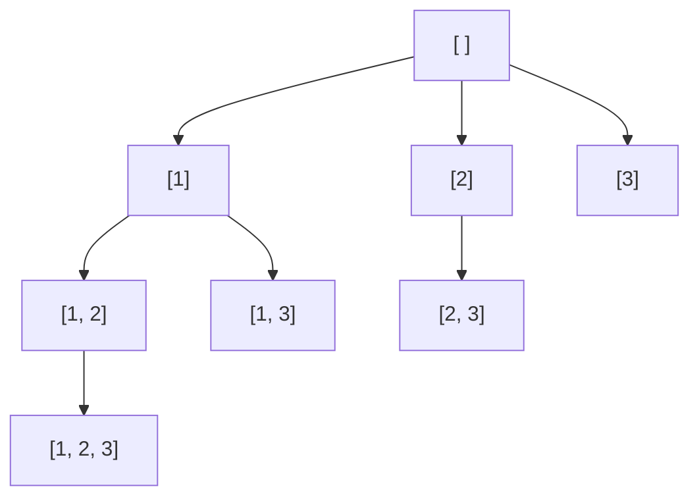

## Introduction

You are configuring a release with three optional features — dark mode, offline sync and a new search box — and you want to test every combination of them being switched on. With nothing on, one on, two on or all three on, how many configurations are there, and how would a program list them all?

Each feature is independently on or off, so there are 2 × 2 × 2 = 8 configurations. Writing them out for three features is easy by hand. Writing a program that does it for *any* number of features is the **subsets** problem: given a collection of `n` elements, produce every **subset** — every group you can form by keeping some of the elements and dropping the rest, including keeping none (the **empty set**) and keeping all of them. The collection of all subsets is called the **power set**.

Subsets are the entry point to **backtracking**, the technique of building a candidate answer one decision at a time, exploring what follows from each decision, and then undoing it to try the alternative. Almost every problem in this module — [[a9-permutations]], [[a9-combinations]], [[a9-combination-sum]], [[a9-n-queens]] — is the same skeleton with a different decision at each step and different rules about which decisions are allowed. If you understand subsets thoroughly, the rest of the module is variations.

The problem also matters on its own. "Try every subset" is the brute-force answer to many selection problems: which items fit in a knapsack, can this array be split into two equal halves, which set of servers covers every region. Knowing how to enumerate subsets correctly, and knowing when 2ⁿ is too many, is the starting point for the faster techniques — pruning and dynamic programming — that replace brute force.

## Before you start

- **Recursion and the call stack** — base cases, how each call gets its own local variables, and the choose–recurse–undo rhythm introduced at the end of [[a1-recursion]]. This lesson assumes you have read that section.
- **`ArrayList` basics** — `add`, `remove(index)`, and creating a copy with `new ArrayList<>(other)`. See [[a1-arraylist]].
- **Big-O notation** — enough to read O(2ⁿ) and compare it with O(n²). See [[a1-big-o]].
- **Binary numbers** (optional) — the bitmask method at the end uses one bit per element. [[a13-bitmasking]] covers the operators in detail.

## The intuition: one switch per element

Picture each element of the input as a light switch. A subset is one setting of all the switches. For `[1, 2, 3]`, the setting off–on–on means the subset `[2, 3]`; on–off–off means `[1]`.

Now think about choosing the settings one switch at a time. For the first element you have two options. Whichever you pick, the second element again has two options, and so on. Drawn out, the choices form a **decision tree**: the root is "nothing decided yet", each level decides one element, every node has two children (out or in), and each path from the root to a bottom node — a **leaf** — is one complete subset.

```mermaid title="Decision tree for [1, 2, 3]: each level decides one element"
flowchart TD
    R["[ ]"] --> A["out 1: [ ]"]
    R --> B["in 1: [1]"]
    A --> C["[ ]"]
    A --> D["[2]"]
    B --> E["[1]"]
    B --> F["[1, 2]"]
    C --> G["[ ]"]
    C --> H["[3]"]
    D --> I["[2]"]
    D --> J["[2, 3]"]
    E --> K["[1]"]
    E --> L["[1, 3]"]
    F --> M["[1, 2]"]
    F --> N["[1, 2, 3]"]
```

The tree makes the count obvious. Level 0 has 1 node, level 1 has 2, level 2 has 4, and level `n` has 2ⁿ leaves. Every leaf is a different subset, because two leaves differ in at least one decision, and every subset appears, because every combination of decisions has a path. So a set of `n` distinct elements has exactly **2ⁿ subsets**.

That number grows fast: 10 elements give 1,024 subsets, 20 give 1,048,576, and 30 give over a billion. Any algorithm that lists every subset must do at least 2ⁿ units of work just to output them, so the goal is not to beat 2ⁿ — that is impossible — but to generate each subset with as little extra work as possible.

## Why the obvious approach does not work

If you know `n` is 3, nested loops do the job: one loop per element, each running over "out" and "in". The trouble is that `n` is not known when you write the code. You cannot write a variable number of nested loops.

Recursion solves exactly this. A recursive method that handles *one* element and then calls itself for the rest behaves like a loop nest whose depth is decided at run time: each active call on the stack plays the role of one loop. The decision tree above *is* the recursion tree — each node is one call, and the two children are the two recursive calls it makes.

## Version 1: include or exclude

The first way to write it follows the switch picture directly. The method receives the index `i` of the element to decide and a list `path` holding the elements chosen so far. The meaning of `path` is the **invariant** of the recursion:

> When `build(i, path)` is called, `path` contains exactly the chosen elements among `nums[0..i-1]`, in order.

From the invariant, the rest follows. If `i == n`, every element has been decided, so `path` is a complete subset: save it. Otherwise make two calls — one with `nums[i]` left out and one with it added — and before returning, remove what you added so the caller gets `path` back exactly as it handed it over. That last step is the **undo**, and it is what makes this backtracking rather than plain recursion: one shared list is modified on the way down and restored on the way up, instead of allocating a fresh list for every call.

```java title="Subsets.java"
import java.util.ArrayList;
import java.util.List;

public class Subsets {

    // Version 1: one level per element, two branches (exclude, include).
    static void includeExclude(int[] nums, int i, List<Integer> path,
                               List<List<Integer>> out) {
        if (i == nums.length) {                  // every element has been decided
            out.add(new ArrayList<>(path));      // save a snapshot, not the live list
            return;
        }
        includeExclude(nums, i + 1, path, out);  // branch 1: leave nums[i] out
        path.add(nums[i]);                       // branch 2: put nums[i] in
        includeExclude(nums, i + 1, path, out);
        path.remove(path.size() - 1);            // undo, so the caller sees path unchanged
    }

    // Version 2: every call is an answer; the loop picks the next element to add.
    static void fromStart(int[] nums, int start, List<Integer> path,
                          List<List<Integer>> out) {
        out.add(new ArrayList<>(path));          // the current path is itself a subset
        for (int j = start; j < nums.length; j++) {
            path.add(nums[j]);
            fromStart(nums, j + 1, path, out);   // later picks come only from the right
            path.remove(path.size() - 1);
        }
    }

    public static void main(String[] args) {
        int[] nums = {1, 2, 3};

        List<List<Integer>> a = new ArrayList<>();
        includeExclude(nums, 0, new ArrayList<>(), a);
        System.out.println("include/exclude: " + a);

        List<List<Integer>> b = new ArrayList<>();
        fromStart(nums, 0, new ArrayList<>(), b);
        System.out.println("from start:      " + b);

        List<List<Integer>> c = new ArrayList<>();
        fromStart(new int[0], 0, new ArrayList<>(), c);
        System.out.println("empty input:     " + c);
    }
}
```

```output
include/exclude: [[], [3], [2], [2, 3], [1], [1, 3], [1, 2], [1, 2, 3]]
from start:      [[], [1], [1, 2], [1, 2, 3], [1, 3], [2], [2, 3], [3]]
empty input:     [[]]
```

Read `includeExclude` against the invariant. The "exclude" call receives `path` unchanged and index `i + 1`, so in that call `path` holds the chosen elements of `nums[0..i]` with `nums[i]` not chosen — the invariant holds. The "include" call receives `path` with `nums[i]` appended — again the invariant holds. After both calls return, `path` has `nums[i]` on the end; removing it restores the state the caller expects. Because the exclude branch runs first here, the output starts with `[]` and ends with `[1, 2, 3]`; swap the two branches and the order reverses. Order does not affect correctness, and most problems accept the subsets in any order.

Two details carry the whole method. **Save a copy**, not `path` itself: `path` is one object reused by every call, so storing the reference would leave `out` holding eight references to the same list, which is empty by the time the recursion finishes. And **undo exactly what you did**: if the `remove` is missing, the element stays in `path` when control returns to the parent, and every subset generated afterwards carries elements that were never chosen on its path.

## Version 2: loop from a start index

The second version in the program looks different and is worth learning well, because it is the template that [[a9-combinations]] and [[a9-combination-sum]] build on.

Instead of asking "is element `i` in or out?", each call asks "**which element do I add next?**" The answer can be any element to the right of the last one added, so the loop runs `j` from `start` to the end, adds `nums[j]`, and recurses with `start = j + 1`. Because each recursive call may only pick elements to the right of the previous pick, every path lists elements in increasing index order. That is what prevents duplicates: the subset `{1, 3}` can only be built as "add 1, then add 3" — the order "add 3, then add 1" is impossible because after picking index 2 the loop never looks back at index 0.

The other difference is *where* answers are recorded. In version 1 only leaves are subsets; internal nodes are partial decisions. In version 2 **every call records its path on entry**, because a path of increasing picks is a complete subset at every moment — you can always stop adding. The tree is therefore smaller: it has exactly one node per subset.



### Dry run of version 2

Here is `fromStart` on `[1, 2, 3]`, one row per call in the order the calls happen. "Loop tries" lists the values of `nums[j]` the call's loop will add.

| Call | `start` | `path` on entry | Recorded | Loop tries |
|---|---|---|---|---|
| 1 | 0 | `[]` | `[]` | 1, 2, 3 |
| 2 | 1 | `[1]` | `[1]` | 2, 3 |
| 3 | 2 | `[1, 2]` | `[1, 2]` | 3 |
| 4 | 3 | `[1, 2, 3]` | `[1, 2, 3]` | none |
| 5 | 3 | `[1, 3]` | `[1, 3]` | none |
| 6 | 2 | `[2]` | `[2]` | 3 |
| 7 | 3 | `[2, 3]` | `[2, 3]` | none |
| 8 | 3 | `[3]` | `[3]` | none |

Between rows 4 and 5, call 4 returns, call 3 removes the `3` (its loop is done) and returns, and call 2 removes the `2` and moves its loop on to `j = 2`, adding `3` to make `[1, 3]`. Tracing the removals is the best way to convince yourself that `path` is always exactly the path from the root to the current node of the tree.

## How it works internally

At any moment, the call stack holds one frame per node on the path from the root to the node currently being explored. In version 2 that is at most `n + 1` frames (the root plus one per element added). Each frame stores only its own `start` and loop variable `j`; the list `path` and the result list `out` are shared objects on the heap, passed by reference.

That sharing is the source of both the efficiency and the classic bugs. Because `path` is never copied on the way down, moving from a node to its child costs one `add`, and moving back costs one `remove` from the end of an `ArrayList`, which is O(1). The only copying happens when a subset is saved. A version that passed `new ArrayList<>(path)` into every recursive call would also be correct, and would not need an undo step, but it would copy on every edge of the tree instead of only at saved answers.

## Time and space complexity

**Time.** Version 2 makes exactly one call per subset, so 2ⁿ calls. Each call does constant work besides copying its path, and the copy costs the length of the path. Summed over all subsets, each element appears in exactly half of them — 2ⁿ⁻¹ subsets contain `nums[0]`, 2ⁿ⁻¹ contain `nums[1]`, and so on — so the total length of all subsets is n · 2ⁿ⁻¹. The total time is therefore **Θ(n · 2ⁿ)**. Version 1 has 2ⁿ⁺¹ − 1 calls (a full binary tree of depth `n`) and copies only at the 2ⁿ leaves, so it has the same bound.

No algorithm that outputs every subset can do better, because the output itself contains n · 2ⁿ⁻¹ numbers. When the running time is proportional to the size of the output, the algorithm is called **output-sensitive optimal**, and that is the best you can claim here.

**Space.** Not counting the output, both versions use O(n): the recursion depth is at most `n + 1` frames, and `path` holds at most `n` elements. The output itself takes Θ(n · 2ⁿ) space. If a problem only needs to *process* each subset — check its sum, say — and not return them all, you can skip storing them and keep the space at O(n).

As a practical guide: n = 20 means about a million subsets and ten million copied elements, which runs in well under a second in Java. Around n = 25 to 30 the output alone needs gigabytes of memory, so listing every subset stops being realistic.

## Version 3: building subsets without recursion

Two iterative methods are worth knowing, both because interviewers ask for them and because each gives a different insight.

The **cascading** method starts with a list containing only the empty subset. For each element `x`, it takes every subset already in the list and adds a copy with `x` appended. After processing `k` elements the list holds all 2ᵏ subsets of the first `k` elements — the "out" ones are the old subsets, the "in" ones are the new copies. This is the include/exclude idea processed level by level instead of path by path.

The **bitmask** method uses the switch picture literally. Write the numbers from `0` to `2ⁿ − 1` in binary: each has `n` bits, and every possible pattern of `n` bits appears exactly once. Let bit `j` mean "element `j` is in the subset", and each number becomes a subset.

```java title="SubsetsIterative.java"
import java.util.ArrayList;
import java.util.List;

public class SubsetsIterative {

    // Start with {[]}; each new element doubles the list by extending every old subset.
    static List<List<Integer>> cascade(int[] nums) {
        List<List<Integer>> out = new ArrayList<>();
        out.add(new ArrayList<>());
        for (int x : nums) {
            int size = out.size();               // only extend subsets that existed before x
            for (int s = 0; s < size; s++) {
                List<Integer> next = new ArrayList<>(out.get(s));
                next.add(x);
                out.add(next);
            }
        }
        return out;
    }

    // Bit j of mask says whether nums[j] is in the subset.
    static List<List<Integer>> bitmask(int[] nums) {
        int n = nums.length;                     // 1 << n needs n <= 30 for an int
        List<List<Integer>> out = new ArrayList<>();
        for (int mask = 0; mask < (1 << n); mask++) {
            List<Integer> subset = new ArrayList<>();
            for (int j = 0; j < n; j++) {
                if ((mask & (1 << j)) != 0) subset.add(nums[j]);
            }
            out.add(subset);
        }
        return out;
    }

    public static void main(String[] args) {
        int[] nums = {1, 2, 3};
        System.out.println("cascade: " + cascade(nums));
        System.out.println("bitmask: " + bitmask(nums));
    }
}
```

```output
cascade: [[], [1], [2], [1, 2], [3], [1, 3], [2, 3], [1, 2, 3]]
bitmask: [[], [1], [2], [1, 2], [3], [1, 3], [2, 3], [1, 2, 3]]
```

In `cascade`, the line `int size = out.size()` matters: the inner loop appends to `out` while iterating over it, so it must stop at the size the list had *before* `x` was processed, or it would extend the subsets it just created and never terminate. In `bitmask`, `mask = 5` is binary `101`, so bits 0 and 2 are set and the subset is `[1, 3]`. The two methods produce the same order because both double the list in the same way.

The bitmask version needs no recursion and makes each subset easy to name with a single integer, which is why it is the starting point for [[a11-bitmask-dp]], where a mask indexes a table. Its limits are that `1 << n` overflows an `int` beyond n = 30 (use `long` and `1L << n` up to 62), and that it always walks all 2ⁿ masks — it cannot skip a whole branch the way recursion can when a partial subset already breaks a rule.

## Inputs with duplicate values

The methods so far treat elements by position. If the input contains equal values, positions differ but subsets look the same. For `[1, 2, 2]`, choosing "the first 2" and choosing "the second 2" both give `[1, 2]`, so the output would contain `[1, 2]` twice and `[2]` twice. Problems such as *Subsets II* ask for each distinct subset once.

Removing duplicates afterwards with a `HashSet<List<Integer>>` works but wastes the time spent generating them, and the number of duplicates can be exponential: an input of ten equal values has 2¹⁰ = 1,024 position-subsets but only 11 distinct ones. The better fix is to never generate a duplicate.

Start by **sorting**, so equal values sit next to each other. Then look at the version 2 loop. At one call, the loop chooses *which value to add next*. If the loop has already tried value `2` in this call — and therefore explored every subset that continues with a 2 here — then trying the *next* `2` in the same call would explore the same subsets again. So the rule is: inside one call's loop, skip `nums[j]` when it equals the value tried just before it in the same loop.

```java title="SubsetsWithDup.java"
import java.util.ArrayList;
import java.util.Arrays;
import java.util.List;

public class SubsetsWithDup {

    static void build(int[] nums, int start, List<Integer> path, List<List<Integer>> out) {
        out.add(new ArrayList<>(path));
        for (int j = start; j < nums.length; j++) {
            // Same value already tried as "the next element" at this level: skip it.
            if (j > start && nums[j] == nums[j - 1]) continue;
            path.add(nums[j]);
            build(nums, j + 1, path, out);
            path.remove(path.size() - 1);
        }
    }

    static List<List<Integer>> subsetsWithDup(int[] nums) {
        int[] sorted = nums.clone();
        Arrays.sort(sorted);                     // equal values must be adjacent
        List<List<Integer>> out = new ArrayList<>();
        build(sorted, 0, new ArrayList<>(), out);
        return out;
    }

    public static void main(String[] args) {
        System.out.println(subsetsWithDup(new int[]{2, 1, 2}));
        System.out.println(subsetsWithDup(new int[]{2, 2, 2}));
    }
}
```

```output
[[], [1], [1, 2], [1, 2, 2], [2], [2, 2]]
[[], [2], [2, 2], [2, 2, 2]]
```

The condition is `j > start`, not `j > 0`, and the difference is the heart of the rule. `j == start` is the *first* option this call considers, so it is always allowed even if it equals `nums[j - 1]`. That is how `[2, 2]` gets built: the root call adds the first `2` (index 1 of the sorted `[1, 2, 2]`) and recurses with `start = 2`; in that child, index 2 is the first option, so the second `2` is allowed and `[2, 2]` is produced. What is forbidden is the root call itself choosing the second `2` as an alternative to the first, which would only rebuild `[2]` and `[2, 2]`'s prefix again. In short: **equal values may be stacked on top of each other (different levels), but not tried side by side (same level)**.

The include/exclude version needs a different form of the same rule. When you *exclude* a value, you must exclude every copy of it, otherwise "exclude the first 2, include the second" duplicates "include the first 2, exclude the second":

```java
path.add(nums[i]);                               // include nums[i]
build(nums, i + 1, path, out);
path.remove(path.size() - 1);
int next = i + 1;                                // exclude nums[i] and all its copies
while (next < nums.length && nums[next] == nums[i]) next++;
build(nums, next, path, out);
```

Both versions generate only distinct subsets, so their running time stays proportional to the size of the deduplicated output.

```quiz
Q: The loop-from-start version is called on the sorted array `[1, 2, 2]`. Which subset would be generated twice if the line `if (j > start && nums[j] == nums[j - 1]) continue;` were deleted?
- [ ] `[1, 2, 2]`
- [x] `[1, 2]`
- [ ] `[1]`
- [ ] `[]`
> Without the rule, the call with path `[1]` tries index 1 (a 2) and index 2 (another 2) side by side, and both produce `[1, 2]`. `[1, 2, 2]` appears once because it needs both copies, stacked at different levels. `[1]` and `[]` are recorded on entry to calls that occur only once.

Q: Why does the skip condition use `j > start` rather than `j > 0`?
- [ ] `j > 0` would throw an exception at index 0
- [x] `j > 0` would also forbid the first option of a deeper call, so subsets that use a value twice, like `[2, 2]`, would be lost
- [ ] `j > start` is faster to evaluate
- [ ] The two conditions behave identically after sorting
> At `j == start` the loop is considering its first option, which has not been tried in this call yet. With `j > 0`, a call with `start = 2` on `[1, 2, 2]` would skip index 2 because it equals index 1, so `[2, 2]` and `[1, 2, 2]` would never be built.
```

## Worked example: subsets with a condition

Most real problems do not want every subset; they want the subsets, or the number of subsets, that satisfy a condition. The include/exclude shape adapts directly. Here is a method that counts how many subsets of a set of positive numbers add up to a target:

```java title="SubsetSumCount.java"
public class SubsetSumCount {

    // How many subsets of nums[i..] add up to target? Elements are positive.
    static int count(int[] nums, int i, int target) {
        if (target == 0) return 1;               // the empty rest completes this subset
        if (i == nums.length || target < 0) return 0;
        return count(nums, i + 1, target - nums[i])   // include nums[i]
             + count(nums, i + 1, target);            // exclude nums[i]
    }

    public static void main(String[] args) {
        System.out.println(count(new int[]{2, 3, 5, 6, 8, 10}, 0, 10));
    }
}
```

```output
3
```

The three subsets are `{2, 8}`, `{10}` and `{2, 3, 5}`. Two things changed from the plain generator. There is no `path`, because the method only counts, so there is nothing to undo — the "choice" is carried in the argument `target - nums[i]`, and each call has its own copy. And there are two early exits: `target == 0` stops as soon as the sum is reached (with positive numbers, adding more can only overshoot), and `target < 0` abandons a branch that has already gone past the target. Abandoning a branch early like this is **pruning**, the main tool for making backtracking practical; it is studied in its own right in [[a9-pruning]].

Notice also that this method is a function of only two values, `i` and `target`. When the same `(i, target)` pair can be reached along different paths, the same work is repeated — the sign that the problem can be solved with dynamic programming instead. Counting subsets with a given sum is the 0/1 knapsack pattern in [[a11-knapsack]], which solves it in O(n · target) time instead of O(2ⁿ).

## Recognising a subsets problem

A problem is a subsets problem in disguise when:

- the answer is a **selection** of input items where order does not matter ("choose some of", "pick any group", "which items to include");
- each item's decision is **independent** — it is either in or out, with no fixed size and no reuse;
- `n` is small, typically 20 or less, or there is a strong pruning rule.

Some examples and how they map:

| Problem | Subset of what | Extra rule |
|---|---|---|
| Subsets / Subsets II | the input array | none / skip duplicates at the same level |
| Partition into two equal-sum halves | elements in the first half | sum must equal total / 2 |
| Letter Case Permutation (`"a1b"`) | letters to capitalise | digits have one choice only |
| Maximum compatible team | people chosen | no two chosen people conflict |
| Choose `k` of `n` | positions | size exactly `k` — see [[a9-combinations]] |

If the problem fixes the size of the selection, it is a combinations problem, which uses the same loop with an extra stopping rule. If order matters, it is a permutations problem. If an item can be used more than once, it is a combination-sum problem.

## In real systems

**Configuration and feature testing.** Testing every combination of `n` feature flags means testing the power set — 1,024 configurations for 10 flags. That growth is exactly why test teams use **pairwise (all-pairs) testing**, which covers every combination of each *pair* of flags with far fewer runs, instead of all subsets.

**Query optimisation.** When a SQL query joins several tables, the planner must choose a join order. PostgreSQL's standard planner uses dynamic programming over subsets of the tables in the query: it finds the best plan for each subset by combining best plans of smaller subsets. Because the number of subsets is exponential, PostgreSQL switches to a genetic search (GEQO) once the number of items in `FROM` reaches `geqo_threshold`, which defaults to 12.

**Frequent itemset mining.** Retail analytics looks for sets of products often bought together. The candidate itemsets are subsets of the product catalogue, far too many to list. The Apriori algorithm prunes the power set with one rule — if a set is rare, every superset of it is rare too — so whole branches of the subset tree are never generated.

In each case, the power set is the space being searched, and the engineering is in avoiding most of it.

## Trade-offs and alternatives

| Method | Calls or iterations | Can prune a branch | Best for |
|---|---|---|---|
| Include/exclude recursion | 2ⁿ⁺¹ − 1 calls | Yes | Problems phrased as an in/out decision per element; counting with conditions |
| Loop from start | 2ⁿ calls | Yes | Extending to combinations, combination sum, duplicates |
| Cascading (iterative) | 2ⁿ list entries | No | Short code without recursion; BFS-like growth |
| Bitmask loop | 2ⁿ masks × n bits | No | n ≤ 30, naming subsets by an integer, bitmask DP |

All four are Θ(n · 2ⁿ) when they output every subset. The recursive versions win as soon as a problem lets you reject partial subsets, because rejecting one node removes its entire subtree. The bitmask version wins when subsets need to be stored as keys or table indices.

When the question is about the *number* of subsets, or the *best* subset, rather than the list of all subsets, do not enumerate at all if you can avoid it. The count of all subsets is 2ⁿ by formula, and many optimisation questions over subsets have dynamic programming solutions polynomial in `n` and the values involved.

## Common mistakes

> [!MISTAKE] Saving the live list
> `out.add(path)` stores a reference to the one list that every call keeps modifying. When the recursion ends, every stored entry is the same empty list. Always save `new ArrayList<>(path)`.

**Forgetting to undo.** Every `path.add` before a recursive call needs a matching `path.remove(path.size() - 1)` after it. A missing undo leaves elements in `path` that later branches never chose, producing subsets that are too large and wrong.

**Removing by value instead of by position.** For a `List<Integer>`, `path.remove(x)` with an `int` argument calls `remove(int index)`, not `remove(Object)`. With `path = [5]`, `path.remove(5)` throws `IndexOutOfBoundsException`. Removing the last element by index is both correct and O(1).

**Skipping duplicates without sorting.** The rule `nums[j] == nums[j - 1]` only finds equal values if they are adjacent. On `[2, 1, 2]` unsorted, the two `2`s are not neighbours and duplicates slip through.

**Using `j > 0` in the skip rule.** As the quiz above showed, this forbids stacking equal values and loses valid subsets such as `[2, 2]`.

**Mutating the caller's array.** Sorting the input in place changes the caller's data. Sort a copy (as `subsetsWithDup` does with `clone()`) unless the problem says the input may be modified.

## Interview perspective

Subsets is usually asked as a warm-up or as the first part of a longer question, and interviewers listen for three things: that you describe the decision tree before coding, that you copy at the right moment, and that you state the complexity with a reason rather than from memory.

> [!INTERVIEW] A strong explanation
> "Each element is either in or out, so there are 2ⁿ subsets. I'll use one shared path and a start index: each call records its path, then tries adding each later element and undoes it. Every call is one subset, and copying costs up to n, so it's O(n · 2ⁿ) time and O(n) extra space besides the output."

Questions you should be ready for:

- **How many subsets does an array of n distinct elements have, and why?** 2ⁿ: two independent choices per element.
- **Why is it O(n · 2ⁿ) and not O(2ⁿ)?** Each of the 2ⁿ subsets is copied into the result, and the average subset has n/2 elements.
- **Write it without recursion.** Cascading or bitmask; be ready to explain why `mask & (1 << j)` tests membership.
- **Subsets II: the input has duplicates.** Sort, then skip a value equal to the previous one *in the same loop*. Explain why `j > start`.
- **Only subsets of size k?** Stop recording except at size `k`, and prune when too few elements remain — this is [[a9-combinations]].
- **What if n is 40?** 2⁴⁰ is about 10¹², too many. For a sum target, **meet in the middle** splits the array into two halves of 20, enumerates each half's 2²⁰ subset sums, sorts one list and binary searches it for each sum of the other — about 2²⁰ · 20 operations instead of 2⁴⁰.

## Practice

1. **Subsets.** Write both recursive versions from memory, then the bitmask version. Check that all three return 8 subsets for `[1, 2, 3]` and 1 for `[]`.
2. **Subsets II.** Handle `[4, 4, 4, 1, 4]`. Before running, predict the number of distinct subsets (hint: choose how many 4s and whether to include the 1).
3. **Letter Case Permutation.** For `"a1b2"`, return every string formed by changing the case of letters. Identify the "in/out" decision.
4. **Partition Equal Subset Sum.** Decide by backtracking whether `[1, 5, 11, 5]` can be split into two equal-sum parts. Then explain why a dynamic programming solution is preferred for large inputs.
5. **Subsets of size k only.** Modify the loop-from-start version to output only subsets of size `k`, and add a check that stops the loop when not enough elements remain.

The DSA explorer lists the matching problems under this topic; start with *Subsets*, *Subsets II* and *Letter Case Permutation*.

## Quick revision {#quick-revision}

- A set of `n` distinct elements has **2ⁿ** subsets: one independent in/out decision per element.
- Include/exclude recursion: at index `i`, recurse without `nums[i]`, then with it; record at `i == n`.
- Loop-from-start: record `path` on entry; for `j` in `[start, n)`: add `nums[j]`, recurse with `j + 1`, remove.
- Always save `new ArrayList<>(path)`; always undo with `path.remove(path.size() - 1)`.
- Time Θ(n · 2ⁿ) (total output length n · 2ⁿ⁻¹); extra space O(n) for stack and path.
- Iterative: cascade (copy every existing subset and append `x`) or bitmask over `0 … 2ⁿ − 1` (`n ≤ 30` with `int`).
- Duplicates: sort, then `if (j > start && nums[j] == nums[j - 1]) continue;` — same value not twice at one level.
- Include/exclude with duplicates: when excluding, skip all copies of the value.
- Practical limit about n = 20 for listing; use pruning, DP or meet-in-the-middle beyond that.

## Key takeaways {#key-takeaways}

- Generating subsets is walking a decision tree with one in/out decision per element; the 2ⁿ leaves are the 2ⁿ subsets.
- Backtracking keeps one shared `path`, changes it on the way down and restores it on the way up; copy it only when saving an answer.
- The loop-from-start template prevents reordered duplicates by only picking elements to the right of the last pick, and it is the base for combinations and combination sum.
- O(n · 2ⁿ) is optimal when every subset must be output, because that is the size of the output itself.
- Duplicate values are handled by sorting and never trying the same value twice in one loop, which avoids generating duplicates instead of filtering them later.
- When only a count or an optimum is needed, look for pruning or dynamic programming before enumerating.
