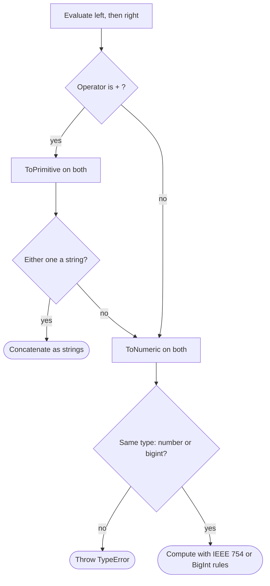

## Introduction

A checkout page reads the price of an item from an `<input>` field and adds a shipping fee:

```javascript title="checkout-bug.js"
const price = '20';   // every <input>.value is a string
const shipping = 5;
console.log(price + shipping);
console.log(price - shipping);
console.log(price * 2);
```

```output
205
15
40
```

The customer is charged 205 instead of 25. Subtraction and multiplication gave the answers you would expect, but addition did something completely different. Nothing threw an error, and the wrong value flowed straight into the order.

This is the first thing to understand about JavaScript's **arithmetic operators**: they never refuse to run. Before computing, each one converts its operands to a type it can work with, and `+` has an extra rule that sends it down a string-joining path whenever a string is involved. Once you know the conversion rules and the handful of floating-point behaviours that sit underneath them, every result in this lesson becomes predictable.

You use these operators constantly in frontend work: totals and discounts in a cart, page counts in pagination, wrapping an index in a carousel, converting seconds into `mm:ss`, computing pixel positions for an animation. Each of those has a classic bug that comes from one rule below.

## Before you start

- **Number and BigInt types** — JavaScript has one floating-point `number` type and an arbitrary-precision integer type `bigint`. See [[b1-type-number]] and [[b1-type-bigint]].
- **Expressions and operands** — an operator combines one or more operands into a new value. See [[b1-statements-expressions]].
- **NaN and Infinity** — the special number values that arithmetic can produce. See [[b1-nan-infinity]].

You do not need to know the coercion algorithms in depth; this lesson explains the parts the operators use and links to [[b1-type-coercion]] for the rest.

## The intuition

Picture every arithmetic operator as a two-stage machine.

**Stage one converts.** Whatever you feed in — a string, `true`, `null`, an array — gets turned into a numeric value: either a `number` or a `bigint`. Strings are parsed, `true` becomes `1`, `null` becomes `0`, and anything that cannot be parsed becomes `NaN`.

**Stage two computes**, using the rules of IEEE 754 double-precision floating point (the same rules your CPU uses for `double` in C or Java). Those rules never throw: dividing by zero gives `Infinity`, an undefined result gives `NaN`, and a result too large to represent becomes `Infinity`.

`+` is the one operator with a **fork before stage one**. It first checks whether either operand is (or converts to) a string. If so, it skips arithmetic entirely and joins the two as text. That fork is why `'20' + 5` is `'205'` while `'20' - 5` is `15`: `-` has no string mode, so it can only convert and subtract.

The analogy breaks in one place: BigInt. The machine refuses to accept a `bigint` and a `number` in the same operation, and BigInt division by zero throws. Those exceptions are covered below.

## The six binary operators

A **binary operator** takes two operands, one on each side. JavaScript has six arithmetic ones.

| Operator | Name | Example | Result |
|---|---|---|---|
| `+` | Addition / concatenation | `7 + 2` | `9` |
| `-` | Subtraction | `7 - 2` | `5` |
| `*` | Multiplication | `7 * 2` | `14` |
| `/` | Division | `7 / 2` | `3.5` |
| `%` | Remainder | `7 % 2` | `1` |
| `**` | Exponentiation (ES2016) | `2 ** 3` | `8` |

```javascript title="basics.js"
console.log(7 + 2, 7 - 2, 7 * 2, 7 / 2, 7 % 2, 2 ** 3);
console.log(Math.trunc(7 / 2), Math.floor(-7 / 2), Math.trunc(-7 / 2));
console.log(0.1 + 0.2);
```

```output
9 5 14 3.5 1 8
3 -4 -3
0.30000000000000004
```

Two things in this output surprise people coming from Java, C or Python.

First, `7 / 2` is `3.5`. JavaScript has **no integer division operator**, because it has no separate integer type for `number` — every number is a 64-bit float. When you need the whole-number part, you choose a rounding function explicitly. `Math.trunc` drops the fractional part (rounds toward zero), and `Math.floor` rounds toward negative infinity. They agree for positive results and disagree for negative ones: `Math.trunc(-3.5)` is `-3`, but `Math.floor(-3.5)` is `-4`. Python's `//` behaves like `Math.floor`; Java's integer `/` behaves like `Math.trunc`. Pick the one that matches what the problem means.

Second, `0.1 + 0.2` is not exactly `0.3`. Neither `0.1` nor `0.2` can be stored exactly in binary floating point, so each is stored as the nearest representable value, and the tiny errors add up. This is not a JavaScript bug — Java's `double` gives the same answer. Integers are exact as long as they stay within ±2⁵³ − 1 (`Number.MAX_SAFE_INTEGER`, 9,007,199,254,740,991). The full explanation lives in [[b1-floating-point]] and [[b1-safe-integers]]; for arithmetic, the practical rule is to keep money in whole cents rather than fractional dollars.

## Division by zero, Infinity and negative zero

In most languages integer division by zero crashes the program. In JavaScript, number arithmetic follows IEEE 754, which defines a result for every operation.

```javascript title="special-values.js"
console.log(1 / 0, -1 / 0, 0 / 0);
console.log(0 * -5, 1 / (0 * -5));
console.log(Number.MAX_VALUE * 2);
console.log(Infinity - Infinity, Infinity * 0);
```

```output
Infinity -Infinity NaN
-0 -Infinity
Infinity
NaN NaN
```

Dividing a non-zero number by zero gives `Infinity` with the appropriate sign. `0 / 0` has no meaningful answer, so it gives **`NaN`** ("Not a Number"), the value IEEE 754 uses for undefined results. A result too large to represent **overflows** to `Infinity` instead of wrapping around as Java's `int` would.

The second line reveals **negative zero**. IEEE 754 numbers carry a sign bit even when the value is zero, so `0 * -5` produces `-0`. In almost every operation `-0` behaves exactly like `0` — `-0 === 0` is `true` — but dividing by it gives `-Infinity` instead of `Infinity`. You rarely need to care, but you will see `-0` printed by Node.js and browser consoles, and it matters for things like the direction of a velocity that reached zero. `Object.is(-0, 0)` distinguishes the two; see [[b1-object-is]].

**`NaN` is contagious.** Any arithmetic with a `NaN` operand produces `NaN` (the one curiosity is `NaN ** 0`, which is `1`, because anything to the power zero is defined as `1`). That makes `NaN` useful as an error signal — a bad input poisons the final result instead of producing a plausible wrong number — but only if you check for it. `Number.isFinite(result)` is the single best check after a calculation built from untrusted input, because it rejects `NaN`, `Infinity` and `-Infinity` together.

## Remainder `%` is not modulo

`%` is the **remainder operator**. `a % b` is what is left over after dividing `a` by `b` and truncating the quotient toward zero. For positive operands this is the familiar "clock arithmetic" result. For negatives, the sign of the result **follows the dividend** (the left operand), not the divisor.

```javascript title="remainder.js"
console.log(7 % 3, -7 % 3, 7 % -3, -7 % -3);
console.log(5.5 % 2, 7 % 0, Infinity % 2, 7 % Infinity);
const mod = (n, m) => ((n % m) + m) % m;
console.log(mod(-7, 3), mod(7, 3), mod(-1, 5));
```

```output
1 -1 1 -1
1.5 NaN NaN 7
2 1 4
```

Work through `-7 % 3`. The quotient `-7 / 3` is `-2.33…`, truncated toward zero to `-2`. Then `-7 - (-2 × 3)` is `-1`. A mathematician's **modulo** would answer `2`, because modulo results always lie in the range `0` to `m − 1` for positive `m`. JavaScript, Java, C and Go all use truncated remainder; Python's `%` uses floored division and gives `2`. Algorithms that rely on the result being non-negative — hashing into buckets, wrapping an array index, day-of-week calculations — break silently on negative input.

The `mod` helper fixes this. `n % m` is in the range `-(m − 1)` to `m − 1`; adding `m` shifts it into `1` to `2m − 1`; the second `% m` brings it back into `0` to `m − 1`. It works for any sign of `n` as long as `m` is positive.

Unlike in Java or C, `%` also works on fractions: `5.5 % 2` is `1.5`. And it follows the same no-throw rules as division: `x % 0` is `NaN`, and so is `Infinity % x`, while `x % Infinity` is `x` because `Infinity` "fits into" `x` zero times.

> [!WARNING] Negative remainders in interview problems
> `-7 % 3` is `-1` in JavaScript. When a problem says "modulo" — rotating an array by `k` that may be negative, or a hash of a value that can be negative — use `((n % m) + m) % m`, and say why.

## Exponentiation `**`

`**` raises the left operand to the power of the right one. It was added in ES2016 as an operator form of `Math.pow`, and the two give identical results for numbers.

```javascript title="exponent.js"
console.log(2 ** 10, 2 ** -1, 2 ** 0.5);
console.log(2 ** 3 ** 2, (2 ** 3) ** 2);
console.log((-2) ** 2, -(2 ** 2));
console.log((-8) ** (1 / 3), Math.cbrt(-8));
console.log(0 ** 0, NaN ** 0, Math.pow(2, 10));
```

```output
1024 0.5 1.4142135623730951
512 64
4 -4
NaN -2
1 1 1024
```

The second line shows that `**` is **right-associative**: `2 ** 3 ** 2` means `2 ** (3 ** 2)`, which is `2 ** 9 = 512`, not `8 ** 2 = 64`. Every other arithmetic operator is left-associative (`10 - 3 - 2` is `(10 - 3) - 2`). Right-associativity matches mathematical notation, where a stacked exponent is evaluated from the top down. Associativity in general is covered in [[b1-precedence]].

The third line exists because of a deliberate syntax rule. In mathematics, −2² means −(2²) = −4, but many programmers would read `-2 ** 2` as `(-2) ** 2 = 4`. Rather than pick one, the language designers made it an error:

```javascript title="unary-minus-exponent.js"
console.log(-2 ** 2);
```

```output
SyntaxError: Unary operator used immediately before exponentiation expression. Parenthesis must be used to disambiguate operator precedence
```

You must write `(-2) ** 2` or `-(2 ** 2)`. The error is raised when the file is parsed, so not even the code before it runs. The same rule applies to the other unary operators such as `typeof` and `!`.

The fourth line is a floating-point trap: raising a negative base to a fractional power gives `NaN`, because `1 / 3` is not exactly one third and the real cube root of a negative number is not defined for an arbitrary fractional power. Use `Math.cbrt` for cube roots.

## `+` and string concatenation

Now the fork. When `+` evaluates, it first converts both operands to **primitive values** (objects such as arrays and dates are turned into strings or numbers; see [[b1-to-primitive]]). Then it asks one question: **is either primitive a string?** If yes, it converts the other one to a string and joins them. If no, it converts both to numbers (or bigints) and adds.

```javascript title="plus.js"
console.log(1 + 2 + '3');
console.log('1' + 2 + 3);
console.log('1' + (2 + 3));
console.log(JSON.stringify([] + []), [1, 2] + 3, ({}) + 'x');
console.log(true + 1, null + 1, undefined + 1);
```

```output
33
123
15
"" 1,23 [object Object]x
2 1 NaN
```

`+` is evaluated **left to right**, and each step is decided separately. In `1 + 2 + '3'`, the first step adds two numbers to get `3`, and only then meets a string, producing `'33'`. In `'1' + 2 + 3`, the very first step involves a string, producing `'12'`, and then `'12' + 3` is `'123'`. Parentheses change the grouping: `'1' + (2 + 3)` adds the numbers first.

Objects are where the rules surprise people. An array converts to a primitive by joining its elements with commas, so `[]` becomes `''` and `[1, 2]` becomes `'1,2'`. Both are strings, so `[] + []` is the empty string (printed with `JSON.stringify` so you can see it) and `[1, 2] + 3` is `'1,23'`. A plain object becomes `'[object Object]'`. When neither primitive is a string, as with `true`, `null` and `undefined`, addition happens: `true` is `1`, `null` is `0`, and `undefined` is `NaN`.

The full set of `+` coercion puzzles, including dates and objects that define `valueOf`, is in [[b1-plus-coercion]].

## The other operators always convert to numbers

`-`, `*`, `/`, `%` and `**` have no string mode. They convert both operands to numeric values and compute. This is why they "work" on numeric strings — and why they quietly produce `NaN` on anything else.

```javascript title="numeric-only.js"
console.log('6' * '2', '6' - 2, '6' / '2', 'abc' * 2);
console.log(true + true, [] * 2, [5] * 2, [1, 2] * 2);
console.log('' - 1, ' 42 ' * 1, '4px' * 1);
const d = new Date(0);
console.log(typeof (d + 1), typeof (d - 1), d - 1);
```

```output
12 4 3 NaN
2 0 10 NaN
-1 42 NaN
string number -1
```

String-to-number conversion is strict about content but lenient about whitespace: `' 42 '` becomes `42`, the empty string becomes `0`, and `'4px'` becomes `NaN` because of the trailing letters. (`parseFloat('4px')` would give `4`; see [[b1-parseint-parsefloat]].) Arrays go through the string form first: `[]` → `''` → `0`, `[5]` → `'5'` → `5`, and `[1, 2]` → `'1,2'` → `NaN`.

The `Date` line shows the fork once more. A `Date` converts to a string when used with `+` (dates are the one built-in object whose default conversion prefers strings), so `d + 1` is a long date string with `1` appended. With `-` there is no string mode, so the date converts to its timestamp in milliseconds — `0` for the Unix epoch here — and `d - 1` is `-1`. This is why `end - start` is the idiomatic way to measure elapsed milliseconds between two dates.

The practical rule from all this: **convert input to numbers explicitly, once, at the boundary**. Write `Number(input.value)` (or `input.valueAsNumber` for `<input type="number">`) and check the result with `Number.isFinite`, rather than relying on `-` and `*` to coerce for you and `+` to not.

## BigInt arithmetic

A **`bigint`** is an integer of arbitrary size, written with an `n` suffix (`10n`). It exists because `number` cannot represent integers beyond 2⁵³ exactly — `2 ** 53 + 1` evaluates to `2 ** 53`. All arithmetic operators work on bigints, but with integer semantics and two strict rules.

```javascript title="bigint.js"
console.log(10n / 3n, 10n % 3n, -7n / 2n, -7n % 2n, 2n ** 64n);
try { console.log(1n + 1); } catch (e) { console.log(e.name + ': ' + e.message); }
try { console.log(1n / 0n); } catch (e) { console.log(e.name + ': ' + e.message); }
try { console.log(2n ** -1n); } catch (e) { console.log(e.name); }
console.log(1n + BigInt(1), Number(10n) + 1);
console.log(2 ** 53, 2 ** 53 + 1, 2n ** 53n + 1n);
```

```output
3n 1n -3n -1n 18446744073709551616n
TypeError: Cannot mix BigInt and other types, use explicit conversions
RangeError: Division by zero
RangeError
2n 11
9007199254740992 9007199254740992 9007199254740993n
```

BigInt division **truncates toward zero**, so `10n / 3n` is `3n` and `-7n / 2n` is `-3n`; there is no fractional bigint. The remainder follows the same sign rule as numbers.

The first strict rule is **no mixing**: `1n + 1` throws a `TypeError`. The reason is that there is no safe automatic choice. Converting the bigint to a number could silently lose precision; converting the number to a bigint is impossible if it has a fraction. So the language makes you choose with `BigInt(x)` or `Number(x)`. The exception is string concatenation: `1n + '1'` is `'11'`, because the string fork happens before the numeric rules.

The second strict rule is that bigint arithmetic **throws on undefined results** instead of returning `Infinity` or `NaN`, since `bigint` has no such values. Division or remainder by `0n` throws a `RangeError`, and so does a negative exponent.

BigInts are slower than numbers and cannot be passed to `Math` functions or serialised by `JSON.stringify`, so use them only when you need exact integers beyond 2⁵³ — 64-bit database IDs, cryptographic values, or large counters. See [[b1-bigint]].

## How it works internally

The ECMAScript specification describes all six operators with one abstract operation, `ApplyStringOrNumericBinaryOperator`. Paraphrased, evaluating `left op right` goes like this:

1. Evaluate the left operand, then the right operand, to values (`lval`, `rval`). Left is always evaluated first.
2. **Only if `op` is `+`:** convert both with `ToPrimitive` (no preferred type). If either result is a string, convert both to strings with `ToString` and return their concatenation.
3. Convert both with `ToNumeric`, which returns either a number or a bigint. (For `+`, the primitives from step 2 are reused, so objects are not converted twice.)
4. If the two numeric types differ, throw a `TypeError`.
5. Apply the operation for that type — `Number::add`, `Number::remainder`, `BigInt::divide` and so on — and return the result.



Step 1 matters when operands have side effects: in `f() + g()`, `f` always runs before `g`, regardless of precedence elsewhere in the expression. Step 5 for numbers is pure IEEE 754: engines such as V8 compile `a * b` on two numbers to a single CPU floating-point instruction once they have observed that the operands are always numbers. When the operands' types keep changing, the engine has to keep the slower generic path that performs the conversions, which is one reason consistent types make hot code faster ([[b1-parsing-jit]]).

## Worked example: a cart total from form input

This example combines the rules: inputs arrive as strings, money must not drift, and the output needs integer division and remainder.

```javascript title="cart-total.js"
// Values arrive from <input> elements as strings.
const form = { unitPrice: '19.99', quantity: '3', couponPercent: '15' };

function toCents(text) {
  const n = Number(text);
  if (!Number.isFinite(n)) throw new Error(`Not a number: ${text}`);
  return Math.round(n * 100); // work in whole cents to avoid 0.1 + 0.2 drift
}

const unitCents = toCents(form.unitPrice);
const quantity = Number(form.quantity);
const subtotal = unitCents * quantity;
const discount = Math.round(subtotal * Number(form.couponPercent) / 100);
const total = subtotal - discount;

console.log(subtotal, discount, total);
console.log(`Total: $${Math.trunc(total / 100)}.${String(total % 100).padStart(2, '0')}`);

// The same total computed naively from floats:
console.log(19.99 * 3 * 0.85);
```

```output
5997 900 5097
Total: $50.97
50.9745
```

Walk through it. `toCents` converts the string explicitly with `Number`, rejects anything that is not a finite number (so `'abc'` or an empty field fails loudly instead of becoming `NaN` or `0`), and multiplies by 100. `Math.round` is needed because `19.99 * 100` is not exactly `1999` in floating point. From then on every value is a whole number of cents, and integer arithmetic on numbers is exact below 2⁵³.

The discount is `5997 × 15 / 100 = 899.55`, which a business rule must round somehow; here it rounds to the nearest cent. Formatting uses integer division (`Math.trunc(total / 100)` gives the dollars) and remainder (`total % 100` gives the cents), padded to two digits. The last line shows what happens without this discipline: a fractional result that someone then has to round at display time, often inconsistently with what the server charged.

Two edge cases are worth knowing. `Math.round(n * 100)` can still be off by a cent for inputs like `'1.005'` (because `1.005 * 100` is `100.49999…`), so production systems either parse the decimal string directly into integer cents or use a decimal library. And a negative `total` (a refund) would make `total % 100` negative; formatting refunds needs `Math.abs` first.

The same two operators handle other everyday conversions:

```javascript title="everyday.js"
function formatDuration(totalSeconds) {
  const hours = Math.floor(totalSeconds / 3600);
  const minutes = Math.floor((totalSeconds % 3600) / 60);
  const seconds = totalSeconds % 60;
  const pad = (n) => String(n).padStart(2, '0');
  return `${hours}:${pad(minutes)}:${pad(seconds)}`;
}
console.log(formatDuration(3725));
console.log(formatDuration(59));

const slides = ['a', 'b', 'c', 'd'];
const wrap = (i, n) => ((i % n) + n) % n;
let current = 0;
current = wrap(current - 1, slides.length); // "previous" from the first slide
console.log(current, slides[current]);
console.log((0 - 1) % slides.length);
const totalItems = 47, pageSize = 10;
console.log(Math.ceil(totalItems / pageSize));
```

```output
1:02:05
0:00:59
3 d
-1
5
```

`formatDuration` peels off units with division and remainder: `3725 % 3600` leaves the 125 seconds past the hour, of which `Math.floor(125 / 60)` is 2 minutes, and `3725 % 60` is 5 seconds. The carousel shows why the `wrap` helper exists: going back from slide 0 with plain `%` gives `-1`, and `slides[-1]` is `undefined`. Pagination needs `Math.ceil` because 47 items at 10 per page need a fifth, partial page.

## In real systems

**User input is always text.** Form fields, URL query parameters, `localStorage`, environment variables and many CSV or JSON fields arrive as strings. Production code converts them at the boundary (often inside a validation schema such as Zod's `z.coerce.number()`) so the rest of the program only sees numbers.

**Money is stored in minor units.** Payment APIs such as Stripe take amounts as integers in the smallest currency unit (cents for USD). The frontend converts once for display with `Intl.NumberFormat`, and never sums floating-point dollars.

**Layout and animation maths.** Scroll positions, element widths and animation progress are floats. Interpolation (`start + (end - start) * t`) and clamping are arithmetic on numbers, and `Math.round` is applied at the end to avoid blurry sub-pixel rendering where it matters.

**Large identifiers.** Some APIs issue 64-bit integer IDs (Twitter/X "snowflake" IDs are a well-known example). Parsed as JSON numbers they lose their last digits, so APIs send them as strings and clients either keep them as strings or convert to `BigInt` when they need arithmetic.

## Trade-offs and alternatives

| Need | Use | Why |
|---|---|---|
| General arithmetic, measurements, UI maths | `number` | Fast, hardware-supported, works with `Math` |
| Exact integers beyond 2⁵³ − 1 | `bigint` | Arbitrary precision; slower and cannot mix with `number` |
| Exact decimal money | Integer cents in `number`, or a decimal library | Floats cannot represent most decimal fractions |
| Integer division | `Math.trunc(a / b)` or `Math.floor(a / b)` | No `//` operator; choose rounding direction deliberately |
| Non-negative modulo | `((n % m) + m) % m` | `%` keeps the sign of the dividend |

You will see `(a / b) | 0` or `~~(a / b)` used as "fast integer division" in older code. Those use bitwise operators, which convert to 32-bit integers, so they give wrong answers above 2,147,483,647. `Math.trunc` is clearer and correct for the full safe range; see [[b1-bitwise-operators]].

## Common mistakes

> [!MISTAKE] Adding values that are secretly strings
> `input.value + 1` concatenates. So does `localStorage.getItem('count') + 1` and `req.query.page + 1`. Convert explicitly with `Number(...)` first, and validate with `Number.isFinite`.

**Assuming `/` gives an integer.** `Math.floor(items.length / 2)` is the middle index; `items.length / 2` may be `2.5`, and `items[2.5]` is `undefined`.

**Using `%` as modulo on negative numbers.** Wrapping an index backwards with `(i - 1) % n` gives `-1` when `i` is 0. Use the `wrap` helper.

**Writing `-x ** 2`.** It is a syntax error. Parenthesise to say what you mean.

**Comparing float results with `===`.** `0.1 + 0.2 === 0.3` is `false`. Compare with a tolerance (`Math.abs(a - b) < Number.EPSILON` for values near 1), or avoid floats by working in integers.

**Mixing `bigint` and `number`.** `id + 1` throws a `TypeError` if `id` is a bigint. Write `id + 1n`.

**Letting `NaN` propagate silently.** A `NaN` total renders as "NaN" on the page or is sent to a server that stores `null`. Check the result once, close to where the input entered.

## Interview perspective

Interviewers use arithmetic operators to test whether you understand coercion and floating point rather than to test the operators themselves.

> [!INTERVIEW] Explaining `'5' + 3` versus `'5' - 3`
> "`+` converts both operands to primitives and, if either is a string, concatenates — so `'5' + 3` is `'53'`. `-` has no string behaviour; it always converts to numbers, so `'5' - 3` is `2`. That asymmetry is why I convert input with `Number()` before doing maths."

Questions you should be ready for:

- **What is `1 + 2 + '3'`, and `'1' + 2 + 3`?** `'33'` and `'123'`; `+` is left-associative and each step decides independently.
- **Why is `0.1 + 0.2 !== 0.3`?** Neither value is exactly representable in binary floating point; the rounding errors add. Work in integers or compare with a tolerance.
- **What is `-7 % 3` and how do you get a non-negative result?** `-1`; use `((n % m) + m) % m`.
- **What does `1 / 0` return? And `1n / 0n`?** `Infinity`; the bigint version throws `RangeError`.
- **Why does `2 ** 3 ** 2` equal 512?** `**` is right-associative, matching mathematical notation.
- **Why can't you add a bigint and a number?** Either automatic conversion could lose information, so the language requires an explicit `BigInt()` or `Number()`.

A good follow-up answer mentions where these show up in real code: form input, pagination, money and IDs.

```quiz
Q: What does `'8' + 2 - 1` evaluate to?
- [ ] `9`
- [x] `81`
- [ ] `'81'`
- [ ] `'821'`
> Evaluation is left to right. `'8' + 2` has a string operand, so it concatenates to `'82'`. Then `'82' - 1` uses `-`, which has no string mode and converts `'82'` to the number 82, giving the number 81. The answer is a number, not the string `'81'`.

Q: You need the index of the previous item in a circular list of length `n`, starting from index `i`. Which expression is correct for every `i` from 0 to n - 1?
- [ ] `(i - 1) % n`
- [ ] `Math.abs(i - 1) % n`
- [x] `((i - 1) % n + n) % n`
- [ ] `Math.floor((i - 1) / n)`
> When i is 0, `(i - 1) % n` is -1, because `%` keeps the dividend's sign. `Math.abs` turns -1 into 1, which is the wrong neighbour. Adding n and taking the remainder again shifts the result into the range 0 to n - 1, giving n - 1 as required.

Q: Which line throws an error instead of returning a value?
- [ ] `console.log(10 / 0)`
- [ ] `console.log(0 / 0)`
- [ ] `console.log(10n + '1')`
- [x] `console.log(10n / 0n)`
> Number division never throws: 10 / 0 is Infinity and 0 / 0 is NaN. Adding a bigint and a string takes the concatenation path and gives '101'. BigInt has no Infinity or NaN, so division by 0n throws a RangeError.

Q: Why is `-2 ** 2` a SyntaxError in JavaScript?
- [ ] Because exponentiation only works on positive numbers
- [x] Because it is ambiguous whether the minus applies before or after exponentiation, so the language requires parentheses
- [ ] Because `**` is not supported in modern engines
- [ ] Because unary minus converts its operand to a string
> Mathematics reads −2² as −(2²), but many programmers would read it as (−2)². Rather than silently choose one, the grammar forbids a unary operator directly before `**`. Write `(-2) ** 2` or `-(2 ** 2)`. Negative bases themselves are fine.
```

## Practice

1. Predict, then run: `'3' * '4'`, `'3' + 4 + 5`, `3 + 4 + '5'`, `[] + 1`, `[2] * [3]`, `null - 1`, `undefined * 2`, `true / 2`.
2. Write `safeAdd(a, b)` that accepts numbers or numeric strings, returns their numeric sum, and throws a clear error if either cannot be converted to a finite number.
3. Write `divmod(a, b)` returning `[quotient, remainder]` with **floored** semantics (like Python's `divmod`), so `divmod(-7, 3)` is `[-3, 2]`. Test with all four sign combinations.
4. Convert a number of milliseconds into a string like `2d 3h 04m`. Use only `/`, `%` and `Math.floor`.
5. Compute `2 ** 64` as a number and as a bigint, print both, and explain the difference in the last digits.

## Quick revision {#quick-revision}

- Six binary operators: `+ - * / % **`. All evaluate the left operand before the right.
- `+`: `ToPrimitive` both; if either is a string, concatenate; otherwise add numerically.
- `- * / % **`: always convert to numbers (or bigints); no string mode. `'6' * '2'` is `12`; `'abc' * 2` is `NaN`.
- Conversions: `true` → 1, `false`/`null`/`''`/`[]` → 0, `undefined` → `NaN`, `' 42 '` → 42, `'4px'` → `NaN`.
- `/` always gives a float; integer division needs `Math.trunc` (toward zero) or `Math.floor` (toward −∞).
- `%` is remainder; result takes the sign of the dividend. True modulo: `((n % m) + m) % m`.
- `**` is right-associative; `-2 ** 2` is a SyntaxError.
- Numbers never throw: `x / 0` → `±Infinity`, `0 / 0` → `NaN`, overflow → `Infinity`. `NaN` propagates.
- BigInt: integer division truncates; mixing with number throws `TypeError`; `/ 0n` and negative exponents throw `RangeError`.
- Floats: `0.1 + 0.2 !== 0.3`; integers exact up to 2⁵³ − 1. Money in integer cents.
- After calculating with untrusted input, check `Number.isFinite(result)`.

## Key takeaways {#key-takeaways}

- Every arithmetic operator converts its operands first, then computes with IEEE 754 rules that never throw for numbers.
- `+` is the only operator with a string mode, so convert input to numbers explicitly before adding.
- `%` is a remainder, not a modulo; negative inputs need the `((n % m) + m) % m` correction.
- There is no integer division: choose `Math.trunc` or `Math.floor` deliberately.
- BigInt gives exact integers of any size but refuses to mix with numbers and throws where numbers would return `Infinity` or `NaN`.
- Keep money in whole minor units and validate results with `Number.isFinite`.
