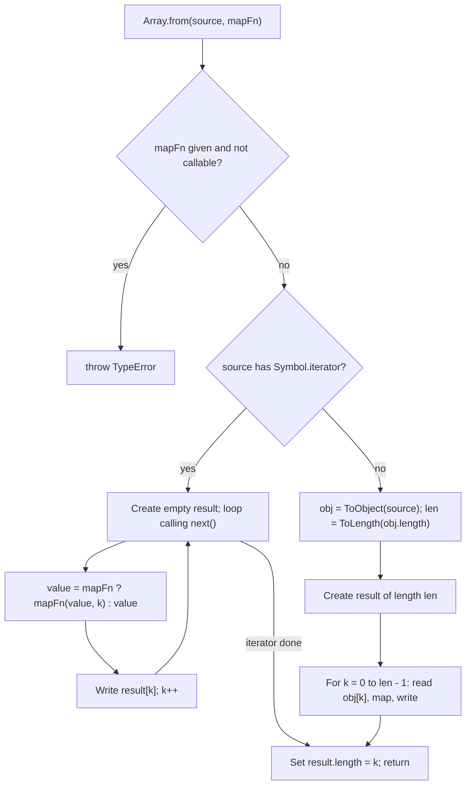

## Introduction

A lot of data in JavaScript *looks* like a list without being an array. A string can be indexed with brackets. A function's `arguments` object has numbered properties and a `length`. A browser's `document.querySelectorAll` returns a `NodeList`. A `Set` holds a collection of values, and a generator produces a sequence of them. None of these has the full set of array methods: you cannot call `.map` on a `Set`, and a `NodeList` has `forEach` but no `filter`.

This raises two everyday questions, and JavaScript has a dedicated static method for each.

The first is **"is this value an array?"** — for example when a function accepts either one item or a list of items. `typeof` cannot answer it, because arrays are objects. **`Array.isArray(value)`** answers it reliably.

The second is **"how do I turn this list-shaped thing into an array?"** **`Array.from(value)`** builds a new, real array from any **iterable** (something a `for...of` loop can walk) or any **array-like** (an object with a `length` and numbered properties). It also takes an optional mapping function, which makes it the standard way to build arrays of a given size: `Array.from({ length: 5 }, (_, i) => i)` gives `[0, 1, 2, 3, 4]`.

A third method, **`Array.of`**, sits beside them. It creates an array from its arguments, and exists to fix one specific trap in the `Array` constructor, where `Array(3)` means "three empty slots" rather than "an array containing 3".

These three are *static* methods: you call them on `Array` itself, not on an array value. This lesson covers each in turn, how they work in the specification, and where they show up in real code.

## Before you start

- **Array basics** — literals, `length`, and why `Array(3)` makes holes. See [[b1-array-basics]].
- **Sparse arrays** — what a hole is, which matters for how `Array.from` treats them. See [[b1-sparse-arrays]].
- **`typeof` and `instanceof`** — the two checks `Array.isArray` replaces. See [[b1-typeof]] and [[b1-instanceof]].
- **Iteration** — `for...of` and the iterable protocol, which `Array.from` relies on. See [[b1-for-of-in]] and [[b1-iterable-protocol]].
- **Callbacks** — the mapping function is called once per element. See [[b1-callbacks-sync]].

All outputs in this lesson are from Node.js 22. Browser-only examples are marked as such and were not run.

## The intuition

Think of `Array.isArray` as checking a passport rather than judging appearance. An object can have a `length`, numbered keys, even `Array.prototype` as its prototype, and still not be an array; a real array from another window can have a different prototype and still be one. `Array.isArray` ignores how the value looks and asks the engine what kind of object it actually is.

Think of `Array.from` as a photocopier for lists. You feed it something list-shaped and it produces a brand-new array holding the same items, in order. It knows two ways to read the original. If the source can be iterated, it reads items one by one the same way `for...of` does. If not, but the source has a `length`, it reads index `0`, `1`, `2`, … up to `length - 1`. Either way the output is a fresh, dense, ordinary array, and changes to it never affect the source.

The copy is shallow: the photocopier copies the list, not the things the list points to. If the items are objects, the new array refers to the same objects. [[b1-copying-arrays]] deals with that in detail.

## `Array.isArray`: asking "is this an array?"

### Why `typeof` cannot answer

Arrays are objects, so `typeof` reports `'object'` for them — the same answer it gives for plain objects, `Date`s, and even `null`:

```javascript title="typeof-fails.js"
console.log(typeof [], typeof {}, typeof null, typeof new Date());
console.log(Array.isArray([]), Array.isArray({}), Array.isArray(null));
```

```output
object object object object
true false false
```

`typeof` was designed to tell primitives apart (strings, numbers, booleans and so on), not to classify objects. `Array.isArray` was added in ES5 precisely because there was no reliable built-in way to ask the question.

### What counts as an array

`Array.isArray` returns `true` only for genuine arrays — the special kind of object the specification calls an **Array exotic object**, whose `length` updates automatically as elements are added. Anything that merely resembles an array returns `false`:

```javascript title="is-array.js"
const like = { 0: 'a', 1: 'b', length: 2 };

console.log(Array.isArray([]));                    // a literal
console.log(Array.isArray(new Array(3)));          // holes, but still an array
console.log(Array.isArray(Array.prototype));       // a historical quirk
console.log(Array.isArray(like));                  // array-like object
console.log(Array.isArray('ab'));                  // a string
console.log(Array.isArray(new Uint8Array(2)));     // a typed array
console.log(Array.isArray(new Set([1])));          // a Set
console.log(Array.isArray(new Proxy([], {})));     // a proxy around an array
```

```output
true
true
true
false
false
false
false
true
```

Three results deserve a comment.

**`Array.prototype` is itself an array.** For backward compatibility, the specification makes the prototype object of `Array` an Array exotic object with `length` `0`. You will rarely meet this, but it is a favourite trivia question.

**Typed arrays are not arrays.** `Uint8Array`, `Float64Array` and their siblings are fixed-length views over raw binary memory ([[b1-arraybuffer]]). They share many method names with arrays — `map`, `filter`, `includes` — but they are a separate family of objects, so `Array.isArray` says `false`. If your code needs to accept both, check for them explicitly with `ArrayBuffer.isView(value)`, or convert with `Array.from`.

**A `Proxy` wrapping an array counts.** A proxy ([[b1-proxy]]) is an object that intercepts operations on another object, its *target*. The specification's `IsArray` check looks through the proxy to its target, so `Array.isArray(new Proxy([], {}))` is `true`. This matters in practice because some state libraries — Vue 3's reactivity and Immer's drafts, for example — hand you proxies of your arrays, and `Array.isArray` keeps working on them.

### Why `instanceof Array` is not enough

`value instanceof Array` asks a different question: "is `Array.prototype` somewhere on this object's prototype chain?" ([[b1-prototype-chain]]). Most of the time the two answers agree, but they can disagree in both directions.

They disagree when the array comes from another **realm**. A realm is a separate global environment with its own set of built-ins: every `<iframe>` has one, as do Web Workers and Node.js `vm` contexts. An array created inside an iframe has *that* iframe's `Array.prototype` on its chain, not yours, so `instanceof Array` in the parent page returns `false`. Node's `vm` module lets us reproduce this without a browser:

```javascript title="realms.mjs"
import vm from 'node:vm';

const context = vm.createContext({});
const foreign = vm.runInContext('[1, 2]', context);
const ForeignArray = vm.runInContext('Array', context);

console.log(foreign instanceof Array);
console.log(Array.isArray(foreign));
console.log(foreign instanceof ForeignArray);
```

```output
false
true
true
```

The array is perfectly normal — it is just an instance of a *different* `Array` constructor. `Array.isArray` does not look at prototypes at all, so it gives the right answer.

They also disagree when an object borrows `Array.prototype` without being an array:

```javascript title="fake-array.js"
const fake = Object.create(Array.prototype);
console.log(fake instanceof Array, Array.isArray(fake));
fake.push('x');
console.log(fake.length, fake[0]);
```

```output
true false
1 x
```

`fake` inherits `push`, so `push` runs and writes `length` as an ordinary property. But `fake` is not an Array exotic object: setting `fake[5] = 'y'` would not update its `length`. `instanceof` is fooled; `Array.isArray` is not.

> [!NOTE] What about `Object.prototype.toString`?
> Before ES5, the standard trick was `Object.prototype.toString.call(value) === '[object Array]'`. It works across realms, but since ES2015 any object can claim a tag with `Symbol.toStringTag` ([[b1-tostringtag]]), so `{ [Symbol.toStringTag]: 'Array' }` would pass a check for `'[object Array]'`. For a real array the default tag does come from the same internal check, but there is no reason to use the trick in new code.

### Using it: functions that accept "one or many"

The most common use of `Array.isArray` is normalising input. Many APIs accept either a single value or a list, such as a `className` prop that may be a string or an array of strings, or an `addRecipients(to)` function. Normalising at the boundary means the rest of the function deals with only one shape:

```javascript title="one-or-many.js"
function toList(value) {
  if (value === undefined || value === null) return [];
  return Array.isArray(value) ? value : [value];
}

console.log(toList('ana@example.com'));
console.log(toList(['ana@example.com', 'ben@example.com']));
console.log(toList(undefined));
```

```output
[ 'ana@example.com' ]
[ 'ana@example.com', 'ben@example.com' ]
[]
```

Note that when the input is already an array, `toList` returns *the same array*, not a copy. If the caller's array must not be changed later, the function should copy it (`[...value]`).

In TypeScript, `Array.isArray` is declared as a type guard (`arg is any[]`), so inside the `true` branch the compiler narrows the variable to an array type. The narrowed element type is `any`, so it is worth annotating the element type yourself when you can.

## Iterables and array-likes

Before looking at `Array.from`, it helps to name precisely the two kinds of input it accepts, because they behave differently.

An **iterable** is an object with a `[Symbol.iterator]` method that returns an iterator — an object whose `next()` method hands out values one at a time ([[b1-iterators]]). Arrays, strings, `Set`s, `Map`s, typed arrays, `arguments`, browser `NodeList`s, and the objects returned by generator functions are all iterable. Iterables are what `for...of` and spread (`[...x]`) consume.

An **array-like** is any object with a numeric `length` property, from which elements are read by index: `obj[0]`, `obj[1]`, and so on. There is no method to call; the "list" is just a convention about property names. `{ 0: 'a', 1: 'b', length: 2 }` is the textbook example. Strings, `arguments` and `NodeList`s are *both* iterable and array-like.

The distinction matters because the spread syntax only accepts iterables, while `Array.from` accepts both:

```javascript title="spread-vs-from.js"
const like = { 0: 'a', 1: 'b', length: 2 };

console.log(Array.from(like));
try {
  console.log([...like]);
} catch (error) {
  console.log(`${error.name}: ${error.message}`);
}
```

```output
[ 'a', 'b' ]
TypeError: like is not iterable
```

Pure array-likes (not iterable) are rare in modern code, but they exist: objects from older libraries, `jQuery` collections in older versions, and objects that you build yourself, such as `{ length: 5 }` in the range trick below.

## `Array.from`: building an array from anything list-shaped

### The signature

```javascript title="signature (not runnable)"
Array.from(source, mapFn, thisArg)
```

`source` is the iterable or array-like to copy. `mapFn` is optional: if you pass it, each element is passed through it on the way in, and its return value is stored instead. It receives `(element, index)`. `thisArg` is the value of `this` inside `mapFn`, and is only relevant for regular `function` callbacks; arrow functions ignore it. The return value is always a new array.

### Converting common sources

Here are the conversions you will meet most, each producing an ordinary array with every array method available:

```javascript title="sources.js"
console.log(Array.from('héllo'));
console.log(Array.from(new Set(['a', 'b', 'a'])));
console.log(Array.from(new Map([['x', 1], ['y', 2]])));
console.log(Array.from(new Map([['x', 1], ['y', 2]]).keys()));

function collect() {
  return Array.from(arguments);
}
console.log(collect(1, 2, 3));

function* countdown(n) {
  while (n > 0) yield n--;
}
console.log(Array.from(countdown(3)));
console.log(Array.from(new Uint8Array([7, 8])));
```

```output
[ 'h', 'é', 'l', 'l', 'o' ]
[ 'a', 'b' ]
[ [ 'x', 1 ], [ 'y', 2 ] ]
[ 'x', 'y' ]
[ 1, 2, 3 ]
[ 3, 2, 1 ]
[ 7, 8 ]
```

Walking through them: a string is iterated **by code point**, so each character becomes an element. A `Set` yields its values in insertion order, and because a `Set` already dropped the duplicate `'a'`, `Array.from(new Set(list))` is the classic one-line de-duplication ([[b1-set]]). A `Map` yields `[key, value]` pairs; to get only keys or values, convert `map.keys()` or `map.values()` instead ([[b1-map]]). `arguments` is the array-like, iterable object available inside regular functions; in modern code a rest parameter (`...args`, [[b1-spread-rest]]) gives you a real array directly. A generator object is iterated until it finishes. A typed array becomes a normal array of numbers, which you might want before calling `JSON.stringify` or `concat`.

Iterating a string by code point has a useful consequence for text containing emoji or other characters outside the Basic Multilingual Plane. Such characters take two UTF-16 code units, so `length` counts them as two and `split('')` breaks them apart. `Array.from` keeps them whole ([[b1-unicode-strings]]):

```javascript title="code-points.js"
const text = 'a👍';
console.log(text.length);
console.log(text.split(''));
console.log(Array.from(text), Array.from(text).length);
```

```output
3
[ 'a', '\ud83d', '\udc4d' ]
[ 'a', '👍' ] 2
```

This is closer to "the number of characters", but not exactly: some visible characters (flags, family emoji, letters with separate combining accents) are several code points long. Counting what a user sees as one character requires `Intl.Segmenter`.

### Converting DOM collections

In the browser, `document.querySelectorAll` returns a static `NodeList`, and `element.children` returns a live `HTMLCollection`. Both are array-like and iterable. A `NodeList` has `forEach`, but neither has `map`, `filter` or `reduce`. Converting gives you all of them:

```javascript title="dom.js (browser only, not run)"
const links = Array.from(document.querySelectorAll('a[href]'));
const external = links
  .map((link) => link.href)
  .filter((href) => !href.startsWith(location.origin));
```

There is a second reason to convert an `HTMLCollection`: it is **live**, meaning it updates as the document changes. Looping over `parent.children` while removing children skips elements, because the collection shrinks under the loop. `Array.from(parent.children)` takes a snapshot first, so the loop sees a fixed list.

### The mapping function

`mapFn` lets you convert and transform in one step:

```javascript title="map-fn.js"
console.log(Array.from('abc', (char) => char.toUpperCase()));
console.log(Array.from(new Set(['a', 'b']), (value, index) => `${index}:${value}`));
console.log(Array.from([1, 2, 3], function (x) {
  return x * this.factor;
}, { factor: 10 }));
```

```output
[ 'A', 'B', 'C' ]
[ '0:a', '1:b' ]
[ 10, 20, 30 ]
```

`Array.from(source, fn)` gives the same result as `Array.from(source).map(fn)`, with one difference worth knowing: it does not create the intermediate array. For a large `NodeList` or `Set` that is one less full-size allocation. Unlike the `map` method, `mapFn` receives only two arguments — the element and its index — not the source as a third.

### Making arrays of a given length

Because `{ length: n }` is an array-like with `n` missing entries, `Array.from({ length: n }, fn)` calls `fn(undefined, i)` for `i` from `0` to `n - 1`. This is the idiomatic way to build arrays of a known size:

```javascript title="ranges.js"
console.log(Array.from({ length: 3 }));
console.log(Array.from({ length: 5 }, (_, i) => i));
console.log(Array.from({ length: 5 }, (_, i) => 10 + i * 5));

const range = (start, end, step = 1) =>
  Array.from({ length: Math.max(0, Math.ceil((end - start) / step)) },
    (_, i) => start + i * step);

console.log(range(1, 10, 3), range(5, 0, -2), range(3, 3));
```

```output
[ undefined, undefined, undefined ]
[ 0, 1, 2, 3, 4 ]
[ 10, 15, 20, 25, 30 ]
[ 1, 4, 7 ] [ 5, 3, 1 ] []
```

Two details matter here. First, without a mapping function the result is three real `undefined` elements, not three holes — `Array.from` always writes every index, so its output is **dense**. That is why `Array.from({ length: 3 }).map(...)` works while `Array(3).map(...)` does not ([[b1-sparse-arrays]]). Second, the function runs once per index, so `Array.from({ length: 3 }, () => [])` produces three *separate* inner arrays, whereas `Array(3).fill([])` puts the same array in every slot. The underscore `_` is only a naming convention for "a parameter I do not use".

The `range` helper uses `Math.ceil` so that a step that does not divide the distance evenly still includes the last value before `end`, and `Math.max(0, …)` so that a range pointing the wrong way is empty instead of throwing. JavaScript has no built-in range function; this one-liner, or a generator, fills the gap.

### Edge cases worth knowing

`Array.from` reads `length` through the specification's **ToLength** conversion: it converts the value to a number, rounds towards zero, and clamps negative numbers to `0`. If the result exceeds the maximum array length (`2 ** 32 - 1`), creating the result array throws. And `source` must not be `null` or `undefined`:

```javascript title="edge-cases.js"
console.log(Array.from({ length: '2' }), Array.from({ length: 2.7 }));
console.log(Array.from({ length: -1 }), Array.from({}), Array.from(5));
console.log(Array.from([1, , 3]));

try {
  Array.from(null);
} catch (error) {
  console.log(error.name);
}
try {
  Array.from({ length: 2 ** 32 });
} catch (error) {
  console.log(`${error.name}: ${error.message}`);
}
```

```output
[ undefined, undefined ] [ undefined, undefined ]
[] [] []
[ 1, undefined, 3 ]
TypeError
RangeError: Invalid array length
```

A number like `5` is neither iterable nor has a `length`, so it becomes an object with `length` `undefined`, which converts to `0`: the result is an empty array, not an error. Holes in a sparse source come out as `undefined`, because the array iterator reads every index. And if a value is *both* iterable and has a `length`, the iterator wins and `length` is ignored.

> [!WARNING] Infinite iterables never finish
> `Array.from` keeps calling `next()` until the iterator says it is done. Passing a generator that never ends — an ID generator, a `while (true)` loop — hangs the program while memory grows. Take only what you need with a loop that stops, or, in runtimes with iterator helpers (Node.js 22, recent browsers), `Array.from(gen().take(10))`.

## `Array.of`: a constructor without the trap

The `Array` constructor changes meaning with its arguments. With one numeric argument it sets the *length* and creates holes; with anything else it uses the arguments as elements:

```javascript title="array-of.js"
console.log(Array(3), Array(1, 2), Array('3'));
console.log(Array.of(3), Array.of(1, 2), Array.of('3'));
console.log(Array.of(), Array.of(undefined));

try {
  Array(-1);
} catch (error) {
  console.log(`${error.name}: ${error.message}`);
}
console.log(Array.of(-1));
```

```output
[ <3 empty items> ] [ 1, 2 ] [ '3' ]
[ 3 ] [ 1, 2 ] [ '3' ]
[] [ undefined ]
RangeError: Invalid array length
[ -1 ]
```

**`Array.of(...items)`** always treats its arguments as elements, whatever their number or type. In everyday code an array literal `[3]` does the same job and is clearer, so `Array.of` is rare in application code. Its real use is where a *function* is needed rather than syntax — for example in generic code that receives an array constructor and must build an instance of it, which leads to the next point.

## Subclasses and `Array.fromAsync`

`from` and `of` use `this` as the constructor for the result. Called on `Array`, that is `Array`; called on a subclass, it builds an instance of the subclass:

```javascript title="subclass.js"
class Stack extends Array {
  peek() {
    return this[this.length - 1];
  }
}

const stack = Stack.from([1, 2, 3]);
console.log(stack instanceof Stack, stack.peek());
console.log(Stack.of(7));
```

```output
true 3
Stack(1) [ 7 ]
```

This is the reason these methods are static and `this`-aware: a subclass gets correctly typed factory methods for free ([[b1-class-inheritance]]). In practice, subclassing `Array` is uncommon; a class that *contains* an array is usually simpler.

Async sources need a different method. **`Array.fromAsync`** accepts an async iterable (such as an `async function*` generator, or a paginated API client that yields pages) or a list of promises, awaits each value, and returns a promise for the array. It shipped in Node.js 22 and current major browsers, and is newer than the rest of this lesson, so check your target runtimes before relying on it:

```javascript title="from-async.mjs"
async function* pages() {
  yield ['a', 'b'];
  yield ['c'];
}

console.log(await Array.fromAsync(pages()));
console.log(await Array.fromAsync([Promise.resolve(1), 2]));
```

```output
[ [ 'a', 'b' ], [ 'c' ] ]
[ 1, 2 ]
```

Unlike `Promise.all`, `Array.fromAsync` awaits values one after another, not concurrently ([[b1-async-iterators]], [[b1-promise-all]]).

## How it works internally

### `Array.isArray`

The specification defines `Array.isArray(arg)` as the abstract operation **IsArray**, which is short:

1. If `arg` is not an object, return `false`.
2. If `arg` is an Array exotic object, return `true`.
3. If `arg` is a Proxy, follow it to its target and repeat (throwing a `TypeError` if the proxy has been revoked).
4. Otherwise return `false`.

No prototype, no `length`, no tag is consulted. "Array exotic object" is a property of how the object was *created* — by an array literal, the `Array` constructor, or an array method — which is why it survives being passed across realms and cannot be faked.

### `Array.from`

The algorithm chooses one of two paths:



On the iterable path, the final length is not known in advance, so the result is grown one element at a time, as `push` would. On the array-like path, `length` is read once at the start, so properties added to the source during the copy beyond that length are not seen. In both paths, elements are written with property *definition* (`CreateDataProperty`), not assignment, so setters on a subclass's prototype are not triggered.

The `ToObject` step is what makes `Array.from(5)` return `[]` and `Array.from(null)` throw: numbers and strings can be wrapped in objects, but `null` and `undefined` cannot.

### Cost

Both paths visit each element once, so `Array.from` is O(n) time and allocates one new array of n slots: O(n) extra space. The copy is shallow, so objects are not duplicated, only references to them. Engines optimise the common cases — for example, V8 has fast paths for converting arrays and strings — but the complexity does not change.

## Worked example: normalising tag input

A form library receives tags from several places: a single string from a text input, an array from a JSON payload, a `Set` from an autocomplete widget, and occasionally `null`. It should produce a clean array of unique, trimmed, lower-case tags without mutating whatever the caller passed in.

```javascript title="normalize-tags.js"
function isIterable(value) {
  return value != null && typeof value[Symbol.iterator] === 'function';
}

function normalizeTags(input) {
  let raw;
  if (input == null) {
    raw = [];
  } else if (typeof input === 'string') {
    // A string is iterable, but we want it whole, split on commas
    raw = input.split(',');
  } else if (Array.isArray(input) || isIterable(input)) {
    raw = Array.from(input);
  } else {
    throw new TypeError(`Expected string or iterable of tags, got ${typeof input}`);
  }

  const cleaned = raw
    .map((tag) => String(tag).trim().toLowerCase())
    .filter((tag) => tag !== '');

  return Array.from(new Set(cleaned));
}

console.log(normalizeTags('JS, react ,  , js'));
console.log(normalizeTags(['Node', 'node', 'Deno']));
console.log(normalizeTags(new Set(['CSS'])));
console.log(normalizeTags(null));
try {
  normalizeTags(42);
} catch (error) {
  console.log(error.message);
}
```

```output
[ 'js', 'react' ]
[ 'node', 'deno' ]
[ 'css' ]
[]
Expected string or iterable of tags, got number
```

Walking through it: the function first handles `null` and `undefined` with `== null`, which matches both. Strings are checked *before* the iterable test on purpose — a string is iterable, and `Array.from('JS, react')` would split it into characters, which is not what a comma-separated tag field means. That ordering is the most common bug in "accept anything" functions.

For arrays and other iterables, `Array.from(input)` makes a copy, so the `map` and `filter` that follow can never affect the caller's data (here they do not mutate anyway, but the copy also protects against later changes). The `Array.isArray(input) ||` part is technically redundant, since arrays are iterable, but it documents the most expected input. Finally, `Array.from(new Set(cleaned))` removes duplicates while keeping first-seen order: `'js'` appears twice in the first call and once in the result.

A number like `42` is rejected loudly rather than turned into `[]`, which is what `Array.from(42)` would quietly do. Accepting silent nonsense at a boundary only moves the bug somewhere harder to find.

## In real systems

**Input normalisation.** Library code commonly uses `Array.isArray` to accept "one or many": middleware lists, `className` utilities such as `clsx` that accept strings, arrays and objects, and request handlers that receive a query parameter either once (`?id=1`, a string) or several times (`?id=1&id=2`, an array, in many Node.js query parsers).

**Validation and serialisation.** JSON schema validators, deep-equality functions, deep-clone implementations ([[b1-impl-deep-clone]]) and loggers all walk unknown values and must branch on "array, plain object or primitive". `Array.isArray` is the array branch, because those values may come from another realm (an iframe, or the `vm` sandboxes that test runners such as Jest use).

**DOM work.** `Array.from(document.querySelectorAll(...))` is the standard bridge from DOM collections to array methods, and snapshotting a live `HTMLCollection` prevents skipped elements when removing nodes in a loop.

**Data conversion.** `Array.from(map.entries())` before sorting a `Map` by value, `Array.from(new Set(ids))` for de-duplication, `Array.from(typedArray)` before sending binary data through JSON, and `Array.from({ length: pageCount }, (_, i) => i + 1)` for pagination buttons or skeleton placeholders in UI code.

## Trade-offs and alternatives

| Task | Options | Prefer |
|---|---|---|
| Check for an array | `Array.isArray`, `instanceof Array`, `Object.prototype.toString` | `Array.isArray` — works across realms, cannot be faked |
| Iterable to array | `Array.from(x)`, `[...x]` | Either; spread is shorter, `Array.from` reads better with a mapping function |
| Array-like (not iterable) to array | `Array.from(x)`, `Array.prototype.slice.call(x)` | `Array.from`; the `slice.call` idiom predates ES2015 |
| Convert and transform | `Array.from(x, fn)`, `[...x].map(fn)` | `Array.from(x, fn)` avoids an intermediate array |
| Array of n computed values | `Array.from({ length: n }, fn)`, `Array(n).fill().map(fn)`, a `for` loop | `Array.from`; a loop for hot paths |
| Array from given values | `[a, b]`, `Array.of(a, b)` | The literal; `Array.of` when a function is required |

Spread and `Array.from` differ in more than syntax. Spread fails on pure array-likes, while `Array.from` handles them. Spread also composes several sources at once (`[...a, x, ...b]`), which `Array.from` cannot do in one call.

Converting has a cost: a full copy of the source. If you only need to loop once, `for...of` over the original iterable avoids the allocation entirely, and a `Set` can answer membership questions (`has`) faster than an array's `includes` — so converting a `Set` to an array just to search it is a step backwards ([[b1-set-vs-array]]).

`Array.isArray` is also not always the right check. If a function should accept *any* iterable — arrays, `Set`s, generators — check for `Symbol.iterator` instead, as the worked example does, so callers are not forced to convert first.

## Common mistakes

> [!MISTAKE] Checking arrays with `typeof`
> `typeof value === 'object'` is `true` for arrays, plain objects, `Date`s and `null`. Code that branches on it treats arrays as objects (iterating `Object.keys`) and crashes on `null`. Use `Array.isArray(value)` for arrays and handle `null` explicitly.

**Relying on `instanceof Array` for values from elsewhere.** Arrays created in an iframe or a `vm` sandbox fail `instanceof Array` in the code that receives them. Use `Array.isArray`.

**Expecting `Array.isArray` to accept typed arrays.** A `Float32Array` returns `false`. Check `ArrayBuffer.isView(value)` as well, or convert with `Array.from`.

**Passing a string to code that expects an iterable of strings.** `Array.from('hello')` is `['h', 'e', 'l', 'l', 'o']`. When a function accepts "a tag or tags", test for strings first.

**Spreading an array-like.** `[...{ length: 2 }]` throws `TypeError: ... is not iterable`. Use `Array.from`.

**Using `Array(n).map(fn)` to build a range.** `map` skips holes, so the result is still `n` holes. Use `Array.from({ length: n }, fn)`.

**Using `fill` with an object.** `Array(3).fill([])` stores one shared array three times. `Array.from({ length: 3 }, () => [])` creates three.

**Treating `Array.from` as a deep copy.** It copies the list, not the objects in it. See [[b1-copying-arrays]].

**Converting an infinite or very large iterable.** `Array.from` reads until the iterator finishes; an infinite generator never does.

## Interview perspective

Interviewers use these methods to check that you know arrays are objects, that you understand iterables versus array-likes, and that you know the classic constructor trap.

> [!INTERVIEW] What a strong answer sounds like
> "`typeof []` is `'object'`, so I use `Array.isArray`, which checks the internal kind of the object — it works across iframes and through proxies, unlike `instanceof Array`. `Array.from` copies any iterable or array-like into a new, dense array, and takes a mapping function, so `Array.from({ length: n }, (_, i) => i)` is my range idiom. `Array.of(3)` is `[3]`, whereas `Array(3)` is three holes."

Questions you should be able to answer:

- **Why not `instanceof Array`?** Each realm has its own `Array` constructor; arrays from another realm fail the prototype check. And `Object.create(Array.prototype)` passes it without being an array.
- **Is a typed array an array?** No. `Array.isArray(new Uint8Array())` is `false`; use `ArrayBuffer.isView`.
- **What is the difference between an iterable and an array-like?** An iterable has `[Symbol.iterator]`; an array-like has `length` and indexed properties. Spread requires the first; `Array.from` accepts either and prefers the iterator.
- **What does `Array.from({ length: 3 })` return, and how does it differ from `Array(3)`?** Three `undefined` elements versus three holes; `map` works on the first and skips the second.
- **How do you de-duplicate an array?** `Array.from(new Set(arr))` or `[...new Set(arr)]` — O(n), keeps first-seen order, compares with SameValueZero (so `NaN` de-duplicates, but two different objects with equal contents do not).
- **What does `Array.from('👍')` return?** `['👍']`, one element, because strings iterate by code point, while `'👍'.length` is `2`.

A follow-up to expect: *"Write a polyfill for `Array.isArray`."* The pre-ES5 answer is `Object.prototype.toString.call(x) === '[object Array]'`; a good answer adds that this is why it was used historically, and that a userland polyfill cannot see through proxies the way the real one does.

```quiz
Q: Which call returns `true`?
- [ ] `Array.isArray({ 0: 'a', length: 1 })`
- [ ] `Array.isArray(new Uint8Array(4))`
- [x] `Array.isArray(new Proxy([1, 2], {}))`
- [ ] `Array.isArray(Object.create(Array.prototype))`
> `IsArray` returns `true` for genuine Array exotic objects and follows a proxy to its target, which here is an array. An array-like object and an object that merely inherits from `Array.prototype` are ordinary objects. Typed arrays are a separate family of objects, so they return `false` even though they share many method names.
```

```quiz
Q: What does `Array.from({ length: 3 }, () => [])` produce that `Array(3).fill([])` does not?
- [ ] An array of length 3 instead of a sparse array
- [x] Three distinct inner arrays instead of one array referenced three times
- [ ] Inner arrays that are frozen
- [ ] Nothing; the two are equivalent
> The mapping function runs once per index, so each call to `() => []` creates a new array. `fill([])` evaluates `[]` once and writes that same reference into every slot, so pushing into one "row" changes them all. Both results have length 3 and no holes, which is why the first option is a tempting but wrong answer.
```

```quiz
Q: Why does `[...{ 0: 'a', length: 1 }]` throw, while `Array.from({ 0: 'a', length: 1 })` returns `['a']`?
- [ ] Spread does not work on objects with numeric keys
- [ ] `Array.from` converts the object to JSON first
- [x] Spread requires an iterable; `Array.from` falls back to reading `length` and indexes
- [ ] The object has a hole at index 1
> Spread asks the value for its `[Symbol.iterator]` method and throws a `TypeError` when there is none. `Array.from` checks for an iterator first, and when there is none it treats the value as an array-like: it reads `length`, then each index from `0` to `length - 1`.
```

## Practice

1. Write `isPlainList(value)` that returns `true` for arrays and typed arrays and `false` for everything else, including array-like objects. Test it with an array from a `vm` context.
2. Using only `Array.from`, produce: the even numbers from 0 to 20; a 3 × 3 grid of `0`s with independent rows; the letters `'a'` to `'z'` (hint: `String.fromCharCode`).
3. Given a `Map` of product names to prices, return an array of names sorted by price, without changing the map.
4. Write a generator `naturals()` that yields 1, 2, 3, … forever. Collect the first 10 values into an array without hanging, both with a loop and (in Node.js 22) with `take`.
5. Explain, step by step, what `Array.from({ length: 2, 0: 'x', 1: 'y', 2: 'z' })` returns and why `'z'` is missing.
6. Rewrite `Array.prototype.slice.call(arguments, 1)` in modern JavaScript in two different ways.

## Quick revision {#quick-revision}

- `typeof []` is `'object'`; use `Array.isArray(x)` to detect arrays.
- `Array.isArray` checks the internal kind (Array exotic object), follows proxies, works across realms (iframes, workers, `vm`), and ignores prototypes and tags.
- `false` for array-likes, strings, `Set`s, typed arrays (`ArrayBuffer.isView` detects those) and `Object.create(Array.prototype)`; `true` for `Array.prototype` itself.
- `instanceof Array` fails across realms and can be fooled by prototype tricks.
- Iterable: has `[Symbol.iterator]` (arrays, strings, Sets, Maps, `arguments`, `NodeList`, generators). Array-like: has `length` and indexed properties.
- `Array.from(source, mapFn?, thisArg?)` returns a new, dense, shallow copy; iterator path first, otherwise `ToLength(length)` and indexes.
- `mapFn(element, index)` transforms during the copy without an intermediate array.
- Strings convert by code point: `Array.from('a👍')` has 2 elements; `'a👍'.length` is 3.
- `Array.from({ length: n }, (_, i) => …)` builds ranges and grids; one fresh value per index.
- `Array.from(null)` throws; `Array.from(5)` is `[]`; holes become `undefined`; infinite iterables hang.
- Spread works only on iterables; `Array.from` also takes array-likes.
- `Array.of(3)` is `[3]`; `Array(3)` is three holes; `Array(-1)` throws `RangeError`.
- `from` and `of` build instances of the subclass they are called on.
- `Array.fromAsync` (Node.js 22+) awaits async iterables or promises sequentially and returns a promise.

## Key takeaways {#key-takeaways}

- Arrays are objects, so detecting them needs `Array.isArray`, which asks what an object *is* rather than what it looks like or inherits from.
- `Array.from` is the universal converter: anything iterable or array-like becomes a new, ordinary, dense array with every array method available.
- Its mapping function makes `Array.from({ length: n }, fn)` the idiomatic way to build ranges and arrays of independent objects.
- Spread is a shorter conversion for iterables only; pure array-likes need `Array.from`.
- `Array.of` removes the ambiguity of `Array(n)` by always treating its arguments as elements.
- Every conversion is a shallow O(n) copy — convert when you need array methods or a snapshot, not by habit.
