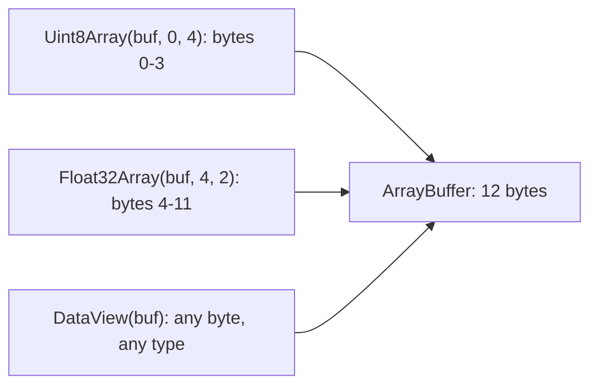

## Introduction

Most JavaScript values are far from the machine. A string is a sequence of UTF-16 code units, a number is always a 64-bit float, and an array is a flexible list that can hold anything. That is ideal for application logic and poor for one important job: working with **bytes**. An image file, an audio sample, a compressed archive, a WebAssembly module's memory, a message on a binary WebSocket protocol, the body of a `fetch` response — all of these are sequences of bytes in a precise layout, and you need to read "the 4-byte unsigned integer at position 16" or write "this float as 4 bytes, little-endian".

A regular array of numbers cannot do that. `[255, 1]` stores two 64-bit floats with no notion of byte width or layout, and every element could also be a string. JavaScript's answer, standardised in ECMAScript 2015, is a small family of objects:

- **ArrayBuffer** — a fixed-length block of raw bytes. It has no methods to read or write those bytes by itself.
- **Typed arrays** such as `Uint8Array`, `Int16Array` and `Float64Array` — array-like **views** that interpret the buffer's bytes as a sequence of numbers of one fixed type.
- **DataView** — a view that reads and writes any numeric type at any byte position, with explicit control over byte order. It is the tool for binary formats that mix field types.

You will meet these whenever JavaScript touches the outside world in binary: `response.arrayBuffer()`, `blob.arrayBuffer()` ([[b1-blob-file-js]]), Canvas pixel data (`ImageData.data` is a `Uint8ClampedArray`), Web Audio sample buffers, WebGL vertex data, crypto APIs, Node.js `Buffer` (a subclass of `Uint8Array`), and passing large data to workers without copying.

## Before you start

- **Numbers in JavaScript** — that `number` is a 64-bit floating-point value and what that means for precision. See [[b1-number-representation]] and [[b1-floating-point]].
- **Binary and hexadecimal** — reading `0xff` as 255, and that one byte holds 0–255. [[b1-bitwise-operators]] covers this.
- **BigInt** — needed only for the 64-bit integer arrays. See [[b1-bigint]].
- **Strings and Unicode** — that text must be encoded to become bytes. See [[b1-unicode-strings]].

## The intuition

Think of an ArrayBuffer as a strip of numbered boxes, each holding one byte. The strip itself has no opinion about what the boxes mean. A **view** is a transparent overlay laid on the strip that groups boxes and reads them as numbers: a `Uint8Array` overlay reads each box as an integer from 0 to 255; a `Uint32Array` overlay reads every four boxes as one integer up to about four billion; a `Float64Array` overlay reads every eight boxes as one floating-point number.

You can lay several overlays on the same strip at once. Writing through one overlay changes the boxes, so every other overlay immediately reads different numbers. That is the core rule of this whole API: **views do not hold data; the buffer does.** The analogy stops working in one place: real overlays cannot misalign, but here alignment matters — a `Float64Array` overlay must start at a box number divisible by 8, as you will see.

## ArrayBuffer and typed arrays

Creating a buffer allocates zero-filled bytes. To do anything with them, create a view:

```javascript title="shared-memory.js"
const buffer = new ArrayBuffer(8);
console.log(buffer.byteLength, buffer[0]);

const bytes = new Uint8Array(buffer);
const words = new Uint32Array(buffer);
bytes[0] = 255;
bytes[1] = 1;
console.log(bytes.join(' '), '|', words[0], words.length);
```

```output
8 undefined
255 1 0 0 0 0 0 0 | 511 2
```

`buffer[0]` is `undefined` because an ArrayBuffer has no indexed elements; only views do. `bytes` sees 8 one-byte elements and `words` sees 2 four-byte elements over the same memory. After two writes through `bytes`, `words[0]` reads the first four bytes `ff 01 00 00` as one integer. On this machine that is `0x000001ff` = 511, because the computer stores the least significant byte first — **little-endian** order. That detail is explained in the DataView section; for now notice that a typed array uses the platform's byte order, and almost every current CPU (x86-64 and ARM as configured by mainstream operating systems) is little-endian.

You can also create a typed array without mentioning a buffer: `new Uint8Array(4)` allocates a 4-byte buffer for you, and `new Uint8Array([1, 2, 3])` or `Uint8Array.from(iterable)` copies values into a new buffer. Every view exposes its storage through `.buffer`, `.byteOffset` and `.byteLength`.

### The typed array family

| Type | Bytes per element | Range / meaning |
|---|---|---|
| `Int8Array` | 1 | −128 to 127 |
| `Uint8Array` | 1 | 0 to 255 — the general "bytes" type |
| `Uint8ClampedArray` | 1 | 0 to 255, out-of-range values clamped (used for pixels) |
| `Int16Array` / `Uint16Array` | 2 | −32,768 to 32,767 / 0 to 65,535 |
| `Int32Array` / `Uint32Array` | 4 | about ±2.1 billion / 0 to about 4.3 billion |
| `Float32Array` | 4 | single-precision float, about 7 significant digits |
| `Float64Array` | 8 | double-precision float — the same as a JavaScript `number` |
| `BigInt64Array` / `BigUint64Array` | 8 | 64-bit integers, read and written as `BigInt` |

ES2025 adds `Float16Array` (2 bytes, used in graphics and machine learning). It is shipping in recent browsers but not in Node.js 22, so check support before using it. Each constructor has a `BYTES_PER_ELEMENT` property with the size from the table.

### What happens to values that do not fit

A typed array element has a fixed width, so assigning a value outside its range cannot store it as-is. The rules differ by type, and knowing them prevents silent data corruption:

```javascript title="conversions.js"
const u8 = new Uint8Array(3);
u8[0] = 256;
u8[1] = -1;
u8[2] = 3.9;
console.log(u8.join(' '));

const clamped = new Uint8ClampedArray(3);
clamped[0] = 256;
clamped[1] = -1;
clamped[2] = 3.5;
console.log(clamped.join(' '));

console.log(new Int8Array(new Uint8Array([200]).buffer)[0]);
console.log(new Float32Array([0.1])[0]);

const big = new BigInt64Array(1);
try { big[0] = 1; } catch (error) { console.log(`${error.name}: ${error.message}`); }
```

```output
0 255 3
255 0 4
-56
0.10000000149011612
TypeError: Cannot convert 1 to a BigInt
```

Integer arrays **wrap around**: the value is truncated toward zero and reduced modulo 2⁸ (or 2¹⁶, 2³²), so 256 becomes 0 and −1 becomes 255. `Uint8ClampedArray` instead **clamps** to 0–255 and rounds to the nearest integer (ties to even), which is what you want for colour channels — brightening a pixel past white should give white, not black. The `Int8Array` line shows that a byte has no inherent sign: the bit pattern of 200 read as signed is −56. `Float32Array` has less precision than a JavaScript number, so `0.1` comes back as the nearest 32-bit float. The 64-bit integer arrays accept only `BigInt` values.

### Arrays, but not quite

Typed arrays support most `Array` methods — indexing, `length`, `for...of`, `map`, `filter`, `reduce`, `slice`, `indexOf`, `at`, `sort` — with differences that follow from their fixed layout:

- **Fixed length.** There is no `push`, `pop`, `splice` or `concat`. Writing beyond the end is silently ignored and reading beyond it gives `undefined`.
- **Numeric sort.** `new Uint16Array([3, 20, 100]).sort()` gives `3, 20, 100`, whereas a plain array's default sort compares as strings and gives `100, 20, 3`.
- **`map` keeps the type.** `new Uint8Array([1, 2, 3]).map((x) => x * 100)` gives `100, 200, 44` because 300 wraps to 44. Use `Array.from(typedArray, fn)` when the result should be ordinary numbers.
- **`Array.isArray` is `false`.** Typed arrays are array-like objects, not arrays. Use `ArrayBuffer.isView(x)` to test for any view.

### Views over part of a buffer, and alignment

A view does not have to cover the whole buffer. The full constructor is `new Type(buffer, byteOffset, length)`, where `length` counts elements, not bytes. This is how one buffer can hold a header and a body of different types:

```javascript title="partial-views.js"
const buffer = new ArrayBuffer(12);
const header = new Uint8Array(buffer, 0, 4);  // bytes 0-3
const body = new Float32Array(buffer, 4, 2);  // bytes 4-11
console.log(header.byteOffset, header.length, body.byteOffset, body.length, body.byteLength);

for (const make of [
  () => new Float64Array(new ArrayBuffer(7)),
  () => new Float32Array(buffer, 2),
  () => new Uint8Array(buffer, 10, 4),
]) {
  try { make(); } catch (error) { console.log(`${error.name}: ${error.message}`); }
}
```

```output
0 4 4 2 8
RangeError: byte length of Float64Array should be a multiple of 8
RangeError: start offset of Float32Array should be a multiple of 4
RangeError: Invalid typed array length: 4
```

The three failures are the rules to remember. A multi-byte typed array needs the covered byte length to be a multiple of its element size, its **byteOffset must be aligned** to its element size, and the view must fit inside the buffer. (The error messages are V8's; other engines word them differently.) Alignment exists so the engine can read elements with fast native loads. Real binary formats often put a 4-byte integer at an odd offset, which typed arrays cannot express — another reason DataView exists.

### `subarray` shares, `slice` copies

Both take start and end indices and look alike, but they differ in the one way that matters most for this API:

```javascript title="subarray-vs-slice.js"
const all = new Uint8Array([10, 20, 30, 40, 50]);
const view = all.subarray(1, 3);
const copy = all.slice(1, 3);
view[0] = 99;
copy[1] = 77;
console.log(all.join(' '), '|', view.join(' '), '|', copy.join(' '));
console.log(view.buffer === all.buffer, copy.buffer === all.buffer, view.byteOffset);
```

```output
10 99 30 40 50 | 99 30 | 20 77
true false 1
```

`subarray` creates a new view over the *same* buffer starting at byte 1, so writing through it changed `all`. `slice` copies the bytes into a new buffer. This matters beyond correctness: a tiny `subarray` of a 50 MB download keeps the whole 50 MB buffer alive, because `.buffer` still points to it. If you keep a small piece long-term, `slice` it.

## DataView and byte order

Numbers wider than one byte must be stored as several bytes, and there are two conventions for their order. **Big-endian** stores the most significant byte first, the way we write numbers: `0x12345678` becomes `12 34 56 78`. **Little-endian** stores the least significant byte first: `78 56 34 12`. CPUs mostly use little-endian; many file formats and network protocols (PNG, TCP/IP headers, Java's class files) use big-endian, often called "network byte order"; others (ZIP, BMP, WAV) are little-endian.

A typed array always uses the platform's order, which you cannot choose. A **DataView** is a view with explicit getters and setters — `getUint8`, `getInt16`, `getUint32`, `getFloat32`, `getFloat64`, `getBigInt64` and the matching `set*` methods — each taking a **byte offset** and, for multi-byte types, a `littleEndian` flag. The default when the flag is omitted is **big-endian**, which surprises people on little-endian machines.

```javascript title="endianness.js"
const buffer = new ArrayBuffer(4);
const view = new DataView(buffer);
const hex = () => [...new Uint8Array(buffer)].map((b) => b.toString(16)).join(' ');

view.setUint32(0, 0x12345678);       // big-endian by default
console.log(hex());
view.setUint32(0, 0x12345678, true); // little-endian
console.log(hex());
console.log(view.getUint16(0).toString(16), view.getUint16(0, true).toString(16));

try { view.getUint32(2); } catch (error) { console.log(`${error.name}: ${error.message}`); }
```

```output
12 34 56 78
78 56 34 12
7856 5678
RangeError: Offset is outside the bounds of the DataView
```

The last line fails because a 4-byte read starting at byte 2 of a 4-byte buffer would run past the end (the message is V8's wording). The third line shows the same two bytes `78 56` read both ways. DataView has no alignment requirement: `getUint32(1)` is legal as long as it fits, which is why it suits packed binary formats.

| Use | Choose |
|---|---|
| A long run of same-typed values in platform order (pixels, audio samples, vertex data, WASM memory) | Typed array — fast, indexable, works with array methods |
| A record with mixed field types, odd offsets or a fixed byte order (file headers, protocol messages) | DataView |
| Plain bytes to pass around (network, files, crypto) | `Uint8Array` |

## How it works internally

In the specification, an ArrayBuffer is an object with an internal slot `[[ArrayBufferData]]` that refers to a block of raw memory, plus `[[ArrayBufferByteLength]]`. The memory is usually allocated outside the JavaScript heap's normal object area, so large buffers do not slow down garbage-collection scans of ordinary objects, but they are still freed when the buffer becomes unreachable ([[b1-garbage-collection]]).

A typed array is an object with slots `[[ViewedArrayBuffer]]`, `[[ByteOffset]]`, `[[ArrayLength]]` and `[[TypedArrayName]]`. Element `i` lives at byte `byteOffset + i * BYTES_PER_ELEMENT`. Typed arrays are **exotic objects**: integer-like keys never become ordinary properties, so `ta[10] = 1` on a 3-element array does nothing and `ta['1.5']` is always `undefined`. That predictability is why engines can compile typed-array loops into tight machine code with no type checks per element, and why a `Float64Array` of a million numbers uses 8 MB, while a regular array of a million numbers needs more memory and may change internal representation as you add different kinds of values.



### Copying, transferring and detaching

Buffers often need to move: to a Web Worker, to the main thread from a worker, or into a newly sized buffer. There are three operations, and they cost very different amounts.

```javascript title="clone-transfer.js"
const original = new Uint8Array([1, 2, 3]);
const cloned = structuredClone(original);   // deep copy of the bytes
cloned[0] = 99;
console.log(original[0], cloned[0]);

const moved = structuredClone(original.buffer, { transfer: [original.buffer] });
console.log(original.buffer.byteLength, original.length, moved.byteLength, original.buffer.detached);
console.log(original[0]);
```

```output
1 99
0 0 3 true
undefined
```

**Cloning** with `structuredClone` ([[b1-structured-clone]]) or `postMessage` copies every byte, which is linear in the size. **Transferring** — listing the buffer in the `transfer` option, or in the second argument of `worker.postMessage(msg, [buffer])` — moves ownership of the memory without copying: the receiver gets a buffer with the bytes and the sender's buffer becomes **detached**. A detached buffer has `byteLength` 0, its views have length 0 and read `undefined`, and methods such as `slice` throw `TypeError`. Transfer is how a worker hands a 100 MB decoded image back to the page in constant time ([[b3-worker-transferables]]); the price is that the sender can no longer use it.

ES2024 added two related features. `buffer.transfer(newLength)` moves the bytes into a new buffer of a possibly different size and detaches the old one, and `buffer.detached` reports the state. **Resizable buffers** are created with `new ArrayBuffer(length, { maxByteLength })` and resized in place with `resize()`:

```javascript title="resizable.js"
const growable = new ArrayBuffer(4, { maxByteLength: 16 });
const tracking = new Uint8Array(growable);      // no length given: tracks the buffer
const fixed = new Uint8Array(growable, 0, 4);
growable.resize(12);
console.log(growable.resizable, growable.byteLength, tracking.length, fixed.length);
growable.resize(2);
console.log(tracking.length, fixed.length);
```

```output
true 12 12 4
2 0
```

A view created without an explicit length is **length-tracking**: it grows and shrinks with the buffer. A view with a fixed length that no longer fits becomes **out of bounds** and reports length 0. Resizing past `maxByteLength` throws `RangeError`. Plain `new ArrayBuffer(n)` remains fixed-size. These features need Node.js 20+ or a 2024-era browser.

**SharedArrayBuffer** is the variant whose memory is genuinely shared between threads rather than moved; it is used with `Atomics` for lock-free coordination and by multithreaded WebAssembly. In browsers it is available only on **cross-origin isolated** pages (see [[b3-cross-origin-isolation]]), a restriction added after the Spectre vulnerabilities.

## Worked example: reading a PNG file's dimensions

A PNG file starts with a fixed 8-byte signature, then an `IHDR` chunk: a 4-byte length, the 4 ASCII bytes `IHDR`, then width and height as 4-byte **big-endian** unsigned integers, then single-byte fields. Reading an image's size this way, without decoding the whole image, is what upload services do to reject oversized images early.

```javascript title="png-size.js"
// The first 33 bytes of a 640x480 PNG file, written out by hand.
const pngStart = new Uint8Array([
  0x89, 0x50, 0x4e, 0x47, 0x0d, 0x0a, 0x1a, 0x0a, // 8-byte PNG signature
  0x00, 0x00, 0x00, 0x0d,                         // IHDR chunk data length: 13
  0x49, 0x48, 0x44, 0x52,                         // chunk type "IHDR"
  0x00, 0x00, 0x02, 0x80,                         // width: 640
  0x00, 0x00, 0x01, 0xe0,                         // height: 480
  0x08, 0x06, 0x00, 0x00, 0x00,                   // bit depth, colour type, ...
  0x00, 0x00, 0x00, 0x00,                         // CRC (not checked here)
]);

function readPngSize(bytes) {
  const view = new DataView(bytes.buffer, bytes.byteOffset, bytes.byteLength);
  const signature = [0x89, 0x50, 0x4e, 0x47, 0x0d, 0x0a, 0x1a, 0x0a];
  if (!signature.every((b, i) => bytes[i] === b)) throw new Error('not a PNG');
  const chunkType = new TextDecoder().decode(bytes.subarray(12, 16));
  if (chunkType !== 'IHDR') throw new Error(`expected IHDR, got ${chunkType}`);
  return {
    width: view.getUint32(16),   // PNG integers are big-endian: no flag
    height: view.getUint32(20),
    bitDepth: view.getUint8(24),
    colourType: view.getUint8(25),
  };
}

console.log(readPngSize(pngStart));
try {
  readPngSize(new TextEncoder().encode('GIF89a and some more bytes here...'));
} catch (error) {
  console.log(error.message);
}
```

```output
{ width: 640, height: 480, bitDepth: 8, colourType: 6 }
not a PNG
```

Step by step: the function accepts a `Uint8Array`, which is what you get from `new Uint8Array(await file.arrayBuffer())` or a network chunk. It builds a DataView over **exactly the bytes the input covers** — `bytes.buffer, bytes.byteOffset, bytes.byteLength` — instead of `new DataView(bytes.buffer)`, because the input might be a `subarray` that starts partway through a larger buffer. It checks the signature byte by byte, decodes the 4-byte chunk type as text with `TextDecoder`, then reads the 32-bit width and height with the default big-endian order. Bytes 16–19 are `00 00 02 80`, which is 0x280 = 640. The GIF input fails the signature check before any offsets are trusted. A production parser would also check that the input is at least 26 bytes long; otherwise `getUint32` would throw a `RangeError` on a truncated file.

## Worked example: encoding and decoding a sensor message

Going the other way, here is a compact little-endian wire format for an IoT sensor reading — a 4-byte unsigned ID, a 4-byte float temperature, and a 1-byte battery percentage — 9 bytes instead of about 50 for the equivalent JSON.

```javascript title="sensor-message.js"
// Wire format (little-endian): u32 sensorId | f32 celsius | u8 battery% = 9 bytes
const MESSAGE_SIZE = 9;

function encodeReading({ sensorId, celsius, battery }) {
  const buffer = new ArrayBuffer(MESSAGE_SIZE);
  const view = new DataView(buffer);
  view.setUint32(0, sensorId, true);
  view.setFloat32(4, celsius, true);
  view.setUint8(8, battery);
  return new Uint8Array(buffer);
}

function decodeReading(bytes) {
  const view = new DataView(bytes.buffer, bytes.byteOffset, bytes.byteLength);
  return {
    sensorId: view.getUint32(0, true),
    celsius: view.getFloat32(4, true),
    battery: view.getUint8(8),
  };
}

const packet = encodeReading({ sensorId: 1001, celsius: 21.5, battery: 87 });
console.log([...packet].map((b) => b.toString(16).padStart(2, '0')).join(' '));
console.log(decodeReading(packet));
console.log(decodeReading(encodeReading({ sensorId: 7, celsius: 0.1, battery: 300 })));

// Two messages arrive in one network chunk
const chunk = new Uint8Array(MESSAGE_SIZE * 2);
chunk.set(packet, 0);
chunk.set(encodeReading({ sensorId: 1002, celsius: -4, battery: 12 }), MESSAGE_SIZE);
const second = chunk.subarray(MESSAGE_SIZE);
console.log(decodeReading(second).sensorId);
console.log(new DataView(second.buffer).getUint32(0, true)); // ignores byteOffset
```

```output
e9 03 00 00 00 00 ac 41 57
{ sensorId: 1001, celsius: 21.5, battery: 87 }
{ sensorId: 7, celsius: 0.10000000149011612, battery: 44 }
1002
1001
```

The hex dump shows the layout: `e9 03 00 00` is 1001 (0x3e9) little-endian, `00 00 ac 41` is the float 21.5, and `57` is 87. The third line exposes two edge cases of the format rather than bugs in the code: `0.1` cannot be stored exactly in a 32-bit float, and `setUint8(8, 300)` wraps to 44 because DataView setters convert like integer typed arrays. A real encoder validates ranges before writing. The last two lines show the most common DataView bug: `chunk.set` copied two messages into one buffer, `subarray` gave a view of the second, and the correct decoder reads ID 1002, while `new DataView(second.buffer)` starts at byte 0 of the whole chunk and returns the *first* message's ID.

## Text, JSON and base64

Bytes and strings are different things, and converting between them always involves an **encoding**. Use `TextEncoder` (always UTF-8) and `TextDecoder` (UTF-8 by default, other encodings supported in browsers):

```javascript title="text-and-json.js"
const bytes = new TextEncoder().encode('héllo €');
console.log(bytes.length, 'héllo €'.length);
console.log(new TextDecoder().decode(bytes));
console.log(new TextDecoder().decode(bytes.subarray(0, 2)));
console.log(JSON.stringify({ data: new Uint8Array([1, 2, 3]), raw: new ArrayBuffer(2) }));
```

```output
10 7
héllo €
h�
{"data":{"0":1,"1":2,"2":3},"raw":{}}
```

`é` takes 2 bytes and `€` takes 3 in UTF-8, so 7 characters become 10 bytes — never assume `string.length` is a byte count. Decoding only the first 2 bytes cuts `é` in half, and the decoder substitutes the replacement character `�`. When decoding a stream in chunks, use `decoder.decode(chunk, { stream: true })` so a character split across chunks is held back until the rest arrives.

**JSON has no binary type** ([[b1-json-unsupported]]). A typed array serialises as an object with index keys, which is bulky and does not parse back into a typed array, and an ArrayBuffer serialises as `{}`, losing everything. To put bytes in JSON, encode them as base64 text. In browsers and Node.js you can do it with the old `btoa` and `atob` functions, which work on "binary strings" where each character holds one byte:

```javascript title="base64.js"
const toBase64 = (u8) => btoa(String.fromCharCode(...u8));
const fromBase64 = (s) => Uint8Array.from(atob(s), (ch) => ch.charCodeAt(0));

const bytes = new TextEncoder().encode('héllo €');
const encoded = toBase64(bytes);
console.log(encoded, new TextDecoder().decode(fromBase64(encoded)));
```

```output
aMOpbGxvIOKCrA== héllo €
```

The spread in `toBase64` passes every byte as a function argument, which fails with a `RangeError` for large arrays (every engine limits the number of arguments, and the exact limit varies); real code processes the bytes in chunks. Node.js has `Buffer.from(bytes).toString('base64')`. A newer standard API, `Uint8Array.prototype.toBase64()` and `Uint8Array.fromBase64()`, was added to the language after ES2025 and is available in recent browsers but not in Node.js 22 — check your targets before relying on it. When you control both ends of a connection, sending raw bytes (a binary WebSocket frame, a `fetch` body of type `application/octet-stream`) avoids base64's 33% size overhead entirely ([[b3-ws-binary-messages]]).

## In real systems

- **Network and files.** `await response.arrayBuffer()` and `await file.arrayBuffer()` give you buffers; you wrap them in `Uint8Array` or `DataView` to inspect headers, compute checksums or hand them to a decoder.
- **Graphics.** Canvas `getImageData()` returns a `Uint8ClampedArray` of RGBA bytes; WebGL and WebGPU upload vertex positions as `Float32Array`.
- **Audio.** Web Audio `AudioBuffer.getChannelData()` returns `Float32Array` samples between −1 and 1.
- **WebAssembly.** A Wasm module's linear memory is an ArrayBuffer; JavaScript reads and writes it through typed arrays to exchange strings and structs with C, C++ or Rust code.
- **Crypto and hashing.** `crypto.getRandomValues(new Uint8Array(16))` fills bytes; `crypto.subtle.digest('SHA-256', bytes)` returns an ArrayBuffer.
- **Node.js.** `Buffer` extends `Uint8Array`, so any API that accepts a `Uint8Array` accepts a `Buffer`. Small Buffers created with `Buffer.from()` or `Buffer.allocUnsafe()` are carved out of a shared pool, which is exactly the "view with a non-zero `byteOffset`" case: always pass `byteOffset` and `byteLength` when building a DataView over a `Buffer`.
- **Workers.** Heavy decoding runs in a worker and transfers the result buffer back without copying ([[b3-web-workers]]).

## Trade-offs and alternatives

Typed arrays are compact and fast: one number costs exactly its byte width, iteration compiles to tight loops, and APIs that talk to hardware or native code require them. The costs are a fixed element type and length, silent wrap-around on overflow, no place in JSON, and manual work for anything structured. Plain arrays remain the right choice for application data — lists of users, mixed values, anything that grows. Strings are right for text; convert to bytes only at the boundary where bytes are required. For structured binary formats, hand-written DataView code is fine for a few fixed fields; for larger schemas, a serialisation library (Protocol Buffers, MessagePack, CBOR) generates the encoding and decoding and handles versioning. For blobs of bytes you only pass along — an uploaded file you send to a server — keep them as a `Blob` and do not read them into memory at all ([[b1-blob-file-js]]).

## Common mistakes

**Building a DataView with only `.buffer`.** `new DataView(bytes.buffer)` ignores `bytes.byteOffset` and `bytes.byteLength`, so it reads the wrong bytes whenever `bytes` is a `subarray`, a slice of a network chunk or a pooled Node.js `Buffer`. Always pass all three.

**Forgetting byte order.** DataView defaults to big-endian; typed arrays use the platform's order, usually little-endian. Look up the format's byte order and pass the flag explicitly on every multi-byte call.

**Assuming out-of-range values throw.** `Uint8Array` stores 256 as 0 and −1 as 255 without complaint, and `map` on a typed array wraps results. Validate inputs or use a wider type.

**Expecting `subarray` to copy.** Writes through a `subarray` change the original, and a small `subarray` keeps a large buffer alive. Use `slice` when you need independent or long-lived data.

**Creating a misaligned typed array.** `new Float32Array(buffer, 2)` throws because offset 2 is not a multiple of 4. Use DataView for packed formats, or copy the bytes to an aligned buffer first.

**Treating a string length as a byte count.** UTF-8 uses 1–4 bytes per character. Encode with `TextEncoder` and use the resulting `.length`.

**Sending binary data through `JSON.stringify`.** It produces `{}` for buffers and a bulky index-keyed object for typed arrays. Use base64 inside JSON, or send raw bytes.

**Using a buffer after transferring it.** A transferred buffer is detached; its views read `undefined` and its methods throw. Keep a copy if the sender still needs the data.

## Interview perspective

**"What is the difference between ArrayBuffer, a typed array and DataView?"** A strong answer separates storage from interpretation: the buffer owns bytes and has no accessors; a typed array reads them as one numeric type in platform byte order with array-like indexing; a DataView reads any type at any offset with explicit endianness. Mention that views share memory.

**"Why does DataView exist if typed arrays can read bytes?"** Because binary formats mix field types, place fields at unaligned offsets, and fix a byte order that may differ from the platform's — all things typed arrays cannot express.

**"How do you pass a large buffer to a worker efficiently?"** Transfer it in `postMessage`'s transfer list; explain detaching and why it is constant time compared with cloning.

**"What is endianness?"** Byte order of multi-byte values; show `0x12345678` as `12 34 56 78` versus `78 56 34 12`; note that network protocols are often big-endian and CPUs usually little-endian.

Follow-ups worth preparing: why `Uint8ClampedArray` exists (pixel arithmetic), why `new Float64Array(new ArrayBuffer(7))` throws, what `JSON.stringify(new ArrayBuffer(4))` returns, and why `SharedArrayBuffer` requires cross-origin isolation.

## Practice

1. Write `toHex(bytes)` and `fromHex(string)` for `Uint8Array`, and confirm `fromHex(toHex(x))` round-trips random bytes from `crypto.getRandomValues`.
2. A BMP file header stores the file size as a little-endian `uint32` at offset 2 and the image width as a little-endian `int32` at offset 18. Write `readBmpInfo(bytes)` and test it on bytes you construct by hand.
3. Extend the sensor format with a 2-byte signed altitude in metres at the end. Update both functions and decide what the decoder should do with a 9-byte message from an old sensor.
4. Write a function that splits a `Uint8Array` stream of concatenated 9-byte sensor messages into decoded readings, keeping any incomplete trailing bytes for the next chunk.
5. Predict, then check: what does `new Int16Array(new Uint8Array([0x01, 0x80]).buffer)[0]` print on a little-endian machine, and why?

## Quick revision {#quick-revision}

- ArrayBuffer = fixed block of zeroed bytes, no indexing. Views (typed arrays, DataView) read and write it; views share memory.
- `new Type(buffer, byteOffset, length)` — length in elements; byteOffset must be a multiple of `BYTES_PER_ELEMENT`; covered bytes must fit, else `RangeError`.
- Integer arrays wrap modulo 2ⁿ; `Uint8ClampedArray` clamps and rounds; `Float32Array` loses precision; `BigInt64Array` needs `BigInt`.
- Typed arrays: fixed length, no `push`/`splice`, numeric `sort`, `map` keeps the element type, `Array.isArray` is `false`, `ArrayBuffer.isView` is `true`.
- `subarray` shares the buffer; `slice` copies.
- Typed arrays use platform byte order (usually little-endian). DataView: any type at any offset, big-endian unless `littleEndian = true`.
- Build a DataView as `new DataView(u8.buffer, u8.byteOffset, u8.byteLength)`.
- `structuredClone`/`postMessage` copy; the transfer list moves and detaches. ES2024: `buffer.transfer()`, `detached`, resizable buffers with `maxByteLength` and length-tracking views.
- `SharedArrayBuffer` + `Atomics` share memory across threads; browsers require cross-origin isolation.
- Text ↔ bytes with `TextEncoder`/`TextDecoder` (UTF-8); JSON has no binary type — use base64 or send raw bytes.

## Key takeaways {#key-takeaways}

- An ArrayBuffer only stores bytes; typed arrays and DataView decide what those bytes mean, and every view over a buffer sees every other view's writes.
- Typed arrays are the fast, compact choice for long runs of one numeric type; DataView is the choice for mixed fields, unaligned offsets and fixed byte order.
- Fixed-width storage means silent wrap-around, clamping or precision loss on values that do not fit, so validate before writing.
- Always respect a view's `byteOffset` and `byteLength`; ignoring them is the most common source of reading the wrong bytes.
- Moving buffers between threads is cheap only by transfer, which detaches the sender's copy.
- Bytes and text are different: encode with `TextEncoder`, decode with `TextDecoder`, and never put raw buffers through `JSON.stringify`.

```quiz
Q: `const u8 = new Uint8Array(4); const u32 = new Uint32Array(u8.buffer); u8[0] = 1;` What is `u32[0]` on a little-endian machine?
- [ ] 16777216, because the byte at index 0 is the most significant
- [x] 1, because the first byte is the least significant byte of the 32-bit value
- [ ] 0, because `u32` has its own copy of the bytes
- [ ] `undefined`, because the views have different lengths
> Both views share one buffer, so the write is visible. On a little-endian machine, the byte at the lowest address is the least significant, so bytes `01 00 00 00` read as 1. 16777216 (0x01000000) would be the big-endian reading. Views never copy the data.
```

```quiz
Q: A parser receives `msg = chunk.subarray(100, 109)` and runs `new DataView(msg.buffer).getUint32(0, true)`. What is wrong?
- [ ] Nothing; `subarray` creates a new buffer
- [ ] DataView cannot read little-endian values
- [x] The DataView starts at byte 0 of the whole chunk's buffer, not at byte 100 where `msg` starts
- [ ] `getUint32` requires offset to be a multiple of 4
> `subarray` returns a view over the same buffer with `byteOffset` 100. `msg.buffer` is that whole underlying buffer, so the DataView must be built with `new DataView(msg.buffer, msg.byteOffset, msg.byteLength)`. DataView has no alignment requirement, and it supports both byte orders.
```

```quiz
Q: Why would you use `Uint8ClampedArray` instead of `Uint8Array` for pixel data?
- [ ] It uses less memory
- [x] Values above 255 become 255 and below 0 become 0, instead of wrapping around
- [ ] It stores four channels per element
- [ ] It is the only type Canvas can read
> When brightening a pixel, 250 + 20 should give white (255), not wrap to 14 and turn nearly black, which is what `Uint8Array` would store. Both use one byte per element. Canvas happens to return `Uint8ClampedArray` from `getImageData`, but that is because of the clamping behaviour.
```

```quiz
Q: A worker sends `postMessage(result.buffer, [result.buffer])`. What is true afterwards in the worker?
- [ ] `result` still holds the data; the page got a copy
- [x] `result.buffer` is detached: its byteLength is 0 and `result` reads `undefined`
- [ ] The page and the worker now share the same memory and see each other's writes
- [ ] The call throws because typed arrays cannot be transferred
> Listing the buffer in the transfer list moves ownership without copying, which detaches the sender's buffer. Shared memory between threads requires `SharedArrayBuffer`. The buffer, not the typed array, is the transferable object.
```
