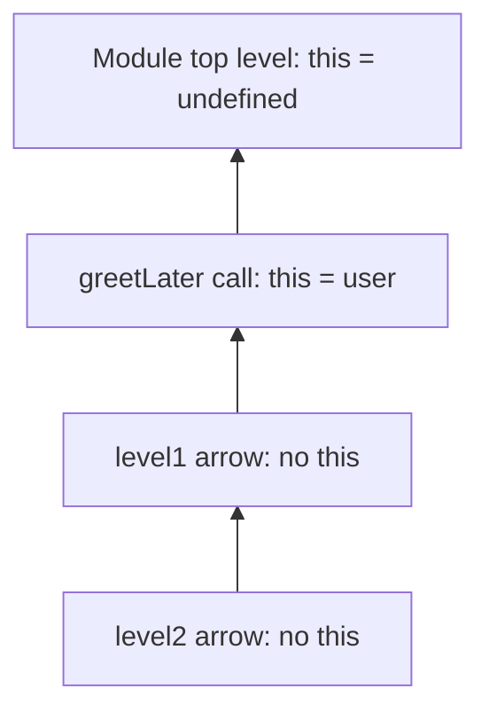

## Introduction

By 2015, a huge share of JavaScript code consisted of small functions passed to other functions: callbacks for `map` and `filter`, event handlers, promise handlers, timers. Writing each one as `function (x) { return x * 2; }` was verbose, but verbosity was not the real problem. The real problem was `this`. A callback written with `function` gets its own `this`, decided by whoever calls it, so inside a method this innocent-looking code broke:

```javascript title="lost-this.mjs"
const team = {
  name: 'Platform',
  members: ['Ada', 'Lin'],
  list() {
    return this.members.map(function (member) {
      return `${member} (${this.name})`;     // this is not team in here
    });
  },
};

try {
  console.log(team.list());
} catch (e) {
  console.log(e.name + ': ' + e.message);
}
```

```output
TypeError: Cannot read properties of undefined (reading 'name')
```

Inside `list`, `this` is `team`. But the callback is a separate function, and `map` calls it as a plain function, so its `this` is `undefined` (the file is a module, which is strict). Programmers worked around this for years with `var self = this` or `.bind(this)`.

ECMAScript 2015 (ES6) introduced **arrow functions**, which solve both problems at once. They are shorter, and they do not have their own `this` — they use the `this` of the code around them, which is called **lexical `this`**:

```javascript title="fixed-this.mjs"
const team = {
  name: 'Platform',
  members: ['Ada', 'Lin'],
  list() {
    return this.members.map((member) => `${member} (${this.name})`);
  },
};

console.log(team.list());
```

```output
[ 'Ada (Platform)', 'Lin (Platform)' ]
```

Arrow functions are now the default way to write callbacks in modern JavaScript, React and Node.js code. But they are not merely a shorthand for `function`. They deliberately leave out several features, and using them in the wrong place — as an object method, a constructor, or a prototype method — produces bugs that are the mirror image of the one above. This lesson teaches the syntax, the missing features, lexical `this` in depth (the nested topic [[b1-lexical-this]]), and how to choose.

## Before you start

- **Function expressions** — arrows are function expressions; values created when evaluated, not hoisted as callable. See [[b1-function-expression]].
- **`this` basics** — that a regular function's `this` depends on how it is called (`obj.method()` vs `method()`). See [[b1-this]]; this lesson recaps what it needs.
- **Strict mode and modules** — the value of `this` in a plain call differs between strict and sloppy code. See [[b1-strict-mode]].
- **Lexical scope** — arrows look up `this` the way any function looks up an outer variable. See [[b1-lexical-scope]].

## The intuition

Imagine two kinds of assistant. A **regular function** is a temp worker: each time they are sent on a job, they ask "who sent me?" and treat that person as their boss for the job. Send them from a different desk and they have a different boss. That is dynamic `this`, decided at the call.

An **arrow function** is a member of a team who never asks. Their boss is whoever runs the team they were hired into, fixed at the moment they joined. Pass them around the building and they still report to the same person. That is lexical `this`, decided by where the arrow was written.

Neither is better in general. A shared tool on a prototype *should* ask who is using it (a temp worker). A callback created inside a method *should* keep serving that method's object (a team member). Choosing correctly is most of what there is to know about arrows.

## Syntax, from shortest to fullest

An arrow function is a parameter list, the `=>` token, and a body.

```javascript
const square = n => n * n;                  // one simple parameter: parentheses optional
const add = (a, b) => a + b;                // several parameters: parentheses required
const now = () => 'tick';                   // no parameters: empty parentheses required
const greet = (name = 'friend') => `Hi, ${name}`;   // defaults need parentheses
const total = (...nums) => nums.reduce((s, n) => s + n, 0);  // rest needs parentheses
const area = ({ w, h }) => w * h;           // destructuring needs parentheses

console.log(square(4), add(2, 3), now(), greet(), total(1, 2, 3), area({ w: 2, h: 5 }));
```

```output
16 5 tick Hi, friend 6 10
```

Many formatters (Prettier's default) always add the parentheses, even for one parameter, so the parameter list looks the same everywhere.

### Concise bodies and block bodies

If the body is a single **expression**, you can write it directly after `=>`. This is a **concise body**, and its value is returned automatically — an **implicit return**. If you need statements (variables, `if`, loops), use a **block body** in braces, and then you must write `return` yourself.

```javascript
const label = (n) => (n > 0 ? 'positive' : 'not positive');   // concise: returns the value

const describe = (n) => {                                       // block: needs return
  const kind = n % 2 === 0 ? 'even' : 'odd';
  return `${n} is ${kind}`;
};

const forgot = (n) => {
  n * 2;                      // computed, then thrown away
};

console.log(label(-3), describe(7), forgot(5));
```

```output
not positive 7 is odd undefined
```

`forgot` is the classic mistake when converting a concise arrow to a block body: once there are braces, there is no implicit return.

### Returning an object literal

Braces after `=>` always mean a block body. So an arrow meant to return an object returns `undefined` instead:

```javascript
const wrong = (id) => { id: id };
const right = (id) => ({ id: id, active: true });

console.log(wrong(1), right(1));
```

```output
undefined { id: 1, active: true }
```

In `wrong`, `{ id: id }` is parsed as a block containing a *label* named `id` followed by the expression `id`. Nothing is returned. Wrapping the object in parentheses forces the parser to read it as an expression. This pattern — `items.map((x) => ({ ...x, done: false }))` — is everywhere in React state updates.

### Two syntax restrictions

The `=>` must be on the **same line** as the parameter list; a line break before it is a `SyntaxError`. A line break after `=>` is fine. And arrows are always **anonymous** in syntax: there is no place to write a name. When an arrow is assigned to a variable or object property, the engine infers its `name` from that position, exactly as for anonymous function expressions ([[b1-anonymous-function]]); passed inline, it stays nameless in stack traces.

## What arrow functions do not have

Arrows were designed as lightweight functions for callbacks, so they leave out everything that only makes sense for methods and constructors.

| Feature | Regular function | Arrow function |
|---|---|---|
| Own `this` | Yes, set by the call | No — uses the enclosing `this` |
| Own `arguments` object | Yes | No — uses the enclosing function's, if any |
| `super`, `new.target` | Own (in methods / constructors) | No — uses the enclosing ones |
| Callable with `new` | Yes (declarations and expressions) | No — `TypeError` |
| `prototype` property | Yes | No |
| Can be a generator (`function*`) | Yes | No |
| Can be `async` | Yes | Yes — `async (x) => …` |

```javascript title="missing.mjs"
const add = (a, b) => a + b;

try {
  new add(1, 2);
} catch (e) {
  console.log(e.name + ': ' + e.message);
}
console.log(add.prototype);

function outer() {
  const arrow = () => arguments[0];        // outer's arguments, not the arrow's
  return arrow('ignored');
}
console.log(outer('from outer'));

const topLevel = () => {
  try { return arguments.length; } catch (e) { return e.name + ': ' + e.message; }
};
console.log(topLevel());
```

```output
TypeError: add is not a constructor
undefined
from outer
ReferenceError: arguments is not defined
```

Each line confirms a row of the table. `new add()` throws because arrows have no internal `[[Construct]]` method. There is no `prototype` object, because nothing could be constructed from it. Inside `outer`, the arrow's `arguments` is *outer*'s `arguments` — the arrow has none of its own, so the name is looked up in the enclosing scope like any variable. At the top level of a module there is no enclosing function, so `arguments` does not exist at all.

> [!NOTE] `arguments` in Node.js CommonJS files
> Run the last snippet as a CommonJS `.js` file and `topLevel()` returns `5`, not an error. Node.js wraps each CommonJS module in a function with five parameters (`exports`, `require`, `module`, `__filename`, `__dirname`), and the arrow finds that wrapper's `arguments`. This is another reason not to use `arguments` in arrows; use rest parameters (`(...args) => …`), covered in [[b1-parameters]].

Arrows also cannot be generators — there is no `*` form, and `yield` inside an arrow is a syntax error — so iterators are written with `function*` ([[b1-generators]]).

## Lexical this {#b1-lexical-this}

**Lexical `this`** means that a function does not get its own `this` when it is called; instead, `this` inside it refers to whatever `this` was in the code that *surrounds the function's definition*. Arrow functions are the functions that work this way. "Lexical" means "determined by where the code is written", the same rule JavaScript already uses for ordinary variables ([[b1-lexical-scope]]).

### The problem it solves

A regular function's `this` is **dynamic**: it is decided each time the function is called, by the shape of the call.

| Call | `this` inside a regular function |
|---|---|
| `obj.method()` | `obj` |
| `fn()` — plain call | `undefined` in strict code; the global object in sloppy code |
| `fn.call(x)`, `fn.apply(x)`, `fn.bind(x)()` | `x` |
| `new Fn()` | The newly created object |
| Called by an API (`map`, `addEventListener`, `setTimeout`) | Whatever that API chooses |

The last row is the trouble. When you hand a regular function to `map` as a callback, `map` calls it as a plain function, so its `this` is not your object — as the opening example showed. Before arrows, developers used three workarounds, all still found in older code:

```javascript title="workarounds.mjs"
function Tally() {
  this.count = 0;

  const self = this;                                         // 1. save this in a variable
  [1, 2, 3].forEach(function () { self.count += 1; });

  [1, 2, 3].forEach(function () { this.count += 1; }, this); // 2. API's thisArg parameter

  [1, 2, 3].forEach(function () { this.count += 1; }.bind(this)); // 3. bind

  [1, 2, 3].forEach(() => { this.count += 1; });             // 4. arrow function
}

console.log(new Tally().count);
```

```output
12
```

All four add 3, so the total is 12. The arrow is the shortest because it needs no extra machinery: it has no `this` of its own, so `this` inside it *is* the `this` of `Tally`.

### How the lookup works

Think of `this` inside an arrow as an ordinary variable that the arrow does not declare. To find its value, look outward through the enclosing scopes until you reach one that **does** define `this`:

- a regular function (declaration, expression or method) — its `this` for the current call;
- a class field initializer or `static` block — the instance or the class;
- the top level of a module — `undefined`;
- the top level of a classic browser script — the global object (`window`);
- the top level of a Node.js CommonJS file — `module.exports`.

Arrows in between are skipped, because they have no `this` to offer. So nested arrows all share the `this` of the nearest non-arrow function:

```javascript title="nested.mjs"
const user = {
  name: 'Ada',
  greetLater() {
    const level1 = () => {
      const level2 = () => this.name;        // walks out past both arrows to greetLater
      return level2();
    };
    return level1();
  },
};

console.log(user.greetLater());

const other = { name: 'Grace', greetLater: user.greetLater };
console.log(other.greetLater());
```

```output
Ada
Grace
```

The second call matters. "Lexical" does not mean the arrow remembers `user` forever. It means the arrow uses `greetLater`'s `this` — and `greetLater` is a regular method, whose `this` is decided at *its* call. Called as `other.greetLater()`, it has `this === other`, and every arrow created during that call sees `other`. The arrow's `this` is fixed when the arrow is **created**, to whatever the enclosing function's `this` is during that particular run.

### `call`, `apply` and `bind` cannot change it

Because an arrow has no `this` binding, the methods that set `this` have nothing to set. They still call the function and pass arguments, but the `thisArg` is ignored:

```javascript title="ignore-thisarg.mjs"
const arrow = () => this;
console.log(arrow.call({ id: 1 }), arrow.bind({ id: 2 })());

const obj = {
  id: 7,
  method() {
    const inner = () => this.id;
    return inner.call({ id: 99 });
  },
};
console.log(obj.method());
```

```output
undefined undefined
7
```

At the top level of a module `this` is `undefined`, and no `thisArg` can override that for the first arrow. Inside `method`, the arrow returns `7` even though `call` passed an object with `id: 99`. The same applies to APIs that try to set `this` for you: a DOM event listener written as a regular function receives the element as `this`, but an arrow listener ignores it and uses the outer `this`. (That browser behaviour is from the DOM specification and was not run for this lesson; use `event.currentTarget` in an arrow listener to get the element.)

### Where lexical `this` goes wrong

The same rule that fixes callbacks breaks methods. An arrow written as an **object-literal property** does not see the object, because an object literal is not a scope that defines `this` — the arrow looks past it to the surrounding code:

```javascript title="arrow-method.mjs"
const counter = {
  count: 10,
  arrowRead: () => typeof this,       // this of the module, not counter
  read() { return this.count; },      // regular method: this is counter
};

console.log(counter.arrowRead(), counter.read());

class Clock {
  tick() { return 'tick'; }
}
Clock.prototype.arrowOnProto = () => typeof this;   // this of the module, again
console.log(new Clock().arrowOnProto());
```

```output
undefined 10
undefined
```

The arrow on the prototype is the same mistake in another form. A prototype method is shared by every instance and must ask "who called me?" to know which instance it is working on. An arrow cannot ask; its `this` was fixed where the assignment was written — here, the module's top level. Rule of thumb: **methods that use `this` must be regular functions** (method shorthand `read() { … }` is the clearest).

### Arrow functions as class fields

There is one place where an arrow *does* see the instance from outside a method: a **class field**. Field initializers run once per instance, during construction, with `this` set to the new instance — so an arrow created in a field captures that instance permanently:

```javascript title="class-fields.mjs"
class Button {
  constructor(label) { this.label = label; }
  handleProto() { return this?.label; }    // regular method on the prototype
  handleField = () => this.label;          // arrow created per instance
}

const save = new Button('Save');
const { handleProto, handleField } = save; // detach both methods from the object

console.log(handleProto(), handleField());
console.log(Object.hasOwn(save, 'handleField'), Object.hasOwn(save, 'handleProto'));

const cancel = new Button('Cancel');
console.log(save.handleField === cancel.handleField, save.handleProto === cancel.handleProto);
```

```output
undefined Save
true false
false true
```

Detaching a regular method loses `this` (so `this?.label` is `undefined`). The field arrow keeps working, because it captured the instance when it was created. This is why class-based React components and many UI libraries wrote handlers as `handleClick = () => { … }`: the handler can be passed to `onClick` or `addEventListener` without `.bind(this)`.

The cost is visible in the last line. A prototype method is **one function shared** by all instances. A field arrow is a **new function per instance**, stored on the instance itself. That uses more memory with many instances, the function is not on the prototype (so subclasses cannot call it with `super.handleField()`, and tests cannot stub it on the prototype), and each instance's handler has a different identity. For a few UI components this does not matter; for thousands of small objects, prefer prototype methods and bind only where a callback is needed. Field syntax is covered in [[b1-public-private-fields]], and the other ways to fix `this` in [[b1-this-lost]] and [[b1-bind]].

> [!IMPORTANT] The one question to ask
> To find `this` inside an arrow, ignore how the arrow is called. Find the nearest enclosing regular function, class field or top level, and ask what `this` is *there*, during the run that created the arrow.

## How it works internally

The specification gives every function an internal `[[ThisMode]]` field. Regular functions have `strict` or `global` mode, and when they are called, the engine creates a function environment that **binds `this`** to the value chosen by the call. Arrow functions have `[[ThisMode]]` set to `lexical`, and their function environment has **no `this` binding**. When code inside the arrow evaluates `this`, the engine walks outward through the environment chain to the first environment that has one — the same walk it performs to resolve an outer variable (the spec operation is `GetThisEnvironment`). `arguments`, `super` and `new.target` are resolved the same way.

Arrows are also created without a `[[Construct]]` internal method, which is why `new` rejects them, and without a `prototype` property. None of this makes arrows faster or slower in a way that matters in practice; the difference is purely about semantics.



The lookup from `level2` stops at `greetLater`'s environment, the first one with a `this` binding.

## Worked example: an event listener inside a class

This program uses Node.js's built-in `EventEmitter`, which calls listeners with `this` set to the emitter — the same convention as DOM `addEventListener`. One listener is a regular function, one is an arrow:

```javascript title="downloader.mjs"
import { EventEmitter } from 'node:events';

class Downloader {
  constructor(name) {
    this.name = name;
    this.done = 0;
    this.events = new EventEmitter();

    this.events.on('finished', function () {
      console.log('function listener: this is', this.constructor.name);
    });

    this.events.on('finished', () => {
      this.done += 1;
      console.log(`arrow listener: ${this.name} finished ${this.done} file(s)`);
    });
  }

  finish() {
    this.events.emit('finished');
  }
}

const d = new Downloader('backup');
d.finish();
d.finish();
```

```output
function listener: this is EventEmitter
arrow listener: backup finished 1 file(s)
function listener: this is EventEmitter
arrow listener: backup finished 2 file(s)
```

Trace it. Both listeners are created inside the `constructor`, where `this` is the new `Downloader`. When `emit` runs them, `EventEmitter` calls each listener with `this` set to itself. The regular function obeys: its `this` is the emitter, so it cannot reach `name` or `done`. The arrow has no `this` of its own, so it uses the constructor's `this` — the `Downloader` — and updates the instance's counter correctly on every emit. If the arrow listener were rewritten as a regular function, `this.done += 1` would add to a property on the emitter and `this.name` would be `undefined`.

## In real systems

**Array pipelines.** Data transformations are chains of arrows: `orders.filter((o) => o.paid).map((o) => o.total)`. Concise bodies keep each step on one line ([[b1-array-map-filter-reduce]]).

**React function components and hooks.** Event handlers and effects are almost always arrows: `onClick={() => setCount((c) => c + 1)}`. Function components have no `this`, so the motivation is brevity and closures over props and state ([[b1-closures-react]]).

**Promise chains and async code.** `fetch(url).then((res) => res.json()).then((data) => render(data))` — arrows keep `this` stable inside class methods that start async work ([[b1-promise-chaining]]).

**Class-based UI code.** Arrow class fields for handlers (`onResize = () => { … }`) avoid `bind` calls in constructors, at the cost of a function per instance.

**Where teams avoid arrows.** Object methods that use `this`, prototype methods, constructors, generators, and test frameworks that set `this` for you — Mocha passes a context object as `this` to `function` callbacks, and its documentation advises against arrows for that reason.

## Trade-offs and alternatives

| Job | Best choice | Why |
|---|---|---|
| Short callback (`map`, `then`, timers) | Arrow | Concise, keeps the surrounding `this` |
| Callback inside a method that needs the instance | Arrow | Lexical `this` removes `self`/`bind` |
| Object or class method using `this` | Method shorthand / regular function | Needs dynamic `this` from `obj.method()` |
| Constructor | `class` or regular function | Arrows cannot be called with `new` |
| Generator | `function*` | Arrows cannot `yield` |
| Handler passed around detached from its instance | Arrow class field, or `bind` once | Keeps `this`; costs one function per instance |
| Named top-level helper | Declaration or `const` + arrow | Team style; declarations are hoisted |

Arrows trade flexibility for predictability. You cannot redirect their `this`, which is exactly what makes callbacks safe and exactly what makes them wrong as shared methods. They also have no inner name, so recursive or long callbacks are often clearer as named function expressions ([[b1-named-function-expression]]).

## Common mistakes

> [!MISTAKE] Returning an object without parentheses
> `() => { id: 1 }` returns `undefined`: the braces are a block and `id:` is a label. Write `() => ({ id: 1 })`.

**Arrow as an object method.** `{ count: 0, inc: () => this.count++ }` does not touch the object; `this` is the outer `this`. Use method shorthand: `inc() { this.count++; }`.

**Expecting `call`/`bind` to change an arrow's `this`.** They are silently ignored. If a library needs to set `this` for your callback (some test frameworks and jQuery handlers do), pass a regular function.

**Adding braces and losing the return.** Turning `(x) => x * 2` into `(x) => { console.log(x); x * 2; }` returns `undefined`. Add `return`.

**Using `arguments` in an arrow.** It silently refers to an outer function's arguments (or Node's module wrapper). Use a rest parameter.

**Using `new` with an arrow.** `TypeError: … is not a constructor`. Use a class.

## Interview perspective

Arrow functions come up constantly in JavaScript interviews, nearly always through `this`. Typical prompts: predict output for an object with both arrow and regular methods; fix a `setTimeout` inside a method; explain why a React class component used `handleClick = () => {}`.

> [!INTERVIEW] What a strong answer sounds like
> "An arrow function has no `this` binding of its own. `this` inside it is resolved like an outer variable — from the nearest enclosing regular function, class field or top level, as it was when the arrow was created. That's why arrows fix callbacks inside methods, why `call` and `bind` can't change their `this`, and why they're wrong as object or prototype methods."

Questions you should be able to answer:

- **What are the differences between arrow and regular functions?** Lexical `this`, no own `arguments`/`super`/`new.target`, not constructible, no `prototype`, cannot be generators, implicit return for concise bodies.
- **What does `const o = { f: () => this }; o.f()` return in a module?** `undefined` — the object literal does not create a `this` scope.
- **Can you change an arrow's `this` with `bind`?** No; `bind` returns a new function, but the `thisArg` is ignored.
- **Why define a class handler as an arrow field?** It captures the instance at construction, so it can be passed as a callback without binding — at the cost of one function per instance, not on the prototype.
- **Why does `() => { a: 1 }` return `undefined`?** Braces after `=>` start a block; `a:` is a label.

```quiz
Q: In an ES module, what does `const o = { n: 5, get: () => this?.n }; console.log(o.get());` print?
- [ ] `5`
- [x] `undefined`
- [ ] It throws `TypeError`
- [ ] `null`
> The arrow is defined inside an object literal, but an object literal does not provide `this`. The arrow uses the module's top-level `this`, which is `undefined`; the optional chaining `?.` then yields `undefined` instead of throwing. A regular method `get() { return this.n; }` would print `5`.

Q: Inside a method `start() { setTimeout(() => this.tick(), 100); }` called as `clock.start()`, what is `this` inside the arrow when the timer fires?
- [x] `clock`, because the arrow uses `start`'s `this` from when the arrow was created
- [ ] The global object, because `setTimeout` calls callbacks as plain functions
- [ ] `undefined`, because timers run after `start` has returned
- [ ] The timer object returned by `setTimeout`
> The arrow has no `this` of its own. It was created during the call `clock.start()`, where `this` is `clock`, and it keeps referring to that value even though it runs later. A regular function callback would get whatever `this` the timer API chooses, which is why the arrow is used here.

Q: Which use of an arrow function causes a bug?
- [ ] `items.map((item) => item.price)`
- [ ] `class A { onClick = () => this.save(); }`
- [x] `Person.prototype.greet = () => 'Hi ' + this.name;`
- [ ] `promise.then((data) => this.render(data))` inside a class method
> A prototype method must use the instance it is called on. An arrow assigned to the prototype has its `this` fixed where the assignment was written (the module or script top level), so `this.name` never refers to a person. The other three either do not use `this` or capture the right `this` from an enclosing method or class field.
```

## Practice

1. **Convert and verify.** Rewrite five `function` callbacks from an old codebase (or from the examples above) as arrows. For each, decide whether the conversion changes behaviour, and explain why.
2. **Object literals.** Write `toEntries = (obj) => …` that returns an array of `{ key, value }` objects using `Object.keys` and `map` with a concise arrow body.
3. **Find the `this`.** For each arrow in a file with nested functions, arrows and a class, write down which scope supplies its `this`, then check by logging.
4. **Fix the timer.** A `Stopwatch` object has `start() { setInterval(function () { this.seconds++; }, 1000); }`. Explain why it fails, then fix it two ways: with an arrow and with `bind`.
5. **Measure the field cost.** Create 10,000 instances of a class with an arrow field and of a class with a prototype method. Compare `a.handler === b.handler` for each and explain the memory implication.

## Quick revision {#quick-revision}

- Forms: `x => …`, `(a, b) => …`, `() => …`; defaults, rest and destructuring need parentheses.
- Concise body returns implicitly; block body `{ … }` needs `return`.
- Return an object literal with parentheses: `() => ({ id: 1 })`.
- No line break before `=>`. Arrows are anonymous in syntax; `name` is inferred from variables and properties.
- Arrows have no own `this`, `arguments`, `super`, `new.target`; no `prototype`; cannot be used with `new`; cannot be generators; can be `async`.
- Lexical `this`: resolved from the nearest enclosing regular function, class field/static block or top level, as it was when the arrow was created.
- Top-level `this`: module → `undefined`; classic browser script → `window`; Node.js CommonJS → `module.exports`.
- `call`/`apply`/`bind` ignore the `thisArg` for arrows.
- Arrows fix callbacks inside methods; they break object-literal methods and prototype methods.
- Arrow class fields capture the instance (safe to pass as callbacks) but create one function per instance, not on the prototype.

## Key takeaways {#key-takeaways}

- Arrow functions are a concise syntax for function expressions, with implicit return for single-expression bodies and parentheses required to return object literals.
- Their defining behaviour is lexical `this`: they use the `this` of the code around their definition, and no call style, `call`, `apply` or `bind` can change it.
- That makes arrows the right choice for callbacks created inside methods, and the wrong choice for object methods, prototype methods and constructors.
- Arrows also have no `arguments`, `prototype` or `[[Construct]]`, so use rest parameters instead of `arguments` and classes instead of `new` on arrows.
- Arrow class fields are a practical way to get pre-bound handlers, paid for with one function per instance.
