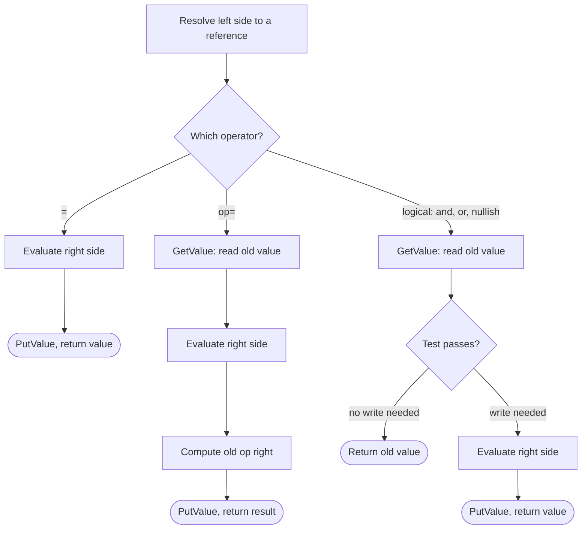

## Introduction

Every program that does anything useful changes state: a counter goes up, a total accumulates, a setting gets a default, a flag is switched off. In JavaScript, all of these are done with **assignment operators** — the family that starts with `=` and includes `+=`, `*=`, `??=` and a dozen others.

They look trivial, and most of the time they are. But several of JavaScript's most common bugs live here: `if (user = admin)` that always succeeds, `let a = b = 0` that silently creates a global variable, `total += price` that produces `NaN`, and `count ||= 10` that throws away a legitimate zero. Each one comes from not knowing exactly what the operator reads, what it writes, and what value it returns.

This lesson gives you that precise model. Once you see assignment as "find the place, compute the value, store it, and hand the value back", the bugs become easy to spot.

## Before you start

- **Variables and `const`** — how `let`, `const` and `var` create bindings. See [[b1-variables]] and [[b1-const]].
- **Arithmetic operators** — compound assignment reuses them. See [[b1-arithmetic-operators]].
- **Statements and expressions** — the difference between code that does something and code that produces a value. See [[b1-statements-expressions]].
- **Primitives and references** — assigning an object copies a reference, not the object. See [[b1-primitive-vs-reference]].

## The intuition

Think of the left side of an assignment as an **address** and the right side as a **parcel**. `x = 5` means "deliver the parcel `5` to the address `x`". The address must be somewhere a parcel can be delivered — a variable, or a property of an object. A literal like `5` or the result of a calculation like `a + b` is not an address; it is just a value, so `5 = x` makes no sense.

A compound assignment like `x += 5` is "go to the address, open what is there, add 5, and put the result back". Logical assignment like `x ||= 5` is "go to the address, look at what is there, and only deliver the parcel if the current contents are falsy".

The analogy needs one addition: after delivering, the operator also **returns the parcel** to whoever asked. That is why an assignment can sit inside a larger expression, and why `a = b = 7` works.

## Plain assignment `=`

The simple assignment operator stores the value of the right-hand side into the target on the left.

```javascript title="assign.js"
let n = 10;
n += 5;
n *= 2;
let s = 'a';
s += 'b';
const o = { x: 1 };
o.x += 3;
console.log(n, s, o.x, (n = 4), n);
```

```output
30 ab 4 4 4
```

`n` goes from 10 to 15 to 30, the string gains a character, and the object property is updated in place. The fourth argument to `console.log` is an assignment expression: it stores `4` into `n` and evaluates to `4`. Because arguments are evaluated left to right, the earlier `n` argument has already been read as `30`, and the fifth argument sees the new value.

### What can be on the left

The left-hand side must be a **reference** — a name or property that can be written to. Valid targets are:

| Target | Example | Writes to |
|---|---|---|
| A variable | `count = 0` | The binding named `count` in the current scope chain |
| A dot property | `user.name = 'Ada'` | Property `name` of the object in `user` |
| A bracket property | `scores[i] = 90` | Property whose key is the value of `i` |
| A destructuring pattern | `[a, b] = [1, 2]` | Each name or property in the pattern |

Anything else is an error. `1 = x` and `a + b = 3` are rejected by the parser with `SyntaxError: Invalid left-hand side in assignment`, so the file never runs. Assigning to a function call such as `getUser() = 1` is a special case: for compatibility with very old web pages, engines accept it at parse time and throw a `ReferenceError` only when that line executes (Node.js 22 reports `ReferenceError: Invalid left-hand side in assignment`). Either way, it is a bug.

### Assignment is an expression

In some languages assignment is a statement and produces nothing. In JavaScript, as in C and Java, it is an **expression** whose value is the right-hand side's value.

```javascript title="assignment-expression.js"
let a, b, c;
a = b = c = 7;
console.log(a, b, c);
const result = (a = 3) * 2;
console.log(result, a);
let x = 0;
if (x = 5) console.log('ran with x =', x);
```

```output
7 7 7
6 3
ran with x = 5
```

`a = b = c = 7` works because `=` is **right-associative**: it groups as `a = (b = (c = 7))`. The innermost assignment stores 7 in `c` and returns 7, which is then stored in `b`, and so on.

The last two lines show the most famous assignment bug. `if (x = 5)` does not compare; it assigns 5 to `x`, and the condition tests the result, `5`, which is truthy. The branch always runs and `x` is overwritten. The fix is `===`. Linters flag this pattern (ESLint's `no-cond-assign`), and some developers who assign deliberately in a condition wrap it in an extra pair of parentheses to show intent: `while ((match = re.exec(text)) !== null)`.

> [!NOTE] The value is the right-hand side, not what was stored
> The expression's value is the value that was *offered*, even if the write did not take effect. In non-strict code, `frozen.x = 2` on a frozen object evaluates to `2` while `frozen.x` stays `1`. This rarely matters, but it explains some confusing console output.

### Evaluation order

When an assignment runs, the parts are evaluated in a fixed order: the target's object and key **first**, then the right-hand side, then the store.

```javascript title="evaluation-order.js"
const order = (label, v) => { console.log('evaluate', label); return v; };
const target = {};
order('object', target)[order('key', 'k')] = order('value', 42);
console.log(target);
```

```output
evaluate object
evaluate key
evaluate value
{ k: 42 }
```

This left-to-right order is guaranteed by the specification, so you can reason about it. It also produces puzzles like this one:

```javascript title="order-puzzle.js"
let i = 0;
const arr = [];
arr[i] = ++i;
console.log(arr, i);
```

```output
[ 1 ] 1
```

The target `arr[i]` is resolved first, while `i` is still 0. Only then is `++i` evaluated, producing 1. So index 0 receives the value 1. The code is legal and predictable, but it forces every reader to replay the evaluation order, which is why style guides discourage changing a variable and using it in the same expression.

### Assigning objects copies the reference

When the right-hand side is an object, assignment copies the **reference**, not the object. Both names then point at the same object.

```javascript title="reference-copy.js"
const user = { name: 'Ada' };
const sameUser = user;
sameUser.name = 'Grace';
console.log(user.name);
```

```output
Grace
```

To get an independent copy you must create a new object, for example with spread (`{ ...user }`) or `structuredClone(user)`. See [[b1-copying-objects]].

## Assignment and `const`, strict mode and globals

Three rules decide whether a write is allowed.

**`const` bindings cannot be reassigned.** Any assignment operator that would write to a `const` variable throws a `TypeError` at runtime. `const` protects the *binding*, not the value: properties of a `const` object can still be changed.

```javascript title="const.js"
const limit = 10;
try { limit = 20; } catch (e) { console.log(e.name + ': ' + e.message); }
try { limit += 1; } catch (e) { console.log(e.name + ': ' + e.message); }
const cart = { items: [] };
cart.items.push('book');
cart.count = 1;
console.log(cart);
```

```output
TypeError: Assignment to constant variable.
TypeError: Assignment to constant variable.
{ items: [ 'book' ], count: 1 }
```

**Assigning to an undeclared name** behaves differently by mode. In non-strict ("sloppy") scripts it silently creates a property on the global object — an **implicit global**. In strict mode, which is automatic inside ES modules and classes, it throws a `ReferenceError`. The classic way to create one by accident is chained assignment in a declaration:

```javascript title="implicit-global.js"
function leak() { let a = b = 5; return a; }
leak();
console.log(typeof b, b);
```

```output
number 5
```

`let` applies only to `a`. The inner `b = 5` is a plain assignment to a name that was never declared, so in sloppy mode `b` becomes a global that outlives the function. Declare each variable separately: `let a = 5, b = 5;` or two `let` statements.

**Writing to a read-only property** — on a frozen object, or a property defined with `writable: false` — fails silently in sloppy mode and throws `TypeError: Cannot assign to read only property 'x' of object` in strict mode. Strict mode turns silent failures into errors, which is one reason modern code is written as modules. See [[b1-strict-mode]].

## Compound assignment

A **compound assignment operator** combines an operation with assignment. `x op= y` reads the current value of `x`, computes `x op y`, and writes the result back to `x`. Every binary arithmetic and bitwise operator has one:

| Operator | Meaning | Example (`x` starts at 10) | New `x` |
|---|---|---|---|
| `+=` | add or concatenate | `x += 5` | `15` |
| `-=` | subtract | `x -= 3` | `7` |
| `*=` | multiply | `x *= 2` | `20` |
| `/=` | divide | `x /= 4` | `2.5` |
| `%=` | remainder | `x %= 3` | `1` |
| `**=` | exponentiate | `x **= 2` | `100` |
| `<<=` `>>=` `>>>=` | bit shifts | `x <<= 1` | `20` |
| `&=` `\|=` `^=` | bitwise AND, OR, XOR | `x &= 6` | `2` |

They follow the same conversion rules as the underlying operators, so `+=` concatenates when either side is a string and all the others convert to numbers:

```javascript title="compound.js"
let flags = 0b0101;
flags |= 0b0010;   // turn bit 1 on
flags &= ~0b0100;  // turn bit 2 off
console.log(flags.toString(2));
let big = 2n;
big **= 10n;
console.log(big);
let total;
total += 5;
console.log(total);
let label = 'Items: ';
label += 3;
label -= 1;
console.log(label);
```

```output
11
1024n
NaN
NaN
```

The bitwise forms are the standard way to set and clear flags in a bit mask ([[b1-bitwise-operators]]), and the compound forms work with bigints as long as both sides are bigints.

The last two results are bugs you will meet. `total` was declared but never initialised, so it is `undefined`, and `undefined + 5` is `NaN`. Every accumulator needs a starting value (`let total = 0`). And `label` became the string `'Items: 3'` after `+=`; `-=` has no string mode, so it converts `'Items: 3'` to a number, gets `NaN`, and subtracts.

### `x += y` evaluates the target once

`x += y` is usually described as shorthand for `x = x + y`. That is almost right. The difference is that in the compound form the target expression is **evaluated once**, while in the long form it is written twice and therefore evaluated twice.

```javascript title="evaluated-once.js"
const counts = [0, 0, 0];
let calls = 0;
function nextIndex() { calls += 1; return 1; }
counts[nextIndex()] += 10;
console.log(counts, 'calls:', calls);
calls = 0;
counts[nextIndex()] = counts[nextIndex()] + 10;
console.log(counts, 'calls:', calls);
```

```output
[ 0, 10, 0 ] calls: 1
[ 0, 20, 0 ] calls: 2
```

Here `nextIndex()` always returns 1, so both lines happen to update the same slot. If it returned a different index each time — popping from a queue, generating an ID, reading a counter — the long form would read from one slot and write to another. The compound form resolves `counts[nextIndex()]` to a single reference, reads it, and writes back to that same reference.

A second consequence of the order "read target, then evaluate right-hand side" is that the old value is captured before the right side runs:

```javascript title="read-first.js"
let x = 1;
x += (x = 10);
console.log(x);
```

```output
11
```

`x` was read as `1` before `(x = 10)` ran, so the sum is `1 + 10`. Code like this should never be written, but understanding why it prints 11 shows you have the model right.

## Logical assignment `&&=`, `||=`, `??=`

ES2021 added three **logical assignment operators**. They are different from compound assignment in one important way: they may **not write at all**.

| Operator | Equivalent to | Writes when the current value is |
|---|---|---|
| `a \|\|= b` | `a \|\| (a = b)` | falsy (`0`, `''`, `false`, `null`, `undefined`, `NaN`, …) |
| `a &&= b` | `a && (a = b)` | truthy |
| `a ??= b` | `a ?? (a = b)` | `null` or `undefined` only |

Note the equivalents: `a ||= b` is **not** `a = a || b`. The long form always assigns (sometimes assigning `a` to itself); the logical form only assigns when the right side is actually needed. That is the same short-circuit behaviour as `||`, `&&` and `??` themselves ([[b1-short-circuit]]).

```javascript title="logical-assignment.js"
const settings = { theme: '', retries: 0, user: null };
settings.theme ||= 'light';
settings.retries ??= 3;
settings.user &&= settings.user.name;
console.log(settings);
const c = 1;
c ||= 2;            // no write happens, so no TypeError
console.log(c);
try { c &&= 2; } catch (e) { console.log(e.name); }
```

```output
{ theme: 'light', retries: 0, user: null }
1
TypeError
```

`theme` was the empty string, which is falsy, so `||=` replaced it. `retries` was `0`; `??=` keeps it because `0` is not `null` or `undefined` — `||=` would have wrongly replaced a deliberate zero with 3. `user` was `null`, so `&&=` did nothing, which is exactly what you want when the operation would otherwise crash on `null.name`.

The `const` lines prove that no write happens when the operator short-circuits: `c ||= 2` succeeds on a `const` because `c` is truthy and nothing is assigned, while `c &&= 2` tries to assign and throws. You should not rely on this in real code, but it is the clearest demonstration of the semantics.

Skipping the write matters for properties with setters, reactive state and proxies, where every write may trigger work:

```javascript title="setter-writes.js"
let writes = 0;
const config = {
  _mode: 'dark',
  get mode() { return this._mode; },
  set mode(v) { writes += 1; this._mode = v; },
};
config.mode ||= 'light';
config.mode = config.mode || 'light';
console.log(config.mode, 'setter calls:', writes);
```

```output
dark setter calls: 1
```

`||=` saw that `mode` was already truthy and did not call the setter. The long form called the setter to write `'dark'` back over itself. In a framework where a setter schedules a re-render, that is a wasted render. The defaults idioms, and when to choose `??=` over `||=`, are covered in depth in [[b1-logical-assignment]].

## Destructuring assignment

The left side of `=` can also be a **destructuring pattern**, which unpacks an array or object into several targets in one step.

```javascript title="destructuring-assign.js"
let a = 1, b = 2;
[a, b] = [b, a];
console.log(a, b);
let width, height;
({ width, height } = { width: 640, height: 480 });
console.log(width, height);
```

```output
2 1
640 480
```

`[a, b] = [b, a]` is the idiomatic swap: the right side builds a new array from the current values first, then the pattern assigns them. The object form needs **parentheses** around the whole statement because a line starting with `{` is parsed as a block, not an object pattern. Patterns, defaults and renaming are covered in [[b1-destructuring]].

## How it works internally

The specification models the left side of an assignment as a **Reference Record**: a pair of "base" (an environment record for a variable, or an object for a property) and "name" (the variable name or property key). Two abstract operations use it: `GetValue` reads through a reference, and `PutValue` writes through it. Paraphrased:

- **`a = b`**: evaluate `a` to a reference (computing the object and key if it is a property); evaluate `b` to a value; `PutValue(reference, value)`; return the value.
- **`a op= b`**: evaluate `a` to a reference; `GetValue` to read the old value; evaluate `b`; compute `old op value` with the same algorithm as the binary operator; `PutValue`; return the result.
- **`a ||= b`**: evaluate `a` to a reference; `GetValue`; if the value is truthy, return it immediately; otherwise evaluate `b`, `PutValue`, and return the new value. `&&=` and `??=` differ only in the test.



`PutValue` is where the mode-dependent rules live: for an unresolvable reference it either creates a global (sloppy) or throws `ReferenceError` (strict); for a read-only property it either does nothing or throws `TypeError`; for a `const` binding it always throws `TypeError`. For a property with a setter, `PutValue` calls the setter. In engines such as V8, a repeated property assignment on objects of the same shape is optimised with inline caches so that the "resolve and store" steps become a direct memory write ([[b1-hidden-classes]]).

## Worked example: totals by category

A common task is aggregating records into a summary object. Assignment operators do all the work.

```javascript title="group-totals.js"
const orders = [
  { category: 'books', cents: 1299 },
  { category: 'games', cents: 5999 },
  { category: 'books', cents: 850 },
  { category: 'music', cents: 0 },
];

const totals = {};
const counts = {};
let grandTotal = 0;

for (const { category, cents } of orders) {
  totals[category] ??= 0;   // create the bucket the first time we see a category
  totals[category] += cents;
  counts[category] = (counts[category] ?? 0) + 1;
  grandTotal += cents;
}

console.log(totals);
console.log(counts);
console.log(grandTotal);
```

```output
{ books: 2149, games: 5999, music: 0 }
{ books: 2, games: 1, music: 1 }
8148
```

The loop destructures each order (a destructuring declaration in the `for...of` head). `grandTotal` starts at 0, so `+=` is safe. For the per-category totals there is no starting value until a category is first seen, so `totals[category] ??= 0` creates it. Without that line, the first `+=` would compute `undefined + 1299` and store `NaN`:

```javascript title="missing-init.js"
const totals = {};
totals.books += 1299;
console.log(totals);
```

```output
{ books: NaN }
```

`??=` is the right choice over `||=` here. Both create the bucket on first sight, but consider the `music` category whose total is 0: if a later order adds to it, `||=` would see `0` as falsy and reset the bucket — harmless in this exact code because it resets to 0, but wrong as soon as the default is anything else. `counts` shows the equivalent single-expression form, `(counts[category] ?? 0) + 1`, which is common when you want one line per update.

## In real systems

**Counters and accumulators** — request counts, retry attempts, running totals in reducers — use `+=` and `-=` everywhere. The bug to watch for is a missing initial value.

**Defaults for options objects.** Libraries normalise configuration with `options.timeout ??= 5000` so that callers can pass `0` explicitly. Older code uses `options.timeout = options.timeout || 5000`, which silently ignores a zero.

**Framework state is usually not assigned directly.** In React, `state.count += 1` mutates an object React does not track, so nothing re-renders; you call `setCount(c => c + 1)` instead. Vue (through `reactive` objects and `ref` values) and Svelte 5 (through `$state`) do track assignments, using proxies or compiler transforms, so there `state.count += 1` or `count.value += 1` triggers an update. Know which model your framework uses before reaching for `+=` on state.

**Bit flags.** Permission masks and renderer flags (React's internal fiber flags are an example) are combined with `|=` and cleared with `&= ~FLAG`.

## Trade-offs and alternatives

| Style | Example | Use when |
|---|---|---|
| Plain assignment | `x = compute()` | Replacing a value outright |
| Compound | `x += step` | Updating a value based on its current value |
| Long form | `x = x + step` | Never better than `+=`; evaluates the target twice |
| Logical | `opts.size ??= 10` | Filling a gap without overwriting real data or triggering needless writes |
| No assignment (new value) | `const next = { ...prev, count: prev.count + 1 }` | Immutable updates for React state, Redux, or shared data |

Assignment inside larger expressions (`arr[i] = ++i`, `if ((m = re.exec(s)))`) is legal and sometimes compact, but it trades readability for brevity. Prefer one assignment per statement unless the idiom is well known.

## Common mistakes

> [!MISTAKE] `=` where `===` was meant
> `if (role = 'admin')` assigns and always passes. Turn on ESLint's `no-cond-assign`, and read conditions aloud: "if role *equals*" should be `===`.

**Chained declarations creating globals.** `let a = b = 0` declares only `a`. Write separate declarations.

**Uninitialised accumulators.** `let sum; sum += x` gives `NaN`. Initialise to the identity value: `0` for sums, `1` for products, `''` for string building, `[]` for collections.

**`+=` on numeric strings.** `count += 1` where `count` came from `localStorage` produces `'01'`, `'011'`, … Convert with `Number` when reading.

**Using `||=` for numeric or string defaults.** It overwrites `0` and `''`. Use `??=` unless you really mean "any falsy value".

**Forgetting parentheses in object destructuring assignment.** `{ a, b } = obj;` is a `SyntaxError`; write `({ a, b } = obj);`.

**A line starting with `[` after a line without a semicolon.** Automatic semicolon insertion does not add one before `[`:

```javascript title="asi-swap.js"
let a = 1
let b = 2
console.log(a, b)
[a, b] = [b, a]
```

```output
1 2
TypeError: Cannot set properties of undefined (setting '2')
```

The last two lines are parsed as `console.log(a, b)[a, b] = [b, a]`: it logs, then tries to index into the `undefined` that `console.log` returned. If you omit semicolons, start such lines with `;`. See [[b1-asi]].

## Interview perspective

Assignment questions test whether you know what expressions evaluate to and in which order.

> [!INTERVIEW] Explaining `a ||= b`
> "`a ||= b` assigns `b` to `a` only if `a` is falsy. It is equivalent to `a || (a = b)`, not `a = a || b`, so when `a` is truthy nothing is written — no setter call and no error even on a `const`. For defaults I'd usually use `??=`, so that `0` and empty strings are kept."

Be ready for:

- **What does `a = b = 5` do, and what is wrong with `let a = b = 5`?** Right-associative chained assignment; in the declaration only `a` is declared, so `b` becomes an implicit global in sloppy mode or a `ReferenceError` in strict mode.
- **Why does `if (x = 0)` never run its body?** It assigns 0 and tests 0, which is falsy.
- **Is `x += 1` identical to `x = x + 1`?** Same result for a simple variable; but the compound form evaluates the target once, which matters for `obj[f()] += 1`.
- **Can you change a `const` object?** Yes, its properties; the binding cannot point to a different object. `Object.freeze` prevents property changes (shallowly).
- **What is printed by `let i = 0; const a = []; a[i] = ++i;`?** `a` is `[1]`, because the target is resolved before the right-hand side runs.

```quiz
Q: After `let x = 5; const y = (x = 2) + x;`, what are `x` and `y`?
- [ ] `x` is 5, `y` is 7
- [ ] `x` is 2, `y` is 7
- [x] `x` is 2, `y` is 4
- [ ] It is a SyntaxError
> The parenthesised assignment runs first because the left operand of `+` is evaluated first. It stores 2 in x and evaluates to 2. The right operand then reads x, which is now 2, so y is 4. Assignment is an expression, so this is legal, if unpleasant to read.

Q: `options.retries` is `0`, meaning "do not retry". Which line keeps it at 0 while giving `undefined` a default of 3?
- [ ] `options.retries ||= 3`
- [ ] `options.retries = options.retries || 3`
- [x] `options.retries ??= 3`
- [ ] `options.retries &&= 3`
> `??=` writes only when the current value is null or undefined, so 0 is kept. Both `||` forms treat 0 as falsy and replace it with 3. `&&=` writes only when the value is truthy, so it would leave undefined unchanged and would overwrite a real retry count.

Q: Why can `counts[next()] = counts[next()] + 1` behave differently from `counts[next()] += 1`?
- [ ] `+=` converts the value to a string first
- [x] The long form calls `next()` twice, so it may read one slot and write another
- [ ] The long form is not allowed on arrays
- [ ] `+=` skips the write when the value is falsy
> A compound assignment resolves its target to a single reference, reads it, computes and writes back to that same reference, so the target expression runs once. The long form contains the target expression twice and evaluates both. Skipping the write is a property of logical assignment, not of `+=`.

Q: In a non-module script, what does `function f() { let a = b = 1; } f(); console.log(b);` print?
- [ ] It throws ReferenceError: b is not defined
- [x] `1`
- [ ] `undefined`
- [ ] It throws TypeError: Assignment to constant variable
> `let` declares only `a`. `b = 1` assigns to an undeclared name, which sloppy-mode scripts turn into a global variable, so it is visible after the function returns. In strict mode, including every ES module, the same code throws a ReferenceError instead.
```

## Practice

1. Predict and run: `let a = 1; let b = a++ + (a = 10) + a;` What are `a` and `b`?
2. Rewrite `if (x) { x = transform(x); }` using a logical assignment operator. Which one, and why?
3. Write `countWords(text)` that returns an object of word frequencies using `??=` and `+=`. Then rewrite it with a `Map`.
4. In a strict-mode file, assign to a property of a frozen object, to an undeclared variable and to a `const`. Record each error type, then repeat in a sloppy script.
5. Use `|=`, `&=` and `^=` to set, clear and toggle the `WRITE` bit in a permission mask where `READ = 1`, `WRITE = 2`, `EXEC = 4`.

## Quick revision {#quick-revision}

- `=` stores the right-hand value into a reference (variable, property or destructuring pattern) and returns that value.
- Assignment is right-associative: `a = b = c` is `a = (b = c)`.
- Order: resolve target (object, key) → evaluate right side → store. Left before right, always.
- Invalid targets: `1 = x` → SyntaxError; `f() = 1` → ReferenceError at runtime.
- `const` → `TypeError` on any reassignment (including `+=`); object contents stay mutable.
- Undeclared name: implicit global in sloppy mode, `ReferenceError` in strict mode/modules. `let a = b = 0` leaks `b`.
- Compound `x op= y`: read once, compute, write back; target evaluated once (unlike `x = x op y`). Same coercion as `op`.
- Logical: `a ||= b` ≡ `a || (a = b)`; `&&=`, `??=` likewise. They may skip the write (no setter call).
- `??=` for defaults that must keep `0`, `''`, `false`.
- Object destructuring assignment needs `( … )`; arrays swap with `[a, b] = [b, a]`.
- Accumulators need initial values; `undefined + n` is `NaN`.

## Key takeaways {#key-takeaways}

- Assignment resolves a place, computes a value, stores it, and returns the value — so it can appear inside other expressions, for better or worse.
- Evaluation is strictly left to right: the target is resolved before the right-hand side runs.
- Compound operators read and write the target exactly once and inherit the coercion rules of their operator, including `+=` concatenation.
- Logical assignment only writes when needed; prefer `??=` for defaults.
- Strict mode turns silent assignment failures into errors, which is a strong reason to write modules.
- Most assignment bugs are `=` instead of `===`, a missing initial value, or an accidental global.
