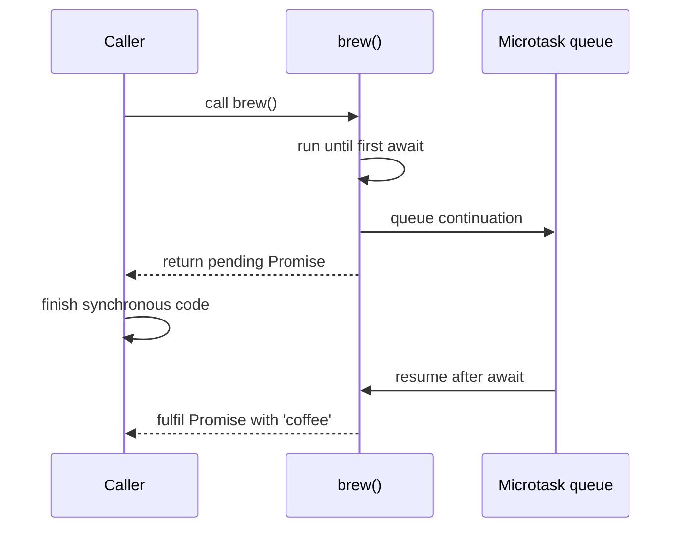

## Introduction

Most useful programs wait for things: a network response, a file, a database row, a timer. JavaScript runs your code on a single thread, so it cannot stop and wait — if it did, the page would freeze and a server would stop answering every other request. The language's answer is the **Promise**, an object that stands for a value that will arrive later. You attach callbacks with `.then()` and `.catch()`, and the runtime calls them when the value is ready.

Promises solve the waiting problem, but chains of callbacks are awkward to read once the logic has several steps, branches or loops. Each step lives in its own function, intermediate values have to be threaded through, and error handling is a separate `.catch()` far from the line that failed.

**async/await** (added in ES2017) is syntax on top of Promises that removes that awkwardness. You mark a function `async`, and inside it you write `await somePromise` wherever you need the result. The code reads top to bottom like synchronous code, local variables keep their values across the waits, and ordinary `try`/`catch` handles failures. Underneath, nothing new happens at runtime: an async function still produces a Promise, and every `await` still schedules a callback. Understanding that translation is what separates someone who uses async/await from someone who can debug it.

You will meet async/await in almost every modern JavaScript and TypeScript codebase — `fetch` calls in a React app, route handlers in Express or Next.js, database access in Node, test files in Vitest or Jest. This lesson teaches the two keywords, the execution model behind them, error handling with try/catch, and the reason `await` does not block the runtime.

## Before you start

- **Promises** — states (pending, fulfilled, rejected), `.then`/`.catch`, and chaining. See [[b1-promises]] and [[b1-promise-chaining]].
- **The event loop** — the call stack, the task queue and the microtask queue, and the rule that all microtasks run before the next task. See [[b1-event-loop]] and [[b1-microtasks]].
- **Exceptions** — `throw`, `try`, `catch` and `finally` in synchronous code. See [[b1-throw-try-catch]].

All runnable examples are ES modules (`.mjs` files) run with Node 22, so they can use `await` at the top level. The behaviour shown is the same in modern browsers unless the text says otherwise.

## The intuition

Imagine ordering at a café counter. You order, the barista gives you a numbered receipt, and you step aside. The barista serves the next customer instead of standing still while your milk steams. When your drink is ready, your number is called and you continue where you left off — you pick up the drink and walk to your table.

An async function behaves like that customer. Calling it gives the caller a receipt immediately — the Promise. When the function reaches `await`, it steps aside: its local variables and its position in the code are saved, and the thread goes off to run other code. When the awaited Promise settles, the function's number is called and it resumes on the next line with the value in hand.

The analogy has one limit worth stating. A real customer waits in parallel with the barista. An async function does not run in parallel with anything; while it is set aside it is not running at all. Only the *waiting* overlaps with other work — the network request or timer progresses outside JavaScript, in the browser or in Node's I/O layer, and JavaScript code takes turns on the one thread.

## The `async` keyword: a function that always returns a Promise

Putting `async` before a function changes what calling it returns. Whatever the body does, the caller receives a **Promise**:

- If the body **returns a value** `v`, the Promise fulfils with `v`.
- If the body **throws**, the Promise rejects with the thrown value. The exception does not escape to the caller as a synchronous throw.
- If the body returns another Promise (or any **thenable** — an object with a `then` method), the returned Promise adopts its outcome. Promises never nest: you get `Promise<number>`, not a Promise of a Promise.

```javascript title="async-returns.mjs"
async function answer() {
  return 42;
}

async function broken() {
  throw new Error('boom');
}

const p = answer();
console.log(p instanceof Promise);
console.log(await p);

const q = broken(); // no exception here: broken() returns a rejected Promise
console.log('still running');
try {
  await q;
} catch (err) {
  console.log('rejected with', err.message);
}

const inner = Promise.resolve('x');
async function passThrough() {
  return inner;
}
console.log(passThrough() === inner); // always a new Promise, never the same object
console.log(await passThrough());
```

```output
true
42
still running
rejected with boom
false
x
```

Two details here matter later. First, calling `broken()` did not throw: the error was converted into a rejection, so the line `still running` printed. Any code that calls an async function and ignores the result will therefore never see its errors unless it handles the Promise. Second, `passThrough()` returned a *fresh* Promise even though the body returned an existing one. An async function always creates its own result Promise when it is called.

`async` works on every function form: declarations (`async function f() {}`), expressions, arrow functions (`async () => {}`), object and class methods (`async load() {}`), and generator functions (`async function* gen() {}`, which produce async iterators — see [[b1-async-iterators]]). It does not work on constructors or getters and setters.

## The `await` keyword: pause this function until a Promise settles

Inside an async function, `await expr` does three things:

1. It converts `expr` to a Promise. A Promise stays as it is; a thenable is adopted; any other value is wrapped as if by `Promise.resolve(expr)`.
2. It **suspends the async function**, returning control to whoever called it (or, after the first suspension, to the event loop).
3. When that Promise settles, it schedules the rest of the function as a **microtask**. If the Promise fulfilled, `await expr` evaluates to the value. If it rejected, the `await` expression **throws** the rejection reason at that line.

Because step 1 wraps plain values, `await 5` is legal and evaluates to `5` — but it still suspends the function for one microtask turn. That small detail is the source of many "why did this log in a different order?" questions.

`await` is only valid inside an async function and at the top level of an ES module ([[b1-top-level-await]], ES2022). In a normal function or a CommonJS script it is a `SyntaxError`. A common surprise is the callback inside an async function:

```javascript title="await-in-callback.js (does not parse)"
async function loadAll(ids) {
  ids.forEach((id) => {
    const user = await fetchUser(id); // SyntaxError: the arrow function is not async
  });
}
```

The arrow function is its own function and is not async. Marking it `async` makes the code parse, but `forEach` ignores the Promises the callback returns, so `loadAll` would finish before any user arrives. Use `for...of` (sequential) or `Promise.all` with `map` (parallel) instead; [[b1-async-control-flow]] covers both.

## From Promise chains to async/await

The fastest way to understand the syntax is to translate a chain. Here is a typical Promise chain that loads a user, then that user's posts:

```javascript title="chain.mjs"
const db = {
  users: { u1: { id: 'u1', name: 'Ada' } },
  posts: { u1: ['Notes on the Analytical Engine'] },
};
const fetchUser = (id) => Promise.resolve(db.users[id]);
const fetchPosts = (userId) => Promise.resolve(db.posts[userId]);

function loadProfileThen(id) {
  return fetchUser(id)
    .then((user) => fetchPosts(user.id).then((posts) => ({ user, posts })))
    .catch((err) => {
      console.log('failed:', err.message);
      throw err;
    });
}

async function loadProfile(id) {
  try {
    const user = await fetchUser(id);
    const posts = await fetchPosts(user.id);
    return { user, posts };
  } catch (err) {
    console.log('failed:', err.message);
    throw err;
  }
}

console.log(await loadProfileThen('u1'));
console.log(await loadProfile('u1'));
```

```output
{
  user: { id: 'u1', name: 'Ada' },
  posts: [ 'Notes on the Analytical Engine' ]
}
{
  user: { id: 'u1', name: 'Ada' },
  posts: [ 'Notes on the Analytical Engine' ]
}
```

Both functions return a Promise of the same value and behave the same way on failure. The chain had to nest a second `.then` only to keep `user` in scope for the final object; the async version keeps `user` as an ordinary local variable. The `catch` sits next to the code it protects. That is the whole ergonomic case for async/await: **the shape of the code matches the shape of the logic**.

## Execution order, step by step

To predict what an async function prints, keep two rules in mind:

- An async function runs **synchronously** from its first line until its first `await`. Only then does the caller get control back (holding the Promise).
- Code after an `await` runs later, as a microtask, and only after the currently running synchronous code has finished.

```javascript title="order.mjs"
async function brew() {
  console.log('2. brew starts (synchronously)');
  await null;
  console.log('5. brew resumes after await');
  return 'coffee';
}

console.log('1. before the call');
const promise = brew();
console.log('3. caller continues; got a Promise:', promise instanceof Promise);
promise.then((drink) => console.log('6. then callback got', drink));
setTimeout(() => console.log('7. timer task'), 0);
Promise.resolve().then(() => console.log('4. microtask queued before brew resumes?'));
```

```output
1. before the call
2. brew starts (synchronously)
3. caller continues; got a Promise: true
5. brew resumes after await
4. microtask queued before brew resumes?
6. then callback got coffee
7. timer task
```

Wait — line 5 printed before line 4, even though the numbering guessed otherwise. That is the point of the exercise. Walk through it:

1. `1.` prints. `brew()` is called and runs synchronously, printing `2.`.
2. `await null` wraps `null` in an already-fulfilled Promise and queues brew's continuation as a microtask right away. `brew` returns its pending Promise to the caller.
3. The caller prints `3.`, registers a `.then`, schedules a timer (a **task**, not a microtask), and queues another microtask for `4.`.
4. The synchronous script ends. The microtask queue now holds, in order: brew's continuation, then the `4.` callback. Brew resumes first, prints `5.`, and returns `'coffee'`, which fulfils its Promise and queues the `6.` callback behind `4.`.
5. `4.` runs, then `6.`. Only when the microtask queue is empty does the event loop take the next task, the timer, which prints `7.`.

So the order follows queue position, not the order in which lines appear in the file. This exact ordering holds in engines that implement the ES2019 change to `await` described in the next section (V8 7.2+/Node 12+, and current Firefox and Safari).



## How it works internally

An async function is compiled into something close to a **state machine**. Each `await` is a numbered resume point. When the function suspends, the engine keeps its **execution context** — local variables, the current position, any open `try` blocks — on the heap rather than on the call stack. The call stack itself unwinds completely, which is why other code can run.

The specification describes `await v` roughly like this:

1. `promise = PromiseResolve(%Promise%, v)` — if `v` is already a native Promise it is used as is; otherwise a new fulfilled (or thenable-following) Promise is made.
2. Attach two internal reactions to `promise`: on fulfilment, resume the function with the value; on rejection, resume it by throwing the reason.
3. Suspend the function and return control.

When the Promise settles, the reaction is placed on the microtask queue (the specification calls these **PromiseReactionJobs**). That is the full story behind "await resumes as a microtask".

Before ES2019, step 1 always wrapped the value in an extra Promise, so awaiting a native Promise cost three microtask turns instead of one. The proposal to remove that overhead (often called the "await optimization") was merged into the specification in 2019 and shipped in V8 7.2. Code that depends on the exact number of microtask turns is fragile anyway, but this explains why older blog posts show different orderings.

Returning a Promise from an async function is a related subtlety. `return somePromise` makes the result Promise *adopt* `somePromise`, and adopting a thenable takes extra microtask turns. `return await somePromise` resolves it inside the function first. You can see the difference:

```javascript title="return-ticks.mjs"
const p = Promise.resolve('done');
const log = [];

async function plain() { return 'value'; }
async function awaited() { return await p; }
async function adopted() { return p; }

adopted().then(() => log.push('return p'));
awaited().then(() => log.push('return await p'));
plain().then(() => log.push('return value'));

setTimeout(() => console.log(log), 0);
```

```output
[ 'return value', 'return await p', 'return p' ]
```

`adopted` was called first but finished last. The difference is a couple of microtask turns — irrelevant for performance, but it shows that `return p` and `return await p` are not identical. The case where the difference really matters is error handling inside `try`, covered in the next section.

Async functions are often described as "generators plus Promises", and that is a good model: before engines supported async/await natively, tools such as Babel and TypeScript compiled them into generator functions driven by a small runner that called `.next(value)` each time a yielded Promise fulfilled and `.throw(err)` when it rejected. Native implementations are optimised differently, but the observable behaviour matches that model. Modern V8 also records which async function awaited which, so `Error.stack` shows `at async loadProfile` frames across await boundaries even though the real call stack was empty in between.

## try/catch with await {#b1-await-try-catch}

**try/catch with await** means wrapping `await` expressions in an ordinary `try` block so that a rejected Promise is handled like a thrown exception. It works because of the rule from the previous sections: when an awaited Promise rejects, the `await` expression throws the rejection reason at that line, inside the async function. From the function's point of view, a failed network call looks exactly like a `throw` statement.

```javascript title="try-catch-await.mjs"
const wait = (ms) => new Promise((resolve) => setTimeout(resolve, ms));

async function fetchOrder(id) {
  await wait(10);
  if (id < 0) throw new Error(`order ${id} not found`);
  return { id, total: 30 };
}

async function showOrder(id) {
  console.log('spinner on');
  try {
    const order = await fetchOrder(id);
    console.log('order total', order.total);
  } catch (err) {
    console.log('caught:', err.message);
  } finally {
    console.log('spinner off');
  }
}

await showOrder(7);
await showOrder(-1);
```

```output
spinner on
order total 30
spinner off
spinner on
caught: order -1 not found
spinner off
```

The `catch` block received the same `Error` object that `fetchOrder` threw, even though the throw happened inside a timer callback chain and the call stack in between had long since unwound. The `finally` block runs on both paths, which makes it the natural place for cleanup such as hiding a spinner, releasing a lock or closing a connection.

### What a try block can and cannot catch

A `try` block around `await` catches three things: a rejection of the awaited Promise, a synchronous throw while evaluating the awaited expression (for example calling `undefined()`), and any throw in the other statements of the block. It does **not** catch a Promise that is created inside the block but not awaited there:

```javascript title="unawaited.mjs"
const fails = () =>
  new Promise((_, reject) => setTimeout(() => reject(new Error('late')), 10));

async function wrong() {
  try {
    Promise.all([fails()]); // no await: the try block finishes immediately
    console.log('try block finished');
  } catch (err) {
    console.log('never printed');
  }
}

process.on('unhandledRejection', (err) => console.log('unhandled:', err.message));
await wrong();
await new Promise((r) => setTimeout(r, 50));
```

```output
try block finished
unhandled: late
```

By the time the Promise rejects, the `try` block has exited, so nobody is listening. Node reports an **unhandled rejection** (and since Node 15, terminates the process by default when no `unhandledRejection` listener is installed; the listener here only exists to print the message). Browsers fire an `unhandledrejection` event on `window` and log an error. The fix is `await Promise.all([...])`. See [[b1-unhandled-rejection]] for the full rules.

### One try or many?

Putting several awaits in one `try` is right when any failure means the whole operation failed and the reaction is the same. When different steps need different recovery, give them separate handling. A compact way to recover from one step is to attach `.catch` to the Promise before awaiting it:

```javascript title="per-step.mjs"
const getUser = async () => ({ id: 1, name: 'Ada' });
const getAvatar = async () => { throw new Error('CDN down'); };

async function loadHeader() {
  const user = await getUser(); // a failure here should propagate
  const avatar = await getAvatar().catch(() => '/img/default.png'); // optional
  return { name: user.name, avatar };
}

console.log(await loadHeader());
```

```output
{ name: 'Ada', avatar: '/img/default.png' }
```

Mixing styles like this is fine as long as each rejection is handled exactly once. The confusing case is a `.catch` that swallows an error inside a `try`, so the `catch` block never runs — decide where each error should be handled and handle it only there.

### `return` versus `return await` inside try

This is the classic trap. If you `return` a Promise from inside a `try` without awaiting it, the function leaves the `try` block *before* the Promise settles, so a later rejection skips your `catch`:

```javascript title="return-await.mjs"
const failSoon = async () => { throw new Error('db timeout'); };

async function withoutAwait() {
  try {
    return failSoon(); // the try block is exited immediately
  } catch {
    return 'fallback';
  }
}

async function withAwait() {
  try {
    return await failSoon(); // rejection is thrown here, inside try
  } catch {
    return 'fallback';
  }
}

console.log(await withAwait());
try {
  await withoutAwait();
} catch (err) {
  console.log('caller had to catch:', err.message);
}
```

```output
fallback
caller had to catch: db timeout
```

Outside a `try` block, `return await p` and `return p` produce the same outcome (with slightly different timing). Inside `try`, `return await` is required if you want your `catch` or `finally` to see the result. typescript-eslint's `return-await` rule enforces exactly this ("in-try-catch" mode).

### Errors the caller must still handle

Catching and re-throwing (`catch (err) { log(err); throw err; }`) is useful for adding context, but it means the function's Promise rejects and the caller must handle it. The error has to stop somewhere: in a top-level handler, an HTTP middleware, a React error boundary, or a `catch` that shows a message. Two places where it often does not:

- **Event handlers and callbacks that ignore return values.** `button.addEventListener('click', async () => { await save(); })` — if `save` rejects, the browser ignores the returned Promise and you get an unhandled rejection. Put the `try`/`catch` inside the handler.
- **Async functions passed where a sync function is expected**, such as `array.forEach(async ...)` or `setTimeout(async ...)`. Nobody awaits the Promise, so nobody sees the error.

In TypeScript, the variable in `catch (err)` has type `unknown` under `strict` (via `useUnknownInCatchVariables`, TypeScript 4.4+), because anything can be thrown or rejected. Narrow it with `err instanceof Error` before reading `.message`. [[b1-error-propagation]] follows errors through longer chains, and [[b1-custom-errors]] shows how to make them distinguishable.

## Sequential by default: the cost of one await after another

Each `await` waits for its Promise before the next line starts. When the second call needs the first call's result, that is exactly right. When the calls are independent, it wastes time:

```javascript title="sequential-vs-parallel.mjs"
const delay = (ms, value) => new Promise((r) => setTimeout(() => r(value), ms));
const getUser = () => delay(200, 'user');
const getSettings = () => delay(200, 'settings');

let start = Date.now();
const u1 = await getUser();
const s1 = await getSettings();
console.log('sequential ~', Math.round((Date.now() - start) / 100) * 100, 'ms');

start = Date.now();
const [u2, s2] = await Promise.all([getUser(), getSettings()]);
console.log('parallel   ~', Math.round((Date.now() - start) / 100) * 100, 'ms');

start = Date.now();
const [u3, s3] = await Promise.all([await getUser(), await getSettings()]);
console.log('await inside the array ~', Math.round((Date.now() - start) / 100) * 100, 'ms');
```

```output
sequential ~ 400 ms
parallel   ~ 200 ms
await inside the array ~ 400 ms
```

(Timings are rounded and depend on the machine; the ratio is what matters.) The second form starts both operations before waiting for either, because calling `getUser()` and `getSettings()` is what starts the work — `await` only waits for it. The third form is a common mistake: the array literal is evaluated element by element, so each `await` finishes before the next call starts, and `Promise.all` receives two plain values. [[b1-sequential-vs-parallel]] and [[b1-promise-combinators]] go deeper, and [[b1-async-control-flow]] covers loops, branches and joins.

## Why await Does Not Block the Runtime {#b1-await-does-not-block}

Because `await` *looks* like the program stops and waits, many people assume it blocks the JavaScript thread the way `Thread.sleep` blocks a Java thread. It does not. **`await` suspends only the async function that contains it.** The thread is released immediately: the call stack unwinds, and the event loop is free to run timers, input events, rendering and other async functions while the awaited operation is in progress. When the Promise settles, the suspended function is resumed through a microtask.

This is the whole reason async code exists. JavaScript has one main thread per page (and one per Node process, ignoring workers). If waiting for a 2-second API call blocked that thread, the page could not scroll, respond to clicks or repaint for 2 seconds, and a Node server could not answer any other request.

### Watching other work run during an await

```javascript title="not-blocking.mjs"
const sleep = (ms) => new Promise((resolve) => setTimeout(resolve, ms));

const ticker = setInterval(() => console.log('  tick: the thread is free'), 100);

async function slowJob() {
  console.log('job: waiting 350 ms');
  await sleep(350);
  console.log('job: resumed');
}

await slowJob();
clearInterval(ticker);
```

```output
job: waiting 350 ms
  tick: the thread is free
  tick: the thread is free
  tick: the thread is free
job: resumed
```

The interval callback ran three times while `slowJob` was suspended. (Exact tick counts depend on timer precision; three is typical on an idle machine.) While `slowJob` waits, it occupies no stack space and no CPU — only a small heap object holding its local variables.

### What does block: synchronous work

The flip side is that nothing about `async` makes CPU work non-blocking. Code between two awaits runs synchronously, to completion, on the one thread. A long loop, a big `JSON.parse`, or image processing inside an async function freezes everything exactly as it would in a normal function:

```javascript title="blocking.mjs"
const start = Date.now();
let loopFinishedAt = 0;
setTimeout(() => {
  console.log('timer fired; it waited for the whole loop:', Date.now() >= loopFinishedAt);
}, 0);

async function crunch() {
  let sum = 0;
  for (let i = 0; i < 3e8; i++) sum += i; // synchronous CPU work: no await inside
  loopFinishedAt = Date.now();
  return sum;
}

await crunch();
console.log('crunch finished; loop took more than 50 ms:', loopFinishedAt - start > 50);
```

```output
crunch finished; loop took more than 50 ms: true
timer fired; it waited for the whole loop: true
```

The timer asked for a 0 ms delay, yet it fired only after the loop ended (a few hundred milliseconds on a typical laptop). The function being `async` changed nothing: the loop had no `await`, so it held the thread the whole time. In a browser the page would not repaint or respond to input during that time. The fix for CPU-heavy work is to move it off the main thread with a Web Worker ([[b3-web-workers]]) or a Node `worker_threads` worker, or to split it into chunks that yield back to the event loop with `await new Promise((r) => setTimeout(r, 0))` between chunks.

A subtler trap: awaiting **already-resolved** Promises yields only to the microtask queue, not to the event loop. A loop that does `await null` a million times still runs as one long stretch of microtasks; timers, input and rendering wait until it finishes, because the event loop drains every microtask before taking the next task or painting (see [[b1-microtask-starvation]]). To give the browser a chance to paint, you must yield a *task*, for example with `setTimeout`, or with `scheduler.yield()` in browsers that support it (Chromium 129+; not run here).

### The spin-wait mistake

Developers coming from threaded languages sometimes "wait" for a flag with a loop:

```javascript title="spin-wait.js (do not run: never terminates)"
let done = false;
setTimeout(() => { done = true; }, 100);
while (!done) {} // the timer callback can never run, so done never becomes true
console.log('finished');
```

The `while` loop holds the thread, and the timer callback that would set `done` needs that same thread. The program hangs forever. The correct version waits on a Promise: `await new Promise((r) => setTimeout(r, 100))`.

### await does not keep a process alive

Since `await` is not a sleep, it does not by itself keep anything running. A Node process exits when there is no more pending work: no timers, open sockets, pending file operations or other **handles**. If you await a Promise that nothing will ever settle, Node notices it has nothing left to do:

```javascript title="never-settles.mjs"
await new Promise(() => {}); // nothing will ever resolve this
console.log('unreachable');
```

Running this with Node 22 prints nothing to stdout. Node writes `Warning: Detected unsettled top-level await` to stderr and exits with code 13. Inside a non-top-level async function, the same situation exits silently with code 0 and the rest of the function never runs. If a Node program must stay alive — a server, a worker waiting for messages — it is the open server socket or timer that keeps it alive, not the `await`.

### The mental model to keep

Think of `await` as "**schedule the rest of this function for later, and give the thread back now**". The thread is never idle-blocked by `await`; it is only ever busy running some piece of synchronous code. Long waits are fine. Long stretches of synchronous code are the thing to avoid, with or without `async`.

## Worked example: a dashboard loader

This example puts the pieces together: dependent calls in sequence, independent calls in parallel, per-step fallbacks, and a `finally` that always runs. The API functions are simulated with timers so the program runs anywhere.

```javascript title="dashboard.mjs"
const delay = (ms) => new Promise((r) => setTimeout(r, ms));

const api = {
  async getSession() { await delay(50); return { userId: 'u42' }; },
  async getUser(id) { await delay(80); return { id, name: 'Grace' }; },
  async getNotifications(id) { await delay(120); return [`welcome ${id}`]; },
  async getRecommendations() { await delay(60); throw new Error('recs service 503'); },
};

async function loadDashboard() {
  const started = Date.now();
  console.log('loading...');
  try {
    // Step 1: everything else needs the user id, so this must come first.
    const { userId } = await api.getSession();

    // Step 2: three independent calls, started together.
    const [user, notifications, recs] = await Promise.all([
      api.getUser(userId),
      api.getNotifications(userId),
      // Recommendations are optional: recover here instead of failing the page.
      api.getRecommendations().catch((err) => {
        console.log('recs unavailable:', err.message);
        return [];
      }),
    ]);

    return { user: user.name, notifications, recs };
  } finally {
    const ms = Date.now() - started;
    console.log('done in ~', Math.round(ms / 100) * 100, 'ms');
  }
}

console.log(await loadDashboard());
```

```output
loading...
recs unavailable: recs service 503
done in ~ 200 ms
{ user: 'Grace', notifications: [ 'welcome u42' ], recs: [] }
```

Walk through it. `getSession` runs alone because its result is an input to everything else; that is about 50 ms. The three remaining calls start at the same moment inside the `Promise.all` array, so the step costs as much as the slowest call (120 ms), not the sum (260 ms). The total is roughly 50 + 120 = 170 ms, which the program rounds to the nearest 100; exact timings depend on the machine. The recommendations call rejects, but its `.catch` turns the rejection into an empty array, so `Promise.all` still fulfils. If `getUser` had failed instead, `Promise.all` would reject immediately, the `try` would exit through `finally` (which still logs the duration), and the rejection would propagate to the caller.

## In real systems

**Frontend data loading.** Event handlers and effects call async functions that `await fetch(...)`, check `response.ok`, and `await response.json()` ([[b3-fetch]]). Libraries such as TanStack Query and SWR accept an async function as the "query function" and handle caching, retries and loading states around it ([[b4-tanstack-query]]). React's `useEffect` callback cannot itself be async because its return value must be a cleanup function, so code defines an async function inside the effect and calls it ([[b4-fetching-in-effects]]).

**Server handlers.** In Node frameworks, route handlers are async functions. Express 5 forwards a rejected handler Promise to the error middleware; Express 4 did not, which is why older code wraps handlers in helpers like `asyncHandler`. Fastify, Koa, Hono and Next.js route handlers all await the handler and turn rejections into 500 responses.

**Tooling and linting.** Teams enable `@typescript-eslint/no-floating-promises` (flags a Promise that is neither awaited nor handled) and `@typescript-eslint/no-misused-promises` (flags passing an async function where a void callback is expected). These two rules catch most of the bugs in the next section before they ship.

**Observability.** Tracing tools must carry context such as a request id across awaits. Node provides `AsyncLocalStorage` for this, and OpenTelemetry's Node SDK uses it so that spans created after an `await` are still attached to the right request.

## Trade-offs and alternatives

| Approach | Strengths | Weaknesses |
|---|---|---|
| async/await | Reads like synchronous code; locals survive waits; try/catch/finally and loops work naturally | Easy to serialise independent work by accident; easy to forget an `await` |
| `.then` chains | Explicit about what runs when; handy for short transformations like `p.then(r => r.json())` | Nesting and threading of intermediate values; error handling far from the failing step |
| Callbacks | No Promise allocation; still used by some Node APIs and event emitters | Callback nesting, no unified error channel ([[b1-error-first-callbacks]]) |
| Observables (RxJS) | Model streams of many values, with built-in cancellation and operators | Larger learning curve; overkill for one request and one response |

async/await is the default choice for I/O in modern JavaScript. It and `.then` mix freely because both operate on the same Promises, and short `.then`/`.catch` calls inside an async function are often the clearest code. Its performance cost is a few Promise allocations and microtask turns per `await`, which is negligible next to any real I/O. The things it does not give you are cancellation (Promises cannot be cancelled; see [[b1-abort-controller-js]]) and multiple values over time (use async iterators or streams).

## Common mistakes

> [!MISTAKE] Forgetting `await`
> `const user = getUser(id); console.log(user.name);` prints `undefined`, because `user` is a pending Promise, not the user. If `getUser` later rejects, nobody handles it. TypeScript catches the first problem (a `Promise<User>` has no `name`), and the no-floating-promises lint rule catches the second. Note that forgetting an `await` on a `return` does *not* create a `Promise<Promise<T>>`: Promises always flatten.

**Awaiting in a loop when the iterations are independent.** `for (const id of ids) results.push(await load(id));` makes N round trips one after another. If the calls do not depend on each other, start them all with `ids.map(load)` and await `Promise.all`. If there are thousands, use a concurrency limit ([[b1-concurrency-limiting]]).

**Using `forEach`, `map` or `filter` with an async callback and expecting them to wait.** These methods ignore or collect the returned Promises; they never await them. `forEach` finishes immediately; `map` returns an array of Promises that you must pass to `Promise.all`; `filter` treats every Promise as truthy.

**An async executor in `new Promise(async (resolve, reject) => ...)`.** If the executor throws after an `await`, the exception rejects the executor's own (ignored) Promise instead of the one you constructed, so the outer Promise never settles. If you already have async code, you do not need `new Promise` at all — write an async function.

**Assuming `async` makes work run in the background.** It does not; see the section on why await does not block the runtime, above. CPU work belongs in a worker.

**Unhandled errors from fire-and-forget calls.** Calling an async function without awaiting it is sometimes intentional (logging, analytics), but then attach a `.catch` so a failure cannot crash a Node process or pollute the console. Writing `void sendAnalytics().catch(reportError)` makes the intent visible.

## Interview perspective

Interviewers use async/await to test whether you understand the Promise and event-loop model underneath. Expect four kinds of question.

**"What does an async function return?"** Always a new Promise. Returned values fulfil it, thrown errors reject it, and returned Promises are adopted. A strong answer adds that the body runs synchronously until the first `await`.

**"Does await block?"** No. It suspends the current async function and releases the thread; the continuation is scheduled as a microtask when the Promise settles. Then show you know the limit: synchronous CPU work inside an async function still blocks, and a chain of awaits on resolved Promises still starves rendering because microtasks drain before the next task.

**Output-ordering puzzles.** You will be given code mixing `console.log`, `setTimeout`, `Promise.resolve().then` and `await`. Work through the call stack, then the microtask queue in FIFO order, then tasks. [[b1-event-loop-puzzles]] has practice.

**"Make this faster" / "convert this chain".** Rewrite a `.then` chain as async/await, then notice independent awaits and parallelise them with `Promise.all`. A good follow-up answer discusses what happens on partial failure (`Promise.all` rejects fast; `Promise.allSettled` collects all outcomes) and how to bound concurrency.

> [!INTERVIEW] A strong one-paragraph answer
> "An async function returns a Promise immediately. It runs synchronously until its first `await`; there it saves its state and returns, so the call stack clears and the event loop keeps going. When the awaited Promise settles, the rest of the function is queued as a microtask; a rejection is thrown at the `await` line, so try/catch works. Two independent awaits in a row run sequentially, so I start both and await `Promise.all`. And `await` only helps with waiting — CPU work still blocks and belongs in a worker."

```quiz
Q: What does this print? `async function f() { console.log('a'); await null; console.log('c'); } f(); console.log('b');`
- [ ] a, c, b — `await null` does not need to wait for anything
- [x] a, b, c
- [ ] b, a, c — async functions start later
- [ ] a, b — `c` never prints because nothing resolves the await
> The body runs synchronously up to the first `await`, so `a` prints during the call. `await null` still suspends the function and queues its continuation as a microtask, so `b` prints first; `c` prints when the microtask runs. Awaiting a non-Promise value wraps it in a resolved Promise but never skips the suspension.
```

```quiz
Q: Inside `try { return fetchData(); } catch { return 'fallback'; }` in an async function, `fetchData()` returns a Promise that rejects. What happens?
- [ ] The catch block runs and the function fulfils with `'fallback'`
- [x] The function's Promise rejects; the catch block never runs
- [ ] A synchronous exception is thrown to the caller
- [ ] The function's Promise never settles
> `return fetchData()` leaves the `try` block as soon as the Promise is returned, before it rejects, so the `catch` is no longer active. The function's result Promise adopts the rejection. Writing `return await fetchData()` makes the rejection throw inside the `try`, so the catch runs. Async functions never throw synchronously to their caller.
```

```quiz
Q: A click handler runs `async () => { for (let i = 0; i < 1e6; i++) await null; }`. Can the browser repaint while it runs?
- [ ] Yes — every `await` gives the browser a chance to paint
- [x] No — awaiting resolved Promises yields only to the microtask queue, which drains completely before rendering
- [ ] No — `await` blocks the thread on every iteration
- [ ] Yes — async functions run on a separate thread
> Each `await null` queues a microtask, and the event loop runs all queued microtasks before it takes the next task or renders. The loop therefore behaves like one long synchronous block for rendering purposes. `await` does not block the thread (that is why the third option is wrong); the problem is that it never yields a task. Yield with `setTimeout` or `scheduler.yield()` to let the browser paint.
```

## Practice

1. **Predict, then run.** Write a script that logs from synchronous code, from a `.then` callback, from a `setTimeout`, and from two async functions that each `await` once. Predict the order on paper using the queue rules, then run it in Node.
2. **Translate.** Take a three-step `.then` chain that needs the result of step 1 in step 3, and rewrite it with async/await. Then add a `catch` that only recovers from failures of step 2.
3. **Fix the trap.** Write a function using `try { return save(); } catch {}` and show with a rejecting `save` that the catch is skipped. Fix it.
4. **Measure parallelism.** Simulate three 100 ms requests and compare total time for sequential awaits, `Promise.all`, and the `Promise.all([await a(), ...])` mistake.
5. **Keep the page responsive.** Write an async function that sums 50 million numbers in chunks of 1 million, yielding with `setTimeout` between chunks, and show (with a `setInterval` logger) that other callbacks run during the computation.

## Quick revision {#quick-revision}

- `async` function → always returns a **new Promise**. `return v` fulfils, `throw e` rejects, `return promise` adopts (never nests).
- The body runs **synchronously until the first `await`**; then the caller gets the Promise.
- `await x` converts `x` to a Promise, suspends the function, and resumes it as a **microtask** when it settles. Fulfilled → value; rejected → **throws at that line**.
- `await` is legal only in async functions and at the top level of ES modules (ES2022).
- **try/catch with await:** a rejection becomes a catchable exception; `finally` runs on both paths. A Promise created in `try` but not awaited is not caught.
- Inside `try`, use **`return await`**, or the `catch`/`finally` will not see the rejection.
- **await does not block the runtime:** the stack unwinds and other tasks, events and rendering proceed. **Synchronous CPU work** inside an async function still blocks.
- Awaiting resolved Promises yields only to **microtasks**; to let the browser paint, yield a task (`setTimeout`, `scheduler.yield()`).
- A spin loop waiting for a flag never ends; wait on a Promise instead.
- Node exits when no handles remain, even if an await is pending (top-level: warning and exit code 13).
- Two awaits in a row are **sequential**; start independent work first and `await Promise.all([...])`.
- `forEach(async ...)` does not wait; use `for...of` or `Promise.all(map(...))`.
- Lint: `no-floating-promises`, `no-misused-promises`, `return-await`.

## Key takeaways {#key-takeaways}

- async/await is syntax over Promises: an async function returns a Promise, and `await` is a `.then` that resumes the function as a microtask.
- The code before the first `await` runs synchronously; everything after an `await` runs later, after the current synchronous code finishes.
- A rejected Promise throws at its `await`, so ordinary try/catch/finally handles async errors — provided the Promise is actually awaited inside the `try`.
- `await` suspends one function, not the thread; waiting is cheap, but long synchronous work still freezes the page or server.
- Calling an async function starts the work; awaiting it only waits. Start independent operations before awaiting them, and never leave a Promise unhandled.
