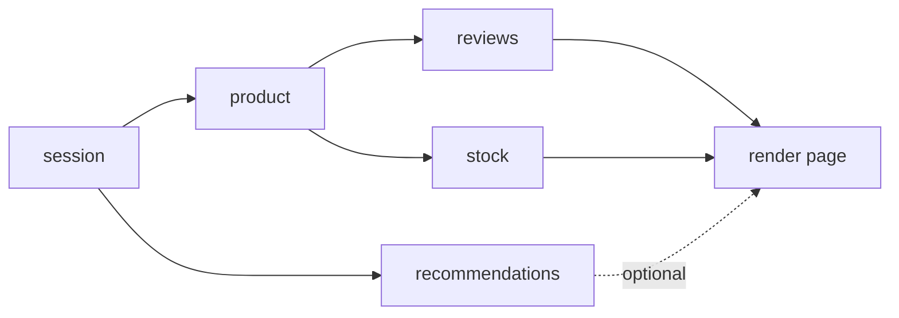

## Introduction

A single `await fetch(url)` is easy. Real features are not single calls. Opening a product page might need the session, then the product, then — independently — reviews, stock levels and recommendations, any of which might fail; checking out might poll a payment until it completes; an export job might walk through hundreds of pages of an API. **Async control flow** is the craft of arranging those steps: deciding what happens in sequence, what happens at the same time, how results are joined, what happens when one step fails, and when a loop should stop.

The building blocks are few: `await`, `for...of`, `try`/`catch`, and the Promise combinators `Promise.all`, `Promise.allSettled`, `Promise.race` and `Promise.any`. The skill is in combining them. Get it wrong one way and a page takes three times longer than it should because independent requests wait for each other. Get it wrong the other way and you fire a thousand requests at once, or a failure in an optional widget crashes the whole page, or a retry loop hits a struggling server thousands of times a second.

This lesson treats each control-flow shape in turn — sequence, fan-out and join, early start, branches, loops, retries — and finishes with a complete workflow that combines them.

## Before you start

- **async/await** — what `await` does and that async functions return Promises. See [[b1-async-await]].
- **Promise combinators** — the behaviour of `Promise.all`, `allSettled`, `race` and `any`. See [[b1-promise-combinators]]; this lesson uses them rather than re-deriving them.
- **Sequential versus parallel work** — why calling a function starts the work and `await` only waits for it. See [[b1-sequential-vs-parallel]].

Examples are ES modules run with Node 22. Simulated APIs use timers so every program runs offline; printed timings are rounded and will vary slightly by machine.

## The intuition: a workflow is a graph

Draw the steps of a feature as boxes and draw an arrow from A to B when B needs A's result. The arrows are the only real ordering constraints. Everything not connected by an arrow is free to run at the same time.



Reading the picture tells you the fastest correct plan: `session` first; then `product` and `recommendations` together; then `reviews` and `stock` together once `product` is ready; then render. The total time is the **longest path** through the graph (the critical path), not the sum of all boxes. A naive version that awaits each call in turn pays for every box.

The dotted arrow shows the other dimension: what happens on failure. A required step failing should fail the page; an optional one should degrade gracefully. With async/await, each arrow becomes an `await`, each set of boxes at the same level becomes a `Promise.all` (or `allSettled`), and each failure policy becomes a `try`/`catch` or `.catch` at the right place.

## Sequence: one step after another

When each step needs the previous result, you write the awaits in order. This is the **waterfall**, and it is what async/await makes most readable:

```javascript title="sequence.mjs"
const delay = (ms, v) => new Promise((r) => setTimeout(() => r(v), ms));
const getSession = () => delay(50, { userId: 7 });
const getCart = (userId) => delay(50, { userId, items: ['pen', 'ink'] });
const priceCart = (cart) => delay(50, { ...cart, total: 12.5 });

const session = await getSession();
const cart = await getCart(session.userId);
const priced = await priceCart(cart);
console.log(priced);
```

```output
{ userId: 7, items: [ 'pen', 'ink' ], total: 12.5 }
```

The same applies to a list of items that must be processed in order — for example, database migrations, or writes that must land in a fixed order. Use `for...of` with `await` inside; each iteration waits for the previous one:

```javascript title="ordered-loop.mjs"
const delay = (ms) => new Promise((r) => setTimeout(r, ms));
async function applyMigration(name) {
  await delay(20);
  console.log('applied', name);
}

for (const name of ['001_users', '002_orders', '003_index']) {
  await applyMigration(name);
}
console.log('all migrations applied');
```

```output
applied 001_users
applied 002_orders
applied 003_index
all migrations applied
```

Older code sometimes builds the same chain with `reduce`: `names.reduce((p, n) => p.then(() => applyMigration(n)), Promise.resolve())`. It works, but `for...of` says the same thing more clearly. What does **not** work is `names.forEach(async (n) => await applyMigration(n))`: `forEach` calls every callback immediately and ignores the returned Promises, so the migrations run concurrently and the line after `forEach` runs before any of them finishes.

Sequence is correct when there is a real dependency or a real ordering requirement. It is a latency bug when the steps are independent.

## Fan-out and join: running independent steps together

To run independent steps at the same time, **start** all of them (call the functions, collecting the Promises) and then **join** — wait for the group with a combinator. `map` plus `Promise.all` is the standard form:

```javascript title="fan-out.mjs"
const delay = (ms, v) => new Promise((r) => setTimeout(() => r(v), ms));
const loadPrice = (sku) => delay(sku.length * 30, { sku, price: sku.length * 10 });

const skus = ['pen', 'notebook', 'ink'];
const t0 = Date.now();
const prices = await Promise.all(skus.map(loadPrice));
console.log(prices.map((p) => `${p.sku}=${p.price}`).join(', '));
console.log('took ~', Math.round((Date.now() - t0) / 60) * 60, 'ms (slowest call is 240 ms)');
```

```output
pen=30, notebook=80, ink=30
took ~ 240 ms (slowest call is 240 ms)
```

Two properties of `Promise.all` make this pattern dependable. The result array is in the **same order as the input**, regardless of which call finished first, so you never need to sort results back into place. And the time is that of the **slowest** call, not the sum.

### Choosing the join

The join decides the failure policy. That is the main design decision in fan-out code.

| Join | Settles when | On a rejection | Use it when |
|---|---|---|---|
| `Promise.all` | all fulfil, or the first rejects | rejects immediately with that reason (fail-fast) | every result is required |
| `Promise.allSettled` | all settle | never rejects; reports each outcome | partial results are useful; you want every error |
| `Promise.any` | the first fulfils | rejects only if all reject (`AggregateError`) | any one source is enough (mirrors, fallbacks) |
| `Promise.race` | the first settles | adopts whichever settles first | timeouts; "first response wins" |

**Fail-fast** has a consequence people miss: when `Promise.all` rejects, the other operations keep running. Promises cannot be cancelled; `Promise.all` only stops *waiting* for them. If those operations are expensive, pass them an `AbortSignal` and abort it on failure ([[b1-abort-controller-js]]).

`allSettled` fits dashboards and batch jobs, where one failed widget or record should not discard the rest:

```javascript title="all-settled.mjs"
const delay = (ms) => new Promise((r) => setTimeout(r, ms));
async function loadWidget(name) {
  await delay(20);
  if (name === 'weather') throw new Error('weather API 503');
  return `${name} ok`;
}

const names = ['news', 'weather', 'stocks'];
const results = await Promise.allSettled(names.map(loadWidget));

results.forEach((r, i) => {
  if (r.status === 'fulfilled') console.log(names[i], '->', r.value);
  else console.log(names[i], '-> failed:', r.reason.message);
});
```

```output
news -> news ok
weather -> failed: weather API 503
stocks -> stocks ok
```

A middle path is to attach a `.catch` to each optional Promise *before* joining, converting its failure into a fallback value. Then `Promise.all` stays fail-fast for required steps and tolerant for optional ones, all in one join.

## Start early, await late

Fan-out with a single join covers steps at the same level. Real graphs have uneven shapes: some independent work should start immediately, while you go on doing dependent steps. The pattern is to call the independent function early, keep its Promise in a variable, and await it at the point you need it.

That pattern has a trap. If the early Promise **rejects while you are awaiting something else**, there is no handler attached to it at that moment, and the runtime reports an unhandled rejection — even though you were going to await it a few lines later:

```javascript title="early-start-trap.mjs"
const delay = (ms, v) => new Promise((r) => setTimeout(() => r(v), ms));
const failAfter = (ms) =>
  new Promise((_, reject) => setTimeout(() => reject(new Error('settings failed')), ms));

process.on('unhandledRejection', (e) => console.log('UNHANDLED:', e.message));

async function loadPage() {
  const settingsPromise = failAfter(10); // starts now
  const user = await delay(50, 'ada'); // settingsPromise rejects during this wait
  try {
    await settingsPromise;
  } catch (e) {
    console.log('caught later:', e.message);
  }
  return user;
}

await loadPage();
```

```output
UNHANDLED: settings failed
caught later: settings failed
```

Without the `process.on` listener in this demo, Node 15+ would have crashed the process at the `UNHANDLED` point; the `catch` would never have run. Browsers log an "Uncaught (in promise)" error. The rejection is detected when it happens with no handler attached, not at the end of the function.

The fix is to make sure every started Promise is joined or handled immediately. The cleanest way is to group work so that the join attaches handlers to everything at once:

```javascript title="early-start-fixed.mjs"
const delay = (ms, v) => new Promise((r) => setTimeout(() => r(v), ms));
const getUser = () => delay(50, { id: 1, name: 'ada' });
const getSettings = () => delay(10, { theme: 'dark' });
const getFeed = (userId) => delay(40, [`post for ${userId}`]);

async function loadPage() {
  // settings is independent; user -> feed is a dependent chain.
  const [settings, { user, feed }] = await Promise.all([
    getSettings(),
    (async () => {
      const user = await getUser();
      const feed = await getFeed(user.id);
      return { user, feed };
    })(),
  ]);
  return { theme: settings.theme, name: user.name, feed };
}

console.log(await loadPage());
```

```output
{ theme: 'dark', name: 'ada', feed: [ 'post for 1' ] }
```

The inner async arrow function, called immediately, turns the dependent chain into a single Promise, which can sit inside `Promise.all` beside the independent call. `Promise.all` attaches handlers to both at once, so a rejection from either is handled. The page takes `max(10, 50 + 40) = 90` ms instead of `10 + 50 + 40 = 100` ms in sequence — and in real pages, where the independent branch is often the slow one, the saving is much larger. If you must keep a Promise in a variable for a while, attach a handler at once (`settingsPromise.catch(() => {})` to mark it handled, while still awaiting the original later).

## Branching

Branches are where async/await is most clearly better than chains: an `if` around an `await` is an ordinary `if`.

```javascript title="branching.mjs"
const delay = (ms, v) => new Promise((r) => setTimeout(() => r(v), ms));
const cache = new Map([['u1', { id: 'u1', name: 'cached Ada' }]]);
const fetchUser = (id) => delay(30, { id, name: `fresh ${id}` });
const fetchAdminStats = () => delay(30, { openTickets: 4 });

async function loadUser(id, { isAdmin }) {
  const user = cache.get(id) ?? (await fetchUser(id)); // await only on a cache miss
  const stats = isAdmin ? await fetchAdminStats() : null; // conditional extra call
  return { user: user.name, stats };
}

console.log(await loadUser('u1', { isAdmin: false }));
console.log(await loadUser('u2', { isAdmin: true }));
```

```output
{ user: 'cached Ada', stats: null }
{ user: 'fresh u2', stats: { openTickets: 4 } }
```

The `??` operator short-circuits: on a cache hit, `fetchUser` is never called, so no request is made. One consequence to remember: an async function that sometimes awaits and sometimes does not still always returns a Promise and always resumes the caller asynchronously, so callers see consistent timing. (Callback APIs that call back synchronously on a cache hit and asynchronously on a miss were a notorious source of bugs; see [[b1-sync-vs-async-callbacks]].)

## Loops that wait: polling and pagination

Two loops come up constantly.

**Polling** repeats a request until a condition is met — a payment completes, an export is ready. A correct polling loop has three parts: a delay between attempts (otherwise it hammers the server), a stopping condition, and a limit so it cannot run forever.

```javascript title="polling.mjs"
const sleep = (ms) => new Promise((r) => setTimeout(r, ms));

let calls = 0;
async function getJobStatus() {
  calls += 1;
  return calls < 4 ? 'running' : 'done'; // done on the 4th check
}

async function waitForJob({ intervalMs, maxAttempts }) {
  for (let attempt = 1; attempt <= maxAttempts; attempt++) {
    const status = await getJobStatus();
    console.log(`attempt ${attempt}: ${status}`);
    if (status === 'done') return status;
    await sleep(intervalMs);
  }
  throw new Error(`job not done after ${maxAttempts} attempts`);
}

await waitForJob({ intervalMs: 50, maxAttempts: 10 });
```

```output
attempt 1: running
attempt 2: running
attempt 3: running
attempt 4: done
```

**Pagination** with a cursor is inherently sequential: you cannot request page 3 until page 2 tells you its cursor. An **async generator** ([[b1-async-iterators]], ES2018) packages that loop so the caller can consume items with `for await...of` without knowing about pages:

```javascript title="pagination.mjs"
const delay = (ms) => new Promise((r) => setTimeout(r, ms));
const pages = { start: { items: [1, 2], next: 'p2' }, p2: { items: [3, 4], next: 'p3' }, p3: { items: [5], next: null } };
async function fetchPage(cursor) {
  await delay(10);
  return pages[cursor];
}

async function* allItems() {
  let cursor = 'start';
  while (cursor) {
    const page = await fetchPage(cursor); // must wait: the next cursor comes from this page
    yield* page.items;
    cursor = page.next;
  }
}

for await (const item of allItems()) {
  if (item === 4) break; // stopping early also stops fetching: page p3 is never requested
  console.log('item', item);
}
```

```output
item 1
item 2
item 3
```

The generator is lazy: it fetches a page only when the consumer asks for more items. Breaking out of the `for await` loop calls the generator's `return()`, so no further pages are fetched. If the pages were addressed by number and the total was known, they would be independent and could be fanned out instead — the dependency graph, not the shape of the API, decides.

## Retries

A **retry loop** wraps one step: try it, and on failure try again, up to a limit. Here is the version most people write first:

```javascript title="retry-no-delay.mjs"
async function retry(fn, attempts) {
  let lastError;
  for (let i = 0; i < attempts; i++) {
    try {
      return await fn();
    } catch (e) {
      lastError = e;
    }
  }
  throw lastError;
}

let k = 0;
const flaky = async () => {
  k += 1;
  if (k < 2) throw new Error('temporary');
  return `succeeded on call ${k}`;
};
console.log(await retry(flaky, 3));
```

```output
succeeded on call 2
```

The loop is correct, but it retries **immediately**. If the server is failing because it is overloaded, every client retrying instantly makes the overload worse, and if `fn` rejects without any I/O the loop spins through microtasks without yielding to the event loop. A production retry adds a delay that grows with each attempt (**exponential backoff**), adds randomness (**jitter**) so many clients do not retry in lockstep, retries only errors that might succeed next time (timeouts, 503, 429 — not 400 or 404), and only retries operations that are safe to repeat. Those details are taught in [[b1-timeouts-retries]].

## How it works internally

Every `await` in a loop or branch is another resume point in the async function's state machine (see [[b1-async-await]]); a loop of 100 awaits suspends and resumes the function 100 times. Nothing about loops or branches is special at runtime.

The combinators are ordinary Promise code. `Promise.all` subscribes to every input, stores each fulfilled value at its input index, counts how many remain, and resolves the result when the count reaches zero; the first rejection rejects the result. A simplified version shows that there is no magic:

```javascript title="mini-all.mjs"
function all(values) {
  return new Promise((resolve, reject) => {
    const results = new Array(values.length);
    let remaining = values.length;
    if (remaining === 0) resolve(results);
    values.forEach((value, i) => {
      Promise.resolve(value).then((v) => {
        results[i] = v; // index, not push: keeps input order
        if (--remaining === 0) resolve(results);
      }, reject); // first rejection wins; later settlements are ignored
    });
  });
}

const delay = (ms, v) => new Promise((r) => setTimeout(() => r(v), ms));
console.log(await all([delay(30, 'slow'), delay(10, 'fast'), 'plain']));
```

```output
[ 'slow', 'fast', 'plain' ]
```

Two consequences follow. Combinators do not *start* anything — the work started when you called the functions that produced the Promises. And because `reject` is attached to every input, `Promise.all` marks all of them as handled; that is why grouping work in a join prevents the unhandled-rejection trap from the previous section. Implementing all four combinators is a common interview exercise ([[b1-impl-promise-combinators]]).

None of this creates threads. The "parallel" in "parallel requests" means the *waiting* overlaps: the network requests or timers are in flight at the same time in the browser or Node's I/O layer, while JavaScript callbacks still run one at a time.

## Worked example: an import job

A job must import every customer from a paged API into a database. Requirements: read pages in order (cursor-based), save each page's customers concurrently, keep going if individual saves fail, and report the failures at the end. This combines sequence, fan-out, a tolerant join and a loop.

```javascript title="import-job.mjs"
const delay = (ms) => new Promise((r) => setTimeout(r, ms));

const api = {
  pages: {
    a: { customers: ['ann', 'bob', 'cy'], next: 'b' },
    b: { customers: ['dee', 'ed!'], next: null }, // 'ed!' has an invalid name
  },
  async page(cursor) { await delay(20); return this.pages[cursor]; },
};

async function saveCustomer(name) {
  await delay(10);
  if (!/^[a-z]+$/.test(name)) throw new Error(`invalid name "${name}"`);
  return name;
}

async function importAll() {
  let cursor = 'a';
  let saved = 0;
  const failures = [];
  while (cursor) {
    const page = await api.page(cursor); // sequential: next cursor depends on it
    const results = await Promise.allSettled(page.customers.map(saveCustomer)); // fan-out
    for (const r of results) {
      if (r.status === 'fulfilled') saved += 1;
      else failures.push(r.reason.message);
    }
    console.log(`page ${cursor}: ${page.customers.length} processed`);
    cursor = page.next;
  }
  return { saved, failures };
}

console.log(await importAll());
```

```output
page a: 3 processed
page b: 2 processed
{ saved: 4, failures: [ 'invalid name "ed!"' ] }
```

Read it against the graph idea. Page fetches form a chain, so they are awaited in a `while` loop. The saves for one page are independent of each other, so they fan out with `map`. Each save may fail without invalidating the others, so the join is `allSettled`, and the loop collects the failures for a report instead of aborting. The page fetch is *not* protected — if the API itself fails, the whole job should stop and the rejection propagates out of `importAll`.

Two changes would make this production-ready. Pages with thousands of customers would launch thousands of concurrent saves, so the fan-out needs a limit ([[b1-concurrency-limiting]]). And transient page-fetch failures deserve a retry with backoff ([[b1-timeouts-retries]]).

## In real systems

**Frontend data loading.** Route loaders in frameworks such as React Router and Next.js are async functions where these patterns appear directly: start independent fetches together, await the critical ones, and let optional ones fail softly. React Server Components encourage starting fetches in parallel for the same reason ([[b4-rsc-data-fetching]]).

**Backend handlers.** An API gateway handler often fans out to several internal services with `Promise.all`, applies a timeout to each, and returns partial data with `allSettled` when some are down ([[d7-retry-strategies]] and [[d7-circuit-breakers]] cover the service-side policies).

**Batch jobs and scripts.** Imports, migrations and crawlers combine sequential cursors with bounded parallel processing, exactly as in the worked example.

**Libraries.** `p-limit`, `p-map`, `p-retry` and `p-queue` (npm) package the bounded fan-out and retry patterns; TanStack Query handles retries, deduplication and stale results for UI code.

## Trade-offs and alternatives

Sequential code is simplest to reason about and gentlest on the server, but its latency is the sum of all steps. Parallel code cuts latency to the longest path, at the cost of bursts of load and more complex failure handling (several things can fail at once). Unbounded parallelism over large lists is not "more parallel"; it exhausts sockets, memory or rate limits, and is often slower overall than a limit of 5–20.

The join choice trades strictness against resilience: `all` gives a simple success-or-failure answer, `allSettled` gives resilience at the cost of checking each result. For streams of values or complex cancellation-heavy flows (search-as-you-type, websockets), reactive libraries such as RxJS express the same patterns as operators (`switchMap`, `mergeMap` with a concurrency argument, `retry`), and some teams prefer them there.

## Common mistakes

> [!MISTAKE] Awaiting independent calls one after another
> `const a = await getA(); const b = await getB();` costs the sum of both latencies when neither needs the other. Start both and `await Promise.all([getA(), getB()])`. The reverse mistake — parallelising steps that do depend on each other — produces wrong results, so check the dependency graph first.

**Starting work early without a handler.** A Promise kept in a variable while you await something else can reject unhandled and crash a Node process. Group it into a join, or attach a handler immediately.

**`forEach` with an async callback.** It neither waits nor collects errors. Use `for...of` for sequence and `Promise.all(items.map(...))` for parallel.

**Polling and retry loops without a delay or a limit.** Without a delay they hammer the server (or spin through microtasks); without a limit they may never end. Every loop that waits on the outside world needs both.

**Assuming fail-fast cancels the rest.** After `Promise.all` rejects, the other operations still run to completion and their side effects still happen. Use an `AbortSignal` if they should stop.

**Treating `Promise.race` as a timeout that stops the work.** Racing a request against a timer only stops *waiting*; the request continues. Combine the race with `abort()` ([[b1-timeouts-retries]]).

## Interview perspective

Async control-flow questions usually arrive as "optimise this function" or "implement this utility". For the first, draw the dependency graph aloud: name what depends on what, then show the version that awaits only on real dependencies and joins the rest. State the latency before and after (sum versus longest path). For the second — implement `Promise.all`, a `retry`, a `sleep`, a `mapLimit` — interviewers check result ordering, the empty-input case, error propagation and termination.

Expect follow-ups such as: what happens to the other requests when one fails in `Promise.all`? (they keep running), how do you get partial results? (`allSettled` or per-call `.catch`), how would you limit concurrency to 5? (a pool of workers pulling from a shared index, see [[b1-concurrency-limiting]]), and how would you cancel the whole graph when the user navigates away? (thread one `AbortSignal` through every call).

> [!INTERVIEW] What a strong answer sounds like
> "I'd first separate real dependencies from accidental ordering. Session must come first, but profile, settings and notifications only need the user id, so I start them together and await `Promise.all`. Notifications are optional, so I give that call its own `.catch` returning an empty list. For the list of 2,000 items I'd use a concurrency limit rather than one huge `Promise.all`, and I'd pass an `AbortSignal` so leaving the page cancels outstanding requests."

```quiz
Q: `const a = slowA(); const b = await slowB(); const c = await a;` — `slowA` rejects while `slowB` is still pending. In Node 22 with default settings, what happens?
- [ ] The rejection is caught when `await a` runs, so nothing special happens
- [x] Node reports an unhandled rejection and, by default, terminates the process before `await a` runs
- [ ] `await slowB()` throws `slowA`'s error
- [ ] `slowA`'s rejection is silently discarded
> Rejection tracking happens when a Promise rejects with no handler attached. At that moment nobody has subscribed to `a` — the `await a` line has not been reached — so Node raises `unhandledRejection`, which crashes the process by default since Node 15. Putting both Promises in one `Promise.all` attaches handlers to both immediately.
```

```quiz
Q: Which join fits a dashboard where each of five widgets loads independently and a failed widget should show an error tile while the others render?
- [ ] `Promise.all`
- [x] `Promise.allSettled`
- [ ] `Promise.race`
- [ ] `Promise.any`
> `allSettled` waits for every widget and reports each one as fulfilled or rejected, so the page can render successes and error tiles together. `Promise.all` would reject on the first failure and discard the other results; `race` and `any` resolve with just one widget.
```

## Practice

1. **Draw, then code.** For a checkout page that needs `user`, `cart` (needs user), `shippingOptions` (needs cart), `promotions` (needs user) and `paymentMethods` (needs user), draw the graph, compute the critical path if each call takes 100 ms, and implement the fastest correct version.
2. **Fix the trap.** Rewrite the early-start trap example so that a settings failure is caught without any `process.on` listener.
3. **Polling with a deadline.** Change `waitForJob` to stop after a total time budget (for example 2 seconds) rather than a fixed number of attempts.
4. **Lazy pagination.** Add a `take(n)` helper that consumes the first `n` items of an async generator, and show that it fetches no more pages than needed.
5. **Implement `allSettled`.** Write your own version and test it with fulfilled, rejected and non-Promise inputs, and an empty array.

## Quick revision {#quick-revision}

- Model a workflow as a **dependency graph**; total latency is the **critical path**, not the sum.
- **Sequence:** consecutive awaits, or `for...of` + `await` for ordered lists. Never `forEach(async ...)`.
- **Fan-out:** start all, then join — `await Promise.all(items.map(fn))`; results keep **input order**.
- **Joins:** `all` (fail-fast), `allSettled` (all outcomes), `any` (first success, `AggregateError` if none), `race` (first to settle).
- Fail-fast and `race` stop *waiting*, not the work; cancel with `AbortSignal`.
- **Start early, await late** is fine only if every started Promise is joined or handled immediately; otherwise a rejection is **unhandled** (Node 15+ crashes).
- Nest a dependent chain inside a join with an immediately called async arrow function.
- **Branching:** `if`/`??` around `await`; an async function always returns asynchronously.
- **Polling:** delay + stop condition + attempt or time limit.
- **Cursor pagination** is sequential; async generators + `for await...of` make it lazy, and `break` stops fetching.
- **Retries** need backoff, jitter, a limit, and idempotent operations.
- Unbounded fan-out over big lists needs a **concurrency limit**.

## Key takeaways {#key-takeaways}

- Async control flow is a dependency graph: await only on real dependencies and run everything else concurrently.
- The join you choose is your failure policy — fail-fast with `all`, collect everything with `allSettled`, take the first success with `any`.
- Calling a function starts the work; a combinator only waits. Neither `Promise.all` rejecting nor `race` finishing stops the other operations.
- Every Promise you start must be awaited or handled promptly, or its rejection can crash a Node process.
- Every loop that waits on the outside world needs a delay and a limit.
- async/await turns branches and loops back into ordinary `if`, `while` and `for`, which is its biggest advantage over Promise chains.
