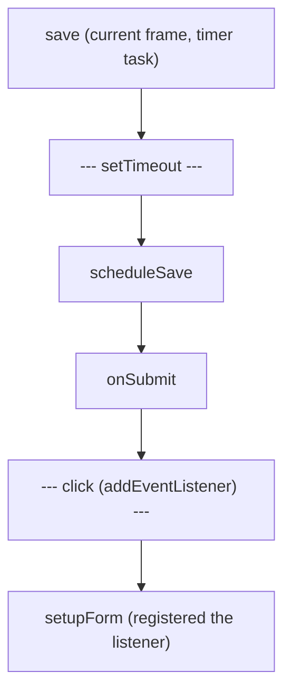

## Introduction

Synchronous bugs have a pleasant property: when something throws, the stack trace tells the whole story. Function `a` called `b`, which called `c`, which threw. Async bugs break that property. A click handler starts a request; a few hundred milliseconds later the response arrives and a callback runs; that callback throws. By the time it throws, the click handler finished long ago. The engine's call stack contains only the callback and whatever internal code invoked it, so the trace often says nothing about *why* the callback ran.

The hardest async bugs are not even errors. They are **ordering bugs**: two responses arrive in the opposite order to their requests and the older one overwrites the newer one; a loading spinner is hidden by one request while another is still running; a `catch` handler is attached one tick too late. Each individual line is correct, and only the sequence is wrong.

**Async debugging** is the set of techniques and tool features for seeing that sequence: async stack traces that join the pieces of a logical operation together, breakpoints that stop when a promise is rejected, the Network panel's view of request timing, and simple instrumentation such as request ids. This lesson explains how each works and why the tools are designed the way they are, building directly on the event loop.

## Before you start

- **The event loop, tasks and microtasks** — the engine runs one job at a time from queues, and the stack is empty between jobs. See [[b1-event-loop]] and [[b1-microtasks]].
- **Promises and `async`/`await`** — what `await` does to a function's execution. See [[b1-promises]], [[b1-async-await]] and [[b1-await-does-not-block]].
- **Error handling with promises** — how rejections propagate and what an unhandled rejection is. See [[b1-await-try-catch]] and [[b1-unhandled-rejection]].
- **Breakpoints and the Call Stack pane** — how to pause and read frames. See [[b1-breakpoints]] and [[b1-watch-scope]].
- **Stack traces** — how to read the `at …` lines of `error.stack`. See [[b1-stack-traces]].

## The intuition

Imagine a relay race filmed by a security camera that only records whoever is holding the baton. If the baton is dropped, the footage shows the last runner fumbling it — but not who handed it over, how the earlier legs went, or which team this was. To understand the drop you need the earlier footage stitched together with the last clip.

The engine's call stack is that camera. Each async job — a timer callback, a promise reaction, an event handler — starts with an empty stack, runs until it finishes, and leaves an empty stack behind. Nothing in the engine's execution model *requires* it to remember who scheduled the job. **Async stack traces** are the stitched-together footage: the debugger (or, for `await`, the engine) records extra information about where async work came from and shows it as if it were one continuous stack. The stitching is a tooling feature layered on top; it is not what the engine is running.

## Why the stack goes empty

Recall how the event loop runs code. It takes one job from a queue, runs it to completion, and then takes the next. A job starts with nothing on the call stack except itself. When you write

```js
button.addEventListener('click', function onClick() {
  setTimeout(function later() { /* ... */ }, 100);
});
```

the click is one task: `onClick` runs, schedules a timer, and returns. The stack empties. A hundred milliseconds later a *different* task runs `later`. From the engine's point of view, `later` has no caller in JavaScript at all — it was called by the timer machinery. The connection between `onClick` and `later` exists only in your head and in the scheduling.

You can see this directly. The program below schedules a save from a submit handler, and the save fails:

```js title="timeout-stack.mjs"
function scheduleSave(data) {
  setTimeout(function save() {
    try {
      JSON.parse(data);
    } catch (err) {
      console.log(err.stack.split('\n').slice(0, 5).join('\n'));
    }
  }, 0);
}
function onSubmit() {
  scheduleSave('{bad json');
}
onSubmit();
```

```output
SyntaxError: Expected property name or '}' in JSON at position 1 (line 1 column 2)
    at JSON.parse (<anonymous>)
    at Timeout.save [as _onTimeout] (file:///app/timeout-stack.mjs:4:12)
    at listOnTimeout (node:internal/timers:585:17)
    at process.processTimers (node:internal/timers:521:7)
```

This was run with Node.js 22; your file path will differ. The trace contains `save` and then Node's internal timer functions. Neither `scheduleSave` nor `onSubmit` appears, because they had returned long before `save` ran. In a real app with many places that call `scheduleSave`, this trace cannot tell you which one passed the bad data.

## Async stack traces after `await`

`await` is different, because the engine knows more. When an `async` function is suspended at `await`, V8 keeps its state in a generator-like object and links the promise being awaited to the function that is waiting for it. When an error is created later, V8 can walk those links to find which `async` functions are *currently waiting* on this chain and append them to the stack. V8 calls this **zero-cost async stack traces**, available in Node.js 12+ and Chrome 73+: it costs nothing until an error's stack is actually captured.

```js title="await-stack.mjs"
async function fetchUser(id) {
  await null; // stands in for a real network wait
  throw new Error(`user ${id} not found`);
}
async function loadProfile(id) {
  const user = await fetchUser(id);
  return user.name;
}
async function main() {
  try {
    await loadProfile(42);
  } catch (err) {
    console.log(err.stack.split('\n').slice(0, 4).join('\n'));
  }
}
await main();
```

```output
Error: user 42 not found
    at fetchUser (file:///app/await-stack.mjs:3:9)
    at async loadProfile (file:///app/await-stack.mjs:6:16)
    at async main (file:///app/await-stack.mjs:11:5)
```

The error was thrown *after* `await null`, in a microtask that started with an empty stack, yet the trace shows the whole logical chain. The frames prefixed with `async` are not real stack frames — `loadProfile` and `main` were suspended, not executing — they are the chain of awaiting functions that V8 reconstructed. Read them as "this was being awaited by…".

The reconstruction has a limit worth knowing: it follows `await`, not arbitrary promise callbacks. Rewrite the same logic with `.then` and the history disappears:

```js title="then-stack.mjs"
function fetchUser(id) {
  return Promise.resolve().then(() => {
    throw new Error(`user ${id} not found`);
  });
}
function loadProfile(id) {
  return fetchUser(id).then((user) => user.name);
}
loadProfile(42).catch((err) => console.log(err.stack.split('\n').slice(0, 4).join('\n')));
```

```output
Error: user 42 not found
    at file:///app/then-stack.mjs:3:11
```

Only the anonymous arrow function is listed. By the time it runs, `fetchUser` and `loadProfile` have returned — they were never suspended, so there is no awaiting function to link to. Two practical lessons follow. First, code written with `async`/`await` produces much more useful production error reports than equivalent `.then` chains. Second, **name your functions**: an anonymous arrow appears as a bare file location, while a named function says what it was doing.

## Async stack traces in DevTools

The `error.stack` string is limited to what the engine can reconstruct cheaply. DevTools go further while they are open. When the debugger is enabled, Chrome records the stack at the moment async work is *scheduled* — when `setTimeout` is called, when a promise reaction is registered, when `addEventListener` registers a handler, when `requestAnimationFrame` is called — and keeps it with the job. When you pause inside the callback later, the Call Stack pane shows the current frames, then a separator such as **setTimeout** or **Promise.then** or **await**, then the stack that scheduled it, and so on further back.



For the `timeout-stack.mjs` example, pausing inside `save` with DevTools open would show `save`, then a `setTimeout` separator, then `scheduleSave` and `onSubmit` — the history the plain error stack lost. This view is built from information captured at scheduling time, so it only exists for work scheduled while DevTools were recording. Chrome enables async stack traces by default (the setting is under *Preferences → Debugger*), and it limits how many async hops it keeps to bound memory. The browser behaviour described here was not run for this lesson; it is taken from Chrome's documentation, and the Node.js outputs above were run with Node.js 22.

> [!NOTE] Two different mechanisms
> `at async …` lines in `error.stack` come from the engine and survive into production logs. The separator-joined stacks in the Call Stack pane come from the debugger and exist only while DevTools are attached. Do not expect production error reports to contain the second kind.

## Pausing where async errors start

A rejected promise usually surfaces far from where it was created. If you wait for the final `catch` — or worse, for an "Uncaught (in promise)" message in the Console — the state that caused the error is gone. Exception breakpoints let you stop at the source instead.

In Chrome's Sources panel, the **Breakpoints** section has two checkboxes. **Pause on uncaught exceptions** stops at the `throw` (or the `reject` call) whose error nobody handles. For promises, "uncaught" means the rejection was not handled by the time the browser checks — the same condition that later produces the `unhandledrejection` event (see [[b1-unhandled-rejection]]). **Pause on caught exceptions** also stops when the error *will* be handled by a `try`/`catch` or a `.catch`. That second option is noisy — libraries throw and catch internally all the time — but it is exactly what you need when an error is being swallowed:

```js
async function loadSettings() {
  try {
    return await fetchSettings();
  } catch {
    return {}; // silently hides network failures, parse errors and typos
  }
}
```

If settings mysteriously come back empty, *Pause on caught exceptions* stops at the real failure inside `fetchSettings`, with its variables intact. Ignore-listing third-party scripts (see [[b1-breakpoints]]) keeps the noise down.

### What an unhandled rejection does

It also helps to know how each runtime reacts when a rejection is never handled, because that message is often your first clue:

```js title="unhandled.mjs"
async function save() {
  throw new Error('disk full');
}
save(); // no await, no .catch
setTimeout(() => console.log('never printed'), 10);
```

```output
file:///app/unhandled.mjs:2
  throw new Error('disk full');
        ^

Error: disk full
    at save (file:///app/unhandled.mjs:2:9)
    at file:///app/unhandled.mjs:4:1
    at ModuleJob.run (node:internal/modules/esm/module_job:343:25)
    at async onImport.tracePromise.__proto__ (node:internal/modules/esm/loader:681:26)
    at async asyncRunEntryPointWithESMLoader (node:internal/modules/run_main:117:5)

Node.js v22.22.3
```

Since Node.js 15, an unhandled rejection crashes the process with exit code 1, which is why `never printed` is never printed. A browser does not crash the page; it logs `Uncaught (in promise) Error: disk full` in the Console and fires an `unhandledrejection` event on `window`, and the rest of the page keeps running. The stack is useful here because the `throw` happened before the first `await` — `save` was still on the real stack when the error was created.

## Ordering bugs: the stale response

Errors at least announce themselves. Ordering bugs produce wrong output silently. The classic one is a search box that sends a request per keystroke. Requests do not necessarily finish in the order they were sent; a broad query such as `r` can be slower than the specific `rea`. If every response writes to the screen unconditionally, the *last response to arrive* wins, not the last request sent.

The program below simulates that with timers whose delays make the earliest request the slowest. It then shows the fix: tag each request with an increasing id and ignore any response that is not for the latest request.

```js title="stale-response.mjs"
// Fake search API: shorter queries are slower, as a broad query often is.
function searchApi(query) {
  const delay = { r: 300, re: 200, rea: 100 }[query];
  return new Promise((resolve) => setTimeout(() => resolve(`results for "${query}"`), delay));
}

let shown = '';
async function onInputBuggy(query) {
  const results = await searchApi(query);
  shown = results;
  console.log('buggy  shows', shown);
}

let latestRequest = 0;
async function onInputFixed(query) {
  const requestId = ++latestRequest;
  console.log(`fixed  sent #${requestId} for "${query}"`);
  const results = await searchApi(query);
  if (requestId !== latestRequest) {
    console.log(`fixed  dropped stale #${requestId}`);
    return;
  }
  console.log('fixed  shows', results);
}

for (const q of ['r', 're', 'rea']) onInputBuggy(q);
await new Promise((r) => setTimeout(r, 400));
console.log('final buggy screen:', shown);
for (const q of ['r', 're', 'rea']) onInputFixed(q);
```

```output
buggy  shows results for "rea"
buggy  shows results for "re"
buggy  shows results for "r"
final buggy screen: results for "r"
fixed  sent #1 for "r"
fixed  sent #2 for "re"
fixed  sent #3 for "rea"
fixed  shows results for "rea"
fixed  dropped stale #2
fixed  dropped stale #1
```

Walk through the buggy half. All three calls start immediately and each suspends at `await`. After 100 ms the `rea` response arrives and is shown — correct so far. At 200 ms the `re` response overwrites it, and at 300 ms the `r` response overwrites that. The user typed `rea` and is looking at results for `r`. Nothing threw, and a breakpoint in `onInputBuggy` would show correct-looking values on every pause.

The fixed version captures `requestId` before the `await`. Because `requestId` is a local constant, each suspended call keeps its own value, while `latestRequest` is shared and always holds the newest id. After the `await`, the comparison asks "am I still the latest request?" and drops stale results. The output order is deterministic here because the timers have fixed delays; with a real network it would vary from run to run, which is exactly why this bug is intermittent.

In real code the more complete fix is to **cancel** the stale request with an `AbortController`, so it stops using bandwidth too: abort the previous controller before starting a new `fetch`, and treat the resulting `AbortError` as expected rather than as a failure. See [[b3-race-conditions-fetch]] and [[b1-abort-controller-js]]; React components face the same problem in effects, covered in [[b4-effect-race-conditions]].

### How to see an ordering bug

Because each step is individually correct, finding an ordering bug means recording *order*, not values. Three techniques work well together:

1. **The Network panel with throttling.** Sort by start time and look at the *Waterfall* column: overlapping bars for the same endpoint, where an earlier bar ends later, are the signature of a possible stale response. Throttling to *Slow 4G* makes the overlap far more likely, turning an intermittent bug into a reproducible one.
2. **Logpoints with sequence numbers.** Logging `"send", id, query` and `"recv", id, query` without pausing shows the interleaving exactly. Breakpoints are a poor fit here because pausing for several seconds changes which response arrives first.
3. **Thinking in tasks.** For each `await`, ask: "what else could run while this function is suspended, and which shared state could it change?" Any shared variable read after an `await` is a candidate.

## Timing async code

`console.time` and `performance.now()` measure **wall-clock time** — real elapsed time — not time spent running your code. Around an `await`, that difference is enormous:

```js title="wall-vs-cpu.mjs"
const sleep = (ms) => new Promise((r) => setTimeout(r, ms));

console.time('wall');
const cpuBefore = process.cpuUsage();
await sleep(200);
const cpu = process.cpuUsage(cpuBefore);
console.timeEnd('wall');
console.log(`cpu: ${((cpu.user + cpu.system) / 1000).toFixed(1)}ms`);
```

```output
wall: 201.223ms
cpu: 0.2ms
```

The exact numbers vary between runs and machines. The process was idle for almost the whole 200 ms; the thread was free to run other tasks. So if `console.time` reports that a `loadDashboard()` call took two seconds, that tells you the user waited two seconds, but not whether the time went to the network, to the server, to other JavaScript that ran in between, or to your own code. To split it up, combine the Network panel's timing breakdown with a Performance recording ([[b1-profiling-basics]]), which shows CPU work task by task.

## How it works internally

Three pieces of machinery support everything above.

**Async stack traces for `await`.** An `async` function compiles into something like a resumable state machine. When it awaits, V8 attaches a reaction to the awaited promise whose job is to resume this function. When an `Error` is created, V8 captures the synchronous frames as usual, then looks at the currently running microtask: if it is resuming an async function, V8 follows that function's result promise to whichever async function is awaiting *it*, and so on up the chain. That is cheap because it only reads links that already exist for resumption, which is where the name "zero-cost" comes from. A `.then` callback has no such link to the function that created the promise, hence the missing frames.

**Debugger async stacks.** When DevTools are open, the CDP `Debugger.setAsyncCallStackDepth` command tells V8 and the browser to capture a stack trace every time async work is scheduled, and associate it with the job. This costs memory and time on every `setTimeout`, every promise reaction and every event registration, which is why it is only active while debugging and why the depth is limited.

**Rejection tracking.** Every promise has an internal "is handled" flag. When a promise is rejected with no handlers, the host is notified through a hook named in the ECMAScript specification (HostPromiseRejectionTracker); if a handler is attached later, the host is notified again. Browsers check after microtasks have run and fire `unhandledrejection` for rejections still unhandled; Node.js applies its `--unhandled-rejections` mode, whose default since version 15 is to throw. DevTools' "pause on uncaught exceptions" for promises is built on the same tracking.

## In real systems

Production applications report errors to tracking services such as Sentry, Datadog or Bugsnag. Those reports contain `error.stack`, so whether `at async …` frames appear depends on whether the code used `await` — a concrete reason teams prefer `async`/`await` in application code. Trackers also record **breadcrumbs**: recent clicks, navigations, console messages and network requests before the error. Breadcrumbs exist precisely because the stack alone cannot explain an async failure; they are a rough reconstruction of the order of events.

On the server, Node.js offers `AsyncLocalStorage` (in `node:async_hooks`) to carry a request id through every callback and `await` in a request, so that log lines from different concurrent requests can be told apart. The idea is the same as the `requestId` in the search example: give each logical operation an identity that survives async boundaries.

Frontend data libraries such as TanStack Query ([[b4-tanstack-query]]) handle stale responses for you by keying requests and discarding outdated results, which is one of the strongest reasons to use them rather than ad-hoc `fetch` calls in effects.

## Trade-offs and alternatives

| Technique | Good for | Limitation |
|---|---|---|
| `error.stack` with `await` | Production reports; costs nothing | Follows only awaiting async functions, not `.then` or timers |
| DevTools async stacks | Seeing who scheduled any callback | Only while DevTools are open; bounded depth; memory cost |
| Exception / rejection breakpoints | Stopping where the error is created | Caught-exception mode is noisy without ignore-listing |
| Logpoints with ids | Seeing the order of events without changing timing | You must choose what to log |
| Breakpoints | Inspecting state inside one async step | Pausing changes timing and can hide races |
| Network waterfall + throttling | Request overlap and stale responses | Only shows network work |

## Common mistakes

**Reading only the top frame after an `await`.** The top frame is where the error surfaced. The `async` frames below it, or the scheduling stack in DevTools, tell you which caller started the operation. Follow them down.

**Assuming a missing caller means the stack is broken.** For timers and `.then` callbacks, the caller is genuinely not on the stack. Switch to DevTools async stacks, or convert the code to `await`.

**Debugging a race with breakpoints alone.** Pausing for ten seconds lets every other request finish, so the bug disappears while you watch. Use logpoints, throttling and ids.

**Catching and discarding errors.** `catch {}` and `.catch(() => {})` make the original error invisible. At minimum log it; during debugging use *Pause on caught exceptions* to find it.

**Forgetting to return or await a promise.** A function that calls `save()` without `await` or `return` lets the rejection escape every surrounding `try`/`catch`, producing an unhandled rejection whose stack points at `save` but not at the caller that should have handled it.

**Reading `console.time` around an `await` as CPU cost.** It is elapsed time, including every task that ran in between.

## Interview perspective

- *"Why does the stack trace of an error thrown in a `setTimeout` callback not show the function that called `setTimeout`?"* Because that function returned before the callback ran; each task starts with an empty stack. A strong answer adds that DevTools can show the scheduling stack while debugging, and `await` chains appear as `async` frames in V8.
- *"What are the `at async` frames in a Node.js stack trace?"* Async functions that were awaiting the failing one, reconstructed by V8 from the promise links, not frames that were executing.
- *"A search box sometimes shows results for an older query. Why, and how do you fix it?"* Responses arrive out of order; fix by ignoring stale responses (request id) and ideally aborting them (`AbortController`). Mention that this is invisible on fast networks and that throttling reproduces it.
- *"How would you find an error that some library catches and hides?"* Pause on caught exceptions, ignore-listing unrelated libraries.
- Follow-up: *"What happens to an unhandled rejection in Node versus the browser?"* Node 15+ crashes with exit code 1 by default; the browser logs it and fires `unhandledrejection`.

```quiz
Q: An error is thrown inside a `.then` callback. Its stack shows only the anonymous callback. Why don't the functions that built the promise chain appear?
- [ ] Stack traces are disabled inside microtasks
- [x] Those functions had already returned; they were not awaiting anything, so there was no link for the engine to follow
- [ ] `.then` callbacks run in a separate thread
- [ ] The error was thrown before the chain was created
> When the callback runs, the functions that called `.then` finished long ago. V8 reconstructs `async` frames only from suspended async functions that are awaiting the failing promise. Microtasks do record stacks — the callback itself appears — and everything runs on the same thread.
```

```quiz
Q: In a search box, typing quickly sometimes leaves results for an older query on screen. Which fix addresses the cause?
- [ ] Wrap the fetch in try/catch
- [ ] Add a breakpoint after the await to slow things down
- [x] Track the latest request id (or abort earlier requests) and ignore responses that are not for the latest request
- [ ] Use `console.time` to measure each request
> The cause is that responses can arrive in a different order from requests, so the last response to arrive overwrites the screen. Comparing a captured id with the latest id, or aborting outdated requests, makes the newest request win. Nothing throws, so try/catch does not help, and timing or pausing does not change which response is applied.
```

```quiz
Q: `console.time` around `await loadData()` prints 1,800 ms. What can you conclude?
- [x] About 1.8 seconds of real time passed, which may include network waiting and unrelated tasks
- [ ] `loadData` used 1.8 seconds of CPU time
- [ ] The main thread was blocked for 1.8 seconds
- [ ] The server took exactly 1.8 seconds to respond
> `console.time` measures wall-clock time. During an `await` the thread is free to run other tasks, so CPU usage could be tiny and the page responsive. The total also includes DNS, connection, transfer and any JavaScript that ran in between, so it is not the server's processing time either.
```

## Practice

1. Rewrite `then-stack.mjs` using `async`/`await` and confirm that `loadProfile` now appears in the stack.
2. Add a second timer hop to `timeout-stack.mjs` (a `setTimeout` inside a `setTimeout`). Predict the stack, run it, then describe what DevTools would show with async stacks enabled.
3. Change `stale-response.mjs` to use `AbortController` so that stale requests are cancelled rather than ignored. Simulate cancellation by rejecting the fake request when its signal aborts.
4. Write a function that swallows an error in `catch {}`. In a browser, find the original error using *Pause on caught exceptions*.
5. Using `process.cpuUsage()`, compare wall and CPU time for a function that awaits a timer and then runs a 50-million-iteration loop.

## Quick revision {#quick-revision}

- Each task or microtask starts on an empty stack; the scheduler, not a JavaScript caller, invokes callbacks.
- V8 zero-cost async stack traces (Node 12+, Chrome 73+) add `at async fn` frames for async functions *awaiting* the failing one.
- `.then` chains and timers do not get those frames — the creating functions already returned. Name your functions.
- DevTools async stacks capture the scheduling stack (setTimeout, Promise.then, await, event listeners) only while debugging.
- *Pause on uncaught exceptions* stops at unhandled throws and rejections; *Pause on caught exceptions* finds swallowed errors.
- Unhandled rejection: Node 15+ crashes (exit code 1); browsers log "Uncaught (in promise)" and fire `unhandledrejection`.
- Stale responses: requests finish out of order. Fix with a latest-request id and/or `AbortController`.
- Find ordering bugs with logpoints + ids, Network waterfall and throttling — not long pauses.
- `console.time` around `await` is wall-clock time, not CPU time.

## Key takeaways {#key-takeaways}

- An async bug is usually a sequence bug; record the order of events, not only values.
- The engine's stack forgets who scheduled a callback; async stack traces are reconstructions, by V8 for `await` chains and by DevTools for everything while debugging.
- Prefer `async`/`await` and named functions: production stack traces become far more informative.
- Exception and rejection breakpoints stop where the error is created, before its state is lost.
- Any shared state read after an `await` may have changed; guard against stale responses explicitly.
- Elapsed time around an `await` measures waiting, not work.
