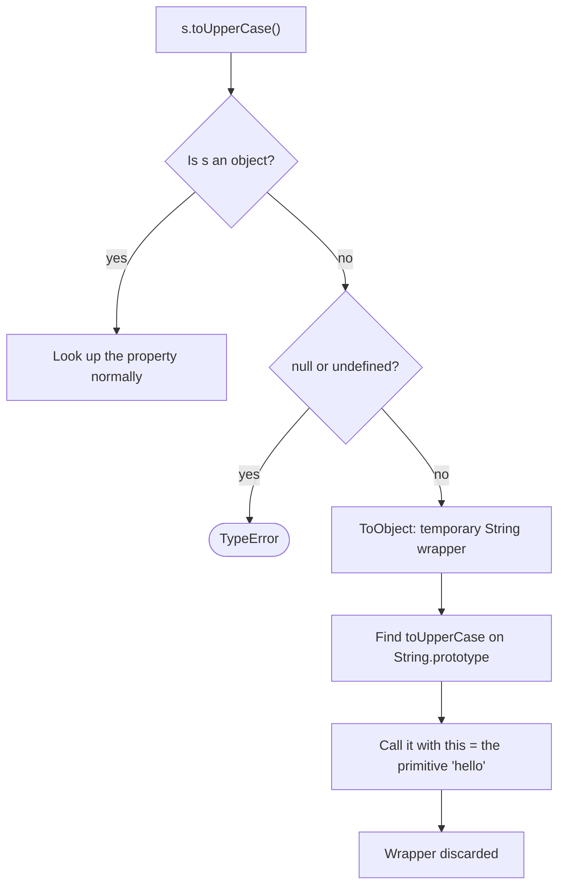

## Introduction

A **primitive** is a plain value such as `'hello'`, `42` or `true`. Unlike an object, it is not a container: it has no properties and you cannot change it. And yet every JavaScript programmer writes code like this on the first day:

```javascript title="first-box.js"
const s = 'hello';
console.log(s.toUpperCase(), s.length, s[1]);

s.tag = 'greeting';      // looks like it stores a property...
console.log(s.tag);      // ...but nothing was stored
```

```output
HELLO 5 e
undefined
```

Two things in this output need an explanation. If primitives have no properties, where do `toUpperCase` and `length` come from? And if you *can* read properties from a string, why does the property you wrote vanish on the very next line?

The answer to both is **autoboxing**: whenever you access a property on a string, number, bigint, boolean or symbol, JavaScript behaves as if it wrapped the primitive in a temporary object of the matching **wrapper type** (`String`, `Number`, `BigInt`, `Boolean` or `Symbol`), performed the access on that object, and threw the object away. Methods live on the wrapper's prototype, so reading works. Anything written lands on the throwaway object, so writing is lost.

This matters for three practical reasons. It explains why methods on primitives work at all, which is the foundation of almost every line of string and number handling. It explains a family of confusing bugs — properties that disappear, a `TypeError` in strict mode, `new Boolean(false)` passing an `if`. And it is a favourite interview topic, because a good answer shows you understand the difference between a value and an object.

## Before you start

- **Primitive types** — the seven primitives (`string`, `number`, `bigint`, `boolean`, `undefined`, `null`, `symbol`) and the idea that they are not objects. See [[b1-primitive-types]].
- **Primitives vs references** — primitives are compared and copied by value, objects by reference. See [[b1-primitive-vs-reference]].
- **Prototypes, briefly** — an object can find a property it does not own on its prototype. You only need the one-sentence version here; the full story is in [[b1-prototype-chain]].
- **Strict mode** — the `'use strict'` opt-in that turns some silent failures into errors. See [[b1-strict-mode]].

## The intuition

Picture a laboratory where only people wearing a lab coat may use the equipment. A visitor (the primitive) walks in and wants to use a microscope (a method). Staff hand the visitor a coat at the door (the wrapper object), the visitor uses the microscope, and the coat goes back on the rack as they leave. If the visitor pins a note to the coat, the note is gone with the coat: next time they get a fresh one.

The analogy captures the two rules that matter. Reading works because, for the length of one property access, the primitive is treated like an object that inherits all the wrapper's methods. Writing does not stick because nothing ties the next access to the coat from the last one.

Where the analogy stops working: engines do not actually sew a new coat for every access. Modern engines such as V8 (Chrome, Node.js) recognise property access on primitives and look the method up directly on `String.prototype` or `Number.prototype` without allocating anything. The specification describes a wrapper; engines only have to behave *as if* one existed. So autoboxing is a rule about meaning, not a performance cost you need to avoid.

## Primitives and their wrapper types

Five of the seven primitive types have a wrapper type. Each wrapper is a constructor function whose `prototype` holds the methods for that type.

| Primitive | Example | Wrapper | Where methods live | Can you `new` it? |
|---|---|---|---|---|
| string | `'hi'` | `String` | `String.prototype` (`toUpperCase`, `slice`, `at`…) | Yes (but don't) |
| number | `42` | `Number` | `Number.prototype` (`toFixed`, `toString`…) | Yes (but don't) |
| boolean | `true` | `Boolean` | `Boolean.prototype` (`toString`, `valueOf`) | Yes (but don't) |
| bigint | `10n` | `BigInt` | `BigInt.prototype` (`toString`, `toLocaleString`) | No — `TypeError` |
| symbol | `Symbol('id')` | `Symbol` | `Symbol.prototype` (`description`, `toString`) | No — `TypeError` |
| undefined | `undefined` | none | — | — |
| null | `null` | none | — | — |

A wrapper object is an ordinary object with one extra hidden piece: an **internal slot** that stores the primitive it wraps. The specification calls these slots `[[StringData]]`, `[[NumberData]]`, `[[BooleanData]]`, `[[BigIntData]]` and `[[SymbolData]]`. You cannot see a slot as a property, but built-in methods read it — `String.prototype.toUpperCase` gets the characters from it, and every wrapper's `valueOf()` returns it.

The two primitives with no wrapper are the important exception. Reading *any* property of `null` or `undefined` cannot be autoboxed, so it throws a `TypeError` in every mode. "Cannot read properties of undefined" is the most common runtime error in JavaScript, and autoboxing is why the error mentions only these two values: every other primitive has somewhere to look properties up.

```javascript title="no-wrapper.js"
try { null.x; } catch (e) { console.log(e.name + ': ' + e.message); }
try { undefined.toString(); } catch (e) { console.log(e.name + ': ' + e.message); }
console.log((42).toFixed(2), true.toString(), Symbol('id').description, 255n.toString(16));
```

```output
TypeError: Cannot read properties of null (reading 'x')
TypeError: Cannot read properties of undefined (reading 'toString')
42.00 true id ff
```

(Error messages in this lesson come from Node.js 22, which uses V8. Other engines word them differently, but the error types are the same.)

## What happens when you read a property

Take `s.toUpperCase()` where `s` is the string `'hello'`. The engine evaluates it in four steps.

1. **Evaluate the base.** `s` evaluates to the primitive `'hello'`.
2. **Box it.** Because the base of a property access is not an object, the specification applies an abstract operation called **ToObject** to it. For a string, ToObject creates a `String` object whose `[[StringData]]` slot holds `'hello'`. For `null` or `undefined`, ToObject throws the `TypeError` you saw above.
3. **Look the property up.** The engine searches the wrapper for `toUpperCase`. The wrapper does not own it, so the search continues to the wrapper's prototype, `String.prototype`, where it is found.
4. **Call it with the primitive as `this`.** The method is called with `this` set to the *original primitive*, not the wrapper. The wrapper has done its only job — finding the property — and is discarded.



Step 4 has an observable consequence. Whether the function you call sees a primitive or an object as `this` depends on whether the function is in strict mode. A **strict-mode function** receives `this` exactly as given, so it sees the primitive. A **sloppy-mode function** (code not in strict mode) has an old rule that converts any primitive `this` into an object, so it sees a wrapper:

```javascript title="this-boxing.js"
String.prototype.sloppyThis = function () {
  return typeof this;
};
String.prototype.strictThis = function () {
  'use strict';
  return typeof this;
};
console.log('x'.sloppyThis(), 'x'.strictThis());
```

```output
object string
```

Built-in methods behave like strict functions, so you only meet the sloppy behaviour when you write methods yourself, as in the worked example later. Classes and ES modules are always strict.

## What happens when you write a property

Writing goes through the same boxing step, but the result is useless. In `s.tag = 'greeting'`, the engine boxes `s`, then tries to set `tag` with the original primitive as the **receiver** — the value the property should end up on. A primitive cannot hold properties, so the set fails. What happens next depends on the mode:

- In **sloppy mode** the failure is ignored. The statement completes, nothing is stored, and the next read of `s.tag` boxes a *new* wrapper that has never heard of `tag`. That is the `undefined` from the introduction.
- In **strict mode** a failed assignment throws a `TypeError`.

```javascript title="strict-write.js"
'use strict';
try { 'hi'.oops = 1; } catch (e) { console.log(e.name + ': ' + e.message); }
try { (5).x = 1; } catch (e) { console.log(e.name + ': ' + e.message); }
```

```output
TypeError: Cannot create property 'oops' on string 'hi'
TypeError: Cannot create property 'x' on number '5'
```

The strict behaviour is better. A sloppy write that silently does nothing usually means the code has the wrong value — you expected an object (say, a parsed response) and got a string — and the silent failure hides that until something reads the missing property much later. The strict error points at the exact line.

> [!NOTE] Primitives are immutable, not just property-less
> Autoboxing does not let you change the primitive itself. `s.toUpperCase()` returns a *new* string; `s` is still `'hello'`. Assigning `s[0] = 'J'` is ignored in sloppy mode and throws in strict mode for the same reason as any other write. See [[b1-immutability-primitives]].

## A syntax quirk with number literals

Methods on numbers have one trap that has nothing to do with boxing and everything to do with parsing. In `5.toFixed(2)` the parser reads `5.` as the start of a decimal number, then meets `t` and reports a syntax error. Any of these forms work:

```javascript title="number-literals.js"
console.log((5).toFixed(2), 5..toFixed(2), 5 .toFixed(2));
const n = 5;
console.log(n.toFixed(2));   // a variable never has this problem
```

```output
5.00 5.00 5.00
5.00
```

`5..toFixed(2)` works because the first dot belongs to the number `5.` and the second is the property access. Parentheses are the clearest choice.

## Explicit wrapper objects and why to avoid them

You can create a wrapper object yourself with `new String('a')`, `new Number(1)` or `new Boolean(false)`, or with `Object(primitive)`, which boxes any non-null primitive. The result is a real, long-lived object, and it behaves like an object everywhere — which is exactly the problem:

```javascript title="explicit-wrappers.js"
const boxed = new String('a');
console.log(typeof boxed, boxed instanceof String);
console.log(boxed === 'a', boxed == 'a', boxed.valueOf() === 'a');
console.log(new String('a') == new String('a'));
console.log(new Boolean(false) ? 'truthy' : 'falsy');
console.log(new Number(5) + 1);
console.log(['a'].includes(boxed), new Set(['a']).has(boxed));
console.log(JSON.stringify({ s: boxed, b: new Boolean(false) }));
```

```output
object true
false true true
false
truthy
6
false false
{"s":"a","b":false}
```

Line by line, here is what each result teaches:

- `typeof` reports `"object"`, so any code that checks `typeof x === 'string'` rejects a boxed string.
- `===` compares an object with a primitive, which is always `false`. `==` (loose equality) converts the object back to a primitive first, so it says `true` — one of the few places where `==` and `===` disagree for "the same" value. See [[b1-equality]].
- Two wrappers are two different objects, so even `==` is `false`: objects are compared by identity.
- **`new Boolean(false)` is truthy**, because every object is truthy. This is the classic bug: a flag that holds a boxed `false` turns on every `if`. See [[b1-truthy-falsy]].
- Arithmetic calls the wrapper's `valueOf()` and uses the primitive inside, so `new Number(5) + 1` is `6`. The mechanism is in [[b1-to-primitive]].
- `includes` and `Set` use strict-style comparison (SameValueZero), so a boxed `'a'` does not match a primitive `'a'`.
- `JSON.stringify` unwraps `String`, `Number` and `Boolean` objects, which hides the difference in logs.

`Symbol` and `BigInt` refuse `new` altogether, because they were added after the community had learned this lesson. You can still box them with `Object(...)`, but there is no reason to:

```javascript title="no-new.js"
try { new Symbol('x'); } catch (e) { console.log(e.name + ': ' + e.message); }
try { new BigInt(1); } catch (e) { console.log(e.name + ': ' + e.message); }
const sw = Object(Symbol('k'));
console.log(typeof sw, sw.description, typeof Object(1n));
```

```output
TypeError: Symbol is not a constructor
TypeError: BigInt is not a constructor
object k object
```

### String wrappers look like arrays of characters

A `String` object is a slightly unusual object — the specification calls it an **exotic object** — because it exposes each character as a read-only, indexed own property, plus a read-only `length`. That is why the earlier `s[1]` read worked: the temporary wrapper owned a property named `'1'`.

```javascript title="string-exotic.js"
const str = new String('ab');
console.log(Object.getOwnPropertyNames(str));
str[0] = 'z';     // read-only index: ignored in sloppy mode
str[5] = 'q';     // not a character index: stored as an ordinary property
console.log(str[0], str.length, str[5]);
```

```output
[ '0', '1', 'length' ]
a 2 q
```

### Calling the wrapper functions without `new`

Without `new`, the same functions do something entirely different and very useful: they **convert** a value to a primitive.

| Expression | Result | Type |
|---|---|---|
| `String(42)` | `'42'` | primitive string |
| `new String(42)` | `[String: '42']` | object |
| `Number('5')` | `5` | primitive number |
| `new Number('5')` | `[Number: 5]` | object |
| `Boolean(0)` | `false` | primitive boolean |
| `new Boolean(0)` | `[Boolean: false]` | object (truthy) |

So `String(x)`, `Number(x)` and `Boolean(x)` are the recommended explicit conversions (see [[b1-explicit-conversion]]), while `new` in front of them is almost always a mistake. A common idiom relies on the conversion form: `values.filter(Boolean)` passes each element to `Boolean`, which returns a primitive `true` or `false`, so the call removes every falsy element.

```javascript title="filter-boolean.js"
console.log([0, 1, '', 'a', null].filter(Boolean));
console.log(typeof Number('5'), typeof String(5), typeof Boolean(0));
```

```output
[ 1, 'a' ]
number string boolean
```

## How it works internally

Three pieces of the specification produce everything above.

- **GetValue** (reading). When the base of a property reference is a primitive, GetValue calls `ToObject(base)` and then the object's internal `[[Get]]` method, passing the original primitive as the receiver. The receiver is what getters and methods see as `this`, which is why strict methods see the primitive.
- **PutValue** (writing). It boxes the base the same way and calls `[[Set]]` with the primitive as receiver. The ordinary set algorithm can only create a property on an object receiver, so it returns `false`. PutValue throws a `TypeError` on `false` only in strict code; sloppy code ignores it.
- **OrdinaryCallBindThis** (calling). When a sloppy-mode function is called with a primitive `this`, it replaces it with `ToObject(this)`; `null` and `undefined` become the global object. Strict functions skip this step.

Engines implement these rules without allocating. V8's inline caches remember that "property `toUpperCase` on a string" resolves to `String.prototype.toUpperCase` and jump straight there. A wrapper is only materialised when the program can observe it — for example, when a sloppy function receives `this`, or when you call `Object(s)` yourself. So the common pattern — calling methods on primitives — is fast, and creating explicit wrappers is the slow, unusual path.

## Worked example: a sloppy method that never matches

Extending built-in prototypes is discouraged in application code (it can collide with future language methods or other libraries), but older polyfills and utility libraries did it, and the bug below still turns up when code is ported or bundled into sloppy scripts.

A developer adds a helper to check whether a string is `'yes'`:

```javascript title="sloppy-method.js"
String.prototype.isYes = function () {
  return this === 'yes';
};
String.prototype.isYesFixed = function () {
  'use strict';
  return this === 'yes';
};
console.log('yes'.isYes(), 'yes'.isYesFixed());

// Clean up so the experiment does not leak into other code.
delete String.prototype.isYes;
delete String.prototype.isYesFixed;
```

```output
false true
```

Trace the first call. `'yes'.isYes` boxes the primitive to find `isYes` on `String.prototype`, then calls it with `this = 'yes'` (a primitive). The function is sloppy, so OrdinaryCallBindThis replaces `this` with a fresh `String` object. Inside, `this === 'yes'` compares an object with a primitive and is `false` — for every input, including `'yes'`. The method can never return `true`.

The second version adds `'use strict'`, so `this` stays the primitive and `===` works. Two other fixes are possible: compare `this.valueOf() === 'yes'` (unwrap explicitly) or write `String(this) === 'yes'`. The strict-mode fix is best, because it removes the boxing rather than undoing it. Even better, avoid touching built-in prototypes and write `const isYes = (s) => s === 'yes'`.

Edge cases worth checking in a test: `'YES'.isYesFixed()` is `false` (comparison is case-sensitive), and calling the method through `String.prototype.isYesFixed.call(null)` gives `this = null` in strict mode, so it returns `false` rather than throwing.

## In real systems

**Every string and number method call.** Parsing user input (`input.trim().toLowerCase()`), formatting prices (`total.toFixed(2)`), reading lengths — all of it depends on autoboxing. You rarely think about it, which is the point of the design.

**TypeScript's two string types.** TypeScript has both `string` (the primitive) and `String` (the wrapper object's interface). A primitive is assignable to `String`, but a wrapper is not assignable to `string`, and TypeScript 6 explains why in the error:

```typescript title="wrapper-types.ts"
const a: String = 'hi';               // allowed, but use string
const b: string = new String('hi');   // error
```

```output
wrapper-types.ts(2,7): error TS2322: Type 'String' is not assignable to type 'string'.
  'string' is a primitive, but 'String' is a wrapper object. Prefer using 'string' when possible.
```

Always annotate with the lower-case types (`string`, `number`, `boolean`). Lint rules exist for both halves of the problem: ESLint's `no-new-wrappers` flags `new String(...)` and friends, and typescript-eslint has a rule that bans the upper-case types in annotations.

**Defensive library code.** General-purpose libraries sometimes accept both forms; for instance, lodash's `isString` returns `true` for `'a'` and for `new String('a')`. Application code should not need this: if a boxed value turns up, fix the code that created it.

**Java comparison.** Java also uses the word autoboxing, but it means something different. Java converts an `int` into a real, persistent `Integer` object when you put it in a collection, and `==` between two `Integer` objects compares identity — a famous source of bugs, explored in [[c1-autoboxing]]. JavaScript's wrappers are temporary and invisible in normal code; the bugs only appear when you create wrappers explicitly.

## Trade-offs and alternatives

The design gives JavaScript the convenience of object-style method calls on values that remain cheap, immutable primitives. Numbers and strings do not carry a per-value object header, are compared by value with `===`, and can be stored compactly by engines. The cost is a small set of surprises at the edges: writes that vanish, a `this` that changes type in sloppy functions, and the wrapper constructors being callable with `new` at all.

When you need extra data attached to a primitive, do not try to hang it on the value. Use an object that holds the primitive (`{ text: 'hello', tag: 'greeting' }`), or a `Map` keyed by the primitive if you need a side table. Both are explicit and survive the next line of code.

When you need to accept "string-like" input from untrusted code, check `typeof x === 'string'` and reject anything else, rather than unwrapping silently. Accepting boxed values spreads the problem.

## Common mistakes

**Storing a property on a primitive and expecting it back.** `id.source = 'cache'` on a string does nothing in sloppy mode and throws in strict mode. Wrap the value in an object you own instead.

**Using `new` with `Boolean`, `Number` or `String` to "convert".** `new Boolean(value)` gives a truthy object for every input. Drop the `new`: `Boolean(value)` returns a primitive.

**Annotating with `String` or `Number` in TypeScript.** It lets wrapper objects through and stops `string` methods narrowing as expected. Use the lower-case primitive types.

**Comparing a boxed value with `===`.** `new String('a') === 'a'` is `false`. If boxed values reach your code, unwrap them once at the boundary with `.valueOf()` and work with primitives from then on.

**Expecting `null` or `undefined` to box.** `value.length` throws when `value` is `null`. Guard with optional chaining (`value?.length`, see [[b1-optional-chaining]]) or a default.

**Writing `5.toFixed(2)`.** It is a syntax error, not a boxing issue. Use `(5).toFixed(2)`.

> [!MISTAKE] "Primitives are objects in JavaScript"
> They are not. `typeof 'a'` is `"string"`, primitives cannot hold properties, and they compare by value. They *borrow* object behaviour for one property access. Saying "everything is an object" in an interview is a red flag; "everything except primitives, which are autoboxed for property access" is the accurate version.

## Interview perspective

**"How can `'abc'.length` work if strings are primitives?"** Describe ToObject: the engine treats the primitive as a temporary `String` wrapper for the property lookup, finds the property (here an own property of the wrapper; for methods, on `String.prototype`), and discards the wrapper. Mention that `null` and `undefined` have no wrapper, hence the `TypeError`.

**"What does this print?"** `let s = 'a'; s.x = 1; console.log(s.x);` — `undefined` in sloppy mode, a `TypeError` on the assignment in strict mode. Strong answers explain *why*: the write goes to a throwaway wrapper.

**"Is `new Boolean(false)` truthy?"** Yes, because it is an object, and all objects are truthy. Follow up by saying `Boolean(false)` without `new` returns the primitive `false`, and that linters flag `new Boolean`.

**"What is the difference between `String(x)` and `new String(x)`?"** Conversion to a primitive versus creation of a wrapper object; contrast `typeof` and `===` results.

**Follow-up: "Does every method call allocate an object?"** Semantically a wrapper exists; in practice engines optimise it away unless the wrapper becomes observable, such as a sloppy function's `this`. This shows you separate specification from implementation.

```quiz
Q: In a sloppy-mode script, what does this print? `const id = 'u1'; id.cached = true; console.log(id.cached);`
- [ ] `true`
- [x] `undefined`
- [ ] It throws a `TypeError`
- [ ] `false`
> The assignment boxes `id` into a temporary `String` object and the write fails to stick, which sloppy mode ignores. The read creates a new wrapper that has no `cached` property. A `TypeError` would be thrown only in strict mode.

Q: Which expression evaluates to `true`?
- [ ] `new String('a') === 'a'`
- [ ] `typeof new Number(1) === 'number'`
- [x] `new String('a') == 'a'`
- [ ] `new String('a') == new String('a')`
> Loose equality converts the wrapper object to its primitive before comparing, so `==` with a primitive is true. `===` compares an object with a primitive (always false), `typeof` of a wrapper is `"object"`, and two separate wrapper objects are compared by identity.

Q: Why does `if (new Boolean(false)) { … }` run its body?
- [ ] `Boolean` converts `false` to `true` when called with `new`
- [x] The expression is an object, and every object is truthy
- [ ] The `if` statement calls `valueOf()` and gets `true`
- [ ] It is a bug in older engines only
> `new Boolean(false)` is a wrapper object whose internal slot holds `false`, but conditions do not unwrap objects; ToBoolean returns true for every object. `valueOf()` would return `false`, but `if` never calls it.

Q: A sloppy-mode function added to `String.prototype` returns `typeof this`. What does `'x'.method()` return?
- [ ] `"string"`
- [x] `"object"`
- [ ] `"undefined"`
- [ ] It throws because primitives have no methods
> The method is found through autoboxing and called with the primitive as `this`, but sloppy functions convert a primitive `this` into a wrapper object. A strict-mode function would see the primitive and return `"string"`.
```

## Practice

1. **Predict, then run.** For each line, predict the output in sloppy mode and in strict mode: `let n = 7; n.x = 1; console.log(n.x);`, `console.log(typeof Object('a'))`, `console.log(Boolean(new Number(0)))`.
2. **Find the wrapper.** A config loader returns `{ enabled: new Boolean(false) }` and the feature is always on. Write the one-line fix at the loader and a test that would have caught it.
3. **Explain the difference.** Write two functions, `isStringStrict(x)` using `typeof` and `isStringLoose(x)` that also accepts `String` objects. Give one input where they disagree and argue which one application code should use.
4. **Spec trace.** Write out the GetValue steps for `(3.14159).toFixed(2)`, naming where ToObject happens, where the method is found, and what `this` is inside `toFixed`.
5. **Port a helper.** Rewrite the `isYes` prototype method from the worked example as a standalone function, and explain why that removes the boxing problem entirely.

## Quick revision {#quick-revision}

- Autoboxing: a property access on a string, number, bigint, boolean or symbol behaves as if the primitive were wrapped in a temporary `String`/`Number`/`BigInt`/`Boolean`/`Symbol` object (ToObject).
- Methods live on the wrapper's prototype (`String.prototype.toUpperCase`); the method is called with `this` = the original primitive.
- `null` and `undefined` have no wrapper: any property read on them throws `TypeError`.
- Writing a property on a primitive: silently lost in sloppy mode, `TypeError` in strict mode.
- Sloppy-mode functions box a primitive `this` into an object; strict functions, classes and modules do not.
- `new String/Number/Boolean` creates real objects: `typeof` is `"object"`, truthy even for `false`/`''`/`0`, `===` with the primitive is false, `==` unwraps.
- `Symbol` and `BigInt` cannot be called with `new`; `Object(x)` boxes any non-null primitive.
- `String(x)`, `Number(x)`, `Boolean(x)` without `new` convert to primitives; `filter(Boolean)` relies on this.
- `5.toFixed(2)` is a syntax error; use `(5).toFixed(2)`.
- Engines optimise the wrapper away; semantics are "as if" it existed.
- TypeScript: annotate with `string`, not `String`.

## Key takeaways {#key-takeaways}

- Primitives are not objects; they borrow a temporary wrapper object for the duration of one property access, which is how `'hi'.toUpperCase()` works.
- Because the wrapper is discarded, properties written to a primitive are lost, and strict mode turns that loss into a `TypeError`.
- `null` and `undefined` have no wrapper, which is why property access on them always throws.
- Never create wrappers with `new`; they are truthy objects that break `typeof`, `===`, `Set` lookups and conditions.
- Use `String()`, `Number()` and `Boolean()` without `new` for conversion.
- Sloppy-mode functions receive a boxed `this`; strict code sees the primitive.
