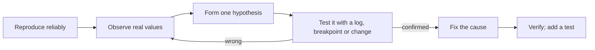

## Introduction

Every programmer spends a large part of their time on code that does not do what they expected. Sometimes it crashes with an error. More often in JavaScript, it does not crash at all: it shows `NaN` where a price should be, `undefined` where a name should be, or a total of `67670` where `20` was expected. **Debugging** is the work of finding out *why*.

The difference between a frustrating afternoon and a ten-minute fix is rarely talent. It is method. Beginners tend to stare at the code, guess what might be wrong, change something, and re-run — repeatedly. Experienced engineers instead **look at what the program is actually doing**: the real values in variables, the real order of function calls, the exact line that threw. Once you can see the actual behaviour, the gap between it and your expectation usually points straight at the bug.

JavaScript makes this skill especially important for two reasons. First, its dynamic and weak typing means many mistakes produce wrong *values* rather than errors, so bugs surface far from where they began ([[b1-what-is-javascript]]). Second, the tools are excellent and free: every browser ships DevTools, and Node.js can attach the same debugger. This lesson teaches the method and the basic tools; later lessons cover [[b1-breakpoints]], [[b1-stack-traces]], [[b1-devtools]] and [[b1-async-debugging]] in depth.

## Before you start

- [[b1-syntax-basics]] — especially the section on the console, which this lesson builds on.
- [[b1-runtimes]] — helpful for knowing whether your code runs in a browser (debug with DevTools) or Node.js (debug in the terminal or an editor).
- A browser with DevTools (press F12, or Cmd+Option+I on macOS) and Node.js installed. Snippets were run with Node.js 22.

## The intuition

Think of your program as a **film**. When you run it normally, the film plays at full speed and you only see the final frame: the output, or the crash. Debugging tools let you **pause on any frame** and look around: who is on stage (the variables in scope and their values), how the scene was reached (the call stack), and what happens if you advance one frame at a time (stepping).

Logging is a cruder version of the same idea: printing snapshots of chosen frames so you can read them after the film ends. Both work; the key is that you look at the film instead of re-reading the script and imagining what it does.

The analogy stops at one point: some bugs, especially those involving timing or asynchronous code, change when you pause or log. That is uncommon in beginner code, and the lesson notes where it matters.

## The debugging loop

Effective debugging repeats a small loop:



1. **Reproduce.** Find a reliable way to trigger the bug — exact inputs, exact clicks. Shrink it if you can: a five-line script or a single failing test is far easier to debug than "the checkout page sometimes breaks". If you cannot reproduce it, you cannot tell whether a change fixed it.
2. **Observe.** Look at what actually happens: the error message and stack trace, the values of the variables involved, the order things run in.
3. **Hypothesise.** State one specific, testable explanation: "`amount` is a string for some orders", not "something is wrong with the maths".
4. **Test.** Check the hypothesis with a log, a breakpoint or a small change. Change **one thing at a time**, so you know which change mattered.
5. **Fix the cause**, not the symptom. If a value is a string because it came from a form, convert it where it enters the program, rather than patching the line where it caused trouble.
6. **Verify.** Re-run the reproduction, check nearby behaviour, and ideally add an automated test so the bug cannot return unnoticed.

Two habits make this loop faster. **Read the whole error message** before doing anything else; it often names the exact problem. And **question your assumptions**: the bug is, almost by definition, in the part of the code you were sure was fine.

## Reading error messages

When JavaScript throws an error and nothing catches it, the runtime prints three things: the error's **name** (its type), its **message**, and a **stack trace** showing where it happened. Learn to read all three.

### Error names tell you the category

```javascript title="error-types.js"
const cases = [
  () => missingVariable,
  () => null.length,
  () => undefined(),
  () => new Array(-1),
  () => JSON.parse('{bad json}'),
];
for (const run of cases) {
  try { run(); } catch (e) { console.log(`${e.name}: ${e.message}`); }
}
```

```output
ReferenceError: missingVariable is not defined
TypeError: Cannot read properties of null (reading 'length')
TypeError: undefined is not a function
RangeError: Invalid array length
SyntaxError: Expected property name or '}' in JSON at position 1 (line 1 column 2)
```

| Error | Usually means | First thing to check |
|---|---|---|
| `ReferenceError` | A name that does not exist in scope | Spelling and case; is it declared; is it used before a `let`/`const` line |
| `TypeError` | An operation on the wrong kind of value: reading a property of `null`/`undefined`, calling something that is not a function | Which value is `null`/`undefined`, and why |
| `RangeError` | A value outside the allowed range; also "Maximum call stack size exceeded" from runaway recursion | Numeric inputs; recursion base cases |
| `SyntaxError` | Code (or JSON) that cannot be parsed | The line and column given; for JSON, the data you received |

The message is written for humans and is often the whole answer. "Cannot read properties of undefined (reading 'city')" says that something before `.city` was `undefined`. Exact wording varies between engines — Firefox says "user.address is undefined" for the same mistake — but the meaning is the same. [[b1-error-types]] covers each type in depth.

### Stack traces tell you where

Here is a program that works for one user and crashes for the next:

```javascript title="profile.js"
function getCity(user) {
  return user.address.city;
}

function renderProfile(user) {
  return `${user.name} lives in ${getCity(user)}`;
}

const users = [
  { name: 'Ada', address: { city: 'London' } },
  { name: 'Lin' },
];

for (const user of users) {
  console.log(renderProfile(user));
}
```

```output
Ada lives in London
/app/profile.js:2
  return user.address.city;
                      ^

TypeError: Cannot read properties of undefined (reading 'city')
    at getCity (/app/profile.js:2:23)
    at renderProfile (/app/profile.js:6:35)
    at Object.<anonymous> (/app/profile.js:15:15)
    at Module._compile (node:internal/modules/cjs/loader:1781:14)
    ...
```

(The trace is shortened; the remaining lines are Node.js internals.) Read it top down:

- The **first frame** is where the error was thrown: inside `getCity`, at line 2, column 23 — the `.city` access. Node.js even prints the line with a caret under the column.
- The **next frames** show how execution got there: `getCity` was called by `renderProfile` at line 6, which was called from the top level of the file (`Object.<anonymous>`) at line 15.
- Frames from `node:internal` (or, in a browser, from framework and library files) are usually not your bug. Find the topmost frame in **your** code.

Combine the trace with the message: at line 2, `user.address` was `undefined`, which means the second user has no `address`. The question becomes a design decision rather than a mystery: should every user have an address (fix the data), or should the code handle a missing one (`user.address?.city ?? 'an unknown city'`)? A stack trace is a list of **stack frames** — one per active function call — which [[b1-call-stack]] and [[b1-stack-traces]] explain further. The exact format of `error.stack` is host-defined and differs between Chrome, Firefox and Node.js.

## Logging deliberately

Logging means adding `console.log` calls to print values while the program runs. It is quick, works everywhere, and is often all you need. It works best when it is targeted at a hypothesis rather than sprinkled everywhere.

### Worked example: the "impossible" average

This function should compute an average order value. For three orders of 20, 30 and 10 it should print `20`.

```javascript title="average.js"
function parseOrders(rows) {
  return rows.map((row) => ({ id: row.id, amount: row.amount }));
}

function averageAmount(orders) {
  let total = 0;
  for (const order of orders) {
    total += order.amount;
  }
  return total / orders.length;
}

// Imagine these rows came from a CSV upload or an API response
const rows = [
  { id: 1, amount: 20 },
  { id: 2, amount: '30' },
  { id: 3, amount: 10 },
];

console.log(averageAmount(parseOrders(rows)));
```

```output
67670
```

No error, just an absurd number. **Observe**: the input looks right, so the problem is in how `total` is built. **Hypothesise**: one of the additions is not numeric addition. **Test** by logging the values *and their types* on each iteration. Logging an object literal labels every value, so you do not have to remember which number is which:

```javascript title="average-debug.js"
function averageAmount(orders) {
  let total = 0;
  for (const order of orders) {
    console.log({ id: order.id, amount: order.amount, type: typeof order.amount, totalBefore: total });
    total += order.amount;
  }
  return total / orders.length;
}
console.log(averageAmount([{ id: 1, amount: 20 }, { id: 2, amount: '30' }, { id: 3, amount: 10 }]));
```

```output
{ id: 1, amount: 20, type: 'number', totalBefore: 0 }
{ id: 2, amount: '30', type: 'string', totalBefore: 20 }
{ id: 3, amount: 10, type: 'number', totalBefore: '2030' }
67670
```

The log shows it immediately: order 2's amount is the string `'30'`, so `20 + '30'` concatenates to `'2030'`, then `'2030' + 10` gives `'203010'`, and dividing that string by 3 converts it back to a number: 67670. Hypothesis confirmed.

Now **fix the cause**. The string entered the program in `parseOrders`, the boundary where outside data arrives, so that is where to convert and validate:

```javascript title="average-fixed.js"
function parseOrders(rows) {
  return rows.map((row) => {
    const amount = Number(row.amount);
    if (!Number.isFinite(amount)) {
      throw new Error(`Order ${row.id}: invalid amount ${JSON.stringify(row.amount)}`);
    }
    return { id: row.id, amount };
  });
}

function averageAmount(orders) {
  if (orders.length === 0) return 0;
  let total = 0;
  for (const order of orders) total += order.amount;
  return total / orders.length;
}

console.log(averageAmount(parseOrders([{ id: 1, amount: 20 }, { id: 2, amount: '30' }, { id: 3, amount: 10 }])));
try {
  parseOrders([{ id: 4, amount: 'abc' }]);
} catch (e) {
  console.error(e.message);
}
console.log(averageAmount([]));
```

```output
20
Order 4: invalid amount "abc"
0
```

Patching `averageAmount` with `total += Number(order.amount)` would also print 20, but it would leave strings flowing through the rest of the program, to break the next function that touches them. Converting once at the boundary, and failing loudly on data that cannot be converted, removes the whole class of bug. While verifying, we also found and handled an edge case the original code had: an empty list would have returned `0 / 0`, which is `NaN`.

### Logging techniques that save time

- **Label everything.** `console.log({ amount, total })` prints names with values. A bare `console.log(x)` among ten others is hard to match to its line.
- **Log types when a value looks impossible.** `typeof`, `Array.isArray(x)` and `x === null` distinguish `'5'` from `5`, `[]` from `{}` and `null` from `undefined`, which look alike in some outputs.
- **Log at boundaries.** Where data enters a function, comes back from an API, or leaves a transformation — that is where a wrong value first appears.
- **Log snapshots of objects that change.** In browser DevTools, an expanded object shows its *current* state, not its state at log time. Use `JSON.stringify(obj)` or `structuredClone(obj)` when the object is mutated later ([[b1-console-output]]).
- **Use `console.trace()`** to print the call stack at a point without throwing, answering "who called this?".
- **Remove the logs afterwards.** A lint rule such as `no-console` catches leftovers.

## Pausing the program: breakpoints and `debugger`

Logging requires you to guess in advance what to print. A **breakpoint** pauses the program at a chosen line and lets you inspect *everything* at that moment: every variable in every enclosing scope, the call stack, and the result of any expression you type. For bugs where you do not know what to look for, this is much faster.

### Setting a breakpoint

In the browser, open DevTools, go to the **Sources** panel (Firefox calls it **Debugger**), open your file, and click a line number. Reload or trigger the code, and execution stops *before* that line runs. In VS Code, click in the gutter to the left of a line number and start the program with the debugger.

You can also write a breakpoint into the code with the **`debugger` statement**:

```javascript title="area.js"
function area(width, height) {
  debugger; // pauses here when a debugger is attached; ignored otherwise
  if (width == null || height == null) throw new Error('missing size');
  return width * height;
}

console.log(area(3, 4));
```

```output
12
```

Run normally, the `debugger` statement does nothing and the program prints `12`. With DevTools open — or with Node.js started under the inspector — execution pauses on that line. The statement is part of the language specification, but what it does is left to the host: with no debugger attached, it has no effect. Remove it before committing; leaving it in pauses every teammate who has DevTools open.

To debug Node.js code, start it with `node --inspect-brk area.js` and open `chrome://inspect` in Chrome, or use your editor's "JavaScript Debug Terminal". `--inspect-brk` pauses on the first line so you have time to attach.

### What you can see while paused

| Pane | Shows | Use it to |
|---|---|---|
| **Scope** | Local variables, closure variables and globals, with current values | Check every value at once without logging |
| **Call Stack** | The chain of function calls that led here; click a frame to inspect it | See who called this function and with what |
| **Watch** | Expressions you add, re-evaluated at every pause | Track `order.amount + 1` or `items.length` as you step |
| **Console** | Evaluates expressions in the paused scope | Try a fix, e.g. `Number(order.amount)`, before editing code |

### Stepping

From a paused line you control execution one step at a time:

- **Resume** (F8) — run until the next breakpoint.
- **Step over** (F10) — run the current line, including any function calls, and pause on the next line.
- **Step into** (F11) — if the line calls a function, pause on that function's first line.
- **Step out** (Shift+F11) — finish the current function and pause in its caller.

The common rhythm is: set a breakpoint just before where you think the bug is, step over line by line while watching the Scope pane, and step into a call only when a value going in looks right but the value coming out looks wrong.

### More precise breakpoints

Clicking a line number covers most needs, but DevTools offers more precise types, covered in [[b1-breakpoints]] and [[b3-devtools-breakpoints]]:

- **Conditional breakpoints** pause only when an expression is true, such as `typeof order.amount !== 'number'` inside a loop over 10,000 orders.
- **Logpoints** print a message without pausing and without editing the source — logging without leftover `console.log` calls.
- **Pause on exceptions** stops at the line where any error is thrown, including caught ones, with the full scope still available.
- **DOM breakpoints** pause when an element is modified, and **event listener breakpoints** pause on any click or keypress, answering "what code runs when I click this?".

## Narrowing down where the bug is

When you have no idea where a bug lives, **bisect**: cut the search space in half repeatedly, exactly like [[a3-binary-search]].

- **In data flow**: log the value halfway through the pipeline. If it is already wrong there, the bug is in the first half; otherwise the second. Repeat.
- **In code**: comment out or bypass half of a suspect function or component. If the bug disappears, it is in the removed half.
- **In history**: if the feature worked last week, `git bisect` checks out commits halfway between a known-good and a known-bad version until it finds the commit that introduced the bug — about ten steps for a thousand commits.

Two other techniques are surprisingly effective. **Minimal reproduction**: copy the failing logic into a fresh file with hard-coded inputs and remove everything that does not affect the bug. Often the bug becomes obvious halfway through, and if not, you have something small enough to ask a colleague about. **Explaining the code out loud** (rubber-duck debugging): describing what each line *should* do forces you to check assumptions you skipped while reading silently.

## How it works internally

When DevTools is open, the browser connects a debugger to the JavaScript engine through an internal protocol (the Chrome DevTools Protocol for Chromium browsers and Node.js). Setting a breakpoint asks the engine to stop when execution reaches that position. When it does, the engine halts your thread, and DevTools reads the current stack frames and their scopes from the engine. That is why, while paused, the page cannot respond to clicks or repaint: your code's thread is stopped.

Breakpoints and stack traces refer to positions in the code the engine is running. In real projects that code is bundled and minified, so DevTools uses **source maps** to translate positions back to your original TypeScript or JSX files. When breakpoints land on the wrong line or traces point into unreadable code, a missing or outdated source map is usually the cause ([[b1-source-maps]]).

Asynchronous code adds one wrinkle. A callback run by a timer or a promise starts with a fresh call stack, so the stack at that point does not include the function that scheduled it. DevTools and Node.js reconstruct **async stack traces** that show the scheduling code too, but they are not always complete. Debugging async order is covered in [[b1-async-debugging]].

## In real systems

**Production errors.** Users do not send stack traces. Error-monitoring services such as Sentry capture uncaught errors and unhandled promise rejections in the browser or server, attach the stack trace (de-minified with source maps), the browser, the URL and the user's recent actions, and group identical errors. Debugging a production bug starts there, with the message and the topmost application frame.

**Structured logging on servers.** Instead of ad hoc `console.log`, backend services log JSON records with levels, timestamps and request IDs, so one request can be followed through several services ([[c16-structured-logging]] covers this on the backend track).

**Tests as reproductions.** Once a bug is understood, teams write a failing automated test that reproduces it, fix the code until the test passes, and keep the test so the bug cannot quietly return.

**Editors.** VS Code and WebStorm run the same breakpoint debugger for Node.js, browser code and test runners, so you can pause inside a failing unit test.

## Trade-offs and alternatives

| Technique | Strengths | Weaknesses |
|---|---|---|
| `console.log` | Fast, works everywhere, good for following a sequence of events over time | You must guess what to print; leftover logs; misleading live objects in browsers |
| Breakpoints and stepping | See every value at once; no code changes; explore freely | Slower setup; pausing can alter timing-sensitive behaviour |
| Conditional breakpoints and logpoints | Precise, no source edits | Less familiar; tied to one machine's DevTools session |
| Bisection (code or `git bisect`) | Finds a bug with no idea where it is | Needs a reliable reproduction and a known-good state |
| Writing a failing test | Reproducible, protects against regressions | Takes time to write; may need mocking |

Use logging for quick checks and for sequences over time, breakpoints when you need to explore state, bisection when you are lost, and tests to lock in the fix.

## Common mistakes

> [!MISTAKE] Changing code before observing
> Editing lines on a hunch, then re-running, often "fixes" the symptom while hiding the cause — or introduces a new bug. First look at the actual values; let them tell you what to change.

**Ignoring the error message.** The name, message and top frame of your own code usually identify the problem. Read them in full before searching the web.

**Fixing the symptom, not the cause.** Adding `|| 0` where `NaN` appears hides bad data that will break something else. Find where the wrong value was created.

**Changing several things at once.** If the bug disappears, you will not know which change fixed it, or whether the others broke something.

**Trusting a stale log.** A log from an earlier run, from a different function with a similar name, or from an object that was mutated after logging can send you in the wrong direction. Clear the console and label your logs.

**Debugging code that is not running.** If your change has no effect, check that the file was saved, the build or dev server picked it up, and the browser is not serving a cached version. Add an obvious log to confirm the line runs at all.

**Leaving `debugger` or noisy logs in committed code.** Use lint rules to catch them.

## Interview perspective

Interviewers ask about debugging to see whether you work methodically, especially in live-coding rounds where your code fails in front of them.

> [!INTERVIEW] Describing your process
> "First I reproduce it reliably and read the full error — the type, the message and the first stack frame in my code. Then I form one hypothesis and test it, usually by logging the inputs and their types at the boundary, or by setting a breakpoint and checking the scope. I change one thing at a time, fix the root cause, and add a test so it can't come back."

Questions to prepare for:

- **How do you read a stack trace?** Top frame is where it was thrown; later frames show the callers; find the first frame in your own code.
- **`console.log` or breakpoints?** Logs for quick checks and sequences over time; breakpoints for exploring unknown state without editing code.
- **What does the `debugger` statement do?** Pauses execution when a debugger is attached; has no effect otherwise.
- **A value is `NaN` — how do you find out why?** Trace backwards: log the inputs and their types where the value is computed, then where those inputs were created.
- **How would you debug a bug that only happens in production?** Use error monitoring with source maps, reproduce with the same data and browser, and check environment differences such as configuration and build settings.

## Practice

1. Run `profile.js` from this lesson. Before fixing it, write down the exact line and the value that was `undefined`. Then fix it twice: once by changing the data, once by handling a missing address. Which is right depends on what — explain.
2. Open `average.js` in Chrome DevTools or VS Code. Set a **conditional breakpoint** inside the loop that pauses only when `typeof order.amount !== 'number'`, and inspect `total` in the Scope pane.
3. Write a function `slugify(title)` that turns `'Hello, World!'` into `'hello-world'`. Introduce a deliberate bug, then find it using only logpoints (no `console.log` edits).
4. Take a 50-line function that produces a wrong result and bisect it: log the intermediate value halfway through, decide which half is wrong, and repeat until you find the line.
5. Start a Node.js script with `node --inspect-brk`, attach from `chrome://inspect`, and practise step over, step into and step out through three nested function calls.

```quiz
Q: A stack trace's first line reads `at getCity (/app/profile.js:2:23)` and the next reads `at renderProfile (/app/profile.js:6:35)`. What does this tell you?
- [ ] `renderProfile` threw the error at line 6
- [x] The error was thrown in `getCity` at line 2, column 23, and `getCity` was called by `renderProfile` at line 6
- [ ] Line 6 must be deleted to fix the bug
- [ ] The error happened inside Node.js itself
> The topmost frame is where the error was thrown; each following frame is the caller of the one above. Line 6 is where the call happened, not necessarily where the bug is — the real cause is often the data passed in.

Q: An average prints `67670` instead of `20`. Which first step is most useful?
- [ ] Rewrite the function using `reduce` instead of a loop
- [ ] Wrap the result in `Math.round`
- [x] Log each input value together with `typeof`, plus the running total, on every iteration
- [ ] Add `|| 0` to the return value
> An absurd number from addition suggests some values are not numbers — for example strings being concatenated. Logging values with their types tests that hypothesis directly. Rewriting or rounding changes code without understanding the cause, and `|| 0` would hide nothing here and fix nothing.

Q: What happens when a browser runs a `debugger;` statement while DevTools is closed?
- [ ] The page throws a `SyntaxError`
- [ ] The page pauses until the user opens DevTools
- [x] Nothing; the statement has no effect when no debugger is attached
- [ ] The browser logs a warning and skips the rest of the function
> `debugger` is valid syntax defined by ECMAScript, but its effect is left to the host. With a debugger attached it acts as a breakpoint; otherwise execution continues normally. It should still be removed before committing, because teammates with DevTools open would be paused.

Q: You change one line, re-run, and the output is identical — even after adding a `console.log` that never prints. What is the most likely explanation?
- [ ] The JavaScript engine has a bug
- [x] The code you edited is not the code being run — an unsaved file, a stale build, a cached script, or a different file
- [ ] `console.log` is disabled in strict mode
- [ ] The function is too long to log from
> When even a new log does not appear, the edited line is not executing. Check that the file was saved, that the build or dev server reloaded, that the browser is not using a cached script, and that the code path is reached at all. `console.log` works in strict mode.
```

## Quick revision {#quick-revision}

- Loop: reproduce → observe → hypothesise → test (one change at a time) → fix the cause → verify and add a test.
- Error = name + message + stack trace. `ReferenceError`: unknown name. `TypeError`: wrong kind of value (property of `null`/`undefined`, not a function). `RangeError`: out-of-range value or stack overflow. `SyntaxError`: unparseable code or JSON.
- Stack trace: top frame is where it was thrown; later frames are callers; find the first frame in your own code. Format is host-defined.
- Logging: label values (`console.log({ a, b })`), log `typeof`, log at boundaries, snapshot mutated objects, `console.trace()` for "who called this?".
- `debugger;` pauses only when a debugger is attached; remove before committing.
- DevTools Sources: line, conditional and logpoint breakpoints, pause on exceptions, DOM and event-listener breakpoints. Panes: Scope, Call Stack, Watch, Console.
- Stepping: resume (F8), step over (F10), step into (F11), step out (Shift+F11).
- Node.js: `node --inspect-brk file.js` + `chrome://inspect`, or the editor's debugger.
- Bisect data, code or history (`git bisect`); build minimal reproductions; explain the code out loud.
- Source maps map bundled code back to source; async callbacks start fresh stacks (async stack traces help).

## Key takeaways {#key-takeaways}

- Debugging is a method, not guesswork: reproduce the bug, observe real values, test one hypothesis at a time.
- Error names, messages and stack traces usually tell you what went wrong and where; read them fully before changing anything.
- In JavaScript many bugs show up as wrong values instead of errors, so logging values with their types at data boundaries is one of the most effective tools.
- Breakpoints and the `debugger` statement let you pause the program and inspect every variable and the call stack without guessing what to log.
- Fix the root cause where a bad value is created, then verify and protect the fix with a test.
