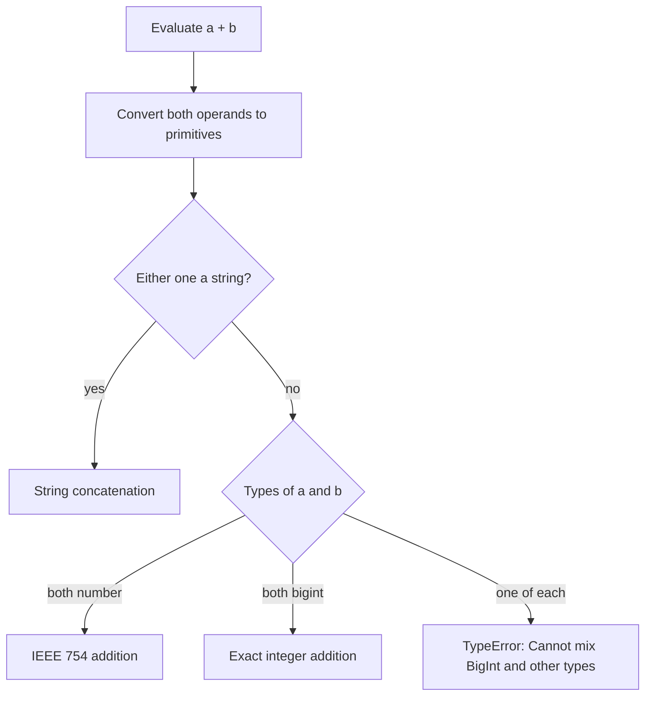

## Introduction

A JavaScript `number` can represent every integer exactly only up to 2⁵³ − 1, which is 9,007,199,254,740,991. Past that, integers start to collapse into each other: `2 ** 53 + 1` is the same number as `2 ** 53`, and no error is raised. For most programs that limit is far away. But some integers are routinely larger:

- **64-bit database IDs** and "snowflake" IDs from Twitter, Discord and similar systems, which go up to about 9.2 × 10¹⁸.
- **Nanosecond timestamps**, such as Node.js's `process.hrtime.bigint()`.
- **Exact large results** — factorials, combinatorics, big counters — where an approximate answer is useless.
- **Binary formats** that store 64-bit integers, read through `DataView` or `BigInt64Array`.

ES2020 added a second numeric primitive for these cases: **`bigint`**, an integer that can be as large as memory allows and never loses precision. You write one with an `n` suffix (`10n`) or create it with `BigInt('10')`.

Bigint is deliberately not a drop-in replacement for number. It has no fractions, it refuses to be combined with numbers in arithmetic, and the `Math` functions do not accept it. Those restrictions are the point: they force every conversion between the two types to be visible, because any silent conversion could lose information. This lesson explains how to work within those rules and when bigint is the right tool.

## Before you start

- **Safe integers** — why numbers stop being exact above 2⁵³ − 1. See [[b1-safe-integers]] in [[b1-number-representation]].
- **The bigint primitive at a glance** — the short overview in [[b1-type-bigint]]. This lesson goes deeper.
- **Arithmetic and bitwise operators** — how `/`, `%`, `<<` and `&` behave on numbers, so you can see what changes. See [[b1-arithmetic-operators]] and [[b1-bitwise-operators]].
- **JSON** — `JSON.stringify`, `JSON.parse` and replacer/reviver functions. See [[b1-json]] and [[b1-json-replacer-reviver]].

## The intuition

Think of how you add two long numbers on paper: column by column, carrying digits, with as many columns as the numbers need. A `number` is the opposite — a fixed box of about 16 significant digits plus an exponent, so large values keep their size but lose their trailing digits.

A bigint works like the paper method. The engine stores the integer as a sequence of digits (in a large base, internally) and grows that sequence as needed, so `2n ** 100n` keeps all 31 decimal digits. Nothing is ever rounded, because there is no fixed box.

That model also explains the main restriction. Number and bigint answer different questions: number says "about this big", bigint says "exactly this integer". Combining them automatically would mean either throwing away a bigint's low digits or a number's fraction, so JavaScript refuses and asks you to choose. Where the analogy stops: unlike paper, a bigint cannot hold a fraction at all, so `7n / 2n` is `3n`, not 3.5.

## Creating bigints

There are two ways to make a bigint: a **literal** with an `n` suffix, or the `BigInt()` function.

```javascript title="create.js"
console.log(10n, 0xffn, 0b1010n, 0o17n, 1_000_000n, typeof 10n);
console.log(BigInt(42), BigInt('9007199254740993'), BigInt('0x1f'), BigInt('  12  '), BigInt(''), BigInt(true));
console.log(BigInt(2 ** 53 + 1), BigInt(Number.MAX_SAFE_INTEGER) + 2n);
```

```output
10n 255n 10n 15n 1000000n bigint
42n 9007199254740993n 31n 12n 0n 1n
9007199254740992n 9007199254740993n
```

Literals accept the same decimal, hexadecimal, binary and octal forms as numbers, including `_` separators, but no decimal point or exponent. `typeof` returns `"bigint"`. Node.js prints bigints with a trailing `n` so you can tell them apart from numbers; `String(42n)` is just `"42"`.

`BigInt()` converts its argument. From a string it parses an integer — decimal, or with a `0x`, `0o` or `0b` prefix — after trimming whitespace, and like `Number()`, it turns an empty string into `0n`. From a boolean it gives `0n` or `1n`.

The third line is the most important in this section. `BigInt(2 ** 53 + 1)` gives `9007199254740992n`, not `…993n`. The expression `2 ** 53 + 1` is evaluated as a *number* first, where it rounds to 2⁵³, and only then converted. `BigInt` faithfully converts the number it receives — the damage was already done. **Create large bigints from literals or strings, never from number expressions.** Once you have a bigint, do the arithmetic in bigint, as the second expression on that line does.

### What `BigInt()` refuses

`BigInt()` throws rather than guessing, and the error type tells you what went wrong. These messages come from V8 in Node.js 22:

```javascript title="create-errors.js"
for (const bad of [1.5, '1.5', '1e3', '12n', 'abc', undefined, null, NaN]) {
  try { BigInt(bad); } catch (e) { console.log(String(bad).padEnd(9), e.name + ': ' + e.message); }
}
try { new BigInt(1); } catch (e) { console.log(e.name + ': ' + e.message); }
```

```output
1.5       RangeError: The number 1.5 cannot be converted to a BigInt because it is not an integer
1.5       SyntaxError: Cannot convert 1.5 to a BigInt
1e3       SyntaxError: Cannot convert 1e3 to a BigInt
12n       SyntaxError: Cannot convert 12n to a BigInt
abc       SyntaxError: Cannot convert abc to a BigInt
undefined TypeError: Cannot convert undefined to a BigInt
null      TypeError: Cannot convert null to a BigInt
NaN       RangeError: The number NaN cannot be converted to a BigInt because it is not an integer
TypeError: BigInt is not a constructor
```

A number with a fraction (or `NaN`/`Infinity`) is a `RangeError`: the value exists but has no integer equivalent. A string that is not an integer literal is a `SyntaxError` — including `'1e3'` and `'12n'`, even though `1e3` and `12n` are valid in source code. `undefined` and `null` are `TypeError`s. Unlike `Number()`, `BigInt()` never returns a "not a number" value, because bigint has no `NaN`. That makes it a strict parser: wrap it in `try/catch` when parsing untrusted input.

`new BigInt()` throws because bigint is a primitive with no wrapper constructor you are meant to use, which spares you the `new Number()` mistakes described in [[b1-number-methods]].

## Arithmetic

The operators `+`, `-`, `*`, `**`, `/` and `%` work on two bigints and always produce a bigint. So do `++`, `--` and unary `-`.

```javascript title="arith.js"
console.log(2n ** 100n);
console.log(7n / 2n, -7n / 2n, 7n % 2n, -7n % 2n, 7n % -2n);
let i = 0n; i++; i += 5n; console.log(i, -i);
try { 1n / 0n; } catch (e) { console.log(e.name + ': ' + e.message); }
try { 2n ** -1n; } catch (e) { console.log(e.name); }
try { +1n; } catch (e) { console.log(e.name + ': ' + e.message); }
```

```output
1267650600228229401496703205376n
3n -3n 1n -1n 1n
6n -6n
RangeError: Division by zero
RangeError
TypeError: Cannot convert a BigInt value to a number
```

**Division truncates toward zero.** `7n / 2n` is `3n` and `-7n / 2n` is `-3n` — the fractional part is discarded, just as `Math.trunc` would do. There is no rounding mode to choose.

**Remainder takes the sign of the dividend.** `-7n % 2n` is `-1n` and `7n % -2n` is `1n`, matching number `%` (see [[b1-arithmetic-operators]]). Together, `a === (a / b) * b + a % b` always holds.

**Errors replace special values.** Number division by zero gives `Infinity`; bigint has no `Infinity`, so `1n / 0n` throws a `RangeError`. A negative exponent would produce a fraction, so it also throws.

**Unary plus throws.** `+x` is defined as "convert to number", and converting a bigint implicitly is exactly what JavaScript forbids. Use `Number(x)` when you mean it.

If you need **floor division** (rounding toward −∞, as Python's `//` does), you must adjust truncated results for operands of opposite signs:

```javascript title="floor-div.js"
const floorDiv = (a, b) => {
  const q = a / b;                                   // truncated toward zero
  return a % b !== 0n && (a < 0n) !== (b < 0n) ? q - 1n : q;
};
console.log(floorDiv(-7n, 2n), floorDiv(7n, 2n), floorDiv(7n, -2n), floorDiv(-8n, 2n));
```

```output
-4n 3n -4n -4n
```

When the division is inexact and exactly one operand is negative, the truncated quotient is one too high, so the helper subtracts one. Exact divisions such as `-8n / 2n` need no adjustment.

## Mixing bigint and number

This is the rule that defines bigint: **arithmetic between a bigint and a number throws a `TypeError`.** Comparison between them, however, is allowed and compares the mathematical values.

```javascript title="mixing.js"
try { 1n + 1; } catch (e) { console.log(e.name + ': ' + e.message); }
console.log(1n + BigInt(1), Number(1n) + 1);
console.log(1n == 1, 1n === 1, 2n > 1, 1n < 1.5, 10n > 9.99, 1n == '1');
console.log(Object.is(1n, 1), new Set([1, 1n]).size, [1n].includes(1));
console.log([3n, 1, 2n, 0.5].sort((a, b) => (a < b ? -1 : a > b ? 1 : 0)));
console.log(1n + '', `${42n}`, Boolean(0n), 0n ? 'yes' : 'no');
```

```output
TypeError: Cannot mix BigInt and other types, use explicit conversions
2n 2
true false true true true true
false 2 false
[ 0.5, 1, 2n, 3n ]
1 42 false no
```

Why throw on `1n + 1` but allow `1n < 1.5`? An arithmetic result must have a type. If it were a number, a large bigint operand would lose digits; if it were a bigint, a fractional number operand would lose its fraction. Neither is safe, so the language makes you convert one side explicitly — `1n + BigInt(1)` or `Number(1n) + 1` — and accept the consequence knowingly. A comparison, by contrast, produces a boolean, and the engine can compare the exact mathematical values without converting either side, so there is nothing to lose.

The other lines show what follows from bigint being a separate type:

- **Loose equality compares values; strict equality compares types too.** `1n == 1` is `true`, `1n === 1` is `false`. `1n == '1'` is `true` because the string is parsed as a bigint for the comparison.
- **Collections keep them apart.** `Set`, `Map` and `includes` use SameValueZero, which treats `1n` and `1` as different, so a `Map` keyed by bigint IDs will not find an entry when you look it up with a number.
- **Sorting mixed arrays works with an explicit comparator** that uses `<` and `>`. A comparator like `(a, b) => a - b` would throw, because subtraction mixes types.
- **String concatenation is allowed.** `1n + ''` is `"1"`, and template literals work, because converting to a string loses nothing.
- **Truthiness matches number:** `0n` is falsy and every other bigint is truthy.

## Converting to number and string

Converting to a number with `Number(big)` never throws — and that is the danger. If the value is outside the safe range, it rounds silently:

```javascript title="to-number.js"
const big = 2n ** 64n + 1n;
console.log(Number(big), BigInt(Number(big)) === big, Number(123n));
const toSafeNumber = (b) => {
  if (b > BigInt(Number.MAX_SAFE_INTEGER) || b < BigInt(Number.MIN_SAFE_INTEGER)) {
    throw new RangeError(`${b} is outside the safe integer range`);
  }
  return Number(b);
};
console.log(toSafeNumber(123n));
try { toSafeNumber(big); } catch (e) { console.log(e.name + ': ' + e.message); }
console.log((255n).toString(16), (255n).toString(2), new Intl.NumberFormat('en-US').format(12345678901234567890n));
```

```output
18446744073709552000 false 123
123
RangeError: 18446744073709551617 is outside the safe integer range
ff 11111111 12,345,678,901,234,567,890
```

`Number(2n ** 64n + 1n)` returns the nearest double, and converting it back does not give the original. The `toSafeNumber` helper checks the range first, which is the conversion to use when a bigint must be handed to an API that expects numbers — an array index, a `setTimeout` delay, a `Math` function.

To strings, conversion is always exact. `toString(radix)` works as for numbers, so hex and binary views are easy, and `Intl.NumberFormat` (and `toLocaleString`) accept bigints directly and format every digit — formatting through `Number` first would round the value.

## Bitwise operations and fixed widths

Bitwise operators on numbers first squash their operands into 32-bit integers ([[b1-bitwise-operators]] explains that conversion). On bigints, they work at **arbitrary width**, treating each value as if it were written in two's complement with infinitely many sign bits to the left:

```javascript title="bits.js"
console.log(~0n, -1n >> 3n, 5n & 3n, 1n << 100n, (0xffn ^ 0x0fn).toString(2));
try { 8n >>> 1n; } catch (e) { console.log(e.name + ': ' + e.message); }
console.log(BigInt.asUintN(64, -1n), BigInt.asIntN(64, 2n ** 63n));
console.log(BigInt.asIntN(8, 255n), BigInt.asUintN(8, 257n));
```

```output
-1n -1n 1n 1267650600228229401496703205376n 11110000
TypeError: BigInts have no unsigned right shift, use >> instead
18446744073709551615n -9223372036854775808n
-1n 1n
```

`1n << 100n` does not overflow; it is 2¹⁰⁰. `~0n` is `-1n` because flipping the infinite row of zero bits gives an infinite row of ones. The unsigned right shift `>>>` is not defined for bigints: it means "shift in zeros from the left", and an infinitely wide value has no left edge to shift from. That is why it throws.

When you *do* need a fixed width — to imitate 64-bit integer overflow from another language, or to interpret bits as signed or unsigned — use **`BigInt.asIntN(bits, x)`** and **`BigInt.asUintN(bits, x)`**. They keep the lowest `bits` bits and interpret them as a signed (two's complement) or unsigned integer:

- `BigInt.asUintN(64, -1n)` is 2⁶⁴ − 1: −1 is all ones in two's complement, and 64 ones read as unsigned is the largest `uint64`.
- `BigInt.asIntN(64, 2n ** 63n)` is −2⁶³: one past the largest `int64` wraps around to the most negative, exactly as overflow does in Java or C.
- `BigInt.asIntN(8, 255n)` is `-1n` and `BigInt.asUintN(8, 257n)` is `1n` — the same idea at 8 bits.

## Bigints in JSON, typed arrays and other APIs

### JSON

`JSON.stringify` throws on bigints. JSON numbers *could* hold the digits, but most JSON parsers — including JavaScript's own — would read them back as doubles and round them, so the designers chose to fail loudly and let you decide on a representation. The usual decision is a **string**:

```javascript title="json.js"
const order = { id: 1428734527302565889n, qty: 2 };
try { JSON.stringify(order); } catch (e) { console.log(e.name + ': ' + e.message); }
const json = JSON.stringify(order, (key, value) =>
  typeof value === 'bigint' ? value.toString() : value);
console.log(json);
const back = JSON.parse(json, (key, value) => (key === 'id' ? BigInt(value) : value));
console.log(back, back.id === order.id);
```

```output
TypeError: Do not know how to serialize a BigInt
{"id":"1428734527302565889","qty":2}
{ id: 1428734527302565889n, qty: 2 } true
```

The replacer converts every bigint to a decimal string, and the reviver converts the known `id` field back. The reviver has to know which fields are bigints, because once serialised they are indistinguishable from ordinary strings — a schema or naming convention is needed. This matches how most APIs transport 64-bit integers anyway, so the receiving side (which may not be JavaScript) can parse them however it likes.

Two alternatives exist. You can define `BigInt.prototype.toJSON = function () { return this.toString(); }`, which makes every `JSON.stringify` call serialise bigints as strings; it works, but it modifies a built-in prototype for the whole application, so most style guides prefer an explicit replacer. And newer engines (Node.js 22, current Chromium) support `JSON.rawJSON(text)`, which lets a replacer emit the exact digits as a JSON *number*, together with a reviver `context.source` argument for reading such numbers back exactly; see [[b1-safe-integers]] for an example. Check browser support before relying on them.

### Typed arrays and binary data

`BigInt64Array` and `BigUint64Array` store signed and unsigned 64-bit integers, and `DataView` has matching `getBigInt64`/`setBigInt64` methods. They accept and return bigints only:

```javascript title="typed.js"
const arr = new BigInt64Array([1n, -1n]);
console.log(arr, new BigUint64Array([-1n])[0]);
try { new BigInt64Array([1]); } catch (e) { console.log(e.name + ': ' + e.message); }
```

```output
BigInt64Array(2) [ 1n, -1n ] 18446744073709551615n
TypeError: Cannot convert 1 to a BigInt
```

Storing `-1n` in an unsigned array keeps the 64 bits and reads them back as 2⁶⁴ − 1 — the typed array equivalent of `BigInt.asUintN(64, …)`. These arrays are how JavaScript reads 64-bit fields from binary file formats, WebAssembly memory and network protocols (see [[b1-arraybuffer]]).

### Where bigints are not accepted

`Math` functions throw on bigints. Array indexes, `length`, `setTimeout` delays and most DOM APIs expect numbers. A bigint used as an object key is converted to a string, so `obj[1n]` and `obj[1]` refer to the same property `"1"` — but `Map` keys are not converted, as shown earlier. In TypeScript the type is `bigint` (lowercase), and bigint literals require a compilation target of ES2020 or later; with an older `target`, the compiler reports that bigint literals are not available.

## How it works internally

In the specification, a bigint is a value of the BigInt type representing a mathematical integer, and every operator has a separate BigInt definition. When the engine evaluates `a + b`, it converts both operands to primitives, then checks their types: two numbers use number addition, two bigints use bigint addition, and one of each throws the `TypeError` you saw. Comparisons have their own mixed-type rules that compare mathematical values directly.

Engines store a bigint as a heap object containing a sign and an array of fixed-size "digits" — in V8, machine words of 64 bits on 64-bit platforms. Small numbers, by contrast, can be stored without any allocation. Each bigint is immutable, so every arithmetic operation allocates a new object sized for the result, and multiplication and division of large values cost more than a single CPU instruction. There is an upper bound set by the engine: in Node.js 22, a bigint with more than 2³⁰ bits (about a billion) throws `RangeError: Maximum BigInt size exceeded`.

Two practical consequences follow. **Bigint arithmetic is slower than number arithmetic** — a simple loop summing ten million values ran about 15 times slower with bigints than with numbers in Node.js 22 on one machine (timings vary by engine and hardware) — so use it where you need the range, not as a default integer type. And **bigint operations are not constant-time** — how long they take depends on the values involved — so bigint should not be used to implement cryptography, where timing differences can leak secrets. Use the Web Crypto API instead.



## Worked example: decoding snowflake IDs

Discord, Twitter and many internal systems generate **snowflake IDs**: 64-bit integers whose bits encode when and where the ID was created. Discord's documented layout packs, from the most significant bit down: 42 bits of milliseconds since the Discord epoch (the first millisecond of 2015), 5 bits of internal worker ID, 5 bits of internal process ID, and 12 bits of a per-process counter. Extracting those fields needs shifts and masks on all 64 bits — impossible with 32-bit number bitwise operators, and inexact with doubles. Bigint handles it directly.

```javascript title="snowflake.js"
const DISCORD_EPOCH = 1420070400000n;              // 2015-01-01T00:00:00.000Z in ms

function decodeSnowflake(idString) {
  const id = BigInt(idString);                     // from the string, never from a number
  return {
    createdAt: new Date(Number((id >> 22n) + DISCORD_EPOCH)),
    workerId: Number((id >> 17n) & 0x1fn),
    processId: Number((id >> 12n) & 0x1fn),
    increment: Number(id & 0xfffn),
  };
}

function snowflakeAtTime(date) {                   // smallest ID created at that time
  return ((BigInt(date.getTime()) - DISCORD_EPOCH) << 22n).toString();
}

const info = decodeSnowflake('175928847299117063');
console.log(info.createdAt.toISOString(), info.workerId, info.processId, info.increment);
console.log(snowflakeAtTime(new Date('2016-04-30T11:18:25.796Z')));
console.log(Number('175928847299117063'));
```

```output
2016-04-30T11:18:25.796Z 1 0 7
175928847298985984
175928847299117060
```

Walk through `decodeSnowflake`:

1. **Parse from the string.** The ID arrives as a string in the API response — Discord sends IDs as strings for exactly the reason shown on the last line, where `Number` rounds the ID to `…060`. `BigInt(idString)` keeps every digit.
2. **Timestamp.** `id >> 22n` shifts away the lower 22 bits (5 + 5 + 12), leaving the 42-bit timestamp. Adding `DISCORD_EPOCH` — also a bigint, because mixing would throw — gives milliseconds since 1970. That value is about 1.46 × 10¹², comfortably safe, so converting it with `Number` for `new Date` loses nothing.
3. **Worker and process IDs.** Shift the field down to the lowest bits and mask with `0x1fn` (five one-bits) to discard everything above it.
4. **Increment.** Mask the lowest 12 bits with `0xfffn`.

Each extracted field is small, so it is converted to a number for ordinary use. That is the general pattern: **do the 64-bit work in bigint, convert small results back to number at the edge.**

`snowflakeAtTime` runs the process in reverse. Shifting the timestamp left by 22 bits produces the smallest possible ID created at that millisecond, which APIs use for pagination ("messages after this time"). It returns a string because that is what the API expects to receive. The decoded values match the example in Discord's developer documentation.

Edge cases: an invalid ID such as `'abc'` makes `BigInt` throw a `SyntaxError`, which a real client should catch and report. Twitter snowflakes use the same 22-bit shift with a different epoch (1288834974657 ms), so the function generalises by making the epoch a parameter.

## In real systems

- **ID handling in frontends.** Most applications never do arithmetic on IDs and simply keep them as strings. Bigint appears when the client must decode, compare or generate IDs, as in the snowflake example, or sort IDs numerically (string comparison sorts `"10"` before `"9"`).
- **Database drivers.** Node.js drivers return 64-bit integer columns as strings by default (for example `pg` for PostgreSQL `bigint`), and many offer an option to return bigints instead. Prisma maps PostgreSQL `BigInt` columns to JavaScript bigint.
- **High-resolution time.** `process.hrtime.bigint()` in Node.js returns nanoseconds as a bigint, because nanoseconds since an arbitrary point quickly exceed 2⁵³.
- **WebAssembly.** Wasm's `i64` type maps to bigint at the JavaScript boundary, so passing 64-bit integers to and from Wasm modules uses bigints.
- **Binary protocols and files.** Parsers for formats with 64-bit fields (Protocol Buffers' `int64`, file offsets in large archives) use `DataView.getBigUint64` and `BigInt64Array`.

## Trade-offs and alternatives

| Need | Best choice | Why |
|---|---|---|
| Ordinary counts, indexes, cents, timestamps in ms | `number` | Fast, works with every API, exact within the safe range |
| 64-bit IDs you only store, display and send back | String | No conversion, no risk, matches API transport |
| 64-bit IDs you decode, compare numerically or generate | `bigint` | Exact, supports shifts and masks at full width |
| Exact huge integers (factorials, combinatorics) | `bigint` | Arbitrary precision |
| Decimal fractions (money with cents, rates) | Integer minor units in `number`, or a decimal library | Bigint has no fractions; scaling by 100 into a bigint works but adds friction |
| Cryptography | Web Crypto API | Bigint operations are not constant-time |

Bigint's strength is exactness at any size; its costs are speed, memory allocation, and friction at every boundary with number-based APIs and JSON. The best designs keep bigints inside a small part of the code — a parsing or ID module — and convert to strings or safe numbers at the edges.

## Common mistakes

**Creating a bigint from a number literal or expression.** `BigInt(9007199254740993)` and `BigInt(2 ** 53 + 1)` are already wrong, because the number rounded first. Use `9007199254740993n` or `BigInt('9007199254740993')`.

**Expecting `JSON.parse` to give bigints.** It gives rounded numbers. Send large integers as strings and convert with a reviver.

**Mixing types in arithmetic.** `total + 1` throws when `total` is a bigint. Write `total + 1n`, and use `0n` and `1n` for loop counters and accumulators.

**Using `(a, b) => a - b` to sort mixed arrays.** Subtraction throws on mixed types; compare with `<` and `>`.

**Converting back with `Number()` without a range check.** It never throws and silently rounds. Check against `Number.MAX_SAFE_INTEGER` first.

**Expecting decimal results from division.** `5n / 2n` is `2n`. If you need fractions, bigint is the wrong type.

**Looking up a `Map` with the wrong type.** `map.get(1)` does not find the key `1n`. Normalise keys to one type — usually strings — at the boundary.

**Using bigint everywhere "to be safe".** It is slower, does not work with `Math`, array indexes or most DOM APIs, and spreads conversion code through the program.

## Interview perspective

Bigint questions check that you understand *why* the type exists and the reasoning behind its restrictions.

> [!INTERVIEW] "Why does 1n + 1 throw, but 1n < 2 works?"
> "Arithmetic has to return a value of some type. If the result were a number, a big bigint would lose precision; if it were a bigint, a fractional number would lose its fraction. Rather than silently losing information, JavaScript throws and makes you convert explicitly. A comparison returns a boolean and can compare the exact mathematical values, so nothing is lost and it's allowed."

> [!INTERVIEW] "An API returns 64-bit IDs. How do you handle them in the browser?"
> "Ask for them as strings, because `JSON.parse` would round numbers above 2⁵³ before my code sees them. If I only display or send them back, I keep them as strings. If I need to decode or compare them numerically, I convert with `BigInt(idString)` and do the work in bigint, converting small results back to numbers with a range check."

Other questions to prepare:

- **What is `7n / 2n`? `-7n / 2n`?** `3n` and `-3n`; division truncates toward zero.
- **What is `typeof 10n`, and is `0n` truthy?** `"bigint"`; `0n` is falsy.
- **Can you `JSON.stringify` a bigint?** No, it throws a `TypeError`; use a replacer that writes strings.
- **Why is there no `>>>` for bigints?** Bigints are conceptually infinitely wide, so "shift in zeros from the left" is undefined; use `BigInt.asUintN` for unsigned views.
- **When would you not use bigint?** For ordinary integers within the safe range, fractions, performance-sensitive loops and cryptography.

## Practice

1. **Predict, then run.** `BigInt('  0x10  ')`, `BigInt(' ')`, `5n ** 0n`, `-5n % 3n`, `2n > 1.9`, `10n == '10'`, `typeof Object(1n)`, `String(-0n)`, `BigInt.asIntN(4, 8n)`, `[10n, 9n, 100n].sort()`.
2. **Exact factorial.** Write `factorial(n)` returning a bigint, and use it to print the number of digits in 100!. Then explain why the number version gives `Infinity` for 171!.
3. **Safe conversion.** Write `parseId(value)` that accepts a string of digits or a safe integer number and returns a bigint, rejecting unsafe numbers, negative values and non-digit strings with clear errors.
4. **Uint64 arithmetic.** Implement `addU64(a, b)` that adds two bigints with 64-bit unsigned wraparound using `BigInt.asUintN`, and test it with `2n ** 64n - 1n` plus `1n`.
5. **Generalise the decoder.** Extend `decodeSnowflake` to accept the epoch as a parameter, and use it to decode a Twitter ID with epoch 1288834974657. Add a function that compares two IDs and returns which one was created first.

```quiz
Q: What does `BigInt(2 ** 53 + 1)` return?
- [ ] 9007199254740993n
- [x] 9007199254740992n
- [ ] It throws a RangeError because the value is unsafe
- [ ] It throws a TypeError because the argument is a number
> The argument is evaluated as a number first, and 2^53 + 1 rounds to 2^53 before BigInt ever sees it. BigInt accepts any integer-valued number, safe or not, and converts it exactly — so the precision was lost earlier. Use the literal 9007199254740993n or BigInt('9007199254740993').

Q: Which of these expressions throws a TypeError?
- [ ] `1n < 2`
- [ ] `1n == 1`
- [x] `1n * 2`
- [ ] `` `${1n}` ``
> Arithmetic that mixes bigint and number throws, because the result type would force one operand to lose information. Comparisons (both strict-ordering and loose equality) compare mathematical values and return booleans, and converting a bigint to a string is exact, so those are all allowed.

Q: What is `-7n / 2n`?
- [ ] -3.5
- [ ] -4n
- [x] -3n
- [ ] It throws because bigints cannot be negative
> Bigint division discards the fractional part, truncating toward zero, so -3.5 becomes -3n. Floor division toward negative infinity would give -4n, which you must implement yourself. Bigints can be negative.

Q: Why does `JSON.stringify({ id: 1n })` throw instead of writing `{"id":1}`?
- [ ] JSON numbers cannot exceed 2^53
- [x] Most JSON parsers would read the number back as a double and could round it, so JavaScript makes you choose a representation explicitly
- [ ] bigint values cannot be converted to strings
- [ ] It does not throw; it writes the string "1n"
> The JSON format has no size limit, but JSON.parse and many other parsers turn numbers into doubles, silently rounding large values. Throwing forces you to pick a safe encoding, usually a string via a replacer. Bigints convert to strings exactly — String(1n) is "1".
```

## Quick revision {#quick-revision}

- `bigint` (ES2020): arbitrary-size integers; `typeof` is `"bigint"`; literal `10n` (also `0xffn`, `0b1n`, `0o7n`, `1_000n`).
- `BigInt(x)`: from integer numbers, integer strings (decimal/`0x`/`0o`/`0b`, trimmed, `''` → `0n`), booleans. Fraction/`NaN` → `RangeError`; bad string (`'1.5'`, `'1e3'`, `'12n'`) → `SyntaxError`; `null`/`undefined` → `TypeError`; `new BigInt` → `TypeError`.
- Create large values from literals or strings, never from number expressions (`BigInt(2 ** 53 + 1)` is already rounded).
- Operators: `+ - * ** / %`, `++`, `--`, unary `-`. Division truncates toward zero; `%` follows the dividend's sign; `/ 0n` and negative exponents → `RangeError`; unary `+` → `TypeError`.
- Mixed arithmetic with number → `TypeError`. Comparisons across types allowed (`1n == 1`, `2n > 1.5`); `1n === 1` is false; `Set`/`Map`/`includes` treat `1n` and `1` as different.
- `0n` is falsy. String concatenation and template literals work.
- `Number(big)` silently rounds outside ±(2⁵³ − 1) — range-check first. `toString(radix)` and `Intl.NumberFormat` are exact.
- Bitwise ops are arbitrary-width two's complement; `>>>` throws. `BigInt.asIntN(bits, x)` / `asUintN(bits, x)` give fixed-width wraparound.
- `JSON.stringify` throws on bigint → replacer to strings; reviver with `BigInt()` on known fields; `JSON.rawJSON` / `context.source` in newer engines.
- `BigInt64Array`, `BigUint64Array`, `DataView.getBigInt64` for 64-bit binary data; Wasm `i64` ↔ bigint.
- No `Math` support; slower and allocating; not constant-time (no crypto); V8 limit 2³⁰ bits. TypeScript type `bigint`, literals need target ES2020+.

## Key takeaways {#key-takeaways}

- Bigint exists for integers beyond 2⁵³ − 1 that must stay exact: 64-bit IDs, nanosecond times, exact large results and 64-bit binary fields.
- Always create large bigints from literals or strings; a number expression has already been rounded before `BigInt` sees it.
- Bigint and number never mix in arithmetic — convert explicitly — but they can be compared, and they are different keys in `Set` and `Map`.
- Division truncates toward zero and there are no fractions, `NaN` or `Infinity`; invalid operations throw instead.
- Move bigints through JSON as strings, and convert back to number only after a range check.
- Do 64-bit work in bigint and convert small results to number at the edges; do not use bigint as a general-purpose integer type.
