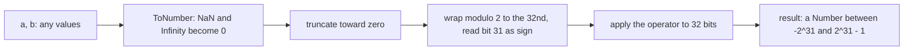

## Introduction

A permission system stores what a user may do as a single number:

```javascript title="permissions.js"
const READ = 1;     // binary 001
const WRITE = 2;    // binary 010
const DELETE = 4;   // binary 100

let perms = READ | WRITE;          // 011: read and write
console.log(perms);
console.log((perms & WRITE) !== 0, (perms & DELETE) !== 0);

perms &= ~WRITE;                   // remove write
console.log(perms, (perms & WRITE) !== 0);
```

```output
3
true false
1 false
```

Each permission is one **bit** — one binary digit — in the number. `|` combines bits, `&` tests them, and `~` with `&` removes one. Three yes/no facts fit in a single small integer, and checking one of them is a single machine instruction. That is what **bitwise operators** are for: treating a number as a row of independent bits rather than as a quantity.

You will meet them in more places than you might expect: permission and feature flags, browser APIs such as `MouseEvent.buttons`, graphics code, hash functions, binary file and network formats, React's internal scheduling, and many interview problems. You will also meet them misused, as obscure shortcuts for rounding.

JavaScript adds one twist that languages such as C and Java do not have. Ordinary JavaScript numbers are 64-bit floating-point values, but the bitwise operators work on **32-bit integers**. Every operand is first converted to a 32-bit integer, the operation runs, and the result is converted back. That conversion is where nearly all the surprises come from, so this lesson explains it carefully before using the operators.

## Before you start

- **How numbers are stored** — JavaScript numbers are IEEE 754 doubles, with exact integers only up to 2⁵³ − 1. See [[b1-number-representation]] and [[b1-safe-integers]].
- **Number conversion** — how strings, booleans and `null` become numbers. See [[b1-number-conversion]].
- **BigInt** — arbitrary-precision integers, used later for wider bit operations. See [[b1-bigint]].
- **Operator precedence** — bitwise operators bind more loosely than comparisons, which causes the most common bug in this lesson. See [[b1-precedence]].

## The intuition: binary and two's complement

A binary number is written with digits `0` and `1`, where each position is worth twice the one to its right. `0b1011` is 8 + 0 + 2 + 1 = 11. JavaScript lets you write binary literals with `0b`, and print a number in binary with `toString(2)`:

```javascript title="binary.js"
console.log(0b1011, (11).toString(2), parseInt('1011', 2));
console.log(0xff, (255).toString(16), 0o17);
```

```output
11 1011 11
255 ff 15
```

Bitwise operators work position by position: bit 0 of the result depends only on bit 0 of the operands, bit 1 on bit 1, and so on. Think of two rows of light switches; `&` turns a light on only if both switches in that column are on, `|` if either is on, and so on.

Negative numbers need one more idea. In 32-bit code, integers use **two's complement**: the leftmost bit (bit 31) is the sign bit, and a negative number `-n` is stored as the bits of `n`, all flipped, plus one. So `-1` is thirty-two `1` bits, and `-5` is `...11111011`. The practical consequences are that flipping every bit of `x` gives `-x - 1`, and that the largest 32-bit signed integer is 2³¹ − 1 = 2,147,483,647, while the smallest is −2³¹ = −2,147,483,648.

Note that `toString(2)` on a negative number does *not* show two's complement — it prints a minus sign followed by the magnitude, so `(-5).toString(2)` is `'-101'`. To see the actual 32 bits, convert to unsigned first with `>>> 0`, explained below.

## Step zero: the 32-bit conversion

Before any bitwise operator runs, each operand goes through the specification's **ToInt32** conversion (the left operand of `>>>` uses the unsigned variant, **ToUint32**). ToInt32 does three things:

1. Convert the value to a number (as `Number(value)` would). `NaN`, `Infinity` and `-Infinity` become `0`.
2. Drop the fractional part, rounding **toward zero**.
3. Wrap the result into the 32-bit range by taking it modulo 2³², then reading bit 31 as the sign.

```javascript title="toint32.js"
console.log(3.7 | 0, -3.7 | 0, Math.floor(-3.7));
console.log(2 ** 31 | 0, 2 ** 32 | 0, (2 ** 32 + 5) | 0, 1e10 | 0);
console.log(NaN | 0, Infinity | 0, '12' | 0, '0x1F' | 0, 'abc' | 0, null | 0, true | 0);
```

```output
3 -3 -4
-2147483648 0 5 1410065408
0 0 12 31 0 0 1
```

`x | 0` performs a bitwise OR with zero, which changes no bits — so all you see is the conversion. Read the lines in order. Fractions are truncated toward zero, which is why `-3.7 | 0` is `-3` while `Math.floor(-3.7)` is `-4`. `2 ** 31` is one past the largest signed 32-bit value, so it wraps to the most negative one. `2 ** 32` wraps all the way round to `0`, and `1e10` (ten billion) keeps only its low 32 bits. Strings are converted to numbers first, so `'0x1F'` becomes 31 and `'abc'` becomes `NaN` and then `0`.



This conversion is silent. A value larger than 2³¹ − 1 does not cause an error; it simply turns into a different number. That is the most important thing to remember about bitwise operators in JavaScript: **they are only safe for integers that fit in 32 bits.** Timestamps in milliseconds (about 1.7 × 10¹²), file sizes over 2 GB and most database IDs do not.

## The operators

There are seven bitwise operators. The three binary logic operators compare bits pairwise:

| Operator | Name | Result bit is 1 when | Example | Binary |
|---|---|---|---|---|
| `a & b` | AND | both bits are 1 | `5 & 3` → `1` | `101 & 011 = 001` |
| `a \| b` | OR | at least one bit is 1 | `5 \| 3` → `7` | `101 \| 011 = 111` |
| `a ^ b` | XOR (exclusive OR) | the bits differ | `5 ^ 3` → `6` | `101 ^ 011 = 110` |
| `~a` | NOT | the bit was 0 | `~5` → `-6` | every bit flipped |

The three shift operators move all bits left or right by a number of positions:

| Operator | Name | Effect | Example |
|---|---|---|---|
| `a << n` | Left shift | Moves bits left, fills with 0 on the right | `1 << 3` → `8` |
| `a >> n` | Sign-propagating right shift | Moves bits right, copies the sign bit on the left | `-40 >> 2` → `-10` |
| `a >>> n` | Zero-fill right shift | Moves bits right, fills with 0 on the left; result is unsigned | `-40 >>> 2` → `1073741814` |

```javascript title="operators.js"
console.log(5 & 3, 5 | 3, 5 ^ 3, ~5);
console.log((5 & 3).toString(2), (5 | 3).toString(2), (5 ^ 3).toString(2));
console.log(1 << 3, 40 >> 2, -40 >> 2, 40 >>> 2, -40 >>> 2);
console.log(~0, ~-1, ~~-3.7);
```

```output
1 7 6 -6
1 111 110
8 10 -10 10 1073741814
-1 0 -3
```

Some facts fall straight out of these definitions. Shifting left by `n` multiplies by 2ⁿ, and `>>` by `n` divides by 2ⁿ rounding toward negative infinity — but only while the value stays inside 32 bits. `~x` is always `-x - 1` for integers in range, which is why `~-1` is `0`. And `~~x` applies NOT twice, which undoes the flip but keeps the ToInt32 conversion, so it truncates — you will see it in older code as a "fast `Math.trunc`".

For positive numbers, `>>` and `>>>` agree. For negative numbers they differ: `>>` keeps the number negative by copying the sign bit into the vacated positions, while `>>>` fills them with zeros, so the result is a large positive number.

### Shift counts wrap at 32

The right operand of a shift is also converted, and then **only its lowest five bits are used** — the count is taken modulo 32. Shifting by 32 is the same as shifting by 0:

```javascript title="shift-count.js"
console.log(1 << 31, 1 << 32, 1 << 33, 1 << -1);
```

```output
-2147483648 1 2 -2147483648
```

`1 << 31` sets the sign bit, giving the most negative 32-bit integer. `1 << 32` is `1`, not `0`, because 32 mod 32 is 0. A negative count is wrapped too: `-1` becomes 31. Code that builds masks with `1 << n` for user-supplied `n` should validate `0 <= n && n < 31` (or `< 32` if a negative result is acceptable).

### Unsigned results with `>>> 0`

`>>>` converts its left operand with ToUint32 and returns a non-negative number. Shifting by zero bits therefore converts any value to its **unsigned 32-bit** interpretation, which is how you display or compare 32-bit patterns that have the top bit set:

```javascript title="unsigned.js"
const bin8 = (n) => (n >>> 0).toString(2).padStart(32, '0').slice(-8);

console.log(-1 >>> 0, (-1 >>> 0).toString(16), (-1).toString(2));
console.log(bin8(5), bin8(-5), bin8(~5));
```

```output
4294967295 ffffffff -1
00000101 11111011 11111010
```

`-1 >>> 0` reveals the thirty-two `1` bits of `-1` as the number 4,294,967,295. The helper prints the low eight bits, so you can see that `-5` is `5` flipped plus one, and that `~5` is `5` flipped.

## Bit flags: the main everyday use

A **bit flag** set (or **bitmask**) stores several booleans in one integer, one per bit. Each flag is a power of two, so each has exactly one bit set. Four operations cover almost every use:

| Goal | Code | Why it works |
|---|---|---|
| Set a flag | `flags \|= F` | OR turns F's bit on and leaves others alone |
| Clear a flag | `flags &= ~F` | `~F` has every bit on except F's; AND keeps all others |
| Toggle a flag | `flags ^= F` | XOR flips only F's bit |
| Test a flag | `(flags & F) !== 0` | AND keeps only F's bit; non-zero means it was set |
| Test several at once | `(flags & (A \| B)) === (A \| B)` | All of A and B must survive the mask |

Every binary bitwise operator has a compound assignment form — `&=`, `|=`, `^=`, `<<=`, `>>=`, `>>>=` — that works like `+=` (see [[b1-assignment-operators]]).

> [!WARNING] Parenthesise every flag test
> Bitwise `&` has lower precedence than `===` and `!==`. `flags & F !== 0` parses as `flags & (F !== 0)`, which is `flags & true`, which tests bit 0 regardless of `F`. Always write `(flags & F) !== 0`.

Defining flags with shifts makes the bit positions explicit and avoids typing powers of two by hand:

```javascript title="flags.js"
const Flags = Object.freeze({
  BOLD: 1 << 0,
  ITALIC: 1 << 1,
  UNDERLINE: 1 << 2,
  STRIKE: 1 << 3,
});

function describe(style) {
  return Object.entries(Flags)
    .filter(([, bit]) => (style & bit) !== 0)
    .map(([name]) => name)
    .join(' + ') || 'plain';
}

let style = 0;
style |= Flags.BOLD | Flags.UNDERLINE;
console.log(describe(style), style.toString(2));
style ^= Flags.BOLD;               // toggle bold off
style |= Flags.ITALIC;
console.log(describe(style), style.toString(2));
style &= ~(Flags.ITALIC | Flags.UNDERLINE);
console.log(describe(style), style);
```

```output
BOLD + UNDERLINE 101
ITALIC + UNDERLINE 110
plain 0
```

Here `||` provides `'plain'` when the joined string is empty, which is a correct use of `||` because an empty string really does mean "nothing to show". Up to 31 flags fit safely in a Number (bit 31 works too, but makes the value negative, which complicates comparisons and display).

## Classic bit tricks

These come up in interviews and in performance-sensitive code. Each works only for integers in the 32-bit range.

- **Even or odd:** `(n & 1) === 0` is true for even `n`. This works for negative numbers as well, because two's complement keeps the lowest bit's meaning: `-3 & 1` is `1`.
- **Power of two:** `n > 0 && (n & (n - 1)) === 0`. Subtracting 1 from a power of two turns its single `1` bit into `0` and all lower bits into `1`, so the AND is zero. Any other positive number keeps at least one bit.
- **Lowest set bit:** `n & -n` isolates the rightmost `1` bit (`12 & -12` is `4`). Fenwick trees rely on this.
- **Count set bits:** repeatedly apply `n &= n - 1`, which clears the lowest set bit, and count the iterations.
- **Find the unique element:** XOR all elements of an array where every value appears twice except one. Because `x ^ x` is `0` and `x ^ 0` is `x`, the pairs cancel and the unique value remains.

```javascript title="tricks.js"
const isPow2 = (n) => n > 0 && (n & (n - 1)) === 0;
console.log([1, 2, 3, 16, 24, 0].map(isPow2));

function popcount(n) {
  let count = 0;
  n >>>= 0;                 // work on the unsigned 32-bit pattern
  while (n !== 0) {
    n &= n - 1;             // clear the lowest set bit
    count++;
  }
  return count;
}
console.log(popcount(0b1011), popcount(255), popcount(-1));

console.log([4, 1, 2, 1, 2].reduce((acc, x) => acc ^ x, 0));
```

```output
[ true, true, false, true, false, false ]
3 8 32
4
```

The `n >>>= 0` line makes `popcount` work on the unsigned pattern: for `-1` it starts from 4,294,967,295 and clears one bit per iteration, ending after 32. It is a good habit for any loop over the bits of a value that may be negative. The version that walks bits with a shift shows why: `while (n !== 0) { count += n & 1; n >>= 1; }` never ends for a negative `n`, because `>>` keeps copying the sign bit in, whereas `n >>>= 1` fills with zeros and reaches `0` after at most 32 steps.

The **XOR swap** (`a ^= b; b ^= a; a ^= b;`) is another famous trick. It works, but in JavaScript it is slower to read and no faster to run than `[a, b] = [b, a]`, and it fails when both names refer to the same storage location. Know it for interviews; do not write it.

## How it works internally

The specification describes every Number bitwise operator with the same recipe, `NumberBitwiseOp`: apply ToInt32 to both operands, perform the operation on the two 32-bit patterns, and return the result as an ordinary Number. Shifts apply ToInt32 (or ToUint32 for `>>>`) to the left operand and ToUint32 followed by "modulo 32" to the right.

Engines take advantage of the fact that the result is always a 32-bit integer. V8, for example, represents small integers specially and its optimising compiler can keep such values in plain integer registers, so bitwise code runs at native integer speed once it is optimised. This is also why `x | 0` once had a technical role: asm.js, a 2013 subset of JavaScript designed for compilers, used `| 0` as a type annotation meaning "this is a 32-bit integer". WebAssembly replaced asm.js, and modern engines infer integer types without hints, so `| 0` no longer belongs in handwritten code as a performance trick.

### Multiplying 32-bit integers: `Math.imul`

A related trap appears in hash functions. Multiplying two large 32-bit integers with `*` produces a double, and once the true product passes 2⁵³ the low bits are already lost before `| 0` truncates it:

```javascript title="imul.js"
console.log(123456789 * 987654321 | 0);
console.log(Math.imul(123456789, 987654321));
```

```output
-67153024
-67153019
```

`Math.imul` performs a true 32-bit integer multiplication, as C would, and returns the correct low 32 bits. Hash functions ported from C (FNV-1a, MurmurHash and similar) must use it.

## BigInt: bitwise operations beyond 32 bits

`BigInt` values (ES2020) support `&`, `|`, `^`, `~`, `<<` and `>>` at **arbitrary width**, with no 32-bit conversion and no shift-count wrapping. Negative BigInts behave as if they had infinitely many sign bits in two's complement, so `~1n` is `-2n`, just as `~1` is `-2`.

```javascript title="bigint-bits.js"
console.log(9n & 3n, ~1n, 1n << 64n, -8n >> 1n);
try { 1n >>> 0n; } catch (e) { console.log(e.constructor.name + ': ' + e.message); }
try { 1n & 1; } catch (e) { console.log(e.constructor.name + ': ' + e.message); }
console.log(BigInt.asUintN(64, -1n), BigInt.asIntN(8, 255n));
```

```output
1n -2n 18446744073709551616n -4n
TypeError: BigInts have no unsigned right shift, use >> instead
TypeError: Cannot mix BigInt and other types, use explicit conversions
18446744073709551615n -1n
```

Three rules follow from this output. There is no `>>>` for BigInt, because "fill with zeros from the left" has no meaning for a number with no fixed width. BigInt and Number cannot be mixed in one operation; convert explicitly with `BigInt(n)` or `Number(b)`. And when you *do* need fixed-width behaviour — for example, emulating 64-bit unsigned arithmetic for a hash or a protocol — wrap results with `BigInt.asUintN(64, x)` or `BigInt.asIntN(64, x)`.

BigInt operations are considerably slower than Number bitwise operations, so use them when you need the width, not by default.

## Worked example: packing a color

Graphics and canvas code often packs a color's red, green, blue and alpha channels — each a value from 0 to 255, so 8 bits — into one 32-bit integer. Packing uses shifts and OR; unpacking uses shifts and AND with the mask `0xff` (eight `1` bits).

```javascript title="color.js"
function pack(r, g, b, a = 255) {
  // a sits in the top byte, so the result can exceed 2^31: >>> 0 keeps it positive
  return ((a << 24) | (r << 16) | (g << 8) | b) >>> 0;
}

function unpack(c) {
  return {
    r: (c >>> 16) & 0xff,
    g: (c >>> 8) & 0xff,
    b: c & 0xff,
    a: c >>> 24,
  };
}

const teal = pack(0, 128, 128);
console.log(teal, teal.toString(16));
console.log(unpack(teal));

const halfRed = pack(255, 0, 0, 128);
console.log(halfRed.toString(16), unpack(halfRed).a);
```

```output
4278222976 ff008080
{ r: 0, g: 128, b: 128, a: 255 }
80ff0000 128
```

Trace `pack(0, 128, 128)`. `255 << 24` puts `ff` in the top byte; because that sets bit 31, the 32-bit result is negative. `128 << 8` puts `80` in the third byte and `128` fills the lowest. OR combines the non-overlapping bytes into the pattern `ff008080`. The final `>>> 0` reinterprets that pattern as unsigned, giving 4,278,222,976 instead of a negative number — the bits are identical, only the reading differs.

Unpacking reverses it. `c >>> 16` moves the red byte down to the lowest position, and `& 0xff` discards everything above it. Using `>>>` rather than `>>` for the alpha channel matters: `c >> 24` on a value with the top bit set would copy the sign bit and return `-1` for an alpha of 255.

Edge cases worth testing: channel values outside 0–255 would spill into the neighbouring channel, so production code clamps them first (`Math.min(255, Math.max(0, v)) | 0`). Real canvas pixel data is usually handled through `Uint8ClampedArray`, which stores one byte per channel and clamps automatically.

## In real systems

**Browser APIs.** `MouseEvent.buttons` reports pressed mouse buttons as a bitmask (1 for primary, 2 for secondary, 4 for auxiliary), so `(event.buttons & 2) !== 0` tests the right button. `Node.compareDocumentPosition` returns a bitmask such as `Node.DOCUMENT_POSITION_FOLLOWING`, and WebGL calls such as `gl.clear(gl.COLOR_BUFFER_BIT | gl.DEPTH_BUFFER_BIT)` combine flags with `|`. These are browser APIs and were not run for this lesson.

**React internals.** React's reconciler marks fibers with bit flags (for example "needs placement" or "has an update"), and its scheduler represents priority "lanes" as bits in a 31-bit mask, so it can merge and compare sets of pending work with single `|` and `&` operations. See [[b4-fiber]].

**Binary data.** Parsing file formats and network protocols means reading individual bits and bytes. Code works with `ArrayBuffer`, typed arrays and `DataView`, and uses shifts and masks to extract fields that do not align to bytes. See [[b1-arraybuffer]].

**Hashing and random numbers.** Non-cryptographic hashes and seeded random generators in JavaScript are written with `^`, `>>>`, `<<` and `Math.imul` to stay within 32-bit arithmetic.

## Trade-offs and alternatives

| Need | Tool | Notes |
|---|---|---|
| Up to 31 independent flags | Number bitmask | Compact, fast; needs parentheses and named constants |
| Readable configuration flags | Object of booleans or a `Set` of strings | Clearer to read and debug; larger, slower to compare |
| More than 32 bits of flags or 64-bit integers | `BigInt` with `asUintN`/`asIntN` | Arbitrary width; slower; cannot mix with Number |
| 32-bit integer multiplication | `Math.imul` | Correct low 32 bits where `*` loses precision |
| Byte-level binary data | `Uint8Array`, `DataView` | Explicit byte order and fixed widths |
| Truncating a number | `Math.trunc` | Works for all sizes; `\| 0` breaks above 2³¹ − 1 |

Bitmasks earn their place when many flags are combined and compared often, or when an external format or API already defines them. For a handful of application settings, an object with boolean properties is easier to read, serialise and debug, and the performance difference is irrelevant.

## Common mistakes

> [!MISTAKE] Using `| 0` or `~~` to round large numbers
> `Date.now() | 0` and `~~bigValue` silently produce wrong values once the number exceeds 2³¹ − 1, and `| 0` truncates toward zero rather than flooring negatives. Use `Math.trunc` or `Math.floor`, which work for every Number.

**Missing parentheses in comparisons.** `flags & MASK === MASK` masks with a boolean. Write `(flags & MASK) === MASK`.

**Using `>>` where `>>>` is needed.** Extracting the top byte of an unsigned 32-bit value with `>> 24` returns a negative number when the top bit is set. Use `>>>`.

**Expecting `1 << 32` to be `0`.** Shift counts are taken modulo 32. Validate the count or use `BigInt` for wider shifts.

**Mixing BigInt and Number.** `mask & 1` where `mask` is a BigInt throws a `TypeError`. Write `mask & 1n`.

**Confusing `&` with `&&` and `|` with `||`.** `a & b` with booleans returns `0` or `1` and does not short-circuit, so `user & user.name` evaluates `user.name` even when `user` is `null`, and throws.

**Leftover `~indexOf` idioms.** `if (~list.indexOf(x))` relied on `~-1` being `0`. `list.includes(x)` says the same thing directly.

## Interview perspective

Bitwise questions in JavaScript interviews test two things: the classic algorithmic tricks, and whether you know JavaScript's 32-bit conversion. Mentioning the conversion unprompted is a strong signal.

> [!INTERVIEW] What a strong answer sounds like
> "JavaScript numbers are doubles, but bitwise operators convert both operands to 32-bit signed integers with ToInt32, truncating fractions and wrapping large values, and the shift count is taken mod 32. So they're fine for flags and 32-bit algorithms, but for anything larger I'd use `BigInt` or plain arithmetic."

Questions you should be able to answer:

- **Why is `~5` equal to `-6`?** NOT flips every bit; in two's complement that gives `-x - 1`.
- **What is `1 << 32`?** `1`, because the shift count wraps modulo 32.
- **Difference between `>>` and `>>>`?** `>>` copies the sign bit; `>>>` fills with zeros and returns an unsigned result.
- **How do you check whether a number is a power of two?** `n > 0 && (n & (n - 1)) === 0`.
- **Find the element that appears once when all others appear twice.** XOR everything; O(n) time, O(1) space.
- **Why does `2 ** 32 | 0` give `0`?** ToInt32 keeps only the low 32 bits, and 2³² has none set.
- **How would you do 64-bit bit manipulation?** `BigInt` with `BigInt.asUintN(64, …)` to emulate wrap-around.

```quiz
Q: What does `console.log(5.9 | 0, -5.9 | 0)` print?
- [ ] `6 -6`
- [ ] `5 -6`
- [x] `5 -5`
- [ ] `6 -5`
> ToInt32 truncates toward zero, so both fractions are dropped: 5.9 becomes 5 and −5.9 becomes −5. `Math.floor(-5.9)` would give −6; that difference is why `| 0` is not a floor function.

Q: `const flags = 0b0100;` Which expression correctly tests whether bit 2 is set?
- [ ] `flags & 4 !== 0`
- [x] `(flags & 4) !== 0`
- [ ] `flags && 4`
- [ ] `flags | 4 === 4`
> `!==` and `===` bind tighter than `&` and `|`, so the first and last options compare first and then mask with a boolean. `flags && 4` is a logical operator and returns `4` for any truthy `flags`. Only the parenthesised version masks first, then compares.

Q: Why does `(-1 >>> 0)` print `4294967295`?
- [ ] `>>>` converts the number to a BigInt
- [x] `>>>` reads the 32 bits of `-1` (all ones) as an unsigned integer
- [ ] `-1` overflows when shifted by zero
- [ ] It is a floating-point rounding error
> In two's complement, −1 is thirty-two 1 bits. `>>>` uses ToUint32 and returns an unsigned result, so the same bit pattern is read as 2³² − 1 = 4,294,967,295.

Q: Which operation throws a TypeError?
- [ ] `1 << 40`
- [ ] `~'7'`
- [x] `8n >>> 1n`
- [ ] `NaN & 1`
> BigInt has no unsigned right shift, because BigInts have no fixed width to fill with zeros. `1 << 40` wraps the count to 8, `~'7'` converts the string to 7 and gives −8, and `NaN & 1` converts NaN to 0.
```

## Practice

1. **Binary printer.** Write `toBinary32(n)` that returns the full 32-bit two's-complement pattern of any integer as a string, grouped into bytes. Test it on `5`, `-5`, `2 ** 31` and `-1`.
2. **Permission set.** Implement `grant`, `revoke`, `has` and `list` for a permission bitmask with at least five permissions, and write tests that include revoking a permission that was never granted.
3. **Reverse bits.** Reverse the 32 bits of an unsigned integer (for `1` the answer is `2147483648`). Watch which right shift you use.
4. **Counting bits.** For every `i` from 0 to `n`, return the number of set bits, in O(n) total, using `bits[i] = bits[i >> 1] + (i & 1)`. Explain why the recurrence works.
5. **Fix the hash.** An FNV-1a string hash computes `h = ((h ^ code) * 16777619) >>> 0` for each character code, starting from `h = 2166136261`. Explain why the product can lose its low bits for some inputs, then fix it with `Math.imul` and compare the results for a few strings.

## Quick revision {#quick-revision}

- Operands are converted with ToInt32 (left side of `>>>`: ToUint32): to number, `NaN`/`Infinity` → 0, truncate toward zero, wrap modulo 2³². Results are Numbers in the 32-bit range.
- `&` both, `|` either, `^` differ, `~x` is `-x - 1`; `<<` fills zeros, `>>` copies the sign bit, `>>>` fills zeros and is unsigned.
- Shift counts use only their low 5 bits: `1 << 32` is `1`, `1 << 31` is negative.
- `x >>> 0` gives the unsigned 32-bit view; `toString(2)` on negatives shows a minus sign, not two's complement.
- Flags: set `|=`, clear `&= ~F`, toggle `^=`, test `(flags & F) !== 0` — parentheses are mandatory because `&` binds looser than `===`.
- Tricks: even `(n & 1) === 0`; power of two `n > 0 && (n & (n - 1)) === 0`; lowest bit `n & -n`; XOR cancels pairs.
- `| 0`, `~~` break above 2³¹ − 1; use `Math.trunc`/`Math.floor`. Use `Math.imul` for 32-bit multiplication.
- BigInt: arbitrary width, no `>>>`, no mixing with Number; `BigInt.asUintN`/`asIntN` for fixed widths.

## Key takeaways {#key-takeaways}

- Bitwise operators treat a number as a row of 32 bits, after silently converting it to a 32-bit signed integer.
- That conversion truncates fractions and wraps large values, so bitwise code is only correct for integers that fit in 32 bits.
- Bit flags are the main everyday use; define them with `1 << n`, and always parenthesise flag tests.
- `>>>` exists to get unsigned results; `>>` preserves the sign.
- Use `BigInt` for wider bit patterns, `Math.imul` for 32-bit multiplication, and `Math.trunc` rather than `| 0` for rounding.
