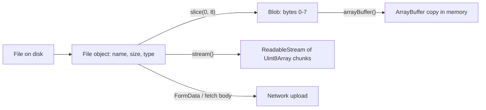

## Introduction

When a user picks a photo in an upload form, drops a PDF onto a page, or your code downloads an image with `fetch`, JavaScript needs a value that means "these bytes, of this kind, possibly with this filename". A string is the wrong shape: it holds text, not arbitrary bytes, and a 200 MB video should not be copied into memory just so you can pass it to `fetch`. An [[b1-arraybuffer|ArrayBuffer]] holds bytes, but it always lives in memory and carries no type or name.

The **Blob** (Binary Large OBject) fills that gap. A Blob is an **immutable** sequence of bytes plus a `type` string such as `'image/png'`. It is deliberately opaque: you cannot index into it or read it synchronously. You hand it to APIs — `fetch` bodies, `FormData`, `URL.createObjectURL`, `postMessage`, IndexedDB — or you ask it, asynchronously, for its contents. A **File** is a Blob subclass that adds `name` and `lastModified`; it is what `<input type="file">` and drag-and-drop give you.

This lesson covers the data model and the reading APIs — the "language" view of Blob and File. The browser features around them (file inputs, drag and drop, downloads, object URLs) are covered in [[b3-blob-file]].

Blob and File are **host objects**, not part of ECMAScript itself: they are defined by the W3C File API specification and provided by browsers, and by Node.js (global `Blob` since Node.js 18, global `File` since Node.js 20) and Deno. That is why they appear in every modern runtime yet are missing from the language spec ([[b1-engine-vs-host]]).

## Before you start

- **ArrayBuffer and Uint8Array** — Blob contents are read as bytes into these. See [[b1-arraybuffer]].
- **Promises and `async`/`await`** — every read is asynchronous. See [[b1-promises]] and [[b1-async-await]].
- **Async iteration** — for reading streams with `for await`. See [[b1-async-iterators]].
- **Text encoding** — that characters and bytes are different counts. See [[b1-unicode-strings]].

## The intuition

Think of a Blob as a **sealed parcel**. The label on the outside tells you its size and what kind of contents it claims to hold. You can pass the parcel around, put it in another parcel, or cut out a piece of it as a new sealed parcel — all without opening it. Opening it (reading the bytes) takes time, because the contents might be large or might still be on disk, so it happens asynchronously and hands you a copy of the contents.

A File is the same parcel with a shipping label that also names the file and says when it was last modified. Where the analogy stops working: the label is not verified. A Blob's `type` and a File's `name` are whatever the creator said they are, not a check of the contents.

## Creating Blobs

The constructor is `new Blob(parts, options)`. `parts` is an array (any iterable) whose items can be strings, ArrayBuffers, typed arrays, DataViews or other Blobs. Strings are encoded as UTF-8. The result is all the parts concatenated:

```javascript title="create-blob.mjs"
const blob = new Blob(['hello ', 'wörld'], { type: 'text/plain' });
console.log(blob.size, blob.type, blob instanceof Blob);
console.log(await blob.text());

const mixed = new Blob([new Uint8Array([72, 105]), ' ', blob.slice(0, 5), { a: 1 }]);
console.log(mixed.size, JSON.stringify(await mixed.text()), JSON.stringify(mixed.type));

const upper = new Blob(['ABC'], { type: 'TEXT/Plain' });
console.log(JSON.stringify(upper.type));
```

```output
12 text/plain true
hello wörld
23 "Hi hello[object Object]" ""
"text/plain"
```

Read the numbers carefully. `'hello wörld'` has 11 characters but `size` is **12**, because `size` counts bytes and `ö` takes two bytes in UTF-8. The second Blob combines raw bytes (`72, 105` are the ASCII codes for `Hi`), a string, and a slice of another Blob. The last part, `{ a: 1 }`, is not a valid byte source, so it was converted to a string — `'[object Object]'` — rather than rejected: a quiet bug to watch for. With no `type` option, `type` is the empty string. The `type` you pass is lower-cased, and is otherwise not checked at all.

**Blobs are immutable**, and creating one takes a snapshot of its parts. If you build a Blob from a `Uint8Array` and then change the array, the Blob still holds the old bytes:

```javascript title="snapshot.mjs"
const source = new Uint8Array([1, 2, 3]);
const snapshot = new Blob([source]);
source[0] = 99;
console.log(new Uint8Array(await snapshot.arrayBuffer()).join(' '));
```

```output
1 2 3
```

Immutability is what makes Blobs safe to share: a Blob passed to a worker, cached in IndexedDB or attached to a request cannot change underneath anyone.

### Slicing

`blob.slice(start, end, contentType)` returns a new Blob covering bytes `start` up to (not including) `end`. Negative positions count from the end, like `Array.prototype.slice`. The third argument sets the new Blob's type; without it the slice's type is `''`.

```javascript title="slice.mjs"
const blob = new Blob(['hello wörld'], { type: 'text/plain' });
const part = blob.slice(6, 12, 'text/plain');
console.log(part.size, await part.text());
console.log(blob.slice(-6).size, await blob.slice(-6).text());
console.log(JSON.stringify(blob.slice(0, 5).type));
```

```output
6 wörld
6 wörld
""
```

Slicing is how large uploads are split into chunks for resumable uploads, and how you read only the first few bytes of a file to check its format. Implementations generally make `slice` cheap — the new Blob refers to a range of the same underlying data rather than copying it — so slicing a 2 GB file into 5 MB pieces does not need 2 GB of memory. Because offsets are in bytes, slicing a text Blob at an arbitrary position can cut a multi-byte character in half; decode with care, as shown in the streaming section.

## Files

A **File** is a Blob with two extra read-only properties: `name` (a filename without any path) and `lastModified` (milliseconds since the Unix epoch). In real applications Files come from `<input type="file">` (`input.files`), drag and drop (`event.dataTransfer.files`), the clipboard, or the File System Access API ([[b3-input-file]]). You construct one yourself mainly in tests or when you want to give generated content a filename:

```javascript title="file.mjs"
const file = new File(['{"id":1}'], 'user.json', { type: 'application/json', lastModified: 0 });
console.log(file.name, file.type, file.size, file.lastModified, file instanceof Blob);
console.log(JSON.parse(await file.text()).id);

const sliced = file.slice(0, 4);
console.log(sliced instanceof File, sliced.constructor.name);

console.log(JSON.stringify(file), JSON.stringify({ upload: file }));
```

```output
user.json application/json 8 0 true
1
false Blob
{} {"upload":{}}
```

Two results matter. First, slicing a File gives a plain **Blob**: the name and date are not carried over. Second, `JSON.stringify(file)` is `{}`. Blob's `size`, `type` and `name` are getters on the prototype, not own enumerable properties, and the bytes are not reachable synchronously at all, so JSON sees an empty object. Sending `JSON.stringify({ upload: file })` to a server therefore uploads nothing, silently. Send files with `FormData`, or as the raw request body.

A File chosen by the user is usually **backed by the file on disk**, not loaded into memory when selected. `size` and `name` are available immediately; the bytes are read only when you ask for them. If the user changes or deletes the file on disk between choosing it and your read, browsers can fail the read (Chrome rejects with a `NotReadableError`). Treat reads as fallible and handle the rejection.

## Reading contents

Since about 2020 in browsers (and in every Node.js version that has a global `Blob`), Blob has three promise-based reading methods, plus a fourth more recent one:

| Method | Resolves to / returns | Use when |
|---|---|---|
| `blob.text()` | a string, decoded as UTF-8 | The content is text and fits comfortably in memory |
| `blob.arrayBuffer()` | an `ArrayBuffer` with a copy of all bytes | You need to inspect or process bytes (headers, hashing) |
| `blob.bytes()` | a `Uint8Array` — same as wrapping `arrayBuffer()` | Same as above; newer, available in current browsers and Node.js 22, check older targets |
| `blob.stream()` | a `ReadableStream` of `Uint8Array` chunks (not a promise) | The data is large, or you can process it piece by piece |

Why asynchronous? Because the bytes may be on disk, may be very large, or may be held by another process; a synchronous read would block the main thread and freeze the page ([[b1-event-loop]]). The `text()` and `arrayBuffer()` methods still load **everything** into memory before resolving, so for a 1 GB log file they need about 1 GB (more for `text()`, since JavaScript strings use UTF-16 internally). `stream()` hands over chunks as they are read and lets each chunk be garbage-collected after you process it.

### Worked example: checking a file's real type

A File's `type` is guessed by the browser from the file extension, and its `name` is chosen by the user. Neither proves what the bytes are. Many formats start with a fixed **magic number**, so reading only the first few bytes — a cheap `slice` plus `arrayBuffer()` — tells you more:

```javascript title="sniff-type.mjs"
async function sniffType(blob) {
  const head = new Uint8Array(await blob.slice(0, 8).arrayBuffer());
  const startsWith = (...signature) => signature.every((b, i) => head[i] === b);
  if (startsWith(0x89, 0x50, 0x4e, 0x47)) return 'image/png';
  if (startsWith(0xff, 0xd8, 0xff)) return 'image/jpeg';
  if (startsWith(0x25, 0x50, 0x44, 0x46)) return 'application/pdf'; // "%PDF"
  return 'unknown';
}

const renamed = new File([new Uint8Array([0xff, 0xd8, 0xff, 0xe0, 0, 0])], 'cat.png', {
  type: 'image/png',
});
console.log(renamed.type, await sniffType(renamed));
console.log(await sniffType(new Blob(['%PDF-1.7 ...'])));
```

```output
image/png image/jpeg
application/pdf
```

The File claims to be a PNG because its name ends in `.png`, but its first bytes are the JPEG signature `ff d8 ff`. Only eight bytes were read, however large the file. This check improves user feedback ("that is not really a PNG") but is not security: the **server must validate uploads itself**, because client-side code can be bypassed entirely.

### Worked example: streaming a large file

To count the lines in a CSV export that may be hundreds of megabytes, reading it all with `text()` is wasteful. Instead, stream it, decode the bytes to text incrementally, and keep only a counter:

```javascript title="count-lines.mjs"
async function countLines(blob) {
  let lines = 0;
  let last = '';
  const text = blob.stream().pipeThrough(new TextDecoderStream());
  for await (const piece of text) {
    for (const ch of piece) if (ch === '\n') lines++;
    if (piece.length > 0) last = piece.at(-1);
  }
  // a final line without a trailing newline still counts
  return last !== '' && last !== '\n' ? lines + 1 : lines;
}

const csv = new Blob(['id,name\n', '1,Ada\n2,Grace\n', '3,Linus']);
console.log(await countLines(csv));
console.log(await countLines(new Blob(['a\nb\n'])), await countLines(new Blob([])));
```

```output
4
2 0
```

`blob.stream()` returns a `ReadableStream` of `Uint8Array` chunks. `pipeThrough(new TextDecoderStream())` turns it into a stream of strings, and the decoder correctly handles a multi-byte character split across two chunks — something that decoding each chunk separately with `new TextDecoder().decode(chunk)` would get wrong. `for await` consumes the stream; async iteration of `ReadableStream` is supported in Node.js, Firefox and Chrome 124+, but check Safari support for your targets; where it is missing, use `stream.getReader()` and call `reader.read()` in a loop. Memory use stays roughly one chunk in size, whatever the file size. Streams are covered in depth in [[b3-blob-streaming]] and [[b3-fetch-streaming]].

## FileReader: the legacy API

Before the promise methods existed, the only way to read a Blob in a browser was **FileReader**, an event-based object from the original File API. You will still meet it in older code and in answers online, so you need to read it fluently:

```javascript title="file-reader-legacy.js"
// Browser only; FileReader does not exist in Node.js. Not run here.
function readAsText(blob) {
  return new Promise((resolve, reject) => {
    const reader = new FileReader();
    reader.onload = () => resolve(reader.result);
    reader.onerror = () => reject(reader.error);
    reader.readAsText(blob); // also: readAsArrayBuffer, readAsDataURL
  });
}
```

Each `FileReader` performs one read at a time. You call one of the `readAs...` methods, and later the `load` event fires and `reader.result` holds a string or ArrayBuffer; `error` and `abort` events report failures, and `progress` events report bytes read so far. Wrapping it in a promise, as above, is exactly what `blob.text()` now does for you. Calling a second `readAs...` while one is in progress throws an `InvalidStateError`.

| FileReader method | Modern equivalent |
|---|---|
| `readAsText(blob)` | `await blob.text()` (UTF-8 only; for other encodings, `new TextDecoder('windows-1252').decode(await blob.arrayBuffer())`) |
| `readAsArrayBuffer(blob)` | `await blob.arrayBuffer()` or `await blob.bytes()` |
| `readAsDataURL(blob)` | Usually `URL.createObjectURL(blob)` for display; build a data URL from base64 only when you need a string |
| `readAsBinaryString(blob)` | Deprecated; use `arrayBuffer()` |
| `progress` events | Count bytes while reading `blob.stream()` |

`readAsDataURL` deserves a note. A **data URL** (`data:image/png;base64,iVBOR...`) embeds the whole file as base64 text, about 33% larger than the file, as one huge string. It was the classic way to preview an uploaded image. An **object URL** from `URL.createObjectURL(blob)` is a short `blob:` URL that refers to the Blob without copying it; remember to call `URL.revokeObjectURL(url)` when you are done, or the Blob stays in memory for the lifetime of the document ([[b3-object-url]]). Prefer object URLs for previews and downloads; use FileReader only when maintaining code that already uses it, or when you need its progress events in a very old browser.

## How it works internally

The File API specification describes a Blob as a reference to an immutable **byte sequence** plus its `type`. It deliberately does not say where the bytes live, which gives browsers room to optimise. In Chromium, for example, Blob data is managed by a separate blob registry in the browser process: small Blobs may be kept in memory, large ones can be written to disk, and Blobs from user-selected files point to the file itself. Slices are recorded as ranges over existing data. A Blob object in your page is essentially a handle to that data, which is why creating, slicing and passing Blobs is cheap and reading them is asynchronous. These are implementation details — the spec only guarantees the behaviour — but they explain the design.



Blobs are **serializable**: `structuredClone`, `postMessage` and IndexedDB copy the *handle*, not necessarily the bytes, so sending a large Blob to a worker is cheap. They are not in the list of **transferable** objects like ArrayBuffer, because nothing needs to be detached — immutable data can be safely shared. JSON, by contrast, cannot represent a Blob at all ([[b1-json-unsupported]]).

## In real systems

- **Uploads.** Put the File in `FormData` and send it with `fetch`: `form.append('avatar', file)`; the browser sends a `multipart/form-data` body that includes the filename and type. Appending a plain Blob uses the filename `blob` unless you pass a third argument ([[b3-formdata-api]], [[b3-blob-upload]]).
- **Chunked and resumable uploads.** Services such as S3 multipart upload or tus slice a large File into pieces with `file.slice()` and upload each, retrying failed pieces.
- **Generated downloads.** Build a CSV or JSON export as `new Blob([text], { type: 'text/csv' })`, create an object URL and click a temporary `<a download>` link ([[b3-blob-download]]).
- **Client-side processing.** Hash a file with `crypto.subtle.digest('SHA-256', await file.arrayBuffer())` to deduplicate before uploading, or check image dimensions from the header before sending.
- **Offline storage.** IndexedDB stores Blobs directly, which is how offline-capable apps keep images and documents.
- **Responses.** `await response.blob()` turns a `fetch` response into a Blob whose `type` comes from the `Content-Type` header.

## Trade-offs and alternatives

A Blob is the right container when you have bytes to **move** rather than inspect: it is immutable, cheap to slice and pass, may live outside JavaScript memory, and is accepted by `fetch`, `FormData`, IndexedDB and object URLs. Its costs are that everything is asynchronous and opaque — to look inside, you pay for a copy into an ArrayBuffer or string.

| Representation | Holds | Choose it when |
|---|---|---|
| `Blob` / `File` | Immutable bytes + type (+ name) | Uploading, downloading, storing, passing large data around |
| `ArrayBuffer` / `Uint8Array` | Mutable bytes in memory | You need to read or modify individual bytes synchronously |
| `string` | Text | The content is text you will manipulate |
| `ReadableStream` | Bytes arriving over time | Data is too large to hold, or arrives incrementally |
| Data URL | Base64 text with a type | You need a self-contained string (rare; prefer object URLs) |

Convert at the boundaries only: keep a user's file as a File until you actually need its bytes, and read only the part you need.

## Common mistakes

**`JSON.stringify` on a File or Blob.** The result is `{}`, so the upload is silently empty. Use `FormData` or send the Blob as the request body.

**Treating `size` as a character count.** `size` is bytes; UTF-8 text has more bytes than characters whenever it contains non-ASCII characters.

**Trusting `type` and `name`.** The type comes from the extension or from whoever created the Blob; the name is user-controlled. Sniff magic bytes for user feedback and validate on the server.

**Reading huge files with `text()` or `arrayBuffer()`.** Both load everything into memory and can crash a tab on large inputs. Stream, or `slice` to read only what you need.

**Forgetting that `slice` drops the type and name.** Pass the content type as the third argument, and wrap the slice in a new `File` if the name matters.

**Passing non-byte parts to the constructor.** Objects become `'[object Object]'` instead of throwing. Convert data with `JSON.stringify` (for JSON) or pass typed arrays for bytes.

**Leaking object URLs.** Each `URL.createObjectURL` keeps its Blob alive until `URL.revokeObjectURL` or page unload.

**Using FileReader in new code.** It works but needs event-handler boilerplate and is easy to misuse; the promise methods are shorter and compose with `await`.

## Interview perspective

**"What is the difference between Blob, File and ArrayBuffer?"** Blob: immutable bytes plus MIME type, read asynchronously, may not be in memory. File: Blob with `name` and `lastModified`, usually from user input. ArrayBuffer: mutable bytes in memory, readable synchronously through views. A strong answer also says why reads are async.

**"How would you upload a file and show a preview?"** Get the File from the input, show `URL.createObjectURL(file)` in an `` and revoke it later, send the File in `FormData` with `fetch`. Mention server-side validation and that `JSON.stringify` does not work.

**"How do you handle a 2 GB file in the browser?"** Never read it whole; use `file.slice()` for chunked upload or `file.stream()` for processing, and run heavy work in a worker.

**"FileReader versus `blob.text()`?"** Same capability; FileReader is event-based legacy API, the methods return promises. Know how to wrap FileReader in a promise.

Follow-ups worth preparing: why `blob.size` differs from `text.length`, what `file.slice(0, 10)` returns (a Blob, not a File), and the difference between data URLs and object URLs.

## Practice

1. Write `downloadText(filename, text)` that creates a Blob with the right type and returns an object URL. List everything a caller must do afterwards.
2. Write `readHead(file, n)` returning the first `n` bytes as hex. Use it to tell PNG, JPEG, GIF (`GIF8`) and PDF files apart.
3. Write `chunks(file, size)` — a generator yielding `{ index, blob }` slices of at most `size` bytes. How many chunks does a 12 MB file give with 5 MB chunks, and how big is the last one?
4. Convert a FileReader-based function that reads a file as an ArrayBuffer and reports progress into one using `blob.stream()`, reporting the percentage after each chunk.
5. Explain why `new Blob(['€']).size` is 3, and what `(await new Blob(['€']).slice(0, 1).text())` returns.

## Quick revision {#quick-revision}

- Blob = immutable bytes + `type`; File = Blob + `name` + `lastModified`. Host objects from the W3C File API, not ECMA-262; global in browsers, Node.js 18+ (`Blob`) and 20+ (`File`).
- `new Blob(parts, { type })`: strings encoded as UTF-8; buffers, views and Blobs copied in; other objects stringified. `size` is bytes. Constructing snapshots the parts.
- `slice(start, end, type)`: byte range, negative indices allowed, cheap, returns a plain Blob with type `''` unless given.
- Read: `text()` (UTF-8 string), `arrayBuffer()`, `bytes()` (newer, `Uint8Array`), `stream()` (`ReadableStream` of `Uint8Array`). All but `stream()` load everything into memory.
- Large data: stream (with `TextDecoderStream` for text) or slice.
- FileReader: legacy, event-based (`load`, `error`, `progress`), one read at a time; `readAsDataURL` → prefer object URLs.
- `JSON.stringify(file)` is `{}`; upload with `FormData` or a raw body.
- `type` and `name` are not verified; sniff magic bytes for UX, validate on the server.
- Blobs are serializable (cheap to `postMessage`), not transferable; object URLs must be revoked.

## Key takeaways {#key-takeaways}

- A Blob is an immutable, typed handle to bytes that may live outside JavaScript memory, which is why it is cheap to pass around and asynchronous to read.
- A File is a Blob with a name and modification time; slicing it gives a plain Blob.
- Choose the reading method by size: `text()` or `arrayBuffer()` for small data, `slice()` for a known part, `stream()` for large data.
- FileReader is the event-based predecessor of the promise methods; recognise it, but do not write new code with it.
- Blobs cannot go through JSON, and their type and name are claims, not facts.

```quiz
Q: `const b = new Blob(['naïve']);` What is `b.size`?
- [ ] 5, the number of characters
- [x] 6, because `ï` takes two bytes in UTF-8
- [ ] 10, because JavaScript strings are UTF-16
- [ ] 0, because no `type` was given
> The Blob constructor encodes strings as UTF-8, and `size` counts bytes. `ï` is outside ASCII and needs two bytes. UTF-16 is how strings are stored in memory, not how Blobs encode them, and `type` has no effect on size.
```

```quiz
Q: A form handler sends `fetch('/upload', { method: 'POST', body: JSON.stringify({ file }) })`. What does the server receive?
- [ ] The file contents as base64
- [ ] The file's name, size and type
- [x] `{"file":{}}`, with no file data
- [ ] A TypeError is thrown in the browser
> Blob and File expose `name`, `size` and `type` as prototype getters, not own enumerable properties, and their bytes are only readable asynchronously, so JSON serialises the File as an empty object. Use `FormData` or send the File itself as the body.
```

```quiz
Q: You need to compute the number of lines in a 3 GB log file selected by the user. Which approach is appropriate?
- [ ] `await file.text()` then `split('\n').length`
- [ ] `FileReader.readAsText` with an `onload` handler
- [x] Read `file.stream()` through a `TextDecoderStream` and count newlines per chunk
- [ ] `JSON.parse(await file.text())`
> `text()` and FileReader both load the whole file into memory before you can touch it, which for 3 GB can exhaust the tab's memory. Streaming processes one chunk at a time, and `TextDecoderStream` correctly joins characters split across chunk boundaries.
```

```quiz
Q: What does `file.slice(0, 100)` return when `file` is a File named `report.pdf`?
- [ ] A File named `report.pdf` with the first 100 bytes
- [x] A Blob with the first 100 bytes and type `''`
- [ ] A promise of an ArrayBuffer
- [ ] A Uint8Array view of the first 100 bytes
> `slice` is defined on Blob and returns a new Blob; it does not keep `name` or `lastModified`, and its type is empty unless you pass one as the third argument. It does not read anything, so it returns synchronously, not a promise.
```
