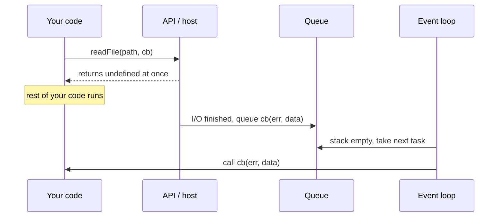

## Introduction

Some work cannot finish right away. A file has to be read from disk, a server has to answer a request, a user has to click a button. JavaScript runs your code on a single thread, so a function that needs such a result has two choices: stand still and wait — freezing everything else — or say "here is what to do when the result is ready" and carry on. JavaScript chose the second, and the "what to do" is a **callback**: a function you pass to other code so that the other code can call it back.

You have used callbacks already, perhaps without the name. `[3, 1, 2].sort((a, b) => a - b)` passes a callback that `sort` calls to compare elements. `button.addEventListener('click', onClick)` passes a callback the browser calls on every click. `setTimeout(done, 1000)` passes one the host calls once, later. Node.js's original file and network APIs all take callbacks.

Callbacks were the first way JavaScript expressed asynchronous work, and they are still underneath almost everything. Promises carry callbacks (the functions you pass to `.then`), `async`/`await` is built on promises, event listeners are callbacks, and every array method from `map` to `reduce` takes one. Understanding callbacks properly — who calls them, when, and what they are allowed to assume — is what makes the later tools make sense, and it explains a whole family of bugs those tools were designed to prevent.

This lesson covers the concept and two ideas nested inside it: [[b1-sync-vs-async-callbacks|synchronous versus asynchronous callbacks]] and the [[b1-error-first-callbacks|error-first callback pattern]]. Its companion, [[b1-callback-hell]], covers what goes wrong when many asynchronous callbacks are chained together.

## Before you start

- **Functions are values** — they can be stored in variables and passed as arguments. See [[b1-first-class-functions]] and its section on [[b1-callbacks-sync|callbacks]].
- **Closures** — a function remembers the variables around it, even when called later. See [[b1-closures]].
- **The event loop** — the call stack, tasks and microtasks, and why asynchronous code runs "later". See [[b1-event-loop]].
- **`setTimeout`** — used below as the simplest way to make something asynchronous. See [[b1-settimeout]].

## The intuition

You phone a shop to ask whether a jacket is in stock. They need to check the stockroom. You could stay on hold — you can do nothing else until they come back. Or you can leave your phone number, hang up, and get on with your day; when they know, they call you back.

Leaving your number is passing a callback. The shop decides when to call, and you trust it to call once, with an answer, and not to ring you before you have even hung up. Those expectations — *when*, *how many times*, *with what* — are exactly the contract of a callback API, and most callback bugs are a broken expectation of one of them.

The analogy stops in one place: a real phone call can interrupt you. A JavaScript callback cannot. If it is called later, it runs only when the call stack is empty and the event loop gets to it, never in the middle of other code.

## What makes a function a callback

There is no special callback type in JavaScript. **"Callback" is a role**: any function becomes a callback when you pass it to code that will call it. The same function can be called directly in one place and used as a callback in another.

```javascript title="role.js"
function greet(name) {
  return `Hello, ${name}`;
}

console.log(greet('Ada'));                        // called directly
console.log(['Ada', 'Linus'].map(greet));         // passed as a callback to map
```

```output
Hello, Ada
[ 'Hello, Ada', 'Hello, Linus' ]
```

In the second line, `map` receives the function `greet` itself — not `greet()`, which would call it immediately and pass the returned string. Inside, `map` calls `greet` once per element. That is the defining move: **you pass the function; the other code decides when to call it.** The function you pass to is often called a **higher-order function**, meaning a function that takes or returns other functions.

Passing a function instead of calling it is the first thing to get right:

```javascript
setTimeout(save(), 1000);   // wrong: runs save now, passes its return value
setTimeout(save, 1000);     // right: passes save, called in a second
setTimeout(() => save(draft), 1000);   // right: a small function that calls save with args
```

### Callbacks keep their context through closures

A callback usually needs data from where it was created. Because JavaScript functions are closures, a callback can read and change the variables that were in scope when it was defined, even if it runs much later from a completely different place.

```javascript title="closure-callback.js"
function countClicks(label) {
  let clicks = 0;
  return function onClick() {           // closes over label and clicks
    clicks += 1;
    console.log(`${label} clicked ${clicks} time(s)`);
  };
}

const handler = countClicks('Save');
handler();   // a button would call it on each click
handler();
```

```output
Save clicked 1 time(s)
Save clicked 2 time(s)
```

`countClicks` has returned long before the second call, but `onClick` still sees `label` and its own private `clicks` counter. This is why callbacks rarely need many parameters: they carry their context with them.

## The contract of a callback API

When you pass a callback, you hand control of *when and how your code runs* to someone else. Every callback API therefore makes promises — in its documentation, if not in its code — about five things:

| Question | Examples |
|---|---|
| **When** is it called? | Before the function returns (`map`), or later (`setTimeout`, `fs.readFile`) |
| **How many times**? | Once (`setTimeout`), once per element (`forEach`), any number (`addEventListener`), possibly never |
| **With what arguments**? | `(element, index, array)` for `map`; `(err, data)` for Node I/O; an `Event` for listeners |
| **With what `this`**? | `undefined` by default; the `thisArg` you pass to `forEach`; the element for DOM listeners |
| **How are errors reported**? | Thrown to the caller (sync), passed as the first argument (Node), or a separate error callback |

The engine enforces none of this. When an API calls your callback, it is an ordinary function call — the specification's `Call(callback, thisArg, args)` — and nothing stops a buggy API from calling it twice, never, or with the wrong arguments. The **`this`** value depends on how the API calls it: array methods pass the optional `thisArg` you give them (or `undefined`), and `addEventListener` calls a regular function with `this` set to the element the listener is attached to. Arrow functions ignore all of that and keep the `this` of the place they were written ([[b1-this-arrow]]). Pass an object's method directly and it loses its object, a bug covered in [[b1-this-lost]].

Promises were designed partly to turn some of these informal promises into guarantees: a promise settles at most once, its callbacks always run asynchronously, and errors travel along the chain. Those guarantees are why [[b1-callback-hell]] calls the trust problem with raw callbacks **inversion of control**.

## Continuation-passing style

There is a second way to look at an asynchronous callback. Normally a function hands back its result with `return`. A function that cannot have its result yet instead takes a function to call with the result. That function is a **continuation** — "the rest of the program, from here on" — and writing code this way is called **continuation-passing style** (CPS).

```javascript title="cps.js"
// Direct style: the result comes back with return
function addDirect(a, b) {
  return a + b;
}

// Continuation-passing style: the result is passed forward to `next`
function addCps(a, b, next) {
  setTimeout(() => next(a + b), 10);    // pretend the addition takes time
}

console.log('direct:', addDirect(2, 3));
addCps(2, 3, (sum) => console.log('cps:', sum));
console.log('after addCps');
```

```output
direct: 5
after addCps
cps: 5
```

`addCps` returns `undefined` immediately; the sum only exists inside the continuation. Everything that depends on the sum has to live in that continuation or be called from it. That one property shapes all callback-based code: you cannot write `const sum = addCps(2, 3)`, so each further step nests one level deeper, which is where callback hell begins.

## Sync vs Async Callbacks {#b1-sync-vs-async-callbacks}

A **synchronous callback** is called before the function you passed it to returns. An **asynchronous callback** is called later, after the function has returned and the current code has finished, from the event loop. Nothing about the callback itself decides which it is — the same arrow function can be either — only the API that calls it.

```javascript title="sync-vs-async.js"
console.log('1. start');

[10, 20].forEach((n) => console.log(`2. forEach callback with ${n}`));   // synchronous

setTimeout(() => console.log('5. timeout callback'), 0);                  // asynchronous

Promise.resolve().then(() => console.log('4. promise callback'));          // asynchronous

console.log('3. end of script');
```

```output
1. start
2. forEach callback with 10
2. forEach callback with 20
3. end of script
4. promise callback
5. timeout callback
```

`forEach` calls its callback for each element *inside* the `forEach` call, so both lines appear before the script continues. `setTimeout` and `.then` only register their callbacks and return; the callbacks run after the script has finished — the promise callback first because it is a microtask, then the timer, which is a task (see [[b1-microtasks]]).

The practical difference is what the code after the call can rely on:

| | Synchronous callback | Asynchronous callback |
|---|---|---|
| Runs | During the call | After the call returns and the stack is empty |
| Code after the call | Sees the callback's effects | Runs *before* the callback |
| Errors thrown in the callback | Propagate to the caller's `try`/`catch` | Do not reach the caller's `try`/`catch` |
| Typical APIs | `map`, `filter`, `sort`, `reduce`, `find`, `replace` with a function | Timers, events, I/O, `.then` |

A common misreading is that an `async` function passed as a callback makes the API asynchronous, or makes it wait. It does neither. `forEach` calls an `async` callback synchronously; the callback runs until its first `await` and returns a promise, which `forEach` ignores. So `[1, 2, 3].forEach(async (id) => { await save(id); })` starts all three saves and moves on immediately without waiting for any of them, and their errors become unhandled rejections. Use a `for…of` loop with `await` for one-by-one work, or `Promise.all` with `map` for parallel work.

### Zalgo: an API that is sometimes sync and sometimes async

The real danger is an API that calls its callback **synchronously in some cases and asynchronously in others**. The usual cause is a cache: on a cache hit the value is already there, so the code calls the callback at once; on a miss it fetches and calls back later.

```javascript title="zalgo.js"
const cache = new Map();

function getUser(id, cb) {
  if (cache.has(id)) {
    cb(cache.get(id));                        // hit: called synchronously
  } else {
    setTimeout(() => {                        // miss: called asynchronously
      const user = { id, name: `user${id}` };
      cache.set(id, user);
      cb(user);
    }, 10);
  }
}

function show(id) {
  let status = 'loading';
  getUser(id, (user) => console.log(`${user.name}: status was "${status}"`));
  status = 'requested';                       // the caller's "after the call" code
}

show(1);                                      // miss
setTimeout(() => show(1), 50);                // hit
```

```output
user1: status was "requested"
user1: status was "loading"
```

The same caller code behaves differently depending on whether the data happened to be cached. On the miss, the line after `getUser` has run before the callback; on the hit, it has not. Real code that, for example, shows a spinner after starting a request, or adds a listener after calling the function, works in testing and breaks once the cache warms up — or the other way round. The Node.js community named this **releasing Zalgo**, after an internet meme about chaos, and the rule that came out of it is simple: **an API must always call its callback synchronously or always asynchronously, never sometimes one and sometimes the other.**

The fix for an asynchronous API is to make the fast path asynchronous too:

```javascript
if (cache.has(id)) {
  const user = cache.get(id);
  queueMicrotask(() => cb(user));    // still fast, but always after the caller's code
  return;
}
```

`queueMicrotask` runs the callback as soon as the current code finishes, before any timer or I/O, so the cost is tiny. In Node.js, `process.nextTick` is the older equivalent and is what many core modules use. Promises apply this rule automatically: `.then` callbacks always run asynchronously, even on an already-resolved promise, which is one reason promise-based APIs cannot release Zalgo.

Three habits keep you out of trouble. Document whether each callback is called synchronously or asynchronously. Never give one API both behaviours. And do not assume that a function taking a callback is asynchronous: `map`, `sort` and `replace` are not, and treating them as if they were — or the reverse — leads to the ordering bugs shown above.

## Error-First Callback Pattern {#b1-error-first-callbacks}

The **error-first callback** is the convention Node.js used for every asynchronous API before promises: the callback's first parameter is an error, and the result comes after it.

```javascript
callback(err, result)
```

On failure, `err` is an `Error` object and the result is absent. On success, `err` is `null` (some libraries use `undefined`) and the result follows. The caller must check `err` first. Here is the real `fs.readFile` from Node.js:

```javascript title="read-config.js"
import { readFile } from 'node:fs';

readFile('missing.json', 'utf8', (err, text) => {
  if (err) {
    console.log(`could not read config: ${err.code}`);
    return;                                   // stop: there is no text to use
  }
  console.log(`config has ${text.length} characters`);
});

console.log('read requested');
```

```output
read requested
could not read config: ENOENT
```

`ENOENT` is the system's code for "no such file or directory". The callback is asynchronous, so `read requested` prints first.

### Why errors go in the callback instead of being thrown

With a synchronous function, failure is reported by `throw`, and the caller catches it with `try`/`catch`. That cannot work for an asynchronous callback, because by the time the operation fails, the function that started it has returned and its `try` block is gone from the stack:

```javascript title="no-catch.js"
function readLater(cb) {
  setTimeout(() => {
    try {
      throw new Error('disk failed');          // thrown long after readLater returned
    } catch (e) {
      cb(e);                                   // the only way back to the caller
    }
  }, 0);
}

try {
  readLater((err) => console.log(`callback got: ${err.message}`));
  console.log('readLater returned without throwing');
} catch (e) {
  console.log('never reached: the try block finished long ago');
}
```

```output
readLater returned without throwing
callback got: disk failed
```

The outer `try` finishes as soon as `readLater` returns. If the timer callback simply threw, the error would be uncaught — in Node.js that crashes the process. So the API catches the error where it happens and *passes* it to the callback. Putting it first, rather than last or in a separate callback, means the caller cannot reach the result without at least seeing the error parameter, and it gives every API the same shape, which tools such as `util.promisify` rely on.

### Writing error-first functions correctly

A function that accepts an error-first callback has three rules to follow.

**Call the callback exactly once.** Either with an error or with a result, never both, never neither. The classic way to break this is forgetting to `return` after reporting an error:

```javascript title="double-callback.js"
function parseBad(text, cb) {
  let data;
  try {
    data = JSON.parse(text);
  } catch (err) {
    cb(err);                    // bug: no return, so execution continues below
  }
  cb(null, data);
}

function parseGood(text, cb) {
  let data;
  try {
    data = JSON.parse(text);
  } catch (err) {
    return cb(err);             // return stops the function after reporting
  }
  cb(null, data);
}

parseBad('{oops', (err, data) => console.log('bad:', err ? 'error' : data));
parseGood('{oops', (err, data) => console.log('good:', err ? 'error' : data));
```

```output
bad: error
bad: undefined
good: error
```

`parseBad` calls the callback twice: once with the error, then again with `null` and `undefined`, so the caller first handles a failure and then "succeeds" with no data. In a web server that could send two responses to one request. `return cb(err)` is the idiom that prevents it. Notice also that `parseGood` calls `cb(null, data)` outside the `try`: if it were inside, an exception thrown by the *caller's* callback would be caught by `parseGood`'s own `catch` and reported back as a parse error — a second call again.

**Keep the callback's timing consistent.** `JSON.parse` is synchronous, so both functions above call back synchronously in every case, which is fine; an asynchronous API must call back asynchronously in every case, including errors detected up front such as invalid arguments. That is the Zalgo rule from the previous section.

**Report errors one way.** An API that sometimes throws and sometimes passes `err` forces callers to write both a `try`/`catch` and an `if (err)`, and they will forget one. Pass every asynchronous failure through the callback.

### Consuming error-first callbacks

On the calling side, the pattern is to handle `err` first and return, then use the result. When you are inside another error-first function, pass the error on rather than swallowing it:

```javascript
function loadSettings(path, cb) {
  readFile(path, 'utf8', (err, text) => {
    if (err) return cb(err);                    // propagate to our own caller
    let settings;
    try {
      settings = JSON.parse(text);
    } catch (parseErr) {
      return cb(parseErr);
    }
    cb(null, settings);
  });
}
```

Every level must remember the `if (err) return cb(err)` line. Forgetting it once means an error vanishes silently, or the code goes on to read properties of `undefined`. That repetition is one of the reasons promises, where errors propagate automatically, replaced this style ([[b1-error-propagation]]).

### From callbacks to promises

Because the convention is so regular, Node.js can convert any error-first function into one that returns a promise. `util.promisify` does it automatically, and most core modules also ship promise versions directly, such as `node:fs/promises`.

```javascript title="promisify.js"
import { promisify } from 'node:util';

function divideLater(a, b, cb) {
  setTimeout(() => {
    if (b === 0) return cb(new Error('division by zero'));
    cb(null, a / b);
  }, 10);
}

const divide = promisify(divideLater);

try {
  console.log(await divide(10, 4));
  console.log(await divide(1, 0));
} catch (err) {
  console.log(`caught: ${err.message}`);
}
```

```output
2.5
caught: division by zero
```

`promisify` returns a function that calls `divideLater` with an extra callback; when that callback receives an error, the promise rejects, and otherwise it resolves with the result. The error now arrives through `await` and `try`/`catch`, as if the code were synchronous. Writing the wrapper by hand shows there is no magic:

```javascript
const divide = (a, b) =>
  new Promise((resolve, reject) => {
    divideLater(a, b, (err, value) => (err ? reject(err) : resolve(value)));
  });
```

The convention exists only by agreement — the engine knows nothing about it. Early Node.js versions experimented with other ways to catch errors thrown from asynchronous code, such as the `domain` module (deprecated) and the global `process.on('uncaughtException')` handler, which is now meant only for logging before shutting down. Error-first callbacks were the approach that lasted, until promises and `async`/`await` replaced them in new APIs.

## How it works internally

When you pass a callback to an asynchronous API, three things keep it alive and get it called. The API — or, for timers, events and I/O, the host behind it — stores a **reference** to your function. Your function, being a closure, keeps the variables it uses alive too. When the event happens or the operation completes, the host puts a task (or, for promises, a microtask) in a queue, and the event loop eventually calls your function with an empty stack beneath it.



Two consequences matter in practice. First, a callback the host still holds keeps its closure alive, which is why forgotten event listeners and timers are a common cause of memory leaks ([[b1-closure-memory]]). Second, the callback starts with a fresh stack: there is no caller's `try` around it, which is why errors must be passed in rather than thrown out.

## Worked example: a small callback API done properly

Here is a `fetchUser` that has a cache, is always asynchronous, uses error-first callbacks and calls back exactly once, plus a caller that uses it.

```javascript title="fetch-user.js"
const cache = new Map();
const fakeDb = { 1: { id: 1, name: 'Ada' } };

function fetchUser(id, cb) {
  if (typeof cb !== 'function') {
    throw new TypeError('cb must be a function');   // programmer error: throw at once
  }
  if (cache.has(id)) {
    const user = cache.get(id);
    queueMicrotask(() => cb(null, user));          // async even on a hit: no Zalgo
    return;
  }
  setTimeout(() => {
    const user = fakeDb[id];
    if (!user) return cb(new Error(`user ${id} not found`));
    cache.set(id, user);
    cb(null, user);
  }, 20);
}

function report(id) {
  fetchUser(id, (err, user) => {
    if (err) return console.log(`error: ${err.message}`);
    console.log(`found ${user.name}`);
  });
  console.log(`requested user ${id}`);
}

report(1);
report(2);
setTimeout(() => report(1), 50);    // cached by now
```

```output
requested user 1
requested user 2
found Ada
error: user 2 not found
requested user 1
found Ada
```

Each `report` prints `requested user …` before its result, including the third call, which is served from the cache — that is the always-asynchronous rule at work. The missing user produces an error through the callback, and the `return` in front of `cb` guarantees one call. The one thing `fetchUser` throws for is a missing callback: that is a mistake in the calling code, not a runtime failure, and reporting it immediately is the convention Node.js core uses too.

## In real systems

**Array methods and sorting** take synchronous callbacks; this is the most common use of all ([[b1-array-map-filter-reduce]], [[b1-array-sort]]).

**DOM events** use callbacks called any number of times: `addEventListener('click', handler)`. They are asynchronous with respect to the code that registered them and always run from the event loop when the user acts ([[b3-add-event-listener]]).

**Node.js core** still offers the error-first versions of its APIs alongside the promise versions, and many older npm packages expose only callbacks. Wrapping them with `util.promisify` at the boundary lets the rest of an application use `async`/`await`.

**React** passes callbacks everywhere: `onClick={handleClick}`, `setCount((c) => c + 1)` and `useEffect(() => …)` are all functions handed to React for it to call. Child components report events to parents by calling callback props ([[b4-child-parent-callbacks]]).

**Promises themselves** are a callback system with stronger rules: `.then(onFulfilled, onRejected)` registers callbacks, and the promise guarantees each is called at most once and always asynchronously ([[b1-promises]]).

## Trade-offs and alternatives

Callbacks are the simplest possible mechanism: no objects, no special syntax, nearly zero overhead, and they work for events that happen many times, which promises cannot model (a promise settles once). That is why event listeners and array methods remain callback-based and always will.

For one-off asynchronous results, though, callbacks have real costs. Sequential steps nest deeper and deeper. Error handling must be repeated at every level. And the API's contract — once, asynchronously, error first — is only a convention, so a buggy library can break your code in ways you cannot prevent. Promises fix all three for single results, and `async`/`await` makes the result read like synchronous code. New APIs should return promises; you still need to understand callbacks to use events, array methods, older libraries and the promise machinery itself.

| Situation | Best fit |
|---|---|
| Transform or inspect a collection | Synchronous callback (`map`, `filter`, `find`) |
| Something that happens many times | Callback / event listener |
| A single asynchronous result | Promise, consumed with `await` |
| A stream of asynchronous values | Async iterator or stream ([[b1-async-iterators]]) |
| Old error-first API | Wrap with `util.promisify` |

## Common mistakes

> [!MISTAKE] Using a callback result as a return value
> `const data = readFile(path, cb)` gives `undefined`. The data exists only inside the callback, after it is called. Put the code that needs it inside the callback, or switch to the promise API and `await` it.

**Calling instead of passing.** `button.addEventListener('click', save())` runs `save` once while registering and passes its return value. Pass `save` or `() => save(id)`.

**Ignoring `err`.** `readFile(p, (err, text) => use(text))` turns every failure into a confusing crash about `undefined`, or into silent wrong behaviour. Check `err` first, every time.

**Calling the callback twice.** Missing `return` before `cb(err)`, or calling `cb` inside a `try` whose `catch` also calls `cb`. Callbacks have no built-in protection; promises do.

**Throwing from an asynchronous callback.** No caller's `try` is on the stack, so the error is uncaught. Pass it to your callback instead.

**Mixing synchronous and asynchronous calls in one API.** Callers' code after the call runs in a different order depending on the path. Defer the fast path with `queueMicrotask`.

**Passing an `async` function to `forEach`.** `forEach` does not wait for the returned promises; use `for…of` with `await` or `Promise.all`.

**Passing a method and losing `this`.** `setTimeout(user.save, 0)` calls `save` without `user`. Use `() => user.save()`.

## Interview perspective

> [!INTERVIEW] What is a callback, and what problems do they have?
> "A callback is a function passed to other code to be called back — synchronously like in `map`, or asynchronously like with timers and I/O. The problems are in the contract: the callee decides when and how often to call it, errors cannot be thrown back to the caller so they are passed as arguments, and sequential steps nest. Promises keep the callback idea but guarantee a single, always-asynchronous settlement with errors that propagate."

Questions to be ready for:

- **Is every callback asynchronous?** No. `map`, `forEach` and `sort` call theirs synchronously. Asynchrony comes from the API, not from the function.
- **What does "don't release Zalgo" mean?** An API must not call its callback synchronously on some paths and asynchronously on others; defer the fast path.
- **Why error-first?** Asynchronous errors cannot be thrown to the original caller; a fixed first slot makes the error impossible to miss and lets tools like `promisify` work generically.
- **Why `return cb(err)`?** To stop the function from continuing and calling the callback again.
- **Convert this callback API to a promise.** Show `util.promisify` and the hand-written `new Promise` wrapper.
- **Predict the output** of code mixing `forEach`, `setTimeout` and `.then`: synchronous callbacks first, then microtasks, then tasks.

## Practice

1. **Classify.** For `Array.prototype.find`, `String.prototype.replace` with a function, `addEventListener`, `fs.readFile`, `Promise.prototype.then` and `queueMicrotask`, write whether the callback is synchronous or asynchronous and how many times it can be called. Check each with a short script.
2. **Fix the Zalgo.** Take the `zalgo.js` example and change `getUser` so both calls print `status was "requested"`.
3. **Once.** Write `once(fn)` that returns a function which calls `fn` the first time and ignores later calls. Use it to protect an error-first callback from double calls.
4. **Promisify by hand.** Implement `myPromisify(fn)` that works for any error-first function, then compare it with `util.promisify` on `fs.readFile`.
5. **Callbackify.** Do the reverse: write `toCallback(asyncFn)` that returns an error-first callback version of an `async` function, making sure an exception thrown by the user's callback is not reported back to it as an error. Compare with `util.callbackify`.

```quiz
Q: What prints, in order? `console.log('a'); [1].forEach(() => console.log('b')); setTimeout(() => console.log('c')); console.log('d');`
- [ ] a, d, b, c
- [x] a, b, d, c
- [ ] a, b, c, d
- [ ] a, d, c, b
> `forEach` calls its callback synchronously, during the `forEach` call, so `b` comes straight
> after `a`. `setTimeout` only registers its callback, which runs after the script finishes, so
> `d` comes before `c`. Taking a callback does not make an API asynchronous.
```

```quiz
Q: A function calls its callback synchronously when the data is cached and asynchronously otherwise. What is the main problem?
- [ ] It is slower than always calling synchronously
- [ ] The callback may be called twice
- [x] Code after the call runs before or after the callback depending on the cache, so callers behave inconsistently
- [ ] Errors from the asynchronous path cannot be caught
> This is "releasing Zalgo". The ordering between the callback and the caller's following code
> changes with the cache state, causing bugs that appear only sometimes. Deferring the cached path
> with `queueMicrotask` keeps it fast and makes the order always the same.
```

```quiz
Q: In an error-first function, why write `return cb(err)` instead of `cb(err)`?
- [ ] `cb` returns the error, which must be passed on
- [x] Without `return`, the function keeps running and may call `cb` again with a result
- [ ] It makes the callback asynchronous
- [ ] Node.js requires callbacks to be returned
> The `return` is only there to stop execution. Without it, the code after the error branch runs
> too and typically calls `cb(null, result)`, so the caller sees a failure followed by a bogus
> success. Callbacks have no built-in protection against being called twice.
```

```quiz
Q: Why can't `try { readFile(p, cb) } catch (e) { … }` catch a failure to read the file?
- [ ] `readFile` swallows all errors
- [ ] `try`/`catch` does not work inside modules
- [x] The read fails after `readFile` has returned, when the `try` block is no longer on the stack
- [ ] The error is a warning, not an exception
> `readFile` starts the operation and returns immediately, so the `try` completes successfully.
> The failure is detected later, in a new task with a fresh stack. That is why the error is passed
> to the callback as its first argument.
```

## Quick revision {#quick-revision}

- A callback is any function passed to other code to be called back; "callback" is a role, not a type. Pass `fn`, not `fn()`.
- Callbacks carry context through closures.
- Every callback API has a contract: when, how many times, which arguments, which `this`, how errors are reported. The engine enforces none of it.
- Continuation-passing style: instead of returning a result, call `next(result)`; everything that needs the result lives in the continuation.
- **Sync callbacks** run during the call (`map`, `forEach`, `sort`); **async callbacks** run after the call returns, from the event loop (timers, events, I/O, `.then`).
- `forEach` does not await `async` callbacks.
- Never mix sync and async calls in one API ("Zalgo"); defer the fast path with `queueMicrotask` or `process.nextTick`. Promises are always async.
- **Error-first:** `cb(err, result)`; `err` is an `Error` or `null`. Check `err` first.
- Async errors cannot be thrown back to the caller, which is why they are passed as an argument.
- `return cb(err)` prevents double calls; call `cb` once, consistently async, and report errors only through `cb`.
- `util.promisify` and `node:fs/promises` turn error-first APIs into promises.

## Key takeaways {#key-takeaways}

- A callback hands control of when and how your code runs to someone else; that is its power and its weakness.
- Whether a callback is synchronous or asynchronous depends on the API, and the order of your code depends on knowing which.
- An API must be consistently synchronous or consistently asynchronous; mixing them produces bugs that come and go.
- Error-first callbacks exist because asynchronous errors cannot be thrown to the caller; check `err` first and call back exactly once.
- Promises and `async`/`await` keep callbacks underneath but enforce the contract; callbacks remain the right tool for events and collection methods.
