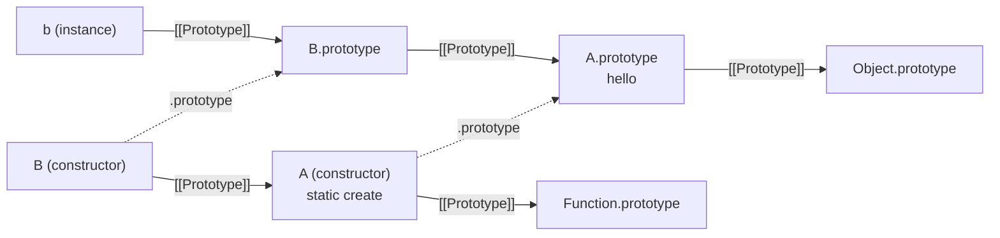

## Introduction

Suppose an application has three kinds of notification: email, SMS and push. All of them have a recipient and a message, all of them are logged when sent, and all of them retry on failure. They differ only in *how* the message is delivered. Writing three unrelated classes means writing the logging and retry code three times, and fixing every bug three times.

**Inheritance** removes that duplication. You write the shared parts once in a general class, then declare more specific classes that **extend** it: they receive everything the general class has and add or replace only what is different.

```javascript
class Notification {
  constructor(to, message) {
    this.to = to;
    this.message = message;
  }

  describe() {
    return `to ${this.to}: ${this.message}`;
  }
}

class EmailNotification extends Notification {
  constructor(to, message, subject) {
    super(to, message);
    this.subject = subject;
  }

  describe() {
    return `[${this.subject}] ${super.describe()}`;
  }
}

const n = new EmailNotification('ada@example.com', 'Your order shipped', 'Order update');
console.log(n.describe());
console.log(n instanceof EmailNotification, n instanceof Notification);
```

```output
[Order update] to ada@example.com: Your order shipped
true true
```

Three keywords do the work. **`extends`** says `EmailNotification` builds on `Notification`. **`super(to, message)`** runs the parent's constructor so the parent's part of the object is set up. **`super.describe()`** calls the parent's version of a method that the child has replaced. The class being extended is called the **parent**, **base class** or **superclass**; the extending class is the **child**, **derived class** or **subclass**.

As with classes themselves ([[b1-classes]]), nothing here is a new object model. `extends` is a tidy way of linking prototypes ([[b1-prototype-chain]]): the child does not receive *copies* of the parent's methods; its prototype object is linked to the parent's, and method lookup walks the link. Understanding that one fact explains almost every behaviour in this lesson, including the surprising ones.

You meet inheritance constantly in JavaScript whether or not you design hierarchies yourself: custom errors extend `Error`, web components extend `HTMLElement`, React class components extend `React.Component`, Node.js streams extend `Readable` and `Writable`. Being able to read, write and debug a subclass is a required skill; knowing when *not* to create one is what distinguishes experienced engineers, and the lesson ends there.

## Before you start

- **Classes** — constructors, instance and static methods, fields, and the fact that methods live on `Class.prototype`. See [[b1-classes]], especially [[b1-class-constructor]] and [[b1-instance-static]].
- **The prototype chain** — property lookup starts at the object and follows `[[Prototype]]` links until the property is found or the chain ends. See [[b1-prototype-chain]] and [[b1-property-lookup]].
- **`this`** — it is set by how a function is called; in `obj.method()` it is `obj`. See [[b1-this]].
- **`instanceof`** (helpful) — it tests whether a constructor's `prototype` is on an object's chain. See [[b1-instanceof]].

All code runs as shown in Node.js 22 or a current browser console.

## The intuition

Think of how job roles work in a company handbook. There is a general chapter, "Employee", describing what applies to everyone: how to request leave, how expenses are reimbursed. Then there is a short chapter, "Manager", which says: *a manager is an employee, plus the following*. It does not repeat the leave policy. A manager who wants to know about leave looks in the Manager chapter first, does not find it, and turns to the Employee chapter.

Occasionally the Manager chapter does mention something the Employee chapter also covers — say, the expense limit — and then the Manager chapter wins, because it is consulted first. And it may say "follow the standard expense process in the Employee chapter, then also get director approval": the specific rule builds on the general one instead of replacing it.

That is the model:

- **Lookup goes from specific to general.** A method call on an object checks the object, then its class's prototype, then the parent's prototype, and so on.
- **The nearest definition wins.** A subclass method with the same name as a parent method is found first. This is **overriding**.
- **`super` means "continue the search from the parent chapter".** It lets the override reuse what it replaces.

Where the analogy stops: handbook chapters are documents, but JavaScript prototypes are live objects. If code adds or changes a method on the parent class at run time, every subclass instance sees it immediately.

The phrase to hold on to is **is-a**. Inheritance models the claim "every `Manager` is an `Employee`": anywhere code expects an employee, a manager must work. If that claim is not really true, inheritance will cause trouble, as the trade-offs section near the end shows.

## What `extends` wires up

A class is two objects: the constructor function and its `prototype` object. `class B extends A` links **both** of them to their counterparts in `A`:

```javascript
class A {
  hello() { return 'hello from A'; }
  static create() { return new this(); }
}

class B extends A {}

console.log(Object.getPrototypeOf(B.prototype) === A.prototype);
console.log(Object.getPrototypeOf(B) === A);

const b = B.create();
console.log(b.hello(), b instanceof B);
console.log(Object.hasOwn(B.prototype, 'hello'), Object.hasOwn(B, 'create'));
```

```output
true
true
hello from A true
false false
```

The first link, `B.prototype → A.prototype`, is what makes **instance methods** inherited. An instance `b` has the chain `b → B.prototype → A.prototype → Object.prototype`, so `b.hello` is found on `A.prototype`.

The second link, `B → A`, is what makes **static members** inherited. `B.create` is not an own property of `B`; it is found on `A` by following `B`'s own prototype link. And because the call is `B.create()`, `this` inside `create` is `B`, so `new this()` builds a `B`.

The two `false` values on the last line confirm that nothing was copied. `B` has no `hello` and no `create` of its own.



Before classes, programmers built the first link by hand with `Child.prototype = Object.create(Parent.prototype)` and usually forgot the second ([[b1-object-create]], [[b1-constructor-functions]]). `extends` does both, correctly, in one word.

### What is inherited and what is not

| Member of the parent | Reaches the subclass how? |
|---|---|
| Instance methods, getters, setters | By lookup through `B.prototype → A.prototype`; shared, never copied |
| Static methods and static fields | By lookup through `B → A` |
| Public instance fields | Not inherited by lookup: the parent's constructor *creates* them on each new object when `super()` runs |
| Private `#` members | The parent's constructor installs them on the object, but only code inside the parent class can touch them |

The last two rows are worth restating. Fields are own properties of each instance, placed there during construction. A `Manager` object has a `name` property because the `Employee` constructor ran on it, not because of any prototype link. And a parent's private members exist on the subclass instance but are unreachable from subclass code: writing `this.#salary` in the subclass is a `SyntaxError`, because `#salary` is declared in a different class body ([[b1-public-private-fields]]). JavaScript has no `protected` level. If subclasses need access, the parent must offer a method or getter — or, by convention only, a public member prefixed with `_`.

## Construction: `super()` and the order of events

A subclass instance must be set up by every class in its hierarchy: the parent initialises the parent's state, then the child initialises its own. The subclass constructor triggers the parent's work by calling **`super(...)`**, which runs the parent constructor.

JavaScript enforces a strict rule here: **in a derived class constructor, `this` does not exist until `super()` has returned.** Touching `this` earlier — even just reading it — throws a `ReferenceError`, and so does finishing the constructor without ever calling `super()`.

```javascript
class Base {
  constructor(id) { this.id = id; }
}

class TooEarly extends Base {
  constructor(id) {
    this.ready = true;      // this is not initialised yet
    super(id);
  }
}

class Forgot extends Base {
  constructor(id) {
    // no super() call at all
  }
}

for (const Cls of [TooEarly, Forgot]) {
  try {
    new Cls(1);
  } catch (e) {
    console.log(`${Cls.name}: ${e.name}`);
    console.log(' ', e.message);
  }
}
```

```output
TooEarly: ReferenceError
  Must call super constructor in derived class before accessing 'this' or returning from derived constructor
Forgot: ReferenceError
  Must call super constructor in derived class before accessing 'this' or returning from derived constructor
```

The message text is V8's (Node.js and Chrome); other engines word it differently, but all throw a `ReferenceError`.

### Why the rule exists

In a base class, `new` creates the object *before* the constructor runs. In a derived class it does not: **the object is created by the base-most constructor**, and `super()` is how the derived constructor receives it. The value that `super()` returns becomes `this`.

The reason is built-in classes. An `Array`, an `Error`, a `Map` or an `HTMLElement` is not an ordinary object — arrays have a special `length`, maps have internal storage, DOM elements are backed by browser internals. Only the built-in constructor knows how to allocate such an object. If `class Stack extends Array` created a plain object first and then called `Array` on it, the result would not be a real array. By letting the top of the hierarchy allocate, a subclass of `Array` gets a real array, already linked to the *subclass's* prototype. (How the base constructor knows which prototype to use is `new.target`, covered later in this lesson.)

The rule also has a design benefit: by the time any of the subclass's code touches `this`, the parent's part is fully initialised.

### The full order

For `new Child(args)` where `Child extends Parent`:

1. `Child`'s constructor body starts. `this` is uninitialised.
2. `super(...)` is reached: `Parent`'s construction runs in full — object created and linked to `Child.prototype`, `Parent`'s fields initialised, `Parent`'s constructor body run.
3. `super()` returns. `this` is now the object.
4. `Child`'s **fields** are initialised, immediately after `super()` returns.
5. The rest of `Child`'s constructor body runs.

```javascript
class Parent {
  parentField = (console.log('1. parent field'), 'p');
  constructor() {
    console.log('2. parent constructor body');
  }
}

class Child extends Parent {
  childField = (console.log('3. child field'), 'c');
  constructor() {
    console.log('0. child constructor starts');
    super();
    console.log('4. child constructor continues');
  }
}

new Child();
```

```output
0. child constructor starts
1. parent field
2. parent constructor body
3. child field
4. child constructor continues
```

Code is allowed before `super()` as long as it does not use `this` — for example to validate or transform arguments before passing them up.

### The default derived constructor

If a subclass declares no constructor, it gets one that forwards everything: `constructor(...args) { super(...args); }`. So a subclass that only adds or overrides methods needs no constructor at all, as `class B extends A {}` showed earlier. Write a constructor only when the subclass takes different arguments or has its own setup.

> [!MISTAKE] Calling an overridable method from a parent constructor
> While the parent constructor runs (step 2), the child's fields do not exist yet (step 4). If the parent constructor calls a method the child overrides, the override runs on a half-built object.

```javascript
class Widget {
  constructor() {
    this.render();              // dispatches to the subclass override
  }
  render() {}
}

class List extends Widget {
  items = ['a', 'b'];
  render() {
    console.log('rendering', this.items.length, 'items');
  }
}

try {
  new List();
} catch (e) {
  console.log(`${e.name}: ${e.message}`);
}
```

```output
TypeError: Cannot read properties of undefined (reading 'length')
```

`render` ran before `items = ['a', 'b']` had been initialised. The same trap exists in Java and C#. The fix is to keep constructors to assigning state, and call behaviour such as `render()` after construction — from the caller, or from a static factory.

A related surprise: a field redeclared in the child does not affect what the parent constructor sees, for the same timing reason.

```javascript
class Animal {
  sound = 'generic noise';
  constructor() {
    console.log('constructor sees:', this.sound);
  }
}

class Dog extends Animal {
  sound = 'woof';
}

console.log('afterwards:', new Dog().sound);
```

```output
constructor sees: generic noise
afterwards: woof
```

## Using `super` to reach parent methods

Inside a method, **`super.name`** looks up `name` starting from the *parent's* prototype instead of from the object itself, and — this is the important part — calls it with the *current* `this`. So `super.describe()` means "run the parent's `describe` on this same object".

The typical use is **extending** behaviour: do what the parent does, then add to it.

```javascript
class Logger {
  log(message) {
    return `LOG: ${message}`;
  }
  static defaults() {
    return { level: 'info' };
  }
}

class TimestampLogger extends Logger {
  log(message) {
    return `2026-11-12 ${super.log(message)}`;
  }
  static defaults() {
    return { ...super.defaults(), timestamps: true };
  }
}

console.log(new TimestampLogger().log('started'));
console.log(TimestampLogger.defaults());
```

```output
2026-11-12 LOG: started
{ level: 'info', timestamps: true }
```

`super` works in static methods too, where it refers to the parent *class*, so `super.defaults()` calls `Logger.defaults`.

### `super` is fixed by where the method is written

`this` is dynamic: it depends on the call. `super` is the opposite. Every method defined in a class body (or in an object literal using method shorthand) permanently remembers the object it was defined on — the specification calls this its **`[[HomeObject]]`**. `super.x` always means "look up `x` on the prototype of my home object". It does not depend on `this`.

You can see the difference by borrowing a method onto an unrelated object:

```javascript
class A {
  who() { return 'A'; }
}

class B extends A {
  who() { return `B, then ${super.who()}`; }
}

const stranger = {
  who: B.prototype.who,       // borrowed: this will be `stranger`
};

console.log(stranger.who());
```

```output
B, then A
```

`this` is `stranger`, which has nothing to do with `A`, yet `super.who()` still finds `A.prototype.who`, because the method's home object is `B.prototype`. If `super` were computed from `this`, a three-level hierarchy would loop forever: the middle class's method, running on an instance of the bottom class, would compute "the parent of this object's class" and find itself again. Fixing `super` at definition time avoids that.

Two consequences follow. First, `super` is only allowed in **methods** — class members and object-literal methods written with shorthand syntax. A `function` expression assigned to a property has no home object, and using `super` in it is a `SyntaxError`. Second, **arrow functions** have no `super` of their own; like `this`, they use the enclosing method's, so `super` works inside callbacks written as arrows.

`super` also works in plain object literals, which shows it is a prototype feature, not a class feature:

```javascript
const base = {
  greet() { return 'hello'; },
};

const polite = {
  __proto__: base,
  greet() { return `${super.greet()}, pleased to meet you`; },
};

console.log(polite.greet());
```

```output
hello, pleased to meet you
```

## Method Overriding {#b1-method-overriding}

**Method overriding** means a subclass defines a method with the same name as one it inherits, so that calls on subclass instances run the subclass's version. It is how a subclass *specialises* behaviour: the parent says "every shape can report its area", and each subclass supplies its own formula. Nothing special marks an override in JavaScript — there is no `override` keyword in the language (TypeScript adds one). Defining the same name is enough.

### Why the override wins

It falls out of property lookup. A method call `obj.area()` first has to *find* `area`, and the search begins at `obj` and moves up the chain: `obj → Square.prototype → Shape.prototype → Object.prototype`. The first match stops the search. `Square.prototype.area` is closer than `Shape.prototype.area`, so it is found first. The parent's method is not deleted or changed — it is **shadowed** for instances of the subclass, and still used by instances of the parent and reachable through `super`. Shadowing in general is covered in [[b1-property-lookup]].

### Dynamic dispatch: the parent calls the child

The most important consequence — and the one interviewers test — is that the lookup happens **at call time, on the actual object**. When a *parent* method calls `this.something()`, and `this` is a subclass instance, the search starts from that instance and finds the subclass's override. The parent's code ends up calling code written later, in a class it knows nothing about. This is **dynamic dispatch**, and it is the mechanism behind polymorphism ([[b1-js-oop-principles]]).

```javascript
class Speaker {
  speak() { return 'some sound'; }
  shout() { return this.speak().toUpperCase() + '!'; }
}

class Robot extends Speaker {
  speak() { return 'beep'; }
}

console.log(new Speaker().shout());
console.log(new Robot().shout());
```

```output
SOME SOUND!
BEEP!
```

`Robot` does not define `shout`. The inherited `shout` runs with `this` set to the robot, so `this.speak()` finds `Robot.prototype.speak`. A common wrong prediction is `SOME SOUND!` for the robot, on the reasoning that "`shout` is `Speaker`'s code, so it calls `Speaker`'s `speak`". Methods do not belong to their class in that way; `this.speak` is looked up fresh on every call.

This enables the **template method** pattern: the parent defines the overall algorithm and calls small "hook" methods that subclasses override.

```javascript
class Exporter {
  export(rows) {
    const body = rows.map((row) => this.formatRow(row)).join('\n');
    return [this.header(), body].filter(Boolean).join('\n');
  }
  header() { return ''; }
  formatRow(row) {
    throw new Error(`${this.constructor.name} must implement formatRow`);
  }
}

class CsvExporter extends Exporter {
  header() { return 'name,qty'; }
  formatRow(row) { return `${row.name},${row.qty}`; }
}

class BrokenExporter extends Exporter {}

const rows = [{ name: 'pen', qty: 2 }, { name: 'ink', qty: 1 }];
console.log(new CsvExporter().export(rows));

try {
  new BrokenExporter().export(rows);
} catch (e) {
  console.log(e.message);
}
```

```output
name,qty
pen,2
ink,1
BrokenExporter must implement formatRow
```

JavaScript has no `abstract` keyword, so a base method that throws is the usual way to say "subclasses must provide this". The error appears only when the method is called, not when the subclass is defined; TypeScript's `abstract` moves that check to compile time.

### Replace or extend

An override has two styles. It can **replace** the parent's behaviour entirely, as `Robot.speak` does. Or it can **extend** it by calling `super.method()` and adding work before or after, as `TimestampLogger.log` did. Extending is usually safer when the parent's method maintains state: if `Parent.reset()` clears internal fields and the override forgets `super.reset()`, the parent's part of the object is silently left stale.

### Keep the contract

Because parent code and outside code will call the override through the same name, an override should accept the same arguments and return the same kind of value as the method it replaces. This is the **Liskov substitution principle**: code that works with the parent type should keep working when handed a subclass instance. JavaScript checks none of this. If `Shape.area()` returns a number and `Label.area()` returns the string `'n/a'`, nothing fails until some arithmetic far away produces `NaN`. Treat the parent's method as a promise the override must keep.

### There is no overloading

In Java, `print(int)` and `print(String)` are two methods chosen by argument types. JavaScript has **no overloading**: a name maps to one function, and the number or type of arguments plays no part in choosing it. Two methods with the same name in one class body are not an error — the later one silently replaces the earlier.

```javascript
class Printer {
  print(a) { return `one argument: ${a}`; }
  print(a, b) { return `two arguments: ${a}, ${b}`; }
}

console.log(new Printer().print('x'));
```

```output
two arguments: x, undefined
```

The same applies across a hierarchy: a subclass `print(a, b)` overrides the parent's `print(a)` completely; it does not sit alongside it. To vary behaviour by arguments, branch inside one method (on `arguments.length`, `typeof`, or an options object), or give the variants different names.

### Three override traps

**An arrow-function field beats a prototype method.** Fields are own properties of the instance, and own properties are found before anything on the prototype chain. If the parent declares `handle = () => ...` as a field, a subclass *method* named `handle` is never reached: the instance's own `handle` shadows it. And `super.handle()` cannot reach an arrow field either, since `super` searches prototypes.

```javascript
class BaseHandler {
  handle = () => 'base (arrow field)';
}

class CustomHandler extends BaseHandler {
  handle() { return 'custom (method)'; }
}

console.log(new CustomHandler().handle());
```

```output
base (arrow field)
```

This is the strongest argument for writing ordinary methods in classes meant to be extended.

**Getters and setters override as a pair.** A getter and setter for one name form a single property. If a subclass overrides only the getter, the subclass's property has no setter, and the parent's setter is shadowed along with the getter. Assignments then fail — silently in sloppy code, with a `TypeError` in strict mode. Override both, delegating the one you did not want to change: `set value(v) { super.value = v; }`.

```javascript
class Field {
  #value = '';
  get value() { return this.#value; }
  set value(v) { this.#value = v; }
}

class UpperField extends Field {
  get value() { return super.value.toUpperCase(); }
}

class FixedUpperField extends Field {
  get value() { return super.value.toUpperCase(); }
  set value(v) { super.value = v; }
}

const broken = new UpperField();
broken.value = 'abc';
const fixed = new FixedUpperField();
fixed.value = 'abc';
console.log(JSON.stringify(broken.value), JSON.stringify(fixed.value));
```

```output
"" "ABC"
```

**Renaming a parent method breaks overrides silently.** If the parent's `formatRow` is renamed to `renderRow`, a subclass still defining `formatRow` now has an unrelated method that is never called, with no error. TypeScript's `override` keyword together with the `noImplicitOverride` option catches this.

### Overriding built-in behaviour

Overriding is also how your classes plug into the language. Every object inherits `toString` from `Object.prototype`; a class that defines its own `toString` overrides it, and template literals and string concatenation use the override. `toJSON`, `valueOf` and symbol-keyed methods such as `[Symbol.toPrimitive]` work the same way ([[b1-to-primitive]]).

```javascript
class Money {
  constructor(cents) { this.cents = cents; }
  toString() { return `$${(this.cents / 100).toFixed(2)}`; }
}

console.log(`Total: ${new Money(1999)}`);
console.log(`Total: ${{ cents: 1999 }}`);
```

```output
Total: $19.99
Total: [object Object]
```

```quiz
Q: `class A { run() { return this.step(); } step() { return 'A'; } }` and `class B extends A { step() { return 'B'; } }`. What does `new B().run()` return?
- [ ] `'A'`, because `run` is defined in `A` and so calls `A`'s `step`
- [x] `'B'`, because `this.step` is looked up on the instance at call time and finds the override first
- [ ] `undefined`, because `B` does not define `run`
- [ ] It throws, because `step` is ambiguous
> `run` is inherited, and it executes with `this` set to the `B` instance. `this.step()` starts its search at that instance: `B.prototype.step` is found before `A.prototype.step`. Where the calling code was written is irrelevant — only `super.step()` would deliberately skip the override.

Q: A parent class has `save = () => 'parent'` as a field, and a subclass defines a method `save() { return 'child'; }`. What does `new Sub().save()` return?
- [x] `'parent'`, because the field is an own property of the instance and shadows the prototype method
- [ ] `'child'`, because subclass members always win
- [ ] It throws a `TypeError` for a duplicate member
- [ ] `'child'`, because methods are defined after fields
> Lookup checks the instance itself before any prototype. The parent constructor put an own `save` property on the instance; the subclass's `save` sits on `Sub.prototype`, one step further away, and is never reached. Overriding works between prototype methods, not between a field and a method.
```

## `new.target` and abstract base classes

Inside a constructor, **`new.target`** is the class that `new` was applied to. When `new EmailNotification()` runs and control passes to the parent constructor through `super()`, `new.target` inside the *parent* is still `EmailNotification`. This is how the base-most constructor knows which prototype to link the new object to.

It also lets a base class refuse to be instantiated directly, which is how JavaScript code imitates an **abstract class** — a class that exists only to be extended:

```javascript
class Shape {
  constructor() {
    if (new.target === Shape) {
      throw new TypeError('Shape is abstract; construct a subclass');
    }
  }
  area() { throw new Error('not implemented'); }
  describe() { return `${this.constructor.name} with area ${this.area()}`; }
}

class Square extends Shape {
  constructor(side) { super(); this.side = side; }
  area() { return this.side ** 2; }
}

console.log(new Square(3).describe());
try {
  new Shape();
} catch (e) {
  console.log(e.message);
}
```

```output
Square with area 9
Shape is abstract; construct a subclass
```

`this.constructor.name` reads the `constructor` property found on the instance's prototype ([[b1-constructor-property]]), giving the actual class's name.

## Extending built-ins and other constructors

Because the base constructor allocates the object, you can extend built-in classes and get real instances of them.

**`Error`** is the built-in you will extend most often. Custom error classes let callers distinguish failures with `instanceof`; the full pattern, including `name`, `cause` and stack traces, is in [[b1-custom-errors]].

**`Array`** subclasses work, with a behaviour that surprises people: methods that create a new array, such as `map`, `filter` and `slice`, create an instance of the *subclass*.

```javascript
class Stack extends Array {
  peek() { return this.at(-1); }
}

const s = Stack.from([1, 2, 3]);
const doubled = s.map((n) => n * 2);

console.log(Array.isArray(s), s.length, s.peek());
console.log(doubled instanceof Stack, doubled.peek());
```

```output
true 3 3
true 6
```

`Stack.from` is the inherited static `Array.from`, with `this` being `Stack`. And `map` asks the original array's constructor what to build, through a mechanism called **`Symbol.species`**; a subclass can override `static get [Symbol.species]() { return Array; }` to make derived arrays plain. Species is rarely needed and engine teams have discussed removing it, so prefer not to depend on it. More generally, subclassing `Array` exposes dozens of inherited methods (`push`, `splice`, `sort`) that may break your class's rules; wrapping an array in a private field is usually the better design — a preview of [[b1-js-oop-principles]].

> [!NOTE] Transpiled code
> Extending built-ins needs real ES2015 classes. Code compiled down to ES5 constructor functions (an old Babel or TypeScript target) cannot make the built-in allocate the object, so `class MyError extends Error` produced instances that failed `instanceof MyError`. [[b1-instanceof]] describes that failure and its workaround. With modern targets the problem does not arise.

The expression after `extends` can be any constructor — or `null`. A class can extend an old-style constructor function, which is how classes interoperate with pre-2015 libraries. It can extend the result of a function call, which enables **mixins**: `class User extends Serializable(Model)`, where `Serializable` is a function returning a new class (shown in [[b1-js-oop-principles]]). `class X extends null` produces a prototype with no `Object.prototype` above it; it is rarely useful, because `super()` then has nothing to call and construction throws unless the constructor returns an object explicitly. What JavaScript does **not** have is multiple inheritance: a class has exactly one parent.

## How it works internally

When a class definition with `extends` is evaluated, the engine evaluates the heritage expression and checks it is a constructor or `null`. It creates `Child.prototype` with `Parent.prototype` as its `[[Prototype]]`, creates the `Child` function with `Parent` as its `[[Prototype]]`, and marks the function's internal `[[ConstructorKind]]` as **derived**. Each method gets its `[[HomeObject]]`: `Child.prototype` for instance methods, `Child` for statics.

On `new Child(...args)`:

1. Because `Child` is derived, **no object is created**. The constructor body starts with its `this` binding uninitialised — the same "exists but cannot be read" state as a `let` variable in its temporal dead zone ([[b1-tdz]]), which is why the error is a `ReferenceError`.
2. `super(...args)` constructs the parent, passing along the same `new.target` (`Child`). This is equivalent to `Reflect.construct(Parent, args, new.target)` ([[b1-reflect]]).
3. When the chain reaches a base constructor, that constructor creates the object, taking its prototype from `new.target.prototype` — so the object is linked to `Child.prototype` even though `Parent` (or `Array`, or `Error`) allocated it.
4. Each `super()` on the way back down binds `this` and then runs that class's field initialisers. Calling `super()` a second time throws, because `this` is already bound.
5. If the derived constructor returns an object, that object is the result; returning `undefined` (the normal case) yields `this`; returning any other primitive throws a `TypeError`.

A `super.method(...)` call resolves as: take the current method's `[[HomeObject]]`, get its prototype, look `method` up there, and call the result with the current `this`. There is no search through "the class of `this`".

Method calls on deep hierarchies are not slow in practice. Engines cache where a property was found for objects of a given shape (inline caching, see [[b1-hidden-classes]]), so a method three prototypes up is found as fast as an own property after the first few calls.

## Worked example: form fields

A realistic front-end case: a form library where every field shares value handling and validation flow, and each kind of field adds its own rules.

```javascript title="fields.js"
class Field {
  #value = '';

  constructor(name, { required = false } = {}) {
    if (new.target === Field) throw new TypeError('Field is abstract');
    this.name = name;
    this.required = required;
  }

  get value() { return this.#value; }
  set value(raw) { this.#value = this.normalise(String(raw)); }

  normalise(text) { return text.trim(); }

  // Template method: the flow is fixed; subclasses add rules via check().
  validate() {
    if (this.#value === '') {
      return this.required ? [`${this.name} is required`] : [];
    }
    return this.check(this.#value);
  }

  check(value) { return []; }
}

class EmailField extends Field {
  normalise(text) { return super.normalise(text).toLowerCase(); }

  check(value) {
    return /^[^@\s]+@[^@\s]+\.[^@\s]+$/.test(value) ? [] : [`${this.name} is not a valid email`];
  }
}

class NumberField extends Field {
  constructor(name, { min = -Infinity, max = Infinity, ...rest } = {}) {
    super(name, rest);
    this.min = min;
    this.max = max;
  }

  check(value) {
    const n = Number(value);
    if (Number.isNaN(n)) return [`${this.name} must be a number`];
    if (n < this.min || n > this.max) {
      return [`${this.name} must be between ${this.min} and ${this.max}`];
    }
    return [];
  }
}

const email = new EmailField('Email', { required: true });
const age = new NumberField('Age', { min: 18, max: 120 });
const fields = [email, age];

const report = () => fields.flatMap((f) => f.validate());

console.log(report());

email.value = '  Ada@Example.COM ';
age.value = '15';
console.log(email.value, report());

age.value = '36';
console.log(report());
```

```output
[ 'Email is required' ]
ada@example.com [ 'Age must be between 18 and 120' ]
[]
```

Follow one call to see every mechanism at work. `email.value = '  Ada@Example.COM '` runs the setter defined in `Field`, with `this` being the `EmailField`. The setter calls `this.normalise(...)`, which dispatches dynamically to `EmailField.normalise`; that calls `super.normalise(text)` to reuse the parent's trimming, then lower-cases the result. The private `#value` is written by the parent's setter — the only code that can touch it.

`validate()` is defined once, in `Field`. It handles the empty case for every kind of field and delegates the rest to `this.check(...)`, which each subclass overrides. `EmailField` needs no constructor, so it gets the default one that forwards its arguments. `NumberField` needs extra options, so it defines a constructor, peels off `min` and `max`, and passes the remaining options up with `super(name, rest)` before touching `this`.

The `report` function calls `f.validate()` without knowing which kind of field it holds. Adding a `PhoneField` later requires no change to `report` or to `Field`. Note also what the design avoids: the hierarchy is two levels deep, the base class is abstract, and subclasses override small, documented hooks (`normalise`, `check`) instead of the main algorithm.

## In real systems

**Custom errors.** `class ValidationError extends Error` and `class NotFoundError extends HttpError` let `catch` blocks and Express or Fastify error handlers branch on `instanceof`. This is the most common hand-written inheritance in modern JavaScript ([[b1-custom-errors]]).

**Web components.** `class UserCard extends HTMLElement` must call `super()` first in its constructor — the browser's element allocation happens there — and overrides lifecycle hooks such as `connectedCallback` and `attributeChangedCallback`. That is the template method pattern with the browser as the caller.

**React class components.** `class Chart extends React.Component` overrides `render` and lifecycle methods; `constructor(props) { super(props); ... }` is the `super`-before-`this` rule in practice. React's own guidance has long been to reuse behaviour through composition and hooks instead of building component hierarchies.

**Node.js.** Custom streams extend `Readable`, `Writable` or `Transform` and override `_read`, `_write` or `_transform`; many classes extend `EventEmitter`.

**Frameworks and ORMs.** Base classes such as a repository, a controller or a model supply shared plumbing, with application classes overriding hooks. These hierarchies are intentionally shallow: one framework base, one application class.

## Trade-offs and alternatives

Inheritance gives real benefits: shared code written once, a common interface callers can rely on, `instanceof` checks, and access to platform base classes that can only be used by extending them.

Its costs come from how tightly it binds the child to the parent. A subclass depends not only on the parent's public methods but on *which of the parent's methods call which others* — the dynamic dispatch that makes template methods work also means a parent refactor can change subclass behaviour without touching the subclass. This is known as the **fragile base class problem**. A subclass also inherits everything, wanted or not: a `Stack extends Array` exposes `splice` and `sort`. And since a class has one parent, behaviour that cuts across hierarchies (logging, serialisation, event emitting) cannot be shared by inheritance alone.

| Question | Inheritance fits | Prefer composition |
|---|---|---|
| Relationship | Genuine is-a: every child can stand in for the parent | Has-a or uses-a: a cart *has* items, a service *uses* a logger |
| Depth | One or two levels | You are reaching three or more |
| Parent | Designed to be extended, with documented hooks | Not designed for it, or from a library whose internals may change |
| Reuse needed | The whole interface | One or two capabilities |
| Platform | Base class is required (`Error`, `HTMLElement`) | No such requirement |

**Composition** means building an object out of other objects it holds and delegates to, instead of out of a parent class. It is taught, with mixins and duck typing, in [[b1-js-oop-principles]]. The working rule most teams follow is: favour composition, and use inheritance when the is-a relationship is real and the hierarchy stays shallow.

## Common mistakes

**Using `this` before `super()`, or forgetting `super()`.** Both throw a `ReferenceError` at construction. Call `super(...)` first, passing the arguments the parent constructor expects. Forgetting to *pass* them is a quieter bug: `super()` with no arguments leaves the parent's properties `undefined`.

**Forgetting `super.method()` when extending.** An override that should add to the parent's behaviour but never calls `super.method()` silently drops the parent's work — listeners not removed, state not reset. When overriding lifecycle-style methods (`connectedCallback`, `dispose`, `reset`), check whether the parent's version must run.

**Expecting parent code to call the parent's method.** `this.method()` inside a parent always dispatches on the actual object. If a parent truly must call its own version regardless of overrides, make that helper private (`#helper()`): private methods are not looked up through the prototype chain and cannot be overridden.

**Calling overridable methods from a constructor.** The override runs before the subclass's fields exist. Keep constructors to state assignment.

**Trying to reach the parent's private fields.** `#x` declared in the parent is a `SyntaxError` in the child. Provide a getter or a method in the parent.

**Deep hierarchies.** `AdminUser extends StaffUser extends User extends Model extends Base` forces a reader to open five files to learn what one method call does. Flatten by moving capabilities into objects the class holds.

> [!WARNING] Inheriting to reuse a few lines
> "These two classes share a helper, so one should extend the other" is the most common wrong reason to inherit. If a `Report` is not truly a kind of `Invoice`, extract the shared code into a function or a small helper object that both use.

## Interview perspective

Inheritance questions check three things: that you know the prototype wiring under `extends`, that you can predict dispatch, and that you have judgement about when to use it.

> [!INTERVIEW] "What does `extends` do under the hood?"
> "It sets two prototype links. `Child.prototype`'s prototype becomes `Parent.prototype`, so instances inherit methods, and `Child`'s own prototype becomes `Parent`, so static members are inherited too. It also makes the child a derived constructor: it doesn't allocate `this` itself, the base constructor does, which is why `super()` has to run before `this` is used and why you can extend built-ins like `Array` and `Error`."

Questions to prepare:

- **Why must `super()` come before `this`?** The object is created by the base constructor and handed down; until `super()` returns there is no `this`. Mention built-ins and `new.target`.
- **What is the order of field initialisers and constructors in a hierarchy?** Parent fields, parent constructor body, child fields, rest of child constructor.
- **Predict the output** when a parent method calls `this.x()` and the child overrides `x`; and when a parent *constructor* does so and the override reads a child field (`undefined`).
- **How does `super.method()` find the parent?** Through the method's `[[HomeObject]]`, fixed at definition; it is not derived from `this`.
- **Does JavaScript support method overloading or multiple inheritance?** No to both; show argument checks or options objects for the first and mixins or composition for the second.
- **Implement inheritance without `class`.** `function Child(...) { Parent.call(this, ...); }`, `Child.prototype = Object.create(Parent.prototype)`, restore `Child.prototype.constructor`, and `Object.setPrototypeOf(Child, Parent)` for statics. Then say what classes add ([[b1-constructor-functions]]).
- **When would you avoid inheritance?** No genuine is-a, a parent not designed for extension, or reuse of only a small capability. Give composition as the alternative.

## Practice

1. **Predict, then run.** Write `class A { constructor() { this.name = 'A'; this.init(); } init() { console.log(this.name, this.extra); } }` and `class B extends A { extra = 1; constructor() { super(); this.name = 'B'; } }`. Predict what `new B()` logs and explain each value using the construction order.
2. **Shapes.** Create an abstract `Shape` with `area()` and a `compare(other)` method that works for any two shapes; add `Circle` and `Rectangle`. Sort a mixed array of shapes by area.
3. **Extend, do not replace.** Given `class Cache { set(k, v) {...} get(k) {...} }` backed by a `Map`, write `class LoggingCache extends Cache` that records every `get` miss, reusing the parent with `super`.
4. **Fix the accessor.** A subclass overrides only `get price()` to add tax, and assignments to `price` stop working. Explain why and fix it two ways.
5. **Manual wiring.** Reproduce `class Dog extends Animal` using constructor functions and `Object.create`, including static inheritance. Verify both prototype links with `Object.getPrototypeOf`.
6. **Refactor to composition.** `class Stack extends Array` leaks `shift` and `splice`. Rewrite `Stack` to hold a private array and expose only `push`, `pop`, `peek` and `size`.

## Quick revision {#quick-revision}

- `class B extends A` sets `B.prototype.[[Prototype]] = A.prototype` (instance methods) and `B.[[Prototype]] = A` (statics). Nothing is copied.
- In a derived constructor, `this` is uninitialised until `super()` returns; using it earlier, or never calling `super()`, throws `ReferenceError`. The base-most constructor allocates the object.
- Construction order: child constructor starts → `super()` → parent fields → parent constructor body → child fields → rest of child constructor.
- No constructor in a subclass means `constructor(...args) { super(...args); }`.
- `super.method()` looks up from the parent of the method's `[[HomeObject]]` and calls with the current `this`. It is fixed by where the method is written; arrows inherit it; plain `function` properties cannot use it.
- Overriding = same name closer on the prototype chain. `this.method()` in parent code dispatches to the override (dynamic dispatch); `super.method()` reaches the parent's version.
- No overloading (last same-named method wins; arity is ignored), no multiple inheritance, no `protected`, no `abstract` keyword — simulate abstract classes with `new.target` checks and throwing methods.
- Traps: overridable method called from a parent constructor sees uninitialised child fields; arrow-function fields shadow subclass methods; overriding a getter without its setter removes the setter.
- Parent `#private` members are inaccessible in subclasses.
- Built-ins can be extended; array-returning methods on an `Array` subclass return the subclass (species).
- Use inheritance for a genuine, shallow is-a relationship; otherwise compose.

## Key takeaways {#key-takeaways}

- Inheritance in JavaScript is prototype delegation: a subclass's prototype links to its parent's, and lookups walk from the most specific class to the most general.
- `super()` must run first in a derived constructor because the parent creates the object; everything about construction order follows from that.
- Overriding works because the nearest method on the chain wins, and calls through `this` are resolved on the actual object at call time — so parent code can invoke subclass behaviour.
- `super` is static (bound to where a method is defined) while `this` is dynamic (bound by the call); mixing those two up is the source of most confusion.
- Keep overrides compatible with the method they replace, and avoid calling overridable methods from constructors.
- Inheritance couples a child tightly to its parent; reserve it for real is-a relationships and shallow hierarchies, and reach for composition otherwise.
