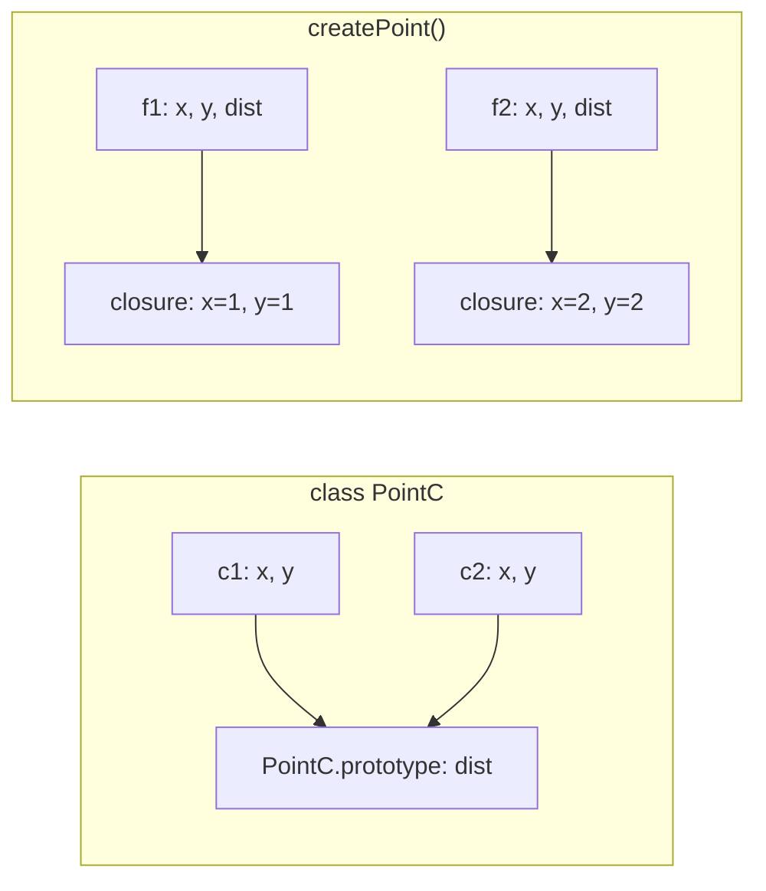

## Introduction

Any program beyond a toy needs many objects of the same kind: many users, many cart lines, many timers. Writing each as an object literal would repeat the same shape and the same methods everywhere, so you write the recipe once and call it. JavaScript has three recipes:

- a **constructor function**, called with `new` — the original, pre-2015 way;
- a **class**, also called with `new` — syntax added in ES2015 over the same machinery;
- a **factory function** — any ordinary function that builds an object and returns it, called without `new`.

All three produce working objects, and for a small example the results look identical. They differ in things you only notice later: how much memory ten thousand instances use, whether a method survives being passed as a callback, whether data can be truly hidden, whether `instanceof` works, and what happens when someone calls the recipe the wrong way. "Class or factory function — which and why?" is a standard interview question precisely because a good answer shows you understand prototypes, closures and `this` together.

This lesson compares the three. It does not re-teach each one: constructor functions are in [[b1-constructor-functions]], classes in [[b1-classes]], and closure-based private state in [[b1-private-state]].

## Before you start

- **Classes** — `constructor`, methods on the prototype, `#private` fields. See [[b1-classes]].
- **Constructor functions and `new`** — the four steps `new` performs. See [[b1-constructor-functions]] and [[b1-new-operator]].
- **Closures** — an inner function keeps access to the variables of the call that created it. See [[b1-closures]].
- **How `this` is set** — by the call, not by where the function was written. See [[b1-this]].

Code was run on Node.js 22.

## The intuition

Picture two ways of equipping a team of ten surveyors.

In the first, the office keeps **one shared instruction manual** on a shelf. Each surveyor carries only their own notebook of measurements, and when they need a procedure they look it up in the shared manual, applying it to *their* notebook. Ten surveyors, one manual. This is the prototype approach, used by constructor functions and classes: each object holds its own data, and the methods live once on a shared prototype and receive the object as `this`.

In the second, each surveyor is handed a **personal sealed kit**: tools pre-wired to their own measurements. Nobody else can open the kit, and a tool taken out of it still works on its owner's data without being told whose it is. Ten surveyors, ten kits. This is the closure-based factory: each call creates fresh functions that remember that call's private variables.

Shared manual: cheap, uniform, but each procedure must be told whose notebook to use. Sealed kit: private and self-contained, but you pay for a kit per person.

## The same type, three ways

Here is a two-dimensional point with a method that returns its distance from the origin, written each way.

```javascript
// 1. Constructor function: `new` creates the object, the function fills it in.
function PointF(x, y) {
  this.x = x;
  this.y = y;
}
PointF.prototype.dist = function () {
  return Math.hypot(this.x, this.y);
};

// 2. Class: the same thing in dedicated syntax.
class PointC {
  constructor(x, y) {
    this.x = x;
    this.y = y;
  }
  dist() {
    return Math.hypot(this.x, this.y);
  }
}

// 3. Factory function: builds and returns an object itself. No `new`, no `this`.
function createPoint(x, y) {
  const dist = () => Math.hypot(x, y);
  return { x, y, dist };
}

const a = new PointF(3, 4);
const b = new PointC(3, 4);
const c = createPoint(3, 4);

console.log(a.dist(), b.dist(), c.dist());
```

```output
5 5 5
```

The first two are nearly the same thing. A class declaration creates a function (`typeof PointC` is `'function'`) with a `prototype` object holding `dist`, exactly as the hand-written version does; `new` then creates an object linked to that prototype and runs the constructor body with `this` set to it. The class adds safety rules on top, covered below.

The factory is different in kind. No prototype is involved: `createPoint` makes a plain object literal whose prototype is `Object.prototype`. Its `dist` does not read `this.x`; it reads the *parameters* `x` and `y` of the call that created it, through a closure.

## What each call creates

The difference becomes visible when you inspect two objects from each recipe.

```javascript
class PointC {
  constructor(x, y) { this.x = x; this.y = y; }
  dist() { return Math.hypot(this.x, this.y); }
}

function createPoint(x, y) {
  const dist = () => Math.hypot(x, y);
  return { x, y, dist };
}

const c1 = new PointC(1, 1);
const c2 = new PointC(2, 2);
const f1 = createPoint(1, 1);
const f2 = createPoint(2, 2);

console.log(c1.dist === c2.dist, Object.keys(c1));
console.log(f1.dist === f2.dist, Object.keys(f1));
```

```output
true [ 'x', 'y' ]
false [ 'x', 'y', 'dist' ]
```

Both class instances find the **same** function object by walking to `PointC.prototype`; the instances own only `x` and `y`. Each factory object owns its **own** `dist` function, created afresh on every call, as an ordinary enumerable property.



That one structural fact — one shared function reached through the prototype, versus one function per object reaching private variables — explains almost every row of the comparison that follows.

> [!NOTE] A subtle difference in this example
> The factory's `dist` reads the closed-over parameters, not the object's properties. After `c.x = 30`, `c.dist()` still returns `5`, because the property `c.x` and the variable `x` are separate storage. The class version would use the new value. If a factory exposes data as public properties *and* computes from closure variables, the two can drift apart; pick one home for each piece of state.

## The differences that matter

### Memory and creation cost

A class with ten methods creates those ten functions once. Ten thousand instances cost ten thousand small objects plus ten functions. A closure-based factory with ten methods creates ten new function objects, plus a scope record holding the captured variables, on every call: ten thousand objects cost a hundred thousand function objects.

Two clarifications keep this in proportion. The engine does not copy the *code* of each closure — all of them share one compiled body and each closure is a small object pointing at that code and at its scope. And for the number of objects most applications create (a few stores, services and components), the difference is far too small to measure. It becomes real when you create objects in bulk: rows of a large table, particles, nodes of a big tree, items parsed from a large file. The measurement technique and closure retention are covered in [[b1-closure-memory]].

A factory does not have to pay this cost. Closures are one way to write a factory; delegating to a shared object is another, shown later.

### Privacy

In a factory, any variable you do not return is private, with no syntax beyond declaring it. Classes gained an enforced equivalent in ES2022: `#private` fields.

```javascript
function createCounter() {
  let count = 0;                         // private: never returned
  return {
    increment() { return ++count; },
  };
}

class Counter {
  #count = 0;                            // private: only the class body can name it
  increment() { return ++this.#count; }
}

const f = createCounter();
const c = new Counter();
f.increment();
c.increment();

console.log(f.count, c.count, Object.keys(f), Object.keys(c));
```

```output
undefined undefined [ 'increment' ] []
```

Both hide `count` completely at run time. Before 2022 this was the factory's strongest argument, and it is why so much older code and so many libraries use the pattern. Today the two are equal in strength and differ in detail: private fields keep methods shared on the prototype and allow one instance to read another instance's private state (useful for `equals(other)`); closure variables are per call and inaccessible even to sibling objects from the same factory. The full comparison is in [[b1-private-state]] and [[b1-public-private-fields]].

A plain constructor function has neither; it can only get privacy by defining closure methods inside the constructor body, which makes it a factory in disguise.

### Losing `this`

A prototype method depends on being called *on* its object. Detach it — pass it as a callback, destructure it — and `this` is no longer the instance. A closure method that never mentions `this` cannot break this way.

```javascript
class ClassCounter {
  count = 0;
  increment() { this.count += 1; return this.count; }
}

function createCounter() {
  let count = 0;
  return { increment: () => ++count };
}

const viaFactory = createCounter().increment;
console.log(viaFactory(), viaFactory());

const viaClass = new ClassCounter().increment;
try {
  viaClass();
} catch (e) {
  console.log(e.constructor.name, '-', e.message);
}
```

```output
1 2
TypeError - Cannot read properties of undefined (reading 'count')
```

This is the most common practical bug with classes: `button.addEventListener('click', counter.increment)` or `promise.then(api.handle)` passes the bare function. The fixes — `bind` in the constructor, an arrow function stored in a class field, or wrapping the call in an arrow — are in [[b1-this-lost]]. Note what the class-field fix does: `increment = () => { ... }` creates one function per instance, which is the factory's memory profile with class syntax. There is no free option; you choose between sharing and self-containment per method.

The safety applies to factories written with closures. A factory whose returned object uses `this` in its methods has the same hazard as a class.

### `instanceof` and identity

Objects made with `new` are linked to their constructor's prototype, so they can be recognised. Factory objects are, as far as the language can tell, anonymous plain objects.

```javascript
class PointC {
  constructor(x, y) { this.x = x; this.y = y; }
}
const createPoint = (x, y) => ({ x, y });

const c = new PointC(1, 2);
const f = createPoint(1, 2);

console.log(c instanceof PointC, c.constructor.name);
console.log(f instanceof Object, f.constructor.name);
console.log(c, f);
```

```output
true PointC
true Object
PointC { x: 1, y: 2 } { x: 1, y: 2 }
```

Three consequences follow. `instanceof` checks, which error handling relies on (`err instanceof ValidationError`, see [[b1-custom-errors]]), need a class or constructor function. Debugging is easier with named instances: the console, heap snapshots and stack traces show `PointC` instead of `Object`. And TypeScript can use a class as both a value and a type, where a factory needs a separately declared interface.

When a factory's objects must be recognisable, the usual answers are a discriminating property (`{ kind: 'point', ... }`), checking for the methods you need (duck typing, in [[b1-js-oop-principles]]), or a private `WeakSet` of everything the factory has made. Keep in mind that `instanceof` is itself unreliable across iframes and duplicated packages ([[b1-instanceof]]), so a property-based check is sometimes the better tool anyway.

### Forgetting or adding `new`

The three recipes react differently to being called the wrong way.

```javascript
function PointF(x, y) {
  'use strict';
  this.x = x;
  this.y = y;
}

class PointC {
  constructor(x, y) { this.x = x; this.y = y; }
}

const createPoint = (x, y) => ({ x, y });

for (const attempt of [() => PointF(1, 2), () => PointC(1, 2), () => new createPoint(1, 2)]) {
  try {
    attempt();
    console.log('no error');
  } catch (e) {
    console.log(e.message);
  }
}
```

```output
Cannot set properties of undefined (setting 'x')
Class constructor PointC cannot be invoked without 'new'
createPoint is not a constructor
```

- A **constructor function** without `new` is an ordinary call. In strict mode `this` is `undefined` and the first assignment throws a confusing error; in non-strict code `this` is the global object, so the call silently creates global variables `x` and `y` and returns `undefined`. This hazard is the main reason classes replaced the pattern.
- A **class** refuses, with a clear message.
- A **factory** has no `new` to forget. Calling one with `new` by mistake is usually harmless: an arrow function throws as above, and a regular function that returns an object has that object replace the one `new` created ([[b1-new-operator]]).

Inside a function, `new.target` reports how it was called: it is the constructor when the call used `new`, and `undefined` otherwise. A constructor function can use it to guard itself (`if (!new.target) return new PointF(x, y);`); in a factory called normally it is always `undefined`.

Since the calling convention is invisible at the call site, follow the naming convention strictly: `PascalCase` for things that need `new`, and `camelCase` with a verb — `createPoint`, `makeStore` — for factories. Never offer both for one type.

### Inheritance and extension

Classes have `extends` and `super`, including the ability to extend built-ins such as `Error` and `HTMLElement` ([[b1-class-inheritance]]). Constructor functions can do the same with manual prototype wiring that is easy to get wrong. Factories have no inheritance mechanism; they extend by **composition** — calling another factory and spreading or wrapping its result:

```javascript
const createPoint = (x, y) => ({ x, y, dist: () => Math.hypot(x, y) });

const createLabelledPoint = (x, y, label) => ({
  ...createPoint(x, y),
  describe() { return `${label} at distance ${this.dist()}`; },
});

console.log(createLabelledPoint(6, 8, 'depot').describe());
```

```output
depot at distance 10
```

If the design calls for a type hierarchy or a platform base class, use a class. If it calls for mixing independent capabilities, factories and composition are the natural fit; that design question is the subject of [[b1-js-oop-principles]].

### Summary table

| | Constructor function | Class | Factory (closures) |
|---|---|---|---|
| Called with | `new F()` | `new C()` | `create()` |
| Without `new` | Silent bug or obscure error | Clear `TypeError` | Not applicable |
| Methods live | Once, on `F.prototype` | Once, on `C.prototype` | Per object |
| Methods enumerable | Yes, unless defined with a descriptor | No | Yes (own properties) |
| True privacy | No | `#private` (ES2022) | Closure variables |
| Detached method keeps working | No | No | Yes |
| `instanceof` / named instances | Yes | Yes | No |
| Inheritance | Manual prototype wiring | `extends`, `super`, built-ins | Composition only |
| Can return a different or cached object | Awkward | Awkward | Natural |
| Body is strict mode | Only if the file is | Always | Only if the file is |
| Hoisting | Function is hoisted | Temporal dead zone | Function is hoisted |

## Factories that share methods

"Factories duplicate methods" is true of closure-based factories only. A factory can link its objects to a shared prototype with `Object.create` and get the class memory profile, without `new`:

```javascript
const pointMethods = {
  dist() { return Math.hypot(this.x, this.y); },
  scale(k) { return createPoint(this.x * k, this.y * k); },
};

function createPoint(x, y) {
  const point = Object.create(pointMethods);    // new object delegating to pointMethods
  point.x = x;
  point.y = y;
  return point;
}

const p = createPoint(3, 4);
const q = createPoint(1, 1);

console.log(p.scale(2).dist(), p.dist === q.dist, pointMethods.isPrototypeOf(p));
```

```output
10 true true
```

This is, step for step, what `new` does for a class: create an object whose prototype is the shared method holder, then initialise it ([[b1-object-create]]). And it brings back the class's properties with it — methods use `this`, so they can be detached and broken, and state is public. `isPrototypeOf` stands in for `instanceof`.

So the real choice is not between two keywords but between two **mechanisms**: delegation to a shared prototype (cheap, `this`-based, public or `#private` state) and closures (per-object functions, `this`-free, private by default). A class commits you to the first, with the option of per-instance arrow fields. A factory lets you use either.

## What only a factory can do

A constructor is bound by what `new` does: it always creates a fresh object of exactly that class, synchronously. A factory is an ordinary function, so it can decide what to return.

```javascript
const cache = new Map();

function createColour(hex) {
  const key = hex.toLowerCase();
  if (!cache.has(key)) {
    cache.set(key, Object.freeze({ hex: key, isDark: parseInt(key.slice(1, 3), 16) < 128 }));
  }
  return cache.get(key);                        // same object for equal input
}

function createShape(spec) {                    // picks the shape of the result
  return 'r' in spec
    ? { kind: 'circle', area: () => Math.PI * spec.r ** 2 }
    : { kind: 'rect', area: () => spec.w * spec.h };
}

console.log(createColour('#0A0A0A') === createColour('#0a0a0a'));
console.log(createShape({ r: 1 }).kind, createShape({ w: 2, h: 3 }).area());
```

```output
true
circle 6
```

Returning a cached instance, choosing between implementations, returning `null` for invalid input, or being `async` and returning a promise of the object are all natural for a factory. A constructor cannot be `async`, and although it may return a different object, doing so surprises readers.

Classes handle these cases with **static factory methods** — `User.fromJSON(data)`, `Connection.open(url)`, `Array.from(iterable)` — which are factory functions attached to the class ([[b1-instance-static]]). That combination is common and idiomatic: a class for the instances, a named static factory for each way of obtaining one. The two approaches are not rivals so much as tools used together.

## How it works internally

When a class or constructor function is called with `new`, the engine allocates an object whose internal `[[Prototype]]` is the function's `prototype` property, runs the body with `this` bound to it, and returns it. Methods are found later by the property lookup that walks the prototype chain ([[b1-property-lookup]]). The method functions exist once, created when the class definition was evaluated.

When a closure-based factory is called, the engine creates a new **environment record** for that call holding its parameters and local variables. Each function expression evaluated in the body produces a new function object whose hidden `[[Environment]]` slot points at that record. The returned object holds those functions as own properties; as long as the object is reachable, so are the functions, and through them the environment record — which is why the "private" variables stay alive after the factory returns ([[b1-lexical-environment]]).

Engines optimise both. Objects created by the same constructor in the same way share a hidden class (shape), which makes property access fast; object literals returned from the same place in a factory also share a shape, as long as properties are added in the same order ([[b1-hidden-classes]]). Calls to a prototype method from one call site see one function and inline well. Calls to per-object closures see a different function object each time, though sharing one code body, which optimising compilers handle but with somewhat more work. In practice, speed of method *calls* rarely separates the two; allocation volume when creating very many objects is the measurable difference.

## Worked example: one rate limiter, two designs

A **rate limiter** allows at most `limit` actions per time window. The requirement: `tryAcquire()` returns `true` if the action is allowed. It must be testable without real waiting, so the clock is passed in.

```javascript title="rate-limiter.js"
// Design A: closure-based factory.
function createRateLimiter({ limit, windowMs, now = Date.now }) {
  let windowStart = now();
  let used = 0;

  function tryAcquire() {
    if (now() - windowStart >= windowMs) {
      windowStart = now();
      used = 0;
    }
    if (used >= limit) return false;
    used += 1;
    return true;
  }

  return { tryAcquire, remaining: () => limit - used };
}

// Design B: class with private fields.
class RateLimiter {
  #limit; #windowMs; #now; #windowStart; #used = 0;

  constructor({ limit, windowMs, now = Date.now }) {
    this.#limit = limit;
    this.#windowMs = windowMs;
    this.#now = now;
    this.#windowStart = now();
  }

  tryAcquire() {
    if (this.#now() - this.#windowStart >= this.#windowMs) {
      this.#windowStart = this.#now();
      this.#used = 0;
    }
    if (this.#used >= this.#limit) return false;
    this.#used += 1;
    return true;
  }

  get remaining() { return this.#limit - this.#used; }
}

// A fake clock makes the test deterministic.
let time = 0;
const now = () => time;

const a = createRateLimiter({ limit: 2, windowMs: 1000, now });
const b = new RateLimiter({ limit: 2, windowMs: 1000, now });

const calls = ['A', 'B'].map((name) => {
  const limiter = name === 'A' ? a : b;
  time = 0;
  const first = [limiter.tryAcquire(), limiter.tryAcquire(), limiter.tryAcquire()];
  time = 1000;
  return `${name}: ${first.join(' ')} | after window: ${limiter.tryAcquire()}`;
});
console.log(calls.join('\n'));

// The difference shows when the method is handed to other code.
const guard = (allow, action) => (allow() ? action() : 'rejected');

time = 5000;
console.log(guard(a.tryAcquire, () => 'sent'));
try {
  guard(b.tryAcquire, () => 'sent');
} catch (e) {
  console.log(e.message);
}
console.log(guard(() => b.tryAcquire(), () => 'sent'), b instanceof RateLimiter);
```

```output
A: true true false | after window: true
B: true true false | after window: true
sent
Cannot read properties of undefined (reading '#now')
sent true
```

Dry run of design A with `limit = 2`: at time 0 the first two calls find `used` at 0 and 1, increment it, and return `true`; the third finds `used >= limit` and returns `false`. At time 1000, `now() - windowStart` is `1000 >= 1000`, so the window resets and the call succeeds. Design B produces the same four results; the two are behaviourally equivalent through their public interfaces.

They diverge at `guard(b.tryAcquire, ...)`. The detached class method runs with `this` as `undefined`, and the first private access, `this.#now`, throws a `TypeError` (the message shown is Node 22's; other engines word it differently). The factory's `tryAcquire` has no `this` to lose. The class works again when wrapped in an arrow function, and it alone answers `instanceof`.

Which is better here? A rate limiter is typically created a handful of times, has state that must not be tampered with, and its `tryAcquire` is exactly the sort of function that gets passed into middleware. That profile favours the factory. If the application created one limiter per connected user across a hundred thousand connections, or the team's codebase were class-based with dependency injection keyed on classes, design B would be the reasonable choice — with `tryAcquire` bound or called through an arrow.

## In real systems

**Classes dominate where the platform or framework asks for them.** Custom elements must extend `HTMLElement`. Errors extend `Error`. Angular and NestJS are built on classes and decorators; ORMs such as TypeORM model entities as classes. Class instances also suit bulk data — AST nodes in compilers, entities in games — where shared methods and stable shapes matter.

**Factories dominate in library APIs and modern React.** `createStore` and `configureStore` in Redux, `createRouter` in Vue Router, `createClient` in many SDKs, `express()` itself: each returns an object whose internals are hidden in closures. React moved from class components to function components and hooks, where state lives in closures managed by the framework ([[b1-closures-react]]). Vue's Composition API and Svelte stores follow the same style.

**Constructor functions** survive in older code, in polyfills, and in the language itself — `Date`, `Promise` and `Map` are constructor functions in the specification's terms. You need to read them fluently, and to recognise transpiled classes, which look like them. For new code they offer nothing a class does not.

**Mixed use is normal.** A codebase commonly has classes for domain entities and errors, factories for services and configuration-driven objects, and static factory methods on classes for alternative construction.

## Trade-offs and alternatives

Choose a **class** when you need `instanceof` or a nominal identity, inheritance from a platform or framework base class, very many instances, tooling that expects classes (decorators, dependency-injection containers), or when the team reads class syntax most easily. Accept that methods are `this`-dependent and plan for it.

Choose a **factory** when the object is created rarely and passed around freely, when its methods are routinely used as callbacks, when construction needs logic (caching, choosing an implementation, asynchronous setup), when you are composing capabilities, or when the result is a simple immutable record that needs no methods at all.

Choose a **constructor function** only to match existing code.

Two alternatives sit outside this comparison. For a single shared instance, an ES module is already a singleton with private scope — no class or factory is needed ([[b1-modules]]). And for plain data, an object literal plus standalone functions (`dist(point)`) avoids the question entirely and serialises trivially; this data-oriented style is common in Redux reducers and functional code ([[b1-functional-style]]).

Whichever you choose, be consistent within one type and document the calling convention. A module in which some objects need `new` and similar ones must not have it is a reliable source of bugs.

## Common mistakes

**Assuming factories always waste memory, or that it always matters.** Only closure-based factories create per-object functions, and the cost is negligible until instances number in the many thousands. Measure before rewriting.

**Using `this` inside a factory's returned methods and then advertising them as callback-safe.** `return { inc() { this.count++ } }` has the same detachment bug as a class. Close over variables instead, or accept the `this` contract.

**Fixing lost `this` by turning every class method into an arrow field.** It works, but each instance now carries its own copy of every method, such methods are not on the prototype (so `super.method()` and prototype-level mocking do not see them), and you have the costs of both designs. Use it for the handlers that are passed around, not for everything.

**Expecting `instanceof` to work on factory output.** `createPoint(1, 2) instanceof createPoint` is `false`; the factory's `prototype` was never linked to anything.

**Exposing state twice.** A factory that returns `{ x, y, dist }` where `dist` closes over the parameters has two copies of the truth. Either compute from the object's properties or keep the data private and expose getters.

> [!MISTAKE] Calling a pre-ES2015 constructor function without `new`
> In non-strict code, `const p = PointF(1, 2)` returns `undefined` and writes `x` and `y` onto the global object, with no error until `p.dist()` fails later. Classes throw immediately; ES modules and class bodies are strict, which at least turns the silent corruption into a `TypeError`. When maintaining old constructor functions, add a `new.target` guard or convert them to classes.

## Interview perspective

The question usually arrives as "What is the difference between a class and a factory function?" or "Which would you use?". Interviewers are checking that you know *where the methods live* and what follows from it, and that you can give a balanced recommendation instead of a slogan.

> [!INTERVIEW] A complete short answer
> "A class is a constructor called with `new`; instances share methods through the prototype, support `instanceof` and `extends`, and get privacy from `#private` fields. A factory is a plain function that returns an object, usually with methods that close over local variables — so state is private by default and methods never lose `this`, but each object gets its own function copies and there is no `instanceof`. I use classes for many instances, hierarchies and platform base classes, and factories for a few long-lived objects whose methods get passed around or whose construction needs logic."

Follow-ups to be ready for:

- **"Is `class` only syntactic sugar?"** Mostly: it creates a function and a prototype. But it adds real differences — must be called with `new`, strict body, non-enumerable methods, temporal dead zone, `super`, and private names, which have no equivalent in constructor functions ([[b1-classes]]).
- **"How would you get privacy in each?"** `#fields` in classes; closure variables in factories; neither natively in prototype-based constructor functions.
- **"Can a factory share methods?"** Yes, with `Object.create(sharedMethods)`; it then behaves like a class with respect to `this`.
- **"What does `new` do, and what if the function returns an object?"** Four steps; an explicitly returned object replaces the new one ([[b1-new-operator]]).
- **"What is `new.target`?"** The constructor that `new` was applied to, or `undefined` in a plain call; used to guard constructors and to detect abstract-class instantiation.
- **"Why did React move from classes to functions?"** Lost `this` in handlers, logic reuse through hooks instead of inheritance or higher-order components, and simpler composition. State the reasons without claiming classes are wrong in general.

A typical coding task is to convert one form to another — "rewrite this class as a factory with private state", or the reverse — and then to say what changed for the caller. Mention `new`, `instanceof`, detached methods and memory.

## Practice

1. **Three ways.** Implement a `Stopwatch` with `start()`, `stop()` and `elapsed` as a constructor function, a class and a closure-based factory. For each, show whether `const { start } = stopwatch; start();` works and explain why.
2. **Count the functions.** For a class and a closure factory with three methods each, create 1,000 objects and use a `Set` of the method references to count the distinct function objects in each case. Predict the two numbers first.
3. **Share without `new`.** Rewrite the closure factory from exercise 1 using `Object.create` and a shared methods object. List what you gained and what you lost.
4. **Guard the constructor.** Add a `new.target` check to a constructor function so that calling it without `new` still returns a correct instance. Then explain why a class does not need this.
5. **Recognisable factory objects.** Give `createPoint` an `isPoint(value)` companion that returns `true` only for objects the factory made, without adding any visible property to them. (Hint: `WeakSet`.)
6. **Decide.** For each, choose class or factory and give one sentence of reasoning: a custom `HttpError`; a debounced search function with internal timer state; 200,000 `Vector` objects in a physics simulation; an API client configured once at start-up.

```quiz
Q: A closure-based factory `createUser(name)` returns `{ getName: () => name }`. A class `User` stores `#name` and has a `getName()` method. You create 10,000 of each. Which statement is correct?
- [ ] Both create 10,000 `getName` function objects
- [ ] Both create exactly one `getName` function object
- [x] The factory creates 10,000 `getName` function objects; the class creates one, shared through `User.prototype`
- [ ] The class creates 10,000 because private fields force per-instance methods
> Each factory call evaluates the arrow function expression again, producing a new function object bound to that call's `name`. A class method is created once, when the class is defined, and every instance reaches it through the prototype. Private fields are per-instance data and do not change where methods live.
```

```quiz
Q: `const run = job.run; run();` throws for one implementation of `job` and works for another. Which implementation works?
- [ ] A class whose `run()` method reads `this.#queue`
- [ ] A constructor function with `run` on its prototype reading `this.queue`
- [x] A factory whose `run` is a function closing over a local `queue` variable
- [ ] A factory using `Object.create(methods)` where `methods.run` reads `this.queue`
> A detached function is called with `this` as `undefined` (in strict code), so anything that reads state through `this` fails. Only the closure version never consults `this`; it reaches `queue` through its lexical scope. Note that being a factory is not enough — the `Object.create` version is `this`-based and breaks like a class.
```

## Quick revision {#quick-revision}

- Three recipes: **constructor function** (`new F()`), **class** (`new C()`, same machinery plus safety), **factory** (plain function returning an object).
- Constructor functions and classes put methods **once on the prototype**; instances hold only data. Closure factories create **new function objects per call** as own properties.
- **Memory**: per-object closures cost more only at scale (thousands of instances). The code body is shared; the function objects and scope records are not.
- **Privacy**: closure variables (factory) and `#private` fields (class) are both enforced at run time. Constructor functions have none.
- **`this`**: prototype methods break when detached; closure methods that avoid `this` do not. Arrow-function class fields trade sharing for safety.
- **Identity**: `instanceof`, `constructor.name` and named console output need `new`. Factory objects are plain objects; use a `kind` property, duck typing or a `WeakSet`.
- **Wrong call**: constructor function without `new` fails silently or obscurely; class throws a clear `TypeError`; factories have no `new`. `new.target` is `undefined` in a plain call.
- **Extension**: classes use `extends`/`super` and can extend built-ins; factories compose by calling other factories.
- A factory can share methods with `Object.create(methods)` — then it behaves like a class regarding `this`.
- Only a factory can naturally return a cached object, a different shape, `null` or a promise; classes cover this with static factory methods.
- Naming: `PascalCase` requires `new`; `createThing` does not. Do not mix conventions for one type.

## Key takeaways {#key-takeaways}

- The real difference is the mechanism: delegation to a shared prototype versus closures over per-call variables. Almost every other difference follows from it.
- Classes give shared methods, identity, inheritance and enforced privacy through `#fields`, at the price of `this`-dependent methods.
- Closure-based factories give privacy by default and methods that are safe to pass around, at the price of per-object functions and no `instanceof`.
- Constructor functions are the legacy form of classes: understand them to read old and transpiled code, but prefer classes in new code.
- Choose by requirement — number of instances, need for identity or inheritance, how methods are used, how construction happens — and keep one convention per type.
- The approaches combine well: classes with static factory methods, and factories that compose small objects, both appear in good codebases.
