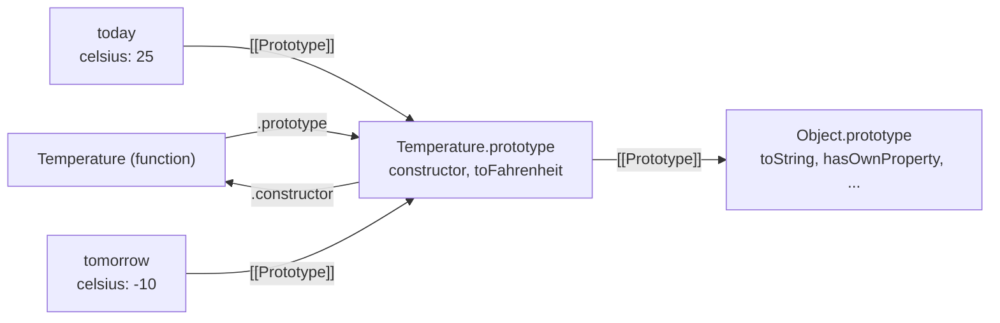

## Introduction

Most programs deal with many things of the same kind: users, shopping carts, invoices, timers, chess pieces. Each one has its own data — this cart has three items, that one has none — but they all support the same operations: add an item, remove one, compute the total. You want to write those operations once and let every cart use them, and you want a single place that describes how a new cart is set up.

A **class** is JavaScript's syntax for exactly that. It bundles three things into one declaration: how to initialise a new object (the **constructor**), the operations every object of that kind shares (its **methods**), and the data each object owns (its **fields**). You create objects from it with `new`:

```javascript
class Cart {
  items = [];

  add(name, price) {
    this.items.push({ name, price });
    return this;
  }

  total() {
    return this.items.reduce((sum, item) => sum + item.price, 0);
  }
}

const a = new Cart().add('pen', 2).add('book', 15);
const b = new Cart();

console.log(a.total(), b.total());
console.log(a.total === b.total);
```

```output
17 0
true
```

Each cart has its own `items` array, so `a` and `b` hold different data. But `a.total === b.total` is `true`: both carts use the *same* `total` function object. That sharing is the point of a class, and understanding *how* it happens is the difference between using classes and understanding them.

Here is the fact that surprises developers coming from Java, C# or Python: **JavaScript classes are not a separate kind of thing**. Since ES2015 (ES6), `class` is mostly a cleaner way to write something the language could already do — a constructor function whose `prototype` object holds the shared methods, with objects linked to that prototype. Later editions added features the old pattern could not express well, chiefly public and private fields and static blocks (ES2022). But the object model underneath is still the prototype model you met in [[b1-prototypes]].

You will see classes everywhere in professional JavaScript: the `Error`, `Map`, `Promise` and `URL` built-ins behave like classes; web components are written as `class extends HTMLElement`; Node.js streams and `EventEmitter` are classes; older React code uses class components; Angular and NestJS are built around classes; and domain models in TypeScript backends are usually classes. This lesson covers the class itself. Subclassing with `extends` and `super` is taught in [[b1-class-inheritance]], the design principles in [[b1-js-oop-principles]], and the choice between classes and factory functions in [[b1-classes-vs-factories]].

## Before you start

- **Objects and properties** — creating objects, reading and assigning properties, methods as properties that hold functions. See [[b1-object-literals]].
- **`this`** — `this` is decided by how a function is called, not where it is written. You need the implicit-binding rule (`obj.method()` sets `this` to `obj`) and the fact that a method passed as a callback loses it. See [[b1-this]] and [[b1-this-lost]].
- **Prototypes** — every object has a hidden link, `[[Prototype]]`, to another object, and property lookup follows that link when the object itself lacks the property. See [[b1-prototypes]] and [[b1-prototype-chain]].
- **Constructor functions and `new`** (helpful) — the pre-2015 way of making objects. This lesson shows the class version side by side, so you can follow without it. See [[b1-constructor-functions]] and [[b1-new-operator]].

All code runs as shown in Node.js 22 or a current browser console (Chrome, Firefox and Safari have supported every feature used here since 2022). Output is shown as Node prints it.

## The intuition

Think of a bakery that makes custom cakes. Every order produces a different cake — different size, different message on top — but all cakes are made by following the same recipe card, and all of them can be served using the same set of tools kept in one drawer by the counter. Nobody builds a new knife for every cake.

Map that onto a class:

- The **cake** is an instance: an object with its own data (`size`, `message`).
- The **recipe card** is the constructor: the steps that run once for each new cake to set up its data.
- The **drawer of tools** is the prototype: one shared object holding the methods. Every cake knows where the drawer is, and when you ask a cake to `slice()`, it goes to the drawer and uses the shared knife on itself.

The analogy matches one important behaviour: if the bakery replaces the knife in the drawer, every cake — including cakes made yesterday — now uses the new knife. In JavaScript, if you change a method on the prototype, every existing instance sees the change immediately, because instances do not hold copies of methods; they look them up.

Where the analogy stops: a cake is not "of type recipe" in any deep sense. A JavaScript object only has a link to its prototype, and that link can be changed or broken. A class does not stamp a permanent type onto an object the way a Java class does. That is why `instanceof` asks "is this prototype on the object's chain?" rather than "what type is this?" — see [[b1-instanceof]].

## Your first class, piece by piece

Here is a small but complete class. Read it once, then we will go through each part.

```javascript
class Temperature {
  constructor(celsius) {
    this.celsius = celsius;
  }

  toFahrenheit() {
    return this.celsius * 9 / 5 + 32;
  }

  describe() {
    return `${this.celsius}°C is ${this.toFahrenheit()}°F`;
  }
}

const today = new Temperature(25);
const tomorrow = new Temperature(-10);

console.log(today.describe());
console.log(tomorrow.describe());
console.log(today);
```

```output
25°C is 77°F
-10°C is 14°F
Temperature { celsius: 25 }
```

**`class Temperature { ... }`** is a **class declaration**. It creates a binding named `Temperature` in the current scope, like `let Temperature = ...` would. The braces hold the **class body**: a list of members, separated by nothing (no commas, unlike an object literal).

**`constructor(celsius) { ... }`** is the special method that runs once for every `new Temperature(...)`. Inside it, `this` is the brand-new object being created, and the constructor's job is to put that object into a valid starting state — here, by giving it a `celsius` property.

**`toFahrenheit()` and `describe()`** are **methods**. Notice they are written without the `function` keyword. Inside a method, `this` is whatever object the method was called on: in `today.describe()`, `this` is `today`. `describe` calls `this.toFahrenheit()`, which again uses `this` to reach the right object's data.

**`new Temperature(25)`** creates an object, runs the constructor with `celsius = 25`, and returns the object. Node prints it as `Temperature { celsius: 25 }`: the object's only *own* property is `celsius`. The methods do not appear, because they are not stored on the object. They live on the prototype.

## What a class really creates

Ask JavaScript what `Temperature` is:

```javascript
class Temperature {
  constructor(celsius) { this.celsius = celsius; }
  toFahrenheit() { return this.celsius * 9 / 5 + 32; }
}

const t = new Temperature(25);

console.log(typeof Temperature);
console.log(Object.getOwnPropertyNames(Temperature.prototype));
console.log(Object.getPrototypeOf(t) === Temperature.prototype);
console.log(Object.hasOwn(t, 'toFahrenheit'), 'toFahrenheit' in t);
console.log(Temperature.prototype.constructor === Temperature);
```

```output
function
[ 'constructor', 'toFahrenheit' ]
true
false true
true
```

Line by line, this shows the whole model:

1. `typeof Temperature` is `'function'`. A class *is* a function — specifically, the constructor function. The body of `constructor(...)` becomes that function's code.
2. Like every constructor function, it has a `prototype` property pointing at an ordinary object. The class's methods were installed on that object. It also has a `constructor` property pointing back at the class.
3. Every object created with `new Temperature(...)` gets its `[[Prototype]]` link set to `Temperature.prototype`.
4. `toFahrenheit` is **not** an own property of `t` (`Object.hasOwn` is `false`), but it is reachable (`in` is `true`), because property lookup walks from `t` to its prototype. The full lookup rules are in [[b1-property-lookup]].



This is the same structure you would build by hand with a constructor function:

```javascript
function TemperatureOld(celsius) {
  this.celsius = celsius;
}
TemperatureOld.prototype.toFahrenheit = function () {
  return this.celsius * 9 / 5 + 32;
};

console.log(new TemperatureOld(25).toFahrenheit());
```

```output
77
```

So why does the class syntax exist? Partly readability — the constructor and methods are grouped in one block — but the class version also behaves differently in several ways that remove whole categories of bugs:

| Behaviour | Constructor function | Class |
|---|---|---|
| Calling without `new` | Runs as a normal function; `this` is `undefined` (strict) or the global object (sloppy), so it fails or leaks globals | Throws `TypeError: Class constructor X cannot be invoked without 'new'` |
| Strict mode | Only if you opt in | The whole class body is always strict |
| Methods enumerable? | Yes, if assigned with `=` — they show up in `for...in` | No — methods are non-enumerable, like built-in methods |
| Hoisting | Function declaration is fully hoisted | Binding exists but is in the temporal dead zone until the declaration runs |
| Methods usable with `new`? | Yes (any `function` can be a constructor) | No — methods have no `prototype` and throw if called with `new` |
| Private state, static blocks | Not available (use closures) | `#private` members and `static { }` blocks (ES2022) |

Two rows deserve a demonstration. Forgetting `new` is caught loudly:

```javascript
class Point {
  constructor(x, y) { this.x = x; this.y = y; }
}

try {
  Point(1, 2);
} catch (e) {
  console.log(`${e.name}: ${e.message}`);
}
```

```output
TypeError: Class constructor Point cannot be invoked without 'new'
```

And class declarations are hoisted like `let`, not like `function`: using a class above its declaration throws a `ReferenceError`. That behaviour, and why it exists, is covered in [[b1-class-hoisting]] and [[b1-tdz]]. In practice it means you should declare a class before the code that uses it runs — which is what you would do anyway in a module.

> [!NOTE] "Syntactic sugar" is mostly, not entirely, true
> You will often read that classes are syntactic sugar over prototypes. For methods and the prototype chain that is accurate. It is not the whole story: the mandatory `new`, the `super` mechanics, private `#` names and field definition semantics are behaviours a hand-written constructor function cannot reproduce exactly. A better summary is "classes use the prototype model, with stricter and richer rules on top".

## constructor {#b1-class-constructor}

The **`constructor`** is the method inside a class body that runs once each time an object is created with `new`. Its job is to take the arguments given to `new` and put the fresh object into a valid starting state: assign its properties, check the arguments, and set up anything else the object needs before anyone uses it. A class can have at most one constructor, and if you do not write one, JavaScript supplies a default.

### What `new` does with a class

When you write `new Account('Ada', 100)` and `Account` is a class with no `extends`, the engine performs these steps:

1. Create a new, empty object.
2. Set its `[[Prototype]]` to `Account.prototype`, so the object can reach the class's methods.
3. Initialise the class's **fields** on that object (fields are covered under [[b1-public-private-fields]] below), in the order they appear in the class body.
4. Run the constructor body with `this` bound to the new object and the arguments `'Ada', 100`.
5. Return the new object — unless the constructor explicitly returned a different object.

Step 3 happening *before* step 4 is worth remembering: inside the constructor body, field initialisers have already run, so the constructor can read and adjust them. For a subclass the order is different — fields are initialised after `super()` returns — and [[b1-class-inheritance]] explains why. The general mechanics of `new` for any function are in [[b1-new-operator]]; the binding rule for `this` is [[b1-this-new]].

```javascript
class Account {
  balance = 0;            // field: runs before the constructor body
  history = [];

  constructor(owner, opening) {
    console.log('in constructor, balance is', this.balance);
    this.owner = owner;
    this.balance = opening;
    this.history.push(`open ${opening}`);
  }
}

const acc = new Account('Ada', 100);
console.log(acc);
```

```output
in constructor, balance is 0
Account { balance: 100, history: [ 'open 100' ], owner: 'Ada' }
```

Look at the property order in the printed object: `balance` and `history` come first because the fields created them before the constructor ran; `owner` comes last because the constructor added it. Property order rarely matters to your logic, but here it is a visible trace of the construction steps.

### The default constructor

If a class has no `constructor`, JavaScript behaves as if you had written an empty one: `constructor() {}` for a base class, and `constructor(...args) { super(...args); }` for a subclass, which forwards every argument to the parent. So this is perfectly valid and common:

```javascript
class Settings {
  theme = 'dark';
  fontSize = 14;
}

console.log(new Settings());
```

```output
Settings { theme: 'dark', fontSize: 14 }
```

When all the starting state is fixed, fields alone are enough. Write a constructor when the starting state depends on arguments or needs checking.

### Constructors should establish invariants

An **invariant** is a rule about an object's data that should be true for the object's whole life — "a percentage is between 0 and 100", "a date range's start is not after its end". The constructor is the one place every object passes through, so it is the right place to refuse bad input. If it throws, `new` throws, and no half-built object ever reaches the caller.

```javascript
class DateRange {
  constructor(start, end) {
    if (!(start instanceof Date) || !(end instanceof Date)) {
      throw new TypeError('start and end must be Date objects');
    }
    if (start > end) {
      throw new RangeError('start must not be after end');
    }
    this.start = start;
    this.end = end;
  }

  days() {
    return (this.end - this.start) / 86_400_000;
  }
}

console.log(new DateRange(new Date('2026-01-01'), new Date('2026-01-31')).days());

try {
  new DateRange(new Date('2026-02-01'), new Date('2026-01-01'));
} catch (e) {
  console.log(`${e.name}: ${e.message}`);
}
```

```output
30
RangeError: start must not be after end
```

Keep constructors focused on *setting up state*. A constructor that also fetches data, registers global listeners or starts timers is hard to test — you cannot create the object without triggering those effects — and a constructor cannot be `async`, so it cannot `await` anything. The usual pattern for asynchronous setup is a static factory method, shown under [[b1-instance-static]] below.

### One constructor, no overloading

Java lets you write several constructors with different parameter lists. JavaScript does not: a class body with two `constructor` methods is a `SyntaxError` ("A class may only have one constructor"), detected before any code runs. Arguments are not matched against parameter lists either — you can call any function with any number of arguments ([[b1-parameters]]).

To accept several input shapes, use one of three idioms. **Default parameters** cover optional values. An **options object** with destructuring covers many optional, named settings and stays readable at the call site. **Static factory methods** give each input shape its own descriptive name.

```javascript
class Color {
  constructor({ r = 0, g = 0, b = 0 } = {}) {
    this.r = r; this.g = g; this.b = b;
  }

  static fromHex(hex) {
    const n = Number.parseInt(hex.slice(1), 16);
    return new Color({ r: n >> 16, g: (n >> 8) & 255, b: n & 255 });
  }
}

console.log(new Color({ g: 255 }));
console.log(Color.fromHex('#ff8000'));
console.log(new Color());
```

```output
Color { r: 0, g: 255, b: 0 }
Color { r: 255, g: 128, b: 0 }
Color { r: 0, g: 0, b: 0 }
```

### Returning from a constructor

Normally a constructor has no `return` statement and `new` hands back the object it created. A base-class constructor *may* return something, with an odd rule inherited from constructor functions: if it returns an **object**, that object replaces the instance; if it returns a **primitive**, the return value is ignored.

```javascript
class Weird {
  constructor() {
    return { hijacked: true };
  }
}

class Ignored {
  constructor() {
    this.ok = true;
    return 42;
  }
}

const w = new Weird();
console.log(w, w instanceof Weird);
console.log(new Ignored());
```

```output
{ hijacked: true } false
Ignored { ok: true }
```

The replaced object is not linked to `Weird.prototype`, so it has none of the class's methods and fails `instanceof`. Libraries occasionally use this deliberately — returning a cached instance, or a `Proxy` wrapped around `this` — but in application code a constructor that returns an object is almost always a bug or a design that would be clearer as a factory function ([[b1-classes-vs-factories]]). In a subclass constructor, returning a primitive other than `undefined` throws a `TypeError` rather than being ignored.

### `new.target`

Inside a constructor, the special expression **`new.target`** refers to the class that `new` was actually applied to. In a base class it is usually the class itself; when a subclass is constructed it is the subclass, even while the parent constructor is running. Two practical uses follow: refusing direct construction of a class meant only as a parent (an "abstract" class), and creating related objects of the caller's own subclass. Both are shown in [[b1-class-inheritance]]. Called without `new`, `new.target` is `undefined` — but for classes that cannot happen, because calling a class without `new` already throws.

```quiz
Q: A class has a field `count = 0` and a constructor that does `console.log(this.count); this.count = 5;`. What happens when you run `new C()`?
- [ ] It logs `undefined`, because fields are added after the constructor finishes
- [x] It logs `0`, because in a base class fields are initialised before the constructor body runs
- [ ] It throws, because a constructor cannot read a field
- [ ] It logs `5`, because the constructor runs first
> For a class without `extends`, `new` creates the object, links its prototype, runs the field initialisers in order, and only then runs the constructor body. So `this.count` is already `0`. The order differs in subclasses, where fields are initialised right after `super()` returns.

Q: What does `new Weird()` return if `Weird`'s constructor ends with `return { a: 1 };`?
- [ ] A `Weird` instance with a property `a`
- [x] The plain object `{ a: 1 }`, which is not a `Weird` instance
- [ ] `undefined`
- [ ] A `TypeError`, because constructors cannot return
> Returning an object from a base-class constructor replaces the instance `new` created. The returned object is linked to `Object.prototype`, not `Weird.prototype`, so `instanceof Weird` is false. Returning a primitive would have been ignored instead.
```

## Instance vs Static Methods {#b1-instance-static}

Methods in a class body come in two kinds. An **instance method** is an operation you perform *on one object*: `cart.total()`, `date.getFullYear()`. It is stored on the class's prototype and works with `this`, the object it was called on. A **static method**, marked with the keyword `static`, is an operation that belongs to the class *as a whole*: `Array.isArray(x)`, `Number.parseFloat(s)`, `Promise.all(list)`. It is stored on the class (the constructor function) itself, and you call it through the class name, without any instance.

### Where each kind lives

```javascript
class User {
  constructor(id, name) {
    this.id = id;
    this.name = name;
  }

  label() {                       // instance method
    return `#${this.id} ${this.name}`;
  }

  static parse(text) {            // static method
    const [id, name] = text.split(':');
    return new User(Number(id), name);
  }
}

const u = User.parse('7:Grace');
console.log(u.label());
console.log(typeof u.parse, typeof User.label);
console.log(Object.hasOwn(User, 'parse'), Object.hasOwn(User.prototype, 'label'));
```

```output
#7 Grace
undefined undefined
true true
```

`User.parse` is a property of the `User` function object; `label` is a property of `User.prototype`. An instance's prototype chain goes `u → User.prototype → Object.prototype`, and `User` itself is not on it, so `u.parse` is `undefined`. Likewise `User.label` is `undefined`, because `label` lives one level down, on `User.prototype`.

```mermaid title="Static members live on the class; instance members on its prototype"
flowchart LR
    U["User (function)<br/>static parse"] -- ".prototype" --> P["User.prototype<br/>label"]
    I["u<br/>id, name"] -- "[[Prototype]]" --> P
```

### What `this` is in each

The rules for `this` do not change for classes; only the usual call sites differ. In `u.label()`, the object before the dot is `u`, so `this` is `u`. In `User.parse(text)`, the object before the dot is `User`, so **inside a static method `this` is the class** (or, as you will see, a subclass). That lets a static method call other statics with `this.otherStatic()` and create instances with `new this(...)`.

Because `this` comes from the call, both kinds can lose it when detached from their object:

```javascript
class Counter {
  static created = 0;
  static create() {
    this.created++;
    return new this();
  }
}

const make = Counter.create;
try {
  make();
} catch (e) {
  console.log(`${e.name}: ${e.message}`);
}
console.log(Counter.create() instanceof Counter, Counter.created);
```

```output
TypeError: Cannot read properties of undefined (reading 'created')
true 1
```

`make()` is a plain function call, so `this` is `undefined` (class bodies are strict), and `this.created` throws. This is the same "lost `this`" problem as with instance methods — see [[b1-this-lost]]. If you pass a static method as a callback, wrap it (`(s) => User.parse(s)`) or `bind` it.

### Static members are inherited

When a class extends another, the subclass constructor's own prototype is set to the parent constructor, so statics are found through the subclass too, and `this` in an inherited static is the subclass it was called on. That is why `new this()` in a static factory is more useful than `new User()`: it creates the right kind of object for whichever class called it.

```javascript
class Model {
  static create(props) {
    return Object.assign(new this(), props);
  }
}

class Product extends Model {}

const p = Product.create({ sku: 'A1' });
console.log(p, p instanceof Product);
```

```output
Product { sku: 'A1' }
true
```

### Static fields and static blocks

**Static fields** are data properties on the class itself, declared with `static name = value`. They hold information shared by the whole class — constants, counters, caches, configuration. A **static initialisation block**, `static { ... }` (ES2022), runs once when the class is defined and is the place for setup that needs more than one expression, such as building a lookup table or a `try`/`catch`. Inside it, `this` is the class.

```javascript
class HttpStatus {
  static OK = 200;
  static NOT_FOUND = 404;
  static #names = new Map();

  static {
    for (const [name, code] of Object.entries(this)) {
      this.#names.set(code, name);
    }
  }

  static nameOf(code) {
    return HttpStatus.#names.get(code) ?? 'UNKNOWN';
  }
}

console.log(HttpStatus.NOT_FOUND, HttpStatus.nameOf(200), HttpStatus.nameOf(500));
```

```output
404 OK UNKNOWN
```

`Object.entries(this)` lists only `OK` and `NOT_FOUND`: static fields are enumerable own properties of the class, while the static method `nameOf` (non-enumerable, like all methods) and the private `#names` are not included.

> [!WARNING] Static fields and subclasses share by lookup, not by copy
> A subclass does not get its own copy of a parent's static field; it reads the parent's through the prototype link. But *assigning* through the subclass creates a new own property on the subclass, which then hides the parent's. So `this.count++` inside an inherited static or in `this.constructor.count++` can silently split one counter into two. If you mean "one value for the whole hierarchy", name the class explicitly: `Model.count++`.

```javascript
class Base {
  static count = 0;
  constructor() { this.constructor.count++; }
}
class Child extends Base {}

new Base(); new Child(); new Child();
console.log(Base.count, Child.count, Object.hasOwn(Child, 'count'));
```

```output
1 3 true
```

The first `new Child()` read `Child.count` (found on `Base`, value `1`), added one, and *assigned* `2` to `Child.count` — creating an own property. From then on `Child` had its own counter.

### Choosing between static and instance

Use an **instance method** when the operation needs one particular object's data. Use a **static method** when it does not: creating instances in a named way (`Color.fromHex`, `User.parse`), validating or comparing values (`Money.compare(a, b)`), or exposing class-wide utilities. A common smell is a static method whose first parameter is always an instance of the same class — `Cart.total(cart)` — which should be an instance method, `cart.total()`.

The **static async factory** deserves special mention, because constructors cannot be `async`. When creating an object needs I/O, do the asynchronous work in a static method and pass the results to a plain constructor:

```javascript
class Report {
  constructor(rows) {
    this.rows = rows;
  }

  static async load(fetchRows) {
    const rows = await fetchRows();
    return new Report(rows);
  }
}

const fakeFetch = async () => [{ id: 1 }, { id: 2 }];
Report.load(fakeFetch).then((r) => console.log(r.rows.length));
```

```output
2
```

The constructor stays synchronous and easy to test with in-memory data, and callers write `await Report.load(...)`.

## Public / Private Fields {#b1-public-private-fields}

A **field** is a property declared directly in the class body, such as `count = 0`, and created on every instance as part of construction. A **public field** becomes an ordinary own property of the object, visible to any code. A **private field**, whose name starts with `#` (as in `#count = 0`), can be read and written only by code written inside the class body; to everything else it is invisible and unreachable. Both were standardised in ES2022 and are supported by all current browsers and Node.js 12+ (private methods from Node.js 14.6).

### Public fields

A public field declaration does the same job as an assignment in the constructor, but declares the object's shape up front where readers can see it:

```javascript
class Timer {
  startedAt = Date.now();     // runs per instance, at construction time
  laps = [];                  // each Timer gets its own new array
  label;                      // declared with no initialiser: value undefined

  lap() {
    this.laps.push(Date.now() - this.startedAt);
  }
}

const t1 = new Timer();
const t2 = new Timer();
console.log(t1.laps === t2.laps, Object.keys(t1));
```

```output
false [ 'startedAt', 'laps', 'label' ]
```

Three details matter here. First, the initialiser expression is evaluated **separately for each instance**, so `laps = []` gives every timer its own array — unlike putting an array on the prototype, which all instances would share. Second, inside an initialiser `this` is the instance being built, so a field can depend on earlier fields (`area = this.width * this.height`), in top-to-bottom order. Third, a field with no initialiser still creates the property, with value `undefined`.

There is one subtle difference from `this.x = value` in a constructor. A field **defines** the property directly on the instance, the way `Object.defineProperty` does ([[b1-define-property]]); it does not perform an assignment. Assignment would trigger a setter inherited from a parent class, whereas definition bypasses it:

```javascript
class Base {
  set mode(value) { console.log('setter called with', value); }
}

class ByField extends Base {
  mode = 'fast';                         // defines an own property
}

class ByAssignment extends Base {
  constructor() { super(); this.mode = 'fast'; }   // runs the inherited setter
}

console.log(Object.keys(new ByField()));
console.log(Object.keys(new ByAssignment()));
```

```output
[ 'mode' ]
setter called with fast
[]
```

This "define, not set" rule was a deliberate decision when fields were standardised, and it is one of the places where TypeScript's older compilation setting (`useDefineForClassFields: false`) behaved differently from the standard. TypeScript now defaults to the standard behaviour when targeting ES2022 or later.

### Private fields

Prefixing a name with `#` makes it private. The `#` is part of the name — `#balance` and `balance` are different members — and a private name must be declared in the class body before methods can use it.

```javascript
class BankAccount {
  #balance = 0;

  deposit(amount) {
    if (amount <= 0) throw new RangeError('deposit must be positive');
    this.#balance += amount;
    return this;
  }

  get balance() {
    return this.#balance;
  }
}

const acct = new BankAccount().deposit(50);
console.log(acct.balance);
console.log(acct, Object.keys(acct), JSON.stringify(acct));
console.log(acct['#balance']);
acct.balance = 1_000_000;
console.log(acct.balance);
```

```output
50
BankAccount {} [] {}
undefined
50
```

From outside, `#balance` simply does not exist. It does not appear in `console.log` output, `Object.keys`, `JSON.stringify` or spread, and the string key `'#balance'` is an unrelated, missing property. The only way to change the balance is `deposit`, which enforces the invariant that deposits are positive. The getter `balance` exposes a read-only view; assigning to `acct.balance` does nothing because there is no setter. (In strict-mode code, including modules, that assignment throws a `TypeError` instead of failing silently.) Writing `acct.#balance` anywhere outside the class is a `SyntaxError` — the code is rejected before it runs.

This is real **encapsulation**, enforced by the language: other code cannot depend on, or corrupt, the internal state. Before ES2022, JavaScript code used a leading underscore (`this._balance`) as a convention meaning "please do not touch", which nothing enforced, or used closures ([[b1-private-state]]), which made every method a separate function per instance.

### Private methods, accessors and statics

The `#` prefix works on every kind of member: private methods (`#validate()`), private getters and setters (`get #raw()`), private static fields (`static #instances`) and private static methods. Private methods are useful for helper logic you do not want in the public interface — if it is not public, you can rename or delete it later without breaking callers.

```javascript
class Slug {
  static #cache = new Map();

  static from(title) {
    if (!Slug.#cache.has(title)) Slug.#cache.set(title, Slug.#normalise(title));
    return Slug.#cache.get(title);
  }

  static #normalise(text) {
    return text.trim().toLowerCase().replace(/[^a-z0-9]+/g, '-').replace(/^-|-$/g, '');
  }
}

console.log(Slug.from('  Hello, World! '), Slug.from('Classes & OOP'));
```

```output
hello-world classes-oop
```

Notice the code says `Slug.#cache`, not `this.#cache`. For private *static* members this is important: if a subclass called an inherited static that used `this.#cache`, `this` would be the subclass, which does not have the private field, and the access would throw.

### How privacy is enforced: brands

A private field is not a property hidden under a strange key. Conceptually, each class has its own private names, and every object constructed by that class is "branded" with them. Accessing `obj.#x` first checks that `obj` carries the brand; if not, it throws a `TypeError`. You can test for the brand without throwing using the **`#x in obj`** form (ES2022), which is also the most reliable way to check "was this object constructed by this class?" — more reliable than `instanceof`, which can be fooled by changing prototypes.

```javascript
class Token {
  #secret;
  constructor(secret) { this.#secret = secret; }

  static isToken(value) {
    return #secret in value;
  }

  equals(other) {
    return this.#secret === other.#secret;
  }
}

const fake = Object.create(Token.prototype);   // passes instanceof, has no brand
console.log(fake instanceof Token, Token.isToken(fake), Token.isToken(new Token('x')));

try {
  new Token('a').equals({});
} catch (e) {
  console.log(`${e.name}: ${e.message}`);
}
console.log(new Token('a').equals(new Token('a')));
```

```output
true false true
TypeError: Cannot read private member #secret from an object whose class did not declare it
true
```

`equals` shows another property of private fields: **privacy is per class, not per object**. Code inside `Token` can read `other.#secret` of any `Token`, not only `this`. That is the same rule Java and C# use.

### What private fields do not do

Private names are strict, and that has consequences you should know before reaching for them everywhere:

- **Subclasses cannot see them.** A subclass is separate code with its own private names. If `Child extends Parent` and `Parent` declares `#x`, writing `this.#x` in `Child` is a `SyntaxError`. Expose what subclasses need through methods or getters — inheritance is covered in [[b1-class-inheritance]].
- **They do not survive copying.** `{ ...obj }`, `Object.assign`, `JSON.stringify` and `structuredClone` see only own public properties, so a copy loses the private state and the brand. To clone, write a method such as `clone()` inside the class ([[b1-copying-objects]]).
- **They do not work through a `Proxy`.** A proxy is a different object without the brand, so a getter that reads `this.#x` throws when called through the proxy. Libraries that wrap objects in proxies — some reactive state libraries, for example — can conflict with private fields ([[b1-proxy]]).
- **They are not a security boundary against the code's own runtime.** They protect against *other code in your program* misusing an object. Debuggers can display private fields, and anyone controlling the JavaScript environment can read your source.

### Arrow functions in fields

Because a field initialiser runs per instance with `this` bound to the instance, an arrow function assigned to a field permanently captures that instance as its `this` ([[b1-this-arrow]]). That makes it safe to pass as a callback — the classic fix for event handlers in React class components and DOM code:

```javascript
class Clicker {
  count = 0;
  handleClick = () => {
    this.count++;
    return this.count;
  };
  increment() {
    this.count++;
    return this.count;
  }
}

const c = new Clicker();
const { handleClick, increment } = c;
console.log(handleClick(), handleClick());
try {
  increment();
} catch (e) {
  console.log(`${e.name}: ${e.message}`);
}
```

```output
1 2
TypeError: Cannot read properties of undefined (reading 'count')
```

The cost is that `handleClick` is a new function for every instance, stored on the instance rather than shared on the prototype, and a subclass cannot override it with an ordinary method (see [[b1-method-overriding]]). Use arrow fields for the handful of methods that really are passed around as callbacks; keep the rest as normal methods.

```quiz
Q: Inside `class A { #x = 1; static read(o) { return o.#x; } }`, what does `A.read({ x: 1 })` do?
- [ ] Returns `1`, because `#x` is looked up as the property `x`
- [ ] Returns `undefined`, because the object has no `#x`
- [x] Throws a `TypeError`, because the object does not carry `A`'s private brand
- [ ] Fails with a `SyntaxError` before running
> Private names are not string keys, so `{ x: 1 }` is unrelated. Reading `o.#x` checks that `o` was constructed by `A` (or received the field some other way from `A`'s code); a plain object was not, so the read throws. Use `#x in o` to test without throwing. It is not a SyntaxError because `#x` is declared in the class and used inside the class body.

Q: Why does `class C extends B { mode = 'x' }` not call a `set mode()` defined on `B`?
- [ ] Fields are created on the prototype, not the instance
- [x] Fields are defined with define semantics, which create an own property instead of assigning through inherited setters
- [ ] Setters are never inherited
- [ ] Field initialisers run before `B`'s methods exist
> Since ES2022, class fields behave like `Object.defineProperty` on the instance. Assignment (`this.mode = 'x'`) would walk the prototype chain and find the setter; definition does not look at the chain at all. Inherited setters work normally for assignments.
```

## Other members of a class body

Besides constructors, methods and fields, a class body can contain a few more kinds of member. They all follow the same placement rule: without `static` they go on the prototype (or the instance, for fields); with `static` they go on the class.

**Getters and setters** (`get name()` and `set name(value)`) define computed properties: reading `obj.name` runs the getter, and assigning runs the setter. In classes they live on the prototype and are non-enumerable. They are useful for derived values and for validating assignments — covered fully in [[b1-getters-setters]].

**Computed method names** use square brackets to compute the key, which is how classes implement protocols keyed by symbols, such as `[Symbol.iterator]()` to make instances work with `for...of` ([[b1-symbol-iterator]]).

**Generator methods** (`*name()`) and **async methods** (`async name()`) work as they do in object literals.

**Class expressions** create a class as a value, which can be anonymous or named: `const Shape = class { ... }`. They are used where a class is built dynamically, most notably in mixins (see [[b1-js-oop-principles]]).

```javascript
class Range {
  constructor(from, to) { this.from = from; this.to = to; }

  get size() {
    return this.to - this.from + 1;
  }

  *[Symbol.iterator]() {
    for (let n = this.from; n <= this.to; n++) yield n;
  }
}

const r = new Range(3, 6);
console.log(r.size, [...r]);
```

```output
4 [ 3, 4, 5, 6 ]
```

## How it works internally

When the engine reaches a class declaration, it evaluates the class **once**, in roughly this order:

1. Evaluate the `extends` clause, if any (see [[b1-class-inheritance]]).
2. Create a new private-name scope: every `#name` declared in the body gets a fresh, unique private name. Evaluating the same class code twice — for example a class expression inside a function called twice — produces two classes whose private names are different, so neither can read the other's private fields.
3. Create the prototype object and the constructor function, and link them through `prototype` and `constructor`.
4. Define every method, getter and setter: instance members on the prototype, `static` members on the constructor. All are non-enumerable.
5. Collect the instance field initialisers into a list stored on the constructor. They are not run yet; they will run once per `new`.
6. Run static field initialisers and `static {}` blocks in source order, with `this` as the class.
7. Initialise the class binding (`Temperature`), ending its temporal dead zone.

Then, on every `new` for a base class: create the object linked to the prototype, add private methods and accessors (the brand), run the instance field initialisers in order, run the constructor body, return the object.

| When | What runs | `this` is |
|---|---|---|
| Class definition (once) | Methods defined; static fields and static blocks run | The class |
| Each `new`, before the constructor body | Instance field initialisers, top to bottom | The new instance |
| Each `new` | Constructor body | The new instance |
| Each call `obj.m()` | Method body | `obj` |
| Each call `C.s()` | Static method body | `C` (or the subclass it was called on) |

On the engine side, V8 and other engines create a hidden class (a "shape") for objects that receive the same properties in the same order, which lets property access be optimised by inline caches. Declaring fields in the class body, and initialising all of them in the constructor rather than adding properties later, keeps every instance on the same shape — see [[b1-hidden-classes]]. This is an optimisation you get for free with consistent code, not something to micro-manage.

## Worked example: a shopping cart

This example combines the ideas in the lesson into the kind of class you would write in a real front-end: private state with a controlled interface, validation in methods, a computed getter, a static factory for restoring saved data, and a `toJSON` method so the cart can be stored.

```javascript title="cart.js"
class ShoppingCart {
  static MAX_QUANTITY = 99;
  #lines = new Map();               // sku -> { name, unitPrice, quantity }

  add(sku, name, unitPrice, quantity = 1) {
    if (!Number.isInteger(quantity) || quantity < 1) {
      throw new RangeError(`invalid quantity: ${quantity}`);
    }
    const line = this.#lines.get(sku) ?? { name, unitPrice, quantity: 0 };
    line.quantity = Math.min(line.quantity + quantity, ShoppingCart.MAX_QUANTITY);
    this.#lines.set(sku, line);
    return this;
  }

  remove(sku) {
    this.#lines.delete(sku);
    return this;
  }

  get total() {
    let cents = 0;
    for (const { unitPrice, quantity } of this.#lines.values()) {
      cents += unitPrice * quantity;
    }
    return cents;
  }

  get itemCount() {
    let n = 0;
    for (const line of this.#lines.values()) n += line.quantity;
    return n;
  }

  toJSON() {
    return { lines: [...this.#lines].map(([sku, line]) => ({ sku, ...line })) };
  }

  static fromJSON(json) {
    const cart = new ShoppingCart();
    for (const { sku, name, unitPrice, quantity } of JSON.parse(json).lines) {
      cart.add(sku, name, unitPrice, quantity);
    }
    return cart;
  }
}

const cart = new ShoppingCart()
  .add('PEN-1', 'Pen', 250, 2)
  .add('NB-9', 'Notebook', 1200)
  .add('PEN-1', 'Pen', 250);

console.log(cart.itemCount, cart.total);

const saved = JSON.stringify(cart);
console.log(saved);

const restored = ShoppingCart.fromJSON(saved).remove('NB-9');
console.log(restored.itemCount, restored.total, restored instanceof ShoppingCart);

try {
  cart.add('X', 'Broken', 100, 0);
} catch (e) {
  console.log(`${e.name}: ${e.message}`);
}
```

```output
4 1950
{"lines":[{"sku":"PEN-1","name":"Pen","unitPrice":250,"quantity":3},{"sku":"NB-9","name":"Notebook","unitPrice":1200,"quantity":1}]}
2 750
true
RangeError: invalid quantity: 0
```

Walk through the decisions. Prices are stored as integer **cents** (`250` for 2.50) because floating-point sums such as `0.1 + 0.2` are not exact ([[b1-floating-point]]). The lines live in a private `Map`, so no caller can set a negative quantity or forget the maximum; every change goes through `add` or `remove`, which keep the invariants. `add` and `remove` return `this`, which allows the chained calls at the bottom. `total` and `itemCount` are getters because they read like properties but are always computed from the current lines, so they can never go stale.

Because `#lines` is private, `JSON.stringify(cart)` would produce `{}` without help. `JSON.stringify` calls a `toJSON` method if the object has one ([[b1-json-stringify-parse]]), so the class decides its own serialised form. The reverse direction is a static factory, `fromJSON`, which rebuilds a real `ShoppingCart` through the public `add` method — so restored data is validated exactly like new data.

Edge cases to try: adding the same SKU many times caps at `MAX_QUANTITY`; `remove` of a missing SKU does nothing; and `restored` is a genuine instance with working methods, whereas `JSON.parse(saved)` alone would give a plain object with none.

## In real systems

**Built-in and platform APIs.** You use classes constantly even if you never write one: `new Map()`, `new URL(href)`, `new AbortController()`, `new Intl.NumberFormat('en-IN')`. Each has instance methods (`map.get`), and many have statics (`Promise.all`, `Array.from`, `Object.groupBy`). Recognising the instance/static split tells you where to look for a method in documentation.

**Web components.** Custom elements are defined by extending `HTMLElement` and registering the class: `customElements.define('user-card', UserCard)`. Lifecycle callbacks such as `connectedCallback` are instance methods that the browser calls on each element.

**Node.js and server frameworks.** `EventEmitter`, streams and errors are classes. NestJS and Angular structure applications as classes with decorators, and use constructor parameters for dependency injection.

**Domain models and SDKs.** API client libraries commonly expose a class (`new Stripe(key)`, `new S3Client(config)`) whose constructor takes configuration and whose instance methods make requests. Domain models such as `Money`, `DateRange` or `Order` use private fields and validated constructors to make invalid states unrepresentable.

**React.** Class components (`class App extends React.Component`) are still found in older codebases and are the only way to write error boundaries without a library. New React code uses function components and hooks; you need classes mainly to read and maintain existing code.

## Trade-offs and alternatives

Classes give you a familiar, declarative shape: one place for initialisation, methods shared through the prototype (one function object no matter how many instances), `instanceof` checks, real private state, static members, and inheritance when you need it. Tooling understands them well — TypeScript, editors and debuggers show class names and member lists.

They also bring costs. Methods depend on `this`, so they break when detached and passed as callbacks unless you bind them or use arrow fields. Private fields are invisible to copying, serialisation and proxies, so you must write `clone` and `toJSON` yourself. Classes encourage inheritance, which couples a subclass to its parent's internals; [[b1-js-oop-principles]] explains why composition is often the better default.

| Approach | Shared methods | Privacy | `instanceof` | `this`-safe callbacks | Best for |
|---|---|---|---|---|---|
| Class | Yes (prototype) | `#private` | Yes | No (unless arrow fields) | Many instances, rich behaviour, inheritance |
| Factory function with closures | No (per instance) | Closure variables | No | Yes | Small objects, callbacks, configured functions |
| Plain object / literal | Not applicable | None | No | Not applicable | Data with no behaviour (JSON, props, DTOs) |
| Constructor function | Yes (prototype) | Closures only | Yes | No | Legacy code, ES5 targets |

The detailed comparison, including memory and performance, is in [[b1-classes-vs-factories]]. A useful rule: if an object is pure data, use a plain object; if it has behaviour and invariants and you create many, a class is a good fit.

## Common mistakes

**Forgetting `this.`** Inside a method, `balance` refers to a variable in scope, not the instance's property. `return balance + 1` throws `ReferenceError: balance is not defined` (or, worse, reads an unrelated outer variable). Instance data is always reached through `this` (or `this.#name` for private fields).

**Passing a method as a callback.** `button.addEventListener('click', counter.increment)` or `setTimeout(timer.tick, 1000)` calls the function without its object, so `this` is `undefined` inside it. Fix it with an arrow wrapper (`() => counter.increment()`), `counter.increment.bind(counter)`, or an arrow-function field. The cause is explained in [[b1-this-lost]].

**Putting mutable state on the prototype.** Writing `Cart.prototype.items = []` or a static array you treat as per-instance shares one array among all carts. Per-instance data belongs in fields or the constructor, which create a fresh value for each object.

**Using `this.#x` in a static method that subclasses inherit.** When a subclass calls the static, `this` is the subclass, which lacks the private static field, and the access throws. Write `ClassName.#x` instead.

**Assigning to a static field through a subclass.** `this.count++` inside an inherited static (or `this.constructor.count++`) creates a separate own property on the subclass. Name the class you mean.

**Expecting methods to show up when logging or copying.** Methods live on the prototype and are non-enumerable, so `console.log(obj)`, `Object.keys(obj)` and `{ ...obj }` show only own data. A spread copy is a plain object without the class's methods. If you need a copy with behaviour, write a `clone()` method or construct a new instance.

> [!MISTAKE] Treating private fields as properties
> `obj['#count']`, `obj.hasOwnProperty('#count')` and `Object.keys` all ignore private fields, because `#count` is not a string key. Inside the class use `this.#count` and `#count in obj`; outside the class, provide a getter if callers genuinely need the value.

## Interview perspective

Interviewers use classes to check whether you understand JavaScript's object model or only its syntax. The strongest answers connect each class feature back to prototypes and to `this`.

> [!INTERVIEW] "Are JavaScript classes like Java classes?"
> "They look similar but they work on prototypes. A class declaration creates a constructor function, and its methods go on that function's `prototype` object, which instances are linked to. Nothing is copied into instances except fields. The class syntax adds stricter rules — it must be called with `new`, the body is strict mode, methods are non-enumerable — plus features like `#private` fields and static blocks that constructor functions don't have."

Questions to prepare:

- **What does `typeof` a class return, and why?** `'function'`, because the class is its constructor function.
- **Where do methods live versus fields?** Methods on the prototype (shared); fields on each instance (own properties); statics on the class.
- **In what order do field initialisers and the constructor run?** For a base class, fields first, then the constructor body. For a derived class, `super()` first, then the subclass's fields, then the rest of the constructor.
- **How would you make a property truly private?** `#private` fields, or closures in a factory. Mention that `_underscore` is only a convention.
- **Why does `const { method } = obj; method()` fail?** The call has no receiver, so `this` is `undefined` in strict class code. Mention arrow fields and `bind` as fixes and their per-instance cost.
- **Implement a class with a static factory and a private counter** — for example, an `IdGenerator` whose instances get sequential IDs from a private static field. Use `ClassName.#next`, not `this.#next`.

A common follow-up: *"How would you write this class without the `class` keyword?"* Show a constructor function and methods assigned to its `prototype`, then note what you lose — enforced `new`, non-enumerable methods, private fields — which is a direct bridge to [[b1-constructor-functions]].

## Practice

1. **Rewrite a constructor function.** Convert `function Circle(r) { this.r = r; } Circle.prototype.area = function () { return Math.PI * this.r ** 2; };` into a class. Then verify with `Object.getOwnPropertyNames(Circle.prototype)` that the structure is the same, and with `for...in` that the class version's method is not enumerable.
2. **Validated value object.** Write `class Percentage` whose constructor throws a `RangeError` outside 0–100, stores the value in a private field, and exposes it through a getter. Add `static fromFraction(f)`.
3. **ID generator.** Write `class Ticket` where every new instance gets `id` 1, 2, 3 and so on from a private static counter. Then create `class VipTicket extends Ticket` and check that VIP tickets continue the same sequence.
4. **Debug the handler.** A class `Stopwatch` has a `tick()` method that increments `this.seconds`, started with `setInterval(this.tick, 1000)`. Predict the error, then fix it two different ways and explain the trade-off.
5. **Serialisable class.** Add `toJSON()` and `static fromJSON()` to the `BankAccount` from this lesson so a balance survives a round trip through `JSON.stringify` and `JSON.parse`, without exposing a public setter.

## Quick revision {#quick-revision}

- `class C {}` creates a constructor function `C` (so `typeof C === 'function'`) and a prototype object `C.prototype`; instances link to `C.prototype`.
- Methods go on `C.prototype`, are shared by all instances, and are non-enumerable. Fields go on each instance as own properties. `static` members go on `C` itself.
- Classes must be called with `new` (otherwise `TypeError`), their bodies are always strict, and their declarations are in the TDZ until evaluated.
- `new C()` for a base class: create object → link prototype → run field initialisers in order → run constructor body → return object.
- One `constructor` per class; use defaults, options objects or static factories instead of overloading. Constructors cannot be `async` — use `static async create()`.
- Returning an object from a base constructor replaces the instance; returning a primitive is ignored.
- `this` in a static method is the class it was called on, so `new this()` respects subclasses. Assigning a static through a subclass creates a separate own property.
- Fields use define semantics: they do not trigger inherited setters.
- `#private` members are accessible only inside the class body, are per-class (any instance of the class can read another's), throw `TypeError` on objects without the brand, and are invisible to `Object.keys`, JSON, spread, `structuredClone` and proxies. Test with `#x in obj`.
- Arrow-function fields keep `this` bound for callbacks but are per instance and cannot be overridden by a subclass method.

## Key takeaways {#key-takeaways}

- A class is a constructor function plus a prototype object; everything it does can be explained with prototypes and `this`, with stricter rules and private names added on top.
- The constructor's job is to put each new object into a valid state; keep it synchronous and free of side effects, and refuse bad input by throwing.
- Instance methods act on one object through `this`; static methods belong to the class and are the natural home for named factories and class-wide utilities.
- Fields declare each instance's own data up front, with a fresh value per instance; private `#` fields give language-enforced encapsulation.
- Methods lose `this` when detached from their object — the most common class bug in callback-heavy JavaScript.
- Use classes for objects with behaviour and invariants that you create many of; use plain objects for pure data.
