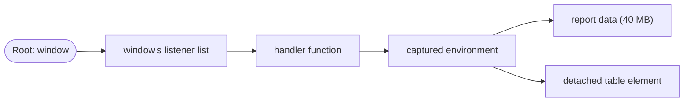

## Introduction

A single-page application stays open for hours. A user opens a dashboard, switches between twenty reports, opens and closes a modal a hundred times. If each of those screens leaves behind one small function that is still registered somewhere — on `window`, on a WebSocket, in a module-level array — and that function closes over the screen's data, then memory grows with every navigation. After an afternoon the tab is using two gigabytes and scrolling stutters.

Closures are at the centre of most such leaks, not because closures are wasteful but because of what they are for. A closure keeps the variables it captured alive for as long as the function can be called ([[b1-closures]]). That is exactly the guarantee that makes callbacks work. The trouble starts when a function stays reachable *after it is no longer needed*: everything it captured stays too, and everything *those* objects reference stays as well.

In memory terms, a **leak** in a garbage-collected language is not memory the runtime forgot to free. It is memory that is still **reachable** — some chain of references leads to it from a root — even though the program will never use it again. The garbage collector cannot know your intentions; it only knows reachability. This lesson teaches you to see the reference chains that closures create, recognise the patterns that leak, and fix them.

## Before you start

- **Closures and their lifecycle** — what a closure captures, and what keeps it alive. See [[b1-closures]] and especially [[b1-closure-lifecycle]].
- **Reachability and garbage collection** — objects reachable from roots (globals, the call stack, active timers and listeners) are kept; everything else may be freed. See [[b1-reachability]], [[b1-garbage-collection]] and [[b1-mark-and-sweep]].
- **The heap** — where objects, functions and captured environments live. See [[b1-heap]].
- **Event listeners and timers** — `addEventListener`, `setInterval`. See [[b1-setinterval]].

Runnable examples use Node.js 22. Examples that inspect garbage collection must be run with `node --expose-gc file.mjs`, which exposes a `gc()` function for demonstration; never use that flag in production.

## The intuition

Think of a closure as a person carrying a backpack full of the things it captured. While that person is standing in some queue — the click-listener queue of a button, the timer queue, a list of subscribers — they cannot leave the building, and neither can their backpack. Usually the backpack contains a few small items: a counter, an id string. Occasionally someone has packed a bowling ball: a 50-megabyte response, a detached DOM tree, an entire component's state.

Two rules follow. To let the backpack go, **take the person out of every queue** they are standing in — remove the listener, clear the timer, delete the registry entry. And to keep the backpack light, **pack only what the job needs** — capture an id rather than the whole object.

The analogy needs one correction for real engines, which comes later in this lesson: people created in the same room share one backpack.

## How garbage collection sees a closure

JavaScript engines free memory with a **tracing garbage collector**. Periodically it starts from the **roots** — the global object, the variables of every function currently on the call stack, the engine's internal lists of active timers, event listeners and pending promise reactions — and follows every reference, marking each object it reaches. Anything left unmarked is unreachable and can be reclaimed. Because the collector traces from roots, reference **cycles are not a problem**: two objects that point at each other but are unreachable from any root are freed together.

A closure participates in this graph like any other object. The function object references its captured environment; the environment references the captured values; those values reference whatever they contain. A typical retention path for a leaked click handler looks like this:



Each arrow is a strong reference. As long as `window` holds the handler in its listener list, every box to the right is reachable and cannot be freed. Remove the first arrow — call `removeEventListener` — and the whole chain becomes unreachable at once. When you debug a leak, this chain is what you are looking for, and DevTools shows it directly as the **retainers** of an object.

## What a closure actually retains

The ECMAScript specification says a function references its whole creation environment, which in turn references its outer environments. If engines implemented that literally, every closure would keep alive every local variable of every enclosing function. They do not. V8 — the engine in Chrome, Edge and Node.js — makes two decisions that determine real memory behaviour.

**Only captured variables are kept.** When V8 compiles a function, it works out which of its local variables are referenced by any inner function. Those variables are stored in a heap object called a **Context**; all the others live in stack slots or registers and disappear when the call returns. An inner function that uses `id` but not `bigArray` does not, by itself, keep `bigArray` alive.

**All closures created in one scope share one Context.** If a function creates three inner functions and any one of them captures `bigArray`, then `bigArray` goes into the Context that all three share. Keeping *any* of the three alive keeps `bigArray` alive — even if the one you kept never mentions it.

This program demonstrates both rules. Each factory returns a tiny function that uses only `id`, plus a `WeakRef` — a reference that does not keep its target alive (ES2021) — so the program can ask whether the large array survived a garbage collection:

```javascript title="shared-context.mjs"
// Run with: node --expose-gc shared-context.mjs
const tick = () => new Promise((resolve) => setTimeout(resolve, 0));

function withSibling() {
  const big = new Array(1_000_000).fill('x');
  const id = 42;
  const usesBig = () => big.length;   // captures big, but is thrown away
  const usesId = () => id;            // the only function we keep
  return { keep: usesId, probe: new WeakRef(big) };
}

function withoutSibling() {
  const big = new Array(1_000_000).fill('x');
  const id = 42;
  const usesId = () => id;
  return { keep: usesId, probe: new WeakRef(big) };
}

const a = withSibling();
const b = withoutSibling();
await tick();            // WeakRef targets stay alive until the current job ends
globalThis.gc();
console.log('with sibling, big alive:', a.probe.deref() !== undefined);
console.log('without sibling, big alive:', b.probe.deref() !== undefined);
console.log(a.keep(), b.keep());
```

```output
with sibling, big alive: true
without sibling, big alive: false
42 42
```

In both factories the kept function is identical and uses only `id`. In `withoutSibling`, nothing captures `big`, so V8 never puts it in the Context, and it is collected. In `withSibling`, the discarded `usesBig` forced `big` into the shared Context, and `usesId` keeps that Context — and the million-element array — alive. This is an engine implementation detail, not something the specification requires, but it is how V8 has behaved for many years, and other engines make similar trade-offs.

Two further details complete the picture. A closure also keeps the chain of **outer Contexts** above it, if those outer functions have captured variables. And a direct call to `eval` inside a function forces *all* of its variables into the Context, because the engine cannot know which names the evaluated string will use.

> [!WARNING] The classic shared-context leak
> A widely studied leak, first described by the Meteor team in 2013, had this shape: inside a function called every second, a helper closure referenced the previous version of a large object, and a separate method closure was stored on the new object. The method never used the previous object, but because both closures shared a Context, each new object kept the previous one alive, forming an ever-growing chain. The fix was to stop capturing the previous object (or to set the variable to `null` once it was no longer needed).

## Leak patterns

Almost every closure leak in real applications is one of the following patterns. In each, the closure is innocent; the bug is a reference that outlives its purpose.

### Forgotten event listeners

A component or screen adds a listener to something long-lived — `window`, `document`, a shared event bus, a WebSocket — and never removes it. The listener's closure keeps the screen's data and DOM nodes alive after the screen is gone. The fix is to remove the listener when the owner is torn down, and that requires the **same function object**:

```javascript title="listener-identity.mjs"
const button = new EventTarget();
let clicks = 0;

button.addEventListener('click', () => clicks++);
button.removeEventListener('click', () => clicks++);   // a different function: removes nothing
button.dispatchEvent(new Event('click'));
console.log('after wrong removal:', clicks);

const onClick = () => clicks++;
button.addEventListener('click', onClick);
button.removeEventListener('click', onClick);          // same function object: removed
button.dispatchEvent(new Event('click'));
console.log('after correct removal:', clicks);
```

```output
after wrong removal: 1
after correct removal: 2
```

Two arrow functions with identical source are two different objects, so the first removal silently does nothing and the first listener — with its closure — stays registered. Keep a reference to the exact function you added. The same trap appears with `bind`: `el.addEventListener('click', this.onClick.bind(this))` cannot be removed later unless you store the bound function.

An often cleaner alternative is an **`AbortSignal`**. Pass `{ signal }` when adding listeners, and calling `abort()` on the controller removes every listener registered with that signal, with no need to keep function references:

```javascript title="abort-listeners.mjs"
const target = new EventTarget();
const controller = new AbortController();
const log = (name) => () => console.log(`${name} ran`);

target.addEventListener('message', log('first'), { signal: controller.signal });
target.addEventListener('message', log('second'), { signal: controller.signal });
target.dispatchEvent(new Event('message'));

controller.abort();                                 // removes both listeners at once
target.dispatchEvent(new Event('message'));
console.log('done');
```

```output
first ran
second ran
done
```

### Forgotten timers

`setInterval` holds its callback until `clearInterval` is called. An interval started by a screen that has closed keeps running, keeps its closure alive, and often keeps doing work — polling an API or updating DOM nodes nobody can see. `setTimeout` callbacks are released once they fire, but a long timeout scheduled by a closed screen still holds its closure until then. Store timer IDs and clear them on teardown.

### Unbounded caches and registries

A closure that owns a `Map` — a memoize cache, a registry of handlers, a list of subscribers — keeps every entry for as long as the closure lives. When that closure is module-level, it lives for the whole session:

```javascript title="bounded-cache.mjs"
function memoizeLast(fn, maxEntries) {
  const cache = new Map();                    // Map keeps insertion order
  return (key) => {
    if (cache.has(key)) return cache.get(key);
    const value = fn(key);
    cache.set(key, value);
    if (cache.size > maxEntries) {
      const oldestKey = cache.keys().next().value;
      cache.delete(oldestKey);                // evict the oldest entry
    }
    return value;
  };
}

const describe = memoizeLast((page) => `page ${page} data`, 3);
for (let page = 1; page <= 5; page++) describe(page);
console.log(describe(5), '| page 1 cached?', describe(1) === 'page 1 data');
```

```output
page 5 data | page 1 cached? true
```

The function caps the cache at three entries, so asking for five pages never holds more than three results. (The last call recomputes page 1, which had been evicted, and returns the same string — the check confirms correctness, not caching.) An unbounded version would keep every page ever requested. For a proper least-recently-used policy, see [[b1-impl-lru]].

### Subscriptions without cleanup in frameworks

In React, an effect that subscribes to a store, socket or browser API must return a cleanup function, or the subscription's closure — with that render's props and state — outlives the component ([[b4-effect-cleanup]]). The same applies to `onMounted`/`onUnmounted` in Vue and `ngOnDestroy` in Angular.

### Detached DOM nodes

A **detached DOM node** is an element removed from the document but still referenced from JavaScript. Closures are the usual holders: a handler registered on a long-lived object captures `row` or `modalElement`, and the element — with its entire subtree and any data attached to it — survives removal. Heap snapshots in Chrome let you filter for "Detached" elements, which makes this pattern easy to spot.

### Promises that never settle

Callbacks passed to `.then` are held by the promise until it settles. A promise that never resolves — waiting for an event that will not come, or a request with no timeout — keeps those callbacks and their closures forever. Add timeouts or abort signals to long waits ([[b1-abort-controller-js]]).

## Worked example: a widget that leaks and its fix

The following program mounts a "widget" that holds a large array and listens to a long-lived event bus — a stand-in for `window`. It mounts and unmounts the widget twice, once without removing the listener and once with, then checks whether the array survived garbage collection:

```javascript title="widget-leak.mjs"
// Run with: node --expose-gc widget-leak.mjs
const tick = () => new Promise((resolve) => setTimeout(resolve, 0));
const bus = new EventTarget();                       // long-lived, like window

function mountWidget({ withCleanup }) {
  const rows = new Array(1_000_000).fill('row');     // large per-widget data
  const onRefresh = () => console.log(rows.length);
  bus.addEventListener('refresh', onRefresh);
  return {
    unmount: () => {
      if (withCleanup) bus.removeEventListener('refresh', onRefresh);
    },
    probe: new WeakRef(rows),                        // lets the demo check if rows survived
  };
}

function mountAndUnmount(withCleanup) {
  const widget = mountWidget({ withCleanup });
  widget.unmount();
  return widget.probe;                               // drop the widget object itself
}

const leakyProbe = mountAndUnmount(false);
const cleanProbe = mountAndUnmount(true);
await tick();
globalThis.gc();
console.log('without cleanup, rows alive:', leakyProbe.deref() !== undefined);
console.log('with cleanup, rows alive:', cleanProbe.deref() !== undefined);
```

```output
without cleanup, rows alive: true
with cleanup, rows alive: false
```

Trace the leaky case. `onRefresh` captures `rows`. The bus's listener list holds `onRefresh`, and the bus is reachable for the whole program. So the path *bus → listener list → onRefresh → Context → rows* keeps a million-element array alive after the widget is "gone". In the clean case, `unmount` removes the listener; nothing else refers to `onRefresh` or its Context once the widget object is dropped, so the array is collected.

Notice one more subtlety: `unmount` and `onRefresh` were created in the same call, so they share a Context that contains `rows`. If the caller had kept the widget object — and with it `unmount` — the array would stay alive even after the listener was removed. The demo returns only the probe for that reason. In real code, the equivalent is a parent that keeps references to children it has already unmounted.

## Tools for keeping memory in check

**Return a disposer.** Any function that registers something should return a function that undoes it. Callers then have one obvious thing to call on teardown, and you can make it idempotent.

**Capture small values.** Read `const { id } = response` before creating a long-lived callback, so the callback captures a string instead of the whole response. Avoid creating a heavy-capturing closure next to a long-lived one in the same scope.

**Use weak collections for metadata.** A `WeakMap` holds its keys weakly: an entry disappears once nothing else references the key object. That makes it the right structure for attaching data to DOM nodes or objects you do not own ([[b1-weakmap]], [[b1-weak-references]]):

```javascript title="weakmap-metadata.mjs"
const tooltipState = new WeakMap();           // element -> state, without pinning elements

function attachTooltip(element, text) {
  tooltipState.set(element, { text, shown: 0 });
}

const fakeElement = { id: 'help-icon' };
attachTooltip(fakeElement, 'Opens the help panel');
console.log(tooltipState.get(fakeElement));
```

```output
{ text: 'Opens the help panel', shown: 0 }
```

If the element is removed and no longer referenced elsewhere, its entry in the `WeakMap` becomes collectable too. A regular `Map` keyed by elements would keep every element alive.

**`WeakRef` and `FinalizationRegistry` (ES2021)** exist for caches that may be dropped under memory pressure. Use them sparingly: collection timing is unspecified, so code must work whether or not an object has been collected.

## Finding leaks with heap snapshots

Guessing about memory is unreliable; measure instead. Chrome DevTools' **Memory** panel (and Node.js via `node --inspect`) lets you take **heap snapshots** — a full graph of every live object ([[b1-heap-snapshots]], [[b1-profiling-basics]]).

A dependable procedure:

1. Load the page and perform the suspect action once (open and close the modal) to warm caches.
2. Take a snapshot.
3. Repeat the action several times, for example ten times.
4. Take a second snapshot and choose the **Comparison** view. Sort by "# Delta" or "Size Delta".
5. Look for object counts that grew by multiples of your repeat count — ten more `Detached HTMLDivElement`, ten more closures with your handler's name.
6. Select one instance and read the **Retainers** panel. Closure environments appear as `context` (or `system / Context`) entries; follow the chain upward until you reach something that should not hold it — a listener list, a module-level array, a timer.

Naming your functions (`function onRefresh() {}` or `const onRefresh = () => {}`) makes this far easier, because snapshots show function names. In Node.js, `v8.writeHeapSnapshot()` writes a snapshot you can open in DevTools.

## In real systems

**Single-page applications** are the main victims, because nothing reloads the page between screens. Route changes must tear down listeners, intervals, observers (`ResizeObserver`, `IntersectionObserver`) and subscriptions created by the previous screen.

**Node.js servers** run for weeks. A request handler that pushes a closure into a module-level array — for logging, metrics or "retry later" — leaks per request. Per-request data must never be stored in module scope without eviction.

**Component libraries and hooks** encapsulate cleanup so that users cannot forget it: a well-written `useEventListener` hook returns cleanup from its effect, and an `AbortController` per component instance can remove all of its listeners and cancel its requests at once.

**Third-party widgets** (maps, editors, charts) often expose a `destroy()` method. Forgetting to call it leaves the widget's internal closures registered on `window` and `document`.

## Trade-offs and alternatives

Retaining memory through closures is the normal, intended cost of callbacks; you should not contort code to avoid closures. Most closures capture a few small values and live briefly. Focus on closures that are **long-lived** (registered on global objects, module-level, intervals) and **heavy** (capturing DOM nodes, large data, or component instances).

| Technique | Prevents | Cost |
|---|---|---|
| Disposer functions / effect cleanup | Forgotten listeners, timers, subscriptions | Discipline: callers must call them |
| `AbortSignal` on listeners and fetches | Forgotten listeners and requests, in bulk | Needs a controller per owner |
| Capturing ids instead of objects | Heavy captures | Sometimes a lookup at call time |
| Bounded caches (size or time limit) | Unbounded growth | Recomputing evicted values |
| `WeakMap` for object metadata | Pinning objects you do not own | Keys must be objects; not iterable |
| Prototype methods instead of factories | Per-instance function objects | Lose closure privacy (use `#private` fields) |

The last row deserves context: a factory that returns an object with five methods creates five function objects per instance, while class instances share methods through the prototype. For a few hundred objects the difference is negligible; for hundreds of thousands of small objects, prefer classes.

## Common mistakes

> [!MISTAKE] Removing a listener with a new function
> `removeEventListener('scroll', () => update())` removes nothing, because it is a different function from the one that was added. Store the handler in a variable (or use an `AbortSignal`) and remove that exact object.

**Believing closures always retain every outer variable.** V8 keeps only captured variables — but shares them among all closures from the same scope. Both halves matter: unused variables are usually safe, while one heavy closure can pin data for its siblings.

**Believing cycles leak.** A DOM node whose handler references the node is a cycle, and tracing collectors free it once nothing outside the cycle refers to it. The leak happens when something reachable — a global registry, a listener list on `window` — points into the cycle. (Very old versions of Internet Explorer did leak on DOM/JavaScript cycles; modern engines do not.)

**Setting variables to `null` everywhere.** Nulling local variables in a function that is about to return does nothing useful. It helps only for references held by long-lived objects or closures, such as a captured variable you no longer need.

**Assuming `WeakRef` frees memory promptly.** Weak references allow collection but never force it, and the timing differs between engines and runs.

## Interview perspective

> [!INTERVIEW] Can closures cause memory leaks?
> "A closure keeps everything it captures reachable as long as the function is reachable, so a closure can cause a leak when it stays registered longer than needed — a listener on `window` that's never removed, an interval that's never cleared, or a module-level cache. The closure isn't the bug; the lingering reference is. I fix it with cleanup functions, `AbortSignal`, bounded caches and by capturing small values. One V8 detail: closures from the same scope share a context, so one closure capturing a big object keeps it alive for all of them."

Questions to prepare:

- **What does the garbage collector consider live?** Anything reachable from roots by following references; cycles without a path from a root are collected.
- **Why does `removeEventListener` sometimes not work?** A different function object was passed; arrow functions and `bind` create new objects each time.
- **How would you find a leak in a production SPA?** Reproduce with repeated actions, compare heap snapshots, inspect retainers of the growing objects.
- **When would you use a `WeakMap`?** To associate data with objects without preventing their collection, such as metadata for DOM nodes.
- **What is a detached DOM node?** An element removed from the document but still referenced from JavaScript, often by a closure.

## Practice

1. Write `on(target, type, handler)` that adds a listener and returns a disposer. Make the disposer safe to call twice.
2. Rewrite a component-like object that adds `resize`, `scroll` and `keydown` listeners plus an interval so that a single `destroy()` removes everything, using one `AbortController` for the listeners.
3. Modify `shared-context.mjs` so that `withSibling` no longer retains `big`, without deleting `usesBig`. (Hint: what if `usesBig` were created in a different scope?)
4. In Chrome, build a page that opens and closes a modal which registers a `keydown` listener on `document`. Use heap snapshot comparison to find the leaked closures, then fix it and confirm the delta disappears.
5. Turn the bounded cache into a time-based cache that drops entries older than a minute. Explain where the closure keeps its state.

## Quick revision {#quick-revision}

- Leak in JavaScript = memory still reachable from a root but never used again.
- Tracing GC: start from roots (globals, stack, timers, listeners, pending promises), mark reachable objects, free the rest; cycles are fine.
- Retention path: root → listener list / timer / registry → function → Context → captured objects.
- V8: only captured variables go into the heap Context; all closures from one scope share that Context.
- One heavy capturing closure can pin data for its siblings; direct `eval` forces everything into the Context.
- Leak patterns: forgotten listeners, intervals, unbounded module-level caches, effects without cleanup, detached DOM nodes, never-settling promises.
- `removeEventListener` needs the same function object; `AbortSignal` removes many listeners at once.
- Fixes: disposers, capture ids not objects, bounded caches, `WeakMap` for metadata.
- Diagnose with heap snapshot comparison and the Retainers panel; name your functions.

## Key takeaways {#key-takeaways}

- Closures keep what they capture alive exactly as long as they are reachable; that is a feature, and leaks come from references that outlive their purpose.
- Think in retention paths: find the root-reachable thing that still holds the function, and break that link.
- In V8, unused outer variables are not kept, but closures created in the same scope share their captured variables.
- Every registration — listener, timer, subscription, cache entry — needs a matching release, ideally returned as a disposer.
- Measure with heap snapshots before and after a repeated action instead of guessing.
