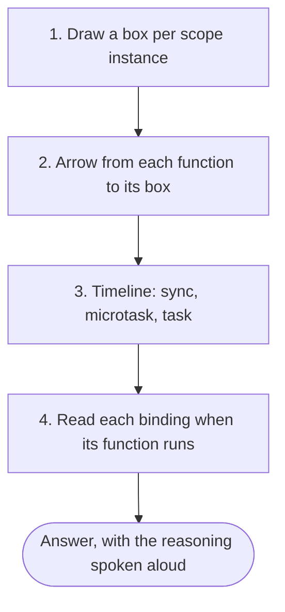

## Introduction

Closure puzzles are short programs — usually under ten lines — where the interviewer asks "what does this print?" They are popular because they are cheap to ask and hard to bluff: a candidate who has memorised "var loops print 3, 3, 3" falls over as soon as the loop uses `while`, or the callback is a promise, or the closure reads an object property instead of a variable.

The good news is that every closure puzzle is decided by the same small set of rules taught in this module: closures capture **bindings**, not values ([[b1-closures]]); `var`, `let` and `const` decide **how many bindings** exist ([[b1-closures-in-loops]]); and asynchronous callbacks run **after** the current code finishes ([[b1-event-loop]]). This lesson turns those rules into a method you can apply out loud, then works through the puzzle patterns interviewers actually use, with the reasoning for each.

Read each puzzle and commit to an answer before you look at the output below it. The value of this lesson is in the predictions you get wrong.

## Before you start

- **Closures** — capture of bindings, factories, shared state. See [[b1-closures]].
- **Loops and closures** — per-iteration bindings and the `var` loop problem. See [[b1-closures-in-loops]] and [[b1-var-loop-problem]].
- **Hoisting and the Temporal Dead Zone** — one puzzle depends on them. See [[b1-hoisting]] and [[b1-tdz]].
- **The event loop and microtasks** — for the timing puzzles. See [[b1-event-loop]] and [[b1-microtasks]].
- **`this`** — one puzzle contrasts arrow and regular functions. See [[b1-this]].

All puzzles run as ES modules in Node.js 22 (which means strict mode); output is shown as Node prints it.

## The method: four questions

Do not try to "see" the answer. Answer these four questions in order, and write the answers down on the whiteboard as you go.

1. **Which bindings exist?** Draw a box for every scope *instance* — each function call, each block execution, each `let` loop iteration — and write the names declared in it. A function called twice produces two boxes.
2. **Which binding does each function point at?** For every function created, draw an arrow to the box it was created in. Functions created in the same box share its variables.
3. **When does each function run?** Mark each call on a timeline: now (synchronously), in the microtask queue (promise callbacks), or as a later task (timers, events).
4. **What does the binding hold at that moment?** Walk the timeline and read each variable at the time the function runs, not at the time it was created.

Most wrong answers come from skipping question 1 (assuming one variable where there are several, or several where there is one) or question 3 (reading a variable at creation time).



## Warm-up: the live binding

```javascript title="puzzle-1.mjs"
function setup(x) {
  const read = () => x;
  x = x * 10;
  return read();
}
console.log(setup(2));
```

```output
20
```

**Bindings:** one call box with `x` and `read`. **Arrow:** `read` points to that box. **Timeline:** `read` runs after `x = x * 10`. **Value:** `20`. Parameters are ordinary bindings and can be reassigned; the closure sees the reassignment.

## Shared or separate state

```javascript title="puzzle-2.mjs"
function makeCounter() {
  let count = 0;
  return { inc: () => ++count, get: () => count };
}

const a = makeCounter();
const b = makeCounter();
a.inc();
a.inc();
b.inc();
const { inc } = a;
inc();
console.log(a.get(), b.get());
```

```output
3 1
```

Two calls of `makeCounter` create two boxes, each with its own `count`. `a.inc`, `a.get` and the destructured `inc` all point into `a`'s box, so they share one `count` and reach `3`. `b` has its own `count`, incremented once. Destructuring `inc` out of the object does not break anything, because these methods do not use `this` — a useful contrast with classes.

## The property that does not update

```javascript title="puzzle-3.mjs"
function makeStore() {
  let n = 0;
  return {
    n,                                   // copies the current value into a property
    inc() { n++; },
    get current() { return n; },         // reads the binding each time
  };
}

const store = makeStore();
store.inc();
store.inc();
console.log(store.n, store.current);
```

```output
0 2
```

This one catches many experienced developers. The shorthand `{ n }` means `{ n: n }`: it evaluates `n` once, when the object is built, and stores the value `0` in a property. That property is not linked to the variable. The getter, by contrast, is a function — a closure — that reads the binding `n` every time it is accessed. `inc` changes the binding, so the getter sees `2` and the property stays `0`. The same reasoning explains why destructuring `const { n } = store` gives you a snapshot.

## Mutation versus reassignment

```javascript title="puzzle-4.mjs"
let config = { level: 1 };
const saved = config;
const readLevel = () => config.level;

config.level = 2;
config = { level: 3 };
saved.level = 4;

console.log(readLevel(), saved.level, config === saved);
```

```output
3 4 false
```

Draw the objects. Initially `config` and `saved` point at object A. `config.level = 2` mutates A. `config = { level: 3 }` points the binding `config` at a new object B; `saved` still points at A. `saved.level = 4` mutates A again. The closure follows the binding `config`, which now holds B with `level` 3. Asking "which binding?" and then "which object does it point at now?" solves every puzzle of this kind.

## Loops: count the bindings

```javascript title="puzzle-5.mjs"
for (var i = 0; i < 3; i++) {
  setTimeout(() => console.log('var', i), i * 100);
}
for (let j = 0; j < 3; j++) {
  setTimeout(() => console.log('let', j), 500 + j * 100);
}
```

```output
var 3
var 3
var 3
let 0
let 1
let 2
```

Two things are being tested. **Bindings:** there is one `i` for the whole module but three separate `j`s, one per iteration. **Timeline:** the delay expressions `i * 100` and `500 + j * 100` are evaluated *during* the loops, so the timers really are scheduled at 0, 100 and 200 milliseconds (and 500, 600, 700). The callback *bodies* run later, after both loops have finished. By then the shared `i` is `3`, so the first three lines all show `3`, spaced 100 ms apart. Each `let` callback reads its own `j`.

A frequent wrong answer is "0, 1, 2 because the delays are different". The different delays prove that the delay argument was read during the loop; they say nothing about the value the callback reads when it finally runs.

> [!WARNING] Do not build answers on timer tie-breaking
> If two timers are due at the same moment, their relative order is a detail of the host environment, not a closure rule. In an interview, state the values each callback logs and keep ordering claims to what the event loop guarantees: synchronous code first, then microtasks, then timers by due time.

## Loops: when the body changes the variable

```javascript title="puzzle-6.mjs"
const fns = [];
for (let i = 0; i < 3; i++) {
  fns.push(() => i);
  i++;
}
console.log(fns.map((f) => f()));
```

```output
[ 1, 3 ]
```

Each iteration's binding is created by copying the previous iteration's value, *then* the increment runs on the new copy. Iteration 0 starts at `0`, pushes a closure, and changes its own `i` to `1`. Iteration 1 starts from a copy of `1`, incremented to `2`; it pushes a closure and changes its `i` to `3`. The next copy is incremented to `4` and fails the test. The two closures read their own bindings: `1` and `3`. The full mechanism is in [[b1-closures-in-loops]].

## `while` loops do not copy

```javascript title="puzzle-7.mjs"
function build() {
  const fns = [];
  let i = 0;
  while (i < 3) {
    const j = i;
    fns.push(() => [i, j]);
    i += 1;
  }
  return fns.map((f) => f());
}
console.log(JSON.stringify(build()));
```

```output
[[3,0],[3,1],[3,2]]
```

`i` is declared once, outside the loop, so all three closures share it and see its final value `3`. `j` is declared inside the body, and the body block is a new scope on each pass, so each closure has its own `j`. The per-iteration copy is a feature of `for` loop headers only.

## Shadowing and the Temporal Dead Zone

```javascript title="puzzle-8.mjs"
let theme = 'light';

function readTheme() {
  return theme;                        // no local theme: finds the outer one
}

function readThemeShadowed() {
  try {
    console.log(theme);
    let theme = 'dark';                // declares a new theme for this whole function
    return theme;
  } catch (err) {
    return `${err.name}: ${err.message}`;
  }
}

console.log(readTheme());
console.log(readThemeShadowed());
```

```output
light
ReferenceError: Cannot access 'theme' before initialization
```

The first function has no local `theme`, so lookup finds the outer one. In the second, `let theme` inside the `try` block **shadows** the outer variable for the *entire* block, not only from the line where it appears. The block's `theme` exists from the start of the block but is uninitialised until its declaration runs — the Temporal Dead Zone ([[b1-tdz]]) — so `console.log(theme)` throws instead of falling back to the outer `'light'`. Scope is decided by where declarations are written, before any code runs ([[b1-shadowing]]).

## Definition site, not call site

```javascript title="puzzle-9.mjs"
const name = 'module';

function makeReporter() {
  const name = 'factory';
  return () => name;
}

function run(fn) {
  const name = 'runner';
  return fn();
}

console.log(run(makeReporter()));
```

```output
factory
```

The arrow function was created inside `makeReporter`, so its box chain is *arrow → makeReporter call → module*. It finds `name` in the `makeReporter` box. The `run` function's `name` is in the caller's scope and is never consulted. If you answered `runner`, you were using dynamic scope, which JavaScript does not have.

## Parameter scope with default values

```javascript title="puzzle-10.mjs"
function demo(a, getA = () => a) {
  var a = 2;
  return [a, getA()];
}
console.log(demo(1));
```

```output
[ 2, 1 ]
```

This is an advanced puzzle, but it is a fair test of whether you think in scopes. When a function has default parameter expressions, the parameters live in their own scope, and a `var` with the same name in the body creates a *separate* binding in a body scope, initialised with the parameter's value. `getA` was created in the parameter scope, so it closes over the parameter `a`, which stays `1`. The body's `var a = 2` changes only the body binding. Without the default parameter, there would be a single `a` and the result would be `[2, 2]`.

## Closures and `this`

```javascript title="puzzle-11.mjs"
const team = {
  name: 'core',
  regular() {
    return function () {
      return this === undefined ? 'this is undefined' : this.name;
    };
  },
  arrow() {
    return () => this.name;
  },
};

console.log(team.regular()());
console.log(team.arrow()());
```

```output
this is undefined
core
```

A regular function does not close over `this`; it receives `this` from how it is called. The inner function is called as a plain function, so in strict mode (modules are strict) its `this` is `undefined`. An arrow function has no `this` of its own and looks it up lexically, like any other variable, so it sees the `this` of the `arrow()` call — `team`. In sloppy-mode scripts the regular function would get the global object instead, whose `name` is usually not `'core'`. See [[b1-this-arrow]] and [[b1-this-lost]].

## Closures meet the event loop

```javascript title="puzzle-12.mjs"
for (var i = 0; i < 2; i++) {
  Promise.resolve().then(() => console.log('microtask', i));
  setTimeout(() => console.log('timer', i), 0);
}
console.log('sync', i);
```

```output
sync 2
microtask 2
microtask 2
timer 2
timer 2
```

Use the timeline. The loop and the final `console.log` run synchronously, leaving `i` at `2`. Promise callbacks are **microtasks**, which run as soon as the current script finishes; timers are **tasks**, which run after all pending microtasks ([[b1-microtasks]]). Every callback reads the single `var i` and sees `2`. Changing `var` to `let` would make the callbacks print `0` and `1`, but the line after the loop would then throw, because `i` would not exist outside the loop.

## Write-it puzzles

Interviewers also ask you to *write* small closures. These three appear often.

### A counter you cannot tamper with

```javascript title="private-counter.mjs"
const nextTicket = (() => {
  let last = 0;
  return () => ++last;
})();

nextTicket();
nextTicket();
console.log(nextTicket(), typeof last);
```

```output
3 undefined
```

The Immediately Invoked Function Expression (IIFE) runs once, creating one box with `last`, and returns a function that closes over it. `last` is unreachable from outside — `typeof last` at the module level reports `undefined` because no such variable exists there. See [[b1-private-state]].

### Curried sum with an unknown number of calls

The task: make `sum(1)(2)(3)()` return `6`, for any number of calls, ending with an empty call.

```javascript title="curried-sum.mjs"
function sum(total) {
  return function next(value) {
    if (value === undefined) return total;   // empty call: report the total
    return sum(total + value);               // new closure with the new running total
  };
}

console.log(sum(1)(2)(3)());
console.log(sum(10)());
```

```output
6
10
```

Each call returns a new function that closes over the running `total`. Nothing is mutated: `sum(total + value)` creates a fresh box. Mention that you check `value === undefined` rather than `!value`, so that `sum(1)(0)()` still works. Currying in general is covered in [[b1-currying]].

### `once`

Write a function that wraps `fn` so that it runs at most once and returns the first result on every later call. Keep `called` and `result` in the closure, set `called` before invoking `fn`, and forward `this` and arguments with `fn.apply(this, args)`. The full worked version is in [[b1-closures]].

```quiz
Q: What does `const o = (() => { let n = 1; return { n, bump() { n++; return n; } }; })(); o.bump(); console.log(o.n, o.bump());` print?
- [ ] 2 3
- [x] 1 3
- [ ] 1 2
- [ ] 3 3
> The property n was copied from the variable when the object was created, so it stays 1. bump closes over the variable: the first call makes it 2, and the call inside console.log makes it 3 and returns 3.

Q: What does `let x = 'a'; const f = () => x; { let x = 'b'; console.log(f()); }` print?
- [x] a
- [ ] b
- [ ] undefined
- [ ] ReferenceError
> f was created at the top level, so it closes over the outer x. The block declares a different x that only code written inside the block can see; calling f from inside the block does not change where f looks.

Q: In `for (var i = 0; i < 3; i++) { const j = i; setTimeout(() => console.log(i + j)); }`, what is logged?
- [ ] 0, 2, 4
- [x] 3, 4, 5
- [ ] 3, 3, 3
- [ ] 6, 6, 6
> i is a single shared var that is 3 when the timers run; j is a block-scoped const created fresh in each iteration with values 0, 1 and 2. So the callbacks log 3 + 0, 3 + 1 and 3 + 2.

Q: Which change makes `for (var i = 0; i < 3; i++) setTimeout(() => console.log(i));` print 0, 1, 2 without changing var to let?
- [ ] Use a delay of i * 1000
- [ ] Wrap the loop in a function
- [x] Pass i through an IIFE parameter: `((n) => setTimeout(() => console.log(n)))(i)`
- [ ] Move the setTimeout before the loop
> Each IIFE call creates a new parameter binding n with the current value, and the timer callback closes over it. Changing the delay only changes when 3 is printed, and wrapping the whole loop in a function still leaves one shared i.
```

## In real systems

Puzzle patterns are distilled from real bugs:

- **The property snapshot** (`{ n }` versus a getter) appears when a module exports a value that later changes; consumers see the old value. ES module exports are live bindings precisely to avoid this ([[b1-live-bindings]]), while CommonJS `module.exports = { n }` copies.
- **Shared loop bindings** appear when legacy `var` code attaches handlers or schedules retries in loops.
- **Stale reads** appear in React handlers and intervals that captured an old render ([[b1-stale-closures]]).
- **Shadowing with TDZ errors** appear when a refactor adds a `const` with the same name as an outer variable further down a function.
- **Lost `this`** appears when a method is passed as a callback, such as `setTimeout(obj.method, 0)`.

## Common mistakes

> [!MISTAKE] Reading the variable at creation time
> The most common wrong answer comes from evaluating the closure's variable when the function is *created*. Always place the function's execution on the timeline first, then read the binding at that moment.

**Assuming `let` everywhere means a fresh binding per iteration.** Only declarations in a `for` header or inside the loop body are per-iteration; an outer `let` used by a `while` loop is shared.

**Treating a property as if it were the variable.** `{ n }`, destructuring and `return count` all copy the current value. Only functions (including getters) keep reading the binding.

**Assuming a closure can see its caller's variables.** Lookup follows the definition, always.

**Over-explaining timer ordering.** When two timers share a delay, do not invent rules; the values are what the closure question is about.

## Interview perspective

> [!INTERVIEW] How to talk through a puzzle
> "Let me first list the bindings: `i` is a single `var` for the whole function, while `j` is created fresh on each iteration. The callbacks are timers, so they run after the loop finishes. At that point `i` is 3 and each `j` holds its own iteration's value, so the output is..."

Interviewers care more about the reasoning than the final number. Narrate the four questions, correct yourself out loud if a step changes your answer, and finish by proposing a fix if the code is buggy. Common follow-ups:

- **"Now change `var` to `let` — what changes?"** The number of bindings, and possibly whether code after the loop still compiles.
- **"How would you fix this without `let`?"** An IIFE or helper function creating a new parameter binding per iteration, or passing the value as an extra `setTimeout` argument.
- **"Where does this variable live after the function returns?"** In an environment on the heap, kept alive by the closure.
- **"Is this a memory leak?"** Only if the closure stays reachable longer than needed; see [[b1-closure-memory]].

## Practice

Solve each with the four questions before running it.

1. `function f() { var a = 1; function g() { return a; } a = 2; return g; } console.log(f()());`
2. `const fns = []; for (const x of [1, 2, 3]) fns.push(() => x * 2); console.log(fns.map(f => f()));`
3. `let count = 0; const inc = () => count++; const snapshot = count; inc(); inc(); console.log(count, snapshot);`
4. Make `add(2)(3)` return `5` and `add(2, 3)` also return `5`.
5. Write `createRateCounter()` returning `hit()` and `perSecond()`, where `perSecond` reports how many hits occurred in the last second. Explain where each piece of state lives.
6. Combine puzzles 7 and 12: a `while` loop that schedules promise callbacks and timers, with one outer `let` and one inner `const`. Predict the complete output order.

## Quick revision {#quick-revision}

- Method: (1) draw a box per scope instance, (2) arrow from each function to its box, (3) place each call on a sync/microtask/task timeline, (4) read bindings at run time.
- Closures read bindings at call time; parameters are bindings too.
- Separate factory calls → separate state; functions from one call share state.
- `{ n }`, destructuring and returned values copy; getters and functions keep reading the binding.
- Mutation is visible through every reference; reassignment only through the reassigned binding.
- `var` loop → one binding; `for (let ...)` → copy then increment; `while` with outer `let` → shared; `const` in body → fresh.
- A `let`/`const` shadows the outer name for its whole block; reading it early throws a TDZ `ReferenceError`.
- Lookup uses the definition site, never the call site.
- Default parameters create a separate parameter scope; closures in defaults see parameters, not body `var`s.
- Regular functions get `this` from the call; arrows take it lexically.
- Promise callbacks (microtasks) run before timers (tasks), both after synchronous code.

## Key takeaways {#key-takeaways}

- Every closure puzzle is solved by counting bindings, linking functions to them, and timing when each function runs.
- The trickiest puzzles hide a copy (`{ n }`, destructuring) or a second binding (shadowing, parameter scopes) where you expect one variable.
- Asynchronous puzzles add only one rule: callbacks run after the synchronous code, microtasks before timers.
- Explain your reasoning aloud; interviewers grade the model, not the memorised answer.
- If the puzzle code is buggy, finish with a fix and say why it creates the right number of bindings.
