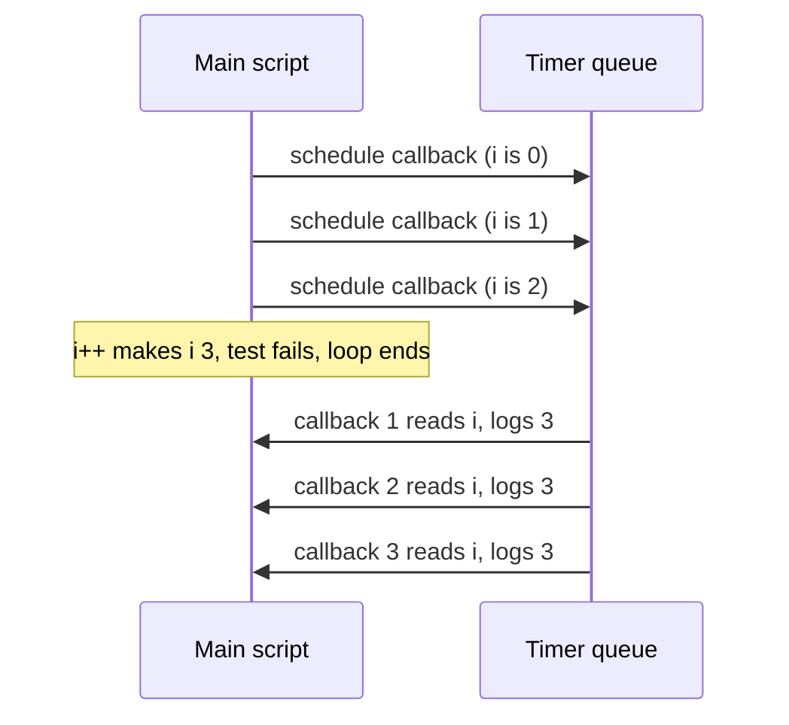

## Introduction

Loops and functions meet constantly in real code. You attach a click handler to each button in a list, schedule a retry for each failed request, build an array of callbacks, or create a promise per item. Each of those functions is created inside the loop body and runs *later* — after the user clicks, after a timer fires, after a response arrives.

The question that decides whether such code works is simple to state: **when the function finally runs and reads the loop variable, which variable is it reading?** A function is a closure ([[b1-closures]]): it refers to variables, not to copies of their values. If every iteration's function refers to the *same* variable, they all see whatever that variable holds when they run — usually its final value. If every iteration has its *own* variable, each function sees the value from its own iteration.

JavaScript gives both behaviours, depending on how the loop variable is declared. `var` creates one variable for the whole loop. `let` in a `for` loop creates a new variable for every iteration. The difference produces the most famous JavaScript interview question — a loop with `setTimeout` that prints `3, 3, 3` instead of `0, 1, 2` — and a class of real bugs that still appears in code reviews.

This lesson explains the rule precisely, shows how each loop form behaves, and teaches the fixes and why each one works.

## Before you start

- **Closures** — a function keeps references to the variables of the scope it was created in, and reads their current values when it runs. See [[b1-closures]].
- **`var` versus `let`/`const`** — `var` is scoped to the enclosing function, `let` and `const` to the enclosing block. See [[b1-var-let-const]] and [[b1-block-scope-vars]].
- **Loop syntax** — `for`, `while`, `for...of` and `for...in`. See [[b1-for-loops]] and [[b1-for-of-in]].
- **Timers and the event loop** (for the `setTimeout` version) — a timer callback runs only after the current script has finished. See [[b1-settimeout]] and [[b1-event-loop]].

Examples run in Node.js 22 or a browser console; output is shown as Node prints it.

## The intuition

Imagine each loop iteration writes its counter value on a sticky note and hands the note to the function created in that iteration.

With `var`, there is **one sticky note** for the whole loop. Each iteration erases the number and writes the next one. Every function was handed the same note, so when they finally look at it, they all read the last number written.

With `let` in a `for` loop, each iteration gets a **brand-new sticky note** carrying the current number. The function created in iteration 0 holds note 0, the next function holds note 1, and so on. Later, each reads its own note.

The analogy captures the essential fact: the functions never stored numbers. They hold references to notes (bindings). The only question is how many notes the loop creates.

## The problem without any timers

The bug is often blamed on `setTimeout`, so start with a version that has no asynchronous code at all:

```javascript title="sync-loop.mjs"
const varFns = [];
for (var i = 0; i < 3; i++) {
  varFns.push(() => i);
}

const letFns = [];
for (let j = 0; j < 3; j++) {
  letFns.push(() => j);
}

console.log(varFns.map((f) => f()));
console.log(letFns.map((f) => f()));
console.log(i);          // var leaks out of the loop
```

```output
[ 3, 3, 3 ]
[ 0, 1, 2 ]
3
```

The loops are identical except for the keyword, and nothing runs asynchronously. Yet the `var` functions all return `3` while the `let` functions return `0`, `1` and `2`.

The last line explains the `var` result. `var i` is not scoped to the loop at all; it belongs to the enclosing function (here, the module), so `i` still exists after the loop and holds `3`. All three arrow functions close over that one `i`. They run after the loop has finished, read `i`, and find `3`.

Why `3` and not `2`? The loop's last increment sets `i` to `3`, the test `3 < 3` fails, and the loop exits with `i` left at `3`. No iteration ever *ran* with `i === 3`, but the variable ends there.

The `let` loop behaves differently because the language creates a separate `j` for each iteration. The next section shows exactly how.

## How `for (let ...)` creates a binding per iteration

A `let` declared in a block normally lives for one execution of that block. The header of a `for` loop is special because the loop variable must carry its value from one iteration to the next (`j++` needs the old `j`). The ECMAScript specification resolves this with a step called **CreatePerIterationEnvironment**: at the start of each iteration, the engine creates a new environment and **copies the current value** of each `let` loop variable into a new binding there.

The precise order for `for (let j = 0; j < 3; j++) { body }` is:

1. Create an environment for the header and run the initialiser: `j = 0`.
2. Copy `j` into a fresh per-iteration environment (iteration 0).
3. Run the test `j < 3` in that environment. If false, stop.
4. Run the body. Any function created here closes over *this* iteration's `j`.
5. Copy the current `j` into another fresh environment (the next iteration).
6. Run the increment `j++` — in the **new** environment, so the old iteration's `j` is untouched.
7. Go back to step 3.

The important detail is step 6: the increment happens *after* the copy. That is what keeps each earlier iteration's binding frozen at the value it had when its body finished.

| Iteration | Binding created | Value when body runs | Value after body (what its closure sees) |
|---|---|---|---|
| 0 | `j₀` | 0 | 0 |
| 1 | `j₁` (copied from `j₀`, then incremented) | 1 | 1 |
| 2 | `j₂` | 2 | 2 |
| exit | `j₃` = 3, test fails | — | no body runs |

```mermaid title="var shares one binding; let gets a binding per iteration"
flowchart LR
    subgraph VAR["for (var i ...)"]
        F0["fn 0"] --> I(("i = 3"))
        F1["fn 1"] --> I
        F2["fn 2"] --> I
    end
    subgraph LET["for (let j ...)"]
        G0["fn 0"] --> J0(("j = 0"))
        G1["fn 1"] --> J1(("j = 1"))
        G2["fn 2"] --> J2(("j = 2"))
    end
```

### Closures see their binding's final value, not its value at creation

Per-iteration bindings are still bindings, not snapshots. If the body changes the loop variable after creating a function, that function sees the change:

```javascript title="mutate-in-body.mjs"
const fns = [];
for (let i = 0; i < 3; i++) {
  fns.push(() => i);
  i++;                       // changes this iteration's binding after the push
}
console.log(fns.map((f) => f()));
```

```output
[ 1, 3 ]
```

Trace it with the steps above. Iteration 0 starts with `i = 0`, pushes a function, then sets its own `i` to `1`. That value is copied into iteration 1's new binding and incremented there to `2`. Iteration 1 pushes a function, then sets its `i` to `3`. The next copy gets `3`, increments to `4`, and the test fails. The two functions read their iterations' bindings: `1` and `3`. This puzzle is a good test of whether you understand the copy-then-increment order.

### Performance

Creating an environment per iteration sounds expensive, but engines generally keep the loop variable in a register and only materialise per-iteration environments when a closure actually captures it; even then the cost is small. Do not use `var` to "optimise" a loop; the readability and correctness of `let` are worth far more.

## Every loop form, compared

The per-iteration copy is a feature of `for` loops with `let` declarations in the header. Other loop forms have their own rules.

### `for...of` and `for...in`

These loops create a fresh binding for each iteration when the variable is declared with `let` or `const`, because each iteration simply evaluates the declaration anew with the next value. With `var`, there is again one shared binding.

```javascript title="for-of.mjs"
const shared = [];
for (var color of ['red', 'green']) shared.push(() => color);

const fresh = [];
for (const size of ['S', 'M']) fresh.push(() => size);

console.log(shared.map((f) => f()), fresh.map((f) => f()));
```

```output
[ 'green', 'green' ] [ 'S', 'M' ]
```

`const` works in `for...of` and `for...in` because each binding is assigned once and never changed. In a classic `for` loop, `const` fails as soon as the increment tries to modify it:

```javascript title="const-for.mjs"
try {
  for (const k = 0; k < 3; k++) {
    console.log('k is', k);
  }
} catch (err) {
  console.log(`${err.name}: ${err.message}`);
}
```

```output
k is 0
TypeError: Assignment to constant variable.
```

The first iteration runs; the error comes from `k++` before the second.

### `while` and `do...while`

These loops have no header declaration, so there is nothing to copy. A `let` declared *outside* the loop is one binding shared by every iteration, exactly like `var` in a `for` loop. A `let` or `const` declared *inside* the body is fresh each time, because the body block is entered anew on every iteration:

```javascript title="while-loop.mjs"
const fns = [];
let i = 0;
while (i < 3) {
  const snapshot = i;        // new binding each time the block runs
  fns.push(() => [i, snapshot]);
  i++;
}
console.log(JSON.stringify(fns.map((f) => f())));
```

```output
[[3,0],[3,1],[3,2]]
```

Every function sees the shared `i` at its final value `3`, and its own `snapshot` at the value from its iteration. Copying into a block-scoped `const` is a general fix that works in any loop.

### Array methods

`forEach`, `map`, `filter` and friends call your callback once per element, passing the element and index as **parameters**. Parameters are new bindings for every call, so closures created inside the callback naturally capture per-element values:

```javascript title="foreach.mjs"
const fns = [];
['a', 'b', 'c'].forEach((letter, index) => {
  fns.push(() => `${index}:${letter}`);
});
console.log(fns.map((f) => f()));
```

```output
[ '0:a', '1:b', '2:c' ]
```

This is one reason React code rarely meets the loop problem: `items.map((item) => <button onClick={() => remove(item.id)} />)` creates each handler in its own callback call with its own `item`.

| Loop form | Declaration | Bindings created | Closures see |
|---|---|---|---|
| `for (var i ...)` | `var` in header | One for the whole function | Final value |
| `for (let i ...)` | `let` in header | One per iteration (copied) | Value at end of their iteration |
| `for (const i ...)` | `const` in header | — | `TypeError` on first increment |
| `for (var x of/in ...)` | `var` | One shared | Last element |
| `for (let/const x of/in ...)` | `let` or `const` | One per iteration | Their element |
| `while`, outer `let` | outside the loop | One shared | Final value |
| any loop, `const` in body | inside the block | One per iteration | Their iteration's value |
| `array.forEach(cb)` | parameters | One per call | Their element |

```quiz
Q: In `const fns = []; let n = 0; while (n < 2) { fns.push(() => n); n++; }`, what does `fns.map(f => f())` return?
- [ ] [0, 1], because let is block-scoped
- [x] [2, 2], because n is declared outside the loop and shared by every iteration
- [ ] [1, 2], because the increment runs before the closure reads n
- [ ] It throws, because n is reassigned inside a closure
> The per-iteration copy only happens for let declared in a for-loop header. Here n is a single binding declared before the loop; both closures read it after the loop, when it is 2. Declaring const copy = n inside the body would give [0, 1].

Q: Why does `for (const x of items)` work while `for (const i = 0; i < n; i++)` throws?
- [ ] for...of converts const to let automatically
- [x] for...of creates a new binding per iteration and assigns it once; the classic for loop tries to modify the same const with i++
- [ ] The classic for loop does not support block-scoped declarations
- [ ] for...of is only allowed on arrays
> Each for...of iteration evaluates the declaration again with the next value, so every const is assigned exactly once. A classic for loop copies the loop variable and then runs the increment on it, and incrementing a const is an assignment error.
```

## var Loop Problem {#b1-var-loop-problem}

The **var loop problem** is the name for this classic program and its surprising output:

```javascript title="var-loop.mjs"
for (var i = 0; i < 3; i++) {
  setTimeout(() => console.log(i), 0);
}
```

```output
3
3
3
```

Most people expect `0`, `1`, `2`. The program prints `3` three times because all three timer callbacks close over the **same** `var i`, and by the time any of them runs, the loop has finished and left `i` at `3`. It is not a bug in `setTimeout`, and the `0` delay is irrelevant: the problem is one shared variable plus callbacks that run later.

### Why the callbacks run after the loop

`setTimeout` does not run its callback; it asks the host (browser or Node.js) to queue the callback as a task once the delay has passed. JavaScript is single-threaded and runs each piece of code to completion, so queued callbacks can only start after the current script — including the entire loop — has finished. That ordering is the job of the event loop ([[b1-event-loop]], [[b1-run-to-completion]]). Even a delay of `0` means "at the earliest, after the current code finishes" (browsers also clamp nested timers to a minimum delay; see [[b1-minimum-delay]]).



So two facts combine. **Timing**: the callbacks read `i` after the loop. **Scope**: there is only one `i` to read. Remove either and the bug disappears — the synchronous example earlier showed that timing alone is not the cause (late reads of a per-iteration binding are fine), and if the callbacks ran *inside* the loop they would read `0`, `1`, `2` even with `var`.

### Fix 1: use `let`

```javascript title="fix-let.mjs"
for (let i = 0; i < 3; i++) {
  setTimeout(() => console.log(i), 0);
}
```

```output
0
1
2
```

Each iteration gets its own `i`, so each callback closes over a different binding. This is the fix to use in modern code (ES2015 and later): it is the shortest, clearest and keeps `i` from leaking out of the loop.

### Fix 2: create a new scope per iteration

Before `let` existed, the standard fix was an **Immediately Invoked Function Expression (IIFE)** — a function called on the spot — that receives the current value as a parameter. Each call creates a new scope with its own parameter binding:

```javascript title="fix-iife.mjs"
for (var i = 0; i < 3; i++) {
  ((captured) => {
    setTimeout(() => console.log(captured), 0);
  })(i);
}
```

```output
0
1
2
```

The timer callback closes over `captured`, which belongs to one IIFE call and is never changed. A named helper does the same thing more readably: `function schedule(n) { setTimeout(() => console.log(n), 0); }` called as `schedule(i)`. Either way, the fix works by **creating a new binding per iteration** — exactly what `let` does automatically. See [[b1-iife]].

### Fix 3: pass the value instead of capturing it

Two fixes avoid capturing `i` at all and instead pass its current value as an argument when the callback is set up:

```javascript title="fix-args.mjs"
for (var i = 0; i < 3; i++) {
  setTimeout((n) => console.log('arg', n), 0, i);      // extra setTimeout arguments
}
for (var k = 0; k < 3; k++) {
  setTimeout(console.log.bind(null, 'bound', k), 0);   // bind fixes the argument now
}
```

```output
arg 0
arg 1
arg 2
bound 0
bound 1
bound 2
```

`setTimeout(callback, delay, ...args)` passes any extra arguments to the callback when it runs; the values are evaluated when `setTimeout` is called, inside the loop. `bind` creates a new function with arguments fixed at the moment `bind` is called ([[b1-bind]]). Both are correct, but understand what you did: the callback no longer reads `i` at all, so if it *also* referred to `i` in its body, that reference would still print `3`. In an interview, say explicitly that this fix passes a value rather than changing what is captured.

### Fix 4: iterate with an array method

```javascript title="fix-foreach.mjs"
[0, 1, 2].forEach((n) => {
  setTimeout(() => console.log(n), 0);
});
```

```output
0
1
2
```

Each `forEach` call has its own parameter `n`. This is natural when you are already iterating over an array of items rather than a numeric range.

### The same bug in the DOM

The original form of this problem, from the days before `let`, attaches click handlers in a loop:

```javascript title="buttons.js"
// Assumes the page has three <button> elements.
const buttons = document.querySelectorAll('button');
for (var i = 0; i < buttons.length; i++) {
  buttons[i].addEventListener('click', () => {
    console.log(`You clicked button ${i}`);     // always logs 3
  });
}
```

Clicking any button logs `You clicked button 3`, and code that used `buttons[i]` inside the handler would get `undefined`, because index `3` is past the end. Changing `var` to `let` fixes both. A cleaner design often avoids the index entirely: `buttons.forEach((button, index) => ...)` or reading `event.currentTarget` inside the handler.

> [!WARNING] Fix every loop, not just the one that failed
> Files with older code often mix `var` and `let` loops. Fixing the loop that a bug report mentions and leaving a sibling `var` loop with a callback behind is a common way to ship the same bug twice. Search the file for `for (var` when you fix one; a linter rule such as ESLint's `no-var` prevents the problem entirely.

## In real systems

You will meet loops that create closures in several everyday places:

- **Event wiring.** Attaching handlers to a list of elements, routes or menu items. Use `let`, `for...of` with `const`, or `forEach`.
- **Promises in loops.** `const results = await Promise.all(ids.map((id) => fetchUser(id)))` creates one closure per id through `map`. A `for (var ...)` loop that pushes `() => fetchUser(ids[i])` into an array and calls them later would fetch `ids[3]` — `undefined` — three times.
- **Retries and scheduling.** Code that schedules `setTimeout(() => retry(attempt), delay * attempt)` in a loop must make sure `attempt` is per-iteration.
- **React lists.** `items.map((item) => <Row key={item.id} onSelect={() => select(item.id)} />)` is safe because of `map`'s per-call parameters. The React-specific way closures go wrong is different: handlers reading state from an old render, covered in [[b1-stale-closures]].
- **Legacy code.** Code written before 2015, or compiled to ES5, uses `var` throughout. Transpilers such as Babel and TypeScript reproduce `let` semantics when targeting ES5 by rewriting the loop body into a function called per iteration — the IIFE fix, generated automatically.

## Trade-offs and alternatives

| Fix | How it works | When to use |
|---|---|---|
| `let` in the loop header | New binding per iteration | Default in modern code |
| `const` copy inside the body | New binding per iteration | `while` loops, or when you need a value frozen mid-body |
| IIFE or helper function | New parameter binding per call | Legacy ES5 code; when the per-iteration work deserves a name |
| `setTimeout` extra arguments / `bind` | Passes the value; captures nothing | When the callback is an existing function that takes the value as an argument |
| `forEach` / `map` | New parameter binding per call | Iterating over arrays of items |

All of the capturing fixes rely on one idea — give each iteration its own binding — so choose the one that reads best. The passing fixes are equally correct but change the callback's shape.

## Common mistakes

> [!MISTAKE] Blaming `setTimeout` or the delay
> Changing the delay to `0`, `1` or `i * 1000` does not fix a `var` loop; it only changes *when* each callback logs `3`. The cause is the shared binding. Fix the scope, not the timing.

**Thinking `let` makes closures copy values.** `let` creates a new *binding* per iteration; closures still reference bindings. If the body changes the loop variable after creating a closure, that closure sees the change.

**Using `let` outside a `while` loop and expecting per-iteration behaviour.** The copy only happens for declarations in a `for` loop's header. Declare a `const` inside the body instead.

**Using `const` in a classic `for` header.** It throws on the first increment. Use `let` for counters and `const` in `for...of`.

**Reading `array[i]` inside a late callback.** Even when the loop variable is correct, the array may have changed by the time the callback runs. Capture the element itself (`const item = array[i]`) if you need the value from that moment.

## Interview perspective

The `setTimeout` loop appears in a large share of JavaScript interviews, often as the first question. Interviewers want three things: the correct output, a correct explanation, and more than one fix with an understanding of why each works.

> [!INTERVIEW] A complete answer
> "It prints 3 three times. `var` is function-scoped, so there's a single `i` shared by all three callbacks. The callbacks run after the loop finishes, because timers are queued and only run after the current script completes. By then the last increment has made `i` 3. Changing `var` to `let` fixes it, because a `let` in a for-loop header gets a fresh binding per iteration. Before ES2015 you'd use an IIFE to create a new scope per iteration, or pass `i` as an extra argument to `setTimeout`, which passes the value rather than capturing it."

Follow-ups to expect:

- **Why `3` and not `2`?** The increment runs before the failing test, so the loop exits with `i === 3`.
- **Does the delay matter?** No; any delay runs the callbacks after the loop.
- **What does `for (let i ...)` do internally?** It creates a new environment per iteration, copying the previous value before running the increment.
- **What if the callback runs synchronously inside the loop?** Then it reads `0`, `1`, `2` even with `var`, because it reads `i` before it changes.
- **Output with `setTimeout(() => console.log(i), i * 1000)` and `var`?** `3` at roughly 0, 1 and 2 seconds: the delay argument is evaluated during the loop, the callback body later.

## Practice

1. Predict and run: `for (var i = 0; i < 3; i++) { setTimeout(() => console.log(i), i * 100); }`. Explain why the delays are different but the values are not.
2. Rewrite the `var` loop three ways — with `let`, with a named helper function, and with `setTimeout`'s extra arguments — and explain which ones capture a binding.
3. Predict `fns.map(f => f())` for `for (let i = 0; i < 4; i += 1) { fns.push(() => i); i += 1; }`, then trace it with the per-iteration steps.
4. Write a `while` loop that builds three closures returning `0`, `1` and `2`.
5. Given an array of URLs, build an array of functions that each fetch one URL when called, using `for...of`. Explain why the version with `for (var j = 0; ...)` and `urls[j]` would break.

## Quick revision {#quick-revision}

- Functions created in a loop close over loop **bindings**; the question is how many bindings exist.
- `var` → one binding per function scope; every closure sees the final value (for `i < 3`, that is `3`).
- `for (let i ...)` → a fresh binding per iteration: copy, then increment in the new environment.
- Closures still see later changes to *their own* iteration's binding.
- `for...of` / `for...in` with `let`/`const` → fresh binding per iteration; with `var` → shared.
- `while` with an outer `let` → shared; declare `const copy = i` inside the body.
- `for (const i = 0; ...; i++)` throws `TypeError` on the first increment.
- Array-method callbacks get per-call parameters.
- var loop + `setTimeout` prints `3, 3, 3`: callbacks run after the loop (event loop) and share one `i` (scope).
- Fixes: `let`; IIFE/helper (new parameter binding); `setTimeout(fn, 0, i)` or `bind` (pass the value); `forEach`.

## Key takeaways {#key-takeaways}

- Closures in loops are ordinary closures: they read whichever binding they captured, when they run.
- `var` gives one shared binding, so late-running functions all see its final value; `let` in a `for` header gives each iteration its own.
- The `setTimeout` loop needs both ingredients — a shared variable and callbacks that run after the loop — and the delay is irrelevant.
- Every capturing fix works by creating a new binding per iteration; passing arguments works by not capturing at all.
- Prefer `let`, `for...of` with `const`, or array methods, and lint against `var`.
