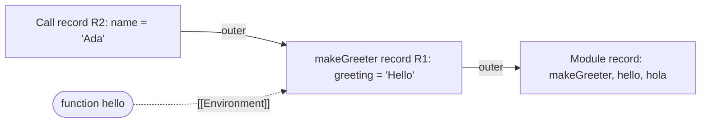
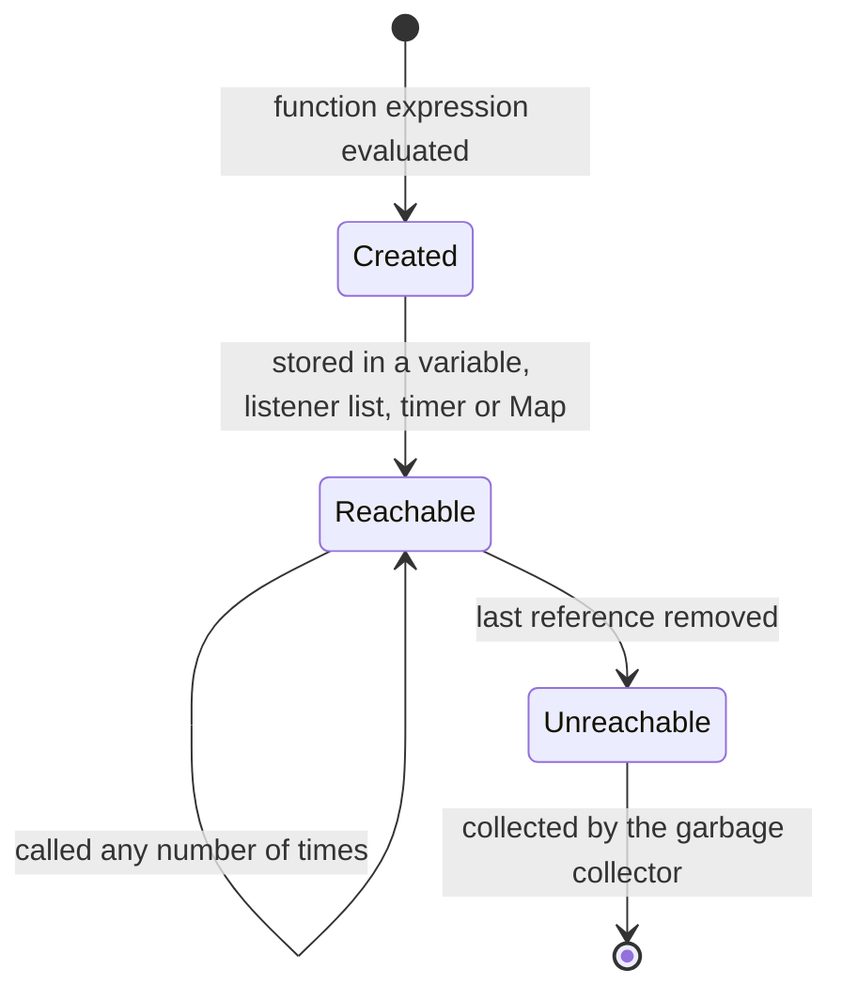

## Introduction

Here is a small program that surprises many people the first time they see it:

```javascript
function makeGreeter(greeting) {
  return function (name) {
    return `${greeting}, ${name}`;
  };
}

const hello = makeGreeter('Hello');
const hola = makeGreeter('Hola');

console.log(hello('Ada'));
console.log(hola('Linus'));
```

```output
Hello, Ada
Hola, Linus
```

By the time `hello('Ada')` runs, `makeGreeter` has already returned. Its parameter `greeting` was a local variable of a call that is over. In many languages that would mean the variable is gone. Yet the inner function still knows that its `greeting` is `'Hello'`, and the second inner function, made by a different call, knows that its `greeting` is `'Hola'`.

The mechanism that makes this work is called a **closure**: a function bundled together with references to the variables that were in scope where the function was *created*. The inner function "closes over" `greeting`, so that variable stays reachable for as long as the inner function does.

Closures are not an advanced feature you opt into. They are a direct consequence of two ordinary JavaScript rules — functions are values you can return and store, and variable lookup follows where code is written — so they appear in almost every program. Every callback passed to `addEventListener`, `setTimeout`, `fetch(...).then` or `array.map` that uses a variable from its surroundings is a closure. React's hooks are built on them. Module-level state, memoization caches, debounced handlers and middleware all rely on them.

Engineers need a precise model of closures for three reasons. They let you write compact code with private state and pre-configured functions. They are behind several of the most common JavaScript bugs: loops that print the same number three times ([[b1-closures-in-loops]]), React handlers that read old state ([[b1-stale-closures]]), and memory that never gets freed ([[b1-closure-memory]]). And they are among the most frequently asked JavaScript interview topics ([[b1-closure-puzzles]]). This lesson builds the model the other lessons in this module rely on.

## Before you start

- **Lexical scope** — the rule that a variable's visibility is decided by where it is written in the source. Closures are lexical scope that outlives a function call. See [[b1-lexical-scope]] and [[b1-scope-chain]].
- **`let`, `const` and `var`** — the difference between block scope and function scope matters for which variable a closure captures. See [[b1-var-let-const]].
- **First-class functions** — functions can be returned from other functions, stored in variables and passed as arguments. See [[b1-first-class-functions]].
- **Execution contexts** (helpful, not required) — what the engine creates when a function is called. See [[b1-execution-contexts]].

All code in this lesson runs as-is in Node.js 22 or a browser console. Output is shown as Node prints it.

## The intuition

Picture every function carrying a **backpack**. When the function is created, the engine puts into the backpack a link to the surroundings the function was written in — the variables of the enclosing function, the enclosing block, the module. Wherever the function travels afterwards — returned to a caller, stored in an object, handed to a timer that fires a minute later — it brings the backpack with it. When the function's code mentions a name it did not declare itself, it looks in the backpack.

Two details make this analogy accurate rather than misleading.

First, the backpack holds **links to the variables, not copies of their values**. If something changes the variable after the function was created, the function sees the new value next time it looks. A closure is a window onto live variables, not a photograph of them.

Second, the backpack is packed at **creation time, based on where the function is written** — not where or by whom it is later called. A function called from somewhere else entirely still sees the variables of its birthplace and nothing of its caller's.

Where the analogy stops working: two functions created in the same scope do not each get a private backpack. They share links to the *same* variables, so a change made through one is visible through the other. You will use this deliberately for private state later in this lesson.

## From lexical scope to closures

Start with something you already know. A function can read variables from the scope it is written in:

```javascript
const taxRate = 0.2;

function priceWithTax(price) {
  return price * (1 + taxRate);   // taxRate is not declared here
}

console.log(priceWithTax(100));
```

```output
120
```

`priceWithTax` does not declare `taxRate`, so the engine looks outward through the **scope chain** — the function's own scope, then the scope it was written inside, then the next one out — until it finds a declaration. This is **lexical scope**: the chain is decided by the nesting of the source code.

Nothing about this example looks special, because `taxRate` lives at the top level and exists for the whole program. The interesting case is when the outer scope is a function call that finishes:

```javascript
function makeTaxCalculator(taxRate) {
  function priceWithTax(price) {
    return price * (1 + taxRate);
  }
  return priceWithTax;
}

const ukPrice = makeTaxCalculator(0.2);
const dePrice = makeTaxCalculator(0.19);

console.log(ukPrice(100));
console.log(dePrice(100));
```

```output
120
119
```

Each call to `makeTaxCalculator` creates a fresh scope with its own `taxRate`, and a fresh `priceWithTax` function created inside that scope. The returned function keeps its scope reachable, so `ukPrice` and `dePrice` each carry a different `taxRate`. Calling a function that makes and returns another function this way is called a **function factory**.

So the definition of a closure in one sentence is: **a closure is a function plus the lexical environment it was created in, which stays alive as long as the function can still be called.**

> [!NOTE] Every JavaScript function is a closure
> Technically, every function object in JavaScript records its creation environment, including top-level functions (whose environment is the module or global scope). In everyday speech, people say "closure" when the function actually uses outer variables *and* outlives the scope that created them — as with returned functions, callbacks and event handlers. Both usages are correct; know that the mechanism is the same in all cases.

## Closures capture variables, not values

The most important fact about closures, and the source of most closure bugs, is that a closure refers to the **variable** (more precisely, the **binding** — the association between a name and a storage slot), not to the value the variable had when the function was created.

```javascript
let message = 'first';
const show = () => message;

message = 'second';
console.log(show());

message = 'third';
console.log(show());
```

```output
second
third
```

`show` was created while `message` was `'first'`, but it never stored `'first'`. Each time it runs, it reads the current value of the binding. This is exactly what you want for counters and caches, and exactly what bites you in loops and timers.

Because closures share bindings, two functions created in the same scope see each other's changes:

```javascript
function makeCounter() {
  let count = 0;
  return {
    increment: () => ++count,
    current: () => count,
  };
}

const counter = makeCounter();
counter.increment();
counter.increment();
console.log(counter.current());

const other = makeCounter();
console.log(other.current());
```

```output
2
0
```

`increment` and `current` were created during the same call, so they close over the same `count`. A second call to `makeCounter` creates a new scope with a separate `count`, so `other` starts at zero. Keep these two rules together: **functions from the same call share variables; functions from different calls do not.**

If you genuinely need a snapshot, copy the value into a new binding that nothing else changes — a parameter, or a `const` declared at the moment you want to freeze:

```javascript
let status = 'loading';
const snapshot = status;            // a new binding holding the current value
const readLive = () => status;
const readSnapshot = () => snapshot;

status = 'done';
console.log(readLive(), readSnapshot());
```

```output
done loading
```

The closure in `readSnapshot` still captures a binding; it is the binding `snapshot`, which never changes. Every "capture the value" fix you will see — `let` in loops, an immediately invoked function, a parameter — works by creating a new binding, not by making closures copy values.

### Mutation versus reassignment

When the captured variable holds an object, distinguish changing the object from changing the variable:

```javascript
let settings = { theme: 'light' };
const readTheme = () => settings.theme;
const original = settings;

settings.theme = 'dark';            // mutates the shared object
console.log(readTheme(), original.theme);

settings = { theme: 'blue' };       // rebinds the variable to a new object
console.log(readTheme(), original.theme);
```

```output
dark dark
blue dark
```

The closure follows the variable `settings`, so it sees both the mutation and the reassignment. The separate binding `original` still points at the first object, so it sees the mutation but not the reassignment. Thinking in terms of "which binding, and which object does it point at right now" resolves almost every closure puzzle.

## Definition site, not call site

A closure's variables come from where the function was written. The caller's variables are invisible to it:

```javascript
const label = 'module';

function report() {
  return label;
}

function caller() {
  const label = 'caller';     // a different variable that report cannot see
  return report();
}

console.log(caller());
```

```output
module
```

If JavaScript used the caller's scope (a rule called **dynamic scope**, used by some shells and older Lisps), this would print `caller`. JavaScript is lexically scoped, so `report` looks in the scope where it was defined and finds the module-level `label`.

One related trap: the value of `this` is *not* part of a regular function's closure. A regular `function` gets its own `this` from how it is called; only arrow functions take `this` from their surrounding scope. That is covered in [[b1-this]] and [[b1-lexical-this]], and it is why you sometimes see `const self = this` in older code — copying `this` into an ordinary variable so that inner functions can close over it.

```quiz
Q: What does `let n = 1; const read = () => n; n = 5; console.log(read());` print?

- [ ] 1, because the closure captured n when read was created
- [x] 5, because the closure reads the current value of the binding n
- [ ] undefined, because n was reassigned
- [ ] It throws, because n changed after the closure was created
> Closures hold references to bindings, not copies of values. When read runs, it looks up n and finds its current value, 5. Getting 1 would require copying the value into a separate binding at creation time.

Q: Two functions are returned from the same call of a factory and both use a local `let total`. One of them changes `total`. What does the other see?
- [x] The new value, because both close over the same binding created by that call
- [ ] The old value, because each function has its own copy of total
- [ ] It depends on whether the functions are arrow functions
- [ ] An error, because total is private
> One call creates one scope, so there is one total. Every function created during that call refers to it. A second call to the factory would create a separate total.
```

## How it works internally

The ECMAScript specification describes closures with a small set of structures. Knowing them lets you reason about any closure question instead of memorising cases.

**Environment Records.** Every time code enters a new scope — a function call, a block with `let`/`const`, a module — the engine creates an **Environment Record**: a table mapping names declared in that scope to their current values. Each record has a link to its **outer** record, the scope the code was written inside. Following those links is the scope chain.

**The `[[Environment]]` slot.** When the engine evaluates a function expression or declaration, it creates a function object and stores in an internal slot called `[[Environment]]` a reference to the Environment Record that is current at that moment. That reference is the backpack.

**Calling a function.** When the function is later called, the engine creates a new Environment Record for that call (holding parameters and locals) and sets its outer link to the function's `[[Environment]]` — *not* to the caller's record. That single step is what makes scope lexical.

Here is the sequence for the greeter from the introduction:

| Step | What happens | Records alive afterwards |
|---|---|---|
| 1 | `makeGreeter('Hello')` is called; record R1 is created with `greeting = 'Hello'` | Module, R1 |
| 2 | The inner function F1 is created; `F1.[[Environment]] = R1` | Module, R1 |
| 3 | `makeGreeter` returns F1; its stack frame is popped | Module, R1 (still referenced by F1) |
| 4 | `hello('Ada')` runs; record R2 holds `name = 'Ada'`, with outer link R1 | Module, R1, R2 |
| 5 | Lookup of `greeting`: not in R2, found in R1 | |
| 6 | The call ends; R2 is no longer referenced | Module, R1 |



The crucial point is step 3. The **call stack** and the **scope chain** are different things. The call stack records *which function calls are in progress*; it shrinks the moment `makeGreeter` returns. The scope chain records *which variables are visible*; its records live on the heap and are kept alive by ordinary references, like any other object. As long as F1 is reachable, R1 is reachable, and the garbage collector cannot free it. (See [[b1-call-stack]] and [[b1-heap]].)

### What real engines do

The specification describes the observable behaviour, not the implementation. Engines such as V8 (Chrome, Node.js, Edge) optimise heavily, and two of their choices matter in practice:

- A local variable that **no inner function references** is usually kept in a stack slot or register and disappears when the call ends. Only variables that some closure uses are moved into a heap object V8 calls a **Context**. So an inner function does not keep alive every local of its parent — only the captured ones.
- All closures created in the same scope **share one Context**. If any one of them captures a large object, every function created in that scope keeps that object alive. This is a real source of memory leaks and is shown in [[b1-closure-memory]].

A visible side effect of the first optimisation: when you pause in the debugger inside a closure and try to inspect an outer variable the closure does not use, DevTools may report that it is not available — it was never kept.

## Closure Lifecycle {#b1-closure-lifecycle}

The **closure lifecycle** is the span between the moment a closure is created and the moment its captured variables can be freed. A closure — the function object and the variables it captured — lives exactly as long as something can still reach the function. The captured variables have no lifetime of their own; they survive because the function references them, and they become collectable when the last reference to every function that captured them is gone.

### The three phases

**Creation.** The closure comes into existence when the engine evaluates the function expression or declaration, not when the function is first called. A function written inside a loop body is created once per iteration; a function written inside a component is created on every render. At this moment the function records its environment.

**Use.** While the function is reachable, it can run any number of times and read or write its captured variables. Each call gets a fresh record for its own parameters and locals, but the captured outer variables are the same ones every time — which is why a counter's `count` keeps growing.

**Release.** The function becomes unreachable when no variable, object property, array, `Map`, event-listener list, timer or pending promise reaction refers to it. On its next run, the garbage collector — which frees objects that can no longer be reached from the program's **roots** (the global object, the current call stack, active timers and listeners, and so on) — can reclaim the function and, if nothing else refers to them, the variables it captured. See [[b1-reachability]] and [[b1-garbage-collection]] for how reachability is decided.



### What keeps a closure alive

The important skill is listing the references. A closure is held by:

- a variable or object property that stores it (`const handler = ...`, `obj.onDone = ...`);
- an **event-listener list**, after `element.addEventListener('click', handler)`, until `removeEventListener` with the *same* function, or until the element itself becomes unreachable;
- a **timer**: `setTimeout` holds its callback until it fires; `setInterval` holds it until `clearInterval`;
- a **pending promise**: callbacks passed to `.then` are held until the promise settles;
- a **collection** such as an array, `Set` or `Map` used as a registry of subscribers;
- another closure that captured it.

```javascript title="lifecycle.mjs"
const subscribers = new Map();

function subscribe(name) {
  let calls = 0;                            // captured: lives as long as the closure
  const onEvent = () => `${name} handled ${++calls} event(s)`;
  subscribers.set(name, onEvent);
  return () => subscribers.delete(name);    // unsubscribe: drops the only reference
}

const unsubscribe = subscribe('audit');
console.log(subscribers.get('audit')());
console.log(subscribers.get('audit')());

unsubscribe();
console.log(subscribers.has('audit'));
```

```output
audit handled 1 event(s)
audit handled 2 event(s)
false
```

While `onEvent` is in the `Map`, its `calls` and `name` live on, and each call sees the previous count. After `unsubscribe()`, nothing refers to `onEvent` (the unsubscribe function closes over `name` but not over `onEvent`), so the function and its `calls` become collectable. Notice that the program cannot *observe* the freeing directly; garbage collection happens at the engine's convenience. What you control is reachability.

### Lifetimes in practice

Different places give closures different natural lifetimes, and matching the lifetime to the job is how you avoid leaks:

| Where the closure is held | Typical lifetime |
|---|---|
| A local variable in a function that does not leak it | Until that call ends |
| A `setTimeout` callback | Until it fires or is cleared |
| An event listener on a DOM element | Until removed, or the element becomes unreachable |
| A `setInterval` callback | Until `clearInterval` — forever if you forget |
| A module-level variable or registry | As long as the page or Node.js process runs |

Module-level closures deserve a special mention: a module is evaluated once and kept for the lifetime of the tab or process, so anything a module-level closure captures is effectively permanent. That is fine for configuration and a disaster for an unbounded cache.

### Capture only what you need

Because engines generally keep only the variables a closure actually references, a function that uses a small value does not by itself pin its large neighbours. The exception is the shared-Context behaviour described above: if *another* function created in the same scope uses the large object, both functions keep it alive. The practical rule is to read what you need into a small variable before creating a long-lived callback:

```javascript
function trackClicks(response) {
  const { id } = response;                 // keep the id, not the whole response
  return () => `clicked item ${id}`;
}

const handler = trackClicks({ id: 7, body: 'x'.repeat(1_000_000) });
console.log(handler());
```

```output
clicked item 7
```

The returned function references only `id`. Once `trackClicks` returns, nothing refers to the large `response` object, so it can be freed even though `handler` lives on. Had the callback used `response.id` directly, the whole object — including the one-megabyte string — would stay alive with it. The consequences for real applications are covered in [[b1-closure-memory]].

## Private State / Function Factories {#b1-private-state}

A **function factory** is a function that creates and returns new functions (or an object of functions), each configured by the factory's arguments. When the returned functions close over variables that are never exposed, those variables become **private state**: data that only the returned functions can read or change, because no other code can name the scope they live in.

Before JavaScript had class private fields (added in ES2022), closures were the only way to make state truly inaccessible from outside an object. They remain a common, idiomatic pattern today, especially for small stateful utilities.

### A bank account with real privacy

```javascript title="account.mjs"
function createAccount(opening) {
  let balance = opening;                   // private: not a property of anything

  return {
    deposit(amount) {
      if (amount <= 0) throw new RangeError('deposit must be positive');
      balance += amount;
    },
    withdraw(amount) {
      if (amount > balance) throw new RangeError('insufficient funds');
      balance -= amount;
    },
    getBalance() {
      return balance;
    },
  };
}

const account = createAccount(10);
account.deposit(5);
account.withdraw(3);
console.log(account.getBalance());
console.log(account.balance);              // there is no such property
console.log(Object.keys(account));

try {
  account.withdraw(100);
} catch (err) {
  console.log(err.message, account.getBalance());
}
```

```output
12
undefined
[ 'deposit', 'withdraw', 'getBalance' ]
insufficient funds 12
```

`balance` is a local variable of one call of `createAccount`. The returned object has three methods, all created in that call, so all three share the same `balance`. Code holding `account` can only change the balance through `deposit` and `withdraw`, which enforce the rules. There is no property to overwrite, no way to enumerate it with `Object.keys`, and no reflection API that reaches into a closure's scope. The only place the value is visible is the debugger, which can inspect closure scopes — useful for you, but a reminder that this is an *encapsulation* tool, not a security boundary against other scripts running on the same page.

Each call to the factory creates a new, independent locker:

```javascript
function createAccount(opening) {
  let balance = opening;
  return { deposit: (n) => { balance += n; }, getBalance: () => balance };
}

const alice = createAccount(100);
const bob = createAccount(100);
alice.deposit(50);
console.log(alice.getBalance(), bob.getBalance());
console.log(alice.deposit === bob.deposit);
```

```output
150 100
false
```

The second line shows the cost of the pattern: every account has its own copies of the method functions, because each was created inside a different call. With a class, all instances share one set of methods through the prototype.

### Ways to lose the privacy

**Returning the secret itself.** If the private value is an object or array and you return it, callers get a reference to the real thing and can mutate it:

```javascript
function createTodoList() {
  const items = [];
  return {
    add: (text) => items.push(text),
    getItemsUnsafe: () => items,           // leaks the private array
    getItems: () => [...items],            // returns a copy instead
  };
}

const todos = createTodoList();
todos.add('write tests');
todos.getItemsUnsafe().length = 0;         // outside code wipes the private list
console.log(todos.getItems());
```

```output
[]
```

Return copies or read-only views (`[...items]`, `structuredClone(obj)`, `Object.freeze` of a copy) when the private state is mutable. Copying has its own subtleties for nested data; see [[b1-copying-objects]].

**Storing it on `this` or the returned object.** Writing `this.balance = opening` makes the value a public, enumerable property. The closure pattern only works when the state stays in a local variable.

### The revealing module pattern

Before ES modules existed, libraries wrapped their code in an **Immediately Invoked Function Expression (IIFE)** — a function that is defined and called in one step — and returned only the public parts. Everything else stayed private in the IIFE's scope:

```javascript
const idGenerator = (() => {
  let next = 1;                            // private, created once
  const format = (n) => `id-${String(n).padStart(4, '0')}`;

  return {
    nextId: () => format(next++),
    reset: () => { next = 1; },
  };
})();

console.log(idGenerator.nextId());
console.log(idGenerator.nextId());
```

```output
id-0001
id-0002
```

This is a factory called exactly once, giving a singleton with private state. Modern code gets the same effect from ES module scope: a top-level `let` that is not exported is private to the module. See [[b1-iife]] and [[b1-module-pattern]].

### Closures versus private class fields

| | Closure factory | Class with `#private` fields (ES2022) |
|---|---|---|
| Privacy | Fully inaccessible from outside | Fully inaccessible from outside the class body |
| Methods | New function objects per instance | Shared on the prototype |
| `instanceof`, inheritance | Not available | Available (`extends`, `super`) |
| `this` handling | Not needed; methods can be passed around safely | Methods passed as callbacks can lose `this` |
| Best for | Small utilities, one-off configured functions, many callbacks | Many instances, inheritance, larger domain objects |

A practical difference beginners notice: `const { deposit } = account; deposit(5)` works with the closure version, because the method does not rely on `this`. The same destructuring on a class instance fails if `deposit` uses `this.#balance`. Classes and private fields are covered in [[b1-public-private-fields]] and the trade-offs in [[b1-classes-vs-factories]].

## Worked examples

The following utilities appear in real codebases and in interviews. Each is a closure doing a specific job.

### `once`: run a function at most one time

```javascript title="once.mjs"
function once(fn) {
  let called = false;
  let result;
  return function (...args) {
    if (!called) {
      called = true;
      result = fn.apply(this, args);       // keep the caller's this and arguments
    }
    return result;
  };
}

const init = once(() => {
  console.log('connecting...');
  return 'connection #1';
});

console.log(init());
console.log(init());
```

```output
connecting...
connection #1
connection #1
```

`called` and `result` live in the closure created by `once`. The first call flips `called` and stores the result; later calls skip the work. Setting `called = true` *before* calling `fn` matters: if `fn` indirectly calls `init` again, the second call returns immediately instead of running the initialisation twice. Using a regular `function` and `fn.apply(this, args)` lets `once` wrap methods as well as plain functions.

### `memoize`: cache results by argument

```javascript title="memoize.mjs"
function memoize(fn) {
  const cache = new Map();                 // private, one per memoized function
  return (n) => {
    if (cache.has(n)) return cache.get(n);
    const value = fn(n);
    cache.set(n, value);
    return value;
  };
}

let computations = 0;
const square = memoize((n) => {
  computations++;
  return n * n;
});

console.log(square(9), square(9), square(4));
console.log('computed', computations, 'times');
```

```output
81 81 16
computed 2 times
```

The cache is invisible to callers and survives between calls. This version handles one primitive argument; supporting several arguments needs a key strategy, and an unbounded cache in a long-lived closure is a memory risk. See [[b1-memoization]].

### Pre-configured functions (partial application)

```javascript title="logger.mjs"
function createLogger(prefix, { timestamps = false } = {}) {
  return (message) => {
    const time = timestamps ? '[12:00] ' : '';   // fixed time keeps output stable
    return `${time}${prefix}: ${message}`;
  };
}

const dbLog = createLogger('db');
const apiLog = createLogger('api', { timestamps: true });
console.log(dbLog('connected'));
console.log(apiLog('GET /users'));
```

```output
db: connected
[12:00] api: GET /users
```

Configuration is supplied once; the returned function is called many times with only the varying part. This is the idea behind [[b1-currying]].

## In real systems

**Event handlers and async callbacks.** Every handler that uses a variable from its surroundings is a closure:

```javascript
function setupSearch(input, resultsEl) {
  let lastQuery = '';
  input.addEventListener('input', async () => {
    const query = input.value;
    lastQuery = query;
    const res = await fetch(`/api/search?q=${encodeURIComponent(query)}`);
    if (query !== lastQuery) return;       // a newer request has started; drop this one
    resultsEl.textContent = await res.text();
  });
}
```

The handler closes over `input`, `resultsEl` and `lastQuery`. Each invocation also has its own `query`, and the comparison with the shared `lastQuery` discards out-of-order responses — a closure-based guard against race conditions ([[b1-stale-requests]]).

**React hooks.** A function component is called on every render, and every handler and effect defined inside it closes over that render's props and state. This is what makes `onClick={() => setCount(count + 1)}` work, and also what causes stale-state bugs. See [[b1-closures-react]].

**Debounce and throttle.** A debounced function keeps its pending timer ID in a closure so that each call can cancel the previous one ([[b1-debounce]]).

**Server middleware.** Frameworks such as Express use factories like `rateLimit({ windowMs, max })` that return a middleware function closing over its configuration and an in-memory counter store.

**Iterators and generators.** Hand-written iterators keep their position in a closure; generators do the same thing with language support ([[b1-iterators]]).

## Trade-offs and alternatives

Closures give you encapsulation without classes, functions that carry their configuration, and callbacks that remember their context without global variables. Their costs are real but manageable:

- **Hidden state.** State in a closure does not appear in `console.log` of the object or in serialisation. That is the point for privacy, but it can make debugging harder; DevTools shows closure scopes under "Scope" when paused.
- **Memory.** A long-lived closure keeps its captured variables alive. Usually that is a few bytes; occasionally it is a DOM tree or a large response.
- **Per-instance functions.** Factories allocate new function objects per instance. For a handful of objects this is irrelevant; for hundreds of thousands, prototype methods are cheaper.
- **Surprising reads.** Because closures read live bindings, code that runs later — timers, handlers, promise callbacks — may see values different from those at creation, or old values from a binding that has since been replaced.

Alternatives: pass data explicitly as arguments when the function does not need to remember it; use a class with private fields when you need many instances, inheritance or `instanceof`; use module scope for singletons.

## Common mistakes

> [!MISTAKE] Expecting a closure to snapshot values
> `let x = 1; const f = () => x; x = 2; f()` returns `2`. If you need the value at creation time, copy it into a binding that will not change (a `const` or a parameter) and close over that.

**Creating callbacks in a `var` loop.** All the callbacks share one `var` binding and see its final value. Use `let`, which creates a fresh binding per iteration. This is the subject of [[b1-closures-in-loops]].

**Assuming a closure sees the caller's variables.** Lookup follows the definition site. To give a function data from its caller, pass it as an argument.

**Assuming `this` is captured.** Regular functions get `this` from the call; only arrow functions inherit it lexically.

**Leaking private state by reference.** Returning an internal array or object hands out the real thing. Return a copy.

**Holding closures longer than needed.** Forgotten listeners, intervals and registry entries keep their closures — and everything those capture — alive. Always pair registration with removal.

## Interview perspective

"What is a closure?" is one of the most common JavaScript interview openers, and interviewers use it to see whether you understand the mechanism or only an example.

> [!INTERVIEW] A strong one-minute answer
> "A closure is a function together with the lexical environment it was created in. When a function is created, it keeps a reference to the scope around it, so it can read and update those variables even after the outer function has returned. It captures bindings, not values, so it sees later changes. That's how factories create private state, and it's also why a `var` loop with `setTimeout` prints the final value."

Questions to be ready for:

- **Why does the inner variable survive after the outer function returns?** The variables live in an environment record on the heap, referenced by the function's `[[Environment]]` slot. The call stack frame goes away; the environment does not, because it is still reachable.
- **Do closures copy values?** No. They reference bindings. Show the `let x = 1; ... x = 2` example.
- **How would you make a counter that cannot be modified from outside?** A factory with a local `let count` and returned methods. Mention `#private` fields as the class-based alternative.
- **Can closures cause memory leaks?** Only by keeping things reachable longer than intended: forgotten listeners, intervals, caches. Mention that V8 shares one context per scope, so one capturing closure can keep a sibling's variables alive.
- **Write `once` or `memoize`.** Both are short closures; explain where the state lives and why it persists between calls.

A follow-up that separates candidates: *"Is every function a closure?"* Yes — every function records its creation environment — but the term is usually used when the function outlives that scope.

## Practice

1. **Counter with limits.** Write `createCounter({ min, max })` returning `increment`, `decrement` and `value`, where the count never leaves the range. Confirm that two counters are independent.
2. **Snapshot or live?** Predict, then run: `let a = 1; const f = () => a; const g = ((v) => () => v)(a); a = 2; console.log(f(), g());`. Explain which bindings each function closes over.
3. **Rate limiter.** Write `limit(fn, n)` that lets `fn` run at most `n` times and returns the last result afterwards. Compare it with `once`.
4. **Fix the leak.** A module keeps `const handlers = []` and pushes a closure every time a component mounts, but never removes them. Change the API so each registration returns an unsubscribe function.
5. **Factory or class?** Rewrite `createAccount` as a class with `#balance`. Then try `const { deposit } = account; deposit(1)` on both versions and explain the difference.

## Quick revision {#quick-revision}

- Closure = function + the lexical environment it was created in; every JS function has one (`[[Environment]]` slot).
- Lookup follows where the function was **written**, never where it is called (lexical, not dynamic, scope).
- Closures capture **bindings**, not values: later changes are visible; reassignments of the captured variable are visible.
- Functions created in the same call share variables; separate calls create separate variables.
- To snapshot, create a new binding (`const copy = value`, a parameter, `let` per loop iteration).
- The call stack frame disappears on return; the environment survives on the heap while any closure references it.
- Lifecycle: created when the function expression is evaluated → reachable via variables, listeners, timers, promises, collections → collectable when the last reference is removed.
- V8 keeps only captured variables, but all closures from one scope share one Context.
- Factories give real private state; each call creates new state and new method objects. Return copies, never the private object itself.
- `this` is not captured by regular functions; arrow functions use the surrounding `this`.

## Key takeaways {#key-takeaways}

- A closure lets a function keep using the variables of the scope it was created in, after that scope has finished running.
- Closures refer to live bindings, so they see later changes; snapshots require a new binding.
- What a closure can see is decided by where it is written, not by who calls it.
- A closure and everything it captured stay alive exactly as long as something can still reach the function — so release listeners, timers and registry entries when they are done.
- Function factories turn closures into private state and pre-configured functions, at the cost of per-instance function objects.
- The loop, stale-state and memory problems in the rest of this module are all consequences of these same rules.
