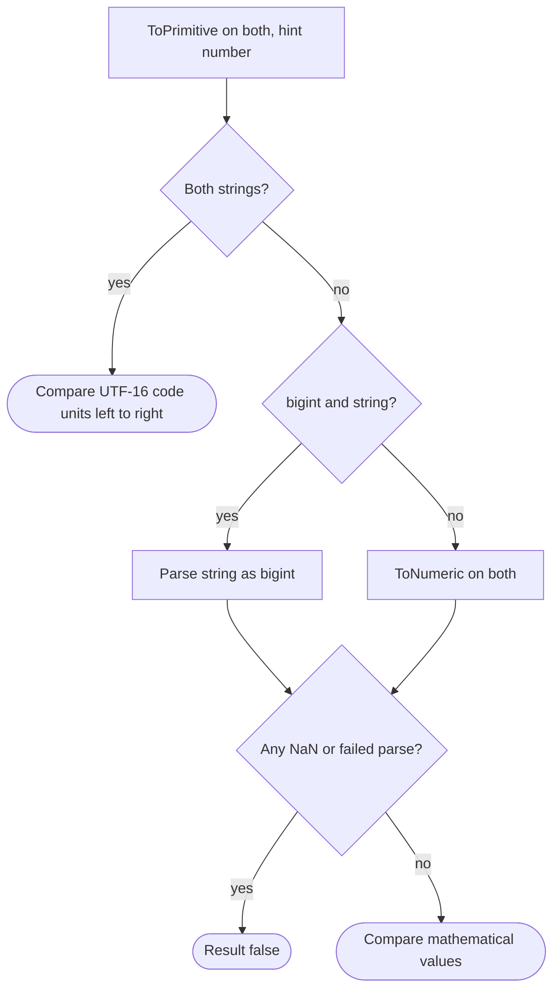

## Introduction

A product listing lets users filter by price. The prices come from a JSON feed where someone stored them as strings, and the filter looks harmless:

```javascript title="filter-bug.js"
const prices = ['9', '10', '100', '25'];
console.log(prices.filter((p) => p > '20'));
console.log(prices.filter((p) => Number(p) > 20));
```

```output
[ '9', '25' ]
[ '100', '25' ]
```

The first filter says 9 is more than 20 and 100 is not. Nothing is broken in the engine: when both operands of `>` are strings, JavaScript compares them **alphabetically**, character by character, the way a dictionary orders words. `'9'` comes after `'2'`, so `'9' > '20'`. Converting to numbers first gives the intended result.

This lesson is about the **relational operators** — `<`, `>`, `<=` and `>=` — which decide order. They are used in every `if` that checks a limit, every loop condition, every sort comparator and every date range. Their rules are short, but they branch on the operand types, and most comparison bugs come from a value having a different type than the programmer assumed.

Equality (`==`, `===`, `!=`, `!==`) is the other half of comparison. It follows a *different* algorithm and has its own lesson, [[b1-equality]]; this lesson refers to it only where the two interact.

## Before you start

- **Primitive types** — strings, numbers, bigints, booleans, `null`, `undefined`. See [[b1-primitive-types]].
- **Type coercion** — the idea that operators convert operands automatically. See [[b1-type-coercion]].
- **NaN** — the "not a number" value and why it is not equal to itself. See [[b1-nan-infinity]].
- **Arithmetic operators** — the same number conversion is used here. See [[b1-arithmetic-operators]].

## The intuition

A relational operator asks one question first: **are both operands strings?**

If yes, it acts like a dictionary. It walks both strings from the left, comparing one character at a time, and the first position where they differ decides the answer. It never looks at what the characters *mean* — `'10'` and `'9'` are just a `'1'` versus a `'9'` at position 0.

If no, it acts like a number line. It converts both operands to numbers and compares their positions. `true` sits at 1, `null` at 0, and anything that cannot become a number turns into `NaN`, which has **no position on the line** at all. Asking whether something without a position is before or after something else can only be answered "no", so every comparison involving `NaN` is `false`.

That is the whole model: dictionary for two strings, number line for everything else, and `NaN` answers "no" to every question.

## The four operators

| Operator | Meaning | `3 ? 5` | `5 ? 5` |
|---|---|---|---|
| `<` | less than | `true` | `false` |
| `>` | greater than | `false` | `false` |
| `<=` | less than or equal | `true` | `true` |
| `>=` | greater than or equal | `false` | `true` |

All four always return a boolean, `true` or `false`. Unlike `&&` and `||`, they never return one of their operands.

```javascript title="basics.js"
console.log(3 < 5, 5 > 3, 5 <= 5, 5 >= 6);
console.log('10' < '9', '10' < 9, 10 < 9);
console.log('apple' < 'banana', 'Zebra' < 'apple', 'a' < 'ab', 'abc' < 'abd');
console.log('A'.charCodeAt(0), 'a'.charCodeAt(0), 'é' < 'f', 'é'.charCodeAt(0));
```

```output
true true true false
true false false
true true true true
65 97 false 233
```

The second line is the core of this lesson in three expressions. Two strings, `'10' < '9'`, compare as text and give `true`. A string and a number, `'10' < 9`, convert the string to the number 10 and give `false`. Two numbers give `false`. **One string operand is enough to switch to numeric comparison**; only *two* strings stay in text mode.

## Comparing two strings

When both operands are strings, JavaScript compares them **lexicographically by UTF-16 code unit**. Each character in a JavaScript string is stored as one or two 16-bit numbers called **code units** (most common characters fit in one). The comparison walks both strings from index 0:

1. At the first index where the code units differ, the string with the smaller code unit is "less".
2. If one string runs out first and every code unit so far matched, the shorter string is "less" (`'a' < 'ab'`).
3. If both run out together, they are equal, so `<` and `>` are `false` and `<=` and `>=` are `true`.

Because the comparison uses raw code unit numbers, the order is the order of the Unicode table, not of any human language. Three consequences follow from the third and fourth lines of the output above.

**Uppercase sorts before lowercase.** `'A'` is 65 and `'a'` is 97, and every capital letter is below every lowercase letter. So `'Zebra' < 'apple'` is `true`.

**Digits are characters, not numbers.** `'10' < '9'` because `'1'` (49) is less than `'9'` (57). This is why the price filter failed, and why numeric strings must be converted before comparing.

**Accented letters land far from their base letter.** `'é'` is code unit 233, above every unaccented lowercase letter (`'z'` is 122), so `'é' < 'f'` is `false` even though a French or English reader would put "é" right next to "e". Characters outside the Basic Multilingual Plane, such as most emoji, are stored as two code units starting with a value between `0xD800` and `0xDBFF`, which can make them compare below some ordinary characters. See [[b1-unicode-strings]].

### Human-language order: `localeCompare` and `Intl.Collator`

For anything a person reads — names, cities, product titles — use **collation**: language-aware ordering provided by `String.prototype.localeCompare` or `Intl.Collator`. They return a negative number, zero or a positive number, which is exactly the shape a sort comparator needs.

```javascript title="collation.js"
console.log([10, 9, 1, 100].sort());
console.log([10, 9, 1, 100].sort((a, b) => a - b));
console.log(['banana', 'Cherry', 'apple'].sort());
console.log(['banana', 'Cherry', 'apple'].sort((a, b) => a.localeCompare(b)));
console.log(['item10', 'item9', 'item1'].sort(new Intl.Collator(undefined, { numeric: true }).compare));
console.log('résumé'.localeCompare('resume', 'en'), 'a'.localeCompare('b'), 'b'.localeCompare('a'));
```

```output
[ 1, 10, 100, 9 ]
[ 1, 9, 10, 100 ]
[ 'Cherry', 'apple', 'banana' ]
[ 'apple', 'banana', 'Cherry' ]
[ 'item1', 'item9', 'item10' ]
1 -1 1
```

The first line is a famous trap that belongs here because it is string comparison in disguise: `Array.prototype.sort` with no comparator converts every element to a string and compares code units, so numbers sort as `1, 10, 100, 9`. Passing `(a, b) => a - b` sorts numerically. With strings, the default sort puts `'Cherry'` first because of its capital letter; `localeCompare` gives dictionary order. The `numeric: true` collator option goes further and compares runs of digits by value, so `'item9'` comes before `'item10'` — what file managers call natural sort. When sorting many strings, create one `Intl.Collator` and reuse its `compare` function; it is faster than calling `localeCompare` repeatedly. Sorting is covered fully in [[b1-array-sort]].

Collation results can differ between locales and between engine versions, because they come from the Unicode data bundled with the runtime (ICU in V8 and Node.js). Use them for display order, not for anything that must be identical on every machine, such as keys in a protocol.

## Comparing everything else: convert to numbers

If at least one operand is not a string, both are converted to **numeric** values (numbers, or bigints — see below) and compared on the number line.

```javascript title="numeric-mode.js"
console.log('abc' < 1, 'abc' >= 1);
console.log(null < 1, null >= 0, undefined < 1, undefined >= 0);
console.log(true > false, true >= 1, [2] > 1, [1, 2] < 3);
console.log(NaN < 1, NaN > 1, NaN <= NaN, NaN >= NaN);
console.log(-0 < 0, -0 <= 0, Infinity > Number.MAX_VALUE);
```

```output
false false
true true false false
true true true false
false false false false
false true true
```

The conversions are the same ones arithmetic uses: `null` becomes `0`, `undefined` becomes `NaN`, `true` becomes `1`, `false` becomes `0`, and non-numeric strings like `'abc'` become `NaN`. Objects are first converted to a primitive: `[2]` becomes `'2'`, which then becomes `2`; `[1, 2]` becomes `'1,2'`, which becomes `NaN`.

Look at `'abc' < 1` and `'abc' >= 1`. Both are `false`. In ordinary logic, if something is not less than 1 it must be greater than or equal to 1. That law fails here because `'abc'` became `NaN`, and **every relational comparison with `NaN` returns `false`** — including `NaN <= NaN`. So you cannot use `!(a < b)` as a substitute for `a >= b` unless you know neither value is `NaN`.

`-0` and `0` compare as equal on the number line (`-0 < 0` is `false`, `-0 <= 0` is `true`). `Infinity` is greater than every finite number. To tell `-0` from `0`, use `Object.is` ([[b1-object-is]]).

### The `null >= 0` puzzle

This is the most famous comparison question in JavaScript interviews:

```javascript title="null-puzzle.js"
console.log(null > 0, null == 0, null >= 0);
console.log(undefined == null, undefined >= null);
```

```output
false false true
true false
```

`null` is not greater than 0, not equal to 0, and yet greater than or equal to 0. The explanation is that **relational operators and `==` are different algorithms**:

- `null > 0` and `null >= 0` use the relational algorithm, which converts `null` to the number `0`. So they ask `0 > 0` (false) and `0 >= 0` (true).
- `null == 0` uses the abstract equality algorithm, which has a special rule: `null` is loosely equal only to `null` and `undefined`, and it is **never** converted to a number. So the answer is `false`.

The second line repeats the pattern from the other side: `undefined == null` is `true` by that special rule, while `undefined >= null` converts to `NaN >= 0`, which is `false`. The practical lesson: never use `<`, `>`, `<=` or `>=` to check for "missing" values. A missing value that is `null` passes `>= 0`; one that is `undefined` fails it. Use `value == null` or explicit checks ([[b1-undefined-vs-null]]), then compare.

### Objects and dates

An object operand is converted to a primitive first, preferring a number: JavaScript calls its `valueOf` method and, if that does not return a primitive, its `toString` method ([[b1-to-primitive]]).

```javascript title="objects.js"
const d1 = new Date('2024-03-01');
const d2 = new Date('2024-03-01');
console.log(d1 < d2, d1 <= d2, d1 >= d2, d1 == d2, d1.getTime() === d2.getTime());
const money = { cents: 500, valueOf() { return this.cents; } };
console.log(money > 400, money < 400);
console.log({} < {}, ({}) >= ({}));
```

```output
false true true false true
true false
false true
```

`Date` objects have a `valueOf` that returns the timestamp in milliseconds, so relational operators on dates compare points in time — `d1 <= d2` and `d1 >= d2` are both `true` for two dates at the same instant. But `d1 == d2` is `false`: equality between two objects checks whether they are the **same object**, and these are two separate objects. This mismatch catches many developers. Compare dates for equality with `d1.getTime() === d2.getTime()`.

The `money` object shows that any object can make itself comparable by defining `valueOf`. Plain objects have no useful `valueOf`, so they fall back to `toString`, which returns `'[object Object]'` for both — two equal strings. That is why `{} < {}` is `false` but `{} >= {}` is `true`: the operator is comparing two identical strings.

### BigInt comparisons

Unlike arithmetic, comparison **does** allow mixing `bigint` and `number`. The specification compares their exact mathematical values, without converting one to the other's type.

```javascript title="bigint-compare.js"
console.log(1n < 2, 2n > 1.5, 2n == 2, 9007199254740993n > 9007199254740992);
console.log(9007199254740993 > 9007199254740992);
console.log('10' < 11n, 'x' < 1n, 'x' >= 1n);
```

```output
true true true true
false
true false false
```

The first line's last comparison is exact: the bigint `9007199254740993n` really is greater than 2⁵³. The second line shows why that matters. As a `number`, the literal `9007199254740993` cannot be represented and rounds to `9007199254740992`, so the comparison is between two equal values. Mixing is allowed in comparisons because there is no information to lose — the answer is computed on the true values. A string compared with a bigint is parsed as a bigint; if parsing fails (`'x'`), the result is "undefined", which every operator reports as `false`, just as with `NaN`.

## No chained comparisons

Mathematics writes `1 < x < 10` to mean "x is between 1 and 10". JavaScript parses the same characters differently.

```javascript title="chained.js"
console.log(1 < 2 < 3, 3 > 2 > 1);
const x = 15;
console.log(10 < x && x < 20);
```

```output
true false
true
```

Relational operators are left-associative and return booleans, so `3 > 2 > 1` means `(3 > 2) > 1`, which is `true > 1`, which converts `true` to `1` and asks `1 > 1`: `false`. `1 < 2 < 3` gives `true` by luck, for a similarly meaningless reason. Python supports chained comparisons; JavaScript, Java and C do not. Write range checks with `&&`, and put the variable in the middle with the bounds on the outside (`min <= x && x <= max`) so the code reads like the mathematical form.

## How it works internally

The specification defines all four operators with one abstract operation, **`IsLessThan(x, y, LeftFirst)`**, which returns `true`, `false` or `undefined` (meaning "not comparable", the `NaN` case). Paraphrased:

1. Convert both operands with `ToPrimitive(value, number)` — objects call `valueOf`, then `toString`. `LeftFirst` controls which operand is converted first, so that side effects happen in source order even when the operator swaps its arguments.
2. If both primitives are strings, compare them code unit by code unit.
3. If one is a bigint and the other a string, parse the string as a bigint; if that fails, return `undefined`.
4. Otherwise convert both with `ToNumeric`. If either is `NaN`, return `undefined`. Compare the mathematical values (this is where bigint and number can be compared exactly).

The four operators are built from `IsLessThan` like this:

| Expression | Computed as | Result if `undefined` |
|---|---|---|
| `a < b` | `IsLessThan(a, b)` | `false` |
| `a > b` | `IsLessThan(b, a)` | `false` |
| `a <= b` | not `IsLessThan(b, a)` | `false` |
| `a >= b` | not `IsLessThan(a, b)` | `false` |

This table explains the `null >= 0` result mechanically: `null >= 0` is "not (`null < 0`)", and `null < 0` is `0 < 0`, which is false, so the answer is true. It also explains `NaN`: `NaN <= NaN` would be "not `undefined`", but the specification special-cases `undefined` to `false` for every operator.



Engines optimise the common case heavily. When V8 sees that a loop condition like `i < arr.length` always compares two small integers, its optimising compiler emits a single machine comparison and skips all of the conversion steps; the generic path only runs when types vary.

## Worked example: comparing version strings

Feature flags, update prompts and dependency checks often need "is version A newer than version B?". The tempting solution compares the strings directly.

```javascript title="versions.js"
function compareVersions(a, b) {
  const pa = a.split('.').map(Number);
  const pb = b.split('.').map(Number);
  const length = Math.max(pa.length, pb.length);
  for (let i = 0; i < length; i++) {
    const x = pa[i] ?? 0;  // treat a missing segment as 0, so 1.2 equals 1.2.0
    const y = pb[i] ?? 0;
    if (Number.isNaN(x) || Number.isNaN(y)) throw new Error(`Bad version: ${a} or ${b}`);
    if (x < y) return -1;
    if (x > y) return 1;
  }
  return 0;
}

console.log('1.10.0' > '1.9.0');                 // string comparison
console.log(compareVersions('1.10.0', '1.9.0'));
console.log(compareVersions('2.0', '2.0.0'));
console.log(compareVersions('0.9.12', '0.10.1'));
console.log(['1.10.0', '1.2.0', '1.9.3'].sort(compareVersions));
```

```output
false
1
0
-1
[ '1.2.0', '1.9.3', '1.10.0' ]
```

String comparison says `'1.10.0'` is *not* greater than `'1.9.0'`: the strings agree on `'1.'`, then `'1'` (49) is less than `'9'` (57). The same mistake is made by anyone who sorts versions alphabetically.

`compareVersions` fixes it by comparing segment by segment as numbers. Splitting on `'.'` and mapping through `Number` turns `'1.10.0'` into `[1, 10, 0]`. The loop compares corresponding segments with `<` and `>` on numbers, and the first difference decides. Missing segments count as 0, which makes `'2.0'` and `'2.0.0'` equal. A non-numeric segment (for example `'1.0.0-beta'`) produces `NaN`; rather than let `NaN` make every comparison false and silently return 0, the function throws. Real-world versions with pre-release tags follow the Semantic Versioning rules, so production code uses a library such as `semver` instead of this simplified version.

The function returns `-1`, `0` or `1`, so it can be passed straight to `sort`, as the last line shows.

The same "convert first" discipline applies to form validation. The `min`, `max` and `value` of an `<input>` are all strings in the Document Object Model (DOM):

```javascript title="range-check.js"
// Simulating values read from <input type="number" min="1" max="9">
const field = { value: '10', min: '1', max: '9' };
console.log(field.value > field.max);                   // string vs string
console.log(Number(field.value) > Number(field.max));   // number vs number

function inRange(value, min, max) {
  return Number.isFinite(value) && min <= value && value <= max;
}
console.log(inRange(Number('10'), 1, 9), inRange(Number(''), 1, 9), inRange(NaN, 1, 9));
console.log(inRange(Number('abc'), -Infinity, Infinity));
console.log(Number(''));
```

```output
false
true
false false false
false
0
```

Comparing the raw strings says 10 is not above the maximum of 9. Converting fixes it. `inRange` adds `Number.isFinite` so that `NaN` is rejected explicitly instead of relying on comparisons quietly returning `false`. Note the last line: `Number('')` is `0`, so an empty field is "in range" for any range that contains 0 — check for empty input separately (or use `input.valueAsNumber`, which gives `NaN` for an empty field). These snippets simulate the DOM values; they were run in Node.js, not in a browser.

## In real systems

**Sorting tables and lists.** Data grids sort columns with comparators: `a - b` for numbers, `Intl.Collator` for text, timestamps for dates. Mixing numeric strings into a numeric column is the usual source of "10 comes before 9" bug reports.

**Dates and time windows.** Checks like `now >= start && now < end` for a sale banner or a token expiry use `Date` objects or epoch milliseconds. Comparing with relational operators works; comparing dates with `===` does not.

**Validation and limits.** Rate limits (`attempts >= MAX_ATTEMPTS`), pagination bounds (`page > totalPages`) and form constraints are relational comparisons on numbers that often began life as strings.

**Version gates.** Feature flags and "please update" prompts compare semantic versions, which always needs a segment-wise numeric comparison.

## Trade-offs and alternatives

| You are comparing | Use | Avoid |
|---|---|---|
| Numbers | `<`, `>`, and `a - b` in comparators | Comparing numeric strings directly |
| Text shown to people | `Intl.Collator#compare` or `localeCompare` | Raw `<` (code-unit order, case-sensitive) |
| Machine identifiers (stable order) | Raw `<` on strings | Locale-dependent collation |
| Dates | `<` / `>` on `Date` or `getTime()` | `==` / `===` between `Date` objects |
| Versions | Segment-wise numeric compare or `semver` | String compare |
| Possibly missing values | `x == null` check first | `x >= 0` as a presence check |

Raw code-unit comparison has one real advantage: it is fast and identical on every engine and locale, which is what you want for deterministic ordering of keys, IDs or hashes. Collation is slower and locale-dependent, which is what you want for people.

## Common mistakes

> [!MISTAKE] Comparing numbers that are secretly strings
> Values from inputs, query strings, `localStorage`, CSV files and some APIs are strings. Two strings compare alphabetically, so `'100' < '25'`. Convert with `Number(...)` at the boundary, and the comparison becomes numeric.

**Sorting numbers without a comparator.** `[10, 9, 1].sort()` gives `[1, 10, 9]`. Always pass `(a, b) => a - b` for numbers.

**Returning a boolean from a sort comparator.** `(a, b) => a > b` returns `true` or `false`, which `sort` reads as `1` or `0`, never negative. The result depends on the engine's sort algorithm and is often wrong. Return a negative, zero or positive number.

**Writing `a < b < c`.** It compares a boolean with `c`. Use `a < b && b < c`.

**Trusting comparisons with `NaN`.** `if (!(price < 0))` lets `NaN` through as "valid". Check `Number.isFinite` first.

**Using `>=` to detect presence.** `null >= 0` is `true` and `undefined >= 0` is `false`. Check for `null`/`undefined` explicitly.

**Comparing dates with `===`.** Two `Date` objects for the same instant are different objects. Compare `getTime()` values.

## Interview perspective

Comparison questions are a favourite way to probe whether you understand coercion as rules rather than as trivia.

> [!INTERVIEW] Explaining `null >= 0`
> "Relational operators convert `null` to the number 0, so `null >= 0` is `0 >= 0`, which is true. Equality is a different algorithm: `==` never converts `null` to a number — it is only loosely equal to `null` and `undefined` — so `null == 0` is false. That's why I never use relational operators to check for missing values."

Questions to prepare:

- **Why is `'10' < '9'` true but `'10' < 9` false?** Two strings compare by code units; one non-string operand switches to numeric comparison.
- **What does `[10, 1, 3].sort()` return and how do you fix it?** `[1, 10, 3]`; pass `(a, b) => a - b`.
- **Why is `3 > 2 > 1` false?** Left-associative: `true > 1` becomes `1 > 1`.
- **What do `NaN < 1`, `NaN >= 1` and `NaN <= NaN` return?** All `false`; `NaN` is unordered.
- **How do you sort user names correctly?** `Intl.Collator` (optionally with `sensitivity` and `numeric` options), reused across comparisons.
- **Can you compare a bigint with a number?** Yes, exactly; arithmetic between them throws, but comparison does not.

```quiz
Q: What does `['8', '30', '200'].filter((s) => s > '100')` return?
- [ ] `['200']`
- [x] `['8', '30', '200']`
- [ ] `['8', '30']`
- [ ] `[]`
> Both operands are strings, so the comparison is by code unit from the left. `'8'` (56) and `'3'` (51) are both greater than `'1'` (49), so `'8'` and `'30'` pass. `'200'` passes too because `'2'` is greater than `'1'`. Converting with `Number(s) > 100` would return only `['200']`.

Q: Which explanation of `null >= 0 === true` and `null == 0 === false` is correct?
- [ ] `null` is converted to `false`, and `false >= 0` is true
- [x] Relational operators convert `null` to 0, while `==` has a rule that `null` only equals `null` or `undefined`
- [ ] `>=` is implemented as `> || ==`, and one of them is true
- [ ] It is an engine bug that browsers keep for compatibility
> `null >= 0` is computed as "not (null < 0)", and null converts to 0, so it is "not (0 < 0)", which is true. The abstract equality algorithm never converts null to a number. If `>=` were `> || ==` the result would be false, because both parts are false.

Q: Why is `1 < 2 < 3` true but `3 > 2 > 1` false?
- [ ] JavaScript supports chained comparisons only in ascending order
- [ ] The second expression compares strings
- [x] Each is evaluated left to right as a boolean compared with a number: `true < 3` is true, `true > 1` is false
- [ ] `>` has lower precedence than `<`
> Relational operators are left-associative and return booleans. `1 < 2` is true, and `true < 3` converts true to 1, giving 1 < 3, true. `3 > 2` is true, and `true > 1` is 1 > 1, false. Write range checks with `&&`.

Q: Which comparator sorts an array of numbers ascending correctly in every engine?
- [ ] `(a, b) => a > b`
- [ ] No comparator: `arr.sort()`
- [x] `(a, b) => a - b`
- [ ] `(a, b) => String(a) < String(b)`
> A comparator must return a negative number, zero or a positive number. `a - b` does exactly that. A boolean comparator never returns a negative value, so the result depends on the sorting algorithm. With no comparator, elements are compared as strings, so 10 sorts before 9.
```

## Practice

1. Predict, then run: `'b' > 'a'`, `'B' > 'a'`, `'2' > '12'`, `2 > '12'`, `undefined > 0`, `[3] > [12]`, `null <= -0`, `'' < 1`.
2. Write `clamp(value, min, max)` that returns `value` limited to `[min, max]` and throws if any argument is not a finite number.
3. Sort `['Émile', 'zoë', 'Adam', 'éva', 'Zack']` three ways — default, `localeCompare`, and `Intl.Collator('en', { sensitivity: 'base' })` — and explain each order.
4. Write `isBetween(date, start, end)` for `Date` objects with an inclusive start and exclusive end. Then write `sameInstant(a, b)`.
5. Extend `compareVersions` to accept a leading `v` (`'v1.2.3'`) and to reject empty segments such as `'1..2'`.

## Quick revision {#quick-revision}

- `<`, `>`, `<=`, `>=` always return a boolean.
- Step 1: `ToPrimitive` with number hint (objects: `valueOf`, then `toString`).
- Both strings → compare UTF-16 code units left to right; shorter prefix is smaller. `'10' < '9'`, `'Z' < 'a'`.
- Otherwise → convert to numbers (`null` → 0, `undefined` → `NaN`, `true` → 1, `'abc'` → `NaN`) and compare.
- Any `NaN` → every relational operator returns `false`, so `!(a < b)` is not `a >= b`.
- `a > b` is `b < a`; `a <= b` is `!(b < a)`; `a >= b` is `!(a < b)` — hence `null >= 0` is true.
- `null == 0` is false: `==` is a different algorithm.
- BigInt vs number compares exact values (no `TypeError`, unlike arithmetic).
- Dates compare by timestamp with `<`/`>`; use `getTime()` for equality.
- No chaining: `a < b < c` is `(a < b) < c`. Use `&&`.
- Human text: `Intl.Collator` / `localeCompare`; numbers in sort: `(a, b) => a - b`.

## Key takeaways {#key-takeaways}

- Relational operators have two modes: text comparison when both operands are strings, numeric comparison otherwise.
- String comparison is by UTF-16 code unit, so it is case-sensitive and treats digits as characters; use collation for anything people read.
- `NaN` makes every relational comparison false, which breaks the usual logical laws — validate numbers before comparing.
- `null >= 0` is true and `null == 0` is false because relational operators and equality use different algorithms.
- Convert strings from inputs, URLs and APIs to numbers once, at the boundary, and comparisons become predictable.
- Sort comparators must return numbers, and range checks must use `&&`, not chained operators.
