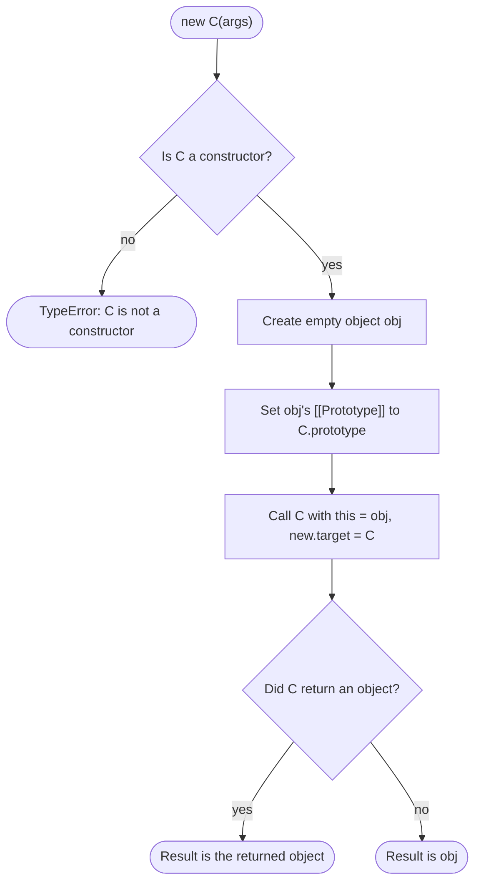
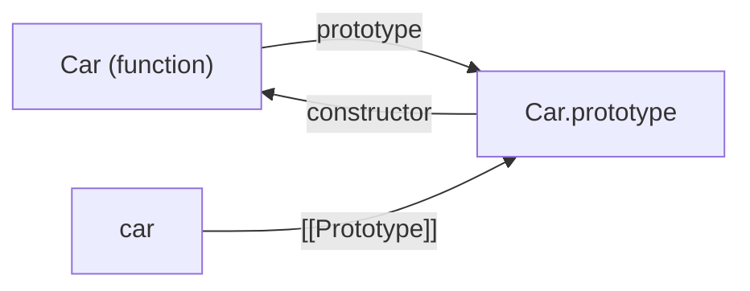

## Introduction

Programs constantly need many objects of the same kind: users, points, orders, DOM nodes. Each one has its own data, and all of them should share the same behaviour. [[b1-prototypes]] showed the mechanism that makes sharing possible — an object delegates to its prototype — and you could wire it up by hand every time:

```javascript title="by-hand.js"
const pointMethods = {
  toString() {
    return `(${this.x}, ${this.y})`;
  },
};

function createPoint(x, y) {
  const point = Object.create(pointMethods);   // make an object, link its prototype
  point.x = x;                                  // initialise it
  point.y = y;
  return point;                                 // hand it back
}

console.log(String(createPoint(3, 4)));
```

```output
(3, 4)
```

Three chores are repeated in every such factory: create an object linked to the right prototype, initialise it, return it. JavaScript has had an operator that performs the first and last chores for you since its first version. It is `new`, and a function written to be used with it is called a **constructor function**:

```javascript title="first-constructor.js"
function Point(x, y) {
  this.x = x;
  this.y = y;
}
Point.prototype.toString = function () {
  return `(${this.x}, ${this.y})`;
};

console.log(String(new Point(3, 4)));
```

```output
(3, 4)
```

Inside the function you only write the initialisation. `new` creates the object, links it to `Point.prototype`, makes it available as `this`, and returns it.

You may wonder why this matters when `class` exists. There are three reasons. A class *is* a constructor function with stricter rules, so everything in this lesson is what your classes compile down to conceptually and what you see in a debugger. A great deal of existing code — older libraries, Node.js core modules, transpiled output — is written in this style. And "what does `new` do?" together with "implement `new` yourself" are among the most common JavaScript interview questions.

This lesson has two nested concepts: [[b1-new-operator|what `new` actually does]], and [[b1-constructor-property|the `constructor` property]].

## Before you start

- **Functions** — declarations, parameters and return values. See [[b1-function-declaration]].
- **`this`** — its value depends on how a function is called; `obj.method()` sets it to `obj`, and a plain call does not. See [[b1-this]] and [[b1-this-default]].
- **Prototypes** — the `[[Prototype]]` link, and how it differs from a function's `prototype` property. See [[b1-prototypes]].
- **The prototype chain** — how reads walk up and writes stay local. See [[b1-prototype-chain]].
- **`call` and `apply`** — invoking a function with a chosen `this`. See [[b1-call]]. Used for inheritance and for the hand-written `new`.

Snippets were run with Node.js 22. Files named `.mjs` run in strict mode; plain `.js` snippets here run in sloppy mode unless noted, which matters when `new` is forgotten.

## The intuition

Think of a constructor function as the setup instructions in a factory, and `new` as the assembly line that runs them. The line does the same things for every product: it takes a blank item from the store, stamps it with a reference to the shared manual for that product type, hands it to the worker who follows the setup instructions, and puts the finished item on the outgoing belt. The worker only customises the item — sets its serial number, its colour. They never fetch the blank and never carry the item out.

The shared manual is `Constructor.prototype`: one copy, referenced by every item. The setup instructions are the function body. The item being worked on is `this`.

The analogy has a limit. A real assembly line cannot be bypassed, but a constructor function is an ordinary function, and nothing stops you calling it *without* `new`. Then there is no blank item, `this` is something else entirely, and the instructions scribble on whatever they are handed. Guarding against that is part of writing a constructor well.

## Writing a constructor function

A constructor function is a normal function used in a particular way. By convention its name starts with a capital letter (**PascalCase**) to signal "call me with `new`". The capital letter changes nothing for the engine; it is a message to other programmers and to linters.

```javascript title="point.js"
function Point(x, y) {
  this.x = x;
  this.y = y;
}
Point.prototype.distanceTo = function (other) {
  return Math.hypot(this.x - other.x, this.y - other.y);
};
Point.prototype.toString = function () {
  return `(${this.x}, ${this.y})`;
};

const a = new Point(0, 0);
const b = new Point(3, 4);

console.log(a.distanceTo(b));
console.log(String(b));
console.log(Object.keys(b));
console.log(a.distanceTo === b.distanceTo);
console.log(b instanceof Point);
```

```output
5
(3, 4)
[ 'x', 'y' ]
true
true
```

The pattern has two halves, and each goes in a specific place.

**Per-instance data goes on `this`, inside the function.** Each call to `new Point(...)` gets a fresh object as `this`, so `this.x = x` gives every point its own `x`. These are own properties, which is why `Object.keys(b)` lists `x` and `y`.

**Shared behaviour goes on `Point.prototype`, outside the function.** Every function created with the `function` keyword automatically gets a `prototype` property holding a nearly empty object. `new` links each instance to that object, so a method added there is reachable from every instance — and it is one function, as `a.distanceTo === b.distanceTo` confirms. The method reads `this.x`, and because it is called as `a.distanceTo(b)`, `this` is `a`.

`b instanceof Point` is `true` because `Point.prototype` is in `b`'s prototype chain; that is all `instanceof` checks ([[b1-instanceof]]).

### Why methods go on the prototype

You can attach methods inside the constructor instead. It works, and the cost is easy to see:

```javascript title="method-placement.js"
function SlowCounter() {
  this.count = 0;
  this.increment = function () {      // a new function for every instance
    this.count += 1;
  };
}
function FastCounter() {
  this.count = 0;
}
FastCounter.prototype.increment = function () {
  this.count += 1;
};

console.log(new SlowCounter().increment === new SlowCounter().increment);
console.log(new FastCounter().increment === new FastCounter().increment);
console.log(Object.keys(new SlowCounter()), Object.keys(new FastCounter()));
```

```output
false
true
[ 'count', 'increment' ] [ 'count' ]
```

`SlowCounter` creates a new function object every time it runs, so ten thousand counters hold ten thousand `increment` functions, and each shows up as an own property in `Object.keys`, in spread copies and in `for...in`. `FastCounter` stores one function on the prototype.

There is one legitimate reason to define a method in the constructor: it needs access to variables that are local to the constructor call. Such a function is a **closure** ([[b1-closures]]) and gives you private state that nothing outside can reach:

```javascript title="private-via-closure.js"
function Account(owner, openingBalance) {
  let balance = openingBalance;        // private: only the closures below see it
  this.owner = owner;
  this.deposit = function (amount) {
    balance += amount;
    return balance;
  };
  this.getBalance = function () {
    return balance;
  };
}

const acc = new Account('Ada', 100);
acc.deposit(50);
console.log(acc.getBalance(), acc.balance);
```

```output
150 undefined
```

`balance` is a local variable, not a property, so `acc.balance` is `undefined` and no outside code can change it. The price is one pair of functions per account. Before classes gained `#private` fields in ES2022 ([[b1-public-private-fields]]), this was the standard way to get real privacy, and [[b1-private-state]] covers it further.

### Static members

A function is an object, so you can also attach properties to the constructor itself. These belong to the function, not to instances, and are the equivalent of `static` members in a class:

```javascript title="static-member.js"
function Temperature(celsius) {
  this.celsius = celsius;
}
Temperature.fromFahrenheit = function (f) {     // static: on the function itself
  return new Temperature(((f - 32) * 5) / 9);
};
Temperature.prototype.toString = function () {
  return `${this.celsius.toFixed(1)}°C`;
};

const t = Temperature.fromFahrenheit(212);
console.log(String(t));
console.log(typeof t.fromFahrenheit);
```

```output
100.0°C
undefined
```

`fromFahrenheit` is not on `Temperature.prototype`, so instances cannot reach it. Built-ins follow the same split: `Array.isArray` and `Object.keys` are static, while `push` and `hasOwnProperty` live on the prototypes. See [[b1-instance-static]].

## Forgetting `new`

Because a constructor is an ordinary function, calling it without `new` is legal. What happens depends on strict mode, and neither outcome is good:

```javascript title="forgot-new.js"
function User(name) {
  this.name = name;
}

const result = User('Ada');            // forgot new, sloppy mode
console.log(result);
console.log(globalThis.name);
```

```output
undefined
Ada
```

Without `new`, this is a plain function call. In sloppy mode, `this` in a plain call is the global object, so `this.name = name` created a **global variable** — a silent leak. The function has no `return`, so `result` is `undefined`, and the bug surfaces later as "cannot read properties of undefined" somewhere far from its cause.

In strict mode (which includes all ES modules and class bodies), `this` in a plain call is `undefined`, so the mistake fails immediately:

```javascript title="forgot-new-strict.mjs"
function User(name) {
  this.name = name;
}
try {
  User('Ada');
} catch (err) {
  console.log(err.name + ': ' + err.message);
}
```

```output
TypeError: Cannot set properties of undefined (setting 'name')
```

An immediate error is better than a silent global, but the message does not mention `new`. You can detect the situation precisely with **`new.target`**, a special expression that is the constructor when the function was invoked with `new` and `undefined` otherwise:

```javascript title="new-target-guard.js"
function Strict(name) {
  if (!new.target) {
    throw new TypeError('Strict must be called with new');
  }
  this.name = name;
}
function Lenient(name) {
  if (!new.target) {
    return new Lenient(name);
  }
  this.name = name;
}

try {
  Strict('Ada');
} catch (err) {
  console.log(err.message);
}
console.log(Lenient('Ada') instanceof Lenient, Lenient('Ada').name);
console.log(typeof Date(), typeof new Date());
console.log(typeof String(5), typeof new String(5));
```

```output
Strict must be called with new
true Ada
string object
string object
```

There are two policies. `Strict` refuses to run, which is what classes do automatically. `Lenient` repairs the call by constructing for you. Before `new.target` arrived in ES2015 the same guard was written `if (!(this instanceof Lenient))`, which you will still find in older libraries.

The last two lines show that built-ins make their own choices. Some behave the same either way (`Array(3)` and `new Array(3)`), but `Date()` without `new` returns a *string*, and `String(5)` returns a primitive while `new String(5)` returns a wrapper object. Do not assume `new` is optional for a built-in; check.

## Which functions can be constructors

Not every function can be used with `new`. In the specification, a function object always has a `[[Call]]` internal method (what runs for `f()`) and may also have a `[[Construct]]` internal method (what runs for `new f()`). Only functions with `[[Construct]]` are constructors.

```javascript title="constructable.js"
const arrow = () => {};
const obj = { method() {} };
async function later() {}
class Modern {}

console.log(arrow.prototype, obj.method.prototype, later.prototype);
for (const [label, fn] of [['arrow', arrow], ['method', obj.method], ['async', later]]) {
  try {
    new fn();
  } catch (err) {
    console.log(label, '->', err.name);
  }
}
try {
  Modern();
} catch (err) {
  console.log(err.message);
}
console.log(typeof Modern, Object.keys(function f() {}.prototype));
```

```output
undefined undefined undefined
arrow -> TypeError
method -> TypeError
async -> TypeError
Class constructor Modern cannot be invoked without 'new'
function []
```

| Kind of function | `f()` | `new f()` | Has `prototype` property |
|---|---|---|---|
| `function` declaration / expression | Yes | Yes | Yes |
| `class` | No (throws `TypeError`) | Yes | Yes |
| Arrow function | Yes | No | No |
| Method shorthand `{ m() {} }` | Yes | No | No |
| `async` function | Yes | No | No |
| Generator function | Yes | No | Yes (used for generator objects) |

Arrow functions have no `this` of their own ([[b1-arrow-functions]]), so there would be nothing for a constructor body to initialise; they have neither `[[Construct]]` nor a `prototype` property. Classes are the mirror image: they can only be constructed. Old-style `function`s are the only kind that allow both, which is exactly what makes forgetting `new` possible.

## What new Actually Does {#b1-new-operator}

The **`new` operator** calls a function as a constructor: it creates a fresh object, links that object to the function's `prototype`, runs the function with `this` set to the new object, and evaluates to that object. "Create, link, initialise, return" — four steps. Knowing them precisely lets you predict every odd case and write `new` yourself.

### The four steps

For `new C(a, b)`:

1. **Create** a new, empty object.
2. **Link** it: set the object's `[[Prototype]]` to `C.prototype`. (If `C.prototype` is not an object, `Object.prototype` is used instead.)
3. **Initialise**: call `C` with `this` bound to the new object, the given arguments, and `new.target` set to `C`.
4. **Return**: if the function returned an object, the result of `new` is that object. Otherwise — no `return`, or a primitive returned — the result is the object from step 1.

You can observe steps 1 to 3 from inside the constructor:

```javascript title="inside-new.js"
function Robot(name) {
  console.log('new.target is Robot:', new.target === Robot);
  console.log('this is linked:', Object.getPrototypeOf(this) === Robot.prototype);
  console.log('this is empty:', Object.keys(this).length === 0);
  this.name = name;
}
Robot.prototype.kind = 'robot';

const r = new Robot('R2');
console.log(r.name, r.kind);
```

```output
new.target is Robot: true
this is linked: true
this is empty: true
R2 robot
```

By the time the first line of the body runs, `this` already exists, is already linked to `Robot.prototype`, and has no own properties yet. That ordering matters: the constructor body can call prototype methods on `this` straight away, because the link is made *before* initialisation.



### Step 4: the return override

A constructor normally has no `return` statement. If it has one, the kind of value decides what happens:

```javascript title="return-override.js"
function ReturnsObject() {
  this.a = 1;
  return { hijacked: true };
}
function ReturnsPrimitive() {
  this.a = 1;
  return 42;
}
function ReturnsFunction() {
  return function inner() {};
}
function ReturnsNull() {
  this.a = 1;
  return null;
}

console.log(new ReturnsObject());
console.log(new ReturnsPrimitive());
console.log(typeof new ReturnsFunction());
console.log(new ReturnsNull());
```

```output
{ hijacked: true }
ReturnsPrimitive { a: 1 }
function
ReturnsNull { a: 1 }
```

Returning an object (including an array or a function) **replaces** the object `new` created; the original, with its `a` property and its prototype link, is discarded. Returning a primitive is **ignored**. `null` counts as a primitive here even though `typeof null` is `"object"`, so it is ignored too.

The override has genuine uses: returning a cached instance to implement a singleton or an object pool, or returning a `Proxy` wrapped around `this`. It is also a trap, because the replacement object is not linked to `C.prototype` unless you arrange it, so `new C() instanceof C` can be `false`. Do not return values from constructors unless you intend this.

### Writing `new` yourself

Implementing the operator as a function is a standard interview exercise, and the four steps translate directly:

```javascript title="my-new.js"
function myNew(Ctor, ...args) {
  if (typeof Ctor !== 'function') {
    throw new TypeError(`${String(Ctor)} is not a constructor`);
  }
  const proto = Ctor.prototype;
  const isObject = (v) => (typeof v === 'object' && v !== null) || typeof v === 'function';
  // Step 1 + 2: create the object already linked to the prototype.
  const obj = Object.create(isObject(proto) ? proto : Object.prototype);
  // Step 3: run the function body with this = the new object.
  const result = Ctor.apply(obj, args);
  // Step 4: an object result replaces the new object; anything else is ignored.
  return isObject(result) ? result : obj;
}

function Point(x, y) {
  this.x = x;
  this.y = y;
}
Point.prototype.sum = function () {
  return this.x + this.y;
};
function Weird() {
  return [1, 2, 3];
}

const p = myNew(Point, 2, 3);
console.log(p.sum(), p instanceof Point);
console.log(myNew(Weird));
console.log(myNew(function () { return 7; }) instanceof Object);
```

```output
5 true
[ 1, 2, 3 ]
true
```

`Object.create(proto)` performs steps 1 and 2 together. `Ctor.apply(obj, args)` is step 3. The final line is step 4, and it is the part candidates most often forget. The `isObject` helper is more careful than the common `result instanceof Object` test, which gives the wrong answer for objects created with `Object.create(null)`.

This version is a teaching model, not a full replacement. It cannot set `new.target` (so guards inside the constructor see `undefined`), and it cannot construct classes, because a class refuses to be called with `apply`. The real equivalent of `new` as a function is **`Reflect.construct(C, args)`**, which invokes `[[Construct]]` directly.

### Edge cases worth knowing

```javascript title="new-edge-cases.js"
function Point(x = 0, y = 0) {
  this.x = x;
  this.y = y;
}
const coords = [4, 5];

console.log(new Point);
console.log(new Point(...coords));

try {
  new Math.max(1, 2);
} catch (err) {
  console.log(err.message);
}
const BoundPoint = Point.bind(null, 9);
const bp = new BoundPoint(1);
console.log(bp, bp instanceof Point);
console.log(Reflect.construct(Point, [1, 2]));
```

```output
Point { x: 0, y: 0 }
Point { x: 4, y: 5 }
Math.max is not a constructor
Point { x: 9, y: 1 } true
Point { x: 1, y: 2 }
```

- **Parentheses are optional** when there are no arguments: `new Point` is `new Point()`. Always write them anyway; `new Point.x` and `new Point().x` mean different things, and the first is rarely what you want.
- **Spread works** in a `new` call, which removed the need for old tricks to "apply" a constructor to an array.
- **Non-constructors throw** a `TypeError`. That includes arrow functions, methods, and most built-in functions such as `Math.max`.
- **`new` beats `bind`.** A bound function's fixed `this` (here `null`) is ignored when it is called with `new`; the freshly created object is used. Pre-filled arguments (`9`) are kept. See [[b1-this-new]].
- **A non-object `prototype` does not throw.** If `C.prototype` has been set to a primitive such as `3`, `new C()` still works and the instance is linked to `Object.prototype`. (Some summaries claim this throws; it does not. What throws afterwards is `instance instanceof C`.)

### `new.target` and classes

Inside any function, `new.target` tells you how it was invoked. In an inheritance chain it refers to the constructor that `new` was *applied to*, not the one currently running, which lets a base class know which subclass is being built:

```javascript title="new-target-class.js"
class Shape {
  constructor() {
    console.log('constructing', new.target.name);
    if (new.target === Shape) {
      throw new TypeError('Shape is abstract');
    }
  }
}
class Square extends Shape {}

new Square();
try {
  new Shape();
} catch (err) {
  console.log(err.message);
}
```

```output
constructing Square
constructing Shape
Shape is abstract
```

This is the usual way to write an "abstract" base class in JavaScript. It also reveals a difference in how classes run the four steps. In a **derived** class (one with `extends`), `new` does not create the object up front. The object is created by the *base* constructor when `super()` is called, using `new.target.prototype` for the link, which is why touching `this` before `super()` throws a `ReferenceError`. This is what allows a subclass of `Array` or `Error` to get a real array or error object. Details are in [[b1-class-constructor]] and [[b1-class-inheritance]].

```quiz
Q: What does `new F()` evaluate to when `function F() { this.a = 1; return 5; }`?
- [ ] `5`
- [x] An object `{ a: 1 }` linked to `F.prototype`
- [ ] `undefined`
- [ ] It throws a `TypeError`
> When a constructor returns a primitive, `new` ignores it and evaluates to the object it created. Only a returned object (including arrays and functions) replaces the new instance. Returning `5` from the same function called *without* `new` would give `5`, which is why the two call styles must not be confused.

Q: In which order do these happen for `new C()`?
- [ ] Run C, then create the object, then link the prototype
- [ ] Create the object, run C, then link the prototype
- [x] Create the object, link its prototype to `C.prototype`, then run C with `this` set to it
- [ ] Link `C` to `Object.prototype`, then run C
> The prototype link is made before the body runs, so the constructor can already call inherited methods on `this`. If the link were made afterwards, `this.someProtoMethod()` inside the constructor would fail.
```

## constructor Property {#b1-constructor-property}

Every function's `prototype` object starts life with one property: **`constructor`**, a reference back to the function. Because instances delegate to that prototype object, every instance can read `.constructor` and get the function that (usually) created it. It is an ordinary property with no special protection, which makes it convenient and also unreliable. This section explains where it comes from, how it gets lost, when it is useful, and why you should not use it to check types.

### Where it comes from

```javascript title="constructor-default.js"
function Car() {}
const car = new Car();

console.log(Car.prototype.constructor === Car);
console.log(car.constructor === Car);
console.log(Object.hasOwn(car, 'constructor'));
console.log(Object.getOwnPropertyDescriptor(Car.prototype, 'constructor'));
console.log(Object.keys(Car.prototype));
```

```output
true
true
false
{
  value: [Function: Car],
  writable: true,
  enumerable: false,
  configurable: true
}
[]
```

When the engine creates a `function`, it also creates the object for its `prototype` property and defines `constructor` on that object. `car.constructor` works by ordinary lookup: `car` has no own `constructor` (`false`), so the read continues to `Car.prototype` and finds it there. The descriptor shows it is a plain data property that is **writable** and **configurable** — anyone can change or delete it — and **non-enumerable**, so it stays out of `Object.keys` and `for...in`. (Descriptor flags are explained in [[b1-property-descriptors]].)

A good mental model is a sticky note on the prototype that says "objects that delegate here were made by `Car`". `new` never reads the note and `instanceof` never reads it. It is information for you, and anyone can replace it.



### Losing it by replacing the prototype

A common old idiom assigns a whole new object to `F.prototype` so that all the methods can be written in one literal. That new object is a plain object, and it has no own `constructor`:

```javascript title="constructor-lost.js"
function Bike() {}
Bike.prototype = {
  ride() {
    return 'riding';
  },
};

const bike = new Bike();
console.log(bike.constructor === Bike);
console.log(bike.constructor === Object, bike.constructor.name);
console.log(bike instanceof Bike);

function Scooter() {}
Scooter.prototype = {
  ride() {
    return 'scooting';
  },
};
Object.defineProperty(Scooter.prototype, 'constructor', {
  value: Scooter,
  writable: true,
  enumerable: false,
  configurable: true,
});
console.log(new Scooter().constructor === Scooter, Object.keys(Scooter.prototype));
```

```output
false
true Object
true
true [ 'ride' ]
```

Follow the lookup for `bike.constructor`. `bike` has none. Its prototype, the replacement literal, has none. The literal's prototype is `Object.prototype`, whose `constructor` is `Object`. So `bike.constructor` is `Object`, and logs that print `obj.constructor.name` say `Object` — confusing when you expected `Bike`. Notice that `instanceof` is unaffected, because it compares prototype objects and never looks at `constructor`.

The repair is to put the property back. Writing `constructor: Scooter` inside the literal works but creates an *enumerable* property, unlike the original; `Object.defineProperty` restores it faithfully, as shown. The same repair is step 3 of the classic inheritance recipe below, because `Object.create(Parent.prototype)` also produces an object with no own `constructor`.

Better still, avoid the problem: add methods to the existing prototype object (`Bike.prototype.ride = ...`) instead of replacing it, or use `class`, which always sets `constructor` correctly on the prototype it builds.

### What it is good for

The most valuable use is creating "another object of the same kind as this one" without hard-coding which kind that is:

```javascript title="constructor-uses.js"
class Money {
  constructor(amount, currency) {
    this.amount = amount;
    this.currency = currency;
  }
  plus(other) {
    // Build "another of whatever I am" without naming the class.
    return new this.constructor(this.amount + other.amount, this.currency);
  }
}
class Price extends Money {}

const total = new Price(5, 'EUR').plus(new Price(7, 'EUR'));
console.log(total instanceof Price, total.amount);

console.log((5).constructor === Number, 'a'.constructor === String);
console.log([].constructor === Array, {}.constructor === Object);
console.log(Object.create(null).constructor);
```

```output
true 12
true true
true true
undefined
```

`plus` is defined on `Money`, but when it is called on a `Price`, `this.constructor` resolves to `Price` (found on `Price.prototype`), so the result is a `Price`. Had the method said `new Money(...)`, subclasses would silently get the wrong type back. Built-ins use a refined version of this idea: `Array.prototype.map` called on an instance of a subclass of `Array` returns an instance of the subclass, by consulting `this.constructor` (and then its `Symbol.species` property).

The other lines show that the property is everywhere. Primitives reach it through their wrapper prototypes, and literals reach `Array.prototype.constructor` and `Object.prototype.constructor`. A null-prototype object has no chain and therefore no `constructor` at all.

### Why it is not a type check

Because `constructor` is an ordinary writable property found by ordinary lookup, any object can claim anything:

```javascript title="constructor-lies.js"
const fake = { constructor: Array };
console.log(fake.constructor === Array, Array.isArray(fake), fake instanceof Array);
```

```output
true false false
```

Use `constructor` for convenience and logging, not for decisions that matter. For type checks, prefer `instanceof` (which checks the chain), `Array.isArray`, or a brand such as a private field or a `Symbol`-keyed tag ([[b1-tostringtag]]). Never use it as a security check on untrusted data.

There is also a security angle in the other direction. Every ordinary object can reach `Object` through `obj.constructor`, and from there `obj.constructor.prototype` is `Object.prototype`. Code that follows attacker-supplied property paths can be led along `constructor` → `prototype` to modify the prototype shared by all objects. That is one of the two classic routes of [[b1-prototype-pollution]], and it is why `constructor` appears on key deny-lists next to `__proto__`.

### Quick reference

| Situation | `obj.constructor` |
|---|---|
| `new F()` with the default prototype | `F` |
| Instance of a `class C` | `C` |
| `F.prototype` replaced by a literal, not repaired | `Object` |
| `Sub.prototype = Object.create(Super.prototype)`, not repaired | `Super` |
| `{}` / `[]` / `() => {}` | `Object` / `Array` / `Function` |
| `Object.create(null)` | `undefined` |
| Object with its own `constructor` key | Whatever was stored |

## Inheritance with constructor functions

Before `class` and `extends`, making one constructor inherit from another took three explicit steps. The pattern is still worth reading fluently, because it shows exactly what `extends` automates:

```javascript title="classic-inheritance.js"
function Animal(name) {
  this.name = name;
}
Animal.prototype.speak = function () {
  return `${this.name} makes a sound`;
};

function Dog(name, breed) {
  Animal.call(this, name);                         // 1. run the parent initialiser
  this.breed = breed;
}
Dog.prototype = Object.create(Animal.prototype);   // 2. link the prototypes
Dog.prototype.constructor = Dog;                   // 3. repair constructor
Dog.prototype.speak = function () {
  return `${Animal.prototype.speak.call(this)} (woof)`;
};

const rex = new Dog('Rex', 'collie');
console.log(rex.speak());
console.log(Object.keys(rex));
console.log(rex instanceof Dog, rex instanceof Animal);
console.log(rex.constructor === Dog);
```

```output
Rex makes a sound (woof)
[ 'name', 'breed' ]
true true
true
```

Step 1, `Animal.call(this, name)`, runs the parent function as a plain call against the object being built, so the parent's per-instance properties (`name`) are set on it. This is the job `super(name)` does in a class. Step 2 replaces `Dog.prototype` with an object that delegates to `Animal.prototype`, creating the chain `rex` → `Dog.prototype` → `Animal.prototype`. It uses `Object.create` rather than `new Animal()` so that the parent constructor does not run with missing arguments just to make a prototype object ([[b1-object-create]]). Step 3 restores the `constructor` note that step 2 lost. Calling the overridden parent method requires naming it explicitly, `Animal.prototype.speak.call(this)`, where a class would write `super.speak()`.

The equivalent class is shorter and harder to get wrong:

| Constructor-function pattern | `class` equivalent |
|---|---|
| `function Dog(name) { … }` | `class Dog { constructor(name) { … } }` |
| `Dog.prototype.speak = function () {}` | `speak() {}` in the class body |
| `Dog.create = function () {}` | `static create() {}` |
| `Animal.call(this, name)` | `super(name)` |
| `Dog.prototype = Object.create(Animal.prototype)` | `extends Animal` |
| `Dog.prototype.constructor = Dog` | automatic |
| `Animal.prototype.speak.call(this)` | `super.speak()` |
| Guard with `new.target` | automatic: calling without `new` throws |

Classes are not *only* shorthand. They add behaviour the old pattern cannot fully reproduce: class bodies are strict, methods are non-enumerable, the constructor cannot be called without `new`, `extends` also links the constructors themselves so statics are inherited, and built-ins such as `Array` and `Error` can be subclassed correctly. Write classes in new code ([[b1-classes]]), and read the constructor pattern as their expanded form.

## How it works internally

When the engine evaluates a `function` declaration or expression, it creates a function object with a `[[Call]]` internal method and, for constructor-capable kinds, a `[[Construct]]` internal method. For those it also creates a fresh ordinary object, defines `constructor` on it pointing back at the function, and stores it as the function's `prototype` property. On a plain function that `prototype` property is writable (so it can be replaced) but non-configurable; on a class it is not writable either.

`new C(args)` evaluates `C` and the arguments, checks that `C` has `[[Construct]]` (throwing a `TypeError` if not), and invokes `[[Construct]](args, newTarget)` with `newTarget` equal to `C`. For an ordinary (base) constructor, `[[Construct]]` first runs `OrdinaryCreateFromConstructor`, which reads `newTarget.prototype`; if that value is an object it becomes the new object's `[[Prototype]]`, otherwise the default `Object.prototype` is used. It then binds `this` to the new object, runs the body, and applies the return rule: an object result is returned as-is, anything else yields the new object. For derived class constructors, no object is created up front; `this` stays uninitialised until `super()` returns the object built by the parent.

Note that `prototype` is read **at the time of each `new` call**. Replacing `C.prototype` affects objects created afterwards, while existing instances keep their link to the old prototype object. This is why swapping a prototype after instances exist makes `oldInstance instanceof C` turn `false`: `instanceof` compares against the *current* `C.prototype`.

Engines optimise constructors heavily. V8 tracks the properties a constructor assigns to `this` and gives instances a shared hidden class ([[b1-hidden-classes]]), so objects built by the same constructor in the same order have the same layout and property access on them can be cached. Assigning properties in a consistent order, and assigning all of them in the constructor rather than adding some later, keeps instances on the same hidden class.

## Worked example: an event emitter

A small publish/subscribe object exercises every part of the pattern: per-instance state, shared methods, a guard, and a subclass.

```javascript title="emitter.js"
function Emitter() {
  if (!new.target) {
    throw new TypeError('Emitter must be called with new');
  }
  this.listeners = new Map();          // per instance: never put this on the prototype
}
Emitter.prototype.on = function (event, handler) {
  if (!this.listeners.has(event)) {
    this.listeners.set(event, []);
  }
  this.listeners.get(event).push(handler);
  return this;                         // allow chaining
};
Emitter.prototype.emit = function (event, ...args) {
  const handlers = this.listeners.get(event) ?? [];
  for (const handler of handlers) {
    handler.apply(this, args);
  }
  return handlers.length;
};

function Logger(prefix) {
  Emitter.call(this);
  this.prefix = prefix;
}
Logger.prototype = Object.create(Emitter.prototype);
Logger.prototype.constructor = Logger;
Logger.prototype.log = function (message) {
  return this.emit('log', `${this.prefix} ${message}`);
};

const a = new Logger('[a]');
const b = new Logger('[b]');
a.on('log', (line) => console.log(line)).on('log', (line) => console.log(line.length));

console.log('handlers called:', a.log('started'));
console.log('handlers called:', b.log('started'));
console.log(a.on === b.on, a.listeners === b.listeners);
console.log(a.constructor.name, a instanceof Emitter);
```

```output
[a] started
11
handlers called: 2
handlers called: 0
true false
Logger true
```

`Emitter` keeps its listeners in a `Map` created inside the constructor, so each emitter has its own. Had the code written `Emitter.prototype.listeners = new Map()`, `a` and `b` would have shared one map and `b.log` would have triggered `a`'s handlers — the shared-mutable-prototype bug from [[b1-prototype-chain]]. The output proves the separation: `b` has zero handlers, and `a.listeners === b.listeners` is `false`, while the `on` method is shared.

`Logger` follows the three-step recipe, with one detail that looks like a problem. `Emitter.call(this)` is a plain call, so inside `Emitter`, `new.target` should be `undefined` and the guard should throw — yet the program runs. The reason is subtle and worth understanding: `new.target` is `undefined` only when the function is invoked through `[[Call]]`, and `Emitter.call(this)` is exactly that. So this code does throw as written if `Logger` is constructed.

That last paragraph describes what you should expect, and it is why the program above was run before being printed here. Guards based on `new.target` are incompatible with the `Parent.call(this)` inheritance idiom. The version that produced the output shown uses the older, compatible guard — replace the first lines of `Emitter` with:

```javascript title="emitter-guard.js"
function Emitter() {
  if (!(this instanceof Emitter)) {
    throw new TypeError('Emitter must be called with new');
  }
  this.listeners = new Map();
}
```

With `this instanceof Emitter`, a call through `Emitter.call(loggerInstance)` passes, because a `Logger` instance has `Emitter.prototype` in its chain, while a bare `Emitter()` call still fails. This is a real compatibility constraint: classes (which enforce `new` the strict way) cannot be extended with the `Parent.call(this)` idiom at all, which is why ES2015-era code that mixed the two styles broke, and why `Reflect.construct(Parent, args, new.target)` exists for the rare cases that need it.

## In real systems

**Built-in constructors.** `Date`, `Map`, `Set`, `Promise`, `Error`, `RegExp`, `URL` and the typed arrays are all constructors with methods on their prototypes. `new Map()` goes through the same four steps; `Map.prototype.get` is found by the same delegation.

**Pre-2015 libraries and Node.js core.** jQuery plugins, Backbone models, older Express middleware and Node's own `EventEmitter` and `Stream` were written with constructor functions and helper functions such as `util.inherits(Child, Parent)`, which performs step 2 of the classic recipe.

**Transpiled output.** When Babel or TypeScript compiles a class for an ES5 target, the output is a constructor function, prototype assignments, a `_classCallCheck` guard (the "called without `new`" check) and an inheritance helper. Reading such stack traces and bundles requires recognising the pattern.

**Framework internals and `new.target`.** Custom elements in the browser are constructed by the platform with a specific `new.target`, and libraries use `Reflect.construct` to forward it. (Described from the specifications; not run for this lesson.)

**Debuggers.** Devtools label an object using its prototype's `constructor.name`. An object that prints as `Object` when you expected `Order` is often a sign that the prototype was replaced without repairing `constructor`, or that the object came from `JSON.parse` and was never constructed at all.

## Trade-offs and alternatives

| Approach | Strengths | Costs |
|---|---|---|
| Constructor function + prototype | Shared methods; works in every engine; explicit about the mechanics | Verbose inheritance; forgetting `new` is possible; easy to mis-wire `constructor` |
| `class` | Same runtime model with enforced `new`, `super`, statics, private fields, correct built-in subclassing | Hides the prototype mechanics from readers who never learned them |
| Factory function returning an object | No `new`, no `this` pitfalls; closures give privacy | Methods duplicated per object unless combined with `Object.create`; no `instanceof` |
| `Object.create(proto)` directly | Delegation with no constructor at all | No initialisation step; you write it yourself |

Use `class` for new code that needs many instances with shared behaviour. Use factories when you want privacy through closures or want to avoid `this` altogether. Knowing constructor functions is what lets you choose between them deliberately; [[b1-classes-vs-factories]] compares them at length.

## Common mistakes

> [!MISTAKE] Calling a constructor without `new`
> In sloppy mode it silently writes properties onto the global object and returns `undefined`; in strict mode it throws a confusing `TypeError`. Use `class`, or guard with `new.target` (or `this instanceof C` if the constructor will be extended with `Parent.call(this)`).

**Defining methods inside the constructor without needing closures.** Every instance gets its own copy of each function, and the methods appear as own enumerable properties. Put them on the prototype.

**Putting mutable data on the prototype.** `Queue.prototype.items = []` shares one array among all queues. Create per-instance state in the constructor.

**Returning a value from a constructor.** A returned object silently replaces the instance; a returned primitive is silently ignored. Neither is what a reader expects.

**Replacing `F.prototype` after creating instances.** Existing instances stay linked to the old object, do not see the new methods, and stop passing `instanceof F`. Replace it before creating any instance, or add to the existing object.

**Forgetting to repair `constructor`.** After `Child.prototype = Object.create(Parent.prototype)`, `child.constructor` is `Parent`. Any code using `new this.constructor()` then builds the wrong type.

**Using `new Parent()` to build the child prototype.** `Child.prototype = new Parent()` runs the parent constructor with no arguments and leaves parent instance properties on the shared prototype. Use `Object.create(Parent.prototype)`.

**Using an arrow function as a constructor or as a prototype method.** Arrows cannot be constructed, and as prototype methods they do not receive the instance as `this`.

## Interview perspective

"What does `new` do?" is asked at every level. A weak answer says "it creates an instance of a class". A strong answer gives the four steps and the return rule, then writes `myNew`.

> [!INTERVIEW] What a strong answer sounds like
> "`new` creates an empty object, sets its `[[Prototype]]` to the constructor's `prototype` property, calls the constructor with `this` bound to that object, and returns the object — unless the constructor explicitly returns an object, in which case that is returned instead. Returned primitives are ignored."

Questions to prepare:

- **Implement `new`.** `Object.create(Ctor.prototype)`, `Ctor.apply(obj, args)`, then return the result if it is an object, else `obj`. Mention that the real thing also sets `new.target` and that `Reflect.construct` is the faithful equivalent.
- **What happens if you forget `new`?** Sloppy mode: `this` is the global object, properties leak, result is `undefined`. Strict mode: `this` is `undefined`, `TypeError`. Classes: always a `TypeError`.
- **Why put methods on the prototype?** One function shared by all instances instead of one per instance; changes reach all instances.
- **Can an arrow function be a constructor?** No: no `[[Construct]]`, no `prototype` property, no own `this`.
- **What is `Foo.prototype.constructor`?** A non-enumerable, writable back-reference to `Foo`, inherited by instances. It is lost when the prototype is replaced and is not used by `new` or `instanceof`.
- **How did inheritance work before `class`?** `Parent.call(this, …)`, `Child.prototype = Object.create(Parent.prototype)`, repair `constructor`.
- **What is `new.target`?** The constructor `new` was applied to, or `undefined` in a plain call; used for guards and abstract base classes.
- **How does `new` interact with `bind`?** `new` overrides the bound `this`; bound arguments are still applied.

## Practice

1. **Stack.** Write a `Stack` constructor with `push`, `pop` and `peek` on the prototype and a per-instance array. Verify that two stacks do not share items and do share methods.
2. **Predict.** For `function A() { this.v = 1; return []; }` and `function B() { this.v = 1; return 'x'; }`, state what `new A()`, `new B()`, `A()` and `B()` produce in sloppy mode.
3. **Extend `myNew`.** Make the hand-written `myNew` throw a clear error for arrow functions (hint: they have no `prototype` property), and explain why it still cannot construct a `class`.
4. **Repair job.** Given `function Shape() {}` and `function Circle() {}` with `Circle.prototype = Object.create(Shape.prototype)`, show what `new Circle().constructor` is, fix it, and confirm the fix is non-enumerable.
5. **Convert.** Rewrite the `Animal` / `Dog` example as classes, and list three behaviours that differ between the two versions (try calling without `new`, enumerating the prototype, and inheriting a static method).

## Quick revision {#quick-revision}

- A constructor function is an ordinary `function`, named in PascalCase, meant to be called with `new`.
- Per-instance data: `this.x = …` in the body. Shared methods: `C.prototype.method = …`. Statics: `C.helper = …`.
- `new C(args)`: create object → link `[[Prototype]]` to `C.prototype` → call `C` with `this` = object and `new.target = C` → return the object.
- Return override: a returned **object** replaces the instance; a returned primitive (including `null`) is ignored.
- Without `new`: sloppy mode leaks onto the global object; strict mode throws. Guard with `new.target` or `this instanceof C`.
- Constructable: `function` and `class`. Not constructable: arrows, method shorthand, `async` functions.
- A non-object `C.prototype` makes instances fall back to `Object.prototype`; it does not throw.
- `new` overrides a bound `this`; `Reflect.construct(C, args)` is `new` as a function.
- `C.prototype.constructor === C` by default; non-enumerable, writable, inherited by instances.
- Replacing `C.prototype` loses `constructor` (repair it) and breaks `instanceof` for existing instances.
- `constructor` is a hint, not a type check; use `instanceof`, `Array.isArray` or a brand.
- Classic inheritance: `Parent.call(this, …)`; `Child.prototype = Object.create(Parent.prototype)`; `Child.prototype.constructor = Child`.

## Key takeaways {#key-takeaways}

- `new` automates the object-creation chores: create, link to `Constructor.prototype`, initialise through `this`, return.
- Keep data on the instance and behaviour on the prototype; define methods in the constructor only when they must close over private variables.
- A constructor is an ordinary function, so calling it without `new` is possible and harmful; classes remove that hazard.
- A constructor that returns an object overrides the instance; returning a primitive does nothing.
- `constructor` is an ordinary, replaceable back-reference on the prototype — useful for `new this.constructor(...)`, unreliable as a type test.
- `class` and `extends` build the same structure with stricter rules; reading the constructor pattern is reading what classes do.
