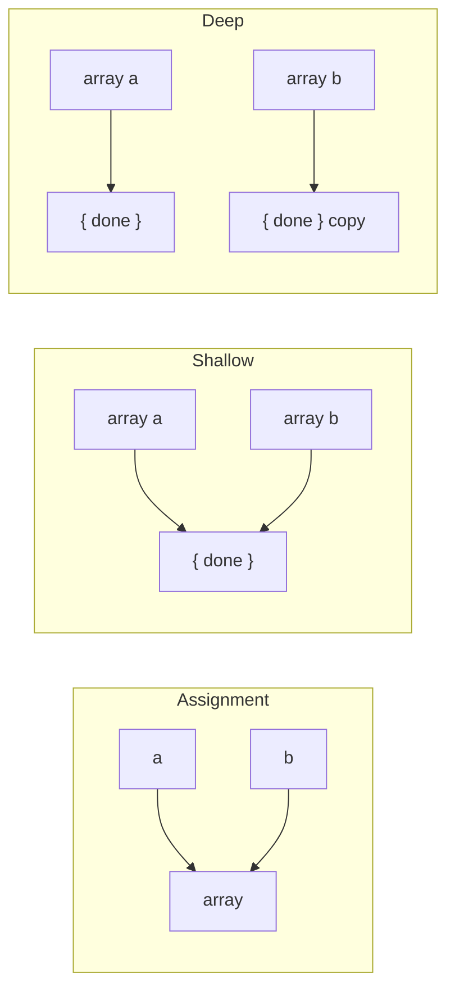

## Introduction

Copying an array sounds like the simplest operation imaginable, and it is the source of a surprising number of bugs. The problem is that "copy" can mean three different things, and JavaScript's syntax does not make it obvious which one you got.

Writing `const b = a` copies nothing: `a` and `b` are two names for one array, so `b.push(4)` changes `a` too. Writing `const b = [...a]` makes a **shallow copy**: a new array whose slots hold the same values as `a`. For numbers and strings that is a full copy. But if `a` holds objects or other arrays, both arrays now point at the same objects, and changing `b[0].done` also changes `a[0].done`. Only a **deep copy** duplicates the nested objects as well.

You need copies whenever code must not change data it does not own: a function that sorts its argument, a React component updating state, an undo history keeping earlier versions, a cache handing out data that callers might modify. Choosing the wrong depth either corrupts shared data (too shallow) or wastes time and memory duplicating things that never change (too deep).

This lesson covers the three levels, the four everyday shallow-copy techniques and their differences, copying nested arrays, deep copying with `structuredClone`, and the edge cases — holes, extra properties, subclasses and frozen arrays — where the techniques disagree.

## Before you start

- **Primitives and references** — the whole topic rests on the fact that a variable holding an object holds a reference to it. See [[b1-primitive-vs-reference]].
- **Array basics and sparse arrays** — `length`, indexes and holes. See [[b1-array-basics]] and [[b1-sparse-arrays]].
- **Mutating and non-mutating methods** — which array methods change the original. See [[b1-array-mutation]] and [[b1-slice-splice]].
- **Spread and `Array.from`** — the syntax and method used to copy. See [[b1-spread-rest]] and [[b1-array-from-isarray]].

All outputs in this lesson are from Node.js 22.

## The intuition

Picture an array as a sheet of paper with numbered lines, and objects as boxes stored somewhere in a warehouse. A number or string is written directly on a line. An object is not: the line holds the box's location.

- **Assignment** (`b = a`) hands someone a second pointer to the *same sheet*. Anything either person writes appears for both.
- **A shallow copy** photocopies the sheet. The new sheet is independent — crossing out a line on it does not touch the original — but where a line held a box location, both sheets now hold the same location. Opening that box and changing its contents is visible from either sheet.
- **A deep copy** photocopies the sheet *and* duplicates every box it points to, and every box those boxes point to, and puts the new locations on the new sheet. Nothing is shared.

The analogy stops working in one respect: primitives such as strings are not "shared" in any way you can observe, because they cannot be changed in place ([[b1-immutability-primitives]]). So for an array of primitives, a shallow copy is already a complete copy.

## Three levels in code

```javascript title="three-levels.js"
const original = [1, { done: false }];

const alias = original;          // same array
const shallow = [...original];   // new array, same inner object
const deep = structuredClone(original); // new array, new inner object

alias.push('pushed via alias');
shallow[0] = 99;
shallow[1].done = true;

console.log(original);
console.log(shallow);
console.log(deep);
console.log(alias === original, shallow === original, shallow[1] === original[1]);
```

```output
[ 1, { done: true }, 'pushed via alias' ]
[ 99, { done: true } ]
[ 1, { done: false } ]
true false true
```

Follow each line of output back to its cause. The `push` through `alias` landed in `original`, because they are one array. Writing `shallow[0] = 99` replaced a slot in the *copy*, so `original[0]` is still `1` — the top level is independent. But `shallow[1].done = true` did not replace a slot; it reached *through* the slot into the shared object, so `original[1].done` changed too. The `deep` copy was taken before any changes and owns its own inner object, so it is untouched by everything.

The comparisons on the last line make this precise: `===` on objects compares references ([[b1-strict-equality]]). The copy is a different array from the original, yet its element at index `1` is the very same object.

This is the single most important rule of the lesson: **a shallow copy protects you from changes to the list — adding, removing, reordering or replacing elements — but not from changes inside the elements.**

## Shallow copy techniques

Four techniques make shallow copies of an ordinary array, and for a dense array of data they produce identical results:

```javascript title="shallow-copies.js"
const source = ['a', 'b', 'c'];

const bySlice = source.slice();
const bySpread = [...source];
const byFrom = Array.from(source);
const byConcat = source.concat();

console.log(bySlice, bySpread, byFrom, byConcat);
console.log(bySlice !== source && bySpread !== source && byFrom !== source);
```

```output
[ 'a', 'b', 'c' ] [ 'a', 'b', 'c' ] [ 'a', 'b', 'c' ] [ 'a', 'b', 'c' ]
true
```

**`slice()`** with no arguments copies from index `0` to the end. It was the standard idiom before ES2015 and is still clear and fast. With arguments it copies part of the array (`slice(1, 3)`), which no other technique here does in one call ([[b1-slice-splice]]).

**Spread** (`[...source]`) is the most common in modern code. Its strength is composition: `[...a, ...b]` joins arrays, `[first, ...rest]` adds to the front, `[...list, item]` adds to the end, all in one expression that also produces a new array.

**`Array.from(source)`** copies any iterable or array-like, and accepts a mapping function, so `Array.from(source, fn)` copies and transforms at once.

**`concat()`** with no arguments returns a copy; with arguments it appends them, flattening array arguments one level.

> [!MISTAKE] Thinking `const` or a new variable makes a copy
> `const copy = list;` creates a second name, not a second array. `const` only stops the *variable* from being reassigned; it does nothing to protect the array's contents, and it does not copy. Any time you mean "a copy", one of the techniques above must appear on the right-hand side.

`map` and `filter` also return new arrays, so `list.map((x) => x)` is technically a shallow copy too. Prefer the explicit forms above when copying is the goal; reach for `map` when you are copying *and* changing elements, which is the basis of copying nested data.

## Copying nested arrays

A common case is a two-dimensional array: a game board, a spreadsheet grid, a seating plan. A shallow copy of the outer array shares every row:

```javascript title="grid-shallow.js"
const board = [
  ['.', '.'],
  ['.', '.'],
];

const shallow = [...board];
shallow[0][0] = 'X';
console.log(board[0][0]);

const twoLevels = board.map((row) => [...row]);
twoLevels[1][1] = 'O';
console.log(board[1][1], twoLevels[1][1]);
```

```output
X
. O
```

The first copy duplicated only the outer list; `shallow[0]` and `board[0]` are the same row array, so the `'X'` appears in the original board. The fix is to copy **one level per level of nesting**: `board.map((row) => [...row])` creates a new outer array whose elements are new row arrays. Because the rows contain strings, two levels is a complete copy of this board.

The same pattern extends to arrays of objects: `todos.map((todo) => ({ ...todo }))` copies the list and each object one level deep ([[b1-copying-objects]]). In state updates, you usually copy *only the path that changes* rather than everything:

```javascript title="update-one.js"
const todos = [
  { id: 1, text: 'Write lesson', done: false },
  { id: 2, text: 'Review lesson', done: false },
];

const next = todos.map((todo) =>
  todo.id === 2 ? { ...todo, done: true } : todo);

console.log(todos[1].done, next[1].done);
console.log(next[0] === todos[0], next[1] === todos[1]);
```

```output
false true
true false
```

The new array reuses the unchanged object for id `1` and holds a new object for id `2`. This is called **structural sharing**: the new version shares everything that did not change with the old one. It is both cheaper than a deep copy and useful — a UI library such as React can compare `next[0] === todos[0]` and skip work for items that are unchanged. [[b1-array-mutation]] covers the full set of non-mutating updates (add, insert, remove, replace, sort), including the ES2023 methods `toSorted`, `toReversed`, `toSpliced` and `with`.

## Deep copies

When you need a fully independent copy of arbitrarily nested data — saving a snapshot for undo, handing data to code you do not trust, or duplicating a template — use **`structuredClone`**, a global function available in browsers and in Node.js 17 and later. It walks the whole structure and copies every array, plain object, `Date`, `Map`, `Set` and more, and it even preserves shared and circular references within the structure:

```javascript title="deep.js"
const snapshot = [new Date(0), new Map([['a', 1]]), [1, [2, [3]]]];
const copy = structuredClone(snapshot);
copy[2][1][1][0] = 'changed';

console.log(snapshot[2][1][1][0], copy[0] instanceof Date);

const cyclic = [1];
cyclic.push(cyclic);
const cyclicCopy = structuredClone(cyclic);
console.log(cyclicCopy[1] === cyclicCopy, cyclicCopy[1] === cyclic);

try {
  structuredClone([() => 1]);
} catch (error) {
  console.log(error.name);
}
```

```output
3 true
true false
DataCloneError
```

The copy's innermost array is a new one, so writing to it leaves `snapshot` unchanged. The cyclic array's copy points at *itself*, not back at the original. And functions cannot be cloned, so an array containing one throws a `DataCloneError`. Class instances lose their prototype and come back as plain objects, and DOM nodes cannot be cloned either. [[b1-structured-clone]] covers exactly what is and is not copied.

The older trick `JSON.parse(JSON.stringify(arr))` also produces a deep copy, but it silently changes data: `Date`s become strings, `Map`s become `{}`, `undefined` and holes become `null`, and cycles throw. It is only safe for data that is already plain JSON; see [[b1-json-clone-limits]].

> [!TIP] Deep copy is rarely the first answer
> A deep copy costs time and memory proportional to the *whole* structure. If you only need to change one element, copying the path to it (as in the `todos` example) is cheaper and keeps unchanged parts identical, which helps change detection. Reach for `structuredClone` when you need an independent snapshot of everything.

## Where the techniques differ

For a dense array of data, the four shallow techniques are interchangeable. They differ on three less common inputs.

### Holes

A **hole** is an index with no element at all, as in `[1, , 3]` ([[b1-sparse-arrays]]). Some techniques keep holes; others turn them into real `undefined` elements:

```javascript title="holes.js"
const sparse = [1, , 3];

console.log(sparse.slice(), sparse.concat());
console.log([...sparse], Array.from(sparse));
console.log(structuredClone(sparse), JSON.parse(JSON.stringify(sparse)));
console.log(1 in sparse.slice(), 1 in [...sparse]);
```

```output
[ 1, <1 empty item>, 3 ] [ 1, <1 empty item>, 3 ]
[ 1, undefined, 3 ] [ 1, undefined, 3 ]
[ 1, <1 empty item>, 3 ] [ 1, null, 3 ]
false true
```

The difference comes from *how* each technique reads the source. `slice` and `concat` copy **properties**: for each index they first ask "does this index exist?" and skip it if not, so a hole stays a hole. Spread and `Array.from` use the array's **iterator**, which reads every index from `0` to `length - 1` and yields `undefined` for missing ones, so the copy is dense. `structuredClone` preserves holes; JSON has no way to express one and writes `null`.

This rarely matters in practice, because arrays with holes are rare and usually accidental. If you want to *remove* holes, spread or `Array.from` is the simplest way; if a hole carries meaning, copy with `slice`.

### Extra properties and subclasses

Arrays are objects, so code can attach non-index properties to them — some regular-expression results do this (`match.index`, `match.groups`). And a class can extend `Array`. The techniques disagree here too:

```javascript title="extras.js"
const tagged = [1, 2];
tagged.label = 'scores';
console.log(tagged.slice().label, [...tagged].label, structuredClone(tagged).label);

class Playlist extends Array {}
const list = Playlist.from(['a', 'b']);
console.log(
  list.slice().constructor.name,
  list.concat().constructor.name,
  [...list].constructor.name,
  Array.from(list).constructor.name,
);
```

```output
undefined undefined scores
Playlist Playlist Array Array
```

None of the shallow techniques copies `label`; they copy only elements. `structuredClone` copies an array's own enumerable properties, so `label` survives.

For subclasses, `slice`, `concat`, `map` and `filter` create their result through the source's constructor (a mechanism the specification calls `ArraySpeciesCreate`, controlled by `Symbol.species`), so the copy is still a `Playlist` with its methods. Spread always builds a plain array literal, and `Array.from` called on `Array` builds a plain `Array` — call `Playlist.from(list)` to get a `Playlist`.

### Frozen arrays

`Object.freeze(arr)` makes an array's elements and length read-only ([[b1-object-freeze-seal]]). A copy of a frozen array is **not** frozen, which is often exactly what you want — copying is how you "edit" frozen data:

```javascript title="frozen.js"
const settings = Object.freeze(['dark', { fontSize: 14 }]);
const draft = [...settings];
draft.push('compact');

console.log(Object.isFrozen(draft), draft.length);
draft[1].fontSize = 16;
console.log(settings[1].fontSize);
```

```output
false 3
16
```

The second line is the shallow-copy rule again: `freeze` is shallow too, so the object inside `settings` was never frozen, and the copy shares it.

## How it works internally

Each technique follows a different algorithm in the specification, which explains the differences above.

`slice(start, end)` computes the range, creates the result with `ArraySpeciesCreate` (hence subclasses survive), and then for each index `k` in the range checks **HasProperty** on the source. Only if the index exists does it **Get** the value and define it on the result at the same position. Finally it sets the result's `length`, which leaves skipped indexes as holes. `concat` uses the same "exists? then copy" check.

Spread in an array literal calls `source[Symbol.iterator]()` and appends each value the iterator yields. The built-in array iterator does not check HasProperty; it reads `source[0]`, `source[1]`, … up to the current length, and a missing index reads as `undefined`. `Array.from` uses the same iterator when one exists.

`structuredClone` runs the HTML standard's **structured serialisation** algorithm: it walks the value recursively, keeps a memory map from already-visited objects to their copies (which is how cycles and shared references survive), and throws a `DataCloneError` for values it does not support.

In every case the cost of a shallow copy is O(n) time and O(n) extra space for an array of length n: each slot is visited once and a new array of the same size is allocated. The *elements* are not visited beyond reading their references, so copying an array of a thousand large objects is as cheap as copying a thousand numbers. A deep copy, by contrast, is proportional to the total size of everything reachable. V8 has fast paths for copying ordinary arrays without holes, so in practice `slice`, spread and `Array.from` perform similarly; measure before choosing one for speed.



## Worked example: an undo history

An editor keeps the list of shapes on a canvas, and an undo stack of earlier versions. A naive implementation stores the same array reference each time, so every "earlier version" is really the current one. Let us build it correctly with structural sharing.

```javascript title="undo.js"
function createHistory(initial) {
  const past = [];
  let present = initial;

  return {
    get current() {
      return present;
    },
    // Every update produces a new array; the old one is kept untouched
    update(change) {
      past.push(present);
      present = change(present);
    },
    undo() {
      if (past.length > 0) present = past.pop();
    },
  };
}

const history = createHistory([{ id: 1, x: 0 }]);

history.update((shapes) => [...shapes, { id: 2, x: 50 }]);
history.update((shapes) =>
  shapes.map((s) => (s.id === 1 ? { ...s, x: 10 } : s)));

console.log(history.current);
history.undo();
console.log(history.current);
history.undo();
console.log(history.current);
```

```output
[ { id: 1, x: 10 }, { id: 2, x: 50 } ]
[ { id: 1, x: 0 }, { id: 2, x: 50 } ]
[ { id: 1, x: 0 } ]
```

Each `change` function receives the current array and returns a *new* one without modifying its input. Adding a shape uses spread to copy the list and append. Moving shape 1 uses `map`, copying only that shape's object and reusing shape 2's object untouched. Because no version is ever mutated, each entry in `past` is a valid snapshot, and `undo` simply restores it.

Now consider the bug this design avoids. If the move were written as `shapes[0].x = 10; return [...shapes];`, the returned array would be new, but the shape object inside it would be the same object referenced by the previous version. After that update, `undo` would restore a list in which shape 1 still has `x: 10`. The outer copy would be correct and the history still broken — the classic shallow-copy bug.

Storing a full `structuredClone` of the shapes on every update would also work, but it duplicates every unchanged shape on every edit. With structural sharing, a thousand-shape canvas costs one new array of references and one new shape object per move.

## In real systems

**React and Redux state.** State must be treated as immutable: React decides whether to re-render by comparing references, so `setItems([...items, item])` is required where `items.push(item)` would be ignored. Libraries such as Immer let you write mutating-looking code against a draft and produce structurally shared copies for you.

**Defensive copies at boundaries.** A class that stores an array passed to its constructor, or returns its internal array from a getter, often copies it (`this.#items = [...items]`, `return [...this.#items]`) so callers cannot change its internal state behind its back ([[b1-private-state]]).

**Function arguments.** A utility that needs to sort or reverse its input copies first (`toSorted`, or `[...input].sort()`), because callers do not expect their array to be reordered.

**Snapshots and messaging.** `structuredClone` is the same algorithm browsers use for `postMessage` to workers and for storing values in IndexedDB, so anything sent there is deep-copied, with the same limits.

## Trade-offs and alternatives

| Technique | Depth | Holes | Keeps subclass | Notes |
|---|---|---|---|---|
| `b = a` | None (alias) | — | — | Not a copy |
| `a.slice()` | Shallow | Kept | Yes | Can copy a range |
| `[...a]` | Shallow | Become `undefined` | No | Composes with other elements |
| `Array.from(a)` | Shallow | Become `undefined` | No (unless `Sub.from`) | Accepts array-likes and a mapping function |
| `a.concat()` | Shallow | Kept | Yes | Flattens array arguments one level |
| `a.map((r) => [...r])` | Two levels | Outer kept | Outer yes | One level per level of nesting |
| `structuredClone(a)` | Deep | Kept | No (plain `Array`) | Copies cycles; throws on functions |
| `JSON.parse(JSON.stringify(a))` | Deep | Become `null` | No | Loses `Date`, `Map`, `undefined`; throws on cycles |

For everyday code, spread is the default for shallow copies, `map` with spread for updating nested data, and `structuredClone` for full snapshots. The decision is really about **depth**: copy as deep as the code that receives the copy will modify, and no deeper.

Avoiding copies is sometimes better than making them. If a function only reads an array, it needs no copy. If data must never change, freezing it at creation turns accidental mutation into an error (in strict mode) instead of a silent bug.

## Common mistakes

> [!MISTAKE] Mutating a nested object after a shallow copy
> `const next = [...todos]; next[0].done = true;` changes `todos[0]` as well, because both arrays hold the same object. Copy the object you change: `next[0] = { ...next[0], done: true }`, or build `next` with `map`.

**Assuming assignment copies.** `const copy = arr` creates an alias. Use `[...arr]`.

**Copying a grid with one spread.** `[...grid]` shares every row. Use `grid.map((row) => [...row])`.

**Building a grid with `fill`.** `Array(3).fill([])` puts one shared row in every slot, so it is broken before any copying happens. Use `Array.from({ length: 3 }, () => [])` ([[b1-array-from-isarray]]).

**Using JSON for a deep copy of non-JSON data.** Dates become strings and holes become `null`. Use `structuredClone`.

**Deep-copying everything by habit.** It is slower, uses more memory and breaks reference-equality checks for parts that did not change.

**Expecting a copy to stay frozen, or a frozen array's objects to be frozen.** Both `freeze` and copies are shallow.

## Interview perspective

Copying questions check that you understand references, which is the foundation for state management, function purity and many debugging sessions.

> [!INTERVIEW] What a strong answer sounds like
> "Assignment copies the reference, so both names see changes. `slice`, spread, `Array.from` and `concat` make shallow copies: a new array holding the same element references, so nested objects are still shared. For nested data I copy the path I change — `map` plus spread — and use `structuredClone` when I need a full independent snapshot. JSON round-tripping is lossy. Spread and `Array.from` turn holes into `undefined`, while `slice` keeps them."

Questions you should be able to answer:

- **Is `[...arr]` a deep copy?** No; nested objects and arrays are shared.
- **How do you copy a 2D array?** `grid.map((row) => [...row])`, or `structuredClone(grid)`.
- **Difference between `slice()` and spread?** Both shallow; `slice` keeps holes and the subclass, spread densifies and always makes a plain array.
- **Why must React state be copied rather than mutated?** React compares references to detect changes; a mutated array is the same reference, so the change can be missed.
- **What can `structuredClone` not copy?** Functions, DOM nodes, class prototypes (instances become plain objects), and certain host objects.

A follow-up to expect: *"Implement a deep clone yourself."* The core is a recursive function with a `Map` from originals to copies to handle cycles, branching on `Array.isArray` for arrays and plain objects for the rest; see [[b1-impl-deep-clone]].

```quiz
Q: After `const b = a.slice(); b[0].count = 5;`, where `a = [{ count: 1 }]`, what is `a[0].count`?
- [ ] `1`, because `slice` returns a new array
- [x] `5`, because the new array holds the same object
- [ ] `undefined`, because `slice` copies only primitives
- [ ] It throws, because `b[0]` is read-only
> `slice` creates a new outer array, so replacing `b[0]` would not affect `a`. But `b[0].count = 5` does not replace the slot; it changes the object the slot refers to, and `a[0]` refers to that same object. The first option confuses a new array with new elements.
```

```quiz
Q: Which copy of `[1, , 3]` still has a hole at index 1?
- [ ] `[...arr]`
- [ ] `Array.from(arr)`
- [x] `arr.slice()`
- [ ] `JSON.parse(JSON.stringify(arr))`
> `slice` checks whether each index exists before copying it, so missing indexes stay missing. Spread and `Array.from` read through the array iterator, which yields `undefined` for every missing index. JSON cannot represent a hole and writes `null`.
```

```quiz
Q: A reducer returns `[...state]` after setting `state[2].selected = true`. The component showing item 2 does not update. Why?
- [ ] Spread does not create a new array
- [ ] Spread loses the `selected` property
- [x] Item 2 is the same object as before, so a reference check sees no change for it
- [ ] Reducers cannot return arrays
> The outer array is new, so the list as a whole looks changed, but the item was mutated in place: `next[2] === prev[2]` is `true`. A memoised item component comparing references concludes nothing changed. Copy the item too: `state.map((item, i) => i === 2 ? { ...item, selected: true } : item)`.
```

## Practice

1. Predict the output, then run it: `const a = [[1], [2]]; const b = [...a]; b[0].push(9); b[1] = [7]; console.log(a, b);`
2. Write `cloneGrid(grid)` for a 2D array of numbers without `structuredClone`, and prove with `===` checks that no row is shared.
3. Given an array of users `{ id, name, tags: [] }`, return a new array in which user `id: 3` has the tag `'admin'` added, sharing every unchanged user and every unchanged `tags` array.
4. A class `Cart` stores items in a private array and exposes a getter `items`. Show how a caller can corrupt the cart if the getter returns the array directly, then fix it.
5. Explain why `[...sparse]` and `sparse.slice()` give different results for `[1, , 3]`, in terms of how each one reads the source.

## Quick revision {#quick-revision}

- `b = a` is an alias, not a copy; `const` does not copy or protect contents.
- Shallow copy: `a.slice()`, `[...a]`, `Array.from(a)`, `a.concat()` — new array, same element references.
- Shallow copies protect against adding, removing, reordering and replacing elements, not against changes inside elements.
- For arrays of primitives, shallow is complete.
- Nested data: copy one level per level of nesting (`grid.map((row) => [...row])`), or copy only the changed path (`map` + object spread) for structural sharing.
- Deep copy: `structuredClone` (Node.js 17+, browsers) handles `Date`, `Map`, `Set`, cycles and holes; throws `DataCloneError` on functions; drops class prototypes.
- `JSON.parse(JSON.stringify(a))` is lossy: `Date` → string, `Map` → `{}`, `undefined` and holes → `null`, cycles throw.
- Holes: `slice` and `concat` keep them (HasProperty check); spread and `Array.from` make `undefined` (iterator).
- Non-index properties: lost by shallow techniques, kept by `structuredClone`.
- Subclasses: `slice`, `concat`, `map`, `filter` keep them (species); spread and `Array.from` make a plain `Array`.
- Copies of frozen arrays are not frozen; `freeze` is shallow.
- Shallow copy is O(n) in the array length regardless of element size; deep copy is proportional to everything reachable.

## Key takeaways {#key-takeaways}

- An array variable holds a reference, so assignment shares the array and copying must be explicit.
- Every everyday copying technique is shallow: the list is new, the objects in it are shared.
- Copy to the depth that the receiving code will modify — usually just the path that changes — and use `structuredClone` for full snapshots.
- Spread is the default shallow copy; `slice` when you need a range or must keep holes and subclasses.
- Most "my copy changed the original" bugs are a nested object mutated through a shallow copy, and the fix is to copy that object too.
