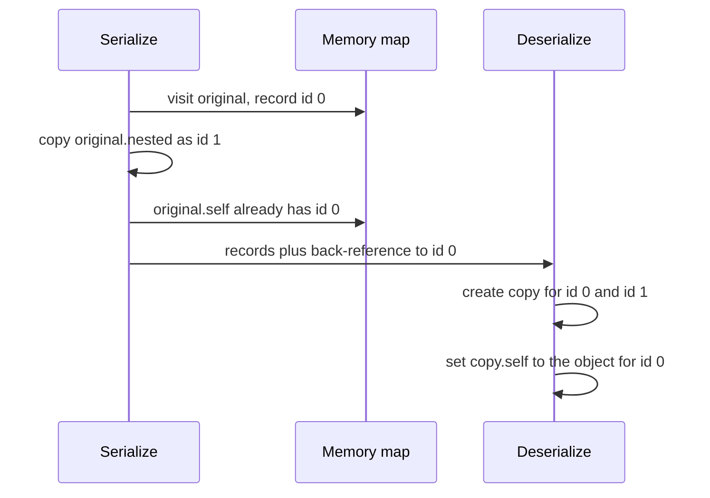

## Introduction

Here is one of the most common bugs in JavaScript applications. A settings form starts editing a "copy" of the user's preferences so that **Cancel** can restore the originals:

```javascript
const draft = original;          // "copy" the preferences
draft.notifications.email = false;
// user clicks Cancel... but original.notifications.email is false too
```

Nothing was copied. `draft = original` copies a **reference**, so both names point to the same object, and editing through one is editing the other ([[b1-objects-as-values]]). The fix that most people reach for next — `const draft = { ...original }` — *still* does not fix this particular bug, because `notifications` is a nested object and spread copies only the top level.

Copying is therefore a real design decision, not a one-liner. There are three levels of "copy", and choosing the wrong one gives either bugs (too little copied, so changes leak into data that should not change) or waste (too much copied, so every update duplicates large structures and breaks identity checks that UI frameworks rely on).

1. **Alias** — a second reference to the same object. Nothing is duplicated.
2. **Shallow copy** — a new top-level object whose properties hold the *same values* as the original, which means nested objects are **shared**.
3. **Deep copy** — a new object, with every nested object also duplicated, all the way down.

This lesson explains each level, the tools that produce them, and two topics that deserve their own careful treatment: [[b1-structured-clone|`structuredClone`]], the built-in deep copy, and [[b1-json-clone-limits|why `JSON.parse(JSON.stringify(x))` is a problematic way to clone]].

## Before you start

- **Objects as values** — variables hold references; `===` on objects compares identity. See [[b1-objects-as-values]] and [[b1-primitive-vs-reference]].
- **Object literals and spread** — `{ ...obj }` syntax. See [[b1-object-literals]].
- **Object APIs** — `Object.assign`, `Object.create` and property descriptors. See [[b1-object-apis]].
- **JSON** — what `JSON.stringify` and `JSON.parse` do. See [[b1-json-stringify-parse]]; the JSON section here explains what matters for cloning.

## The intuition

Picture a folder on your computer containing some documents and a few **shortcuts** to other folders.

- An **alias** is a second shortcut to the same folder. Open either and you are in the same place.
- A **shallow copy** is a new folder into which you copy everything at the top level. Documents are duplicated — but the shortcuts are copied *as shortcuts*, so they still lead to the original subfolders. Edit a file inside a subfolder from the copy, and the original sees the change.
- A **deep copy** follows every shortcut and duplicates the folders they point to as well, recursively, so the two trees share nothing.

In JavaScript the "documents" are primitive values (strings, numbers, booleans and so on), which are immutable and therefore safe to share, and the "shortcuts" are references to objects, arrays, `Map`s, `Date`s and other mutable things. The analogy is accurate as far as it goes; where it stops working is that a deep copy in JavaScript must also decide what to do with things that are not plain folders at all — functions, class instances, DOM nodes, cycles — and different tools make different decisions.

```mermaid title="Alias, shallow copy and deep copy of { a: 1, nest: { b: 2 } }"
flowchart LR
    subgraph Alias
      A1["original"] --> O1["{ a: 1, nest }"]
      A2["alias"] --> O1
      O1 --> N1["{ b: 2 }"]
    end
    subgraph Shallow
      B1["original"] --> O2["{ a: 1, nest }"]
      B2["shallow"] --> O3["{ a: 1, nest }"]
      O2 --> N2["{ b: 2 }"]
      O3 --> N2
    end
    subgraph Deep
      C1["original"] --> O4["{ a: 1, nest }"]
      C2["deep"] --> O5["{ a: 1, nest }"]
      O4 --> N4["{ b: 2 }"]
      O5 --> N5["{ b: 2 }"]
    end
```

## The three levels in code

```javascript title="levels.js"
const original = { a: 1, nest: { b: 2 } };

const alias = original;
const shallow = { ...original };
const deep = structuredClone(original);

alias.a = 10;
shallow.a = 20;
shallow.nest.b = 99;
deep.nest.b = -1;

console.log(original);
console.log(shallow);
console.log(deep);
console.log(alias === original, shallow === original, shallow.nest === original.nest);
console.log(deep.nest === original.nest);
```

```output
{ a: 10, nest: { b: 99 } }
{ a: 20, nest: { b: 99 } }
{ a: 1, nest: { b: -1 } }
true false true
false
```

Trace each line. `alias.a = 10` changed `original.a`, because they are the same object. `shallow.a = 20` did **not** change `original.a`: the shallow copy has its own top-level property `a`, and replacing a top-level value only affects the copy. But `shallow.nest.b = 99` *did* change `original.nest.b`, because `shallow.nest` and `original.nest` are references to one shared object. The deep copy has its own `nest`, so `deep.nest.b = -1` affected only `deep`, and `deep` also kept the value `a: 1` from the moment it was copied.

The rule to remember: **a shallow copy protects you from replacing top-level properties, not from mutating nested objects.**

## Shallow copying techniques

All of these produce a new top-level container whose properties hold the same values (and therefore the same nested references) as the source.

| Technique | Copies | Loses |
|---|---|---|
| `{ ...obj }` | Own enumerable string and symbol keys | Prototype, non-enumerable properties, getters (become values) |
| `Object.assign({}, obj)` | Same as spread | Same as spread; also runs setters on the target |
| `[...arr]`, `arr.slice()`, `Array.from(arr)` | Array elements | Extra non-index properties ([[b1-copying-arrays]]) |
| `new Map(map)`, `new Set(set)` | Entries | Nothing beyond shallowness |
| `Object.create(Object.getPrototypeOf(o), Object.getOwnPropertyDescriptors(o))` | Everything own, with flags and accessors, plus the prototype | Private `#fields` |

Spread is the everyday choice for plain data. It does not preserve the **prototype**, which matters when copying class instances:

```javascript title="shallow-class.js"
class Money {
  constructor(amount, currency) { this.amount = amount; this.currency = currency; }
  format() { return `${this.amount.toFixed(2)} ${this.currency}`; }
}
const price = new Money(9.5, 'EUR');
const copy = { ...price };
console.log(copy, copy instanceof Money, typeof copy.format);
const proper = new Money(price.amount, price.currency);
console.log(proper.format());
```

```output
{ amount: 9.5, currency: 'EUR' } false undefined
9.50 EUR
```

The spread copy is a plain object with the right data but none of the class's methods, which live on `Money.prototype`. For class instances, the cleanest copy is usually a method the class provides itself — `price.clone()` or `price.with({ amount: 12 })` — because the class knows which fields matter and which invariants must hold. The descriptor-based copy in the table also keeps the prototype ([[b1-object-assign-create]]).

## Updating nested data without mutating it

Most copying in front-end code is not about cloning whole objects; it is about **updating** state immutably. React decides whether to re-render by comparing the old and new state with `Object.is` — essentially `===` for objects. If you mutate the existing object, the reference does not change, and React may skip the update ([[b4-update-state-objects]]). Redux selectors and memoised components rely on the same identity checks.

The correct technique is to **copy every object on the path from the root to the change, and nothing else**:

```javascript title="nested-update.js"
const state = {
  user: { name: 'Ada', address: { city: 'London', zip: 'N1' } },
  settings: { theme: 'dark' },
};

const next = {
  ...state,
  user: {
    ...state.user,
    address: { ...state.user.address, city: 'Paris' },
  },
};

console.log(next.user.address.city, state.user.address.city);
console.log(next === state, next.user === state.user, next.user.address === state.user.address);
console.log(next.settings === state.settings);
```

```output
Paris London
false false false
true
```

Three new objects were created — the root, `user` and `address` — because they are on the path to `city`. `settings` was not touched, so `next.settings` is the very same object as `state.settings`. This reuse is called **structural sharing**, and it is deliberate, not a shortcut. It makes updates cheap (the work is proportional to the depth of the change, not the size of the state), and it means anything that depends only on `settings` can tell, with one `===` check, that nothing it cares about changed.

A full deep clone for every update would be *wrong* here, not merely slow: every object would get a new identity, and every memoised component and selector would think everything changed.

The spread pyramid gets tiresome for deep structures. Immer lets you write a "mutation" against a draft and produces exactly this structurally shared copy for you; Redux Toolkit uses it inside reducers ([[b4-redux-toolkit]]). Under the hood, the result is the same as the hand-written version above.

> [!WARNING] Two levels is not "deep"
> `{ ...obj, nest: { ...obj.nest } }` copies two levels. Anything below `obj.nest` — `obj.nest.items`, say — is still shared. Each level you intend to modify needs its own spread.

## When you really need a deep copy

Deep copies are the right tool when you want a **fully independent snapshot** that no later code can affect through shared references:

- keeping an **undo history** or a "reset form" snapshot of editable data;
- **defensive copies** of input your function will mutate, so callers are not surprised;
- **test fixtures** that each test modifies freely;
- caching a response and handing out copies so that one consumer cannot corrupt the cache for others.

There are four ways to make one: `structuredClone`, the JSON round trip, a hand-written recursive function, or a library such as Lodash's `cloneDeep`. The next two sections examine the first two in detail; the others appear in the trade-offs section.

## structuredClone {#b1-structured-clone}

`structuredClone(value)` is a built-in global function that returns a **deep copy** of `value`. It copies plain objects, arrays and many built-in types — `Date`, `Map`, `Set`, `RegExp`, `ArrayBuffer`, typed arrays, errors, `BigInt` — preserves **cycles** and **shared references**, and throws a `DataCloneError` for values it cannot copy, such as functions.

It is not part of the JavaScript language specification. It comes from the HTML standard, where the **structured clone algorithm** has existed for many years as the way browsers copy data between contexts: when you call `worker.postMessage(data)`, store an object in IndexedDB, or pass state to `history.pushState`, the browser structured-clones it ([[b3-postmessage-structured-clone]]). In 2021–2022 that algorithm was exposed directly as `structuredClone`. It is available in Chrome and Edge 98+, Firefox 94+, Safari 15.4+, Node.js 17+, Deno and Bun.

### What it copies faithfully

```javascript title="structured-clone.mjs"
const original = {
  date: new Date('2026-01-15T10:00:00Z'),
  tags: new Set(['a', 'b']),
  scores: new Map([['ada', 10]]),
  pattern: /ab+c/gi,
  big: 12345678901234567890n,
  nested: { list: [1, { deep: true }] },
  missing: undefined,
  nan: NaN,
  negZero: -0,
};
original.self = original;                 // a cycle

const copy = structuredClone(original);
console.log(copy.date instanceof Date, copy.date !== original.date, copy.date.toISOString());
console.log(copy.tags, copy.scores.get('ada'), copy.pattern, copy.big);
console.log(copy.nested.list[1] !== original.nested.list[1], copy.self === copy);
console.log('missing' in copy, copy.nan, Object.is(copy.negZero, -0));

const shared = { n: 1 };
const pair = structuredClone({ a: shared, b: shared });
console.log(pair.a === pair.b, pair.a !== shared);
```

```output
true true 2026-01-15T10:00:00.000Z
Set(2) { 'a', 'b' } 10 /ab+c/gi 12345678901234567890n
true true
true NaN true
true true
```

Every line demonstrates something the JSON approach gets wrong. The `Date` is a real, separate `Date`. `Set`, `Map`, `RegExp` and `BigInt` survive with their types. Nested objects are new. The **cycle** is preserved: `copy.self` points to `copy`, not to the original and not to an infinite chain. Properties holding `undefined` stay present, `NaN` stays `NaN`, and `-0` stays `-0`. Finally, **shared references stay shared**: `shared` appeared twice in the input, so the copy contains one new object referenced twice, not two separate objects. The clone has the same *shape of references* as the original, which is what "copying a graph" means.

### What it cannot copy

```javascript title="clone-errors.mjs"
for (const value of [() => 1, Symbol('s'), new WeakMap(), { method() {} }]) {
  try {
    structuredClone(value);
  } catch (e) {
    console.log(e.name, '|', e.message, '|', e instanceof DOMException);
  }
}
```

```output
DataCloneError | () => 1 could not be cloned. | true
DataCloneError | Symbol(s) could not be cloned. | true
DataCloneError | #<WeakMap> could not be cloned. | true
DataCloneError | method() {} could not be cloned. | true
```

**Functions** cannot be cloned — a function carries its closure, the variables it captured from its surrounding scope, and there is no meaningful way to duplicate that ([[b1-closures]]). An object that merely *contains* a method fails the same way, so a single callback anywhere in a large state tree makes the whole clone throw. **Symbol values**, **`WeakMap`** and **`WeakSet`**, **Proxies**, and in browsers **DOM nodes** also throw. The error is a `DOMException` with `name` equal to `"DataCloneError"`; check `e.name`, because the message text differs between engines.

### What it copies but changes

Some values are cloned without an error but do not come back exactly as they were. These are the cases that bite, because nothing warns you:

```javascript title="clone-losses.mjs"
class User {
  constructor(name) { this.name = name; }
  greet() { return `Hi, ${this.name}`; }
}
const u = structuredClone(new User('Ada'));
console.log(u instanceof User, u, typeof u.greet);

console.log(structuredClone({ [Symbol('k')]: 1, v: 2 }));

const withGetter = { get x() { return 42; } };
console.log(Object.getOwnPropertyDescriptor(structuredClone(withGetter), 'x'));

const hidden = { v: 2 };
Object.defineProperty(hidden, 'h', { value: 1, enumerable: false });
console.log(structuredClone(hidden), Object.isFrozen(structuredClone(Object.freeze({ a: 1 }))));

const re = /a/g;
re.lastIndex = 3;
console.log(structuredClone(re).lastIndex);
```

```output
false { name: 'Ada' } undefined
{ v: 2 }
{ value: 42, writable: true, enumerable: true, configurable: true }
{ v: 2 } false
0
```

- **Prototypes are lost.** A class instance comes back as a plain object with the same own data: `instanceof` is false and methods are gone. Only built-in types the algorithm knows (`Date`, `Map`, errors and so on) keep their type.
- **Symbol-keyed properties are dropped silently** (symbol *values* throw, symbol *keys* are skipped).
- **Getters are run** and their results stored as plain data.
- **Non-enumerable properties are dropped**, and property flags are not preserved — a frozen object's clone is not frozen.
- A `RegExp` keeps its source and flags, but `lastIndex` resets to `0`.
- `Error` objects keep their type for the standard error constructors (`RangeError` stays `RangeError`) and their `message`; whether `stack` and custom properties survive depends on the engine.

The mental model that predicts all of this: **structuredClone copies data that could be sent to another thread**. Another thread has its own copy of every class and closure, so only plain data and well-known built-in types can make the trip. Behaviour — methods, accessors, prototypes — stays behind.

### Transferring instead of copying

For large binary data, copying can be expensive. The second argument lets you **transfer** ownership of an `ArrayBuffer` (and other transferable objects, such as `MessagePort`) instead:

```javascript title="transfer.mjs"
const buffer = new ArrayBuffer(8);
const moved = structuredClone(buffer, { transfer: [buffer] });
console.log(buffer.byteLength, moved.byteLength);
```

```output
0 8
```

After the call, the original buffer is **detached**: its length is `0` and it can no longer be used, while the clone owns the memory. Transfer is mostly useful with `postMessage` — moving a large image buffer to a worker without duplicating it ([[b3-worker-transferables]]) — but `structuredClone` accepts the same option.

### When to use it

Use `structuredClone` when you need an independent deep copy of **data**: API responses with dates, state containing `Map`s or `Set`s, cyclic graphs, snapshots for undo. It is the standard, built-in answer and should be your default deep copy. Do not use it for objects whose behaviour matters (class instances you will call methods on), for anything containing functions, or as a replacement for structural sharing in state updates. It is also not free: it walks the whole graph, so cloning a large structure on every keystroke or animation frame is a performance mistake regardless of which deep-copy method you use.

## Why JSON cloning is problematic {#b1-json-clone-limits}

Before `structuredClone` existed, the common way to deep-copy an object was to turn it into a JSON string and parse it back:

```javascript
const copy = JSON.parse(JSON.stringify(original));
```

It works for some data, it is a single line, and it appears in countless older codebases and answers online. The problem is that JSON is a **data-interchange format**, designed to move a small set of types — strings, numbers, booleans, `null`, arrays and plain objects — between programs written in any language. It was never meant to describe JavaScript values in memory. Anything outside that set is **dropped, converted or rejected**, often silently, and the result looks like a successful clone until code later trips over the difference.

### A tour of the losses

```javascript title="json-losses.mjs"
const original = {
  name: 'Ada',
  createdAt: new Date('2026-01-15T10:00:00Z'),
  nickname: undefined,
  greet() { return 'hi'; },
  [Symbol('id')]: 7,
  score: NaN,
  limit: Infinity,
  offset: -0,
  roles: new Set(['admin']),
  prefs: new Map([['theme', 'dark']]),
  pattern: /ab+c/,
  list: [1, undefined, () => 1, , 5],
  error: new Error('boom'),
};
const text = JSON.stringify(original);
console.log(text);
const copy = JSON.parse(text);
console.log(typeof copy.createdAt, 'nickname' in copy, copy.list);
try { copy.createdAt.getFullYear(); } catch (e) { console.log(`${e.name}: ${e.message}`); }
```

```output
{"name":"Ada","createdAt":"2026-01-15T10:00:00.000Z","score":null,"limit":null,"offset":0,"roles":{},"prefs":{},"pattern":{},"list":[1,null,null,null,5],"error":{}}
string false [ 1, null, null, null, 5 ]
TypeError: copy.createdAt.getFullYear is not a function
```

Read the JSON line against the input. Thirteen properties went in; the output tells a different story for almost all of them:

| Input value | After the JSON round trip | Why |
|---|---|---|
| `Date` | ISO **string**, which stays a string after parsing | `Date.prototype.toJSON` returns `toISOString()`; `JSON.parse` has no way to know it was a date |
| `undefined` property | Property **removed** | JSON has no `undefined` |
| Function / method | Property **removed** | Functions are not data |
| Symbol key or symbol value | **Removed** | `JSON.stringify` only lists string keys, and has no symbol type |
| `NaN`, `Infinity`, `-Infinity` | `null` | JSON numbers must be finite |
| `-0` | `0` | JSON has no negative zero |
| `Set`, `Map`, `RegExp`, `Error` | `{}` | They have no own enumerable properties; their data is internal |
| `undefined`, function or hole in an array | `null` | Arrays cannot drop items without shifting indexes, so they become `null` |
| Class instance | Plain object | The prototype is not part of the data |
| Getter | Its current value | `stringify` reads properties |
| Non-enumerable property | Removed | `stringify` only lists enumerable keys |

The `Date` case is the most dangerous in practice. The copy *looks* right when logged, and `copy.createdAt < otherDate` even "works" by comparing strings — until code calls a `Date` method and crashes, or compares strings that happen to sort differently from the dates they represent. The `Map` case is equally bad: a `Map` of user preferences silently becomes `{}`, and all the data is gone.

### What throws

Two kinds of value make `JSON.stringify` throw instead of losing data quietly:

```javascript title="json-throws.mjs"
try { JSON.stringify({ big: 10n }); } catch (e) { console.log(`${e.name}: ${e.message}`); }
const node = { name: 'loop' };
node.self = node;
try { JSON.stringify(node); } catch (e) { console.log(`${e.name}: ${e.message.split('\n')[0]}`); }
const shared = { n: 1 };
const pair = JSON.parse(JSON.stringify({ a: shared, b: shared }));
console.log(pair.a === pair.b);
```

```output
TypeError: Do not know how to serialize a BigInt
TypeError: Converting circular structure to JSON
false
```

A `BigInt` anywhere in the tree throws, and so does any **cycle** — a parent and child that point to each other, a DOM-like tree with `parent` links, a graph. And even without cycles, **shared references are broken**: an object referenced twice becomes two independent copies, so code that relies on `pair.a === pair.b` — or that mutates one and expects to see it through the other — now behaves differently.

### Customisation exists, but it is opt-in

`JSON.stringify` calls a value's `toJSON` method if it has one, and `JSON.parse` accepts a **reviver** function that can transform values as they are parsed ([[b1-json-replacer-reviver]]). You can use them to restore dates:

```javascript title="json-reviver.mjs"
const text = JSON.stringify({ createdAt: new Date('2026-01-15T10:00:00Z'), title: 'Launch' });
const revived = JSON.parse(text, (key, value) =>
  key === 'createdAt' ? new Date(value) : value);
console.log(revived.createdAt instanceof Date, revived.createdAt.getUTCFullYear());
```

```output
true 2026
```

That works when you control both ends and know which fields are dates. As a general-purpose clone it does not scale: you must list every special field, and the reviver still cannot bring back `undefined`, functions, prototypes or shared references.

### When JSON is still the right tool

The round trip is fine — and sometimes the best choice — when the data is **already JSON-shaped**: a response you just received from `fetch(...).then((r) => r.json())`, or a configuration you know contains only strings, numbers, booleans, `null`, arrays and plain objects. In that case nothing can be lost, it works in every JavaScript environment, and it doubles as a check that the data really is serialisable (for example, before storing it in `localStorage`, which only stores strings ([[b3-storage-serialization]])).

JSON is also the right tool when serialising is the actual goal — sending data over the network or saving it to disk. The problem is only in using it as a *clone*, where silent type changes masquerade as success. For in-memory deep copies, use `structuredClone`.

## How it works internally

**Spread and `Object.assign`** walk the source's own property keys and create a property on the new object for each enumerable one, copying the *value*. When the value is an object, the value is a reference, so the new property holds the same reference. That one fact is the whole explanation of shallow copying.

**`structuredClone`** runs the HTML **StructuredSerialize** and **StructuredDeserialize** operations. Serialisation walks the object graph and, crucially, keeps a **memory map** from every object already visited to its serialised record. When it meets an object it has seen before — a cycle or a shared reference — it writes a back-reference instead of serialising it again. Deserialisation rebuilds new objects from the records and resolves back-references to the newly created objects, which is why cycles and sharing survive. Each type has a rule: plain objects copy their own enumerable string-keyed properties; arrays copy their indexes and length; `Map`, `Set` and `Date` copy their internal data; platform objects such as `File` or `ImageBitmap` define their own serialisation; anything without a rule throws `DataCloneError`.

**The JSON round trip** turns the graph into a string and builds a new graph from it. `JSON.stringify` keeps only a stack of the objects currently being serialised, not a map of everything seen, which is why it detects a cycle (an object already on the stack) and throws, but cannot detect sharing (an object seen earlier on another branch) and duplicates it instead.



## Worked example: a form draft with undo

A profile editor lets the user change nested fields, undo each change, and cancel back to the original. It needs both kinds of copy: structural sharing for each edit, so unchanged parts keep their identity, and a deep snapshot of the original, so nothing can corrupt the "cancel" state.

```javascript title="draft-undo.mjs"
function setIn(obj, [key, ...rest], value) {
  // copy only the path to the change; everything else is shared
  if (rest.length === 0) return { ...obj, [key]: value };
  return { ...obj, [key]: setIn(obj[key], rest, value) };
}

const loaded = {
  name: 'Ada',
  joined: new Date('2024-03-01T00:00:00Z'),
  notifications: { email: true, sms: false },
  tags: new Set(['math']),
};

const pristine = structuredClone(loaded);   // independent snapshot for Cancel
let draft = loaded;
const history = [];

function edit(path, value) {
  history.push(draft);                       // old versions stay valid: never mutated
  draft = setIn(draft, path, value);
}

edit(['notifications', 'email'], false);
edit(['name'], 'Ada Lovelace');
console.log(draft.name, draft.notifications.email, loaded.notifications.email);
console.log(draft.tags === loaded.tags, draft.notifications === loaded.notifications);

draft = history.pop();                       // undo the rename
console.log(draft.name, draft.notifications.email);

loaded.tags.add('poetry');                   // someone mutates the loaded data
console.log([...draft.tags], [...pristine.tags]);
console.log(pristine.joined instanceof Date, pristine.joined !== loaded.joined);
```

```output
Ada Lovelace false true
true false
Ada false
[ 'math', 'poetry' ] [ 'math' ]
true true
```

Step through what happened.

- `setIn` is the recursive form of the nested spread from earlier. Each call copies one level and recurses into the next, so editing `notifications.email` creates a new root and a new `notifications`, while `tags` and `joined` are shared. `loaded.notifications.email` is still `true`: the original was never mutated.
- Because no version is ever mutated, **undo is a matter of keeping old references**. `history` stores whole states cheaply — they share most of their objects — and popping one restores it exactly.
- `pristine` was made with `structuredClone`, so it shares nothing with `loaded`. When some other code mutates `loaded.tags`, the change shows up in `draft` (which still shares `tags` with `loaded`) but not in `pristine`. The `Set` and the `Date` in `pristine` are genuine `Set` and `Date` objects; a JSON round trip would have turned them into `{}` and a string.

The example also shows the limit of structural sharing: it protects you only if **everyone** follows the no-mutation rule. `loaded.tags.add(...)` broke it, and the draft saw the change. That is why teams pair immutable updates with conventions, lint rules, TypeScript `readonly` types, or frozen state in development.

## In real systems

**React and Redux state.** Updates create new objects along the changed path with spread or Immer; identity comparisons then tell components and selectors what changed. Deep cloning state for every update is a known anti-pattern because it defeats memoisation ([[b4-state-immutability]]).

**Workers and messaging.** `postMessage` structured-clones its data, so the same rules apply: no functions, class instances arrive as plain objects, and large buffers should be transferred rather than copied ([[b3-worker-postmessage]]).

**Browser storage and history.** IndexedDB stores structured-cloned values, so it can hold `Date`, `Map` and `Blob` directly; `localStorage` stores only strings, so data goes through JSON and loses types unless you revive them ([[b3-idb-vs-localstorage]]). `history.pushState(state, …)` also structured-clones its `state`.

**Caching.** In-memory caches that return mutable objects often hand out `structuredClone` copies so that one caller's mutation cannot corrupt what the next caller receives — at the cost of a clone per read. The alternative is to freeze cached objects and require callers to copy before modifying.

**Server-side code.** Node.js 17+ has `structuredClone`; older code often used `JSON.parse(JSON.stringify(...))` or Lodash's `cloneDeep`. When upgrading such code, check for places that relied on JSON's conversions — for example code that expected dates to be strings.

## Trade-offs and alternatives

| Technique | Depth | Keeps types (`Date`, `Map`…) | Cycles / shared refs | Functions | Prototype | Notes |
|---|---|---|---|---|---|---|
| Assignment | None (alias) | — | — | — | — | Not a copy |
| Spread / `Object.assign` | One level | References shared | Shared | Copied as references | Lost | Best for immutable updates |
| `structuredClone` | Full | Yes, for supported built-ins | Preserved | Throws | Lost | Default deep copy for data |
| JSON round trip | Full | No | Cycles throw, sharing broken | Dropped | Lost | Only for JSON-shaped data |
| Custom recursive clone | Full | Whatever you code | With a `WeakMap` | Your choice | Your choice | Full control, more to maintain |
| Lodash `cloneDeep` | Full | Many types | Preserved | Shared when nested; `{}` at top level | Kept | Third-party dependency |

A **custom clone** earns its place when you need behaviour neither built-in offers, such as keeping prototypes or skipping certain fields. The core is short; the hard parts are cycles (track visited objects in a `WeakMap`) and deciding the rule for each type:

```javascript title="custom-clone.mjs"
function deepClone(value, seen = new WeakMap()) {
  if (value === null || typeof value !== 'object') return value;   // primitives, functions
  if (seen.has(value)) return seen.get(value);                     // cycle or shared ref
  if (value instanceof Date) return new Date(value);
  if (value instanceof Map) {
    const out = new Map();
    seen.set(value, out);
    for (const [k, v] of value) out.set(deepClone(k, seen), deepClone(v, seen));
    return out;
  }
  const out = Array.isArray(value) ? [] : Object.create(Object.getPrototypeOf(value));
  seen.set(value, out);
  for (const key of Reflect.ownKeys(value)) out[key] = deepClone(value[key], seen);
  return out;
}

class Point { constructor(x) { this.x = x; } norm() { return Math.abs(this.x); } }
const graph = { p: new Point(-3), when: new Date(0), fn: () => 'kept' };
graph.self = graph;
const c = deepClone(graph);
console.log(c.p instanceof Point, c.p.norm(), c.self === c, c.fn === graph.fn);
```

```output
true 3 true true
```

This version keeps prototypes (so `c.p.norm()` works) and shares functions by reference, decisions `structuredClone` makes the other way. It still has gaps — `Set`, typed arrays, accessors and non-enumerable properties are handled only roughly — which is exactly why a built-in or a well-tested library is usually the better choice. Implementing one is a common interview exercise ([[b1-impl-deep-clone]]).

On performance: every deep copy walks the entire structure, so its cost grows with the size of the data. Relative speeds of `structuredClone`, JSON and libraries vary by engine version and data shape; measure with your real data before choosing on speed, and prefer avoiding unnecessary deep copies over picking the fastest one.

## Common mistakes

> [!MISTAKE] Thinking spread is a deep copy
> `const copy = { ...state }; copy.user.name = 'X';` changes `state.user.name`, because `copy.user` is the same object. Spread every level you modify, or use `structuredClone` when you need full independence.

**Mutating before copying.** `state.items.push(item); setState({ ...state })` creates a new root, but `items` is the *same mutated array*, so anything comparing `items` by identity sees no change, and the previous state you kept for undo was mutated too. Copy first, then change the copy: `{ ...state, items: [...state.items, item] }`.

**Using the JSON round trip on data with dates or `Map`s.** Dates come back as strings and `Map`s as `{}`, silently. Use `structuredClone`, or a reviver if you must go through JSON.

**Cloning class instances and expecting methods.** Spread, `structuredClone` and JSON all return plain objects. Give the class its own `clone()` method, or rebuild the instance from the copied data.

**Deep-cloning on every state update.** It breaks structural sharing, makes every memoised component re-render, and costs time proportional to the whole state. Copy only the changed path.

**Putting functions in data you plan to clone or send.** One callback in a state tree makes `structuredClone` and `postMessage` throw. Keep behaviour out of data, or strip it before cloning.

**Assuming a clone is frozen because the original was.** None of the cloning techniques preserve `Object.freeze`; freeze the copy again if needed.

## Interview perspective

Interviewers use copying to test whether you understand references. Expect "what does this print?" snippets, a request to implement a deep clone, and questions about React state updates.

> [!INTERVIEW] "Implement deep clone" — what they listen for
> A strong answer starts by asking what must be supported, then handles primitives, arrays and plain objects recursively, uses a `WeakMap` of visited objects to survive cycles and preserve shared references, and states the policy for `Date`, `Map`, `Set`, functions and prototypes. Mentioning that `structuredClone` exists — and what it does differently — shows you would not reinvent it in production.

Questions you should be able to answer:

- **What is the difference between a shallow and a deep copy?** A shallow copy duplicates the top-level container but shares nested objects; a deep copy duplicates everything reachable.
- **Is `{ ...obj }` a deep copy?** No — one level only.
- **What does `JSON.parse(JSON.stringify(obj))` lose?** `undefined` and function properties, symbols, `Date`s (become strings), `Map`/`Set` (become `{}`), `NaN`/`Infinity` (become `null`), prototypes, shared references; it throws on cycles and `BigInt`.
- **What can `structuredClone` not clone?** Functions, symbol values, `WeakMap`/`WeakSet`, Proxies, DOM nodes — and it silently drops prototypes, symbol keys, accessors and non-enumerable properties.
- **Why does React need new objects for updates, and why not deep-clone?** React compares state by identity; a new object along the changed path signals the change, while sharing unchanged parts keeps memoised children from re-rendering.

Follow-up to anticipate: *"How does structuredClone handle cycles?"* It records every visited object in a map during serialisation and writes a back-reference when it meets one again, then reconnects the back-references to the new objects.

## Practice

1. **Predict the sharing.** For `const a = { x: [1], y: { z: 1 } }; const b = { ...a, y: { ...a.y } };`, list which of `a.x`, `a.y` and `a.y.z` are shared with `b`, then verify with `===`.
2. **Immutable update.** Write `addTag(state, userId, tag)` for `state = { users: { [id]: { tags: [] } } }` that returns a new state, shares every user except the changed one, and never mutates `state`.
3. **Find the losses.** Given an object with a `Date`, a `Map`, an `undefined` field and a nested array containing `NaN`, write down what `JSON.parse(JSON.stringify(x))` returns, then check it.
4. **Safe clone.** Write `tryClone(value)` that returns `structuredClone(value)` when possible and otherwise returns `null` and logs the path of the first uncloneable value (for example `"settings.onSave"`).
5. **Extend the custom clone.** Add `Set` support and non-enumerable property support (via descriptors) to `deepClone`, and test it on a cyclic structure.

```quiz
Q: After `const a = { list: [1, 2] }; const b = { ...a }; b.list.push(3);`, what is `a.list`?
- [ ] `[1, 2]`, because `b` is a copy
- [x] `[1, 2, 3]`, because `a.list` and `b.list` are the same array
- [ ] `[3]`
- [ ] A `TypeError` is thrown
> Spread copies one level: `b` is a new object, but its `list` property holds the same reference as `a.list`. `push` mutates that shared array. Reassigning `b.list = [...]` would not affect `a`, which is the difference between replacing and mutating.

Q: What does `JSON.parse(JSON.stringify({ when: new Date(0) })).when` hold?
- [ ] A `Date` object for 1 January 1970
- [x] The string `"1970-01-01T00:00:00.000Z"`
- [ ] `{}`
- [ ] `null`
> `JSON.stringify` calls `Date.prototype.toJSON`, which returns the ISO string, and `JSON.parse` has no type information to turn it back into a `Date`. `{}` is what a `Map` or `Set` becomes, which is a different loss.

Q: Which value makes `structuredClone` throw a `DataCloneError`?
- [ ] `{ when: new Date() }`
- [ ] `{ tags: new Set(['a']) }`
- [x] `{ onSave() {} }`
- [ ] An object that references itself
> Functions — including methods inside an object — cannot be structured-cloned because a closure cannot be meaningfully duplicated. `Date` and `Set` are supported types, and cycles are preserved via the memory map.

Q: You update React state with `next = { ...state, user: { ...state.user, name: 'X' } }`. Why is `next.settings === state.settings` desirable?
- [ ] It saves typing
- [ ] React requires every nested object to be identical
- [x] Components that depend only on `settings` can see by identity that nothing they use changed
- [ ] It makes `next` a deep copy
> This structural sharing lets memoised components and selectors skip work with a cheap `===` check. A full deep clone would give `settings` a new identity and make everything that depends on it re-render even though its data did not change.
```

## Quick revision {#quick-revision}

- Assignment = alias (same object). Shallow copy = new top level, nested objects shared. Deep copy = nothing shared.
- Shallow copies protect against **replacing** top-level properties, not against **mutating** nested objects.
- Shallow tools: spread, `Object.assign({}, o)`, `[...arr]`, `slice`, `new Map(m)`, descriptor copy via `Object.create`.
- Spread loses prototype, non-enumerable properties and accessors (getters become values).
- Immutable update: copy every object on the path to the change; share the rest (structural sharing). Never deep-clone state per update.
- `structuredClone` (HTML standard; browsers 2022+, Node 17+): deep, keeps `Date`, `Map`, `Set`, `RegExp`, `BigInt`, typed arrays, errors; preserves cycles and shared references, `undefined`, `NaN`, `-0`.
- `structuredClone` throws `DataCloneError` for functions, symbol values, `WeakMap`/`WeakSet`, Proxies, DOM nodes.
- `structuredClone` silently drops prototypes, symbol keys, non-enumerable properties, accessors (values kept), freeze state; resets `RegExp.lastIndex`.
- `{ transfer: [buffer] }` moves an `ArrayBuffer`, detaching the original.
- JSON round trip: `Date` → string, `Map`/`Set`/`RegExp`/`Error` → `{}`, `undefined`/functions/symbols dropped (→ `null` in arrays), `NaN`/`Infinity` → `null`, `-0` → `0`, prototypes lost, sharing broken; throws on cycles and `BigInt`.
- JSON is acceptable only for data that is already JSON-shaped; revivers can restore known fields.
- Custom clone: `WeakMap` for cycles; explicit policy per type.

## Key takeaways {#key-takeaways}

- Copying has three levels — alias, shallow and deep — and most "my original changed" bugs come from using a shallow copy where nested objects are later mutated.
- For state updates, copy only the path to the change; structural sharing is both faster and what identity-based UI frameworks need.
- `structuredClone` is the built-in deep copy for data: it keeps common built-in types, cycles and shared references, but rejects functions and drops prototypes.
- `JSON.parse(JSON.stringify(x))` is a serialisation round trip, not a clone: it silently changes dates, collections and special numbers, breaks shared references and throws on cycles.
- Behaviour does not survive generic cloning; give classes their own copy methods and keep functions out of data you clone or send.
