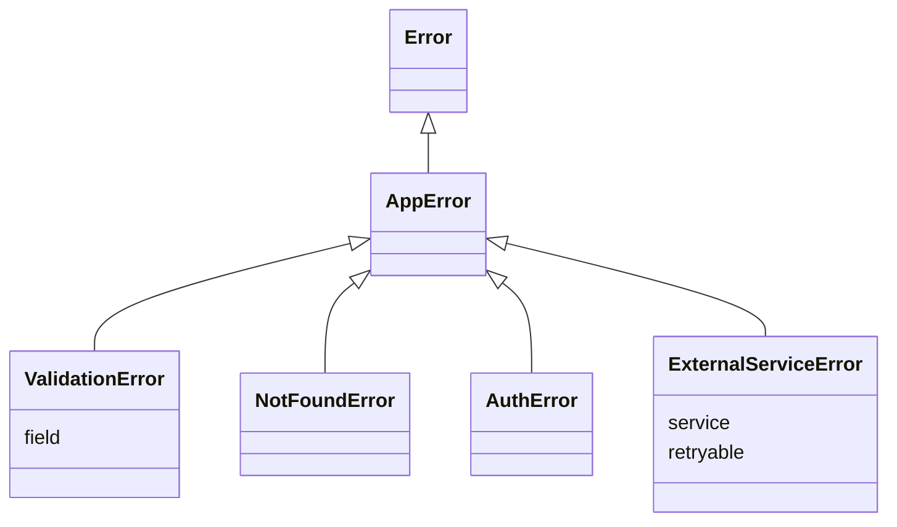

## Introduction

Suppose a checkout function can fail in several ways: the card is declined, the cart is empty, a field in the address is invalid, or the payment provider's server did not answer. The code calling it needs to react differently to each. A declined card should show "Try another card". An invalid field should highlight that field. A provider timeout should be retried. A bug should be reported and shown as a generic failure.

If every failure is `throw new Error('...')`, the caller can only tell them apart by reading the message text — `if (e.message.includes('declined'))` — which breaks the moment someone rewords a message or translates it. What the caller needs is a reliable **category** for each failure, plus structured data like *which* field was invalid.

**Custom errors** provide that. You define a class that extends `Error` — `CardDeclinedError`, `ValidationError`, `TimeoutError` — and throw instances of it. Callers recognise the category with `instanceof` or a `name`/`code` check, and read extra fields from the error object instead of from its message. Done well, custom errors turn error handling from string-matching into ordinary, type-checked control flow.

This lesson builds on [[b1-error-types]] (what an error object contains) and [[b1-throw-try-catch]] (how errors move). It is mostly about getting the details right: a custom error that is missing its `name`, loses its stack trace, or fails `instanceof` is worse than none.

## Before you start

- **Error objects** — `name`, `message`, `stack` and `cause`, and why `instanceof` breaks across realms. See [[b1-error-types]].
- **try/catch and rethrowing** — handle what you understand and rethrow the rest. See [[b1-throw-try-catch]].
- **Class inheritance** — `extends`, `super(...)` and how instances get their prototype. See [[b1-class-inheritance]] and [[b1-prototype-chain]].

## The intuition

Think of a hospital again: "the patient is unwell" is not enough to route them anywhere. The triage desk needs a category, and the specialist needs specifics — which bone, which allergy. A generic `Error` is "the patient is unwell". A `ValidationError` with `field: 'email'` is "fracture, left wrist".

The subclass is the category, and the extra properties are the specifics. And because a `ValidationError` *is an* `Error`, any code that only knows about generic errors — a logger, a test runner, an error-monitoring service — still handles it correctly. You add precision without breaking anything that came before.

## A minimal custom error

```js title="validation-error.js"
class ValidationError extends Error {
  constructor(field, message) {
    super(message);
    this.name = 'ValidationError';
    this.field = field;
  }
}

try {
  throw new ValidationError('email', 'Email is required');
} catch (e) {
  if (e instanceof ValidationError) {
    console.log(`Highlight field "${e.field}": ${e.message}`);
  }
  console.log(String(e));
  console.log(e instanceof Error, e.stack.split('\n')[0]);
}
```

```output
Highlight field "email": Email is required
ValidationError: Email is required
true ValidationError: Email is required
```

Every line in the constructor has a job.

**`super(message)`** runs the `Error` constructor. In a subclass, `this` does not exist until `super` has been called — the base constructor is what creates the object — so it must come first. `Error` sets the `message`, gives the object the internal `[[ErrorData]]` marker that makes it a genuine error, and (in every major engine) captures the stack trace.

**`this.name = 'ValidationError'`** fixes the category label. Without it, `name` is inherited from `Error.prototype` and is `"Error"`, so logs and `String(e)` would say `Error: Email is required`, hiding the type. In V8 the first line of `stack` also picks up the new name, because V8 formats that line lazily the first time `stack` is read.

**`this.field = field`** adds the structured data the caller needs. This is the main reason custom errors exist: the handler reads `e.field` instead of parsing it out of a sentence.

Forgetting `name` is the most common defect in custom errors:

```js title="forgot-name.js"
class PaymentError extends Error {}
const e = new PaymentError('Card declined');
console.log(String(e));
console.log(e instanceof PaymentError);
```

```output
Error: Card declined
true
```

`instanceof` still works, but every log, stack trace and error-monitoring dashboard shows a plain `Error`.

### Choosing how to set name

There are three common ways to set `name`, and one of them has a hidden trap.

| Approach | Example | Notes |
|---|---|---|
| String literal in the constructor | `this.name = 'ValidationError'` | Explicit and survives minification. Must be repeated in each class. |
| Prototype property | `ValidationError.prototype.name = 'ValidationError'` | One shared property, like built-in errors, not an own property of each instance. |
| Derived from the class | `this.name = new.target.name` or `this.constructor.name` | Written once in a base class, but **breaks under minification**. |

Deriving the name from the class looks elegant, and it is safe in code that ships unminified (Node.js services, tests). In front-end bundles it is a trap: minifiers rename classes to save bytes, so `ValidationError` may become `t`, and production logs read `t: Email is required`. Most minifiers have an option to keep class names (Terser's `keep_classnames`), but relying on it couples correctness to build configuration. **Prefer a string literal.** In a base class you can combine both by giving each subclass an explicit name:

```js title="named-subclasses.js"
class AppError extends Error {
  constructor(message, options) {
    super(message, options);
    // Each subclass overrides this with a literal; the fallback is for AppError itself.
    this.name = 'AppError';
  }
}
class NotFoundError extends AppError {
  constructor(resource, options) {
    super(`${resource} not found`, options);
    this.name = 'NotFoundError';
    this.resource = resource;
  }
}
const e = new NotFoundError('Order 42');
console.log(String(e), '|', e.resource);
console.log(e instanceof NotFoundError, e instanceof AppError, e instanceof Error);
```

```output
NotFoundError: Order 42 not found | Order 42
true true true
```

TypeScript users often write `override readonly name = 'NotFoundError'` as a class field; class fields are assigned right after `super()` returns, so the effect is the same as the constructor assignment.

## Forwarding cause

Since ES2022, `Error` accepts a second argument, an options object whose `cause` property records the error that led to this one. A custom error should accept options and pass them through to `super`, or its callers cannot attach a cause:

```js title="cause.js"
class AppError extends Error {
  constructor(message, options) {
    super(message, options); // forwards { cause } to Error
    this.name = 'AppError';
  }
}
class ConfigError extends AppError {
  constructor(path, options) {
    super(`Cannot load config from ${path}`, options);
    this.name = 'ConfigError';
    this.path = path;
  }
}

function loadConfig(path, text) {
  try {
    return JSON.parse(text);
  } catch (e) {
    throw new ConfigError(path, { cause: e });
  }
}

try {
  loadConfig('/etc/app.json', '{ port: 80 }');
} catch (e) {
  console.log(`${e.name}: ${e.message}`);
  console.log(`  cause -> ${e.cause.name}: ${e.cause.message}`);
}
```

```output
ConfigError: Cannot load config from /etc/app.json
  cause -> SyntaxError: Expected property name or '}' in JSON at position 2 (line 1 column 3)
```

The two errors answer different questions. The `ConfigError` says what the *application* was doing and is what calling code branches on. The `SyntaxError` says what *physically* went wrong, with its own stack, and is what an engineer reading the log needs. (The SyntaxError message is V8's wording in Node.js 22.) Wrapping at each meaningful boundary builds a chain: "Checkout failed" caused by "Payment provider unreachable" caused by "connect ECONNREFUSED". Node.js and browser consoles print the `cause` chain when you log the outer error.

> [!NOTE] Wrap, do not replace
> When you translate a low-level error into a domain error, always pass the original as `cause`. Dropping it throws away the only stack trace that points at the real failure.

## Designing an error hierarchy

Once you have a few custom errors, a small hierarchy helps. A common shape is one base class for everything your application throws deliberately, and a handful of subclasses for the categories callers actually handle differently:



The base class earns its place by answering one important question: **was this failure anticipated?** `e instanceof AppError` means "our code detected a known problem and has a message fit for the user". Anything else — a `TypeError` from a bug, a failure inside a library — is unexpected, and should be logged with full detail and shown to the user as a generic failure.

How many subclasses? Create a class only when **some caller handles it differently**. If no `catch` anywhere distinguishes `UsernameTooShortError` from `UsernameTooLongError`, they should both be a `ValidationError` with different messages. A hierarchy of twenty classes that are all handled the same way is cost without benefit: more code, more imports, and more chances to throw the wrong one.

### Classes or a code property

An alternative to many classes is one class with a **`code`** field, the approach Node.js itself uses (`err.code === 'ENOENT'`):

```js title="error-code.js"
class AppError extends Error {
  constructor(code, message, options) {
    super(message, options);
    this.name = 'AppError';
    this.code = code;
  }
}
const errors = [
  new AppError('CARD_DECLINED', 'Your card was declined'),
  new AppError('CART_EMPTY', 'Your cart is empty'),
];
for (const e of errors) {
  switch (e.code) {
    case 'CARD_DECLINED': console.log('Offer another payment method'); break;
    case 'CART_EMPTY': console.log('Redirect to the shop'); break;
  }
}
```

```output
Offer another payment method
Redirect to the shop
```

| | Separate classes | One class with `code` |
|---|---|---|
| Recognise with | `instanceof` | `e.code === '...'` |
| Extra typed fields per kind | Natural (`field`, `status`) | Awkward (optional fields on one class) |
| Survives realms and JSON | No (`instanceof` breaks) | Yes (a string survives) |
| Group related kinds | Inheritance (`instanceof AppError`) | Naming convention (`AUTH_*`) |

Many codebases combine them: a few classes for categories that carry different data, each with a stable `code` for anything that crosses a boundary. In TypeScript, a union of string-literal codes gives exhaustive `switch` checking.

## Making instanceof reliable

`instanceof` checks the prototype chain ([[b1-instanceof]]). Three situations break it for custom errors, and each has a different fix.

### Transpiling to ES5

Code compiled to ES5 — TypeScript with `"target": "ES5"`, or Babel 6 — turns classes into constructor functions, and calling `Error` as a function **returns a new object** instead of initialising `this`. The returned object has `Error.prototype` as its prototype, not your subclass's, so `instanceof` fails and any methods you defined are missing. This simulates what that compiled code does:

```js title="es5-subclass.js"
// Roughly what an ES5 compiler emits for `class LegacyError extends Error {}`.
function LegacyError(message) {
  const self = Error.call(this, message) || this;
  return self;
}
LegacyError.prototype = Object.create(Error.prototype);

// The documented fix: restore the prototype by hand.
function FixedError(message) {
  const self = Error.call(this, message) || this;
  Object.setPrototypeOf(self, FixedError.prototype);
  return self;
}
FixedError.prototype = Object.create(Error.prototype);

console.log(new LegacyError('x') instanceof LegacyError);
console.log(new FixedError('x') instanceof FixedError);
```

```output
false
true
```

TypeScript's documentation recommends `Object.setPrototypeOf(this, new.target.prototype)` immediately after `super()` in error subclasses when targeting ES5. The better fix today is to stop targeting ES5: every current browser and Node.js version supports native classes, and native `class extends Error` needs no workaround. Babel 7 also wraps built-in superclasses correctly.

### Realms

A realm is a separate set of built-ins: each iframe, worker and Node.js `vm` context has its own `Error` — and, if the same module is loaded in each, its own copy of your `ValidationError` class too. An error created in one realm fails `instanceof` against the class from another. The same problem appears without realms when **two copies of a library** end up in one bundle (for example two versions installed in `node_modules`): each copy has its own class, and `instanceof` against the other copy's class is false. The fix in both cases is to check something that is not a class identity, such as `name` or `code`.

### Serialisation

An error that crosses the network, `postMessage` or a JSON log is no longer an instance of anything. `JSON.stringify` keeps only own enumerable properties:

```js title="serialise.js"
class ValidationError extends Error {
  constructor(field, message) {
    super(message);
    this.name = 'ValidationError';
    this.field = field;
  }
}
const e = new ValidationError('email', 'Email is required');
console.log(JSON.stringify(e));
```

```output
{"name":"ValidationError","field":"email"}
```

`name` and `field` survived because they were assigned as ordinary (enumerable) properties, but `message` and `stack` did not. Define `toJSON` to control exactly what is sent, which also stops you leaking stack traces to clients:

```js title="to-json.js"
class AppError extends Error {
  constructor(code, message, options) {
    super(message, options);
    this.name = 'AppError';
    this.code = code;
  }
  // Called by JSON.stringify; the stack is deliberately left out.
  toJSON() {
    return { name: this.name, code: this.code, message: this.message };
  }
}
const e = new AppError('CART_EMPTY', 'Your cart is empty');
console.log(JSON.stringify({ error: e }));
```

```output
{"error":{"name":"AppError","code":"CART_EMPTY","message":"Your cart is empty"}}
```

On the receiving side, rebuild a real error from the payload if code there uses `instanceof`, or branch on `code` directly. (Within a browser, `structuredClone` and `postMessage` preserve built-in error types such as `TypeError`, but a custom error arrives as a plain `Error` named `"Error"`, with its extra fields dropped; see [[b1-structured-clone]].)

```quiz
Q: A shared component library and your app each bundle their own copy of `ValidationError`. The library throws one; your app checks `e instanceof ValidationError`. What happens?
- [ ] It is true, because both classes have the same name
- [x] It is false, because they are two different class objects with different prototypes
- [ ] It throws a TypeError
> `instanceof` compares object identity along the prototype chain, not names. Two copies of a
> module produce two distinct classes. Checking `e.name === 'ValidationError'` or a `code`
> property works regardless of which copy created the error.
```

## How it works internally

`class ValidationError extends Error` sets up two prototype links: `ValidationError.prototype`'s prototype is `Error.prototype`, and the constructor `ValidationError` itself has `Error` as its prototype (which is how static methods are inherited).

When you call `new ValidationError(...)`, a derived class constructor does not create an object itself. Its `this` stays uninitialised until `super(...)` runs. `super` calls the `Error` constructor with `new.target` set to `ValidationError`; `Error` creates the object using `new.target.prototype` as its prototype — that is how the new object ends up as a `ValidationError` rather than a plain `Error` — and gives it the `[[ErrorData]]` slot, an own `message`, and an own `cause` if one was passed. The engine adds `stack`. Control returns to your constructor with `this` bound to that object, and your assignments add `name` and extra fields as own, *enumerable* properties (unlike the built-in ones, which is why they appear in `JSON.stringify`).

The ES5 bug follows directly: compiled code calls `Error.call(this, msg)`, which is a plain function call with no `new.target`, so `Error` creates a fresh object with the default `Error.prototype` and ignores `this`.

V8 also provides **`Error.captureStackTrace(obj, fn)`**, a non-standard function that attaches a `stack` to any object and omits frames above `fn`. With native classes you do not need it — the stack is already captured — but some libraries call it to hide their own helper frames, for example passing a factory function so traces start at the factory's caller. Guard it (`Error.captureStackTrace?.(this, Factory)`) if your code may run in engines that lack it.

## Worked example: typed failures for a fetch wrapper

A front-end `request` helper is a natural home for custom errors, because `fetch` reports failures in three different ways: it rejects with a `TypeError` for network failures, with a `DOMException` named `AbortError` for cancellation, and *resolves* normally for HTTP errors such as 404 or 500 (see [[b3-fetch-error-handling]]). Callers should not have to know all of that.

```js title="request.mjs"
class AppError extends Error {
  constructor(message, options) {
    super(message, options);
    this.name = 'AppError';
  }
}
class HttpError extends AppError {
  constructor(status, url, options) {
    super(`HTTP ${status} from ${url}`, options);
    this.name = 'HttpError';
    this.status = status;
    this.url = url;
  }
  get retryable() {
    return this.status >= 500 || this.status === 429;
  }
}
class NetworkError extends AppError {
  constructor(url, options) {
    super(`Network failure calling ${url}`, options);
    this.name = 'NetworkError';
    this.url = url;
  }
  get retryable() {
    return true;
  }
}

// A fake fetch so the example runs anywhere; it mimics fetch's three outcomes.
async function fakeFetch(url) {
  if (url.includes('offline')) throw new TypeError('fetch failed');
  const status = url.includes('missing') ? 404 : url.includes('busy') ? 503 : 200;
  return { ok: status < 400, status, json: async () => ({ url }) };
}

async function request(url) {
  let res;
  try {
    res = await fakeFetch(url);
  } catch (e) {
    if (e?.name === 'AbortError') throw e; // cancellation is not a failure to wrap
    throw new NetworkError(url, { cause: e });
  }
  if (!res.ok) throw new HttpError(res.status, url);
  return res.json();
}

for (const url of ['/api/user', '/api/missing', '/api/busy', '/api/offline']) {
  try {
    console.log('ok', await request(url));
  } catch (e) {
    if (e instanceof AppError) {
      console.log(`${e.name} (retryable: ${e.retryable}) - ${e.message}`);
    } else {
      throw e; // a bug, not an expected failure
    }
  }
}
```

```output
ok { url: '/api/user' }
HttpError (retryable: false) - HTTP 404 from /api/missing
HttpError (retryable: true) - HTTP 503 from /api/busy
NetworkError (retryable: true) - Network failure calling /api/offline
```

Look at what each part buys. `request` is the only function that knows how `fetch` reports failures; it translates all of them into two application errors. `AbortError` is passed through untouched because cancellation is deliberate, and callers usually ignore it ([[b1-abort-controller-js]]). The `TypeError` from the network is wrapped with `cause` so the log still shows the low-level reason. `retryable` is a getter, so retry logic ([[b1-timeouts-retries]]) can ask the error itself instead of keeping its own list of status codes. And the caller handles every `AppError` the same way while rethrowing anything else — so a typo inside `request` would surface as a real bug rather than as "network failure".

## In real systems

**Back ends** map error classes to HTTP responses in one place: a framework error handler turns `ValidationError` into 400 with the field list, `NotFoundError` into 404, `AuthError` into 401 or 403, and anything that is not an `AppError` into a 500 with a generic message, logging the full stack internally.

**Front ends** map the same categories to UI: field-level messages for validation errors, a sign-in redirect for auth errors, a retry button for retryable network errors, and an error boundary fallback for everything unexpected ([[b4-error-boundaries]]).

**Libraries** export their error classes (and usually a `code`) so that applications can catch them precisely; many also include the HTTP status or the request on the error object.

**Monitoring** tools group by `name`, so meaningful names turn a pile of "Error" reports into distinct, countable problems.

## Trade-offs and alternatives

Custom errors give precise, structured, type-checkable failure categories while remaining ordinary errors that every tool understands. Their costs are the class boilerplate and the fact that `instanceof` is fragile across realms, duplicate packages and serialisation.

For expected outcomes that are part of normal flow — a form that is invalid, a search with no results — returning a **result value** (`{ ok: false, errors }`) is often clearer than throwing, because TypeScript then forces the caller to handle it. Use custom errors for failures that should interrupt the normal path, and keep the hierarchy shallow: a base class, the handful of categories that are handled differently, and `code` strings for anything finer.

## Common mistakes

**Not setting `name`.** Logs show `Error: …` and the type is invisible. Set it with a string literal.

**Deriving `name` from `constructor.name` in minified code.** Production logs show single-letter class names. Use literals.

**Not forwarding options to `super`.** `constructor(message) { super(message); }` silently drops `{ cause }`. Accept and forward an options argument.

**Putting data only in the message.** `new Error('Invalid field: email')` forces callers to parse text. Put `field: 'email'` on the error.

**Accessing `this` before `super()`.** In a derived constructor this throws a `ReferenceError` (V8: "Must call super constructor in derived class before accessing 'this' or returning from derived constructor"). Call `super` first.

**Catching a base class and handling everything as expected.** `catch (e) { if (e instanceof Error) showToast(e.message) }` treats bugs as user-facing messages. Check for your own base class, and rethrow the rest.

**Sending raw errors to clients.** Stack traces and internal messages can leak file paths, queries and library versions. Serialise through `toJSON` or an explicit mapping.

## Interview perspective

**"Write a custom error class."** Extend `Error`, call `super(message, options)` first, set `this.name` to a literal, add fields. Mention `cause`, and why you set `name`.

**"Why might `instanceof MyError` be false?"** ES5 transpilation (fix: `Object.setPrototypeOf(this, new.target.prototype)` or target modern JavaScript), realms such as iframes and workers, duplicate package copies, and errors rebuilt from JSON. The robust alternative is `name` or `code`.

**"How would you structure errors in a large app?"** A shallow hierarchy with a base `AppError` meaning "expected failure", a few categories that are handled differently, stable `code`s for crossing boundaries, wrapping with `cause` at layer boundaries, and one place that maps errors to responses or UI.

**Follow-up: "Do you need `Error.captureStackTrace`?"** Not for native class subclasses; it is a V8-specific tool for trimming frames or attaching stacks to non-error objects.

```quiz
Q: What is wrong with `class DbError extends Error { constructor(message) { super(message); this.name = 'DbError'; } }` when used as `throw new DbError('Query failed', { cause: e })`?
- [ ] `name` should be set before `super`
- [x] The `{ cause }` options object is ignored, so the original error is lost
- [ ] `instanceof DbError` will be false
> The constructor accepts only `message` and calls `super(message)`, so the second argument never
> reaches `Error` and no `cause` property is created. Accepting `options` and calling
> `super(message, options)` fixes it. Setting `name` before `super` would be a ReferenceError,
> and `instanceof` works fine with native classes.
```

## Practice

1. Write `ValidationError` that accepts an array of `{ field, message }` problems and exposes them as `errors`, with a `message` that summarises how many fields failed. Throw one from a `validateSignup(form)` function and render the problems.
2. Add a `toJSON` to your base error that includes `cause` recursively (name and message only, no stacks). Test it on a three-level cause chain.
3. Write `isAppError(value)` that works across realms and duplicate packages. Explain which property you rely on and why.
4. Extend the worked example with `TimeoutError`, raised when an `AbortSignal.timeout()` fires (`e.name === 'TimeoutError'`), and make it retryable.
5. Review an existing codebase's `catch` blocks: find one that branches on `e.message`, and refactor it to a custom error or `code`.

## Quick revision {#quick-revision}

- Pattern: `class X extends AppError { constructor(arg, options) { super(msg, options); this.name = 'X'; this.arg = arg; } }`.
- `super()` must run before `this` is touched; it creates the object, sets `message`, `cause`, `[[ErrorData]]`; the engine adds `stack`.
- Always set `name`; prefer a string literal — `constructor.name` breaks under minification.
- Forward `options` so `{ cause }` works; wrap low-level errors instead of replacing them.
- Put structured data on fields (`field`, `status`, `code`), not in the message.
- Create a class only for failures some caller handles differently; use `code` strings for finer detail.
- `instanceof` fails for ES5-transpiled subclasses (fix: `Object.setPrototypeOf(this, new.target.prototype)`), across realms, with duplicate packages, and after JSON.
- Custom fields you assign are enumerable and appear in `JSON.stringify`; `message` and `stack` do not. Use `toJSON` and never send stacks to clients.
- `Error.captureStackTrace` is V8-specific and unnecessary for native subclasses.

## Key takeaways {#key-takeaways}

- Custom errors exist so callers can branch on a category and read structured data instead of parsing messages.
- A correct custom error calls `super(message, options)` first, sets a literal `name`, and adds fields.
- Wrap lower-level failures with `cause` at each boundary so both the meaning and the original stack survive.
- Keep the hierarchy shallow; a base class that means "expected failure" is the most useful split.
- Rely on `name` or `code` whenever an error may cross a realm, a package boundary or the network.
