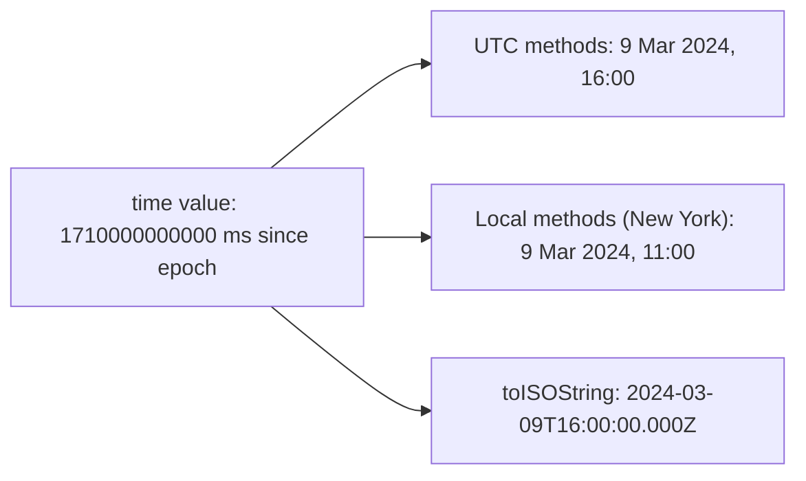

## Introduction

Almost every application handles time. An order has a creation time, a session expires, a calendar shows today's events, a log line records when something failed. JavaScript's built-in tool for all of this is the `Date` object, and it has been in the language since the first version in 1995.

`Date` is small and easy to start using, but it hides two separate ideas behind one object. The first idea is an **instant**: a single point on the global timeline, the same everywhere on Earth. "The moment the order was placed" is an instant. The second idea is a **wall-clock reading**: the year, month, day and hour that a clock on the wall shows in a particular place. The same instant is 4 PM in London and 9:30 PM in Mumbai. A `Date` stores only the instant, and computes wall-clock readings on demand — either for UTC or for the time zone of the computer running the code.

Once that is clear, most `Date` behaviour stops being mysterious. Bugs such as "the birthday shows one day early for users in California" or "the token looks expired the moment it is issued" come from mixing those two ideas, or from mixing units. This lesson builds the model from the ground up, then teaches two concepts that also stand on their own: [[b1-unix-timestamps]] (the number inside every `Date`) and [[b1-local-vs-utc]] (the two ways of reading it).

The rest of the module builds on this lesson: [[b1-date-pitfalls]] covers arithmetic such as "add one month", [[b1-intl-datetime]] covers formatting dates for people, and [[b1-temporal-api]] covers the newer `Temporal` API designed to replace most uses of `Date`.

## Before you start

- **Numbers** — that JavaScript numbers are 64-bit floating-point values and can represent integers exactly up to 2^53 − 1. See [[b1-type-number]].
- **Objects are references** — assigning an object to another variable does not copy it. See [[b1-objects-as-values]].
- **JSON basics** — that `JSON.stringify` turns values into text and `JSON.parse` turns text back into values. See [[b1-json]].

Every snippet runs in Node.js 22 as an ES module (save as `.mjs`). Output that depends on the time zone was produced by setting the `TZ` environment variable, for example `TZ=America/New_York node example.mjs`; the zone is named above each such block. Browsers behave the same way, using the operating system's time zone.

## The intuition

Picture an airport control tower with a single master clock that counts milliseconds and never adjusts for anything — no daylight saving, no time zones. Every event at the airport is stamped with that count. That count is what a `Date` stores.

Now picture the arrivals hall, where screens show the time for travellers. Each screen takes the master count and converts it to a local wall-clock reading: "Saturday 9 March, 11:00 AM". A screen in another city would show a different reading for the same count. A `Date` object comes with two such screens built in: one fixed to UTC (methods with `UTC` in their name) and one set to whatever zone the computer is configured for (methods without `UTC`).

The analogy breaks in one place: a real screen cannot change the master clock, but a `Date` can. Methods such as `setHours` take a wall-clock change ("make it 8 o'clock"), work out which instant that means, and overwrite the stored count. That mutability is convenient and also a frequent source of bugs, covered below.



## What a Date stores

The ECMAScript specification describes a `Date` object as having one internal slot, `[[DateValue]]`, which holds a **time value**. A time value is either a number of milliseconds since the **Unix epoch** — 1 January 1970, 00:00:00 UTC — or `NaN`, which marks an invalid date. Nothing else is stored: not a time zone, not a format, not the string you created it from.

Three consequences follow, and the rest of this lesson keeps returning to them:

1. **Two dates created in different ways are identical if their time values match.** A date from an ISO string and a date from a number are indistinguishable once created.
2. **Time zone is not part of the date.** It is applied each time you call a local method, using the host's current settings.
3. **A date is a mutable object.** Setters change the slot in place, and everyone holding a reference sees the change.

The time value ignores leap seconds: the specification defines every day as exactly 86,400,000 milliseconds. That keeps arithmetic simple and matches how Unix systems count time.

## Creating dates

There are four common ways to make a `Date`, and they differ in how they interpret their input.

```javascript title="create.mjs"
const fromIso = new Date('2024-03-09T16:00:00Z');   // ISO string with Z (UTC)
const fromMs = new Date(1710000000000);             // milliseconds since the epoch
const fromParts = new Date(2024, 2, 9, 11, 0);      // local parts: 9 March 2024, 11:00

console.log(fromIso.getTime());
console.log(fromMs.getTime());
console.log(fromParts.getTime());
console.log(fromParts.toISOString());
console.log(fromParts.toString());
```

```output
1710000000000
1710000000000
1710000000000
2024-03-09T16:00:00.000Z
Sat Mar 09 2024 11:00:00 GMT-0500 (Eastern Standard Time)
```

This ran with `TZ=America/New_York`. All three dates hold the same time value, because 11:00 in New York in March 2024 (before daylight saving began on 10 March) is 16:00 UTC. `getTime()` returns the stored number; `toISOString()` prints it as UTC; `toString()` prints it in the local zone. In Mumbai, `fromParts` would be 11:00 Mumbai time — a different instant — while the first two would be unchanged. **The numeric-parts constructor is the only one of the three whose meaning depends on where the code runs.**

The forms in full:

| Call | Meaning |
|---|---|
| `new Date()` | The current instant |
| `new Date(ms)` | The instant `ms` milliseconds after the epoch (negative means before 1970) |
| `new Date(string)` | Parse the string (rules below) |
| `new Date(year, monthIndex, day?, h?, m?, s?, ms?)` | Local wall-clock parts; omitted parts default to the start (day 1, 00:00:00.000) |
| `new Date(otherDate)` | A copy with the same time value |
| `Date.now()` | The current time value as a **number**, not a `Date` |
| `Date.UTC(year, monthIndex, ...)` | Like the parts constructor but in UTC, and returns a **number** |
| `Date.parse(string)` | Parse a string and return the time value (a number, possibly `NaN`) |

The difference between `Date.now()` and `new Date()` matters in code that only needs a number — measuring elapsed time, stamping an event. `Date.now()` avoids allocating an object. Calling `Date()` without `new` is a historical oddity: it ignores any arguments and returns the current time as a string.

```javascript title="now.mjs"
const now = new Date();
console.log(typeof Date.now());   // a number of milliseconds
console.log(typeof now);          // a Date object
console.log(typeof Date());       // called without new: a string
console.log(now.getTime() === now.valueOf());
```

```output
number
object
string
true
```

### Months start at zero

In the parts constructor and in `getMonth`/`setMonth`, January is `0` and December is `11`. Days of the month start at `1` as usual. This was copied from Java's `java.util.Date`, which JavaScript's `Date` was modelled on, and it can never change without breaking existing websites.

```javascript title="parts.mjs"
const d = new Date(2024, 1, 29, 18, 45, 30);  // month 1 is February
console.log(d.getFullYear(), d.getMonth(), d.getDate());
console.log(d.getDay());       // day of the week: 0 = Sunday
console.log(d.getHours(), d.getMinutes(), d.getSeconds(), d.getMilliseconds());
console.log(d.getMonth() + 1); // the month number a human expects
```

```output
2024 1 29
4
18 45 30 0
2
```

Notice `getDate()` (day of the month, 29) versus `getDay()` (day of the week, 4 = Thursday). The names are easy to confuse. One more legacy rule: in the parts constructor and `Date.UTC`, a year from `0` to `99` means 1900–1999, so `new Date(99, 0, 1)` is 1 January 1999. Use four-digit years.

### Parsing strings

The specification defines exactly one string format that every engine must parse: a simplified form of **ISO 8601**, such as `2024-03-09`, `2024-03-09T11:00`, `2024-03-09T11:00:00.000Z` or `2024-03-09T11:00+05:30`. Any other format — `03/09/2024`, `March 9, 2024`, `9-3-2024` — is **implementation-defined**: an engine may accept it, reject it, or read it differently from another engine. Even when Node.js and Chrome agree on `"01/02/2020"` (they read it as 2 January, US order), nothing guarantees it, and a British user would expect 1 February.

Within ISO strings, the rule for which zone applies is easy to get wrong:

```javascript title="parse.mjs"
const inputs = [
  '2024-03-09',               // date-only ISO: treated as UTC
  '2024-03-09T11:00',         // date-time without offset: treated as local
  '2024-03-09T11:00Z',        // explicit UTC
  '2024-03-09T11:00+05:30',   // explicit offset
];
for (const s of inputs) {
  console.log(s.padEnd(24), new Date(s).toISOString());
}
```

```output
2024-03-09               2024-03-09T00:00:00.000Z
2024-03-09T11:00         2024-03-09T16:00:00.000Z
2024-03-09T11:00Z        2024-03-09T11:00:00.000Z
2024-03-09T11:00+05:30   2024-03-09T05:30:00.000Z
```

With `TZ=America/New_York`: a **date-only** string is midnight UTC, but a **date-time** without an offset is local time. This asymmetry was fixed in ES2016 to match how browsers already behaved, and it is the root of the "previous day" bug explained in [[b1-local-vs-utc]]. The safe rule: send and accept instants as full ISO strings with `Z` or an explicit offset, and parse anything else yourself.

## Reading and changing a date

Every getter has a local version and a UTC version: `getFullYear`/`getUTCFullYear`, `getMonth`/`getUTCMonth`, `getDate`/`getUTCDate`, `getDay`/`getUTCDay`, `getHours`/`getUTCHours`, and so on down to milliseconds. Setters come in the same pairs (`setHours`/`setUTCHours`). `getTime()` and `getTimezoneOffset()` have no pair because the first is zone-free and the second is about the local zone by definition.

Setters do three things: compute the wall-clock fields in the chosen zone, replace the fields you passed, and convert back to a new time value stored in the same object. They return the new time value. Because the conversion back uses the usual date rules, out-of-range fields **overflow** rather than throw: `setDate(32)` in January lands on 1 February. That is useful for arithmetic and dangerous when unintended; [[b1-date-pitfalls]] covers it in depth.

To print a date, the three methods you will use most are:

| Method | Example output | Use |
|---|---|---|
| `toISOString()` | `2024-03-09T16:00:00.000Z` | Storage, APIs, logs — always UTC, always the same format |
| `toString()` | `Sat Mar 09 2024 11:00:00 GMT-0500 (Eastern Standard Time)` | Debugging; local, English, not for users |
| `toLocaleString(locale, options)` | `3/9/2024, 11:00:00 AM` | Display to users; see [[b1-intl-datetime]] |

## Copying and comparing

A `Date` is an object, so assignment shares it. This bites when one function stores a date and another "adjusts" it.

```javascript title="copy-compare.mjs"
const meeting = new Date(2024, 0, 15, 9, 0);
const reminder = meeting;                  // same object, not a copy
reminder.setHours(8, 45);
console.log(meeting.getHours(), meeting.getMinutes());

const copy = new Date(meeting);            // a new object with the same time value
copy.setDate(16);
console.log(meeting.getDate(), copy.getDate());

const a = new Date(2024, 0, 15);
const b = new Date(2024, 0, 15);
console.log(a === b);                      // two different objects
console.log(a.getTime() === b.getTime());  // same instant
console.log(a < new Date(2024, 0, 16));    // < converts both to numbers
console.log(new Date(2024, 0, 16) - a);    // difference in milliseconds
```

```output
8 45
15 16
false
true
true
86400000
```

Setting the reminder moved the meeting, because both names point at one object. `new Date(meeting)` creates an independent copy. For comparison, `===` and `==` compare object identity, so two dates for the same instant are "not equal". Relational operators (`<`, `>`) and subtraction convert dates to numbers through `valueOf()`, so they work as expected. Compare with `a.getTime() === b.getTime()`, and sort with `(x, y) => x - y`.

## Invalid dates

When construction fails, JavaScript does not throw. It returns a real `Date` object whose time value is `NaN`, usually called an **Invalid Date**.

```javascript title="invalid.mjs"
const bad = new Date('31/12/2024');
console.log(bad instanceof Date);        // still a Date object
console.log(bad.getTime());              // but its time value is NaN
console.log(String(bad));
console.log(Number.isNaN(bad.getTime()));

try {
  bad.toISOString();
} catch (err) {
  console.log(`${err.name}: ${err.message}`);
}

function isValidDate(value) {
  return value instanceof Date && !Number.isNaN(value.getTime());
}
console.log(isValidDate(new Date('2024-12-31')), isValidDate(bad));
```

```output
true
NaN
Invalid Date
true
RangeError: Invalid time value
true false
```

An invalid date passes `instanceof Date` checks and travels silently through your code: every getter returns `NaN`, comparisons are `false`, and `JSON.stringify` writes `null`. It only fails loudly when something calls `toISOString()` or a formatter, often far from where the bad input entered. Validate at the boundary — where user input or API data becomes a `Date` — with a check like `isValidDate`.

## Dates and JSON

JSON has no date type. `JSON.stringify` calls a date's `toJSON()` method, which returns `toISOString()` (or `null` for an invalid date). `JSON.parse` does not turn the string back into a `Date`; you get a string.

```javascript title="json.mjs"
console.log(JSON.stringify({ createdAt: new Date(Date.UTC(2024, 2, 9, 16)) }));
const parsed = JSON.parse('{"createdAt":"2024-03-09T16:00:00.000Z"}');
console.log(typeof parsed.createdAt);
console.log(new Date(parsed.createdAt).getTime());
```

```output
{"createdAt":"2024-03-09T16:00:00.000Z"}
string
1710000000000
```

Convert known fields explicitly after parsing, or use a reviver function — see [[b1-json-replacer-reviver]].

## Unix Timestamps {#b1-unix-timestamps}

A **Unix timestamp** is a single number that identifies an instant by counting time since the Unix epoch, 1 January 1970 at 00:00:00 UTC. It has no time zone and no format to misread, which is why databases, operating systems, tokens and network protocols use it. The catch is the unit. Traditional Unix time, from the C language and POSIX systems, counts **seconds**. JavaScript, like Java, counts **milliseconds**. `Date.now()`, `date.getTime()`, `date.valueOf()` and `+date` all return milliseconds.

Mixing the two units is the classic "off by a factor of 1,000" bug. A seconds value passed to `new Date()` is read as milliseconds and lands in January 1970; a milliseconds value sent to an API that expects seconds lands about 50,000 years in the future.

```javascript title="units.mjs"
const ms = Date.parse('2024-03-09T16:00:00Z');
const seconds = Math.floor(ms / 1000);
console.log(ms, String(ms).length);              // milliseconds: 13 digits today
console.log(seconds, String(seconds).length);    // seconds: 10 digits today

console.log(new Date(seconds * 1000).toISOString());  // correct
console.log(new Date(seconds).toISOString());         // bug: seconds read as ms
```

```output
1710000000000 13
1710000000 10
2024-03-09T16:00:00.000Z
1970-01-20T19:00:00.000Z
```

The digit count is a quick sanity check for present-day values: about **10 digits means seconds, about 13 means milliseconds**. (Seconds reached 10 digits in 2001 and will stay there until 2286.) Inside code, do not guess — name variables with their unit (`expiresAtSec`, `createdAtMs`) and convert once, at the boundary where data enters or leaves your program.

The two conversions are:

- seconds → milliseconds: `seconds * 1000`
- milliseconds → seconds: `Math.floor(ms / 1000)`

Use `Math.floor` rather than `Math.round` so a timestamp never rounds into the future; an "issued at" time half a second ahead can make a strict server reject a token. Plain division leaves a fraction (`1710000000.123`), which many APIs reject.

### A realistic example: token expiry

JSON Web Tokens (JWT) carry an `exp` claim in seconds. A front end often decodes it to decide whether to refresh before calling an API.

```javascript title="token-expiry.mjs"
// A JWT-style payload from a server: exp is in seconds.
const payload = { sub: 'user-42', exp: 1710003600 };
const nowMs = Date.parse('2024-03-09T16:30:00Z');   // pretend "now" for a fixed result

const expiresAtMs = payload.exp * 1000;
console.log(new Date(expiresAtMs).toISOString());
console.log(expiresAtMs > nowMs ? 'still valid' : 'expired');
console.log('minutes left:', (expiresAtMs - nowMs) / 60000);

// Building a seconds timestamp for an API that expects one.
const issuedAt = Math.floor(nowMs / 1000);
console.log(issuedAt);
```

```output
2024-03-09T17:00:00.000Z
still valid
minutes left: 30
1710001800
```

In real code `nowMs` would be `Date.now()`. Comparing `payload.exp > Date.now()` without the conversion would report every token as expired, since a 10-digit number is always smaller than a 13-digit one. Remember too that the client's clock may be wrong; servers must make the real decision.

### Range and precision

A time value must lie within ±8.64 × 10^15 milliseconds of the epoch — exactly 100,000,000 days either side, roughly from the year −271821 to +275760. The specification's `TimeClip` operation turns anything outside that range into `NaN`. Because 8.64 × 10^15 is below `Number.MAX_SAFE_INTEGER` (about 9 × 10^15), every valid millisecond value is an exact integer in a double, so there is no rounding error at millisecond precision.

```javascript title="range.mjs"
console.log(new Date(2 ** 31 * 1000).toISOString());   // 32-bit seconds overflow point
console.log(new Date(-86400000).toISOString());        // negative: before 1970
console.log(new Date(8.64e15).toISOString());          // largest valid Date
console.log(new Date(8.64e15 + 1).getTime());          // one ms more: invalid
console.log(Number.isSafeInteger(8.64e15));
```

```output
2038-01-19T03:14:08.000Z
1969-12-31T00:00:00.000Z
+275760-09-13T00:00:00.000Z
NaN
true
```

The first line is the **Year 2038 problem**: systems that store seconds in a signed 32-bit integer run out at 2^31 − 1 seconds, one second before 2038-01-19T03:14:08Z. JavaScript is not affected because it uses a 64-bit double, but a JavaScript client talking to an old C service or a database column of 32-bit type can still be. Negative timestamps are valid and mean dates before 1970.

What a timestamp cannot carry is a time zone or anything finer than a millisecond. Two other clocks are worth knowing so you do not confuse them with timestamps. `performance.now()` returns milliseconds (with a fractional part) since the page or process started — good for measuring durations, meaningless as a date. And the newer `Temporal.Instant` stores nanoseconds as a `BigInt`; see [[b1-temporal-api]].

### Where timestamps fit

Use a number timestamp when you need compact storage, cheap comparison and sorting, or a protocol requires it (JWT `exp`/`iat`/`nbf`, Redis expiry times, many analytics events). Use an ISO 8601 string with `Z` when humans read the data — logs, JSON APIs, database exports — because `2024-03-09T16:00:00.000Z` can be checked by eye and `1710000000000` cannot. Both represent the same instant; neither can represent "9 March" as a calendar date without a zone, which is the subject of the next section.

## Local Time vs UTC {#b1-local-vs-utc}

**UTC** (Coordinated Universal Time) is the world's reference clock: it has no daylight saving and no regional offset. **Local time** is what clocks show in a particular place, defined by a **time zone** such as `America/New_York` or `Asia/Kolkata`. A time zone is a set of rules giving the offset from UTC at each instant — New York is UTC−5 in winter and UTC−4 in summer; India is UTC+5:30 all year. A JavaScript `Date` stores a UTC-based instant and offers two families of methods to read it: `getUTC*`/`setUTC*`/`toISOString`/`toUTCString` use UTC, while `get*`/`set*`/`toString`/`toDateString` use the **host time zone** — the zone of the operating system or the `TZ` environment variable in Node.js.

The same `Date` therefore gives different local answers on different machines:

```javascript title="two-readings.mjs"
const d = new Date('2024-01-01T02:30:00Z');

console.log(d.getUTCDate(), d.getUTCHours());   // read in UTC
console.log(d.getDate(), d.getHours());         // read in the host's zone
console.log(d.getTimezoneOffset());             // minutes to ADD to local to get UTC
console.log(d.toISOString());
console.log(d.toUTCString());
console.log(d.toString());
```

Run with `TZ=America/New_York`:

```output
1 2
31 21
300
2024-01-01T02:30:00.000Z
Mon, 01 Jan 2024 02:30:00 GMT
Sun Dec 31 2023 21:30:00 GMT-0500 (Eastern Standard Time)
```

Run with `TZ=Asia/Kolkata`:

```output
1 2
1 8
-330
2024-01-01T02:30:00.000Z
Mon, 01 Jan 2024 02:30:00 GMT
Mon Jan 01 2024 08:00:00 GMT+0530 (India Standard Time)
```

The UTC lines are identical. The local lines differ, and in New York even the *day* is different: it is still New Year's Eve there. `getTimezoneOffset()` has a sign that surprises people: it returns **UTC minus local, in minutes**, so zones west of UTC are positive (New York: `300`) and zones east are negative (India: `-330`). It is the opposite sign of the `-05:00` you see in an ISO string.

### The offset changes during the year

The host zone is not a fixed number. `getTimezoneOffset()` is evaluated for the instant stored in the date, so it reflects daylight saving time (DST) at that instant.

```javascript title="dst-offset.mjs"
console.log(new Date('2024-01-15T12:00:00Z').getTimezoneOffset());
console.log(new Date('2024-07-15T12:00:00Z').getTimezoneOffset());
```

```output
300
240
```

With `TZ=America/New_York`, January is UTC−5 and July is UTC−4. Never store "the user's offset" once and apply it to other dates; store the zone name (`America/New_York`) and let the time-zone database compute offsets. The specification leaves the local-zone conversion to the host (an abstract operation historically named `LocalTZA`); engines use the IANA time-zone database through the operating system or ICU.

### The "previous day" bug

This is the most common local/UTC bug in front-end code. A form or API gives a date-only string, the code parses it with `new Date`, and then displays it with local methods.

```javascript title="birthday.mjs"
const birthday = new Date('1990-05-15');   // date-only: midnight UTC
console.log(birthday.toISOString());
console.log(birthday.getDate());           // local day of month
console.log(birthday.toDateString());
console.log(birthday.getUTCDate());        // UTC day of month
```

```output
1990-05-15T00:00:00.000Z
14
Mon May 14 1990
15
```

With `TZ=America/Los_Angeles`, midnight UTC on 15 May is the evening of 14 May locally, so the user sees the wrong birthday. Users east of UTC never see the bug, which is why it often reaches production unnoticed by a developer in Europe or India. Two fixes work, and the choice depends on what the value means:

- If the value is a **calendar date** (birthday, due date, holiday), it is not an instant at all. Keep it as the string `"1990-05-15"`, or parse it into local parts with `new Date(1990, 4, 15)` and read it with local methods, as in the worked example below.
- If you must keep it as UTC midnight, read it consistently with UTC methods (`getUTCDate`) or format with `timeZone: 'UTC'` in [[b1-intl-datetime]].

The bug comes from mixing: parsed in UTC, displayed in local time. Any consistent choice fixes it.

### Setters: local versus UTC

The same split applies when changing a date. "Start of day" depends on whose day you mean.

```javascript title="start-of-day.mjs"
const d1 = new Date('2024-01-01T02:30:00Z');
d1.setHours(0, 0, 0, 0);                   // local midnight of the LOCAL day
console.log(d1.toISOString());

const d2 = new Date('2024-01-01T02:30:00Z');
d2.setUTCHours(0, 0, 0, 0);                // midnight UTC of the UTC day
console.log(d2.toISOString());
```

```output
2023-12-31T05:00:00.000Z
2024-01-01T00:00:00.000Z
```

With `TZ=America/New_York`, the instant is 21:30 on 31 December locally, so `setHours(0, 0, 0, 0)` moves to local midnight of 31 December — 05:00 UTC. `setUTCHours` moves to midnight of the UTC day, 1 January. Neither is wrong; they answer different questions. "Group today's orders for this user" needs the user's local day; "aggregate daily server metrics" usually needs the UTC day.

### A practical rule set

Production systems settle this with a few conventions:

1. **Store and transmit instants in UTC** — as ISO strings with `Z` or as millisecond timestamps. Servers, databases and logs then agree regardless of where they run. Many teams also run servers with `TZ=UTC` so local methods cannot silently differ between machines.
2. **Store calendar dates as dates**, not instants: a `DATE` column in the database, a `"YYYY-MM-DD"` string in JSON.
3. **Store the user's time-zone name** when the meaning depends on it (a 9 AM daily reminder must stay at 9 AM after DST changes).
4. **Convert to local only for display**, using `Intl.DateTimeFormat` with an explicit `timeZone` where the zone is known. Browser code can read the user's zone with `Intl.DateTimeFormat().resolvedOptions().timeZone`.

`Date` cannot represent "an instant in a specific zone other than the host's"; it only knows UTC and the host zone. For that, use `Intl.DateTimeFormat` with `timeZone` for display, or `Temporal.ZonedDateTime` ([[b1-temporal-api]]) for arithmetic.

## Worked example: calendar dates in local time

A to-do app stores due dates as `"YYYY-MM-DD"` strings and must show and compare them in the user's local calendar. Two helpers do the conversion without the date-only UTC trap, and without the equally common `toISOString().slice(0, 10)` trap.

```javascript title="calendar-dates.mjs"
// Calendar dates ("2024-03-09") and instants are different things.
// These two helpers keep a calendar date in the user's local zone.
function parseLocalDate(text) {
  const match = /^(\d{4})-(\d{2})-(\d{2})$/.exec(text);
  if (!match) throw new RangeError(`Not a YYYY-MM-DD date: ${text}`);
  const [, y, m, d] = match.map(Number);
  const date = new Date(y, m - 1, d);          // local midnight; month is 0-based
  // Reject overflow such as 2024-02-30 (which Date would roll to 1 March).
  if (date.getFullYear() !== y || date.getMonth() !== m - 1 || date.getDate() !== d) {
    throw new RangeError(`No such calendar date: ${text}`);
  }
  return date;
}

function toLocalDateKey(date) {
  const y = date.getFullYear();
  const m = String(date.getMonth() + 1).padStart(2, '0');
  const d = String(date.getDate()).padStart(2, '0');
  return `${y}-${m}-${d}`;
}

const due = parseLocalDate('2024-03-09');
console.log(due.toString());
console.log(toLocalDateKey(due));

const evening = new Date(2024, 2, 9, 21, 0);      // 9 PM local time
console.log(evening.toISOString().slice(0, 10)); // the UTC calendar day
console.log(toLocalDateKey(evening));            // the local calendar day

try {
  parseLocalDate('2024-02-30');
} catch (err) {
  console.log(`${err.name}: ${err.message}`);
}
```

```output
Sat Mar 09 2024 00:00:00 GMT-0500 (Eastern Standard Time)
2024-03-09
2024-03-10
2024-03-09
RangeError: No such calendar date: 2024-02-30
```

With `TZ=America/New_York`:

- `parseLocalDate` reads the three numbers itself instead of handing the string to `new Date`, so the result is local midnight, not UTC midnight. It subtracts 1 from the month because the parts constructor is 0-based.
- The round-trip check catches overflow. `new Date(2024, 1, 30)` silently becomes 1 March; comparing the fields back against the input turns that into an error.
- `toLocalDateKey` builds the key from local getters. The tempting shortcut `toISOString().slice(0, 10)` gives the **UTC** day, which at 9 PM in New York is already 10 March.
- Because both helpers use local time consistently, a key produced on one day always parses back to the same day.

## In real systems

- **APIs** send instants as ISO 8601 strings with `Z` (`"createdAt": "2024-03-09T16:00:00.000Z"`) and front ends convert them with `new Date(str)` before formatting for display.
- **Authentication** code converts JWT `exp` from seconds to milliseconds before comparing with `Date.now()`.
- **Date pickers** (including `<input type="date">`, whose `value` is a `"YYYY-MM-DD"` string) deal in calendar dates; robust forms keep that string or parse it as local parts rather than with `new Date(str)`.
- **Logging and monitoring** use `toISOString()` or numeric timestamps so lines from servers in different zones sort correctly.
- **Libraries** such as date-fns, Luxon and Day.js exist because `Date` lacks calendar arithmetic and named-zone support. The `Temporal` API ([[b1-temporal-api]]) brings those capabilities into the language.

## Trade-offs and alternatives

`Date` is built in, fast, and understood by every API that accepts dates, from `JSON.stringify` to `Intl.DateTimeFormat` and IndexedDB. For storing and comparing instants it is entirely adequate. Its weaknesses are in modelling: it cannot represent a calendar date without a time, a wall-clock time without a date, or an instant in a named zone other than the host's; it is mutable; and its string parsing is only reliable for ISO formats.

| Need | Reasonable choice |
|---|---|
| Timestamp an event, compare instants | `Date.now()` / `Date` |
| Send an instant over an API | ISO string with `Z`, or ms/seconds as the protocol says |
| A calendar date (birthday, due date) | `"YYYY-MM-DD"` string, or local-parts `Date` handled carefully |
| Display in the user's language and zone | `Intl.DateTimeFormat` ([[b1-intl-datetime]]) |
| Calendar arithmetic, other zones, durations | `Temporal` where supported, otherwise a library |

## Common mistakes

> [!MISTAKE] Using 1-based months in the constructor
> `new Date(2024, 1, 1)` is 1 **February**. Subtract 1 when building from human month numbers, and add 1 when displaying `getMonth()`.

**Parsing non-ISO strings.** `new Date('03/04/2024')` may mean 4 March or 3 April depending on who wrote it, and engines are free to disagree. Parse such input yourself with an explicit format, or use a date picker that produces ISO strings.

**Confusing `getDay` and `getDate`.** `getDay()` is the weekday (0 = Sunday); `getDate()` is the day of the month.

**Comparing with `===`.** Two dates for the same instant are different objects. Compare `getTime()` values.

**Sharing a mutable date.** Passing a `Date` into a function that calls `setDate` changes the caller's date too. Copy with `new Date(d)` before modifying, or treat dates as read-only.

**Seconds versus milliseconds.** `new Date(1710000000)` is January 1970. Multiply seconds by 1,000; divide milliseconds by 1,000 and floor.

**Not validating.** `new Date(userInput)` never throws. Check `Number.isNaN(d.getTime())` before trusting it.

**Using `toISOString().slice(0, 10)` for "today".** It gives the UTC date, which differs from the local date for several hours each day in most zones.

## Interview perspective

**"What does a JavaScript `Date` actually store?"** A strong answer: a single time value, milliseconds since 1970-01-01T00:00:00Z, or `NaN` if invalid; no zone. Local getters apply the host zone on every call. Mention that the object is mutable.

**"Why does `new Date('2024-03-09')` show 8 March for some users?"** Date-only ISO strings are parsed as UTC midnight, and local getters in zones west of UTC read that as the previous evening. Fixes: keep calendar dates as strings or local parts, or read with UTC methods consistently.

**"How do you check that a value is a valid date?"** `value instanceof Date && !Number.isNaN(value.getTime())`. Explain why `instanceof` alone is not enough.

**"An API returns `exp: 1710003600`. How do you check expiry?"** Recognise 10 digits as seconds, compare `exp * 1000` with `Date.now()`, and note clock skew between client and server.

**Follow-up: "Is JavaScript affected by the Year 2038 problem?"** Not internally — time values are doubles with a range of ±100 million days — but data exchanged with 32-bit systems can be.

## Practice

1. Without running it, predict what `new Date(2024, 11, 31, 23, 59).getMonth()` and `new Date(2024, 12, 1).getFullYear()` return. Then check.
2. Write `secondsToDate(sec)` and `dateToSeconds(date)`, and test them with `1710000000`.
3. Run the `two-readings.mjs` snippet with `TZ=Pacific/Auckland`. Explain the sign of `getTimezoneOffset()` you see.
4. A user in Los Angeles enters a due date of `2024-03-09` in `<input type="date">`. Show code that displays "3/8/2024" by mistake, then fix it two different ways.
5. Write `isSameLocalDay(a, b)` and `isSameUtcDay(a, b)`. Find two instants where they disagree for `TZ=Asia/Kolkata`.

```quiz
Q: With `TZ=America/New_York`, what does `new Date('2024-03-09').getDate()` return?
- [ ] 9, because the string says the 9th
- [x] 8, because a date-only string is UTC midnight, which is the evening of the 8th in New York
- [ ] 9, because strings without an offset are always local time
- [ ] NaN, because the string has no time part
> Date-only ISO strings are parsed as UTC; only date-time strings without an offset are local. UTC midnight on the 9th is 7 PM on the 8th in New York, and `getDate()` reads local time. The string is valid, so the result is not `NaN`.
```

```quiz
Q: A server sends `{ "exp": 1710003600 }`. Which check correctly tells whether the token has expired?
- [ ] `exp < Date.now()`
- [x] `exp * 1000 < Date.now()`
- [ ] `exp < Date.now() * 1000`
- [ ] `new Date(exp) < new Date()`
> `exp` has 10 digits, so it is in seconds, while `Date.now()` is in milliseconds. Multiplying by 1,000 puts both in the same unit. The first and last options compare seconds with milliseconds and would report every token as expired; the third makes the mismatch worse.
```

```quiz
Q: Why does `new Date(2024, 0, 15) === new Date(2024, 0, 15)` print `false`?
- [ ] The two calls run a few milliseconds apart
- [ ] Local dates cannot be compared, only UTC dates
- [x] `===` compares object identity, and these are two different objects
- [ ] The parts constructor returns an Invalid Date
> Both dates hold the same time value, because the parts are fixed rather than "now". But `===` on objects checks whether both sides are the same object. Compare `getTime()` values instead, or use `<`/`>` which convert to numbers.
```

## Quick revision {#quick-revision}

- A `Date` stores one time value: milliseconds since 1970-01-01T00:00:00Z, or `NaN` (Invalid Date). No zone, no format.
- `new Date(ms)`, `new Date(isoWithZ)` are zone-independent; `new Date(y, m, d, ...)` uses local time; `Date.UTC(...)` returns a UTC number.
- Months are 0-based in the parts constructor and `get/setMonth`; `getDay` is weekday, `getDate` is day of month.
- Only ISO 8601 strings are reliably parsed. Date-only ISO is UTC; date-time ISO without offset is local.
- `Date.now()` returns a number; `Date()` without `new` returns a string.
- Dates are mutable objects: copy with `new Date(d)`, compare with `getTime()`, subtract to get milliseconds.
- Invalid dates do not throw on creation; `toISOString()` throws `RangeError`. Validate with `Number.isNaN(d.getTime())`.
- JS timestamps are milliseconds (13 digits today); Unix/JWT timestamps are seconds (10 digits). `sec * 1000`, `Math.floor(ms / 1000)`.
- Valid range ±8.64e15 ms (±100 million days); JS is not affected by the 32-bit 2038 overflow.
- `get*`/`set*`/`toString` use the host zone; `getUTC*`/`setUTC*`/`toISOString` use UTC. `getTimezoneOffset()` = UTC − local in minutes, varies with DST.
- Store instants in UTC, calendar dates as `YYYY-MM-DD`, and zone names (not offsets); convert to local only for display.

## Key takeaways {#key-takeaways}

- Think of a `Date` as one number with two lenses: UTC methods and local methods read the same instant differently.
- Know which inputs are interpreted locally: the parts constructor and ISO date-times without an offset.
- Always know your timestamp unit; JavaScript uses milliseconds, most other systems use seconds.
- A calendar date is not an instant. Keep them apart, or the "previous day" bug will reach users west of UTC.
- Copy before mutating, compare with `getTime()`, and validate every date built from outside input.
