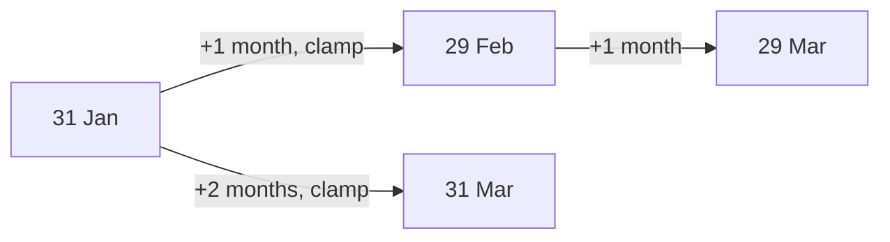

## Introduction

"Add one month to the subscription date." "Show events from the next seven days." "How many days until the deadline?" These sound like one-line jobs, and with `Date` they usually are one line. The trouble is that the one line is often subtly wrong, and wrong only on some dates: the 31st of a month, the weekend clocks change, 29 February, or for users in a particular time zone. Tests written on an ordinary Tuesday pass, and the bug surfaces months later.

The root cause is that **civil time is not uniform**. Months have 28 to 31 days. Years have 365 or 366. A "day" in a zone with daylight saving time (DST) is usually 24 hours long, but once a year it is 23 and once a year it is 25. JavaScript's `Date` is a thin layer over a millisecond count (see [[b1-date-basics]]): it can convert between that count and calendar fields, but it has no concept of "a month" or "a day" as a duration. When you ask for 31 February, it does not throw or clamp; it rolls forward into March.

This lesson catalogues the pitfalls you will meet in real code, explains *why* each happens, and gives a correct pattern for each. The patterns use only `Date`; where the right answer is "use a better tool", that tool is [[b1-temporal-api]] or a well-tested library.

## Before you start

- **What a `Date` stores** — one millisecond time value, read through local or UTC methods. See [[b1-date-basics]].
- **Local time versus UTC** — that `setDate` uses the host zone while `setUTCDate` uses UTC, and that offsets change with DST. See [[b1-local-vs-utc]].
- **Timestamps** — milliseconds versus seconds. See [[b1-unix-timestamps]].
- **Sorting with a comparator** — `array.sort((a, b) => a - b)` and why the default sort compares strings. See [[b1-array-sort]].
- **Objects are shared by reference** — see [[b1-object-mutability]].

Snippets run in Node.js 22 as ES modules. Output that depends on the zone was produced with `TZ=America/New_York` or `TZ=UTC`, named above each block. In 2024, New York's clocks jumped forward at 2:00 AM on 10 March and fell back at 2:00 AM on 3 November; the DST examples use those dates.

## The intuition

Think of a `Date` as a stopwatch wearing a calendar hat. The stopwatch — the time value — counts milliseconds steadily and is never wrong. The hat translates the count into "Saturday 9 March, 12:00" for one zone. When you call a setter, you write on the hat ("make the month April"), and the hat works out which stopwatch reading matches what you wrote.

Writing on the hat is where things go wrong. If you write a date that does not exist — 31 February, or 2:30 AM on the night clocks skip from 2:00 to 3:00 — the hat does not refuse; it picks the nearest reading it can make sense of. And "one day later" on the hat is not always "86,400,000 milliseconds later" on the stopwatch. Most pitfalls come from forgetting which of the two you are changing.

## Pitfall 1: setters overflow instead of failing

The specification computes a date from fields with operations called `MakeDay` and `MakeDate`, and these accept any integer values. A month of 12 means "one past December", a day of 32 means "one past the 31st", and a day of 0 means "the day before the 1st". Nothing is clamped.

```javascript title="overflow.mjs"
const utc = (y, m, d) => new Date(Date.UTC(y, m, d)).toISOString().slice(0, 10);
console.log(utc(2024, 0, 32));   // day 32 of January
console.log(utc(2024, 2, 0));    // day 0 of March = last day of February
console.log(utc(2024, 12, 1));   // month 12 = January of the next year
console.log(utc(2024, 0, -1));   // two days before 1 January
```

```output
2024-02-01
2024-02-29
2025-01-01
2023-12-30
```

Overflow is useful. Adding days with `setUTCDate(getUTCDate() + n)` works across month and year ends without any special cases, and `Date.UTC(year, month + 1, 0)` is the standard trick for "last day of this month" — it correctly gives 29 for February 2024.

It is harmful when the overflow was not intended, and "add one month" is the classic case:

```javascript title="add-month.mjs"
const d = new Date(Date.UTC(2024, 0, 31));   // 31 January 2024
d.setUTCMonth(d.getUTCMonth() + 1);          // "add one month"
console.log(d.toISOString().slice(0, 10));

const e = new Date(Date.UTC(2023, 0, 31));   // 2023 is not a leap year
e.setUTCMonth(e.getUTCMonth() + 1);
console.log(e.toISOString().slice(0, 10));

const leap = new Date(Date.UTC(2024, 1, 29)); // 29 February
leap.setUTCFullYear(2025);                    // "add one year"
console.log(leap.toISOString().slice(0, 10));
```

```output
2024-03-02
2023-03-03
2025-03-01
```

`setUTCMonth(1)` keeps the day (31) and asks for 31 February. February 2024 has 29 days, so the two extra days spill into March: 2 March. In 2023 February has 28, so it becomes 3 March. Likewise, adding a year to 29 February lands on 1 March in a non-leap year. A user who signed up on 31 January would be billed on 2 March and then, from there, on the 2nd of every month.

What people usually mean by "one month after 31 January" is **the last day of February** — clamping to the end of the month. That is a business rule, not a fact of nature (some systems prefer rolling forward), so write it down and implement it deliberately:

```javascript title="add-months-clamped.mjs"
function addMonthsClamped(date, months) {
  const result = new Date(date);              // never mutate the caller's date
  const day = result.getUTCDate();
  result.setUTCDate(1);                       // step to a day every month has
  result.setUTCMonth(result.getUTCMonth() + months);
  // Day 0 of the following month is the last day of this one.
  const lastDay = new Date(Date.UTC(result.getUTCFullYear(), result.getUTCMonth() + 1, 0))
    .getUTCDate();
  result.setUTCDate(Math.min(day, lastDay));
  return result;
}

const iso = (d) => d.toISOString().slice(0, 10);
console.log(iso(addMonthsClamped(new Date(Date.UTC(2024, 0, 31)), 1)));
console.log(iso(addMonthsClamped(new Date(Date.UTC(2023, 0, 31)), 1)));
console.log(iso(addMonthsClamped(new Date(Date.UTC(2024, 2, 31)), -1)));
console.log(iso(addMonthsClamped(new Date(Date.UTC(2024, 10, 30)), 3)));
```

```output
2024-02-29
2023-02-28
2024-02-29
2025-02-28
```

The important line is `setUTCDate(1)` before changing the month. Moving from day 1 can never overflow, because every month has a 1st. Then the code computes the target month's length and puts back the original day, capped at that length. Subtracting months works the same way, and crossing a year boundary (November + 3) is handled by `setUTCMonth`'s own overflow, which here is exactly what we want.

> [!NOTE] Why UTC methods here?
> These dates represent calendar days, and UTC methods have no DST, so adding months can never shift the time of day. With local methods the same logic works for dates at local midnight, but a time near a DST change can move by an hour. Pick one family and use it throughout.

## Pitfall 2: "24 hours later" is not "tomorrow"

In a zone with DST, a calendar day is not always 24 hours. Adding `24 * 60 * 60 * 1000` milliseconds adds exactly 24 hours of elapsed time. Adding 1 to the local date adds one calendar day and keeps the wall-clock time. Usually those agree; on DST days they do not.

```javascript title="dst-add.mjs"
const HOUR = 60 * 60 * 1000;
const DAY = 24 * HOUR;

const saturdayNoon = new Date(2024, 2, 9, 12, 0);   // the day before DST starts

const plus24h = new Date(saturdayNoon.getTime() + DAY);
console.log(plus24h.toString());

const nextDay = new Date(saturdayNoon);
nextDay.setDate(nextDay.getDate() + 1);              // calendar day, local
console.log(nextDay.toString());

console.log((nextDay - saturdayNoon) / HOUR);        // hours that really passed
```

```output
Sun Mar 10 2024 13:00:00 GMT-0400 (Eastern Daylight Time)
Sun Mar 10 2024 12:00:00 GMT-0400 (Eastern Daylight Time)
23
```

With `TZ=America/New_York`: on 10 March the clocks skipped an hour, so 24 elapsed hours after Saturday noon is Sunday 1 PM. The calendar-day version stays at noon, and only 23 real hours pass. Neither is wrong; they answer different questions.

- A **duration** ("the link expires in 24 hours", "retry after 30 minutes") is elapsed time. Add milliseconds to the timestamp.
- A **calendar step** ("the same time tomorrow", "every day at 9 AM") is a change of wall-clock fields. Use `setDate` (local) on a copy, or better, a zone-aware API.

A daily reminder implemented with `+ DAY` drifts by an hour twice a year. An expiry implemented with `setDate(+1)` is an hour short or long twice a year.

### Times that do not exist, and times that happen twice

DST also creates **gaps** (wall-clock times skipped when clocks jump forward) and **overlaps** (wall-clock times repeated when clocks fall back).

```javascript title="dst-gap-overlap.mjs"
// 2:30 AM on 10 March 2024 never happened in New York (clocks jumped 2:00 -> 3:00).
console.log(new Date(2024, 2, 10, 2, 30).toString());
// 1:30 AM on 3 November 2024 happened twice (clocks fell back 2:00 -> 1:00).
const ambiguous = new Date(2024, 10, 3, 1, 30);
console.log(ambiguous.toString());
console.log(new Date(ambiguous.getTime() + 60 * 60 * 1000).toString());
```

```output
Sun Mar 10 2024 03:30:00 GMT-0400 (Eastern Daylight Time)
Sun Nov 03 2024 01:30:00 GMT-0400 (Eastern Daylight Time)
Sun Nov 03 2024 01:30:00 GMT-0500 (Eastern Standard Time)
```

For the gap, the engine moves the time forward by the size of the gap: 2:30 becomes 3:30. For the overlap, it picks the **earlier** of the two 1:30s (still daylight time, `GMT-0400`); one hour later is the second 1:30, in standard time. Current editions of the specification require exactly this behaviour — earlier instant for repeated times, shift forward for skipped ones — matching what browsers already did. `Date` gives you no way to choose differently. `Temporal.ZonedDateTime` does, through its `disambiguation` option.

The practical consequences: a job scheduled at 2:30 AM local time does not run on the spring-forward night, and one at 1:30 AM may run twice in autumn unless it records the instant it last ran. Schedulers on servers avoid this by running in UTC.

## Pitfall 3: counting days by dividing milliseconds

"How many days between two dates?" is often written as `(b - a) / 86400000`. Across a DST change that gives a fraction, and rounding the wrong way produces an off-by-one error.

```javascript title="days-between.mjs"
const DAY = 24 * 60 * 60 * 1000;
const start = new Date(2024, 2, 9);   // 9 March, local midnight
const end = new Date(2024, 2, 11);    // 11 March, local midnight

console.log((end - start) / DAY);                 // not a whole number
console.log(Math.floor((end - start) / DAY));     // off by one

// Count calendar days by comparing UTC midnights of the local dates.
function calendarDaysBetween(a, b) {
  const ua = Date.UTC(a.getFullYear(), a.getMonth(), a.getDate());
  const ub = Date.UTC(b.getFullYear(), b.getMonth(), b.getDate());
  return Math.round((ub - ua) / DAY);
}
console.log(calendarDaysBetween(start, end));
```

```output
1.9583333333333333
1
2
```

With `TZ=America/New_York`, the two local midnights are 47 hours apart, because 10 March had 23 hours. `Math.floor` turns that into 1 day — a deadline counter would say "1 day left" when two calendar days remain. The fix is to take the local calendar fields of each date and rebuild them as UTC midnights, where every day is exactly 86,400,000 ms. The division then gives a whole number; `Math.round` is a guard against any remaining fraction. This also ignores time of day, which is usually what "days between" means for calendar dates.

## Pitfall 4: mutating a shared date

Every `set*` method changes the object in place. A helper that "computes" a new date by modifying its argument changes the caller's value as well.

```javascript title="mutation.mjs"
function startOfWeek(date) {          // BUG: changes the argument
  date.setDate(date.getDate() - date.getDay());
  return date;
}
const today = new Date(2024, 2, 14);   // Thursday 14 March
const weekStart = startOfWeek(today);
console.log(weekStart.toDateString(), today.toDateString(), weekStart === today);

function startOfWeekSafe(date) {
  const result = new Date(date);       // copy first
  result.setDate(result.getDate() - result.getDay());
  result.setHours(0, 0, 0, 0);
  return result;
}
const thursday = new Date(2024, 2, 14, 15, 30);
console.log(startOfWeekSafe(thursday).toDateString(), thursday.toDateString());
```

```output
Sun Mar 10 2024 Sun Mar 10 2024 true
Sun Mar 10 2024 Thu Mar 14 2024
```

In the buggy version, `today` and `weekStart` are the same object, so "today" is now Sunday. In a UI this shows up as a date picker that jumps when a sibling component formats the date, or as React state that changes without `setState` being called, so the component does not re-render. Copy before calling any setter, and treat `Date` values as if they were immutable. (`Object.freeze` does not help: the time value lives in an internal slot, not a property, so a frozen `Date` can still be changed by its setters.)

## Pitfall 5: sorting dates as strings

`Array.prototype.sort` without a comparator converts elements to strings and compares them character by character. That is correct for ISO 8601 strings (`YYYY-MM-DD…`), because their fields go from largest to smallest with fixed widths. It is wrong for display formats, and wrong for `Date` objects, whose string form starts with the weekday.

```javascript title="sort.mjs"
const display = ['9/1/2024', '10/1/2024', '1/15/2025'];
console.log([...display].sort());                 // string order, not time order

const isoDays = ['2025-01-15', '2024-09-01', '2024-10-01'];
console.log([...isoDays].sort());                 // ISO strings sort correctly

const dates = [new Date(2024, 8, 1), new Date(2024, 0, 3)];   // 1 Sep, 3 Jan
console.log([...dates].sort().map((d) => d.toDateString()));   // compares strings
console.log([...dates].sort((a, b) => a - b).map((d) => d.toDateString()));
```

```output
[ '1/15/2025', '10/1/2024', '9/1/2024' ]
[ '2024-09-01', '2024-10-01', '2025-01-15' ]
[ 'Sun Sep 01 2024', 'Wed Jan 03 2024' ]
[ 'Wed Jan 03 2024', 'Sun Sep 01 2024' ]
```

With `TZ=UTC`: the default sort put September before January because "Sun" sorts before "Wed". Always pass `(a, b) => a - b` for `Date` objects, which subtracts their time values. ISO strings sort correctly only if every string uses the same format and the same offset; `2024-03-09T10:00+05:30` and `2024-03-09T06:00Z` sort in the wrong order as strings. When in doubt, convert to timestamps first.

## Pitfall 6: invalid dates travel silently

`new Date(badInput)` does not throw. It returns an Invalid Date whose time value is `NaN`, and `NaN` makes every comparison false.

```javascript title="invalid.mjs"
const events = [
  { name: 'launch', at: new Date('2024-13-01') },   // month 13: invalid
  { name: 'review', at: new Date('2024-03-01') },
];
const first = events[0].at;
console.log(first.getTime());
console.log(first < events[1].at, first > events[1].at);   // NaN compares false
console.log(JSON.stringify(events[0]));
console.log(new Date('2024-02-30').toISOString());          // V8 rolls this over
```

```output
NaN
false false
{"name":"launch","at":null}
2024-03-01T00:00:00.000Z
```

The invalid date is neither before nor after the other, so a filter like `events.filter((e) => e.at > cutoff)` drops it silently and a sort comparator returns `NaN`, which leaves the order unpredictable. `JSON.stringify` writes `null`, so the bad value can reach a database before anyone notices.

The last line shows a related inconsistency. `2024-02-30` is not a real date, and the ISO format in the specification does not allow it, so behaviour falls to the engine's fallback parser. V8 (Node.js 22, Chrome) rolls it over to 1 March; other engines may return Invalid Date. To validate a calendar date reliably, parse the numbers yourself and check that the fields survive the round trip, as in the worked example of [[b1-date-basics]].

## Pitfall 7: parsing strings that are not ISO

Only the ISO 8601 subset is specified. `new Date('03/04/2024')` is 4 March in Node.js and Chrome because they assume US month-first order, but a user in the UK typed 3 April, and nothing in the specification guarantees either reading. Strings like `'2024-03-07 10:00'` (space instead of `T`) are also outside the specified format; V8 accepts it as local time, but you are relying on an engine detail. Accept ISO strings from APIs, use `<input type="date">` or a date picker for user input, and parse anything else with explicit code that knows the expected format.

## Pitfall 8: mixing units and zones

Two bugs from earlier lessons cause many arithmetic errors, so they belong on this list:

- **Seconds versus milliseconds.** `new Date(jwt.exp)` is January 1970; `expiresAt - Date.now()` with `expiresAt` in seconds is hugely negative. Convert at the boundary ([[b1-unix-timestamps]]).
- **Local and UTC methods mixed in one calculation.** Reading `getUTCDate()` and writing `setDate()` on the same object shifts results by a day for part of each day. Choose one family per calculation ([[b1-local-vs-utc]]).

## Worked example: billing dates without drift

A subscription service bills monthly from the sign-up date. Using `addMonthsClamped` from Pitfall 1, there are two ways to generate the next four billing dates.

```javascript title="billing.mjs"
function addMonthsClamped(date, months) {
  const result = new Date(date);
  const day = result.getUTCDate();
  result.setUTCDate(1);
  result.setUTCMonth(result.getUTCMonth() + months);
  const lastDay = new Date(Date.UTC(result.getUTCFullYear(), result.getUTCMonth() + 1, 0))
    .getUTCDate();
  result.setUTCDate(Math.min(day, lastDay));
  return result;
}
const iso = (d) => d.toISOString().slice(0, 10);
const signup = new Date(Date.UTC(2024, 0, 31));

// Chained: each step starts from the previous (already clamped) date.
let current = signup;
const chained = [];
for (let i = 0; i < 4; i++) {
  current = addMonthsClamped(current, 1);
  chained.push(iso(current));
}
console.log('chained ', chained.join(' '));

// Anchored: every step starts from the original date.
const anchored = [1, 2, 3, 4].map((n) => iso(addMonthsClamped(signup, n)));
console.log('anchored', anchored.join(' '));
```

```output
chained  2024-02-29 2024-03-29 2024-04-29 2024-05-29
anchored 2024-02-29 2024-03-31 2024-04-30 2024-05-31
```

The chained version loses information at the first step: once the date is clamped to 29 February, the original "31st" is gone, so every later bill is on the 29th. The anchored version always computes from the sign-up date and month count, so it returns to the 31st whenever the month allows. The general lesson: **date arithmetic is not associative**. Adding one month twice is not the same as adding two months, so compute from a fixed anchor and store the anchor (sign-up date and billing day), not only the last result.



## In real systems

- **Billing and subscriptions** store an anchor date and billing day, and compute each period from the anchor. Payment providers document their own month-end rules; read them rather than assuming.
- **Calendars and reminders** store the wall-clock time and the user's zone name (for example `09:00` in `Europe/Berlin`), and compute the next instant with zone-aware code, so the reminder stays at 9 AM after DST changes.
- **Expiry and rate limits** use durations in milliseconds or seconds added to timestamps, which is exactly right for elapsed time.
- **Reports** that group by day choose explicitly between UTC days and the customer's local days, and label which one they use.
- **Libraries** such as date-fns (`addMonths`, `differenceInCalendarDays`) and Luxon implement these rules and are well tested. The `Temporal` API ([[b1-temporal-api]]) provides them natively: `PlainDate.add({ months: 1 })` clamps by default, and `ZonedDateTime` distinguishes `add({ days: 1 })` from `add({ hours: 24 })`.

## Trade-offs and alternatives

Hand-written helpers on top of `Date` are fine for a few well-defined operations — add days, add months with clamping, count calendar days — if they copy their inputs, stick to one family of methods, and are tested on month ends, leap years and DST dates. The cost grows quickly once you need named zones other than the host's, recurring rules, or locale-specific week starts; at that point a library or `Temporal` is less code and less risk.

| Operation | With `Date` | Safer choice |
|---|---|---|
| Add a duration (hours, minutes) | `new Date(d.getTime() + ms)` | Same — this is correct |
| Add calendar days in local time | copy, `setDate(getDate() + n)` | `Temporal.ZonedDateTime.add({ days })` |
| Add months with clamping | helper as above | `Temporal.PlainDate.add({ months })` |
| Days between calendar dates | UTC-midnight trick | `PlainDate.until()` or date-fns |
| Work in a zone other than the host's | not possible directly | `Temporal` or Luxon |

## Common mistakes

> [!MISTAKE] `d.setMonth(d.getMonth() + 1)` for "next month"
> On the 29th–31st it skips into the following month. Clamp to the last day of the target month, and compute from an anchor rather than chaining.

> [!MISTAKE] `+ 86400000` for "tomorrow"
> Correct for "24 hours later", wrong for "same time tomorrow" on DST days. Decide whether you mean a duration or a calendar step.

**`Math.floor` on a day difference.** Across a spring-forward night, two calendar days are 47 hours. Normalise to UTC midnights first.

**Helpers that modify their argument.** Always `new Date(input)` before any setter.

**`array.sort()` on dates.** Pass `(a, b) => a - b`.

**Trusting `new Date(str)` to validate.** It may roll over impossible dates in V8 and return Invalid Date in other cases; neither throws. Validate explicitly.

**Testing only on "normal" dates.** Add test cases for 31 January, 29 February, 31 December, and the DST dates of at least one northern and one southern hemisphere zone, run with `TZ` set.

## Interview perspective

**"What does `new Date(2024, 0, 31)` become after `setMonth(1)`?"** 2 March 2024: the day 31 is kept, February 2024 has 29 days, and the overflow rolls forward. Explain the clamping alternative and that the right behaviour is a business decision.

**"Why might `(b - a) / 86400000` return 1.958?"** One of the days in the range had 23 hours because of DST. Show the UTC-midnight normalisation or a calendar-aware API.

**"Implement `addDays(date, n)`."** A good answer copies the input, chooses local or UTC deliberately, and uses `setDate(getDate() + n)` (calendar days) rather than adding milliseconds, explaining the DST difference. Follow-up: "What if the user is in a zone other than the server's?" — `Date` cannot do it; use `Temporal.ZonedDateTime` or a library with IANA zone support.

**"A scheduled job sometimes runs twice in November. Why?"** The job is scheduled in local wall-clock time inside the fall-back overlap. Run schedulers in UTC or record the last-run instant.

## Practice

1. Predict, then verify: `new Date(Date.UTC(2024, 4, 31))` after `setUTCMonth(5)`. Then use `addMonthsClamped` to get the clamped result.
2. Write `lastDayOfMonth(year, monthIndex)` using day 0, and test it on February 2023, February 2024 and December 2024.
3. Write `addDaysLocal(date, n)` that never mutates its argument. With `TZ=America/New_York`, show that adding 1 day to 2024-11-02T12:00 local gives a 25-hour difference.
4. With `TZ=Australia/Sydney`, find the 2024 DST start and end dates (southern hemisphere: October and April) and reproduce the 23-hour and 25-hour days.
5. Given an array of event objects with ISO `at` strings, some invalid, write code that sorts the valid ones by time and reports the invalid ones instead of dropping them.

```quiz
Q: With `TZ=America/New_York`, `d` is Saturday 9 March 2024 at 12:00 local time. What does `new Date(d.getTime() + 24 * 60 * 60 * 1000)` show?
- [ ] Sunday 10 March at 12:00, because 24 hours is one day
- [x] Sunday 10 March at 13:00, because that day was only 23 hours long
- [ ] Sunday 10 March at 11:00, because clocks moved forward
- [ ] Saturday 9 March at 12:00, because DST cancels the addition
> Adding milliseconds adds elapsed time. Clocks jumped from 2:00 to 3:00 overnight, so 24 elapsed hours after noon is 1 PM on the wall clock. "Noon tomorrow" needs a calendar step such as `setDate(getDate() + 1)`. 11:00 would be the result if clocks had moved back.
```

```quiz
Q: A billing date is computed each month with `next = addMonthsClamped(previous, 1)`, starting from 31 January 2024. What is the bill date in May?
- [ ] 31 May, because clamping restores the original day
- [x] 29 May, because the first clamp to 29 February lost the original day
- [ ] 2 May, because overflow carries forward
- [ ] 30 May, because April has 30 days
> Each step only sees the previous result. After clamping to 29 February, the "31st" is gone, so March, April and May all fall on the 29th. Computing from the original anchor with `addMonthsClamped(signup, 4)` gives 31 May.
```

```quiz
Q: Why does `[new Date(2024, 8, 1), new Date(2024, 0, 3)].sort()` leave September first?
- [ ] Dates sort in descending order by default
- [ ] `sort` compares time values, and September's is larger
- [x] Without a comparator, `sort` compares the dates' string forms, which begin with the weekday
- [ ] Sorting dates is unstable in V8
> The default `sort` converts each element to a string. "Sun Sep 01 2024" comes before "Wed Jan 03 2024" alphabetically. A comparator `(a, b) => a - b` compares time values and gives chronological order.
```

## Quick revision {#quick-revision}

- `Date` setters overflow: month 12 → next January, day 32 → next month, day 0 → last day of previous month. Nothing is clamped or rejected.
- `setMonth(m + 1)` on the 29th–31st skips a month. Clamp: go to day 1, change month, set `min(day, lastDay)`.
- Last day of a month: `new Date(Date.UTC(y, m + 1, 0)).getUTCDate()`.
- Date arithmetic is not associative: compute from an anchor, do not chain clamped results.
- Durations (expiry, retries) → add milliseconds. Calendar steps (tomorrow at 9) → change date fields. They differ on DST days (23 or 25 hours).
- DST gaps: skipped times move forward. Overlaps: `Date` picks the earlier instant (required by current editions of the specification).
- Days between calendar dates: convert both to UTC midnights of their local fields, then divide and round.
- Setters mutate: copy with `new Date(d)` first; `Object.freeze` does not stop setters.
- Sort dates with `(a, b) => a - b`; default sort compares strings. ISO strings sort correctly only with one fixed format and offset.
- Invalid dates compare false with everything and stringify to `null`. V8 rolls `2024-02-30` to 1 March; validate fields yourself.
- Only ISO strings parse reliably; keep seconds/ms and local/UTC consistent.

## Key takeaways {#key-takeaways}

- `Date` treats out-of-range fields as overflow, which is handy for adding days and wrong for adding months unless you clamp.
- Decide whether you mean elapsed time or a calendar step; DST makes them differ twice a year.
- Count calendar days on UTC midnights, never by dividing raw local differences.
- Copy before every setter, sort with a numeric comparator, and validate dates at the boundary.
- Test date code on month ends, leap days and DST transitions with `TZ` set, and reach for `Temporal` or a library when you need named zones or recurring rules.
