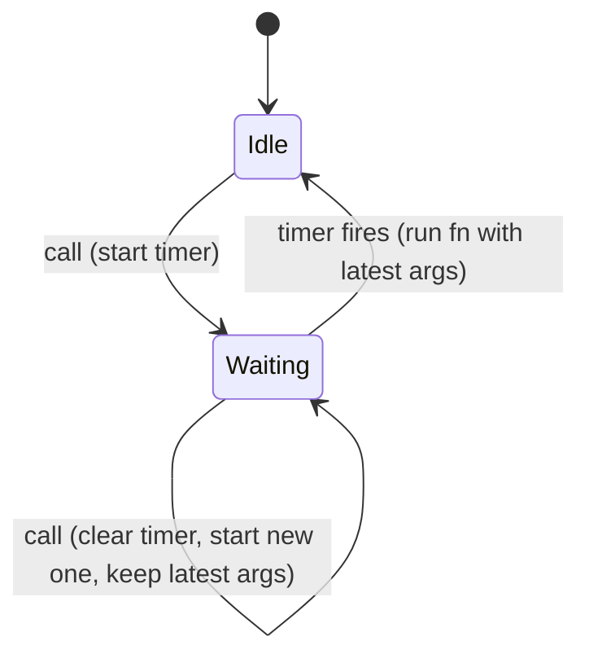

## Introduction

A search box suggests results as the user types. The naive version sends a request on every `input` event. Typing "react hooks" produces eleven requests in about two seconds; ten of them are for prefixes nobody wanted ("r", "re", "rea"…), they compete for the network, and they can even arrive out of order and overwrite the correct results. The server does eleven times the work for one useful answer.

What you actually want is: *wait until the user pauses, then search once for whatever they typed last*. That is **debouncing**. A debounced function postpones its work until a set time — the **wait**, for example 300 ms — has passed without another call. Every new call restarts the countdown. Only when the calls stop does the work run, once, with the latest arguments.

Debouncing appears wherever a burst of events should produce one reaction: search-as-you-type, validating a form field after the user stops typing, autosaving a document, recomputing a layout after a window has finished resizing, and preventing double submits. It is not a language feature; it is a small pattern built from [[b1-settimeout|setTimeout]] and a closure, and it is a classic interview implementation question. Its sibling, [[b1-throttle]], solves a different problem — doing work at a steady rate *during* a burst — and the two are compared in detail [[b1-debounce-vs-throttle|below]].

## Before you start

- **`setTimeout` and `clearTimeout`** — scheduling a callback and cancelling it by id. See [[b1-settimeout]].
- **Closures** — a returned function keeps access to variables of the function that created it. See [[b1-closures]].
- **The event loop** — timer callbacks run later, as separate tasks. See [[b1-event-loop]].
- **Rest parameters and `apply`** — forwarding arguments and `this`. See [[b1-spread-rest]].

## The intuition

Think of an automatic elevator door. It starts to close a few seconds after someone walks through. If another person steps into the sensor, the timer resets and the door waits again. The door closes once — a few seconds after the *last* person — no matter how many people came through in a stream. The door does not close every few seconds while people keep arriving; for that behaviour you would want throttling.

A debounced function is that door. Each call is a person stepping through, the wait is the delay, and closing the door is running your function. Where the analogy stops: a debounced function also remembers *who* stepped through last, because it runs with the arguments of the final call.

## Building a debounce

The mechanism needs exactly one piece of state: the id of the pending timer. Each call cancels the pending timer, if there is one, and schedules a new one. The function only runs when a timer survives the full wait without being cancelled.

```javascript title="debounce-basic.mjs"
function debounce(fn, wait) {
  let timerId;
  return function debounced(...args) {
    clearTimeout(timerId);                   // a new call cancels the pending one
    timerId = setTimeout(() => fn.apply(this, args), wait);
  };
}

const start = Date.now();
const search = debounce((query) => {
  console.log(`${Date.now() - start} ms: search "${query}"`);
}, 300);

// Simulate keystrokes: "r", "re", "rea", "reac", "react", a pause, then "reacts"
const typed = [[0, 'r'], [80, 're'], [160, 'rea'], [240, 'reac'], [320, 'react'],
               [1000, 'reacts']];
for (const [at, value] of typed) setTimeout(() => search(value), at);
```

```output
623 ms: search "react"
1303 ms: search "reacts"
```

Timer-based output varies by a few milliseconds between runs; the shape does not. Walk through it:

- At 0 ms `search('r')` schedules a run for 300 ms.
- At 80 ms `search('re')` cancels that timer and schedules a new run for 380 ms. The same happens at 160, 240 and 320 ms; each keystroke pushes the deadline back.
- After the keystroke at 320 ms nothing happens for 300 ms, so the timer fires at about 620 ms and runs with `'react'`, the latest arguments.
- At 1000 ms a new burst of one call starts. It fires at about 1300 ms.

Six calls produced two runs, each with the most recent value. Several details in this short function are deliberate.

**`timerId` lives in the closure.** It must survive between calls but belong to this one debounced function. If it were a global, two debounced functions would cancel each other's timers. [[b1-closures]] is what makes the per-instance state possible.

**`clearTimeout(undefined)` is harmless.** On the first call there is no timer; clearing an `undefined` id does nothing, so no special case is needed.

**`...args` captures the latest arguments.** Each call creates a new timer callback that closes over that call's `args`. The cancelled callbacks are discarded, so the one that runs always has the newest arguments. A version that stored the *first* call's arguments would search for "r".

**`function debounced` and `fn.apply(this, args)` preserve `this`.** If the debounced function is used as a method (`input.onInput = debounce(this.validate, 300)` or `obj.save = debounce(function () { … }, 500)`), `this` should be whatever the caller used. The returned function is a regular `function` so it receives the caller's `this`, and the arrow passed to `setTimeout` inherits it lexically. An arrow function as the returned wrapper would lose the caller's `this`.



## Trailing and leading edges

The version above runs at the **trailing edge** of a burst: after it ends. Sometimes you want the **leading edge** instead: run immediately on the first call, then ignore further calls until things have been quiet for the wait. A "Save" button that should react instantly but ignore the frantic double- and triple-clicks that follow is a leading-edge case. Some cases want both: respond instantly *and* make sure the final state is handled.

| Mode | Runs when | Typical use |
|---|---|---|
| Trailing (default) | Once, `wait` ms after the last call | Search-as-you-type, autosave, validate after typing |
| Leading | Immediately on the first call of a burst; later calls in the burst are ignored | Preventing double submits, instant feedback |
| Leading + trailing | At the start of a burst and again at the end (only if there were further calls) | Instant response plus a guaranteed final update |

## A complete implementation

Production debounce functions add three things to the basic version: the leading/trailing options, `cancel()` to drop a pending call (essential when a component unmounts), and `flush()` to run a pending call immediately (for example, saving a draft when the user closes the tab).

```javascript title="debounce.mjs"
function debounce(fn, wait, { leading = false, trailing = true } = {}) {
  let timerId = null;
  let pendingArgs = null;       // arguments of the latest unhandled call
  let pendingThis = null;

  function invokePending() {
    const args = pendingArgs;
    const self = pendingThis;
    pendingArgs = pendingThis = null;
    fn.apply(self, args);
  }

  function onQuiet() {          // the wait elapsed with no new calls
    timerId = null;
    if (trailing && pendingArgs) invokePending();
    pendingArgs = pendingThis = null;
  }

  function debounced(...args) {
    const isFirstInBurst = timerId === null;
    pendingArgs = args;
    pendingThis = this;
    clearTimeout(timerId);
    timerId = setTimeout(onQuiet, wait);
    if (leading && isFirstInBurst) invokePending();  // fire at the start of a burst
  }

  debounced.cancel = () => {
    clearTimeout(timerId);
    timerId = pendingArgs = pendingThis = null;
  };
  debounced.flush = () => {     // run the pending call now instead of later
    if (timerId === null) return;
    clearTimeout(timerId);
    timerId = null;
    if (pendingArgs) invokePending();
  };
  return debounced;
}

const start = Date.now();
const log = (label) => (v) => console.log(`${Date.now() - start} ms: ${label} ${v}`);

const trailingOnly = debounce(log('trailing'), 200);
const leadingOnly = debounce(log('leading '), 200, { leading: true, trailing: false });
const both = debounce(log('both    '), 200, { leading: true });

for (const at of [0, 50, 100, 150]) {
  setTimeout(() => {
    trailingOnly(at);
    leadingOnly(at);
    both(at);
  }, at);
}

const saver = debounce(log('save'), 1000);
setTimeout(() => saver('draft v1'), 500);
setTimeout(() => saver.flush(), 600);     // e.g. the user closes the tab
const cancelled = debounce(log('never'), 100);
cancelled('x');
cancelled.cancel();                         // e.g. the component unmounted
```

```output
1 ms: leading  0
2 ms: both     0
353 ms: trailing 150
353 ms: both     150
601 ms: save draft v1
```

Read the output against the code. The burst is four calls at 0, 50, 100 and 150 ms, so the quiet period ends at about 350 ms.

- **Trailing only** runs once at about 350 ms with `150`, the last value.
- **Leading only** runs at 0 ms with `0`. Calls at 50–150 ms arrive while the timer is pending, so they only extend the quiet period; when it ends nothing runs, because `trailing` is false.
- **Both** runs at the start with `0` and at the end with `150`. If the burst had contained only one call, it would have run only once: `invokePending` clears `pendingArgs` after the leading run, so the trailing check finds nothing new to do. Running twice for a single click would be a surprising bug.
- **`flush`** turned a save that was due at 1500 ms into one at 600 ms.
- **`cancel`** discarded the pending call, so `never` was not printed.

The `timerId === null` test is what defines a burst: a call that arrives while no timer is pending starts a new one. The key invariant is that `pendingArgs` is non-null exactly when there is a call that has not been handled yet; every path that runs or discards a call clears it.

Libraries offer the same features. Lodash's `debounce(fn, wait, { leading, trailing, maxWait })` adds `maxWait`, a cap on how long a call can be postponed during a never-ending burst; Lodash's own `throttle` is built on `debounce` with `maxWait` set to the wait. Writing your own is fine for simple cases and is expected in interviews ([[b1-impl-debounce-throttle]] practises it).

> [!WARNING] A trailing debounce can wait forever
> If calls never pause — a user holding down a key, a sensor streaming values — a trailing debounce never runs. Add `maxWait`, or use a throttle, when progress during the burst matters.

## Debouncing in a UI

### A search box with stale-response protection

Debouncing reduces how many requests start, but it does not guarantee they finish in order. If a search for "rea" is slow and a later search for "react" is fast, the "rea" results can arrive last and overwrite the correct ones. Combine debounce with cancellation of the previous request:

```javascript title="search-box.js"
const input = document.querySelector('#search');
const list = document.querySelector('#results');
let controller = null;

const runSearch = debounce(async (query) => {
  controller?.abort();                       // the previous request is now stale
  controller = new AbortController();
  try {
    const res = await fetch(`/api/search?q=${encodeURIComponent(query)}`, {
      signal: controller.signal,
    });
    const items = await res.json();
    list.replaceChildren(...items.map((item) => {
      const li = document.createElement('li');
      li.textContent = item.title;
      return li;
    }));
  } catch (err) {
    if (err.name !== 'AbortError') throw err;  // aborts are expected, not failures
  }
}, 300);

input.addEventListener('input', (event) => runSearch(event.target.value.trim()));
```

This needs a page and a search endpoint, so it was not run here. Note that the listener passes `event.target.value`, a plain string, rather than the event object. Passing the value you need, captured at call time, is safer than reading shared state when the debounced function eventually runs. [[b1-stale-requests]] and [[b1-abort-controller-js]] cover request cancellation in depth.

### In React

In a component, the debounced function must be created **once** per component instance. If you call `debounce(...)` directly in the render body, every render creates a new debounced function with its own empty timer, so nothing is ever debounced. It must also be cancelled on unmount, or a pending call may run after the component is gone.

```javascript title="useDebouncedCallback.js"
import { useEffect, useMemo, useRef } from 'react';

export function useDebouncedCallback(callback, wait) {
  const latest = useRef(callback);
  useEffect(() => {
    latest.current = callback;               // always call the newest callback
  });

  const debounced = useMemo(
    () => debounce((...args) => latest.current(...args), wait),
    [wait],
  );

  useEffect(() => () => debounced.cancel(), [debounced]);   // cancel on unmount
  return debounced;
}
```

This hook uses the `debounce` above and requires React (it was not run here). The `ref` keeps the newest callback, so the debounced function, created once, never calls a stale closure that captured old props or state; [[b4-stale-closures]] explains that problem. An alternative for values (rather than callbacks) is to debounce the *value* — keep a `debouncedQuery` state that updates 300 ms after `query` stops changing — and run the effect on that.

## Debounce vs throttle {#b1-debounce-vs-throttle}

Debouncing and throttling both limit how often a function runs when events arrive faster than you want to handle them, and both are built from timers and closures. They differ in *when* the work happens. **Debounce waits for a pause**: it runs once after the events stop. **Throttle sets a maximum rate**: it runs at most once per interval *while* the events continue. Choosing the wrong one gives a UI that either lags behind the user or does work that is immediately thrown away.

### The same burst, two behaviours

The clearest way to see the difference is to feed both the same stream of events. This program fires an event every 35 ms from 0 to 350 ms and passes it to a 100 ms debounce and a 100 ms throttle (the leading-edge, timestamp-based throttle explained in [[b1-throttle]]).

```javascript title="compare.mjs"
const debounce = (fn, wait) => {
  let timerId;
  return (...args) => {
    clearTimeout(timerId);
    timerId = setTimeout(() => fn(...args), wait);
  };
};

const throttle = (fn, wait) => {
  let lastRun = -Infinity;
  return (...args) => {
    const now = Date.now();
    if (now - lastRun >= wait) {
      lastRun = now;
      fn(...args);
    }
  };
};

const start = Date.now();
const report = (label) => (t) =>
  console.log(`${String(Date.now() - start).padStart(3)} ms  ${label} handled event @${t}`);

const debounced = debounce(report('debounce'), 100);
const throttled = throttle(report('throttle'), 100);

// The same burst for both: an event every 35 ms from 0 to 350 ms
for (let t = 0; t <= 350; t += 35) {
  setTimeout(() => { debounced(t); throttled(t); }, t);
}
```

```output
  1 ms  throttle handled event @0
106 ms  throttle handled event @105
212 ms  throttle handled event @210
316 ms  throttle handled event @315
452 ms  debounce handled event @350
```

Eleven events arrived. The throttle handled four of them, roughly one every 100 ms, starting immediately — a steady heartbeat while the burst lasted. The debounce handled exactly one, the last, 100 ms after the burst ended, and was silent the entire time events were arriving. Also notice what each loses: this simple throttle never handled the final event at 350 ms, so if that event carried the final scroll position, the UI would end slightly wrong. That is why throttles often add a trailing call; [[b1-throttle]] builds one.

| | Debounce | Throttle |
|---|---|---|
| Question it answers | "Has the user finished?" | "What is happening right now, at a reasonable rate?" |
| Runs during a continuous burst | Never (trailing) or once at the start (leading) | Regularly, at most once per interval |
| Runs after the burst | Once, `wait` ms after the last event (trailing) | Optionally once more with the final event (trailing option) |
| Number of runs for an endless burst | Zero (trailing) unless `maxWait` is set | Grows with the burst's duration |
| Latency to first reaction | `wait` ms after the user stops (trailing) | Immediate (leading) |
| Typical uses | Search input, autosave, validation, resize-end layout | Scroll position, drag, mouse-move, progress reporting, infinite-scroll checks |

### How to choose

Ask what the user expects to see *while* they are acting. If intermediate results are useless or harmful — partial search queries, validating half an email address, saving a draft after every keystroke — debounce, because only the end state matters. If the user expects continuous feedback — a sticky header reacting to scroll, a dragged element following the pointer, a "you have scrolled 40%" indicator — throttle, because waiting for the end would make the UI feel frozen. Debouncing a scroll handler is a common mistake: the page updates only after the user stops scrolling.

Some cases sit in between. For window resizing, debounce if the work is an expensive relayout that only matters at the final size, and throttle (or use a [[b3-resize-observer|ResizeObserver]]) if the layout must track the size live. For visual updates of any kind, the best "throttle" is often `requestAnimationFrame`, which runs at most once per display frame, exactly when the browser is about to paint; see [[b1-requestanimationframe-js]]. And when you want a debounce that still guarantees periodic progress during an endless burst — an autosave while someone types continuously for minutes — use debounce with a `maxWait`, which is effectively a debounce/throttle hybrid.

> [!INTERVIEW] Give one example each
> When asked the difference, avoid "they are basically the same". Say: debounce waits for quiet, then runs once — search box; throttle runs at most once per interval during activity — scroll handler. Then mention leading and trailing edges.

### Neither is part of JavaScript

Neither pattern is in the ECMAScript specification or the DOM; both are user-space code on top of timers (or, for frame-based throttling, `requestAnimationFrame`). Their accuracy is therefore limited by the event loop: a timer callback cannot run while the main thread is busy, so a debounce scheduled for 300 ms after the last keystroke can run later if a [[b1-long-tasks|long task]] is blocking the thread.

## In real systems

Search and autocomplete combine a trailing debounce of around 200–400 ms with request cancellation and a minimum query length; [[b6-search-debounce]] discusses the trade-offs at system-design level. Autosave in editors debounces by one to a few seconds and adds `maxWait` (or a flush on `visibilitychange`/`pagehide`) so that work is not lost if the user never pauses or closes the tab. Analytics and logging libraries debounce batched sends. Form libraries debounce asynchronous validation such as "is this username taken?". Buttons that trigger payments or submissions use leading-edge debouncing or, better, disable themselves while a request is in flight.

## Trade-offs and alternatives

Debouncing trades latency for less work: a 300 ms trailing debounce means every result appears at least 300 ms after the user stops. Too short a wait and fast typists still trigger several requests; too long and the UI feels sluggish. Typical values are 150–300 ms for search, 500–2000 ms for autosave, and the right value comes from measuring real users.

Alternatives depend on what you are protecting. If the concern is the server, cancel in-flight requests or deduplicate them. If the concern is rendering cost, React's `useDeferredValue` keeps input responsive by rendering the expensive part at lower priority without delaying it by a fixed time. If the concern is out-of-order responses, debouncing alone is never enough; you need cancellation or a "latest request wins" check.

## Common mistakes

**Creating the debounced function on every call or render.** `onInput={() => debounce(search, 300)(value)}` makes a fresh debouncer with its own timer each time, so every call runs. Create it once and reuse it.

**Not cancelling on unmount.** A pending call can fire after a component is destroyed, updating state that no longer exists or sending a request nobody will read. Call `cancel()` in cleanup.

**Using the first call's data.** A debounce that stores arguments only when the timer starts, or a callback that reads a variable captured in an old closure, runs with stale values. The trailing call must use the latest arguments.

**Holding on to event objects.** Passing the whole event and reading it later works in modern browsers, but `event.currentTarget` is `null` after dispatch finishes. Extract the values you need when the event happens.

**Debouncing twice.** Wrapping an already debounced function (for example a library that debounces internally) adds the delays together and makes the UI feel slow for no benefit.

**Debouncing scroll or drag.** The user sees nothing until they stop. Use a throttle or `requestAnimationFrame`.

## Interview perspective

**"Implement debounce."** Start with the five-line trailing version and explain each choice: the closure-held timer id, clearing before scheduling, `...args` for the latest arguments, and a regular function plus `apply` to keep `this`. Then offer extensions — leading edge, `cancel`, `flush`, `maxWait` — and implement whichever the interviewer picks. Talk through a timeline like the one above to show the behaviour.

**"What is the difference between debounce and throttle?"** Debounce runs after a quiet period; throttle runs at a capped rate during activity. Give one example each and mention the trailing-edge subtlety of throttle.

**Follow-ups to expect.** "What happens if the user never stops typing?" (A trailing debounce never runs; `maxWait` fixes it.) "How do you use it in React?" (Create once with `useMemo` or a ref, cancel on unmount, avoid stale closures.) "Does debounce prevent out-of-order responses?" (No; add cancellation.)

## Practice

1. Add a `maxWait` option to `debounce.mjs`: while calls keep arriving, the function must still run at least once every `maxWait` ms. Test it with a stream of calls every 50 ms for two seconds.
2. Add a `pending()` method that reports whether a call is waiting to run.
3. Write a debounced autosave for a `<textarea>` that also flushes when the page becomes hidden (`visibilitychange`).
4. Given events at 0, 90, 180, 400 and 450 ms and a 150 ms wait, list when a trailing, a leading, and a leading+trailing debounce run, and with which event. Check your answers by running the code.
5. Write a `useDebouncedValue(value, wait)` React hook and explain why it does not need `cancel`.

## Quick revision {#quick-revision}

- Debounce: postpone `fn` until `wait` ms pass with no new call; each call restarts the countdown.
- Core implementation: closure-held `timerId`; `clearTimeout(timerId)` then `timerId = setTimeout(...)`.
- Run with the **latest** arguments; keep `this` with a regular function and `fn.apply(this, args)`.
- Trailing (default): once after the burst. Leading: once at the start. Both: start and end, but only once for a single call.
- `cancel()` drops a pending call (use on unmount); `flush()` runs it now (use before leaving the page).
- `maxWait` guarantees a run during an endless burst (Lodash `throttle` = `debounce` + `maxWait`).
- Debounce ≠ throttle: debounce waits for quiet; throttle caps the rate during activity.
- Search/autosave/validation → debounce. Scroll/drag/mouse-move → throttle or `requestAnimationFrame`.
- Debouncing does not stop out-of-order responses; pair it with `AbortController`.
- Neither is in the language; both depend on the event loop, so long tasks delay them.

## Key takeaways {#key-takeaways}

- Debouncing collapses a burst of calls into one call after the burst ends, using a timer that every call resets.
- The state lives in a closure, so each debounced function has its own timer, and the latest arguments win.
- Leading, trailing, `cancel`, `flush` and `maxWait` cover the variations real UIs need.
- In components, create the debounced function once and cancel it on unmount.
- Pick debounce when only the final state matters and throttle when the user needs feedback during the activity.

```quiz
Q: A trailing debounce with a 300 ms wait receives calls at 0, 100, 200 and 700 ms. When does the wrapped function run?
- [ ] At 300, 400, 500 and 1000 ms
- [ ] At 0 and 700 ms
- [x] At 500 ms (with the 200 ms call's arguments) and 1000 ms (with the 700 ms call's arguments)
- [ ] Only at 1000 ms
> The first three calls form one burst; the last of them is at 200 ms, so the quiet period ends at 500 ms. The call at 700 ms comes after that run and starts a new burst, ending at 1000 ms. Running at the leading edge (0 and 700) would require the `leading` option, and runs after every call would mean no debouncing at all.
```

```quiz
Q: Why does `onInput={(e) => debounce(search, 300)(e.target.value)}` fail to debounce?
- [ ] Arrow functions cannot be debounced
- [x] A new debounced function, with its own empty timer, is created on every input event
- [ ] `e.target.value` is null inside a debounced function
- [ ] React cancels all timers on re-render
> Each event calls `debounce(...)` again, producing a fresh closure whose `timerId` is undefined. There is never an earlier timer to clear, so every call runs after 300 ms. The debounced function must be created once and reused.
```

```quiz
Q: Which interaction should be throttled rather than debounced?
- [ ] Sending a search request as the user types
- [ ] Autosaving a document draft
- [x] Updating a sticky header's appearance while the user scrolls
- [ ] Checking whether a username is available
> The header should respond during the scroll, which needs regular updates at a capped rate. A debounce would update it only after scrolling stopped. The other three only need the final value, which is exactly what a debounce provides.
```
