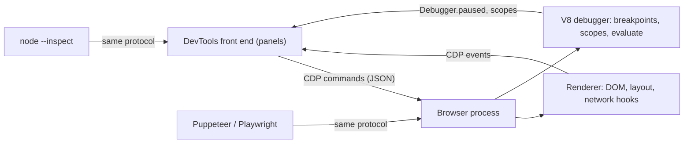

## Introduction

A web page is a running program, and most of its bugs only exist while it runs. A button does nothing when clicked, a list shows yesterday's data, a layout jumps when an image loads, a request fails with a status code you never see. Reading the source code will sometimes find the cause, but often it will not: the problem lives in the *state* of the program at one particular moment — what was in a variable, what the server actually returned, which element the click really landed on.

**Browser DevTools** are the set of inspection tools built into every major browser that let you see that state. Press `F12`, or `Ctrl+Shift+I` on Windows and Linux (`Cmd+Option+I` on macOS), and a panel opens beside the page. Through it you can browse and edit the live DOM, run JavaScript inside the page, watch every network request, pause the script at any line and look at every variable, and record what the browser spent its time and memory on.

It helps to be clear about what DevTools are *not*. They are not part of the JavaScript language. The ECMAScript specification defines only one debugging hook, the `debugger` statement, and even that is allowed to do nothing. Everything else — the console helpers, breakpoints, the network log — is a feature of the **host** (the browser or Node.js) wrapped around the JavaScript engine. That is why the panels differ slightly between Chrome, Firefox and Safari, and why the same ideas reappear when you debug Node.js. This lesson uses Chrome's names, which Edge and other Chromium browsers share; Firefox and Safari have equivalent panels under slightly different names.

The most important habit this lesson tries to build is simple: **reproduce the bug with DevTools already open, then observe**. Most debugging time is lost to guessing — changing code, reloading and hoping. DevTools turn a guess ("maybe the API returned nothing?") into a fact you can check in seconds.

## Before you start

- **Execution contexts and the call stack** — what a stack frame is and how calls push and pop frames. See [[b1-execution-contexts]] and [[b1-call-stack]].
- **Scope and closures** — how a function remembers the variables around it. The Scope pane shows exactly this. See [[b1-scope-chain]] and [[b1-closures]].
- **The DOM and events** — elements, attributes and event listeners, at the level of `document.querySelector` and `addEventListener`.
- **Promises and `fetch`** — enough to recognise an asynchronous request. See [[b1-promises]] and [[b3-fetch]].

## The intuition

Think of DevTools as the instrument panel of an aircraft. Each instrument answers one kind of question, and a good pilot knows which instrument to look at for which symptom:

- **Elements** answers "what is on the page right now, and why does it look like that?"
- **Console** answers "what did the program report, and what happens if I run this expression here?"
- **Sources** answers "what is the program doing at this exact line?" — it is the pause button.
- **Network** answers "what did the page ask the server for, and what came back?"
- **Performance** and **Memory** answer "where did the time go?" and "what is using memory?"
- **Application** answers "what is stored locally — cookies, `localStorage`, IndexedDB, service workers?"

The analogy stops working in one place: the instruments of a plane do not change the flight, but DevTools can. Editing a style in Elements, running code in the Console or pausing in Sources all affect the page you are inspecting. That is a feature, because it lets you test a fix without rebuilding, but it also means you should reload to get a clean state once you have learned what you needed.

## A tour of the panels

### Elements: the live DOM, not your HTML file

The Elements panel shows the **current DOM tree**, not the HTML the server sent. If JavaScript added a class, removed a node or rendered a whole React component tree, you see the result. This is the first place to look when something *looks* wrong: select the element (right-click it on the page and choose *Inspect*, or use the arrow tool in the top-left of DevTools), then read the **Styles** pane to see every CSS rule that applies, which ones are crossed out because another rule won, and which file and line each rule came from. The **Computed** tab shows the final value of each property after the cascade, and the box-model diagram shows margin, border and padding in pixels. See [[b3-devtools-computed-layout]] for more on the layout tools.

Two smaller features save a lot of time. The `:hov` button forces states such as `:hover` and `:focus` so you can inspect a dropdown that disappears as soon as the mouse leaves it. The **Event Listeners** tab lists every listener attached to the selected element and its ancestors, with a link to the function's source — the fastest way to answer "what happens when I click this?"

### Console: the page's REPL

The Console shows messages from the page — logs, warnings, errors, failed requests — and it is a **REPL** (read–evaluate–print loop) that runs JavaScript inside the page. Anything you type runs with the page's `window` as the global object, so you can call the app's functions, read its globals and modify the DOM.

The Console also provides **Console Utilities**, extra names that exist only when you type in the Console, not in your page's scripts:

| Utility | What it gives you |
|---|---|
| `$0` | The element currently selected in the Elements panel (`$1` is the previous one, up to `$4`) |
| `$_` | The value of the last expression you evaluated |
| `$('sel')` / `$$('sel')` | `document.querySelector`, and `querySelectorAll` returned as a real array |
| `inspect(x)` | Reveals an element in Elements or a function in Sources |
| `copy(x)` | Copies a value (objects as JSON) to the clipboard |
| `getEventListeners(el)` | The listeners registered on an element |
| `monitorEvents(el, 'click')` | Logs every event of that type that reaches the element |
| `queryObjects(Ctor)` | Finds every live object created by a constructor |

Because these are host extras, code that uses `$0` works in the Console and throws a `ReferenceError` if you paste it into your application. A **live expression** (the eye icon at the top of the Console) pins an expression such as `document.activeElement` and re-evaluates it continuously, which is ideal for focus bugs. See [[b3-console-live-expressions]].

### The console API beyond console.log

`console.log` is the tool everyone knows, but the `console` object has several methods that make output far easier to read. The `console` object itself is defined by a WHATWG standard (the Console Standard), not by ECMAScript, which is why Node.js and browsers both have it but format the output differently. The program below runs in Node.js 22; a browser shows the same information as an interactive table and collapsible groups.

```js title="console-helpers.mjs"
const users = [
  { id: 1, name: 'Ada', role: 'admin' },
  { id: 2, name: 'Grace', role: 'editor' },
];
console.table(users);
console.table(users, ['name']);

function handleClick(id) {
  console.count('handleClick');
  console.assert(typeof id === 'number', 'id should be a number, got', id);
}
handleClick(1);
handleClick('2');
console.countReset('handleClick');
handleClick(3);

console.group('checkout');
console.log('validating cart');
console.warn('coupon expired');
console.groupEnd();
console.log('done');
```

```output
┌─────────┬────┬─────────┬──────────┐
│ (index) │ id │ name    │ role     │
├─────────┼────┼─────────┼──────────┤
│ 0       │ 1  │ 'Ada'   │ 'admin'  │
│ 1       │ 2  │ 'Grace' │ 'editor' │
└─────────┴────┴─────────┴──────────┘
┌─────────┬─────────┐
│ (index) │ name    │
├─────────┼─────────┤
│ 0       │ 'Ada'   │
│ 1       │ 'Grace' │
└─────────┴─────────┘
handleClick: 1
handleClick: 2
Assertion failed: id should be a number, got 2
handleClick: 1
checkout
  validating cart
  coupon expired
done
```

`console.table` turns an array of objects into rows and columns, and its second argument picks columns — much easier to scan than a nested tree. `console.count` answers "how many times did this run?", which is often the whole question when a handler fires twice. `console.assert` prints only when its condition is false, so you can leave a sanity check in place without flooding the log; note that it *does not throw* and does not stop the program. `console.group` indents related messages so that one user action reads as one block. Two others are worth knowing: `console.dir(el)` shows a DOM element as a JavaScript object with its properties instead of as HTML markup, and `console.time(label)` / `console.timeEnd(label)` print the elapsed time between two points.

Messages have levels — `console.debug`, `log`, `info`, `warn`, `error` — and the Console's level filter hides the ones you do not need. `console.error` and `console.trace` also print a stack trace, which tells you *who called* the code that logged. See [[b3-console-logging-levels]].

### Sources: reading and pausing code

The Sources panel shows every script the page loaded, lets you set breakpoints and step through code, and hosts the Scope, Watch and Call Stack panes. Production bundles are usually **minified** — whitespace removed and names shortened to one letter — so the panel offers a `{}` *pretty-print* button that reformats the file. Pretty-printing restores layout but not names; to see your original TypeScript or JSX files, the bundle needs a source map, covered in [[b1-source-maps]]. Breakpoints and the inspection panes are the subject of the two sections below.

The Sources panel also has **Snippets** (small scripts you save and rerun in any page) and **Overrides**, which let you replace a server response or file with a local edited copy that survives reloads — useful for testing a fix against production without deploying.

### Network: what was actually sent and received

When data is wrong, the first question is whether the server sent the wrong data or the client mishandled the right data. The Network panel answers it. Each row is one request; clicking it shows the request headers, the payload, the response headers and body, and a timing breakdown (DNS, connection, waiting for the server, downloading). The **Initiator** column links to the line of code that started the request, and the *Fetch/XHR* filter hides images and stylesheets so only API calls remain. A failed request is shown in red, but remember that `fetch` only rejects on network failure; a `404` or `500` is a successful `fetch` with `response.ok === false` (see [[b3-fetch-ok-status]]).

Three checkboxes at the top are part of daily work. **Preserve log** keeps entries across page navigations, so a request made just before a redirect is not wiped. **Disable cache** bypasses the HTTP cache — but only while DevTools are open, which is a frequent source of "it works on my machine" confusion. The **throttling** menu simulates a slow network such as "Slow 4G" so you can see loading states and race conditions that never appear on a fast office connection. Right-clicking a request offers *Copy as fetch* and *Copy as cURL*, which reproduce the exact request outside the page.

### Performance, Memory and Application

The **Performance** panel records a timeline of everything the browser did — JavaScript, style calculation, layout, paint — and the **Memory** panel takes heap snapshots to find leaks. Both are covered in [[b1-profiling-basics]]. The **Application** panel shows cookies, `localStorage`, `sessionStorage`, IndexedDB, the cache storage and registered service workers, and lets you clear them — the first thing to try when a page behaves differently for you than for a fresh visitor.

**Device mode** (the phone-and-tablet icon, or `Ctrl+Shift+M`) emulates a phone's viewport size, device pixel ratio, touch events and user-agent string. It is excellent for layout work, but it does not emulate a phone's slower CPU unless you also turn on CPU throttling in the Performance panel, and it is not a real mobile browser engine. Test on real devices before trusting it for performance or browser-specific bugs.

## How it works internally

DevTools are themselves a web application. The panels you see are written in HTML, CSS and TypeScript, and they talk to the browser through the **Chrome DevTools Protocol (CDP)**, a set of JSON messages such as `Debugger.setBreakpointByUrl`, `Runtime.evaluate` and `Network.requestWillBeSent`. The browser forwards debugging commands to the V8 engine's debugger and network and DOM commands to the matching browser components, and sends back events as they happen.



This design has practical consequences. Automation tools such as Puppeteer and Playwright drive Chromium through the same protocol, which is why they can intercept requests and evaluate code. Node.js exposes the same protocol when you start it with `node --inspect app.js`; open `chrome://inspect` in Chrome and you can debug server code with the same Sources, Console and Memory panels you use for pages. Firefox has its own protocol, but the concepts — breakpoints, scopes, evaluation in a frame — are identical.

The protocol is also why every example in the sections below about scopes could be checked outside a browser: the scope and watch outputs shown there were produced by sending CDP messages to V8 from Node.js's built-in `node:inspector` module, which reports exactly what Chrome's panes display.

## Breakpoints & Stepping {#b1-breakpoints}

A **breakpoint** is a marker that tells the JavaScript engine to stop just before it executes a particular statement, and to hand control to the debugger. While the program is stopped — **paused** — every variable keeps its value, and you can inspect all of them, evaluate expressions, and then move forward one statement at a time. **Stepping** is that controlled movement: running the next statement, entering a function call, or finishing the current function, then pausing again.

### Why pause instead of log?

Logging is a perfectly good debugging technique, and for timing-sensitive code it is sometimes the only one. But it has a slow feedback loop. You guess which values matter, add `console.log` lines, reload, reproduce the bug, read the output, realise you logged the wrong thing, and repeat. A breakpoint inverts this: you stop at the suspicious line once and then ask any question you like — every local variable, every closure variable, `this`, the full call stack — without editing or reloading. When you do not yet know *what* to look at, pausing is usually faster.

### Setting a line breakpoint

In the Sources panel, open the file and click the line number in the left gutter. A blue marker appears. The next time execution reaches that line, the page freezes, the line is highlighted, and the right-hand side shows the Scope, Watch and Call Stack panes. Breakpoints are remembered across reloads, so you can set one on startup code and press reload to hit it.

The engine can only stop at certain positions — the start of a statement or expression — so if you click a blank line or the middle of a multi-line expression, Chrome moves the breakpoint to the nearest position where it can actually pause. On a line containing several calls, such as `render(format(load()))`, Chrome shows small inline markers so you can choose which call to pause before.

### The `debugger` statement

You can also put a breakpoint in code by writing the statement `debugger;`. This is the only debugging feature in the ECMAScript specification itself, and the specification says exactly how little it promises: if a debugging facility is available and enabled, the implementation does something implementation-defined; otherwise the statement does nothing.

```js title="debugger-statement.mjs"
function sum(a, b) {
  debugger; // pauses here only if a debugger is attached
  return a + b;
}
console.log(sum(2, 3));
```

```output
5
```

Run with plain `node`, or in a browser tab with DevTools closed, the statement is ignored and the program prints `5`. Open DevTools (or start Node with `node --inspect-brk` and attach) and the same code pauses inside `sum`, with `a` and `b` visible in the Scope pane. That makes `debugger` handy in two situations: code that is hard to find in the Sources panel, such as a function generated by a bundler, and a breakpoint you want to share with a colleague through a diff. It must never reach production. A forgotten `debugger` inside a loop or a frequently called handler pauses the page again and again for anyone who happens to have DevTools open, and linters such as ESLint's `no-debugger` rule exist to catch it.

### Stepping controls

Once paused, five controls move execution forward. Their keyboard shortcuts in Chrome are given in brackets.

| Control | What it does |
|---|---|
| **Resume** (`F8`) | Run normally until the next breakpoint |
| **Step over** (`F10`) | Run the current line, including any calls it makes, then pause on the next line of *this* function |
| **Step into** (`F11`) | If the current line calls a function, pause on that function's first line |
| **Step out** (`Shift+F11`) | Run until the current function returns, then pause in its caller |
| **Step** (`F9`) | Pause at the very next statement wherever it is, including into async callbacks |

A useful mental model is a film paused on one frame. Step over plays one scene of *this* storyline; step into follows a side character into their own storyline; step out finishes the side story and returns to the main one. Consider this code with a breakpoint on the marked line:

```js title="stepping.mjs"
function applyDiscount(price, code) {
  const rate = lookupRate(code);   // breakpoint here
  return price - price * rate;
}
function lookupRate(code) {
  const rates = { SPRING10: 0.1, VIP: 0.25 };
  return rates[code] ?? 0;
}
console.log(applyDiscount(200, 'VIP'));
```

```output
150
```

Paused on the `lookupRate` line, **step over** runs `lookupRate` entirely and pauses on the `return` line of `applyDiscount`, where `rate` now shows `0.25`. **Step into** instead pauses on the first line of `lookupRate`, where the Scope pane shows `code: "VIP"` and `rates` not yet initialised. From inside `lookupRate`, **step out** finishes it and returns to `applyDiscount`; Chrome then shows a *Return value* entry in the Scope pane with `0.25`, which is the easiest way to see what a function returned without assigning it to a variable. The usual rhythm is to step over until a value looks wrong, then restart and step into the call that produced it.

Right-clicking a line and choosing **Continue to here** runs to that line without setting a permanent breakpoint, which is the quickest way out of a long loop. **Restart frame**, in the Call Stack's context menu, re-runs the current function from its first line — handy after you realise you stepped too far, though side effects that already happened (a request sent, a global changed) are not undone.

### Conditional breakpoints and logpoints

A breakpoint inside a loop that runs a thousand times is useless if the bug happens on iteration 997. Right-click the gutter and choose **Add conditional breakpoint**, then type an expression such as `i === 996` or `user.id === 42`. The engine evaluates the expression in the paused frame every time it reaches the line and only stops when the result is truthy. The condition can use any variable in scope.

A **logpoint** (*Add logpoint*) is the opposite trade: it never pauses, but logs an expression to the Console every time the line runs. It gives you the benefit of a `console.log` without editing the source, rebuilding or risking a stray log being committed. For example, a logpoint of `'render', props.items.length` prints the item count on every render.

> [!TIP] A conditional breakpoint can also be a logpoint
> Before logpoints existed, people wrote conditions like `console.log(x), false` — the log runs, the comma expression evaluates to `false`, and the breakpoint never pauses. You will still see this trick in older answers; a logpoint is the clearer tool today.

### Breakpoints that are not tied to a line

Often you do not know which line is responsible — you only know *what* happened. Chrome has breakpoints for that, listed in the right-hand side of Sources:

- **DOM change breakpoints.** In Elements, right-click a node and choose *Break on* → *subtree modifications*, *attribute modifications* or *node removal*. The next time any script changes that node, execution pauses on the line that did it. This answers "who is removing my element?" or "what keeps changing this class?" directly.
- **XHR/fetch breakpoints.** Pause whenever a request URL contains a given string, such as `/api/orders`, at the line that sends it.
- **Event listener breakpoints.** Pause on the first line of any listener for a category of event, such as *Mouse → click* or *Keyboard → keydown*, even when you have no idea which file the handler lives in.
- **Exception breakpoints.** *Pause on uncaught exceptions* stops at the throwing line before the error propagates, with the full state intact. *Pause on caught exceptions* also stops for errors that a `try`/`catch` will handle, which is how you find an error that a library is silently swallowing. Promise rejections count too, which is covered in [[b1-async-debugging]].
- **Function breakpoints.** Typing `debug(fnName)` in the Console pauses whenever that function is called; `undebug(fnName)` removes it.

### Ignore-listing library code

Stepping into a call frequently drops you into framework or library internals — React's scheduler, a lodash helper, a polyfill — when you wanted your own next line. **Ignore-listing** (formerly called *blackboxing*) tells the debugger to treat chosen scripts as opaque: stepping skips through them, they are collapsed in the call stack, and exception breakpoints do not stop inside them. In Chrome you can right-click a file and choose *Add script to ignore list*, or add a pattern such as `/node_modules/` in Settings. Bundlers and frameworks can also mark their own files as ignorable through a field in the source map, so many projects get this behaviour automatically.

### What pausing does to the page

JavaScript in a tab runs on one main thread, and that thread also handles rendering and input. While the debugger is paused, that thread is stopped in the middle of a task. The page does not repaint, clicks and key presses are not processed, and timer callbacks that become due are only queued; they run after you resume. Chrome shows a "Paused in debugger" overlay to remind you.

This has two consequences. First, pausing can change timing-dependent behaviour. A request that would have lost a race may win it because you spent ten seconds paused, and a `setTimeout` that would have fired before a response may now fire after it. For race conditions, logpoints are often more honest than breakpoints. Second, stepping cannot interleave other work into the middle of a function. When you step over an `await`, the debugger pauses on the next line *after* the awaited promise settles, but between those two pauses other tasks and microtasks may have run — your function was suspended and resumed, not executed continuously. [[b1-async-debugging]] explains how to follow such code.

> [!WARNING] Leftover breakpoints
> Breakpoints persist across reloads and sometimes across sessions. If a page mysteriously freezes only on your machine, check the Breakpoints list in Sources, or use the *Deactivate breakpoints* toggle to disable them all at once.

### Editing code while paused

Chrome lets you edit a script in the Sources panel and save it with `Ctrl+S`, and the new function body takes effect for later calls. This is convenient for testing a one-line fix, but it is deliberately limited: it changes only the in-memory copy, it cannot change code that has already run, and edits to a bundle are lost on reload. Treat it as an experiment, then make the real change in your source files. Local Overrides are the more durable option when you need an edited file to survive reloads.

## Watch / Scope / Call Stack {#b1-watch-scope}

When the debugger pauses, three panes on the right of the Sources panel describe the program's state at that instant. The **Scope** pane lists every variable the paused code can see, grouped by where it was declared. The **Watch** pane re-evaluates expressions you choose every time the program pauses. The **Call Stack** pane lists the chain of function calls that led to the current line and lets you jump into any of them. Together they are a live view of the structures the language specification describes: execution contexts, their environments, and the scope chain linking them.

### Call Stack: how did we get here?

Every time a function is called, the engine pushes a **stack frame** — the record of that call, including its arguments, local variables and where to return to (see [[b1-stack-frames]] and [[b1-call-stack]]). The Call Stack pane lists these frames with the current function at the top and the oldest caller at the bottom.

Its most useful property is that **clicking a frame moves the whole debugger into that frame**. The Scope pane switches to that function's variables, and anything you type in the Console is evaluated *in that function*, with its locals in scope. So if `applyDiscount` received a wrong `price`, you do not need to restart with a new breakpoint in the caller; click the caller's frame and inspect what it passed. The program does not rewind — the caller is still paused mid-call — but its state is fully visible.

Frames from ignore-listed scripts are collapsed into a single "show ignore-listed frames" line, which keeps a call stack through a framework readable.

### Scope: every variable you can reach

The Scope pane mirrors the **scope chain**: the current function's own variables, then the variables of each enclosing scope, ending with the global object. Chrome labels the sections by kind:

| Section | What it contains |
|---|---|
| **Local** | Parameters and variables of the current function, plus `this` and, after stepping out, the *Return value* |
| **Block** | `let`/`const` declared inside the current `{ }` block, such as a loop body |
| **Closure** (named after the outer function) | Variables of an enclosing function that this function captured |
| **Script** / **Module** | Top-level `let`, `const` and `class` declarations of a classic script, or top-level bindings of an ES module |
| **Global** | The global object — `window` in a page — with all its properties |

The **Closure** section is the most educational part of DevTools. It shows *exactly* which outer variables a function kept alive. Here is a counter factory with a `debugger` statement inside the returned function.

```js title="closure-scope.mjs"
function makeCounter(label) {
  let count = 0;
  const unused = 'never read by inner';
  return function increment(step) {
    debugger;
    count += step;
    return `${label}: ${count}`;
  };
}
const inc = makeCounter('clicks');
console.log(inc(2));
```

```output
clicks: 2
```

With a debugger attached, execution stops on the `debugger` line. This is what V8's debugger reported at that pause, queried through Node.js's inspector (the same data Chrome's panes display):

| Pane | What it showed |
|---|---|
| Call Stack | `increment` on top, then the module code that called it |
| Scope sections | Local, Closure, Closure, Global |
| Watch `step` | `2` |
| Watch `count` | `0` (the `+=` has not run yet) |
| Watch `label` | `"clicks"` |
| Watch `count * 10` | `0` |
| Watch `unused` | `ReferenceError: unused is not defined` |

At the pause, **Local** holds `step: 2` and `this` (`undefined` here, because `increment` was called as a plain function in strict-mode module code — see [[b1-this-default]]). The first **Closure** section, labelled `makeCounter` in Chrome, holds `count: 0` and `label: "clicks"`. The second closure is the module's own top-level scope, and then comes **Global**. Notice what is missing: `unused`. It was declared right next to `count`, yet asking for it fails.

### Why some variables are "not available"

The reason is an engine optimisation, not a language rule. When V8 compiles `makeCounter`, it checks which of its variables are used by inner functions. Those (`count`, `label`) are stored in a heap-allocated **context** object that the inner function keeps alive; that object *is* the closure. Variables that no inner function uses (`unused`) are kept in the stack frame of `makeCounter` and disappear when it returns. By the time `increment` runs, `unused` no longer exists anywhere, so the debugger cannot show it. Chrome reports such a variable as not defined or not available, depending on the version. The language semantics are unaffected — `increment` could never have read `unused` anyway — but it surprises people who expect the debugger to show "every variable in the source text".

The same thing happens in hot code that V8 has **optimised**: the optimising compiler may keep a value only in a register or drop it once it is no longer needed, so a paused optimised frame can show a variable as unavailable. If you need to see it, reference it from the code you are debugging (even a temporary `console.log(unused)`), or reproduce the problem before the function gets hot.

A third case looks similar but has a different cause. A `let` or `const` variable whose declaration has not run yet is in its **temporal dead zone** ([[b1-tdz]]). The Scope pane lists the name without a value, and evaluating it throws — V8 reports `ReferenceError: Cannot access 'later' from debugger`. That is not an optimisation: it is the language telling you the binding exists but is not initialised.

### Watch: expressions that update on every pause

The Watch pane holds expressions you add with the `+` button. Every time the debugger pauses or you switch frames, each expression is evaluated in the selected frame and its result shown. Good watch expressions are the values you would otherwise re-type at every step: `this.state.items.length`, `cart.total - cart.discount`, `document.activeElement`, or `count` in a closure you are stepping through.

Watch expressions are real JavaScript evaluated in your program. A watch such as `queue.shift()` removes an item every time it is evaluated — that is, at every pause — and the bug you then observe is one you created. Keep watch expressions free of side effects. The Console's as-you-type preview refuses to run code with obvious side effects, but a watch expression, or a Console command you submit with Enter, runs for real.

### Using the Console while paused

While paused, the Console is the most flexible inspection tool. It evaluates in the frame selected in the Call Stack, so you can call helper functions with the current locals, try a candidate fix (`items.filter(i => i.price > 0)`) or change a variable's value before resuming. Double-clicking a value in the Scope pane also lets you edit it directly. Changing state like this is a fast way to test a hypothesis — "would the rest of the function work if `rate` were `0.1`?" — without editing code.

### Making scopes match your source

If the paused file is a minified bundle, the Scope pane shows minified names such as `t`, `n` and `r`, and the closure sections correspond to the bundler's wrapper functions rather than to your modules. Pretty-printing fixes the layout but not the names. A source map lets DevTools show original file names and lines and, where the map includes name information, original variable names. See [[b1-source-maps]].

## Worked example: a filter that does nothing

Here is a realistic bug, debugged the way this lesson recommends. A product list has a "Show in-stock only" checkbox. Clicking it does nothing visible.

```js title="products.js"
const state = { products: [], inStockOnly: false };

async function loadProducts() {
  const res = await fetch('/api/products');
  state.products = await res.json();
  render();
}

function visibleProducts() {
  return state.products.filter((p) => !state.inStockOnly || p.stock > 0);
}

function render() {
  const list = document.querySelector('#list');
  list.innerHTML = visibleProducts().map((p) => `<li>${p.name}</li>`).join('');
}

document.querySelector('#in-stock').addEventListener('change', (event) => {
  state.inStockOnly = event.target.checked;
});

loadProducts();
```

**Step 1: is the handler running?** In Elements, select the checkbox and open *Event Listeners*: there is a `change` listener from `products.js`. Add a logpoint inside it printing `event.target.checked`, then click the box. The Console shows `true`, then `false` — the handler runs and gets the right value.

**Step 2: is the data right?** In Network, filter by *Fetch/XHR* and click the `/api/products` request. The response contains products with `stock` values of `0` and `12`, so filtering should visibly change the list.

**Step 3: pause where the list is built.** Set a breakpoint inside `visibleProducts` and click the checkbox. It never pauses. That is the answer: nothing calls `render` after the state changes. The handler updates `state.inStockOnly` and stops. Adding `render();` after the assignment fixes the bug. You can confirm the fix before editing any file by typing `render()` in the Console after ticking the box.

**Step 4: the edge case.** With the fix in place, set *Slow 4G* throttling and tick the box immediately after reload. The breakpoint in `visibleProducts` now pauses with `state.products` equal to `[]` — the user acted before the data arrived. The list renders empty, then correctly once `loadProducts` finishes, because `loadProducts` also calls `render`. That is acceptable here, but it is exactly the kind of timing behaviour that is invisible on a fast connection.

No step involved guessing. Each panel answered one question, and the bug was found by noticing where expected behaviour stopped.

## In real systems

Engineers use DevTools constantly, but in recognisable patterns. Frontend developers keep Elements and Console open while building UI, and switch to Network whenever data looks wrong — most "frontend bugs" in a full-stack app turn out to be an API returning something unexpected, and the Network panel settles that argument immediately. *Copy as cURL* is how a frontend engineer hands a failing request to a backend engineer.

Framework teams build their own extensions on top: React DevTools and Vue DevTools add component trees and state inspection, and Redux DevTools records every action. These work alongside the built-in panels rather than replacing them; breakpoints in your component code are still set in Sources.

Server-side JavaScript uses the same tools. `node --inspect` (or `--inspect-brk` to pause on the first line) lets you debug an Express or Next.js server in Chrome's DevTools, and editors such as VS Code speak the same protocol, so breakpoints set in the editor gutter work the same way. End-to-end test tools use the protocol to run browsers headlessly, which is why Playwright traces can show network, console and DOM snapshots side by side.

In production, you usually cannot attach a debugger to a user's browser, so teams rely on logging, error-tracking services and source maps to reconstruct what happened. DevTools are the tool for reproducing a reported bug locally; they are not a substitute for telemetry.

## Trade-offs and alternatives

| Technique | Strengths | Weaknesses |
|---|---|---|
| `console.log` | Works everywhere, including CI and production logs; does not change timing much | Slow edit–reload loop; you must guess what to print; easy to leave behind |
| Logpoints | Same output as logging with no code change or rebuild | Lost when breakpoints are cleared; only on your machine |
| Breakpoints and stepping | Full state at one instant; no guessing what to print | Freezes the page, which can hide or create timing bugs; slow for code that runs thousands of times |
| Conditional breakpoints | Pause only on the interesting case | Condition runs on every pass, slowing hot loops |
| DOM / fetch / event breakpoints | Find the responsible code when you do not know the file | Can trigger often on busy pages |
| `alert()` | None worth having | Blocks the page, converts objects to `[object Object]`, and its modal pauses interact badly with timing |

The rule of thumb: log to watch behaviour over time, break to understand state at one moment.

## Common mistakes

**Expanding a logged object later and trusting what you see.** In Chrome, `console.log(obj)` stores a *reference*. The collapsed preview is captured when the line runs, but when you click to expand it, DevTools reads the properties *at that moment*, and shows a small `i` icon noting that the value was evaluated upon first expanding. If the object changed in between, the expanded view shows the new values and the preview the old ones, which looks contradictory. Log a snapshot instead:

```js title="snapshot-logging.mjs"
const cart = { items: ['book'] };
console.log(cart);                      // a reference, not a copy, in the browser
console.log(JSON.stringify(cart));      // a string: frozen at this moment
console.log(structuredClone(cart));     // a deep copy: also frozen
cart.items.push('pen');
```

```output
{ items: [ 'book' ] }
{"items":["book"]}
{ items: [ 'book' ] }
```

That output is from Node.js, which formats the object immediately, so all three lines show only `book`. In Chrome, expanding the first entry after the `push` has run shows both `book` and `pen`. `JSON.stringify` and `structuredClone` capture the state at log time in every environment.

**Debugging with the cache enabled — or only with it disabled.** If you fixed a script but the page still runs the old one, the browser may be serving a cached copy; tick *Disable cache* and reload. Conversely, remember that real users have caches, so a caching bug can only be reproduced with the checkbox off.

**Using `alert()` as a debugger.** It shows `[object Object]` for objects, blocks the page and cannot show a stack. Use logs or breakpoints.

**Reading only the top of the call stack.** The top frame tells you where the error surfaced; the frames below tell you which call passed the bad value. Click down the stack until the values stop being wrong.

**Assuming a missing variable means a scope bug.** As explained above, a variable not captured by a closure, optimised away, or still in its temporal dead zone may be unavailable in the debugger even though the code is correct.

**Leaving `debugger;` statements in committed code.** Use a lint rule and prefer gutter breakpoints, which never leave your machine.

## Interview perspective

DevTools questions in interviews are rarely about menu locations. They test whether you debug systematically.

- *"A button does nothing when clicked. How do you debug it?"* A strong answer walks the chain: confirm the element is the one receiving the click (Elements, Event Listeners, maybe a transparent overlay is on top), confirm the handler runs (logpoint or event listener breakpoint), confirm the data it needs (Network), then step through the handler. The interviewer is listening for a process that narrows the search instead of random edits.
- *"What is the difference between step over, step into and step out?"* Define each in terms of the current function, and mention *Return value* after stepping out.
- *"Why might the console show an object with values it did not have when it was logged?"* Live references and lazy expansion; fix with a snapshot.
- *"Why can't the debugger show a variable that is clearly in the source?"* Closures capture only referenced variables, optimised frames may drop values, and `let`/`const` in the temporal dead zone has no value yet.
- *"Is `debugger` part of JavaScript?"* Yes, it is in the ECMAScript specification, but its effect is implementation-defined and it is a no-op without an attached debugger. Everything else in DevTools is host tooling.
- A good follow-up to be ready for: *"How would you debug a Node.js server the same way?"* — `node --inspect`, attach via `chrome://inspect` or an editor.

```quiz
Q: You set a breakpoint on a line that calls `formatPrice(total)`. You want to see what `formatPrice` does internally. Which control should you use?
- [ ] Step over, because it runs the current line
- [x] Step into, because it pauses on the first line of the called function
- [ ] Step out, because it leaves the current line
- [ ] Resume, because the next breakpoint will be inside `formatPrice`
> Step into enters the function called on the current line. Step over would run `formatPrice` completely and pause on the next line of the current function, so you would only see its result. Step out finishes the *current* function, and Resume only stops at another breakpoint, which may not exist inside `formatPrice`.
```

```quiz
Q: Paused inside an inner function, you type the name of a variable declared in its outer function and get a ReferenceError, although the code works. What is the most likely cause?
- [ ] The outer function has already been garbage-collected, so all its variables are gone
- [ ] Watch expressions cannot read outer variables
- [x] The inner function never references that variable, so the engine did not keep it in the closure
- [ ] The variable is global and must be accessed through `window`
> V8 stores in the closure context only the outer variables that inner functions use. An unreferenced variable lived in the outer function's frame and disappeared when it returned. Referenced outer variables are still visible in the Closure section, so the outer function's state is not entirely gone, and watch expressions can read anything in scope.
```

```quiz
Q: Which statement about `console.log(obj)` in Chrome is accurate?
- [ ] It deep-copies the object, so what you see is always the state at log time
- [x] It keeps a reference; expanding it later reads the object's current properties
- [ ] It serialises the object to JSON
- [ ] It freezes the object so later mutations throw
> The Console keeps a live reference so objects can be explored lazily. The collapsed preview reflects log time, but expansion reads current values. Logging `structuredClone(obj)` or `JSON.stringify(obj)` captures a snapshot. Nothing is frozen, and the object is not serialised unless you do it yourself.
```

## Practice

1. Open any web app you use and find the code that runs when you click a button, using only the Event Listeners tab and an event listener breakpoint.
2. On a page with a list, set a DOM *subtree modifications* breakpoint on the list container and trigger an update. Read the call stack and identify the framework frames and your own frames.
3. Write a loop of 1,000 iterations that throws on one specific iteration. Find it with a conditional breakpoint, then with *Pause on uncaught exceptions*, and compare.
4. Create a closure that captures one of two outer variables. Pause inside it and confirm which variable appears in the Closure section.
5. Start a small Node.js script with `node --inspect-brk`, attach from `chrome://inspect`, and step through it.

## Quick revision {#quick-revision}

- DevTools are host tooling around the engine; only `debugger` is in ECMAScript, and it is a no-op without an attached debugger.
- Panels: Elements (live DOM and styles), Console (REPL, logs), Sources (breakpoints), Network (requests), Performance/Memory (profiling), Application (storage, service workers).
- Console Utilities (`$0`, `$_`, `$$`, `copy`, `inspect`, `getEventListeners`, `monitorEvents`) exist only in the Console.
- `console.table`, `count`, `assert` (does not throw), `group`, `dir`, `time`/`timeEnd`, `trace`.
- Logged objects are live references; expansion shows current values. Snapshot with `structuredClone` or `JSON.stringify`.
- Network: *Preserve log*, *Disable cache* (only while DevTools open), throttling, Initiator column, *Copy as cURL*.
- Breakpoints: line, conditional, logpoint, DOM change, XHR/fetch, event listener, exceptions (caught/uncaught), `debug(fn)`.
- Stepping: over = next line here; into = enter the call; out = finish this function; resume = to next breakpoint.
- Pausing stops the main thread: no rendering, no input, timers queue; it can change race outcomes.
- Call Stack: clicking a frame switches Scope and Console to that frame.
- Scope: Local, Block, Closure, Script/Module, Global. Closures hold only referenced variables; optimised frames and TDZ bindings can be unavailable.
- Watch expressions run real code on every pause — keep them side-effect free.
- DevTools speak the Chrome DevTools Protocol; `node --inspect` exposes the same debugger.

## Key takeaways {#key-takeaways}

- Reproduce the bug with DevTools open and let each panel answer one question; that replaces guessing with observation.
- Breakpoints show the full state at one moment; logs and logpoints show behaviour over time. Use each where it fits.
- Step over, into and out are defined relative to the current function, and the Call Stack lets you inspect any caller without restarting.
- The Scope pane is a live picture of the scope chain, and its Closure section shows exactly which variables a function kept alive.
- A paused page is frozen, so breakpoints can change timing-sensitive behaviour.
- A logged object is a live reference; log a snapshot when values change over time.
