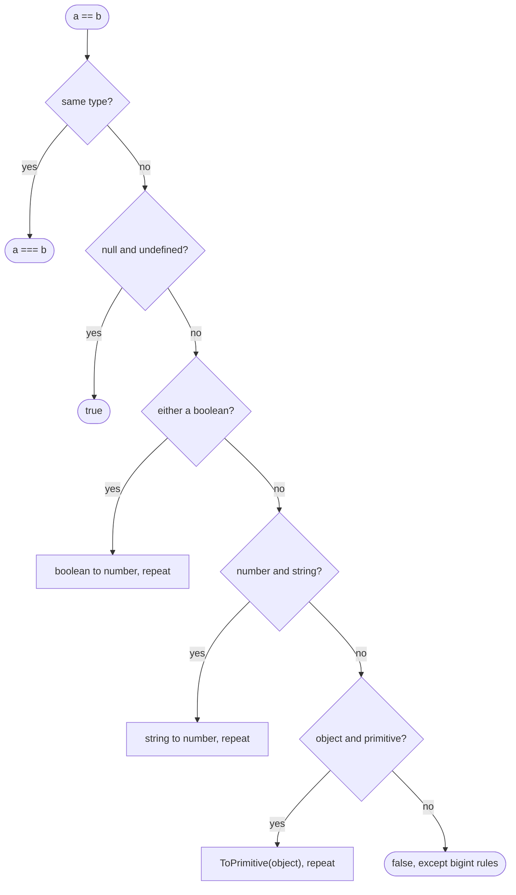

## Introduction

A product filter lets users type a minimum stock level. The code that decides whether to show the "out of stock" badge compares the typed value with zero:

```javascript title="badge-bug.js"
function showsOutOfStock(typed) {
  return typed == 0;
}

console.log(showsOutOfStock('0'));
console.log(showsOutOfStock(''));
console.log(showsOutOfStock('   '));
console.log(showsOutOfStock('0.0'));
```

```output
true
true
true
true
```

The user who has not typed anything yet, and the one who typed only spaces, both get the badge. The comparison `typed == 0` uses **loose equality**, which converts the string to a number before comparing, and `Number('')` and `Number('   ')` are both `0`. The code did exactly what the language specifies; the specification just does not match what the author meant.

JavaScript gives you several ways to compare values, and they answer subtly different questions:

- `===` (**strict equality**) asks: are these the same type *and* the same value, with no conversion?
- `==` (**loose equality**, called *abstract equality* in older editions of the specification) asks: are these equal *after* converting them to a common type?
- `!==` and `!=` are the negations of those two.
- `Object.is` asks a slightly stricter version of `===`, differing only for `NaN` and signed zero.

For objects — arrays, dates, your own records — all of them ask the same, often surprising, question: is this *the same object*, not merely an object with the same contents?

Choosing the right comparison is one of the most frequent decisions in JavaScript code. Most style guides say "always use `===`", and that is good advice, but the reasons matter: you need them to read older code, to understand interview puzzles, to know when `== null` is acceptable, and to handle the cases where even `===` gives an answer you did not expect.

## Before you start

- **Primitive versus reference values** — primitives are compared by value, objects are held by reference. See [[b1-primitive-vs-reference]].
- **Type coercion** — how operators convert values implicitly, and why `Number('')` is `0`. See [[b1-type-coercion]] and [[b1-explicit-conversion]].
- **Object-to-primitive conversion** — how an object becomes a primitive when compared with one. See [[b1-to-primitive]].
- **`NaN` and signed zero** — the special number values that behave oddly in comparisons. See [[b1-nan-infinity]].

## The intuition

Imagine checking two passports at a border. A strict officer compares them as they are: same country, same number, or they do not match. A lenient officer first translates both into a common format — perhaps converting a date written "01/02" into "2 January" — and then compares the translations. The lenient officer accepts more pairs, including some that the traveller never intended to match.

`===` is the strict officer; `==` is the lenient one. The problem with leniency is not that it is random — the translation rules are fixed — but that the rules are numerous and some are counter-intuitive, so readers of the code have to simulate them to know what a comparison does.

For objects, think of house keys instead of passports. Two keys cut from the same blank, with identical teeth, still open different houses if they belong to different locks. JavaScript variables hold *references* to objects, and every equality operator compares the references — "do these open the same house?" — not the shape of the teeth.

## Four kinds of sameness

The specification defines four comparison algorithms. Every equality check in the language uses one of them:

| Algorithm | Where you meet it | Converts types? | `NaN` equals `NaN`? | `0` equals `-0`? |
|---|---|---|---|---|
| IsStrictlyEqual | `===`, `!==`, `switch`, `indexOf` | No | No | Yes |
| IsLooselyEqual | `==`, `!=` | Yes | No | Yes |
| SameValue | `Object.is` | No | Yes | No |
| SameValueZero | `includes`, `Map`, `Set` | No | Yes | Yes |

All four compare objects by identity. The rest of this lesson takes them in order of importance.

## === Strict Equality {#b1-strict-equality}

Strict equality, written `===`, compares two values **without converting either of them**. If the two values have different types, the answer is `false` immediately. If they have the same type, they are compared by value for primitives and by identity for objects. It is the comparison you should use by default, because its result depends only on the two values — there are no translation rules to remember.

### The algorithm

`a === b` follows these rules:

1. If `a` and `b` have different types, return `false`. `1 === '1'` and `1n === 1` are both false.
2. If both are numbers: return `false` if either is `NaN`; return `true` if they are the same number, treating `+0` and `-0` as the same.
3. If both are strings: return `true` if they contain the same sequence of UTF-16 code units.
4. If both are bigints, booleans, `undefined` or `null`: return `true` if they are the same value.
5. If both are symbols or objects: return `true` only if they are the very same symbol or object.

```javascript title="strict-primitives.js"
console.log(1 === 1, 1 === 1.0, 1 === '1', 1n === 1);
console.log(null === null, null === undefined, true === 1);
console.log(NaN === NaN, 0 === -0, 0.1 + 0.2 === 0.3);
console.log('café' === 'café', 'café'.normalize() === 'café'.normalize());
console.log(Symbol('id') === Symbol('id'), Symbol.for('id') === Symbol.for('id'));
```

```output
true true false false
true false false
false true false
false true
false true
```

`1 === 1.0` is true because JavaScript has one number type and `1.0` is the same number as `1`. `null === undefined` is false: they are different types, even though both mean "no value" (see [[b1-undefined-vs-null]]). `true === 1` is false because booleans are not numbers. Every other line contains a trap worth understanding.

### The numeric exceptions: NaN and signed zero

`NaN === NaN` is `false`. This is not a JavaScript quirk; it is the rule of the IEEE 754 floating-point standard that JavaScript numbers follow. `NaN` represents the result of an undefined operation, such as `0 / 0` or `Number('abc')`, and two failed computations are not considered equal to each other. The practical consequence is that **you cannot test for `NaN` with `===`**. Use `Number.isNaN(x)` (see [[b1-number-isnan]]) or `Object.is(x, NaN)`.

`0 === -0` is `true`, also from IEEE 754. The two zeros are distinct values — `1 / -0` is `-Infinity` — but they compare equal. You rarely need to tell them apart; when you do, use `Object.is`.

`0.1 + 0.2 === 0.3` is false because neither `0.1` nor `0.2` can be stored exactly in binary floating point, and their sum is `0.30000000000000004`. That is a property of floating-point arithmetic, not of `===`. Compare floating-point results with a tolerance, such as `Math.abs(a - b) < 1e-9`, or keep money in integer cents. See [[b1-floating-point]].

### Strings compare code units, not appearance

`'café' === 'café'` is false even though both display as "café". The first uses the single character `é`; the second uses `e` followed by a combining accent. Strict equality compares the underlying UTF-16 code units, and those differ. When comparing text from different sources — user input, files, other systems — normalise both sides with `normalize()` first, as the fourth line shows. See [[b1-unicode-strings]].

### Objects compare by identity

For objects, `===` asks whether both operands refer to the same object in memory:

```javascript title="strict-objects.js"
const a = { x: 1 };
const b = { x: 1 };
const c = a;
console.log(a === b, a === c, [] === [], new String('hi') === 'hi');
c.x = 99;
console.log(a.x);
```

```output
false true false false
99
```

`a` and `b` were created by two separate object literals, so they are two objects that happen to look alike, and `a === b` is false. `c = a` copies the *reference*, not the object, so `a` and `c` name the same object — which the last line proves, because changing `c.x` changed `a.x`. Every `[]` or `{}` literal creates a new object, so `[] === []` is always false. A `String` wrapper object is an object, so it is never strictly equal to a primitive string (see [[b1-autoboxing]]).

Symbols behave like objects here: every call to `Symbol('id')` creates a new, unique symbol. `Symbol.for('id')` looks the symbol up in a global registry, so it returns the same symbol each time (see [[b1-symbol-for]]).

### Where === is used without you writing it

`switch` compares its expression against each `case` with strict equality, so `switch ('1') { case 1: … }` does not match the number case. `Array.prototype.indexOf` and `lastIndexOf` also use strict equality, which is why `[NaN].indexOf(NaN)` is `-1`. `includes`, as you will see later, uses a different rule.

### A missing-value trap

Strict equality makes you be precise about *which* empty value you mean. DOM methods such as `document.querySelector` return `null` when nothing matches, while a missing object property or array element is `undefined`. A check written as `if (el === undefined)` therefore never catches a failed `querySelector`. Either compare with the value the API actually returns, or use the deliberate idiom `el == null`, which matches both and is explained in the next section.

```quiz
Q: Which expression is `true`?
- [ ] `NaN === NaN`
- [x] `0 === -0`
- [ ] `[1] === [1]`
- [ ] `1n === 1`
> IEEE 754 equality treats the two zeros as equal, so `0 === -0` is true. NaN is unequal to everything including itself; two array literals are two different objects; and a bigint and a number are different types, so strict equality returns false without comparing magnitudes.

Q: `const a = [1, 2]; const b = a; b.push(3);` What are `a === b` and `a.length`?
- [ ] `false` and `2`
- [ ] `true` and `2`
- [x] `true` and `3`
- [ ] `false` and `3`
> `const b = a` copies the reference, so both names point at one array. Strict equality on objects compares identity, so a === b is true, and pushing through b changes the single shared array, so a.length is 3.
```

## == Abstract Equality {#b1-abstract-equality}

Loose equality, written `==`, compares two values **after converting them to a common type** when their types differ. The specification calls the algorithm IsLooselyEqual (older editions called it the Abstract Equality Comparison). It is not "compare loosely, however seems sensible": it is a fixed sequence of rules, and every surprising result comes from applying them exactly. When both operands already have the same type, `==` behaves exactly like `===`.

### The algorithm

For `a == b`:

1. If `a` and `b` have the **same type**, return `a === b`.
2. If one is `null` and the other `undefined`, return `true`.
3. If one is a **number** and the other a **string**, convert the string with ToNumber and compare again.
4. If one is a **bigint** and the other a **string**, convert the string to a bigint; if it is not a valid integer, return `false`; otherwise compare again.
5. If either is a **boolean**, convert *the boolean* to a number (`true` → 1, `false` → 0) and compare again.
6. If one is an **object** and the other is a string, number, bigint or symbol, convert the object with ToPrimitive (hint `"default"`) and compare again.
7. If one is a **bigint** and the other a **number**, return `true` if they have the same mathematical value (and neither is `NaN` or infinite).
8. Otherwise return `false`.

Browsers add one legacy rule from the specification's web-compatibility annex: the object `document.all` loosely equals `null` and `undefined`. You will not need it.



Notice what is *missing*. There is no rule that converts `null` or `undefined` to anything, so they equal only each other (and themselves). There is no rule that converts two objects, so two different objects are never loosely equal. And there is no rule that applies truthiness: `==` never asks whether a value is truthy.

### Tracing the classic results

```javascript title="loose-cases.js"
console.log('' == 0, 0 == '0', '' == '0');
console.log('true' == true, '1' == true, '2' == true);
console.log(null == undefined, null == 0, null == false, undefined == '');
console.log([] == false, [] == ![], [0] == false, [1, 2] == '1,2');
console.log(1n == 1, 1n == '1', NaN == NaN, {} == {});
```

```output
true true false
false true false
true false false false
true true true true
true true false false
```

Trace each surprising one through the rules.

**`'' == 0` is true, `0 == '0'` is true, but `'' == '0'` is false.** The first two are number-versus-string, so rule 3 converts the string: `''` becomes `0`, `'0'` becomes `0`. The third has two strings — the same type — so rule 1 compares them strictly, and they are different strings. Loose equality is **not transitive**: `a == b` and `b == c` do not imply `a == c`.

**`'true' == true` is false.** Rule 5 converts the boolean first, not the string: `true` becomes `1`, leaving `'true' == 1`. Rule 3 converts `'true'` to a number, which is `NaN`, and `NaN == 1` is false. By the same steps `'1' == true` becomes `1 == 1` (true) and `'2' == true` becomes `2 == 1` (false). This is why comparing with `== true` is almost always a bug: it does not mean "is truthy".

**`null == 0` is false and `null == false` is false.** No rule converts `null`. Rule 2 handles `null == undefined`, and every other comparison with `null` falls to rule 8. (Contrast `null >= 0`, which *is* true because relational operators do convert `null` to `0` — see [[b1-implicit-coercion]].)

**`[] == ![]` is true.** First the right side is evaluated: `![]` applies ToBoolean, and every object is truthy, so `![]` is `false`. Now the comparison is `[] == false`:

| Step | Comparison | Rule applied |
|---|---|---|
| 1 | `[] == false` | boolean → number (rule 5) |
| 2 | `[] == 0` | object → primitive (rule 6): `[].toString()` is `''` |
| 3 | `'' == 0` | string → number (rule 3) |
| 4 | `0 == 0` | same type (rule 1) → `true` |

An array is equal to its own negation. The trace also explains `[0] == false` (`[0]` becomes `'0'`, then `0`) and `[1, 2] == '1,2'` (the array's `toString` produces exactly that string).

**`1n == 1` and `1n == '1'` are true** through the bigint rules, even though `1n === 1` is false. **`NaN == NaN` is false**, because once the types match `==` defers to `===`. **`{} == {}` is false** because two objects are the same type, so rule 1 compares identity.

### The one widely accepted use: `x == null`

Because `null` and `undefined` loosely equal each other and nothing else, `x == null` is a compact test for "is this value missing?" that matches exactly those two values:

```javascript title="eq-null.js"
const values = [null, undefined, 0, '', false, NaN];
for (const v of values) console.log(String(v).padEnd(9), v == null, v === null || v === undefined);
```

```output
null      true true
undefined true true
0         false false
          false false
false     false false
NaN       false false
```

The two columns agree for every value. Unlike a truthiness check such as `if (!x)`, `x == null` keeps `0`, `''`, `false` and `NaN` as real values. Many codebases allow this one use of `==` — ESLint's `eqeqeq` rule has an option, `{ "null": "ignore" }`, for exactly this — while others prefer the explicit `x === null || x === undefined`. In modern code, `x ?? fallback` and `x?.prop` cover many of the situations where this check used to be written (see [[b1-nullish-coalescing]] and [[b1-optional-chaining]]).

### Why loose equality is avoided

The algorithm is deterministic, but it has eight rules, a recursive structure and object conversions that can run user code. To know what `a == b` does, a reader needs to know both operands' types, and in a dynamic language that information is often not visible at the comparison. Strict equality has no such dependency. That asymmetry — a small convenience when writing, a real cost when reading — is why `===` is the default in nearly every style guide.

```quiz
Q: Why is `'true' == true` false?
- [ ] Because `==` compares strings and booleans by identity
- [x] The boolean is converted to `1`, then `'true'` is converted to `NaN`, and `NaN == 1` is false
- [ ] Because `'true'` is converted to `true` and the comparison is case-sensitive
- [ ] Because strings and booleans can never be loosely equal
> When one operand is a boolean, IsLooselyEqual converts the boolean to a number first, giving 'true' == 1. Then number-versus-string converts the string with ToNumber, and 'true' is not numeric, so it becomes NaN. NaN equals nothing. Note that '1' == true is true by the same steps.

Q: Which values make `x == null` true?
- [ ] `null`, `undefined`, `0` and `''`
- [ ] Every falsy value
- [x] Only `null` and `undefined` (plus the browser-only `document.all`)
- [ ] Only `null`
> IsLooselyEqual has a dedicated rule making null and undefined equal to each other, and no rule converts them to numbers or strings, so they equal nothing else. That is what makes `x == null` a precise "missing value" check, unlike `!x`, which also catches 0, '', false and NaN.
```

## != and !== {#b1-inequality}

The inequality operators are the negations of the equality operators. `a !== b` is defined as `!(a === b)` and `a != b` as `!(a == b)`. They use exactly the same algorithms as their equality partners and then flip the result — they do not convert or negate the operands themselves. Everything about `===` and `==` therefore applies to them: prefer `!==`, and use `!=` only for the deliberate `x != null` idiom.

```javascript title="inequality.js"
const status = 'draft';
console.log(status != 'draft' || status != 'published');
console.log(status !== 'draft' && status !== 'published');
console.log(!['draft', 'published'].includes(status));
const x = NaN;
console.log(x != x, x !== x, Number.isNaN(x));
console.log(1 != '1', 1 !== '1', null != undefined, null !== undefined, 0 != null);
```

```output
true
false
false
true true true
false true false true true
```

### The condition that is always true

The first line shows the most common inequality bug, and it has nothing to do with types. A developer wants "status is neither draft nor published" and writes `status != 'draft' || status != 'published'`. Any value is different from at least one of two different strings, so the `||` is always true — here `'draft'` is not `'published'`, so the whole condition passes. "Not A and not B" must be written with `&&`, as on the second line. This is De Morgan's law: `!(a || b)` equals `!a && !b`. For more than two values, `!list.includes(value)` states the intent directly and cannot be miswritten this way.

### The NaN inequality

`NaN` is the only value that is not equal to itself, so `x !== x` is `true` exactly when `x` is `NaN`. You may meet this in older code as a NaN test written before `Number.isNaN` existed (ES2015). It works, but `Number.isNaN(x)` says what it means. The trap in the other direction is `x != NaN` or `x !== NaN`, intended as "x is a valid number": it is true for *every* value, including `NaN`, because nothing equals `NaN`.

### Loose inequality inherits loose surprises

`!=` mirrors every result of `==`. `1 != '1'` is false because `1 == '1'` is true. `'' != 0` is false. `null != undefined` is false. And `0 != null` is true, because `0 == null` is false — this is what makes `x != null` a precise "value is present" test: it is true for `0`, `''` and `false`, and false only for `null` and `undefined`. Outside that idiom, `!=` carries all the risks of `==`, and the `eqeqeq` lint rule flags both operators together.

```quiz
Q: A function should reject any role other than `'admin'` and `'owner'`. Which condition is correct?
- [ ] `if (role != 'admin' || role != 'owner') reject();`
- [x] `if (role !== 'admin' && role !== 'owner') reject();`
- [ ] `if (role !== 'admin' || role !== 'owner') reject();`
- [ ] `if (!(role === 'admin' && role === 'owner')) reject();`
> "Neither A nor B" is `!== A && !== B`. Joining two inequalities with `||` is always true for two different strings, so the first and third options reject everyone, including admins. The fourth negates a condition that can never be true (a role cannot equal both strings), so it also rejects everyone. `!['admin', 'owner'].includes(role)` is an equally correct and clearer alternative.
```

## Object.is and SameValueZero

Strict equality has two exceptions, both inherited from floating-point arithmetic: `NaN` is unequal to itself and `-0` equals `+0`. Two further algorithms exist for the cases where those exceptions are unwanted.

**`Object.is(a, b)`**, added in ES2015, implements **SameValue**: it is `===` except that `Object.is(NaN, NaN)` is `true` and `Object.is(0, -0)` is `false`. It answers "are these indistinguishable values?". **SameValueZero** is SameValue except that the two zeros are equal. You cannot call it directly, but the newer collection APIs use it: `Array.prototype.includes`, `Map` keys and `Set` membership.

```javascript title="same-value.js"
console.log(Object.is(NaN, NaN), Object.is(0, -0), Object.is('a', 'a'), Object.is({}, {}));
console.log([NaN].indexOf(NaN), [NaN].includes(NaN), [-0].includes(0));
console.log(new Set([NaN, NaN, 0, -0]).size, new Map([[0, 'zero']]).get(-0));
```

```output
true false true false
-1 true true
2 zero
```

The second line is the practical difference between two similar-looking array methods: `indexOf` uses strict equality and cannot find `NaN`; `includes` uses SameValueZero and can. The set holds two values, one `NaN` and one zero, because SameValueZero treats both `NaN`s as the same and both zeros as the same. For objects, all of these still compare identity.

You will meet `Object.is` in frameworks more often than you write it. React compares state values and effect dependencies with `Object.is` to decide whether something changed, and Jest's `toBe` matcher uses it, which is why `expect(NaN).toBe(NaN)` passes. See [[b1-object-is]] for more.

## Comparing objects by value

Since every equality operator compares objects by identity, "do these two objects have the same contents?" needs code of its own. There is no built-in operator for it in the language.

A **shallow** comparison checks that both objects have the same own keys and that each pair of values is identical. It is fast and is what UI libraries use to decide whether props changed:

```javascript title="shallow-equal.js"
function shallowEqual(a, b) {
  if (Object.is(a, b)) return true;
  if (typeof a !== 'object' || a === null || typeof b !== 'object' || b === null) {
    return false;
  }
  const keysA = Object.keys(a);
  const keysB = Object.keys(b);
  if (keysA.length !== keysB.length) return false;
  return keysA.every((k) => Object.hasOwn(b, k) && Object.is(a[k], b[k]));
}

const tags = ['x'];
console.log(shallowEqual({ id: 1, tags }, { tags, id: 1 }));
console.log(shallowEqual({ id: 1, tags }, { id: 1, tags: ['x'] }));
console.log(shallowEqual({ v: NaN }, { v: NaN }), shallowEqual(1, 1), shallowEqual(null, {}));
```

```output
true
false
true true false
```

Key order does not matter, because each key is looked up by name. The second call is false because the two `tags` arrays are different objects: shallow equality looks only one level deep. A **deep** comparison recurses into nested objects and arrays. Writing a correct one is harder than it looks — it must handle arrays versus objects, dates, maps and sets, prototypes and circular references — so most projects use a tested implementation: Node.js provides `util.isDeepStrictEqual`, test frameworks provide `toEqual`, and libraries such as Lodash provide `isEqual`.

A tempting shortcut is `JSON.stringify(a) === JSON.stringify(b)`. It is fragile:

```javascript title="json-compare.js"
const a = { id: 1, tags: ['x'], meta: { when: undefined } };
const b = { tags: ['x'], id: 1, meta: {} };
console.log(JSON.stringify(a) === JSON.stringify(b));
console.log(JSON.stringify(a), JSON.stringify(b));
console.log(JSON.stringify({ v: NaN }), JSON.stringify({ v: null }));
```

```output
false
{"id":1,"tags":["x"],"meta":{}} {"tags":["x"],"id":1,"meta":{}}
{"v":null} {"v":null}
```

It reports the objects as different only because their keys were inserted in a different order, while it silently drops the `undefined` property and turns `NaN` into `null`, so genuinely different objects can compare equal. It also fails on dates, maps, sets, bigints and circular structures. See [[b1-json-unsupported]].

## How it works internally

The specification defines the algorithms as abstract operations. **IsStrictlyEqual** checks the types and, for numbers, calls `Number::equal`, which implements the IEEE 754 rules; for everything else it calls **SameValueNonNumber**, which compares strings by code units, bigints by value and objects and symbols by identity. **SameValue** and **SameValueZero** share SameValueNonNumber and differ from strict equality only in their number cases. **IsLooselyEqual** is the recursive procedure shown earlier: each conversion step produces new operands and calls IsLooselyEqual again until the types match or a rule returns `false`.

Two practical differences follow. Strict equality never runs user code: it reads two values and compares them, which is why engines can compile it into a few machine instructions when the types are known. Loose equality can call ToPrimitive, which can run an object's `valueOf`, `toString` or `Symbol.toPrimitive` methods — and those can throw, log or have side effects (the `a == 1 && a == 2 && a == 3` puzzle in [[b1-symbol-toprimitive]] depends on this).

For objects, "identity" means the engine compares the references themselves — in effect, the addresses of the objects on the heap. No properties are read. That is why comparing two large objects with `===` costs the same as comparing two small ones, and why it says nothing about their contents.

## Worked example: detecting unsaved changes

An edit form loads a product from an API and should enable its "Save" button only when the user has changed something. The saved record has proper JSON types; the form gives back strings, with `''` for an empty field. A first attempt compares field by field:

```javascript title="dirty-check-naive.js"
// Saved record from the API (typed by JSON) and the same fields read back from a form.
const saved = { name: 'Desk lamp', qty: 2, note: null };
const fromForm = { name: 'Desk lamp', qty: '2', note: '' };

function changedFieldsStrict(a, b) {
  return Object.keys(a).filter((k) => a[k] !== b[k]);
}
function changedFieldsLoose(a, b) {
  return Object.keys(a).filter((k) => a[k] != b[k]);
}

console.log(changedFieldsStrict(saved, fromForm));
console.log(changedFieldsLoose(saved, fromForm));
console.log(changedFieldsLoose({ qty: 0 }, { qty: '' }));
```

```output
[ 'qty', 'note' ]
[ 'note' ]
[]
```

Neither version is right. Strict comparison reports changes the user never made, because `2` and `'2'` are different types and `null` is not `''`. Loose comparison hides the type problem for `qty`, still reports `note` (because `null` loosely equals only `undefined`), and — the last line — treats clearing a quantity of `0` as "no change", because `0 == ''`. Switching operators only moves the bug around. The real problem is that the two objects use different types for the same data.

The fix is to normalise the form values into the API's types once, and then compare strictly:

```javascript title="dirty-check.js"
const saved = { name: 'Desk lamp', qty: 2, note: null };

// Convert form strings into the same types the API uses, once.
function normalise(form) {
  return {
    name: form.name.trim(),
    qty: form.qty.trim() === '' ? null : Number(form.qty),
    note: form.note.trim() === '' ? null : form.note,
  };
}

function changedFields(a, b) {
  return Object.keys(a).filter((k) => !Object.is(a[k], b[k]));
}

console.log(changedFields(saved, normalise({ name: 'Desk lamp', qty: '2', note: '' })));
console.log(changedFields(saved, normalise({ name: 'Desk lamp ', qty: '3', note: '' })));
console.log(changedFields(saved, normalise({ name: 'Desk lamp', qty: '', note: 'fragile' })));
```

```output
[]
[ 'qty' ]
[ 'qty', 'note' ]
```

After `normalise`, both records use numbers or `null` for `qty` and strings or `null` for `note`, so a strict comparison means exactly "the value changed". `Object.is` is used instead of `!==` so that a `NaN` quantity (from text such as `'abc'`) does not count as changed on every render; for a real form you would reject such input during normalisation instead. The comparison is shallow, which is enough for a flat record; a record with nested objects would need a deep comparison or a per-field rule.

## In real systems

**Style and linting.** Most JavaScript style guides require `===` and `!==`. ESLint's `eqeqeq` rule enforces it, with options to allow `== null` (`{ "null": "ignore" }`) or to allow `==` when the result cannot differ, such as comparing two literals (`"smart"`). TypeScript also reports an error for comparisons between types that can never be equal, such as a `number` and a `string`.

**Frameworks.** React decides whether to re-render or re-run an effect by comparing values with `Object.is`. That is why mutating an object and setting it as state again does nothing — it is the same reference — and why creating a new object or array on every render can make an effect run every time even when its contents did not change.

**Collections.** `Map` and `Set` use SameValueZero for keys, so objects are matched by identity. Using an object as a `Map` key works only if you look it up with the same object. To key by contents, derive a primitive key, such as an ID or a canonical string.

**Testing.** Jest's `toBe` uses `Object.is`; `toEqual` and `toStrictEqual` compare structure recursively. Choosing the wrong matcher is a common reason a test that "should pass" fails with two identical-looking objects in the output.

**Security.** Loose equality on untrusted input can let unexpected types through checks — for example, an array `['admin']` loosely equals the string `'admin'`. Strict comparisons plus validation of input types close that gap.

## Trade-offs and alternatives

| Comparison | Use it for | Avoid it for |
|---|---|---|
| `===` / `!==` | Almost everything: primitives of known type, object identity | Detecting `NaN`; comparing contents of objects |
| `== null` / `!= null` | "Is this value missing?" when the team allows it | Anything else |
| `==` / `!=` in general | Reading legacy code | New code |
| `Object.is` | `NaN`-safe or sign-sensitive comparison, framework-style change detection | Everyday comparisons (it reads less familiarly) |
| `includes`, `Map`, `Set` | Membership with `NaN`-safe matching | Matching objects by contents |
| Shallow equality | Flat records, props, memoisation | Nested data |
| Deep equality (`isDeepStrictEqual`, `toEqual`) | Tests, nested data | Hot paths on large data (cost grows with size) |
| `JSON.stringify` comparison | Quick debugging only | Production logic |

The underlying choice is between comparing **identity** and comparing **contents**, and between comparing values **as they are** and comparing them **after conversion**. Good code compares identity or primitive values with strict operators, converts types explicitly at boundaries so conversion-based comparison is never needed, and calls a deliberate deep comparison when contents matter.

## Common mistakes

**Comparing input with `==` to a number.** `'' == 0` and `'   ' == 0` are true. Convert and validate the input, then use `===`.

**Testing for `NaN` with `===` or `!==`.** `x === NaN` is always false and `x !== NaN` always true. Use `Number.isNaN(x)`.

**Expecting two identical-looking objects to be equal.** `{ a: 1 } === { a: 1 }` is false. Compare a key field, or use a shallow or deep comparison.

**Comparing dates with `===` or `==`.** Both compare identity. Compare `getTime()` values (see [[b1-to-primitive]]).

**Writing `x == true` or `x == false`.** These apply the loose rules, not truthiness: `'2' == true` is false. Write `if (x)` or compare with the specific value you expect.

**Joining inequalities with `||`.** `x !== 'a' || x !== 'b'` is always true. Use `&&` or `!list.includes(x)`.

**Checking only `=== undefined` for an API that returns `null`.** Know what each API returns, or use `== null` deliberately.

**Using `JSON.stringify` for equality.** Key order, `undefined`, `NaN` and dates all break it.

> [!MISTAKE] "`==` checks the value, `===` checks the value and the type"
> This common summary is misleading. `==` does not "ignore type"; it *converts* operands by a specific algorithm, which is why `'true' == true` is false and `null == 0` is false even though a value-only comparison might suggest otherwise. When the types already match, `==` and `===` give identical results.

## Interview perspective

**"What is the difference between `==` and `===`?"** `===` compares without converting: different types are unequal. `==` converts operands to a common type using the IsLooselyEqual algorithm — booleans to numbers, strings to numbers when compared with numbers, objects to primitives — and treats `null` and `undefined` as equal only to each other. A strong answer gives one example of each conversion and says when, if ever, you would use `==` (`x == null`).

**"Why is `[] == ![]` true?"** Walk the trace: `![]` is `false` because objects are truthy; `[] == false` becomes `[] == 0`; `[]` becomes `''`; `'' == 0` becomes `0 == 0`. Interviewers want to see the rule order, especially that the boolean is converted first.

**"Why is `NaN === NaN` false, and how do you check for NaN?"** IEEE 754 defines `NaN` as unequal to everything. Use `Number.isNaN` or `Object.is`. Mentioning that `includes` finds `NaN` but `indexOf` does not shows depth.

**"What is the difference between `===` and `Object.is`?"** Only `NaN` (equal under `Object.is`) and signed zero (unequal under `Object.is`). Mention SameValueZero for `Map`, `Set` and `includes`, and React's use of `Object.is`.

**"Why is `{} === {}` false? How would you compare objects?"** Objects compare by reference. Discuss shallow versus deep comparison, the problems with `JSON.stringify`, and library functions.

**Follow-up: "Is `==` transitive?"** No: `'' == 0` and `0 == '0'` are true, but `'' == '0'` is false.

## Practice

1. **Trace by hand.** Using the IsLooselyEqual rules, trace `[0] == ''`, `'0' == false`, `[[]] == 0`, `null == ''`, `'1,2' == [1, 2]` and `true == [1]`. Write the rule used at each step, then check in Node.js.
2. **Find the bug.** `if (user.role != 'editor' || user.role != 'admin') return forbidden();` — explain what happens for each role and fix it two ways.
3. **NaN-safe unique.** Write `unique(values)` that removes duplicates from an array of numbers, treating all `NaN`s as one value and keeping `0` and `-0` as one. Then explain which built-in gives you this for free.
4. **Shallow versus deep.** Extend `shallowEqual` from this lesson into `deepEqual` that handles nested plain objects and arrays (ignore dates, maps and cycles). Write tests showing a case where the two functions disagree.
5. **Lint policy.** Write the ESLint `eqeqeq` configuration that bans `==` except `== null`, and list two expressions from this lesson that it would reject and one it would allow.

## Quick revision {#quick-revision}

- Four algorithms: **IsStrictlyEqual** (`===`, `!==`, `switch`, `indexOf`), **IsLooselyEqual** (`==`, `!=`), **SameValue** (`Object.is`), **SameValueZero** (`includes`, `Map`, `Set`). All compare objects by identity.
- `===`: different types → false; `NaN === NaN` false; `0 === -0` true; strings by UTF-16 code units (normalise Unicode); objects and symbols by identity.
- `==` rules: same type → `===`; `null == undefined` true (nothing else equals them); number vs string → string to number; boolean → number first; object vs primitive → ToPrimitive (default hint); bigint vs number/string → compare values.
- `'' == 0`, `'0' == 0`, `'' == '0'` → true, true, false (not transitive).
- `'true' == true` false; `'1' == true` true; `null == 0` false; `null == false` false; `[] == false` true; `[] == ![]` true; `[1,2] == '1,2'` true; `1n == 1` true.
- `x == null` ⇔ `x === null || x === undefined`.
- `!==` = `!(===)`, `!=` = `!(==)`. "Neither A nor B" = `!== A && !== B`. `x !== x` only for NaN; `x !== NaN` always true.
- `Object.is(NaN, NaN)` true, `Object.is(0, -0)` false. `[NaN].indexOf(NaN)` -1, `[NaN].includes(NaN)` true.
- Objects: `{} === {}` false. Shallow compare = same keys + `Object.is` values. Deep compare = library (`util.isDeepStrictEqual`, `toEqual`, `isEqual`). Avoid `JSON.stringify` equality.
- Default: `===`/`!==`; normalise types at boundaries instead of relying on `==`.

## Key takeaways {#key-takeaways}

- Use `===` and `!==` by default: they never convert, so their result depends only on the two values.
- `==` follows a fixed conversion algorithm — booleans become numbers first, strings become numbers next to numbers, objects become primitives — and `null` equals only `undefined`; the one widely accepted use is `x == null`.
- `NaN` is never equal to itself under `===` or `==`, and `-0` equals `0`; `Object.is` and SameValueZero-based APIs handle these cases.
- Every equality operator compares objects by identity, so comparing contents needs a deliberate shallow or deep comparison.
- Inequality operators are just negated equality; most inequality bugs are logic errors such as joining two `!==` checks with `||`.
- When two values of "the same data" have different types, fix the types at the boundary rather than switching to loose comparison.
