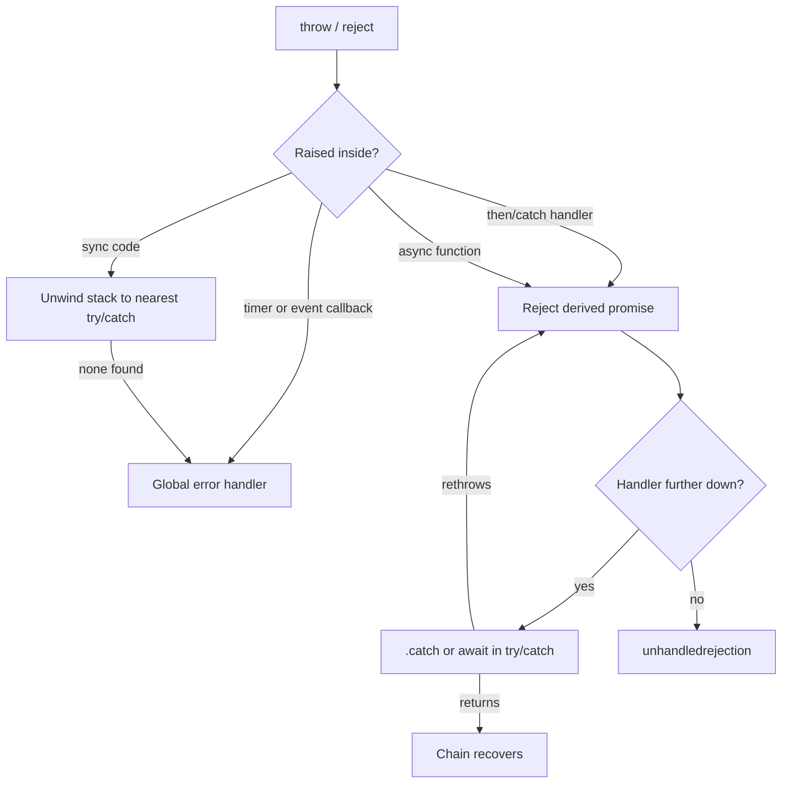

## Introduction

Every program fails sometimes: a server is down, input is malformed, a record is missing. The question this lesson answers is not how to avoid failures but **where a failure goes after it happens**. If you know the path an error travels, you can put a handler in the right place — close enough to recover sensibly, far enough up that you are not repeating the same check everywhere — and you can tell when an error has escaped every handler and will crash the process or disappear.

**Error propagation** is the name for that path. JavaScript has two separate mechanisms for it. Synchronous code uses **exceptions**: `throw` interrupts the current function and moves up the call stack until a `try`/`catch` takes it. Asynchronous promise code uses **rejections**: a rejected promise moves down a chain of `.then` calls until a `.catch` takes it. `async`/`await` connects the two so that an awaited rejection behaves like a thrown exception, but the underlying channels are still different, and most real error-handling bugs live exactly where they meet.

This matters in every layer of a web application. A React component needs to show an error state instead of a blank screen; a Node.js server needs to answer 500 instead of crashing; a background job needs to log the real cause instead of "undefined". All of those depend on errors reaching the code that is meant to handle them.

## Before you start

- **`throw`, `try`, `catch`, `finally`** — the synchronous syntax. See [[b1-throw-try-catch]].
- **Error objects** — `Error`, `TypeError` and friends, and how to subclass them. See [[b1-error-types]] and [[b1-custom-errors]].
- **Promises and chaining** — what `.then` returns and how `.catch` works. See [[b1-promises]], especially [[b1-then-catch-finally]].
- **`async`/`await` basics** — an `async` function returns a promise and `await` pauses it until a promise settles. This lesson explains only the error side; [[b1-async-await]] teaches the rest.

All snippets run in Node.js 22 as ES modules (`.mjs`), and the output shown is what Node printed.

## The intuition

Picture two different shapes. A synchronous call stack is a **tower**: `main` calls `loadConfig`, which calls `parse`. When `parse` throws, the error rises up the tower, floor by floor, and each floor either catches it or lets it pass. If it reaches the roof with nobody catching it, it is an **uncaught exception**.

A promise chain is a **pipeline** laid out in time: step 1, then step 2, then step 3. A rejection flows *along* the pipeline, passing every station that only knows how to handle success, until it reaches a station that handles failure. If it falls out of the end of the pipeline, it is an **unhandled rejection**.

The two shapes explain the single most important rule: **an error only travels along the channel it was raised in**. An exception thrown inside a `setTimeout` callback rises up the timer's stack — which is nearly empty, because the timer was called by the event loop, not by your code — and it never enters any promise pipeline. A rejection never jumps into a `try`/`catch` unless something `await`s it. Where the shapes are connected, errors cross; where they are not, errors are lost.

## Channel 1: exceptions up the call stack

When a `throw` statement runs, the engine stops executing the current function and looks for an enclosing `try` block in that function. If there is none, it leaves the function — discarding its frame — and repeats the search in the caller, and so on. This is called **unwinding the stack**. Any `finally` block on the way out runs before the error continues upward.

```javascript title="sync-unwind.mjs"
function parse(text) {
  return JSON.parse(text);            // throws SyntaxError on bad input
}
function loadConfig(text) {
  try {
    return parse(text);
  } finally {
    console.log('loadConfig: finally runs on the way out');
  }
}
function main() {
  try {
    loadConfig('{ bad json');
    console.log('never printed');
  } catch (err) {
    console.log('main caught', err.name);
  }
}
main();
```

```output
loadConfig: finally runs on the way out
main caught SyntaxError
```

`JSON.parse` throws inside `parse`, which has no `try`, so its frame is discarded. `loadConfig` has a `try` with only a `finally`, so the cleanup runs and the error continues. `main` catches it, and the line after the failing call is skipped. Notice that **the catch does not need to be next to the throw**. Code in the middle — `loadConfig` here — can ignore errors it has nothing useful to say about, and the error passes through it untouched. That is the main advantage of exceptions over return codes.

If no frame catches the error, the host reports it: browsers log "Uncaught …" to the console and fire an `error` event on `window`; Node.js prints the stack and exits with a non-zero code.

## Channel 2: rejections down a promise chain

A promise reports failure by **rejecting**. Inside `.then` and `.catch` callbacks, the engine wraps your code in an internal `try`, so a `throw` there does not unwind the stack — it rejects the promise returned by that `.then`. Every following `.then` with no rejection handler forwards the rejection unchanged, which is how it "skips" to the nearest `.catch`.

```javascript title="chain-propagation.mjs"
Promise.resolve()
  .then(() => {
    throw new Error('boom');
  })
  .then(() => console.log('skipped 1'))
  .then(() => console.log('skipped 2'))
  .catch((err) => {
    console.log('caught', err.message);
    return 'recovered';
  })
  .then((v) => console.log('continues with', v));
```

```output
caught boom
continues with recovered
```

Two rules carry most of the weight. First, **a `.catch` that returns normally recovers the chain**: its return value fulfils the next promise, so the steps after it run as if nothing failed. Second, **to keep the failure going, throw again** — either the same error or a new one. A `.catch` is therefore a decision point: "can I produce a meaningful value here?" If yes, return it; if not, rethrow, or do not catch at all.

If a rejection reaches the end of a chain with no handler, the host treats it as an **unhandled rejection**. Browsers log "Uncaught (in promise)" and fire `unhandledrejection` on `window`. Node.js 15 and later crash the process by default — the same severity as an uncaught exception.

## Where the channels meet: `async`/`await`

An `async` function connects the two channels in both directions:

- Inside an `async` function, **`await` on a rejected promise throws** the rejection reason at that line, so an ordinary `try`/`catch` can handle it.
- Anything **thrown inside an `async` function rejects the promise** it returned, so the caller sees a rejection, not an exception.

```javascript title="await-rethrow.mjs"
const failLater = (msg) =>
  new Promise((_, reject) => setTimeout(() => reject(new Error(msg)), 10));

async function step() {
  try {
    await failLater('db timeout');
    console.log('not reached');
  } catch (err) {
    console.log('step caught', err.message);
    throw new Error('could not load orders', { cause: err });
  }
}

step().catch((err) => {
  console.log('caller caught', err.message);
  console.log('  because', err.cause.message);
});
```

```output
step caught db timeout
caller caught could not load orders
  because db timeout
```

The rejection from `failLater` becomes an exception at the `await`, is caught, is wrapped in a new, more meaningful error, and the `throw` turns back into a rejection of `step()`'s promise, which the caller handles. The **`cause` option** (ES2022) attaches the original error to the new one, so the high-level message does not destroy the low-level detail. Logging tools such as Node's `console.error` and most error-reporting services print the cause chain.

This bridge is why most modern code uses `try`/`catch` around `await` instead of `.catch` chains: the error handling reads like synchronous code. But the bridge only exists where an `await` (or `.then`) actually connects a promise to your code.

## Where errors escape

Most error-handling bugs are errors leaving the path you expected. Here are the four common escape routes.

### Throwing before the promise exists

A regular (non-`async`) function that returns a promise can still throw synchronously — for example, when it validates its arguments before starting work. Then `.catch` on the result never runs, because there is no result:

```javascript title="sync-throw-before-promise.mjs"
function loadUser(id) {
  if (typeof id !== 'number') throw new TypeError('id must be a number');
  return Promise.resolve({ id });
}

try {
  loadUser('7').catch((e) => console.log('.catch saw', e.message));
} catch (e) {
  console.log('try/catch saw', e.message);
}

async function loadUserAsync(id) {
  if (typeof id !== 'number') throw new TypeError('id must be a number');
  return { id };
}
const p = loadUserAsync('7');
console.log('call returned a', p.constructor.name);
p.catch((e) => console.log('.catch saw', e.message));
```

```output
try/catch saw id must be a number
call returned a Promise
.catch saw id must be a number
```

The first version fails on the exception channel, so `loadUser('7').catch(...)` never even reaches `.catch`. Callers of a promise-returning function reasonably expect *all* failures as rejections. Marking the function `async` guarantees it: the same `throw` becomes a rejection. A function that returns a promise should never also throw.

### Throwing inside a callback that the promise does not own

A promise executor catches exceptions thrown *during* the executor. It cannot catch exceptions thrown later by a callback the executor scheduled, because by then the executor has returned and that callback runs on a fresh stack started by the event loop:

```javascript title="timer-throw.mjs"
process.on('uncaughtException', (e) => console.log('uncaught exception:', e.message));

const p = new Promise((resolve) => {
  setTimeout(() => {
    throw new Error('thrown inside a timer');   // not inside the executor any more
  }, 10);
});
p.catch((e) => console.log('never: promise is still pending'));
setTimeout(() => console.log('p is still pending, forever'), 30);
```

```output
uncaught exception: thrown inside a timer
p is still pending, forever
```

The error becomes an uncaught exception (the handler at the top stops Node from exiting so we can see the rest), and the promise is never settled at all. Inside callbacks, report failure with `reject(err)`, not `throw`. The same applies to event listeners and callback-style APIs: an exception thrown in a `click` handler goes to the browser's global error handler, not to whatever code added the listener.

### Promises nobody is listening to

A **floating promise** is one that was created and then ignored — `saveDraft()` called without `await`, `.then` or `.catch`. If it rejects, nothing handles it. A subtler version appears when two operations are started together but awaited one at a time:

```javascript title="unawaited-sibling.mjs"
const failAfter = (ms, msg) =>
  new Promise((_, reject) => setTimeout(() => reject(new Error(msg)), ms));

async function loadBoth() {
  const a = failAfter(10, 'a failed');   // both start now
  const b = failAfter(20, 'b failed');
  await a;                               // throws here; nobody ever awaits b
  await b;
}

loadBoth().catch((e) => console.log('caught', e.message));
```

```output
caught a failed
file:///app/unawaited-sibling.mjs:2
  new Promise((_, reject) => setTimeout(() => reject(new Error(msg)), ms));
                                                     ^

Error: b failed
```

The first failure is handled correctly, but `await a` throws and exits the function, so `b` is abandoned with no handler. Ten milliseconds later it rejects and Node.js crashes. The fix is to wait for both through one promise — `await Promise.all([a, b])` attaches handlers to every input — which [[b1-promise-combinators]] and [[b1-sequential-vs-parallel]] cover.

### Handlers that swallow or replace the error

The last route is a handler that is present but loses information:

```javascript title="swallow-and-mask.mjs"
async function cleanupFails() {
  try {
    throw new Error('real cause: payment declined');
  } finally {
    throw new Error('cleanup: could not release lock');
  }
}
cleanupFails().catch((e) => console.log('caller sees:', e.message));

const swallow = Promise.reject(new Error('disk full'))
  .catch((e) => { console.log('logged', e.message); })
  .then((v) => console.log('next step thinks it succeeded with', v));
```

```output
caller sees: cleanup: could not release lock
logged disk full
next step thinks it succeeded with undefined
```

An exception in `finally` **replaces** the error that was propagating — the payment failure is gone. And a `.catch` (or `catch` block) that only logs returns `undefined`, which recovers the chain, so the next step runs on a value it never expected. Both are fixed by being deliberate: keep `finally` blocks from throwing, and after logging, either rethrow or return a real fallback value.

## How it works internally

For exceptions, the engine keeps a call stack of frames. A `throw` creates an **abrupt completion** — the specification's term for "this statement did not finish normally" — and every statement and function returns that completion to its caller instead of a value, until a `try` statement converts it back to normal control flow by running its `catch`. `finally` runs in both cases; if `finally` itself completes abruptly (with `throw` or `return`), that completion wins over the original one, which is the masking you saw above.

For promises, each `.then` reaction job calls your handler inside the engine's own `try`. A normal completion resolves the derived promise; an abrupt one rejects it. That is why exceptions in handlers turn into rejections but exceptions in unrelated callbacks do not: only code called by a reaction job runs inside that internal `try`.

For `async` functions, the engine runs the body inside an internal `try` too, connected to the promise the function returned. Each `await` suspends the function and attaches reactions to the awaited promise; when it rejects, the engine resumes the function by *throwing* the reason at the `await` expression.

Unhandled rejections are detected by **rejection tracking**. When a promise rejects with no handlers, the engine notifies the host. The host waits — browsers until the microtask queue has been processed, Node.js until its own microtask and `nextTick` processing finishes — and if no handler has been attached by then, it fires `unhandledrejection` (browser) or `process`'s `'unhandledRejection'` event (Node.js). If a handler is attached *later*, browsers fire `rejectionhandled`. This explains a puzzle: `const p = Promise.reject(e); setTimeout(() => p.catch(log), 0);` still triggers an unhandled-rejection report, because a timer is later than the check.



## Worked example: error boundaries in a request handler

Real applications are built in layers, and each layer has a different job with errors. Here, a data layer talks to storage, a service layer gives results domain meaning, and a request handler at the boundary decides what the user sees.

```javascript title="layers.mjs"
class NotFoundError extends Error {
  constructor(message, options) {
    super(message, options);
    this.name = 'NotFoundError';
  }
}

// Data layer: talks to storage, reports raw failures.
const ORDERS = { 1: { id: 1, total: 40 } };
function dbGetOrder(id) {
  return new Promise((resolve, reject) => {
    setTimeout(() => {
      if (id === 13) reject(new Error('ECONNRESET: connection lost'));
      else resolve(ORDERS[id] ?? null);
    }, 5);
  });
}

// Service layer: turns storage results into domain meaning.
async function getOrder(id) {
  let row;
  try {
    row = await dbGetOrder(id);
  } catch (err) {
    throw new Error(`could not read order ${id}`, { cause: err });
  }
  if (row === null) throw new NotFoundError(`order ${id} does not exist`);
  return row;
}

// Boundary: the one place that decides what the user sees.
async function handleRequest(id) {
  try {
    const order = await getOrder(id);
    return { status: 200, body: order };
  } catch (err) {
    if (err instanceof NotFoundError) return { status: 404, body: err.message };
    console.log('  [log]', err.message, '<-', err.cause?.message);
    return { status: 500, body: 'Something went wrong' };
  }
}

for (const id of [1, 2, 13]) {
  console.log(id, JSON.stringify(await handleRequest(id)));
}
```

```output
1 {"status":200,"body":{"id":1,"total":40}}
2 {"status":404,"body":"order 2 does not exist"}
  [log] could not read order 13 <- ECONNRESET: connection lost
13 {"status":500,"body":"Something went wrong"}
```

Follow each request. For id 1, nothing throws and the handler returns 200. For id 2, storage succeeds with `null`; the service layer is the one that knows "no row" means "not found" in this domain, so it throws a typed `NotFoundError`. The error propagates out of `getOrder` as a rejection, becomes an exception at `await getOrder(id)`, and the boundary maps it to 404.

For id 13, storage fails. The service layer catches only to **wrap**: it adds which order it was trying to read and keeps the low-level error as `cause`, then rethrows. It does not try to recover, because it has no sensible fallback. The boundary recognises this as unexpected, logs the full chain for engineers, and returns a generic message — internal details such as `ECONNRESET` should not leak to clients.

The pattern generalises: **low layers throw, middle layers add context and rethrow, one boundary per entry point handles**. Catching in every function, or in none, are both mistakes. The final loop uses top-level `await`, which works in ES modules ([[b1-top-level-await]]).

## In real systems

**Server frameworks.** Express 5 and Fastify forward rejections from `async` route handlers to their error-handling middleware, which plays the role of `handleRequest` above. Express 4 did not — a rejected `async` handler there was an unhandled rejection unless you passed the error to `next(err)` yourself — so check which version a codebase uses.

**React error boundaries.** A component that throws while rendering is caught by the nearest error-boundary component, which shows a fallback UI. Error boundaries do *not* catch errors in event handlers or in asynchronous code such as a `fetch` in an effect; those must be caught and turned into state explicitly.

**Process-level safety nets.** `process.on('unhandledRejection')` and `process.on('uncaughtException')` in Node.js, and `window.addEventListener('error' | 'unhandledrejection')` in browsers, exist to *report* errors to monitoring tools such as Sentry. After an uncaught exception the Node.js docs recommend exiting and restarting, because the program may be in an inconsistent state.

**Linters.** TypeScript-ESLint's `no-floating-promises` and `no-misused-promises` rules flag promises that are created and ignored, catching the escape route that is hardest to spot in review.

## Trade-offs and alternatives

Exceptions and rejections let intermediate code ignore errors it cannot handle, which keeps the happy path readable. The cost is that the error path is invisible: nothing in a function's signature says it can throw, and TypeScript types a `catch` variable as `unknown` (with `useUnknownInCatchVariables`, part of `strict`) because anything can be thrown.

The main alternative is a **result type**: functions return `{ ok: true, value }` or `{ ok: false, error }` and never throw for expected failures. This makes failures part of the type and forces callers to handle them, at the price of more code at every call site. A common compromise is to use result values for *expected* outcomes (validation failed, record not found) and exceptions for *unexpected* ones (bugs, infrastructure down). `Promise.allSettled` is the promise-level version of the same idea, turning every outcome into a value.

Throwing is also slower than returning, so avoid using exceptions for ordinary control flow in hot loops. For normal application code the difference is irrelevant.

## Common mistakes

**Catching everywhere.** Wrapping every function in `try`/`catch` that logs and rethrows produces the same error logged five times and adds nothing. Catch where you can recover, add context, or must translate the error for a boundary.

**Empty or log-only catch blocks.** They turn failures into `undefined` successes. Either return a real fallback or rethrow.

**Forgetting `return` or `await`.** `return fetchData()` inside `try` in an `async` function returns the promise without waiting, so if it rejects, the surrounding `catch` never sees it. Use `return await fetchData()` when the `try`/`catch` should cover it.

**Throwing from a promise-returning function.** Make it `async`, or return `Promise.reject(err)`, so callers get one channel.

**Throwing non-errors.** `throw 'oops'` has no stack trace; code that reads `err.message` gets `undefined`. Always throw `Error` instances, and attach `cause` when wrapping.

**Throwing in `finally`.** It hides the original failure. Keep cleanup code from failing, or catch inside it.

**Assuming `try`/`catch` covers callbacks.** A `try` around `setTimeout(...)` or `addEventListener(...)` only covers *registering* the callback, not running it.

## Interview perspective

Interviewers use error propagation to see whether you understand both channels and the boundary between them.

- **"What happens if `.then` throws?"** The derived promise rejects; later success handlers are skipped until a rejection handler. Mention that returning from `.catch` recovers.
- **"Does `try`/`catch` catch a rejected promise?"** Only if you `await` it inside the `try`. Without `await`, the rejection happens later on another channel.
- **"Why does `return fetchX()` inside `try` not get caught?"** The function returns the promise before it settles, so the `try` has already exited when it rejects.
- **"What is an unhandled rejection and how do you prevent it?"** Explain rejection tracking, floating promises, and the unawaited-sibling case; prevention is awaiting or combining every promise, plus linting.
- **"How would you structure error handling in a service?"** Describe throw low, wrap with `cause` in the middle, handle once at the boundary, map to safe messages for users, log full detail for engineers.

A strong answer names the two channels explicitly and explains *why* timer callbacks escape: they run on a new stack the promise machinery never wrapped.

## Practice

1. Rewrite `loadUser` from "Throwing before the promise exists" without `async` so that it still never throws synchronously.
2. Fix `loadBoth` so both failures are observed, then change it so the function waits for both and reports *every* failure.
3. Write `withContext(promise, message)` that rejects with a new `Error(message, { cause })` when `promise` rejects and otherwise passes the value through.
4. Explain, then verify, what `try { return fetchX(); } catch {}` versus `try { return await fetchX(); } catch {}` do when `fetchX` rejects.
5. Add a `ValidationError` to the layered example that the boundary maps to status 400.

```quiz
Q: A `.catch` handler logs the error and has no `return`. What does the next `.then` receive?
- [ ] The original error, as a rejection
- [x] `undefined`, as a fulfilled value
- [ ] Nothing; the chain stops after `.catch`
- [ ] The logged string
> A handler that returns normally recovers the chain, and a function without `return` returns `undefined`. To keep the failure propagating you must rethrow; the chain never "stops" by itself.
```

```quiz
Q: Which error does this `try`/`catch` catch? `try { setTimeout(() => { throw new Error('x'); }, 0); } catch (e) { log(e); }`
- [ ] It catches `x` when the timer fires
- [x] None; `x` becomes an uncaught exception
- [ ] It catches `x` immediately
- [ ] It turns `x` into a rejected promise
> The `try` only covers the call to `setTimeout`, which succeeds. The callback runs later on a new stack started by the event loop, where no `try` encloses it, so the error goes to the global handler.
```

```quiz
Q: Inside an `async` function, `try { return fetchUser(); } catch (e) { return null; }` — `fetchUser()` rejects. What does the caller get?
- [ ] `null`
- [x] A rejection with `fetchUser`'s error
- [ ] `undefined`
- [ ] An uncaught exception
> `return fetchUser()` hands back the pending promise and leaves the `try` before it settles, so the `catch` never runs and the async function's promise adopts the rejection. `return await fetchUser()` would make the rejection throw inside the `try`.
```

```quiz
Q: A `finally` block throws while an earlier error is already propagating. What does the caller see?
- [ ] The original error, with the second attached as `cause`
- [ ] Both errors in an `AggregateError`
- [x] Only the error thrown in `finally`
- [ ] The original error; errors in `finally` are ignored
> An abrupt completion in `finally` replaces the pending one, so the original error is lost unless you catch inside `finally`. JavaScript never combines them automatically; `AggregateError` is produced only by APIs such as `Promise.any`.
```

## Quick revision {#quick-revision}

- Two channels: **exceptions** unwind the call stack to the nearest `try`/`catch`; **rejections** flow down a promise chain to the nearest rejection handler.
- `finally` runs on the way out of both; a throw in `finally` **replaces** the propagating error.
- `throw` inside `.then`/`.catch` → derived promise rejects. Missing rejection handler → rejection passes through.
- A rejection handler that **returns** recovers the chain; to keep failing, **rethrow**.
- `async` bridges channels: `await` rejected → throw at that line; throw in body → returned promise rejects.
- Escape routes: sync throw before a promise exists; throw inside timer/event callbacks; floating or abandoned promises; log-only catches; throwing `finally`.
- `return p` inside `try` in an `async` function does not let the `catch` see `p`'s rejection — use `return await p`.
- Wrap with `new Error(msg, { cause: err })` (ES2022); throw `Error` instances only.
- Unhandled: browsers fire `unhandledrejection` / `error`; Node.js 15+ exits on unhandled rejections by default.
- Pattern: throw low, add context in the middle, handle once at the boundary; never leak internals to users.

## Key takeaways {#key-takeaways}

- Know which channel an error is on: the stack for synchronous code, the chain for promises; `await` is the bridge.
- Errors only cross between channels where something connects them; timer callbacks, event handlers and un-awaited promises are disconnected.
- A handler is a decision: return a real value to recover, or rethrow — never silently return `undefined`.
- Make promise-returning functions `async` so every failure arrives as a rejection.
- Preserve the original error with `cause` when adding context, and handle errors once, at a boundary that knows what the user should see.
