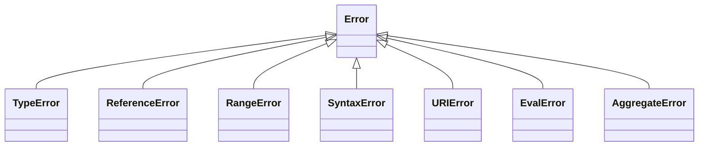

## Introduction

Every program fails sometimes. A user types letters into an age field, a server returns `null` where you expected an object, a recursive function never stops. When JavaScript hits a situation it cannot continue from, it does not print a vague "something went wrong" and stop. It creates an **error object** — an ordinary object that describes what failed — and **throws** it, which abandons the current work and hands that object to whatever code is prepared to deal with it.

Because errors are objects, they can carry structured information: what kind of failure it was, a human-readable description, where in the code it happened, and what earlier failure caused it. JavaScript defines a small family of built-in error types, each tied to a particular class of language rule. When you see `TypeError` in a log, you already know the category of bug before reading the message: some value was the wrong kind of thing. `ReferenceError` means a name did not exist. `RangeError` means a number was outside what an operation accepts.

That taxonomy is the subject of this lesson. You need it for three practical reasons. First, reading errors quickly is most of debugging, and the type name is the fastest clue you get. Second, code that recovers from failures has to decide *which* failures it can recover from, and the error type is how it decides. Third, interviews regularly ask you to predict which error a snippet throws, and the differences between the types are precise.

How errors travel through your program — `throw`, `try`, `catch` and `finally` — is covered in [[b1-throw-try-catch]]. Defining your own error classes is in [[b1-custom-errors]], and errors from promises that nobody handles are in [[b1-unhandled-rejection]]. This lesson is about the objects themselves.

## Before you start

- **Objects and prototypes** — error types form a small inheritance tree, and `instanceof` walks the prototype chain. See [[b1-prototype-chain]] and [[b1-instanceof]].
- **Classes** — you only need to recognise `class X extends Y`; it is explained in [[b1-class-inheritance]].
- **Variables and scope** — `ReferenceError` is about names that do not resolve. See [[b1-scope]] and [[b1-tdz]].
- **A rough idea of `try`/`catch`** — the examples catch errors so they can print them. The details are in [[b1-throw-try-catch]]; for now, `catch (e)` receives the thrown value as `e`.

## The intuition

Think of a hospital triage form. When a patient arrives, the nurse does not write a free-form essay; the form has fixed fields. The **category** (cardiac, fracture, burn) decides which department handles the patient. The **notes** describe this particular case. The **history** records how the patient got here. A doctor scanning a hundred forms reads the category first.

An error object is that form. Its `name` is the category (`TypeError`), its `message` is the notes ("Cannot read properties of null (reading 'email')"), its `stack` is the history of function calls that led to the failure, and its optional `cause` points to the earlier error that triggered this one. Code that catches errors acts like the triage desk: it reads the category and routes the failure to the right handling.

The analogy stops in one place. A hospital form is filled in by trained staff following one standard. In JavaScript, *anything* can be thrown — a string, a number, `undefined`, a plain object — and nothing forces it to have these fields. Only values created from the `Error` family reliably have them, which is why good code always throws real error objects.

## Anatomy of an error object

Create an error with `new Error(message)` and look at what you get:

```js title="anatomy.js"
const err = new Error('Payment amount must be positive', {
  cause: { amount: -5 },
});

console.log(err.name);
console.log(err.message);
console.log(err.cause);
console.log(String(err));
console.log(err instanceof Error);
console.log(Object.keys(err));
console.log(JSON.stringify(err));
```

```output
Error
Payment amount must be positive
{ amount: -5 }
Error: Payment amount must be positive
true
[]
{}
```

Walk through each line.

**`name`** is the error's category as a string. For a plain `Error` it is `"Error"`; for a type error it is `"TypeError"`. It is not stored on the error itself — it is inherited from the constructor's prototype (`Error.prototype.name`, `TypeError.prototype.name`), which is why it costs nothing per error.

**`message`** is the text you passed in. It is for humans: logs, bug reports, sometimes UI. Engines word their own messages differently — V8 says "Cannot read properties of null" where Firefox and Safari use their own phrasing — so a message is not a stable thing to test against.

**`cause`**, added in ES2022, records the error that led to this one. You pass it in an options object as the second argument. When you catch a low-level failure and throw a more meaningful one, `cause` keeps the original so the full story survives. Chaining is taught properly in [[b1-custom-errors]].

**`String(err)`** calls `Error.prototype.toString`, which produces `"name: message"`. That is the one-line form you see at the top of most stack traces.

**`Object.keys(err)` is empty and `JSON.stringify(err)` is `"{}"`.** The `message`, `cause` and `stack` properties exist, but they are **non-enumerable**, so key listing and JSON serialisation skip them. This surprises people the first time they send an error to a logging service and receive `{}`. Serialise errors explicitly: `{ name: err.name, message: err.message, stack: err.stack }`.

### The stack property

The property you will read most while debugging is **`stack`**: a string containing the name, the message, and the chain of function calls active when the error was *created* (not when it was thrown — usually the same line, but not always).

```js title="stack.js"
function parseAge(input) {
  const n = Number(input);
  if (Number.isNaN(n)) throw new Error(`Not a number: ${input}`);
  return n;
}
function handleForm(form) {
  return parseAge(form.age);
}
try {
  handleForm({ age: 'twelve' });
} catch (e) {
  // Keep the first three lines (the rest are Node's module loader) and drop the
  // file paths, which differ on every machine.
  const lines = e.stack.split('\n').slice(0, 3);
  console.log(lines.map((l) => l.replace(/ \(.*\/(.*)\)$/, ' ($1)')).join('\n'));
}
```

```output
Error: Not a number: twelve
    at parseAge (stack.js:3:30)
    at handleForm (stack.js:7:10)
```

Read it from the top down: the error was created in `parseAge` at line 3, column 30 (where `new Error` starts), which was called by `handleForm` at line 7. Unedited, each line also shows the file's full path. How to read longer traces is covered in [[b1-stack-traces]].

Two facts about `stack` matter. It is **not part of the ECMAScript standard** — every major engine provides it, but the format differs between V8 (Chrome, Node.js, Edge), SpiderMonkey (Firefox) and JavaScriptCore (Safari), so parse it only with tools built for that purpose. And it is **captured at construction**, which is why throwing a real `Error` matters: a thrown string has no stack at all.

### Calling Error with or without new

`Error('x')` without `new` behaves the same as `new Error('x')`: the built-in error constructors are specified to create a new object either way. Use `new` anyway; it reads as object creation and matches how your own error classes must be called, since classes throw a `TypeError` when called without `new`.

## The built-in error family

The ECMAScript specification defines `Error` as the base and a set of **native error types** that inherit from it. Each one represents a different rule of the language being broken.



| Type | The rule that broke | Typical trigger |
|---|---|---|
| `TypeError` | A value is the wrong kind for the operation | `null.x`, calling a non-function, `1n + 1` |
| `ReferenceError` | A name has no binding, or is used before initialisation | reading an undeclared variable; `let` in its TDZ |
| `RangeError` | A number is outside the allowed range | `new Array(-1)`, `(1).toFixed(101)`, unbounded recursion |
| `SyntaxError` | Source text is not valid for the grammar being parsed | `JSON.parse('{')`, `eval('let = ;')` |
| `URIError` | A URI encoding or decoding function got malformed input | `decodeURIComponent('%')` |
| `EvalError` | Historical; the current spec never throws it | kept only for compatibility |
| `AggregateError` | Several errors need to be reported together | `Promise.any` when every promise rejects |

Because each type extends `Error`, `e instanceof Error` is true for all of them, and every one has `name`, `message` and (in practice) `stack`. The three you meet daily — `TypeError`, `ReferenceError` and `RangeError` — get their own section below.

### SyntaxError: two very different moments

A `SyntaxError` can happen at two moments, and only one of them can be caught by your code.

When the engine **loads a script or module**, it parses the whole file before running any of it. If the file itself has a syntax mistake, such as an unclosed bracket, the engine reports an **early error** and runs none of that file. A `try`/`catch` inside the same file cannot help, because the `try` statement never got to run.

When your running code **asks the engine to parse a string** — `JSON.parse`, `eval`, `new Function`, `new RegExp('[')` — a parse failure becomes an ordinary runtime `SyntaxError` that you can catch:

```js title="syntax-errors.js"
const inputs = ['{"ok":true}', '{ok:true}', ''];
for (const text of inputs) {
  try {
    console.log('parsed', JSON.parse(text));
  } catch (e) {
    console.log(e.name);
  }
}
```

```output
parsed { ok: true }
SyntaxError
SyntaxError
```

This is why every `JSON.parse` of data you did not produce — a request body, `localStorage`, a message from another window — belongs inside a `try`. See [[b1-json-stringify-parse]].

### URIError and EvalError

`URIError` comes from `encodeURI`, `encodeURIComponent`, `decodeURI` and `decodeURIComponent`. The common case is decoding user-controlled text containing a lone `%`, such as a search query copied from somewhere else: `decodeURIComponent('100%')` throws `URIError: URI malformed`. Wrap decoding of untrusted input in a `try`.

`EvalError` exists so that old code referring to it still works. No current built-in operation throws it, and you should not use it for your own errors.

### AggregateError

`AggregateError` (ES2021) holds several errors at once in its `errors` array. You meet it from `Promise.any`, which rejects with an `AggregateError` when *every* input promise rejects, because there is no single reason to report. See [[b1-promise-any]].

```js title="aggregate.js"
const err = new AggregateError(
  [new Error('mirror 1 down'), new Error('mirror 2 down')],
  'All mirrors failed',
);
console.log(err.name, '-', err.message);
console.log(err.errors.map((e) => e.message));
```

```output
AggregateError - All mirrors failed
[ 'mirror 1 down', 'mirror 2 down' ]
```

### Host errors: DOMException and friends

The ECMAScript spec covers the language. The *environment* — the browser or Node.js — adds its own failures. In browsers, most web APIs fail with a **`DOMException`**, whose `name` carries the specific reason: `"AbortError"` when a fetch is cancelled with an `AbortController`, `"TimeoutError"` from `AbortSignal.timeout()`, `"NotAllowedError"` when the user denies a permission, `"QuotaExceededError"` when storage is full. Node.js (version 17 and later) provides the same `DOMException` global.

In current engines `DOMException` inherits from `Error`, so `instanceof Error` is true, but the useful check is on `name`:

```js title="abort.js"
const controller = new AbortController();
controller.abort();
const reason = controller.signal.reason;
console.log(reason instanceof DOMException, reason instanceof Error);
console.log(reason.name);
```

```output
true true
AbortError
```

Treating `AbortError` differently from real failures — usually by ignoring it, because the cancellation was deliberate — is a core pattern in [[b1-abort-controller-js]]. Note also that `fetch` rejects with a plain `TypeError` when the network request itself fails (DNS failure, connection refused, CORS block). An HTTP 404 or 500 does *not* reject at all; see [[b3-fetch-network-errors]].

Node.js adds its own `code` property to system errors (`'ENOENT'` for a missing file, `'ECONNREFUSED'` for a refused connection). Like `DOMException.name`, the `code` is the stable thing to branch on; the message is not.

## TypeError / ReferenceError / RangeError {#b1-typeerror}

`TypeError`, `ReferenceError` and `RangeError` are the three built-in error types JavaScript throws most often while your code runs. Each one corresponds to a different question the engine asks before performing an operation, and telling them apart tells you what kind of mistake you are looking at:

- **`ReferenceError`** — *does this name exist?* The engine looked up an identifier and found no variable by that name, or found one that is not yet initialised.
- **`TypeError`** — *is this value the right kind?* The name existed and had a value, but that value cannot do what you asked: you called something that is not a function, read a property of `null`, or wrote to something read-only.
- **`RangeError`** — *is this number allowed?* The value was the right kind (a number) but outside the range the operation accepts.

A short way to hold the three apart: ReferenceError is about **names**, TypeError is about **kinds of value**, RangeError is about **amounts**.

### Seeing all three

```js title="three-errors.js"
const cases = {
  'read undeclared name': () => totalPrice,
  'use let before declaration': () => { count; let count = 1; },
  'property of null': () => null.email,
  'call a non-function': () => { const user = {}; user.save(); },
  'mix BigInt and Number': () => 10n + 1,
  'assign to const': () => { const limit = 5; limit = 6; },
  'negative array length': () => new Array(-1),
  'too many decimal digits': () => (3.14159).toFixed(101),
  'endless recursion': () => { const f = () => f(); f(); },
};
for (const [label, run] of Object.entries(cases)) {
  try {
    run();
  } catch (e) {
    console.log(`${label.padEnd(27)} ${e.name}: ${e.message}`);
  }
}
```

```output
read undeclared name        ReferenceError: totalPrice is not defined
use let before declaration  ReferenceError: Cannot access 'count' before initialization
property of null            TypeError: Cannot read properties of null (reading 'email')
call a non-function         TypeError: user.save is not a function
mix BigInt and Number       TypeError: Cannot mix BigInt and other types, use explicit conversions
assign to const             TypeError: Assignment to constant variable.
negative array length       RangeError: Invalid array length
too many decimal digits     RangeError: toFixed() digits argument must be between 0 and 100
endless recursion           RangeError: Maximum call stack size exceeded
```

The messages are V8's (Node.js 22); other engines word them differently, but the **types are fixed by the specification** and are the same everywhere — with one exception noted below for stack overflow.

### ReferenceError: the name does not resolve

When the engine evaluates an identifier like `totalPrice`, it searches the current scope, then each enclosing scope, out to the global scope (the **scope chain**, see [[b1-scope-chain]]). If no scope has a binding with that name, the reference is **unresolvable**, and *reading* it throws `ReferenceError: totalPrice is not defined`. In specification terms, `GetValue` on an unresolvable reference throws.

The second source is the **temporal dead zone (TDZ)**. A `let`, `const` or `class` binding exists from the start of its block, but it is uninitialised until the declaration line runs. Touching it before then throws "Cannot access 'count' before initialization". The binding *exists* — that is why the message differs — but it has no value yet. See [[b1-tdz]].

Two subtleties are worth knowing. `typeof undeclaredName` does **not** throw; it returns `"undefined"`, which is the one safe way to test whether a global exists. (It does throw for a TDZ binding.) And *assigning* to an undeclared name in sloppy mode silently creates a global variable, while in strict mode — which includes all modules and classes — it throws `ReferenceError`. That difference is one reason strict mode exists; see [[b1-strict-mode]].

### TypeError: the value cannot do that

`TypeError` is the broadest of the three, because so many operations require a particular kind of value. The cases you will meet most:

**Reading a property of `null` or `undefined`.** `null.email` and `undefined.length` throw, because those two values have no properties and cannot be converted to an object. This is the single most common runtime error in front-end code — usually data that has not loaded yet, or an API response missing a field. Optional chaining (`user?.email`) returns `undefined` instead of throwing; see [[b1-optional-chaining]].

**Calling something that is not a function.** `user.save()` looks up `save` (the name `user` resolved fine), gets `undefined`, then tries to call it. The specification checks `IsCallable` before every call and throws `TypeError` if it fails. Likewise `new 5` fails because `5` is not a constructor.

**Writing to something read-only.** Assigning to a `const` binding throws `TypeError` in every engine — this is specified, not engine-specific. Writing to a frozen object's property or to a getter-only property throws `TypeError` in strict mode and is silently ignored in sloppy mode.

**Mixing incompatible types where JavaScript refuses to convert.** `10n + 1` throws because BigInt arithmetic never silently converts to or from Number (see [[b1-bigint]]). Converting a `Symbol` to a string implicitly (`'' + Symbol()`) throws too.

**Built-ins receiving the wrong kind of argument.** `new Map(5)` throws because `5` is not iterable; calling a class without `new` throws; `Object.defineProperty(1, 'x', {})` throws because `1` is not an object.

### RangeError: the number is out of bounds

A `RangeError` means the value was the right *type* but an unacceptable *amount*. Array lengths must be integers from 0 to 2³² − 1, so `new Array(-1)`, `new Array(1.5)` and `arr.length = -1` all throw. `toFixed` accepts 0–100 digits and `toPrecision` 1–100. `'ab'.repeat(-1)` and `'ab'.repeat(Infinity)` throw. `'x'.normalize('bad')` throws because the form must be one of four values. `Intl` formatters throw `RangeError` for out-of-range options.

**Stack overflow** — unbounded recursion — shows up as `RangeError: Maximum call stack size exceeded` in V8 and JavaScriptCore. The specification does not define this error at all, because stack depth is an implementation limit. Firefox reports it as `InternalError: too much recursion`, a non-standard type. So do not write code that relies on the type of a stack overflow; fix the recursion. See [[b1-stack-overflow]].

### Telling them apart under pressure

The phrase "undefined is not a function" causes more confusion than any other message. It is a **TypeError**, not a ReferenceError. The *name* you used existed (otherwise you would get "is not defined"); its *value* was `undefined`, and `undefined` cannot be called. Compare the two messages:

| Message | Type | What it tells you |
|---|---|---|
| `x is not defined` | ReferenceError | No variable named `x` is in scope. Typo, missing import, wrong scope. |
| `Cannot access 'x' before initialization` | ReferenceError | `x` is declared with `let`/`const`/`class` but used too early. |
| `x is not a function` | TypeError | `x` exists, but holds something uncallable — often `undefined`. |
| `Cannot read properties of undefined (reading 'y')` | TypeError | The thing *before* `.y` is `undefined`. Look one step left. |
| `Invalid array length` | RangeError | A computed size went negative, fractional or huge. |

The fourth row is a debugging habit worth building: the error names the property it was *trying to read*, but the bug is the value to its left. In `order.customer.address.city`, "reading 'address'" means `order.customer` was `undefined`.

### Preventing each kind

The prevention follows from the question each type answers. For ReferenceErrors, declare names before use, import what you use, and turn on a linter rule such as ESLint's `no-undef`; TypeScript reports most of them at compile time. For TypeErrors, guard values that can legitimately be missing (`?.`, `??`, an early `if (!user) return`), and validate data at the boundary where it enters your program rather than deep inside. For RangeErrors, validate sizes and option values before passing them to built-ins, and give every recursion a base case.

> [!TIP] Test the type, not the wording
> In unit tests assert on the error type (`expect(fn).toThrow(TypeError)`) rather than the full message. Messages change between engine versions; types do not.

```quiz
Q: `const api = {}; api.fetchUser();` throws which error?
- [ ] ReferenceError, because `fetchUser` is not defined
- [x] TypeError, because `api.fetchUser` is `undefined`, which is not callable
- [ ] RangeError, because the property is out of range
> The identifier `api` resolves, and reading a missing property gives `undefined` without any
> error. The failure happens at the *call*: the engine's `IsCallable` check fails on `undefined`,
> which is a TypeError. ReferenceError is only for names that do not resolve, and property
> lookups never produce one.
```

## Inspecting a caught value

When you catch something, you usually need to decide what it is before acting. There are four tools, and each has a weakness.

### instanceof

`e instanceof TypeError` checks whether `TypeError.prototype` appears on `e`'s prototype chain. It is the normal choice, and it understands inheritance: a `TypeError` is also `instanceof Error`.

Its weakness is **realms**. A realm is a complete, separate set of built-ins — its own `Error`, its own `TypeError`, its own `Array`. Each browser window, each `<iframe>`, each Web Worker, and each Node.js `vm` context is a separate realm. An error created in an iframe has the iframe's `TypeError.prototype` on its chain, not yours, so `instanceof` returns `false`:

```js title="realms.js"
const vm = require('node:vm');
const foreign = vm.runInNewContext('new TypeError("from another realm")');

console.log(foreign instanceof TypeError);
console.log(foreign instanceof Error);
console.log(foreign.name);
console.log(Object.prototype.toString.call(foreign));
```

```output
false
false
TypeError
[object Error]
```

### name

Checking `e.name === 'TypeError'` works across realms, because `name` is a string. Its weakness is that it is only a convention: any object can have a `name` property, and a careless subclass can forget to set one. It is the right check for `DOMException` (`e.name === 'AbortError'`), where the name *is* the API's way of saying what happened.

### Object.prototype.toString and Error.isError

Every genuine error object has an internal marker the specification calls the **`[[ErrorData]]` internal slot**, set by the `Error` constructor. You cannot read it directly, but `Object.prototype.toString.call(e)` returns `"[object Error]"` for any value that has it, regardless of realm — that is how the example above identified the foreign error. A plain object pretending to be an error (`{ name: 'Error', message: 'x' }`) gives `"[object Object]"` (unless it fakes `Symbol.toStringTag`).

ES2026 adds **`Error.isError(value)`**, which checks for `[[ErrorData]]` directly and works across realms. It is new: it is not present in Node.js 22, so check your target runtimes before relying on it, and fall back to the `toString` check where it is missing.

### A practical rule

Use `instanceof` for errors your own code creates and catches in the same realm. Use `name` (or Node's `code`) for host errors and anything that may cross a realm or a serialisation boundary. Use `Error.isError` or the `toString` check when you only need to know "is this a real error at all?".

## Throw Error objects, not strings

The language lets you throw any value:

```js title="throw-string.js"
function withdraw(amount) {
  if (amount <= 0) throw 'Amount must be positive';
  return amount;
}
try {
  withdraw(-10);
} catch (e) {
  console.log(typeof e, '|', e.message, '|', e.stack);
}
```

```output
string | undefined | undefined
```

Everything that makes an error useful is missing. There is no stack, so the log will not say where the problem started. There is no `name`, so a handler cannot branch on the category. There is no `message` property, so generic code that does `console.error(e.message)` prints `undefined`. And `e instanceof Error` is false, so error-reporting tools may record it as an opaque value.

The fix is to always throw `new Error(...)` (or a subclass). Because libraries — especially old ones — sometimes throw strings or plain objects anyway, defensive code **normalises** what it catches at a boundary:

```js title="normalise.js"
function toError(value) {
  if (value instanceof Error) return value;
  // Keep the original value as the cause so nothing is lost.
  return new Error(typeof value === 'string' ? value : 'Non-Error thrown', {
    cause: value,
  });
}

for (const thrown of [new RangeError('too big'), 'plain text', { code: 42 }]) {
  try {
    throw thrown;
  } catch (raw) {
    const e = toError(raw);
    console.log(e.name, '-', e.message, '- has stack:', typeof e.stack === 'string');
  }
}
```

```output
RangeError - too big - has stack: true
Error - plain text - has stack: true
Error - Non-Error thrown - has stack: true
```

The normalised error's stack points at `toError`, not the original throw site — that information was never recorded — but downstream code can now rely on `name`, `message` and `stack` existing. In TypeScript the caught value is typed `unknown` under `strict` for the same reason: the language cannot promise it is an `Error`.

## How it works internally

Each native error constructor (`TypeError`, `RangeError`, and so on) is specified the same way. Called with or without `new`, it creates an ordinary object whose prototype is the constructor's `.prototype`, gives it the `[[ErrorData]]` internal slot, and — if you passed a message — defines an own, non-enumerable `message` property. If the options argument has a `cause` property, it defines an own, non-enumerable `cause` too. The `name` property is not created on the instance; it lives on `TypeError.prototype`, and `TypeError.prototype`'s own prototype is `Error.prototype`, which is where `toString` comes from.

The `stack` property is added by the engine, outside the standard. V8 captures the call frames when the error is constructed and formats the string lazily the first time `stack` is read; that is why a `name` you set in a subclass constructor still appears in the first line of the trace.

When the engine itself detects a failure — an `IsCallable` check fails, an identifier is unresolvable, a length is out of range — the specification says to "throw a **TypeError** exception" (or the relevant type). The engine constructs a new error from *the current realm's* constructor and starts a **throw completion**, which unwinds the call stack until a `catch` receives it (see [[b1-throw-try-catch]]). If nothing catches it, the host reports it: a browser logs "Uncaught TypeError: …" to the console and fires an `error` event on `window`; Node.js prints the stack and exits with code 1.

## In real systems

**Error monitoring.** Services such as Sentry group incoming reports by error type and the top stack frame. Throwing real `Error` objects with stable names is what makes that grouping useful; a thousand thrown strings all look like one meaningless group.

**Data boundaries.** Most production TypeErrors come from data that did not have the expected shape: an API returned `null` for an optional field, a feature flag was missing, a cached value predates a schema change. Teams prevent them by validating at the boundary — parsing responses with a schema library such as Zod — so that a malformed payload fails once, loudly, at the edge, rather than as "Cannot read properties of undefined" in a component three layers deep.

**Logging.** Because error properties are non-enumerable, structured loggers include a serialiser that copies `name`, `message`, `stack`, `cause` and any custom fields explicitly. If your logs show `"error": {}`, that serialiser is missing.

**Cancellation.** UI code that cancels stale requests checks `e.name === 'AbortError'` and returns quietly, so that cancellation does not show the user an error banner. See [[b1-stale-requests]].

## Common mistakes

**Branching on `message` text.** `if (e.message.includes('not a function'))` breaks when the engine or its version changes the wording. Branch on type, `name` or `code`.

**Logging `JSON.stringify(error)`.** It prints `{}`. Log the error object itself (`console.error(e)` formats it properly) or serialise the fields explicitly.

**Calling a ReferenceError a TypeError, or the reverse.** "is not defined" is about a missing name; "is not a function" and "cannot read properties of" are about a value. The interview-favourite "undefined is not a function" is a TypeError.

**Trusting `instanceof` across frames or workers.** An error from an iframe, a `vm` context or a `postMessage` copy fails `instanceof` in your realm. Use `name` or `Error.isError`.

**Throwing strings or plain objects.** They have no stack and no standard fields. Throw `new Error(...)`, and normalise values caught from code you do not control.

**Using `EvalError` or a built-in type for your own domain errors.** Throwing `RangeError` for "insufficient funds" misleads readers into looking for a numeric bug. Use built-in types only when they match their meaning (a `TypeError` for a wrong argument type is fine); define custom errors for domain failures ([[b1-custom-errors]]).

## Interview perspective

**"What are the built-in error types?"** List `Error` as the base and `TypeError`, `ReferenceError`, `RangeError`, `SyntaxError`, `URIError`, `EvalError` and `AggregateError`, with one trigger each. Strong answers add that hosts contribute their own (`DOMException` in browsers, `code`-bearing system errors in Node.js), and that stack overflow is a `RangeError` in V8 but not a standard error type.

**"Predict the error."** Expect snippets such as `undefined()`, `notDeclared`, `null.x`, `let` in its TDZ, `new Array(-1)`, `(1).toFixed(101)`, `10n + 1`. Explain the reasoning — name lookup, callability check, range check — not only the answer.

**"Why is `JSON.stringify(err)` empty?"** Because `message`, `stack` and `cause` are non-enumerable own properties and `name` is inherited.

**"How do you check an error's type safely?"** `instanceof` within one realm; `name` or `Error.isError` across realms; and normalise non-Error throws first.

**Follow-up: "Can a try/catch catch a SyntaxError?"** Only one raised at run time by `JSON.parse`, `eval`, `new Function` or `new RegExp`. A syntax error in the file itself prevents the file from running at all.

```quiz
Q: An error created inside an `<iframe>` reaches the parent page's code. Which check reliably identifies it as a TypeError?
- [ ] `e instanceof TypeError`
- [x] `e.name === 'TypeError'`
- [ ] `e.constructor === TypeError`
> The iframe is a separate realm with its own `TypeError` constructor and prototype. Both
> `instanceof` and the `constructor` comparison use the parent's `TypeError`, so they return
> false. The `name` string is the same in every realm. (`Error.isError` would confirm it is an
> error, but not which kind.)
```

```quiz
Q: Why should you throw `new Error('...')` instead of a string?
- [ ] Strings cannot be caught by `catch`
- [ ] Throwing a string is a SyntaxError
- [x] An Error records a stack trace and standard fields that handlers and tools rely on
> Any value can be thrown and caught, so the first two options are wrong. The real cost is
> information: a string has no `stack`, no `name` and no `message` property, so logs cannot show
> where it started and handlers cannot branch on its category.
```

## Practice

1. Without running it, name the error each line throws, then check with Node.js: `[].reduce((a, b) => a + b)`, `Symbol() + 1`, `'abc'.repeat(-1)`, `decodeURIComponent('%E0%A4%A')`, `new Set(42)`, `structuredClone(() => {})`. (The last one throws a `DOMException` named `DataCloneError`.)
2. Write `describeError(value)` that returns `"TypeError: message"` for any real error, from any realm, and `"Non-error: <value>"` for anything else. Test it with an error from `vm.runInNewContext`.
3. Write a `serializeError(e)` that returns a plain object containing `name`, `message`, `stack`, any own enumerable fields, and a recursively serialised `cause`. Check that `JSON.stringify` of the result is no longer `{}`.
4. Take a component that reads `response.data.user.profile.avatarUrl`. List each TypeError it can throw and rewrite it so a missing level produces a default avatar instead.

## Quick revision {#quick-revision}

- An error object has `name` (inherited from the prototype), `message`, optional `cause` (ES2022) and a non-standard but universal `stack`, captured at construction.
- `message`, `stack` and `cause` are non-enumerable: `Object.keys(e)` is `[]` and `JSON.stringify(e)` is `"{}"`.
- `String(e)` gives `"name: message"`.
- Native types: `TypeError` (wrong kind of value), `ReferenceError` (unresolvable name or TDZ), `RangeError` (number out of range), `SyntaxError` (invalid source when parsing), `URIError` (bad URI encoding), `EvalError` (legacy, never thrown), `AggregateError` (many errors, from `Promise.any`).
- "is not defined" = ReferenceError; "is not a function" / "cannot read properties of" = TypeError.
- Assigning to `const` is a TypeError in every engine. Stack overflow is `RangeError` in V8/JSC, `InternalError` in Firefox.
- File-level syntax errors are early errors and cannot be caught by that file; `JSON.parse`/`eval` SyntaxErrors can.
- Hosts add `DOMException` (check `name`: `AbortError`, `TimeoutError`) and Node.js system errors (check `code`).
- `instanceof` fails across realms; `name`, `Object.prototype.toString` and `Error.isError` (ES2026) do not.
- Always throw `Error` objects; normalise caught non-Errors with `new Error(msg, { cause: value })`.

## Key takeaways {#key-takeaways}

- An error is a structured object: the `name` says what kind of rule broke, the `message` describes this case, and the `stack` says where.
- ReferenceError is about names, TypeError about kinds of value, RangeError about amounts — reading the type first narrows any bug.
- Branch on types, names or codes, never on message wording, which differs between engines.
- `instanceof` is the default check, but realms break it; strings are safer across boundaries.
- Throwing anything other than an `Error` throws away the stack trace, so always throw real errors and normalise what others throw.
