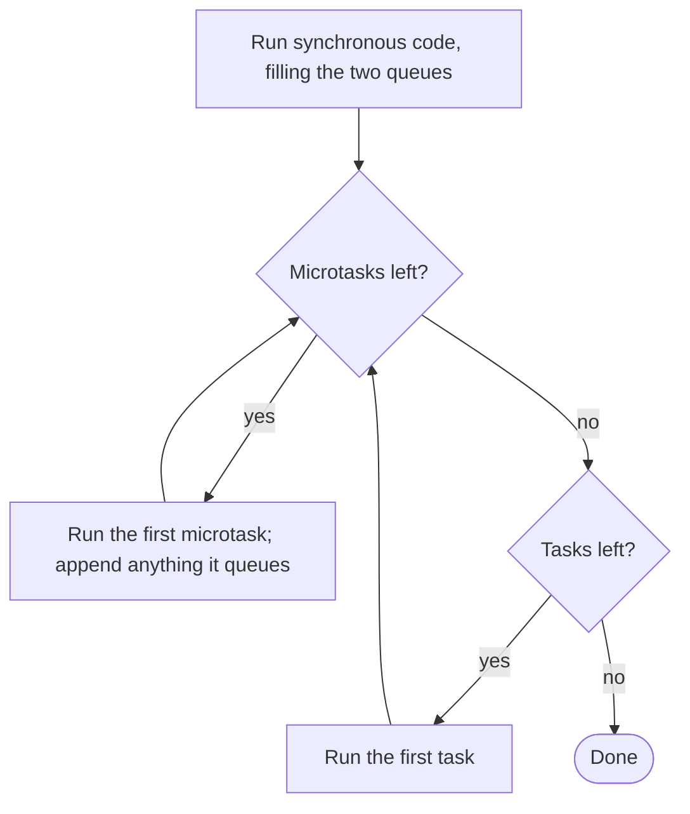

## Introduction

"What does this code print?" is one of the most common front-end interview questions. The snippet is usually ten to twenty lines mixing `console.log`, `setTimeout`, `Promise.resolve().then`, `async`/`await` and `queueMicrotask`, and the expected answer is the exact order of the logs.

These puzzles are not trivia. They test whether you have a working model of how JavaScript schedules code, which is the same model you need to debug a UI that renders stale data, a test that passes only sometimes, or a Node service whose timers fire late. A candidate who guesses — "promises are fast, so they go first" — gets the easy puzzles right and the medium ones wrong. A candidate who *simulates* the event loop gets them all right and can explain why.

This lesson gives you that simulation method and then applies it to ten puzzles, each chosen to exercise one rule. Every snippet was run on Node.js 22 as a CommonJS file, and every output shown is real. Unless a puzzle says otherwise, browsers print the same thing.

## Before you start

- **The event loop** — one task per iteration, then the microtask queue drained completely. See [[b1-event-loop]].
- **Microtasks versus macrotasks** — which APIs feed which queue, and when promise callbacks are queued. See [[b1-microtasks]].
- **Promises and `async`/`await`** — `.then` chaining and what `await` does. See [[b1-promises]], [[b1-promise-chaining]] and [[b1-async-await]].

## The method

Draw three columns on paper: **Output**, **Microtasks** and **Tasks**. Then follow these steps.

1. **Run the synchronous code, top to bottom.** Write each `console.log` into Output. Whenever the code schedules something, write it into the right queue instead of running it. Remember what runs synchronously even though it looks asynchronous: the function passed to `new Promise(...)` (the **executor**), and the body of an `async` function up to its first `await`.
2. **Drain the Microtasks column.** Take the first entry, run it (which may log, and may add entries to either column), cross it out, and repeat until the column is empty. New microtasks go to the *bottom* and run in this same pass.
3. **Take the first entry in Tasks.** Run it, then go back to step 2. Repeat until both columns are empty.

To know *where* and *when* things are queued, use these rules:

| Code | What it queues, and when |
|---|---|
| `setTimeout(fn, 0)`, `setInterval`, `setImmediate` (Node) | A task, now (timers in delay order, then call order) |
| `p.then(fn)` where `p` is already settled | A microtask, now |
| `p.then(fn)` where `p` is pending | Nothing yet; a microtask when `p` settles |
| `p.then(a).then(b)` | `b` is queued only when `a` has returned |
| `p.then(a)` where `p` rejected (no rejection handler) | A microtask that passes the rejection on — it still costs a hop |
| `await x` | Rest of the function as one microtask once `x` settles |
| `return somePromise` from an `async` function, or `resolve(somePromise)` | Two extra microtask hops before the outer promise settles |
| `queueMicrotask(fn)` | A microtask, now |
| `process.nextTick(fn)` (Node) | Its own queue, drained before promise microtasks |



## Puzzle 1: the warm-up

```javascript title="puzzle-1.js"
console.log('A');
setTimeout(() => console.log('B'), 0);
Promise.resolve().then(() => console.log('C'));
console.log('D');
```

Try it before reading on.

```output
A
D
C
B
```

`A` and `D` are synchronous. The timer goes into Tasks; the `.then` on an already-resolved promise goes into Microtasks. After the script, the microtask queue is drained (`C`), and only then is the timer task taken (`B`). **Rule:** sync first, then microtasks, then tasks. A zero delay does not change this.

## Puzzle 2: a timer queued from a microtask

```javascript title="puzzle-2.js"
console.log('1');
setTimeout(() => console.log('5'), 0);
Promise.resolve().then(() => {
  console.log('3');
  setTimeout(() => console.log('6'), 0);
});
queueMicrotask(() => console.log('4'));
console.log('2');
```

```output
1
2
3
4
5
6
```

| Step | Output | Microtasks | Tasks |
|---|---|---|---|
| Sync code | 1, 2 | then(3), micro(4) | timer(5) |
| Microtask then(3) | 3 | micro(4) | timer(5), timer(6) |
| Microtask micro(4) | 4 | — | timer(5), timer(6) |
| Task timer(5) | 5 | — | timer(6) |
| Task timer(6) | 6 | — | — |

The trap is the `setTimeout` inside the `.then`. It is created *during* a microtask, but it is still a timer, so it is a task — and it joins the back of the task queue, behind timer `5`, which was scheduled earlier. **Rule:** where a callback is scheduled from does not change which queue it goes to.

## Puzzle 3: the executor runs now

```javascript title="puzzle-3.js"
const p = new Promise((resolve) => {
  console.log('executor start');
  resolve('done');
  console.log('executor end');
  resolve('ignored');
});
p.then((v) => console.log('then', v));
console.log('sync end');
```

```output
executor start
executor end
sync end
then done
```

The executor function runs synchronously inside `new Promise`, so both of its logs come before `sync end`. Calling `resolve` does not stop the executor — it is an ordinary function call, not a `return` — so `executor end` still prints. A promise settles only once; the second `resolve('ignored')` does nothing. The `.then` callback is a microtask and runs after the script. **Rule:** the executor is synchronous; only the reactions are asynchronous.

## Puzzle 4: the classic async/await puzzle

```javascript title="puzzle-4.js"
async function a1() {
  console.log('a1 start');
  await a2();
  console.log('a1 end');
}
async function a2() {
  console.log('a2');
}
console.log('script start');
setTimeout(() => console.log('setTimeout'), 0);
a1();
new Promise((resolve) => {
  console.log('promise executor');
  resolve();
}).then(() => console.log('then 1'))
  .then(() => console.log('then 2'));
console.log('script end');
```

```output
script start
a1 start
a2
promise executor
script end
a1 end
then 1
then 2
setTimeout
```

Walk it carefully. `a1()` runs synchronously up to its `await`, so `a1 start` prints, then `a2()` is *called* — synchronously — and prints `a2`. `a2` returns an already-fulfilled promise, and `await` queues `a1`'s continuation as a microtask. Back in the script, the executor prints `promise executor` and resolves, so `then 1` is queued *behind* `a1`'s continuation. After `script end`, the microtasks run: `a1 end`, then `then 1`, which queues `then 2`, which runs in the same checkpoint. The timer is last.

**Rule:** an `async` function runs synchronously until its first `await`; the continuation is queued when the awaited promise settles. A common wrong answer puts `a1 end` right after `a2`, which treats `await` as if it did nothing when the value is ready. It always suspends.

## Puzzle 5: two async functions taking turns

```javascript title="puzzle-5.js"
async function task(name) {
  console.log(name, 'start');
  await null;
  console.log(name, 'after first await');
  await null;
  console.log(name, 'after second await');
}
task('A');
task('B');
console.log('sync end');
```

```output
A start
B start
sync end
A after first await
B after first await
A after second await
B after second await
```

Each `await` is one microtask hop, and each async function joins the back of the queue every time it resumes. So the two functions alternate, like two promise chains interleaving. **Rule:** async functions do not run "to the end" once started; they run to the next `await`, and any other queued microtask can run in between. This is why a value read before an `await` can be stale after it.

## Puzzle 6: a rejection still costs a hop

```javascript title="puzzle-6.js"
Promise.reject(new Error('boom'))
  .then(() => console.log('then: skipped'))
  .catch((e) => console.log('catch:', e.message))
  .then(() => console.log('after catch'));

Promise.resolve()
  .then(() => console.log('t1'))
  .then(() => console.log('t2'))
  .then(() => console.log('t3'));
```

```output
t1
catch: boom
t2
after catch
t3
```

Why does `catch` come *after* `t1`? The first `.then` has no rejection handler, but it still gets a reaction job: one microtask that passes the rejection on to the promise it returned. Only then is the `.catch` reaction queued. So the rejected chain is one hop behind:

| Microtask hop | Rejected chain | Second chain |
|---|---|---|
| 1 | pass rejection through `.then` (no log) | `t1` |
| 2 | `catch: boom` | `t2` |
| 3 | `after catch` | `t3` |

Within each hop, the rejected chain's job was queued first, so it runs first. And `after catch` runs at all because `.catch` returned normally, which *fulfils* its promise. **Rule:** every link in a chain costs one hop, whether or not it has a handler for the outcome.

## Puzzle 7: everything at once

```javascript title="puzzle-7.js"
console.log('1');

setTimeout(() => {
  console.log('2');
  Promise.resolve().then(() => console.log('3'));
}, 0);

new Promise((resolve) => {
  console.log('4');
  setTimeout(() => {
    console.log('5');
    resolve('6');
  }, 0);
}).then((value) => {
  console.log(value);
  queueMicrotask(() => console.log('7'));
  setTimeout(() => console.log('8'), 0);
});

queueMicrotask(() => {
  console.log('9');
  Promise.resolve().then(() => console.log('10'));
});

console.log('11');
```

```output
1
4
11
9
10
2
3
5
6
7
8
```

| Step | Output | Microtasks | Tasks |
|---|---|---|---|
| Sync code | 1, 4, 11 | m9 | T-a (logs 2), T-b (logs 5) |
| Microtask m9 | 9 | m10 | T-a, T-b |
| Microtask m10 | 10 | — | T-a, T-b |
| Task T-a | 2 | m3 | T-b |
| Microtask m3 | 3 | — | T-b |
| Task T-b: logs 5, resolves the promise | 5 | then(value) | — |
| Microtask then | 6 | m7 | T-c (logs 8) |
| Microtask m7 | 7 | — | T-c |
| Task T-c | 8 | — | — |

The key moment is the `.then` attached to a promise that is still pending. Nothing is queued during the script; the reaction is queued only when `resolve('6')` is called inside timer T-b. **Rule:** a `.then` on a pending promise waits for settlement, and settlement can happen inside a task much later.

## Puzzle 8: `async` callbacks in `forEach`

```javascript title="puzzle-8.js"
const ids = [1, 2, 3];
const wait = (ms) => new Promise((resolve) => setTimeout(resolve, ms));

ids.forEach(async (id) => {
  await wait(10 * (4 - id)); // id 1 waits longest
  console.log('loaded', id);
});
console.log('done?');
```

```output
done?
loaded 3
loaded 2
loaded 1
```

This puzzle reflects a real bug. `forEach` calls the callback three times synchronously and ignores the promises the async callbacks return. Each callback starts, hits `await`, and returns immediately, so `done?` prints before any loading has finished. The loads then complete in order of their delays (10, 20, 30 ms), not array order. If you need sequential work, use `for...of` inside an async function; if you need parallel work you can wait for, use `await Promise.all(ids.map(async (id) => ...))`. See [[b1-sequential-vs-parallel]].

## Puzzle 9: click listeners — user click versus `click()`

This one only runs in a browser, because it depends on how the browser dispatches events.

```javascript title="puzzle-9.js"
const button = document.querySelector('button');
button.addEventListener('click', () => {
  console.log('listener 1');
  Promise.resolve().then(() => console.log('microtask 1'));
});
button.addEventListener('click', () => {
  console.log('listener 2');
  Promise.resolve().then(() => console.log('microtask 2'));
});
```

When the **user clicks** the button, the browser prints:

```output
listener 1
microtask 1
listener 2
microtask 2
```

When **script** calls `button.click()` (and then logs `after click()`), it prints:

```output
listener 1
listener 2
after click()
microtask 1
microtask 2
```

The difference comes from the rule about when microtask checkpoints happen: after a callback invoked by the host returns *and the JavaScript stack is empty*. For a real click, the browser calls each listener from an empty stack, so a checkpoint runs after each listener. For `button.click()`, the calling script is still on the stack while both listeners run, so no checkpoint can happen until that script finishes. The same applies to `dispatchEvent`. **Rule:** a microtask checkpoint needs an empty stack. This difference has caused real bugs in tests that simulate clicks with `click()` and expect the same timing as a user.

## Puzzle 10: Node's extra queues

Node.js adds `process.nextTick` and `setImmediate`. This puzzle uses both inside an I/O callback.

```javascript title="puzzle-10.js"
const fs = require('node:fs');

fs.readFile(__filename, () => {
  setTimeout(() => console.log('timeout'), 0);
  setImmediate(() => console.log('immediate'));
  process.nextTick(() => console.log('nextTick'));
  Promise.resolve().then(() => console.log('promise'));
});
```

```output
nextTick
promise
immediate
timeout
```

After the `readFile` callback returns, Node drains the `nextTick` queue, then the promise microtask queue. The loop is in the poll phase (where I/O callbacks run), and the next phase is check, where `setImmediate` callbacks run; the timers phase comes only on the next lap. Inside an I/O callback this order is guaranteed. Move the same four lines to the top level of the script and `timeout` versus `immediate` can come out in either order from run to run, because it depends on whether 1 ms passed before the loop started. Save the file as an ES module and `promise` may print before `nextTick`. When a puzzle involves Node, state the module system and say which parts are not deterministic — interviewers value that more than a confident wrong answer.

```quiz
Q: What is printed? `setTimeout(() => console.log('T'), 0); (async () => { console.log('A'); await null; console.log('B'); })(); console.log('C');`
- [ ] A, C, T, B
- [x] A, C, B, T
- [ ] C, A, B, T
- [ ] A, B, C, T
> The async IIFE runs synchronously until its first await, so A prints before C. The code after `await null` is a microtask, so B runs at the checkpoint after the script, before the timer task T. Putting B after T treats the continuation as a task; putting B before C forgets that await always suspends.

Q: `Promise.resolve().then(() => setTimeout(() => console.log('X'), 0)); setTimeout(() => console.log('Y'), 0);` — what is the order?
- [ ] X, Y — the promise callback runs first, so its timer fires first
- [x] Y, X — Y's timer was queued during the script; X's timer is only created later, during the microtask
- [ ] It is random
- [ ] Only Y prints
> Timers with equal delays fire in the order they were created. Y's timer is created synchronously; X's timer is created during the microtask checkpoint that follows the script, so it is behind Y in the task queue. The microtask running first does not make its timer run first.

Q: In a browser, a user clicks a button with two listeners, each of which queues a promise callback. When do the promise callbacks run?
- [ ] Both after the second listener
- [x] Each one right after the listener that queued it
- [ ] After the next timer task
- [ ] During the next animation frame
> For a user-initiated event, the browser calls each listener from an empty stack, and a microtask checkpoint runs after each callback returns. With `button.click()` from script the stack is not empty between listeners, so both promise callbacks wait until the script finishes.
```

## How interviewers use these puzzles

The puzzle is the start of the conversation, not the end. A typical sequence is: solve it, explain why, then answer a follow-up that changes one line — "what if this `then` were a `setTimeout`?", "what if the promise were created inside the timer?", "what changes in Node?" If you solved the original by simulation, the follow-up is just another simulation. If you memorised the answer, it is a new puzzle.

> [!INTERVIEW] Talk while you trace
> Narrate each line with the rule it follows: "This logs now. This `setTimeout` goes to the task queue. This `.then` is on a resolved promise, so its callback goes to the microtask queue now. The script is done, so I drain microtasks: this one logs and queues another, which also runs now. Queue empty, so I take the first timer." Interviewers grade the reasoning as much as the final order.

Questions that often follow a puzzle:

- **Why does the microtask queue run before the next timer?** The loop drains microtasks completely after every task, and the script itself is a task.
- **Does `await` on a non-promise value pause?** Yes. `await 42` still suspends and resumes in a microtask.
- **Why can returning a promise from an async function change the order?** Resolving with a thenable takes two extra hops before the outer promise settles (see [[b1-microtasks]]). Say you know it exists and would not rely on it in production code.
- **What would rendering do here?** In a browser, a frame can only be painted between tasks, never during microtasks. So a DOM change made in a microtask is visible in the same frame as one made in the task that preceded it.

## Common mistakes

> [!MISTAKE] Treating "asynchronous" as one category
> Promise callbacks and timers are both asynchronous, but they go into different queues with different priority. Every puzzle answer starts from classifying each callback as microtask or task.

**Forgetting the synchronous parts of asynchronous code.** The promise executor and the start of an async function (up to the first `await`) run immediately.

**Running a chain all at once.** In `p.then(a).then(b)`, `b` is not queued until `a` returns. Two chains interleave one link at a time.

**Putting a nested timer at the front.** A timer created inside a microtask or another timer goes to the back of the task queue.

**Assuming a skipped handler is free.** A `.then` without a rejection handler still uses a microtask to pass the rejection along.

**Ignoring the environment.** Browser click dispatch, Node's `nextTick` and `setImmediate`, and the CommonJS-versus-ES-module difference all change answers. Name the environment before answering.

## Practice

Solve each with the three-column method, then run it to check.

1. Add a second `queueMicrotask` inside the `then` of Puzzle 7 and predict where it lands.
2. Rewrite Puzzle 4 so that `a2` contains `await null` before its log. Predict the new order and explain each change.
3. Write a snippet where a timer callback resolves a promise that has three `.then` callbacks attached to it (not chained). Predict their order relative to a second timer.
4. Predict the output of `Promise.all([Promise.resolve(1), 2]).then(console.log)` mixed with a two-link chain started after it, then verify. Explain the number of hops `Promise.all` needs.
5. In Node, write a script with a recursive `process.nextTick` that stops after five calls, plus a `Promise.resolve().then` and a `setImmediate`. Predict the order in CommonJS, then run it as `.mjs` and explain the difference.

## Quick revision {#quick-revision}

- Method: three columns — Output, Microtasks, Tasks. Run sync code, drain microtasks (appending new ones), take one task, drain again, repeat.
- Synchronous even though it looks async: the `new Promise` executor and an async function's body up to the first `await`. `resolve()` does not stop the executor; a promise settles once.
- `.then` on a settled promise → microtask now; on a pending one → microtask at settlement; next link → when the previous callback returns.
- `await` always suspends (even on non-promises), resuming as one microtask.
- A link without a matching handler still costs one hop; `.catch` that returns normally fulfils its promise.
- A timer created inside a microtask goes to the back of the task queue.
- `forEach` ignores promises from async callbacks; use `for...of` or `Promise.all`.
- Browser: user click → checkpoint after each listener; `el.click()` → checkpoint after the calling script.
- Node: `nextTick` before promises (CommonJS); inside I/O callbacks `setImmediate` before `setTimeout(0)`; at top level that order is not deterministic.

## Key takeaways {#key-takeaways}

- Event-loop puzzles are solved by simulating two queues, not by remembering which API is "faster".
- Classify every callback as a microtask or a task, and note exactly when it is queued.
- Promise chains and async functions advance one hop at a time, so independent chains interleave.
- The microtask checkpoint needs an empty stack, which explains differences such as user clicks versus `click()`.
- Name the environment — browser, Node CommonJS, Node ES module — because a few orders depend on it, and say so when an order is not guaranteed.
