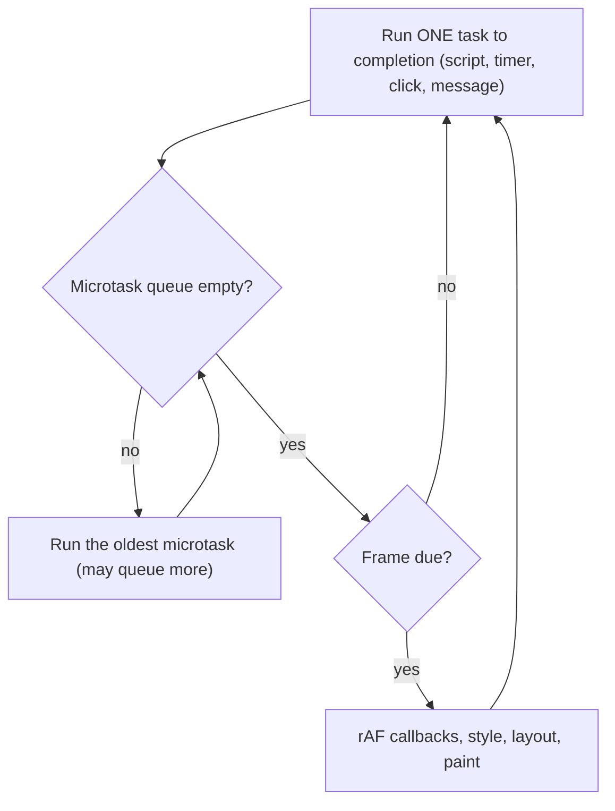
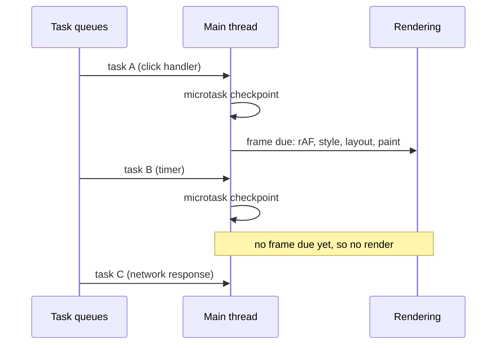

## Introduction

Open any web page and three things happen at once from the user's point of view: a script downloads data, an animation keeps moving, and a button responds when clicked. Yet JavaScript on that page runs on **one thread**. At any instant, exactly one line of your JavaScript is executing. There is no second JavaScript thread waiting to handle the click while the first one parses the data.

So how does a single thread appear to do many things? It takes turns. The network request is performed by the browser outside JavaScript; when the response arrives, the browser *queues* a callback. The click is detected by the browser; it queues a callback. A timer expires; the browser queues a callback. Something then has to decide which queued callback runs next, and when the page gets repainted between them. That something is the **event loop**: a loop, run by the environment hosting JavaScript, that repeatedly picks a piece of waiting work, runs it to the end on the single thread, runs any urgent follow-up work, lets the screen update, and goes back for more.

Understanding the event loop answers questions every front-end engineer meets in the first month of real work. Why does `setTimeout(fn, 0)` not run immediately? Why does a `.then` callback run before it? Why does a heavy loop freeze the page — including the spinner you showed to say "please wait"? Why can a value change between two lines of an `async` function, but never in the middle of a plain `for` loop? It is also one of the most commonly asked topics in front-end interviews, usually as an "in what order do these logs print?" puzzle.

This lesson builds the model from the ground up. The two kinds of queued work — microtasks and macrotasks — get a full lesson of their own in [[b1-microtasks]], and [[b1-event-loop-puzzles]] applies everything to interview questions.

## Before you start

- **The call stack** — how function calls push and pop frames, and what "the stack is empty" means. See [[b1-call-stack]].
- **Execution contexts** — the global context and function contexts that live on that stack. See [[b1-execution-contexts]].
- **Promises at a basic level** — that `.then(fn)` registers `fn` to run once the promise settles. See [[b1-promises]]. You do not need to know the details of chaining yet.
- **Callbacks** — passing a function to be called later. See [[b1-callback-concept]].

It also helps to know that the engine (such as V8) and the host (browser or Node.js) are different layers; [[b1-js-engine]] covers this, and the short version is repeated below.

## The intuition

Picture a small restaurant with one chef. The chef can only cook one dish at a time, and once a dish is started, the chef finishes it before looking up. Waiters (the browser's other machinery) take orders, wait at the oven for bread to bake, and answer the phone. Whenever something needs the chef — an order, finished bread that needs plating — the waiter puts a ticket on the rail.

The chef's routine is fixed. Finish the current dish. Then deal with every **urgent note** stuck to the pass ("the sauce for that dish needs finishing") — and if finishing one urgent note produces another, deal with that too, until no urgent notes remain. Then, if it is time, let the dining room be tidied (the screen repainted). Then take the **next ticket** from the rail and start again.

In this picture the chef is the single JavaScript thread, a dish is a **task**, the urgent notes are **microtasks**, the tidy-up is **rendering**, and the routine itself is the **event loop**. Two consequences fall straight out of it. A dish that takes an hour delays every ticket and every tidy-up behind it — that is a frozen page. And urgent notes always jump ahead of the next ticket — that is why promise callbacks beat timers.

The analogy has a limit worth stating: real waiters work in parallel with the chef, and so does the browser. Network transfers, timer counting, image decoding and much of scrolling happen on other threads. Only the *JavaScript callbacks* are serialised through the loop.

## Who runs the loop: engine versus host

A JavaScript **engine** such as V8, SpiderMonkey or JavaScriptCore implements the language defined by the ECMAScript specification (ECMA-262): syntax, objects, functions, promises. The engine has a call stack and a heap, and it can run a function you hand it. What the engine does *not* have is a loop that waits for clicks or timers. ECMA-262 defines **jobs** — for example, "run this promise reaction later" — and says the **host** must schedule them.

The host is the program that embeds the engine: a browser, Node.js, Deno, Bun, or a serverless runtime. The host provides `setTimeout`, `fetch`, DOM events, file I/O, and the event loop that ties them together. In browsers the event loop is defined by the HTML Standard; in Node.js it is implemented by a C library called **libuv**.

This split explains a fact that surprises many beginners: `setTimeout` is not part of JavaScript the language. It is a host API. `Promise` *is* part of the language, but even promise callbacks only run because the host's loop decides to run them.

## The pieces of the model

Four pieces are enough to explain nearly every behaviour you will see.

The **call stack** holds the function currently executing and the functions that called it. When the outermost function returns, the stack is empty and the engine is idle. JavaScript code only ever runs on the stack; the event loop's job is to choose what to put on it next.

A **task** (often called a **macrotask**, to contrast it with microtasks) is a unit of work the host has queued: running a `<script>`, firing a timer callback, dispatching a click event, delivering a `postMessage`, handling a network response. The HTML Standard gives an event loop **one or more task queues**, one per kind of source, and the browser may choose which queue to serve next. That freedom is how browsers prioritise user input over, say, a low-priority timer. Within a single source, order is preserved: two timers with the same delay fire in the order they were set.

A **microtask** is a smaller, more urgent unit of work. Promise reactions (the callbacks passed to `.then`, `.catch` and `.finally`), the code after an `await`, `queueMicrotask` callbacks and `MutationObserver` callbacks are microtasks. There is a single **microtask queue**, and it is processed completely at each **microtask checkpoint**.

**Rendering** is the browser's work to put pixels on screen: running `requestAnimationFrame` callbacks, recalculating styles, layout, paint and compositing. It happens *between* tasks, when the browser decides a new frame is due — typically once per display refresh, about every 16.7 ms on a 60 Hz screen.

## One iteration of the loop

With those pieces, the browser event loop is a short algorithm. Each iteration does this:

1. **Pick one task** from one of the task queues (the oldest runnable task in the chosen queue) and run it. Running it means calling its JavaScript, which pushes frames onto the stack, until the stack is empty again.
2. **Microtask checkpoint.** While the microtask queue is not empty, take the oldest microtask and run it to completion. Microtasks queued *during* this step are appended to the same queue and also run now.
3. **Update the rendering, if a frame is due.** Run `requestAnimationFrame` callbacks, then style, layout and paint. If nothing changed, or the tab is hidden, the browser may skip this.
4. If there is spare time before the next frame, the browser may run `requestIdleCallback` callbacks. Then go back to step 1.



Three words in that algorithm carry most of the meaning. **One** task per iteration: the loop never runs two timer callbacks back to back without checking microtasks in between. **All** microtasks per checkpoint: the queue is drained, not sampled. And rendering happens only *between* tasks, never in the middle of one.

There is one more rule that matters in practice. A microtask checkpoint also runs whenever a callback that the host invoked finishes and the JavaScript stack becomes empty — for example, after each event listener when the browser itself dispatches an event. You will see why that matters in the click-listener puzzle in [[b1-event-loop-puzzles]].

## Worked example: tracing the queues

Here is a program that uses each kind of work. Run it in Node.js or paste it into a browser console; the output is the same in both.

```javascript title="trace.js"
console.log('script start');

setTimeout(() => {
  console.log('timeout 1');
  Promise.resolve().then(() => console.log('microtask from timeout 1'));
}, 0);

setTimeout(() => console.log('timeout 2'), 0);

Promise.resolve()
  .then(() => console.log('microtask 1'))
  .then(() => console.log('microtask 2'));

console.log('script end');
```

```output
script start
script end
microtask 1
microtask 2
timeout 1
microtask from timeout 1
timeout 2
```

Walk through it with the algorithm, keeping three columns in your head: what is on the stack, what is in the microtask queue, and what is in the timer task queue.

| Step | What runs | Microtask queue after | Task queue after |
|---|---|---|---|
| 1 | The whole script (task). Logs `script start`, schedules two timers, queues `microtask 1` (the promise is already resolved), logs `script end` | `microtask 1` | `timeout 1`, `timeout 2` |
| 2 | Checkpoint: `microtask 1` runs. Its `.then` returns a promise that is now fulfilled, so `microtask 2` is queued | `microtask 2` | `timeout 1`, `timeout 2` |
| 3 | Checkpoint continues: `microtask 2` runs | empty | `timeout 1`, `timeout 2` |
| 4 | Next task: `timeout 1` runs and queues a microtask | `microtask from timeout 1` | `timeout 2` |
| 5 | Checkpoint: the new microtask runs *before* `timeout 2` | empty | `timeout 2` |
| 6 | Next task: `timeout 2` | empty | empty |

Notice three things. First, the whole script is itself a task, so nothing asynchronous runs until `script end` has printed. Second, `microtask 2` did not exist when the checkpoint started, yet it ran in the same checkpoint — that is what "drain completely" means. Third, `microtask from timeout 1` ran *between* the two timers, which proves the loop takes one task, then checks microtasks, then takes the next task.

> [!IMPORTANT] The rule to remember
> Synchronous code first. Then *every* microtask, including ones queued along the way. Then *one* task. Then every microtask again. Rendering can only happen between tasks.

## What "asynchronous" really means here

A common misreading is that `setTimeout(fn, 0)` means "run `fn` now, in parallel". It means "queue a task that calls `fn` once at least 0 ms have passed". The task cannot start until the current task — including all of your remaining synchronous code — has finished and the microtask queue is empty. The delay is a **minimum**, not a schedule. Browsers also clamp it: after timers have been nested five levels deep, the HTML Standard requires at least 4 ms, and background tabs are throttled much more heavily. [[b1-minimum-delay]] covers the details.

You can watch a timer being held back by synchronous work:

```javascript title="blocked-timer.js"
const scheduled = Date.now();
setTimeout(() => {
  const waited = Date.now() - scheduled;
  console.log(`timer asked for 0 ms, waited >= 200 ms: ${waited >= 200}`);
}, 0);

const end = Date.now() + 200;
while (Date.now() < end) {} // 200 ms of synchronous work
console.log('busy loop finished');
```

```output
busy loop finished
timer asked for 0 ms, waited >= 200 ms: true
```

The timer's 0 ms elapsed almost immediately, and the host put its callback in the task queue on time. But the queue is only read when the stack is empty, and the stack stayed busy for 200 ms. The same holds for clicks, network responses and repaints. This is the single most important practical lesson of the event loop: **while your JavaScript runs, nothing else on that thread can**.

The flip side is what makes asynchronous I/O efficient. When you call `fetch(url)`, the engine does not wait. The browser's network code performs the request on other threads, and the call returns a pending promise immediately. Your script finishes, the loop serves clicks and animations, and when the response arrives the browser queues a task that resolves the promise, which in turn queues the microtasks for your `.then` or `await` continuation. Thousands of requests can be in flight while the JavaScript thread does nothing at all.

## Run-to-Completion {#b1-run-to-completion}

**Run-to-completion** is the guarantee that once a piece of JavaScript starts running on a thread — a task or a single microtask — it runs until its call stack is empty before any other JavaScript on that thread can start. No event handler, timer or promise callback can cut into the middle of it. The event loop is built on this guarantee: it can only switch between pieces of work at the boundaries between them.

### What the guarantee means in code

Consider a timer that wants to change a variable while a loop is using it:

```javascript title="run-to-completion.js"
let n = 0;
setTimeout(() => {
  n = 99;
  console.log('timeout', n);
}, 0);

for (let i = 0; i < 1e6; i++) n += 1;
console.log('after loop', n);
queueMicrotask(() => console.log('micro', n));
```

```output
after loop 1000000
micro 1000000
timeout 99
```

The timer's delay expires long before the loop ends, but its callback cannot interrupt the loop. The loop sees `n` change only through its own `n += 1`, so `after loop` prints exactly one million. The microtask runs next, still seeing one million, and only then does the timer task get its turn and set `n` to 99.

This is a large simplification compared with languages that run code on several preemptive threads, such as Java or C++. There, another thread could change `n` between reading it and writing it, so you need locks. In single-threaded JavaScript, a synchronous block of code is effectively atomic with respect to other JavaScript on the same thread. You never need a lock to make `count = count + 1` safe from a click handler.

### The cost: long tasks

The same guarantee is what freezes pages. If a task runs for 2 seconds, the user's clicks, the browser's repaints and every timer wait 2 seconds. Browsers call a task longer than **50 ms** a **long task**, and it is the most common cause of poor responsiveness. Google's Interaction to Next Paint (INP) metric, a Core Web Vital since March 2024, measures exactly this delay between a user's input and the next frame.

A subtle consequence: DOM changes made during a task are not painted until the task ends. If you show a loading spinner and then start a 2-second synchronous computation in the same task, the spinner never appears — rendering only happens between tasks, and by the time the task ends you have hidden the spinner again.

The fix is never to make the task "interruptible" — JavaScript offers no way to do that. Instead you split the work into several tasks (yielding to the loop between chunks, as shown later), or move it to a **Web Worker**, which runs on a different thread with its own event loop and its own heap. See [[b3-web-workers]].

### Where interleaving *can* happen: `await`

Run-to-completion applies to each task and each microtask separately. An `async` function is not one unit: every `await` ends the current piece of work, and the rest of the function resumes later as a new microtask. Between the two halves, any other queued work can run. That creates a race even without threads:

```javascript title="await-race.js"
let balance = 100;

async function withdraw(amount) {
  const current = balance;      // read
  await Promise.resolve();      // stands in for a network call
  balance = current - amount;   // write, based on a value read before the await
}

Promise.all([withdraw(30), withdraw(50)]).then(() => {
  console.log('balance:', balance); // 20 expected
});
```

```output
balance: 50
```

Both calls read `balance` as 100 before either resumes. The first resumes and writes 70; the second resumes and writes 50, overwriting it. The fix is to make the read and write happen in the same uninterrupted piece of code — after the `await`, not on either side of it:

```javascript title="await-race-fixed.js"
let balance = 100;

async function withdraw(amount) {
  await Promise.resolve();      // do the slow part first...
  balance = balance - amount;   // ...then read and write with no await in between
}

Promise.all([withdraw(30), withdraw(50)]).then(() => {
  console.log('balance:', balance);
});
```

```output
balance: 20
```

The rule of thumb: **treat every `await` as a point where the world may have changed**. Re-read shared state after it, and keep read-modify-write sequences free of `await`.

### Exceptions to the guarantee

Two things look like exceptions but are not. Web Workers run truly in parallel, but each has its own heap; they communicate by copying messages, so they cannot change your variables mid-loop. Node.js `worker_threads` follow the same model. The real exception is `SharedArrayBuffer`: memory deliberately shared between threads, where another thread *can* change a value while your loop reads it. That is why it comes with `Atomics` for safe access, and why browsers only enable it on cross-origin-isolated pages.

```quiz
Q: A click handler and a 3-second synchronous loop are both on the main thread. The user clicks one second into the loop. When does the click handler run?
- [ ] Immediately, interrupting the loop
- [ ] In parallel on a second JavaScript thread
- [x] After the loop's task finishes and any queued microtasks have run
- [ ] Never — clicks during a long task are discarded
> Run-to-completion means the loop's task cannot be interrupted. The browser records the click and queues a task for it; the loop picks that task up once the current task and the following microtask checkpoint are done. The click is delayed, not lost.
```

## Rendering and the loop

In a browser, rendering is one more step of the loop, and it explains several practical behaviours.

Because rendering happens between tasks, a sequence of DOM changes inside one task produces one frame, not many. Setting `el.style.left` a hundred times in a loop costs a hundred style writes but only one paint. This batching is a performance benefit — and a trap when you expect to *see* intermediate states.

Because microtasks run before rendering, a microtask can change the DOM and the change is guaranteed to be included in the next frame. `MutationObserver` uses this: its callbacks are microtasks, so they can react to DOM changes before the user ever sees them.

Because `requestAnimationFrame` callbacks run in the rendering step, right before style and layout, they are the right place to do visual updates. A `setTimeout`-driven animation is not aligned with frames: some frames get two updates and some get none, which looks like stutter. [[b3-raf]] and [[b3-event-loop-rendering-sync]] go deeper, and [[b3-browser-event-loop]] covers the browser's side of the processing model in full.



## The event loop in Node.js

Node.js has no DOM and no rendering, but it has far more I/O, and its loop is organised around that. The loop is provided by libuv and runs in **phases**, each with its own queue of callbacks:

| Phase | What runs there |
|---|---|
| timers | Expired `setTimeout` and `setInterval` callbacks |
| pending callbacks | Some deferred system-level I/O callbacks (for example, certain TCP errors) |
| idle, prepare | Internal use only |
| poll | Retrieve new I/O events and run their callbacks (file reads, sockets); may block here waiting for I/O when nothing else is pending |
| check | `setImmediate` callbacks |
| close callbacks | `'close'` events, such as `socket.on('close')` |

Node has two queues that sit *outside* the phases and are drained after every individual callback: the **`process.nextTick` queue** and the promise **microtask queue**. Since Node 11, this happens after each timer and each immediate callback, which makes Node's behaviour match browsers: one callback, then all the urgent work, then the next callback. (Before Node 11, the queues were drained only between phases, which gave different results for some puzzles; you may still see that older behaviour described online.)

The program below shows the four common scheduling APIs side by side.

```javascript title="node-order.js"
Promise.resolve().then(() => console.log('promise'));
process.nextTick(() => console.log('nextTick'));
setTimeout(() => console.log('timeout'), 0);
setImmediate(() => console.log('immediate'));
console.log('sync');
```

Running it as a CommonJS file (`node node-order.js`) on Node 22 prints:

```output
sync
nextTick
promise
timeout
immediate
```

The synchronous log comes first. Then Node drains the `nextTick` queue before the promise microtask queue, which is why `nextTick` wins even though the promise callback was queued first. The order of the last two lines, however, is **not guaranteed** when the code runs at the top level of the main module. A `setTimeout` of 0 is stored as 1 ms, and whether that millisecond has passed when the loop first reaches the timers phase depends on how fast the process started. Inside an I/O callback the order is fixed: the loop is in the poll phase, the check phase comes next, so `setImmediate` always runs before a zero-delay timer.

There is another subtlety: if you save the same code as an ES module (`node-order.mjs`), it prints `promise` before `nextTick`. ES module evaluation in Node is itself driven by promises, so microtasks queued during it get drained before Node turns to the `nextTick` queue. This is a good reason not to write code whose correctness depends on the relative order of `nextTick` and promise callbacks.

One more difference: a browser's loop lives as long as the page. Node's loop **exits** when there is nothing left to wait for — no pending timers, sockets, file operations or other handles. That is why a script that only logs and returns ends immediately, while a server with an open listening socket runs forever.

```quiz
Q: In Node.js, inside an `fs.readFile` callback, you call `setTimeout(a, 0)` and `setImmediate(b)`. Which runs first, and why?
- [ ] `a`, because timers are always processed first
- [x] `b`, because the loop is in the poll phase and the check phase (immediates) comes before the next timers phase
- [ ] It is random every time
- [ ] Both run at the same time on different threads
> I/O callbacks run in the poll phase. The next phase is check, where setImmediate callbacks run; the timers phase is only reached on the next lap of the loop. The order is random only at the top level of the main module, where it depends on whether 1 ms has elapsed before the first timers phase.
```

## In real systems

**Keeping interfaces responsive.** A data table that sorts 200,000 rows on click is a long task. Production apps split such work into chunks and yield to the loop between them, or run it in a worker. Chrome DevTools' Performance panel marks long tasks with a red corner, and the Long Animation Frames API reports them from real users.

**Batching state updates.** React 18 and later batch state updates from the same event, timer or promise callback and render once, relying on the fact that nothing else runs until the current task or microtask finishes. Vue's `nextTick` and many reactive libraries schedule their update flush as a microtask for the same reason: every change made synchronously is collected, then applied once, before the browser paints.

**Server throughput.** A Node.js server handles thousands of concurrent connections on one JavaScript thread because almost all of the time is spent waiting for databases and networks, and waiting costs nothing in the event loop. The danger is the reverse: one CPU-heavy request — a large `JSON.parse`, a synchronous `bcrypt` hash, a catastrophic regular expression — blocks every other request on that process. Production Node services monitor **event loop lag** (how late timers fire) as a key health metric.

**Testing.** Test frameworks with fake timers (Jest, Vitest) replace `setTimeout` but not the microtask queue. A test that advances fake timers and then asserts immediately can fail because promise callbacks have not run yet, which is why such tools offer helpers that also flush microtasks.

## Trade-offs and alternatives

The single-threaded event loop is a deliberate design. Its main advantage is simplicity: no data races on ordinary variables, no locks, no deadlocks, and a predictable order for callbacks. Its main cost is that one thread can only use one CPU core, and any long piece of work delays everything else.

| Need | Tool | Why |
|---|---|---|
| Wait for I/O without blocking | Promises, `async`/`await` | The wait happens outside JavaScript; the thread stays free |
| Run follow-up work right after the current code | Microtask (`.then`, `queueMicrotask`) | Runs before any task or render |
| Give the browser a chance to paint and handle input | A new task (`setTimeout`, `MessageChannel`, `scheduler.postTask`) or `scheduler.yield()` | Rendering and input only happen between tasks |
| Update visuals smoothly | `requestAnimationFrame` | Runs once per frame, right before rendering |
| Heavy CPU work | Web Worker / Node `worker_threads` | Real parallelism on another thread, with its own loop |

`scheduler.yield()` is a newer API designed for chunking: it yields to the loop but lets the continuation run ahead of other ordinary tasks. It shipped in Chromium-based browsers in version 129 (2024); check current support before relying on it elsewhere, and fall back to `setTimeout`.

## Common mistakes

> [!MISTAKE] Believing `async` means "runs on another thread"
> An `async` function runs synchronously on the same thread until its first `await`. Marking a CPU-heavy function `async` does not move the work anywhere; it still blocks the loop for as long as it computes. Only workers give you another thread.

**Expecting `setTimeout(fn, 0)` to run before promise callbacks.** Timers are tasks; promise callbacks are microtasks; all microtasks run before the next task. A zero delay only means "as soon as a task can run".

**Showing a spinner, then computing synchronously.** The spinner's DOM change is not painted until the task ends. Yield to the loop (for example, start the computation in a `setTimeout` or after `requestAnimationFrame` plus a task) so a frame can render first, or move the work to a worker.

**Read-modify-write across an `await`.** As shown in the run-to-completion section, other code can run at every `await`. Read shared state after the `await`, not before.

**Yielding with `await Promise.resolve()` and expecting a repaint.** That continuation is a microtask, so it runs before rendering. To let the browser paint or handle input, you need a new task, not a microtask. [[b1-microtasks]] shows the difference side by side.

**Assuming the browser and Node behave identically.** The core rule is shared, but `setImmediate` and `process.nextTick` exist only in Node, `requestAnimationFrame` and rendering exist only in browsers, and Node's timers-versus-immediates order at the top level is not deterministic.

## Interview perspective

Interviewers use the event loop to check whether you have a working model of asynchronous JavaScript rather than memorised orders. The strongest answers name the parts precisely: one call stack, one task chosen per iteration, a microtask queue drained completely, rendering between tasks.

> [!INTERVIEW] A strong one-minute answer
> "JavaScript runs on one thread with one call stack. The host — browser or Node — runs an event loop. Each iteration it takes one task from a task queue, such as a timer or click, and runs it to completion. Then it drains the microtask queue completely: promise callbacks, code after `await`, `queueMicrotask`. In a browser it may then render a frame. So synchronous code runs first, then all microtasks, then the next task. That's why `Promise.then` beats `setTimeout(0)`, and why a long synchronous loop freezes the page."

Questions to be ready for:

- **Is JavaScript single-threaded?** The language runs your code on one thread per agent (a page's main thread, or a worker). The browser and Node themselves use many threads for networking, timers, rendering and I/O. Workers add more JavaScript threads, each with its own loop and heap.
- **What does `await` do to the call stack?** It suspends the async function, returns control to the caller (the async function's frame is popped), and schedules the rest of the function as a microtask once the awaited promise settles. The thread is free in the meantime.
- **Why does a heavy loop freeze a page?** Run-to-completion: no other task and no rendering can happen until the current task finishes.
- **How would you keep the UI responsive during heavy work?** Chunk it and yield with a task (`setTimeout`, `scheduler.yield()`), or move it to a worker. Explain why yielding with a microtask does not help.
- **How does Node's loop differ?** libuv phases (timers, poll, check, close), `setImmediate` in the check phase, `process.nextTick` drained before promise microtasks in CommonJS, and the loop exiting when no work remains.

A common follow-up is React: *"How does concurrent rendering relate to the event loop?"* React cannot interrupt a running task either. Concurrent rendering works by splitting rendering work into small units and yielding back to the browser between them, so input and paint can happen in the gaps — the same chunking technique you would use by hand. See [[b4-concurrent-rendering]].

## Practice

1. **Predict, then run.** Write down the output of the `trace.js` example with a third timer added that queues two microtasks, then run it to check. Explain every line using the loop algorithm.
2. **Freeze and unfreeze.** In a browser, add a button that runs a 3-second loop and a CSS animation on the page. Observe the animation of `transform` keep running (it is composited off the main thread) while a `left`-based animation freezes. Then split the loop into 50 ms chunks separated by `setTimeout` and compare.
3. **Spinner bug.** Write a page that shows a "Working…" message, runs a 2-second computation and hides the message. Confirm the message never appears, then fix it two different ways.
4. **Race at an `await`.** Write an async `reserveSeat()` that checks `seatsLeft > 0`, awaits a fake API call, then decrements. Call it three times with `seatsLeft = 2` and show the overbooking. Fix it.
5. **Node phases.** Inside an `fs.readFile` callback, schedule a timer, an immediate, a `nextTick` and a promise. Predict and verify the order, then move the same four lines to the top level and run the file several times.

## Quick revision {#quick-revision}

- JavaScript runs on one thread with one call stack; the host (browser per the HTML Standard, Node via libuv) runs the event loop. ECMA-262 only defines jobs.
- Each iteration: run **one** task → drain **all** microtasks (including newly queued ones) → render if a frame is due → repeat.
- Tasks (macrotasks): script, `setTimeout`/`setInterval`, events, `postMessage`, I/O. Microtasks: promise reactions, `await` continuations, `queueMicrotask`, `MutationObserver`.
- `setTimeout(fn, 0)` = "queue a task after at least 0 ms"; it waits for the stack to empty and all microtasks to run.
- **Run-to-completion**: a task or microtask is never interrupted by other JavaScript on the same thread. Synchronous code needs no locks; long tasks (> 50 ms) block input and paint.
- `await` ends the current piece of work; the rest resumes as a microtask, so shared state can change across an `await`.
- DOM changes in one task paint together, after the task and its microtasks.
- Node: phases timers → pending → poll → check (`setImmediate`) → close; `nextTick` queue then promise queue drained after every callback (Node 11+). Top-level timeout-vs-immediate order is not deterministic; inside I/O callbacks, immediate wins.
- Heavy CPU work: chunk with task yields or move to a worker.

## Key takeaways {#key-takeaways}

- The event loop is how one JavaScript thread serves timers, network responses and user input: it takes turns rather than running things in parallel.
- Synchronous code runs first, then every microtask, then one task, then every microtask again; rendering can only happen between tasks.
- Run-to-completion makes ordinary code free of data races, but it also means any long task freezes everything behind it.
- Every `await` is a point where other code can run, so re-read shared state after it.
- To let the browser paint or respond, yield with a new task or move the work to a worker; a microtask does not yield.
- Browsers and Node share the core rule, but Node adds libuv phases, `setImmediate` and `process.nextTick`.
