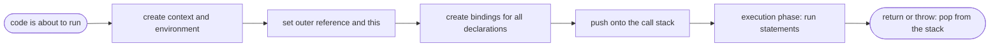

## Introduction

Take a three-line function that is called twice at the same time, for example a recursive function that is half-way through its first call when the second call starts. Both calls run the same source code, yet each has its own parameters and its own local variables, and when the inner call finishes the outer one carries on from the exact place it stopped with its values intact. Something has to keep those two runs apart.

That something is the **execution context**: a record the engine creates each time it starts running a unit of code, holding everything needed to run that code and to resume it later. One is created when a script starts, and one more for every function call. The context says which variables exist right now, what `this` refers to, and which outer scope to search for names the code does not declare itself.

Execution contexts are worth learning because several topics that are usually taught as separate rules turn out to be one mechanism seen from different sides. [[b1-hoisting]] is what a context's setup step looks like from the outside. [[b1-scope]] and the [[b1-scope-chain|scope chain]] are the context's environments and the links between them. [[b1-closures]] are what happens when an environment outlives its context. The [[b1-call-stack]] is the pile of contexts that are currently in progress. Once the model is in place, "why does this print `undefined`?" and "why is `this` wrong here?" stop being trivia and become things you can trace.

## Before you start

- **Scope** — which parts of a program can see a variable, and the difference between global, function and block scope. See [[b1-scope]].
- **Lexical scope** — the rule that a function looks up outer variables where it was *written*, not where it is called. See [[b1-lexical-scope]]; its section on the [[b1-lexical-environment|lexical environment]] introduces the data structure this lesson builds on.
- **Hoisting** — the observation that declarations exist before their line runs. See [[b1-hoisting]]. This lesson explains where that behaviour comes from.
- **`var`, `let` and `const`** — how the three declarations differ. See [[b1-var-let-const]].

Knowing [[b1-this]] and [[b1-closures]] helps, but both are explained here as far as they are needed.

## The intuition

Imagine an office where every job is done at a desk. When a job starts, a clerk lays out a fresh worksheet with three things on it: a table of names and their current values, a note saying who the job is being done *for*, and a pointer to the worksheet of the room this job's instructions came from, in case a name is not in the local table. The clerk fills in the table's row labels before doing any of the work. If the job requires another job, a new worksheet is placed on top and the old one waits underneath, untouched, with a bookmark at the line where it stopped.

The worksheet is the execution context. The table is its **environment**, the "who for" note is `this`, the pointer is the **outer reference**, and the pile of worksheets is the call stack.

The analogy misleads in one place. It suggests the table is thrown away with the worksheet when the job is done. In JavaScript the table is a separate object that the worksheet only points to. If something else still points to it — a function created during the job — the table survives after the worksheet is gone. That detail is the whole explanation of closures, and it is covered near the end.

## What an execution context is

An execution context is created when the engine begins to run one of three kinds of code:

| Kind of code | Context created | How often |
|---|---|---|
| A script or module's top-level code | **Global** (or module) execution context | Once per script or module |
| A function body | **Function** execution context | Once per *call* |
| A string passed to `eval` | Eval execution context | Once per `eval` call (rare; avoid `eval`) |

Note the middle row: a context belongs to a call, not to a function definition. A function that is never called never gets a context; a function called a thousand times gets a thousand, one after another or nested inside each other.

Each context for JavaScript code keeps track of the following:

- **Where it is in the code.** The specification calls this the *code evaluation state*: enough information to pause this code and resume it later at the same point.
- **A LexicalEnvironment.** The environment used to look up names, and where `let`, `const` and `class` declarations are stored. It changes as execution enters and leaves blocks.
- **A VariableEnvironment.** The environment where `var` declarations are stored. It is fixed for the lifetime of the context.
- **Which function is running** (nothing, for global code), and which script or module the code came from.
- **The realm** — the set of built-in objects (`Array`, `Object`, the global object) the code runs against. A page and an `<iframe>` inside it are two realms.

An **environment** (the specification's term is *environment record*) is a table of bindings — name, value, and whether the name is initialised yet — plus a reference to an outer environment. If you have read [[b1-lexical-environment]], this is the same object.

Most teaching material lists `this` as a third component of the context, and that picture is good enough to reason with. To be precise, the value of `this` is stored in the environment of the function call (or of the global code, or of the module), not in the context itself. It still belongs to *one run* of the code, which is the point that matters.

> [!NOTE] Context versus scope
> **Scope** is a property of the source text: a region of code in which a name is visible. It exists before the program runs. An **execution context** is a runtime thing: one activation of some code, with actual values in its environments. One function has one scope and as many execution contexts as it has calls.

## The two phases: creation, then execution

Every context goes through two phases. In the **creation phase** the engine prepares the environments: it decides what `this` is, links the new environment to its outer environment, and creates a binding for every declaration in the code it is about to run. In the **execution phase** it runs the statements one by one. No statement runs until the creation phase is complete. The hoisting lesson covers the per-declaration rules in detail under [[b1-creation-vs-execution]]; here is how they fit into the life of a context.

| Declaration | State after the creation phase | State after its line runs |
|---|---|---|
| `var x = 1` | exists, value `undefined` | value `1` |
| `function f() {}` | exists, value is the finished function | unchanged |
| `let x = 1`, `const x = 1`, `class X {}` | exists but **uninitialised** (reading it throws) | initialised |
| function parameters | exist, hold the passed arguments | — |

The uninitialised state is the [[b1-tdz|temporal dead zone]]. The engine knows the name belongs to this scope, so it will not look further out, but it refuses to give a value until the declaration has run.

### Tracing both phases

The program below prints its lines out of numeric order on purpose: the labels show the order in which the source lines appear, and the output shows the order in which they run.

```javascript title="phases.js"
console.log('1:', typeof scale, total);
var total = 10;
let rate = 2;

function scale(n) {
  console.log('3:', result);
  var result = n * rate;
  return result;
}

console.log('2:', total, rate);
console.log('4:', scale(total));
```

```output
1: function undefined
2: 10 2
3: undefined
4: 20
```

Walk through it the way the engine does.

**Global creation phase.** Before line 1 runs, the engine scans the top-level declarations. `total` is a `var`, so it gets a binding with the value `undefined`. `scale` is a function declaration, so it gets a binding holding the complete function object. `rate` is a `let`, so it gets a binding that is uninitialised.

**Global execution phase.** Line 1 runs: `typeof scale` is `'function'` and `total` is `undefined`, exactly the state the creation phase left behind. Had line 1 read `rate`, it would have thrown a `ReferenceError`. Then `total` becomes `10`, `rate` is initialised to `2`, and the declaration of `scale` is skipped, since there is nothing left to do for it. The log labelled `2:` runs.

**Calling `scale(total)`.** Evaluating the last line reaches the call. A new function execution context is created and placed on top of the global one. Its creation phase binds the parameter `n` to `10` and creates `result` with the value `undefined`.

**Function execution phase.** The log labelled `3:` prints `undefined`. Then `n * rate` is evaluated: `n` is found in the function's own environment; `rate` is not there, so the engine follows the outer reference to the global environment and finds `2`. `result` becomes `20` and is returned. The function context is removed, the global context resumes in the middle of its last line, and `4: 20` is printed.

The state of the environments at three moments:

| Moment | Global environment | `scale` environment |
|---|---|---|
| After global creation | `total: undefined`, `scale: function`, `rate: uninitialised` | does not exist |
| Just before `scale(total)` is called | `total: 10`, `scale: function`, `rate: 2` | does not exist |
| Inside `scale`, before its `return` | unchanged | `n: 10`, `result: 20`, outer → global |



## Global Execution Context {#b1-global-execution-context}

The **global execution context** is the context in which the top-level code of a script runs — the code that is not inside any function. It is the first context on the call stack and the one that every chain of function calls eventually returns to. When it finishes, the stack is empty and the host (the browser or Node.js) can move on to the next piece of work, such as a timer callback; that hand-over is the subject of [[b1-event-loop]].

### What its creation phase sets up

Before a single top-level statement runs, the engine does three things for a script.

It sets `this` to the **global object** — `window` in a browser page, available everywhere under the standard name `globalThis`.

It uses the **global environment**, which is unusual in being made of two stores. Top-level `var` and function declarations become *properties of the global object*. Top-level `let`, `const` and `class` go into a separate declarative store that is not attached to any object. Both stores are searched when a name is looked up, which is why the two kinds of global feel the same in everyday code. [[b1-global-variables]] explores the consequences of this split.

It performs the creation phase described above for all top-level declarations: `var` as `undefined`, functions complete, `let`/`const`/`class` uninitialised.

The global environment's outer reference is `null`. It is the end of every scope chain: a name not found here produces `ReferenceError: x is not defined`.

The two stores can be observed directly. Node.js normally does not run files as plain scripts (more on that below), so this example uses `vm.runInThisContext`, which runs a string as a classic script in the real global scope — the same treatment a browser gives a `<script>` tag.

```javascript title="global-stores.js"
const vm = require('node:vm');

// runInThisContext runs the string as a classic script in the real global scope
vm.runInThisContext('var viaVar = 1; let viaLet = 2; function viaFn() {}');

console.log(globalThis.viaVar, typeof globalThis.viaFn, globalThis.viaLet);
console.log(vm.runInThisContext('viaLet'));
console.log(vm.runInThisContext('this === globalThis'));
```

```output
1 function undefined
2
true
```

The `var` and the function became properties of the global object. The `let` did not — `globalThis.viaLet` is `undefined` — yet a later script can still read `viaLet` by name, because the declarative store is shared by all scripts. The last line confirms that `this` in script code is the global object.

### One global environment, several scripts

A page with three `<script>` tags does not have three global scopes. Each script is evaluated in its own execution context, with its own creation phase, but all of them use the same global environment of the page's realm. That is why a function declared in the first script can be called from the third, and why a function declared in the third is *not* hoisted into the first: the third script's creation phase has not happened yet when the first one runs.

### Top level is not always global

Three common situations have a top level that is not the global execution context of a script, and each changes what `this` means there.

| Where the code runs | Top-level `this` | Top-level `var x` |
|---|---|---|
| Classic script (`<script>`) | the global object | becomes `globalThis.x` |
| ES module (`<script type="module">`, `.mjs`) | `undefined` | local to the module |
| Node.js CommonJS file (`.js` by default) | `module.exports` | local to the file |

A **module** has its own module environment whose outer reference is the global environment. Its declarations never touch the global object, its code is always in strict mode, and its top-level `this` is `undefined`. Running a two-line `.mjs` file that logs `this` and then `globalThis.x` after `var x = 1` prints `undefined` twice. Module code can also use top-level `await`, which pauses the module's own context without any function being involved (see [[b1-top-level-await]]).

A **CommonJS** file in Node.js is not top-level code at all: Node wraps the file's text in a function and calls it. The "top level" you write is therefore the inside of a function execution context, with `this` set to `module.exports`.

```javascript title="cjs-this.js"
console.log(this === module.exports, this === globalThis);
```

```output
true false
```

> [!WARNING] `this.foo = 1` at the top of a file
> Old snippets attach globals with `this.foo = 1` at the top level. That only works in a classic script. In a module `this` is `undefined`, so the line throws a `TypeError`; in a CommonJS file it adds a property to `module.exports` instead. If you really need a global, write `globalThis.foo = 1` — and prefer an export.

### Using the global context well

Everything stored in the global environment lives for as long as the page or process does, and every script can read and overwrite it. Keep application state out of it: put code in modules, where top-level declarations are private by default. The global context should hold what the platform provides and little else.

## Function Execution Context {#b1-function-execution-context}

A **function execution context** is the context created each time a function is called. It gives that one call its own parameters, its own local variables and its own `this`, so that calls to the same function — including a function calling itself — never interfere with each other. It is placed on top of the call stack when the call starts and removed when the function returns or throws.

### What happens during a call

When the engine evaluates `f(a, b)` for an ordinary function, it proceeds in this order:

1. Evaluate the arguments `a` and `b` in the *caller's* context.
2. Create a new execution context and a new **function environment**. The environment's outer reference is set to the environment in which `f` was *created* (stored on the function object in a hidden field the specification calls `[[Environment]]`) — not to the caller's environment.
3. Push the new context onto the call stack. The caller is now suspended.
4. Bind `this` for the call.
5. Run the creation phase for the body: bind parameters to the arguments, create the `arguments` object, create `var` bindings as `undefined`, create function declarations, and create uninitialised bindings for top-level `let`/`const`/`class`.
6. Run the body.
7. On `return` or an uncaught `throw`, pop the context. The caller resumes with the returned value, or the exception continues outward.

Step 2 is the rule of lexical scope expressed as a mechanism. Because the outer reference comes from the function object, it does not matter who calls the function or from where.

### Each call has its own variables

```javascript title="own-locals.js"
function sumTo(n) {
  const local = n * 10;
  if (n === 0) return local;
  return local + sumTo(n - 1);
}
console.log(sumTo(3));
```

```output
60
```

While the innermost call is running there are four `sumTo` contexts on the stack, each with a separate environment:

```text
sumTo(0)   n = 0, local = 0     <- running
sumTo(1)   n = 1, local = 10       waiting for sumTo(0)
sumTo(2)   n = 2, local = 20       waiting for sumTo(1)
sumTo(3)   n = 3, local = 30       waiting for sumTo(2)
global                             waiting for sumTo(3)
```

The four variables named `local` are four different bindings. Assigning to one cannot change another. As each call returns, its value is added on the way down: `0`, then `10 + 0`, then `20 + 10`, then `30 + 30`, giving `60`. If `local` were shared between calls, recursion could not work at all. What *is* shared is anything reached through the outer reference: a variable declared outside `sumTo` would be the same binding for every call. [[b1-recursion-js]] builds on this picture.

### What the context decides at call time

Three values are fixed when the context is created, and they depend on *how* the function was called rather than where it was written: `this`, `arguments` and `new.target`.

```javascript title="call-time.js"
'use strict';
function report(label) {
  return [label, this === undefined ? 'undefined' : this.name, arguments.length,
    new.target === undefined ? 'no new' : new.target.name];
}
const user = { name: 'Asha', report };

console.log(report('plain'));
console.log(user.report('method', 'extra'));
console.log(report.call({ name: 'Ben' }, 'call'));

function Point(x) {
  this.x = x;
  this.how = new.target === undefined ? 'no new' : new.target.name;
}
console.log(new Point(1));

const team = {
  name: 'Core',
  members: ['Asha', 'Ben'],
  list() {
    return this.members.map((m) => m + ' @ ' + this.name);
  },
  listBroken() {
    return this.members.map(function (m) {
      return m + ' @ ' + (this === undefined ? 'undefined' : this.name);
    });
  },
};
console.log(team.list());
console.log(team.listBroken());
```

```output
[ 'plain', 'undefined', 1, 'no new' ]
[ 'method', 'Asha', 2, 'no new' ]
[ 'call', 'Ben', 1, 'no new' ]
Point { x: 1, how: 'Point' }
[ 'Asha @ Core', 'Ben @ Core' ]
[ 'Asha @ undefined', 'Ben @ undefined' ]
```

The same `report` function produced three different values of `this` in three calls: `undefined` for a plain call in strict mode (the global object in sloppy mode), the object before the dot for a method call, and the explicit first argument for `call`. `arguments.length` reflects how many arguments were actually passed, and `new.target` is set only when the call used `new`, in which case `this` is a freshly created object. The full rules are in [[b1-this]].

The last two lines show the classic trap. In `listBroken`, the callback is an ordinary function, so *its* call gets its own context and its own `this`. `map` calls it as a plain function, so `this` is `undefined`. The outer method's `this` is not inherited, because `this` is not looked up through the scope chain for ordinary functions — every ordinary call binds a new one.

### Arrow functions bind less

Calling an **arrow function** still creates a function execution context with its own environment for parameters and locals. What it does not create is its own `this`, `arguments` or `new.target`. When arrow code mentions `this`, the engine finds no binding in the arrow's environment and follows the outer reference until it reaches an environment that has one — the enclosing ordinary function, or the top level. That is why `team.list()` above works: the arrow's `this` is the `this` of the `list` call. See [[b1-this-arrow]].

### Contexts that pause

A context does not always run from start to finish in one go. A [[b1-generators|generator]] context is taken off the stack at each `yield`, with its environment and position preserved, and put back when `next()` is called. An `async` function does the same at each `await`: its context leaves the stack so other code can run, and is pushed again later when the awaited promise settles. In both cases the locals keep their values across the pause, because the environment is kept alive by the paused context. This is why [[b1-await-does-not-block|`await` does not block]] the rest of the program.

## Variable / Lexical Environment {#b1-variable-environment}

Every execution context holds two references to environments. The **VariableEnvironment** is where the context's `var` declarations live. The **LexicalEnvironment** is where `let`, `const` and `class` declarations live, and the place every name lookup starts. When a function begins they normally refer to the same environment; they separate as soon as execution enters a block.

### Why two references are needed

`var` is function-scoped: a `var` declared inside an `if` or a `for` must be visible in the whole function. `let` and `const` are block-scoped: they must disappear at the closing brace. One function can contain both, so the engine needs a place that stays put for the whole call and a place that changes with each block.

The VariableEnvironment is the place that stays put. It is set when the context is created and never changes. The LexicalEnvironment is the place that moves: when execution enters a block that declares something, the engine creates a new environment for the block, makes its outer reference the current LexicalEnvironment, and points the context's LexicalEnvironment at the new one. When the block ends, the previous environment is restored.

```javascript title="two-environments.js"
function demo() {
  var a = 1;
  {
    let b = 2;
    var c = 3;
    console.log(a, b, c);
  }
  console.log(a, c);
  try {
    console.log(b);
  } catch (e) {
    console.log(e.name + ': ' + e.message);
  }
}
demo();
```

```output
1 2 3
1 3
ReferenceError: b is not defined
```

During the creation phase of the call, `a` *and* `c` are created in the function's environment, both `undefined` — `c` is found even though it is written inside the block, because the scan for `var` looks through nested blocks. When execution enters the block, a block environment is created holding `b`. The assignment `c = 3` inside the block finds `c` by walking outward from the block environment to the function environment.

```mermaid title="Inside the block: the two references point to different environments"
flowchart LR
    CTX["demo() context"] -- "LexicalEnvironment" --> BLK["block environment: b = 2"]
    CTX -- "VariableEnvironment" --> FN["function environment: a = 1, c = 3"]
    BLK -- "outer" --> FN
    FN -- "outer" --> GLB["global environment: demo"]
    GLB -- "outer" --> NUL(["null"])
```

After the closing brace the context's LexicalEnvironment points back at the function environment. The block environment is no longer reachable, so `b` is gone, while `c` is still there. Name lookup always starts at the current LexicalEnvironment and follows the `outer` arrows; the VariableEnvironment is not a second place to search, only a marker for where `var` declarations are created.

### Conflicts between the two

Because `var` skips over blocks to the function level, the language rejects code in which a `var` would have to cross a `let` of the same name on its way there. These are early errors — the code is refused before any of it runs. The snippet uses `new Function` only so that each piece of source can be compiled separately and the error caught.

```javascript title="conflicts.js"
for (const src of [
  'try {} catch (e) { let e = 1; }',
  'try {} catch (e) { var e = 1; }',
  'function f(a) { let a = 1; }',
  'function f(a) { var a = 1; }',
  '{ let x = 1; var x = 2; }',
]) {
  try { new Function(src); console.log('ok        ', src); }
  catch (e) { console.log(e.name, src, '|', e.message); }
}
```

```output
SyntaxError try {} catch (e) { let e = 1; } | Identifier 'e' has already been declared
ok         try {} catch (e) { var e = 1; }
SyntaxError function f(a) { let a = 1; } | Identifier 'a' has already been declared
ok         function f(a) { var a = 1; }
SyntaxError { let x = 1; var x = 2; } | Identifier 'x' has already been declared
```

A `catch (e)` clause creates a small environment holding `e`, and a `let e` directly in the catch block is treated as a redeclaration. A parameter and a top-level `let` of the same name clash for the same reason. The `var` versions are allowed for historical compatibility: `var a` next to a parameter `a` re-uses the parameter's binding. In the last case the `var x` would be hoisted through the block that already has a `let x`, which is forbidden.

### Parameters with default values

There is one case where the two references differ from the first line of a function. When a function has default parameter values, the parameters get their own environment, and the body's `var` declarations go into a second environment whose outer reference is the parameter environment. This keeps a function written in a default value from seeing variables declared in the body.

```javascript title="default-params.js"
function f(read = () => x, x = 1) {
  var x = 2;
  return [read(), x];
}
console.log(f());
```

```output
[ 1, 2 ]
```

The arrow in the first default closes over the *parameter* environment, where `x` is `1`. The body's `var x` is a different binding in the body's environment, initialised with the parameter's value and then set to `2`. The arrow cannot see it. You will rarely write code like this, but it shows that "the function's scope" can be more than one environment.

### Things that change environments at run time

Two legacy features alter the chain while the code runs. A `with (obj)` statement inserts an environment backed by `obj`'s properties in front of the current LexicalEnvironment; it is forbidden in strict mode and should not be used. A direct `eval` call in sloppy mode can add `var` bindings to the calling function's VariableEnvironment while it runs. Both make it impossible to know from the source text where a name will be found, which is why modern code and all module code exclude them. [[b1-name-resolution]] describes their effect on lookup.

> [!NOTE] These are specification names
> `LexicalEnvironment` and `VariableEnvironment` cannot be accessed from JavaScript, and engines do not literally build these objects for every call; they compile most variables to fixed slots. The names describe behaviour that every engine must reproduce. Use them to reason about code, not to predict memory layout.

## When the context is gone but the environment stays

A function's context is popped the moment it returns. Its environment is a separate object, and it is destroyed only when nothing refers to it any longer. If the function created another function, that inner function's `[[Environment]]` field still points to the environment, and so it survives.

```javascript title="survives.js"
function makeCounter(start) {
  let count = start;
  return function next() {
    count += 1;
    return count;
  };
}
const next = makeCounter(10);
console.log(next(), next());
```

```output
11 12
```

By the time `next()` is first called, the `makeCounter` context no longer exists — the call returned on the line before. Each call to `next` creates a new context whose outer reference is the old `makeCounter` environment, so `count` is found there and updated in place. That combination — a function plus the environment it was created in — is a **closure**; the lifecycle is examined in [[b1-closures]], and its memory cost in [[b1-closure-memory]].

This is also why "local variables live on the stack" is only an approximation in JavaScript. Engines do keep variables that no inner function uses in fast stack storage, but any variable captured by an inner function is placed on the [[b1-heap|heap]] so it can outlive the call.

## Worked example: tracing a small program

```javascript title="checkout.js"
const tax = 0.1;

function addTax(amount) {
  const result = amount + amount * tax;
  return result;
}

function checkout(prices) {
  let sum = 0;
  for (const p of prices) {
    sum += p;
  }
  return addTax(sum);
}

console.log(checkout([100, 50]));
```

```output
165
```

| Step | What happens | Stack (top first) | Environments of note |
|---|---|---|---|
| 1 | Global creation phase | global | `tax: uninitialised`, `addTax: fn`, `checkout: fn` |
| 2 | `const tax = 0.1` runs | global | `tax: 0.1` |
| 3 | `checkout([100, 50])` is called; creation phase | checkout, global | checkout: `prices: [100, 50]`, `sum: uninitialised` |
| 4 | `let sum = 0` runs | checkout, global | checkout: `sum: 0` |
| 5 | Loop, first iteration | checkout, global | new block environment: `p: 100`; then `sum: 100` |
| 6 | Loop, second iteration | checkout, global | another new block environment: `p: 50`; then `sum: 150` |
| 7 | `addTax(150)` is called; creation phase | addTax, checkout, global | addTax: `amount: 150`, `result: uninitialised` |
| 8 | `amount * tax` is evaluated | addTax, checkout, global | `tax` not in addTax → outer is **global** → `0.1` |
| 9 | `addTax` returns `165` | checkout, global | addTax environment unreachable |
| 10 | `checkout` returns `165`; `console.log` prints it | global | checkout environment unreachable |

Two steps deserve attention. In steps 5 and 6 each loop iteration gets its own block environment, so the context's LexicalEnvironment changes while its VariableEnvironment does not. In step 8, the lookup of `tax` goes from `addTax` straight to the global environment. It does not pass through `checkout`, even though `checkout` is directly below `addTax` on the stack. The stack records who called whom; the outer references record where each function was written. They are different chains, and mixing them up is the most common error in reasoning about scope.

```quiz
Q: A function `f` is defined once and called five times, with two of those calls nested inside another call to `f`. How many function execution contexts are created for `f`?
- [ ] One, because there is one function
- [ ] Three, because nested calls share a context with their caller
- [x] Five, one for each call
- [ ] It depends on whether `f` uses `var` or `let`
> A context belongs to a call, not to a definition. Every call gets a new context and a new environment, whether it happens before, after or during another call. That is what keeps the locals of recursive calls separate.

Q: Inside a function, the line `console.log(x)` appears before `var x = 5`. What does the creation phase do with `x`, and what is printed?
- [ ] Nothing is done until the declaration line; a ReferenceError is thrown
- [x] A binding for `x` is created with the value `undefined`; `undefined` is printed
- [ ] The whole line `var x = 5` is moved to the top; `5` is printed
- [ ] `x` is created uninitialised; a ReferenceError is thrown
> The creation phase creates a binding for every `var` and gives it `undefined`. Only the declaration is handled early; the assignment `x = 5` runs in the execution phase when its line is reached. "Uninitialised" is the state of `let`, `const` and `class`, which do throw.

Q: `addTax` is declared at the top level and called from inside `checkout`. While `addTax` runs, where does its environment's outer reference point?
- [ ] To the environment of `checkout`, because `checkout` called it
- [x] To the global environment, because that is where `addTax` was created
- [ ] To whichever environment is directly below it on the call stack
- [ ] Nowhere; functions only see their own variables
> The outer reference is copied from the function object's `[[Environment]]` field, which was set when the function was created. The caller is irrelevant. The call stack and the scope chain are separate structures that often happen to look similar.

Q: Inside a function, execution is in the middle of a block containing `let b` and `var c`. Which statement is correct?
- [ ] Both `b` and `c` are stored in the block's environment
- [ ] Both are stored in the function's environment
- [x] `b` is in the block's environment (the current LexicalEnvironment); `c` is in the function's environment (the VariableEnvironment)
- [ ] `c` is stored in the global environment
> `var` declarations are always created in the context's VariableEnvironment, which is fixed for the whole call. `let` goes into the environment of the nearest enclosing block, which the LexicalEnvironment points to while the block runs. This is the mechanism behind "var ignores blocks".
```

## In real systems

**Debuggers show contexts directly.** When execution is paused at a breakpoint, the Call Stack pane of browser DevTools lists the active contexts, and the Scope pane shows the environment chain of the selected one: Local, Block, Closure, Script and Global sections. "Script" is the declarative half of the global environment (top-level `let` and `const`), and "Global" is the global object. Selecting a different entry in the call stack switches the Scope pane to that context's environments. This describes DevTools behaviour from its documentation; it was not run as part of this lesson. See [[b1-watch-scope]].

**Module bundlers rely on function contexts.** The CommonJS wrapper function shown earlier is how Node.js gives each file private top-level variables, and older bundlers emulated modules the same way, wrapping each file in a function so that its declarations landed in a function environment instead of the global one. The historical [[b1-iife]] pattern is the hand-written version of the same idea.

**Frameworks depend on fresh environments per call.** Each render of a React function component is a function call with a new context and a new environment. Event handlers created during that render close over that render's values, which is where stale-closure bugs come from; see [[b1-stale-closures]].

**Engines optimise the model away where they can.** V8 analyses each function to see which variables are captured by inner functions. Uncaptured variables live in registers or stack slots and cost nothing to "create"; only captured ones go into a heap-allocated context object. The behaviour is identical to the specification's model, which is why the model is safe to reason with.

## Trade-offs and alternatives

A fresh context per call is what makes recursion, re-entrancy and closures possible, and it keeps one call's locals from leaking into another. The price is that each active call occupies space on a stack of limited size, so very deep recursion fails with a `RangeError` (see [[b1-stack-overflow]]), and that environments kept alive by closures occupy memory for as long as the closure is reachable.

The call-time binding of `this` is flexible — one function can serve many objects — but is the largest source of confusion in the model. Arrow functions and `bind` are the two tools for making `this` stable; arrow functions do it by not binding `this` at all.

The two-stage design (create, then execute) allows functions to be called above their definitions and allows mutually recursive functions to be declared in any order. The cost was `var`'s silent `undefined`, which `let` and `const` replace with an explicit error.

## Common mistakes

> [!MISTAKE] Reading the scope chain off the call stack
> "`inner` was called from `outer`, so it can see `outer`'s variables" is wrong. A function sees the variables of the place it was *defined*. Being called by a function gives no access to that function's locals; the caller must pass values as arguments.

**Assuming an inner ordinary function inherits `this`.** Every ordinary function call binds its own `this`. A callback written with `function` inside a method does not see the method's `this`. Use an arrow function, which has no `this` of its own, or pass the value explicitly.

**Thinking a context is created per function.** Contexts are per call. This matters when reasoning about closures: two calls to a factory function produce two independent environments, not one shared one.

**Expecting top-level `this` or `var` to be global everywhere.** In modules `this` is `undefined` and `var` stays in the module. In CommonJS files `this` is `module.exports`. Only classic scripts have the behaviour older tutorials describe.

**Believing hoisting moves code.** Nothing is moved. The creation phase creates bindings; the execution phase runs lines in the order written. A `var` reads as `undefined` early because its binding exists and its assignment has not run.

**Believing locals always die when the function returns.** The context dies. The environment lives as long as any function created inside it is still reachable.

## Interview perspective

Interviewers use this topic to check that you have one coherent model instead of a list of memorised outputs. A strong answer names the parts, puts them in order, and connects them to hoisting, closures and `this`.

> [!INTERVIEW] What a strong answer sounds like
> "An execution context is the engine's record for one run of some code — the global code, or one call to a function. It's created in two steps. First the engine sets up the environment: it links it to the outer environment the function was defined in, binds `this`, and creates bindings for all declarations — `var` as `undefined`, functions fully, `let` and `const` uninitialised. Then it executes the statements. Contexts sit on the call stack while they're active. When a function returns, its context is popped, but its environment stays alive if a closure still references it."

Questions to be ready for:

- **What is in an execution context?** The environments (LexicalEnvironment and VariableEnvironment, each a record of bindings with an outer reference), the `this` binding for that run, and the position in the code. Mention that `this` strictly lives in the environment record.
- **Global versus function context?** The global one is created per script, binds `this` to the global object (or `undefined` in a module), and its environment ends the scope chain. A function context is created per call, binds `this` from the call site, and adds `arguments` and `new.target`.
- **What happens when a function returns?** Its context is popped and the caller resumes. Its environment is garbage only if nothing references it.
- **How do arrow functions differ?** They get a context and an environment but no own `this`, `arguments` or `new.target`; those resolve through the outer environment.
- **Why does `var` ignore blocks?** It is created in the VariableEnvironment, which is the function's environment for the whole call; block environments only ever replace the LexicalEnvironment.
- **What does `await` do to the context?** It suspends the async function's context and removes it from the stack; it is pushed again when the promise settles, with the same environment.

A common follow-up is "is the scope chain the same as the call stack?" The answer is no, with the `addTax`/`checkout` example as the proof.

## Practice

1. **Predict, then run.** Write a function that logs a `var`, a `let` and a nested function declaration before their declaration lines, each in its own `try`/`catch`. Write down the three results before running it.
2. **Draw the environments.** For the `makeCounter` example, call it twice to get two counters. Draw every environment that exists after three calls to the first counter and one to the second, with outer references.
3. **Trace a recursion.** For `function fact(n) { return n <= 1 ? 1 : n * fact(n - 1); }`, list the contexts on the stack at the deepest point of `fact(4)` and the value of `n` in each.
4. **Find the outer reference.** Define a function `show` at the top level that logs a variable `v`. Call it from inside another function that declares its own local `v`. Explain the output using `[[Environment]]`.
5. **Three top levels.** Put `console.log(this)` in a classic script, a `.mjs` file and a CommonJS `.js` file. Explain each result in terms of which context the line runs in.
6. **Fix the callback.** Rewrite `listBroken` from this lesson three ways so it prints the team name: with an arrow function, with `bind`, and with the second argument of `map`.

## Quick revision {#quick-revision}

- An execution context is the engine's record for one run of code: a script's top level, one function call, or one `eval`.
- It tracks a LexicalEnvironment, a VariableEnvironment, the running function, the realm and the position in the code; `this` is stored in the environment of that run.
- An environment is a table of bindings plus an outer reference; following outer references is the scope chain.
- Creation phase: create the environment, set the outer reference and `this`, create bindings — `var` as `undefined`, function declarations complete, `let`/`const`/`class` uninitialised (the temporal dead zone).
- Execution phase: run statements in written order; assignments happen here.
- Global context: `this` is the global object in a classic script, `undefined` in a module, `module.exports` in a CommonJS file. Top-level `var` and functions become global-object properties in scripts only; `let`/`const`/`class` never do.
- Function context: one per call; outer reference comes from the function's `[[Environment]]` (where it was created), not from the caller; `this`, `arguments` and `new.target` are set from the call.
- Arrow functions have a context but no own `this`, `arguments` or `new.target`.
- `var` goes to the VariableEnvironment (fixed per call); `let`/`const`/`class` go to the current LexicalEnvironment (changes per block).
- Returning pops the context; the environment survives if a closure references it.
- Generators and async functions suspend their context at `yield`/`await` and resume it later with the same environment.
- The call stack (who called whom) and the scope chain (where code was written) are different structures.

| | Global context | Function context |
|---|---|---|
| Created | Once per script or module | Once per call |
| `this` | Global object; `undefined` in modules | From the call site; inherited lexically in arrows |
| Outer reference | `null` (modules: the global environment) | The environment where the function was created |
| Extra bindings | Built-ins on the global object | Parameters, `arguments`, `new.target` |
| Ends when | Top-level code finishes | `return` or uncaught `throw` |

## Key takeaways {#key-takeaways}

- Every run of global code and every function call gets its own execution context, which is why calls never share local variables.
- A context is set up before it runs: the creation phase makes all bindings, and the execution phase gives them values. Hoisting is that ordering seen from outside.
- Name lookup follows outer references between environments, and those references are fixed by where functions are written — not by the order of calls on the stack.
- `this` is decided per call for ordinary functions and is not decided at all for arrow functions, which use the surrounding one.
- `var` and `let` differ because they are stored in different environments of the same context: one fixed for the call, one replaced at every block.
- Popping a context does not destroy its environment; closures keep environments alive, and that is how a function remembers variables after its creator has returned.
