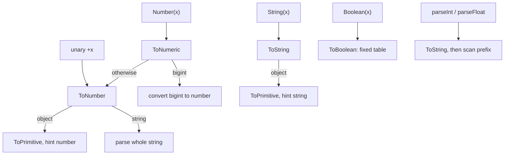

## Introduction

An order form has two inputs, a unit price and a quantity. The script that shows the total looks correct at a glance:

```javascript title="total-bug.js"
// In a browser these would come from priceInput.value and qtyInput.value.
const price = '19.99';
const qty = '2';

console.log('Total:', price * qty);
console.log('Price plus shipping:', price + 5);
```

```output
Total: 39.98
Price plus shipping: 19.995
```

The first line works and the second is nonsense. Every value read from an `<input>`, a URL, a cookie, `localStorage` or an environment variable is a **string**, even when it looks like a number. The `*` operator happens to convert both sides to numbers, so multiplication works by accident. The `+` operator sees a string and joins text instead, so `'19.99' + 5` becomes `'19.995'`. Nothing failed loudly; the program produced a wrong price.

The fix is to decide the type yourself, once, as soon as the value enters your code:

```javascript title="total-fixed.js"
const price = Number('19.99');
const qty = Number('2');

console.log('Total:', price * qty);
console.log('Price plus shipping:', price + 5);
```

```output
Total: 39.98
Price plus shipping: 24.99
```

That is **explicit conversion**: calling a function or operator whose only job is to change a value's type, so the conversion is visible in the source and happens at a moment you chose. The alternative, **implicit coercion**, is a conversion an operator performs on its own because it needs a different type, as `*` and `+` did above. Implicit coercion is the subject of [[b1-type-coercion]].

JavaScript gives you a small set of explicit converters: `String()`, `Number()`, `Boolean()`, `parseInt()`, `parseFloat()`, unary `+` (and `BigInt()` for big integers). They look interchangeable but are not. `Number('12px')` is `NaN` while `parseInt('12px', 10)` is `12`; `Number('')` is `0`, which is rarely what a form validator wants; `Boolean('false')` is `true`. This lesson teaches each converter precisely, so you can choose the right one and know what it will do with bad input — which is where real bugs live.

## Before you start

- **Primitive types** — string, number, bigint, boolean, `undefined`, `null`, symbol, and the fact that everything else is an object. See [[b1-primitive-types]].
- **`NaN` and `Infinity`** — the number values that mean "not a valid number" and "too large". `NaN` is the usual result of a failed numeric conversion. See [[b1-nan-infinity]].
- **Truthy and falsy values** — the eight values that count as false in a condition. `Boolean()` applies exactly that rule. See [[b1-truthy-falsy]].
- **`typeof`** — used throughout to show what type a conversion produced. See [[b1-typeof]].

Objects (arrays, dates, your own classes) are converted by first asking them for a primitive. This lesson shows the results for common objects and links to [[b1-to-primitive]] for the full mechanism.

## The intuition

Think of the language as owning three conversion machines: one that turns any value into a **string**, one into a **number**, and one into a **boolean**. The specification gives them names — **ToString**, **ToNumber** and **ToBoolean** — and calls them *abstract operations*: internal algorithms that you cannot call by name but that the language runs on your behalf.

Every conversion in JavaScript, explicit or implicit, goes through one of these machines. When you write `Number(x)` you press the ToNumber button yourself. When you write `x * 2`, the `*` operator presses the same button for you. **Explicit and implicit conversion use the same algorithms; the only difference is who decides to run them, and whether a reader can see it.** This is why learning the explicit converters well also teaches you most of what implicit coercion does.

Two converters do not fit this picture neatly. `parseInt` and `parseFloat` are not ToNumber at all — they are text scanners that read digits from the front of a string and stop at the first character they do not understand. That difference is the reason they exist, and the source of their surprises.

| Target | Explicit converter | Spec operation | Shorthand you will see |
|---|---|---|---|
| string | `String(x)` | ToString | `` `${x}` ``, `'' + x` |
| number | `Number(x)` | ToNumber (via ToNumeric) | `+x` |
| number from text with junk | `parseInt(s, radix)`, `parseFloat(s)` | their own scanners | none |
| boolean | `Boolean(x)` | ToBoolean | `!!x` |
| bigint | `BigInt(x)` | ToBigInt | none |

One rule applies to all of the first three: **call them without `new`**. `String(5)` returns the primitive string `'5'`. `new String(5)` returns a wrapper *object* that behaves differently in comparisons and conditions (see [[b1-autoboxing]]). There is no reason to create wrapper objects on purpose.

## String() {#b1-string-conversion}

`String(x)` converts any value into a primitive string using the ToString operation. It is the converter you use for labels, log messages, map keys built from several values, and anywhere text is required. Template literals (`` `${x}` ``) use the same ToString algorithm for each interpolated value.

### What each type becomes

For primitives the result is what you would expect from reading the value aloud, with a few details worth knowing:

```javascript title="string-primitives.js"
const values = [null, undefined, true, 42, -0, 1.50, 1e21, 0.0000001, 10n, NaN];
for (const v of values) {
  console.log(JSON.stringify(String(v)));
}
console.log(String(Symbol('id')));
```

```output
"null"
"undefined"
"true"
"42"
"0"
"1.5"
"1e+21"
"1e-7"
"10"
"NaN"
Symbol(id)
```

`JSON.stringify` is used only to show the quotes, so you can see that every result is a string. Notice three things. Negative zero becomes `'0'`, so converting to a string loses the sign (see [[b1-nan-infinity]] for why `-0` exists). Trailing zeros vanish: `1.50` and `1.5` are the same number, so they have the same string. And very large or very small numbers switch to exponent notation — from `1e21` upwards and below `1e-6` — which matters later for `parseInt`. A bigint prints its digits without the `n` suffix.

Objects are converted in two steps: first the object is asked for a primitive, preferring its `toString` method; then that primitive goes through ToString. Most built-in objects have a useful `toString`; plain objects do not:

```javascript title="string-objects.js"
console.log(String([1, 2, 3]));
console.log(String([1, [2, 3]]));
console.log(String([null, undefined]));
console.log(String({ name: 'Ada' }));
console.log(String(new Error('disk full')));
console.log(String(/ab+c/g));
console.log(String(new Map([[1, 2]])));
```

```output
1,2,3
1,2,3
,
[object Object]
Error: disk full
/ab+c/g
[object Map]
```

An array's `toString` joins its elements with commas, converting each element with the same rules — except that `null` and `undefined` elements become empty strings, which is why `[null, undefined]` prints a single comma. Nested arrays flatten into one comma list, so the string loses the structure. A plain object becomes `'[object Object]'`, the default text from `Object.prototype.toString` (the bracketed name comes from [[b1-tostringtag]]). Maps and sets do the same. The full lookup order — `Symbol.toPrimitive`, then `toString`, then `valueOf` — is taught in [[b1-to-primitive]].

> [!WARNING] `String()` is not serialization
> `String({ name: 'Ada' })` is `'[object Object]'`, and `String([1, [2, 3]])` cannot be told apart from `String([1, 2, 3])`. When you need text that preserves structure — for logging, storage or sending over the network — use `JSON.stringify` (see [[b1-json-stringify-parse]]).

### Four ways to get a string, and how they differ

Code in the wild converts to strings in four ways. They agree on ordinary numbers and strings and disagree at the edges:

```javascript title="string-four-ways.js"
const both = { valueOf() { return 1; }, toString() { return 'two'; } };

console.log(String(both), `${both}`, '' + both);

console.log(String(null), String(Symbol('k')));
try { null.toString(); } catch (e) { console.log('toString:', e.message); }
try { `${Symbol('k')}`; } catch (e) { console.log('template:', e.message); }
try { '' + Symbol('k'); } catch (e) { console.log('concat:', e.message); }
```

```output
two two 1
null Symbol(k)
toString: Cannot read properties of null (reading 'toString')
template: Cannot convert a Symbol value to a string
concat: Cannot convert a Symbol value to a string
```

| Form | `null` / `undefined` | Symbol | Object with both `valueOf` and `toString` |
|---|---|---|---|
| `String(x)` | `'null'` / `'undefined'` | `'Symbol(k)'` | uses `toString` first |
| `` `${x}` `` | `'null'` / `'undefined'` | throws `TypeError` | uses `toString` first |
| `'' + x` | `'null'` / `'undefined'` | throws `TypeError` | uses `valueOf` first |
| `x.toString()` | throws `TypeError` | `'Symbol(k)'` | calls `toString` directly |

The reasons are different in each row. `x.toString()` is a method call, so it fails whenever there is no object to call it on — `null` and `undefined` have no properties at all. Symbols are deliberately hard to turn into text by accident, because a symbol used as a hidden property key would silently become an ordinary string key; so ToString throws on symbols, and only `String(sym)` (and `sym.toString()` or `sym.description`) are allowed to produce text. The last column comes from the *hint* each form passes when it asks an object for a primitive: `String()` and template literals ask for a string, while `+` asks with no preference, which ordinary objects treat as "number first". [[b1-to-primitive]] explains hints in detail; for now, the practical rule is that **`String(x)` is the only form that never throws for any primitive**, which makes it the safest choice for logging unknown values.

### Formatting is a different job

`String(x)` produces the shortest text that identifies the number exactly. It does not round, pad or add separators. For that, numbers have methods that *return strings*: `n.toFixed(2)` for a fixed number of decimals, `n.toString(16)` for another base, and `Intl.NumberFormat` or `toLocaleString` for human-readable output. Keep in mind that `toFixed` returns a string, so `(1.5).toFixed(1) + 1` is `'1.51'`, not `2.5`. Rounding behaviour is covered in [[b1-rounding]].

```quiz
Q: What does `String([1, [2, null]])` return?
- [ ] `'[1, [2, null]]'`
- [x] `'1,2,'`
- [ ] `'1,2,null'`
- [ ] It throws because of the `null` element
> Arrays convert by joining their elements with commas, and nested arrays are joined the same way, so the brackets disappear. Inside an array join, `null` and `undefined` become empty strings rather than `'null'`, which leaves a trailing comma. Use `JSON.stringify` when the structure matters.

Q: You are writing a logger that must turn any value into text without ever throwing. Which form is safest for primitives?
- [x] `String(value)`
- [ ] `value.toString()`
- [ ] `` `${value}` ``
- [ ] `'' + value`
> `String()` handles `null`, `undefined` and symbols. `value.toString()` throws on `null` and `undefined`, and both the template literal and `+` throw on symbols. (An object whose own conversion methods throw can still make `String()` throw; no form protects against that.)
```

## Number() {#b1-number-conversion}

`Number(x)` converts a value into a number using ToNumber. It treats a string as a **whole**: the entire text, apart from surrounding whitespace, must be a valid number, or the result is `NaN`. That strictness makes it the right default for converting input that is supposed to be a number.

### Primitives

```javascript title="number-primitives.js"
const values = [true, false, null, undefined, 10n];
for (const v of values) console.log(String(v), '->', Number(v));
try { Number(Symbol('x')); } catch (e) { console.log('Symbol ->', e.name); }
```

```output
true -> 1
false -> 0
null -> 0
undefined -> NaN
10 -> 10
Symbol -> TypeError
```

`true` and `false` become `1` and `0`. The pair that trips people up is `null` and `undefined`: **`null` becomes `0` but `undefined` becomes `NaN`**. There is no deep reason — it is a decision from JavaScript's first version that the language has kept for compatibility. A bigint converts to the nearest number (more on precision below), and a symbol throws a `TypeError` because a symbol has no numeric meaning.

### Strings: the whole-string grammar

For strings, ToNumber follows a small grammar. It removes whitespace (spaces, tabs, line breaks) from both ends, and then the remainder must be one of: empty; a decimal number with an optional sign, decimal point and exponent; `Infinity` with an optional sign; or a hexadecimal, binary or octal integer written with the `0x`, `0b` or `0o` prefix and *no* sign. Anything else is `NaN`.

```javascript title="number-strings.js"
const inputs = [
  '42', ' 42 ', '-12.5e1', '.5', '5.', '+5', 'Infinity',
  '0x1f', '0b101', '0o17', '010',
  '', '   ', '\n',
  '12px', '1,000', '1_000', '-0x10', 'infinity', '1e',
];
for (const s of inputs) console.log(JSON.stringify(s).padEnd(10), Number(s));
```

```output
"42"       42
" 42 "     42
"-12.5e1"  -125
".5"       0.5
"5."       5
"+5"       5
"Infinity" Infinity
"0x1f"     31
"0b101"    5
"0o17"     15
"010"      10
""         0
"   "      0
"\n"       0
"12px"     NaN
"1,000"    NaN
"1_000"    NaN
"-0x10"    NaN
"infinity" NaN
"1e"       NaN
```

Most rows are what you would hope for. Read the surprising ones carefully, because each is a real bug source:

- **Empty and whitespace-only strings become `0`.** The grammar allows an empty numeric string and defines its value as zero. A form field the user left blank therefore converts to `0`, and a check such as `Number.isNaN(Number(input))` does not catch it.
- **A leading zero does not mean octal.** `'010'` is ten. Only the explicit `0o` prefix means octal in a string.
- **Separators and units are rejected.** `'1,000'` (a thousands separator), `'1_000'` (underscores are allowed in number *literals* in source code since ES2021, but not in strings being converted) and `'12px'` are all `NaN`. That strictness is usually what you want; when you do need the leading number from `'12px'`, use `parseFloat`.
- **Hex cannot be signed** in a string, and `Infinity` is case-sensitive.

Unicode digits from other scripts, such as Arabic-Indic `'٣'`, are not accepted either; only ASCII `0`–`9` count.

### Objects

An object is first asked for a primitive — this time preferring `valueOf`, then `toString` — and the result is converted. For arrays, `valueOf` returns the array itself (not a primitive), so the array's `toString` is used, and the joined string is then parsed:

```javascript title="number-objects.js"
console.log(Number([]), Number([7]), Number(['8']), Number([1, 2]));
console.log(Number({}), Number({ valueOf() { return 3; } }));
console.log(Number(new Date('2024-01-01T00:00:00Z')));
```

```output
0 7 8 NaN
NaN 3
1704067200000
```

`[]` becomes `''` and then `0`; `[7]` becomes `'7'` and then `7`; `[1, 2]` becomes `'1,2'`, which is not a number. A plain object becomes `'[object Object]'` and then `NaN`, unless it supplies its own `valueOf`. A `Date` converts to its timestamp in milliseconds since 1 January 1970 UTC (see [[b1-unix-timestamps]]). None of these array tricks belongs in real code; they matter because they explain puzzles such as `[] == 0` in [[b1-equality]].

### Precision and big numbers

A JavaScript number is a 64-bit floating-point value, which represents every integer exactly only up to 2⁵³ − 1 (`Number.MAX_SAFE_INTEGER`, 9,007,199,254,740,991). Conversion beyond that quietly rounds:

```javascript title="number-precision.js"
console.log(Number('9007199254740993'));
console.log(Number(2n ** 64n + 1n));
console.log(BigInt('9007199254740993'));
```

```output
9007199254740992
18446744073709552000
9007199254740993n
```

This is why database IDs and other 64-bit integers often travel as strings in JSON. If you convert such an ID with `Number()`, two different IDs can become the same number. Keep large IDs as strings, or convert with `BigInt()`, which is exact for integers of any size but rejects decimals (`BigInt('1.5')` throws a `SyntaxError`, `BigInt(1.5)` a `RangeError`). See [[b1-safe-integers]] and [[b1-bigint]].

### Validating, not just converting

Because `Number()` turns blanks into `0` and garbage into `NaN`, a converter for user input needs two extra checks: reject empty text, and reject results that are not finite.

```javascript title="to-number.js"
function toNumber(raw) {
  if (typeof raw !== 'string' || raw.trim() === '') return null;
  const n = Number(raw);
  return Number.isFinite(n) ? n : null;
}

for (const raw of ['42', ' 3.5 ', '', '   ', 'abc', '1e400', '0x10', undefined]) {
  console.log(JSON.stringify(raw), '->', toNumber(raw));
}
```

```output
"42" -> 42
" 3.5 " -> 3.5
"" -> null
"   " -> null
"abc" -> null
"1e400" -> null
"0x10" -> 16
undefined -> null
```

`Number.isFinite` rejects `NaN`, `Infinity` and `-Infinity` in one call (`'1e400'` overflows to `Infinity`). Use it, or `Number.isNaN`, rather than the older global `isNaN`, which converts its argument first and so reports `isNaN('')` as `false` (see [[b1-number-isnan]]). Notice that `'0x10'` is still accepted as 16; if your input must be plain decimal, add a pattern check such as `/^-?\d+(\.\d+)?$/` before converting.

```quiz
Q: A user leaves an optional "age" field empty. What does `Number(ageInput.value)` produce, and why is that a problem?
- [ ] `NaN`, which crashes the next calculation
- [x] `0`, which looks like a real age and passes a `Number.isNaN` check
- [ ] `null`, which is safe to store
- [ ] `undefined`, because the field has no value
> `input.value` is `''` for an empty field, and ToNumber defines the empty string (and any whitespace-only string) as 0. A NaN check does not catch it, so the program stores an age of zero. Check `raw.trim() === ''` before converting.

Q: Which input does `Number()` convert to a number other than `NaN`?
- [ ] `'12px'`
- [ ] `'1,000'`
- [x] `'  0b11  '`
- [ ] `'-0x10'`
> After trimming whitespace, `'0b11'` is a valid binary literal, so the result is 3. Units, thousands separators and signed hexadecimal are all outside ToNumber's grammar, so those inputs produce NaN.
```

## Boolean() {#b1-boolean-conversion}

`Boolean(x)` converts any value into `true` or `false` using ToBoolean — the same rule every `if`, loop condition and `!` applies. Its result is `false` for exactly eight values and `true` for everything else:

| Falsy values | |
|---|---|
| `false` | `0`, `-0`, `0n` |
| `''` (empty string) | `null`, `undefined`, `NaN` |

The lesson [[b1-truthy-falsy]] covers this rule and where it applies in depth. Here, the focus is on `Boolean()` as a *converter*: when to call it, and what it does not do.

### It is a table lookup, not a parser

ToBoolean does not read the contents of a string. Any non-empty string is `true`, including the strings `'false'`, `'0'` and `' '`:

```javascript title="boolean-strings.js"
console.log(Boolean('false'), Boolean('0'), Boolean(' '), Boolean(''));
console.log(Boolean([]), Boolean({}), Boolean(new Boolean(false)));
console.log(!!'false', !!0n, !!NaN);
```

```output
true true true false
true true true
true false false
```

The second line shows the other half of the rule: **every object is truthy**, including an empty array, an empty object and even a `Boolean` wrapper object that holds `false`. ToBoolean never calls any method on the object, so nothing an object does can make it falsy. (Browsers have one legacy exception, `document.all`, which is falsy for compatibility with very old pages; it is browser-only and was not run here.)

The third line shows **double negation**, `!!x`. The first `!` applies ToBoolean and negates the result; the second negates it back. `!!x` and `Boolean(x)` always give the same answer. `Boolean(x)` reads more clearly to newcomers; `!!x` is common in existing code. Either is fine — be consistent within a codebase.

### Parsing the words "true" and "false"

Configuration often arrives as text: `?debug=false`, `FEATURE_X=true` in an environment variable, a value saved in `localStorage`. `Boolean(raw)` is wrong for all of them, because `'false'` is a non-empty string. Parse the words yourself and decide what to do with anything unexpected:

```javascript title="parse-flag.js"
function parseFlag(raw, fallback = false) {
  if (raw == null || raw.trim() === '') return fallback;
  const v = raw.trim().toLowerCase();
  if (v === 'true' || v === '1' || v === 'yes') return true;
  if (v === 'false' || v === '0' || v === 'no') return false;
  throw new Error(`Not a boolean flag: ${raw}`);
}

console.log(parseFlag('false'), parseFlag('TRUE'), parseFlag(undefined), parseFlag('', true));
try { parseFlag('maybe'); } catch (e) { console.log(e.message); }
```

```output
false true false true
Not a boolean flag: maybe
```

Throwing on an unknown value is a deliberate choice: a typo such as `ture` in a deployment setting should fail at startup rather than silently switch a feature off. If the value was written with `JSON.stringify(true)`, reading it back with `JSON.parse` also returns a real boolean.

### When to call Boolean()

Inside an `if`, calling `Boolean()` is redundant — the condition converts anyway. The converter earns its place when you **store or return** a boolean: a function named `isLoggedIn` should return `true` or `false`, not the user object; a field sent in JSON should be `true`, not `'yes'` or `1`. It also gives a neat idiom for removing falsy values from an array, `values.filter(Boolean)`, which passes each element to `Boolean` and keeps the truthy ones — be sure that dropping `0` and `''` is what you want before using it.

Never write `new Boolean(x)`. It creates an object, and since every object is truthy, `if (new Boolean(false))` runs its block.

```quiz
Q: An environment variable `CACHE_ENABLED` is set to the text `false`. What does `Boolean(process.env.CACHE_ENABLED)` return?
- [x] `true`, because any non-empty string is truthy
- [ ] `false`, because `Boolean()` recognises the word
- [ ] `undefined`, because environment variables are not booleans
- [ ] It throws a `TypeError`
> ToBoolean only checks whether a string is empty. It never reads the characters, so `'false'` converts to true. Compare against the words explicitly, or use `JSON.parse` when the value was produced by `JSON.stringify`.
```

## parseInt and parseFloat {#b1-parseint-parsefloat}

`parseInt(string, radix)` and `parseFloat(string)` extract a number from the **beginning** of a string. Unlike `Number()`, they do not require the whole string to be numeric: they read characters from the left for as long as those characters can be part of a number, then stop and return what they have read. If they cannot read even one digit, they return `NaN`.

That design comes from early web pages, where numbers were often embedded in text such as CSS sizes. Reading `'12px'` as `12` was the convenient behaviour.

```javascript title="parse-basics.js"
console.log(parseInt('12px', 10), parseFloat('3.75rem'), parseInt('  -42 apples', 10));
console.log(parseInt('3.99', 10), parseFloat('1.2.3'), parseFloat('-.5e-2x'));
console.log(parseInt('', 10), parseInt('px12', 10), parseFloat('Infinity'));
console.log(Number('12px'), Number('3.99'));
```

```output
12 3.75 -42
3 1.2 -0.005
NaN NaN Infinity
NaN 3.99
```

### How the scanners work

`parseInt` follows these steps:

1. Convert the argument to a string (with ToString — this step causes the most famous trap, below).
2. Skip leading whitespace.
3. Read an optional `+` or `-` sign.
4. Decide the base. If `radix` is given, use it; it must be 2–36, otherwise the result is `NaN` (a `radix` of `0` or `undefined` means "not given"). If no radix is given and the text starts with `0x` or `0X`, use base 16 and skip the prefix; otherwise use base 10. A `0x` prefix is also skipped when the radix is explicitly 16.
5. Read as many characters as are valid digits in that base (`0`–`9`, then `a`–`z` for bases above 10, in either case) and stop at the first character that is not.
6. If no digits were read, return `NaN`; otherwise return the value of those digits with the sign applied.

`parseFloat` is simpler. It skips leading whitespace and then reads the longest prefix that forms a decimal number: optional sign, digits, at most one decimal point, an optional exponent such as `e-2`, or the word `Infinity`. It has no radix and no hex support — `parseFloat('0x10')` reads the `0` and stops at `x`.

Both are available under two names: the global `parseInt` and `Number.parseInt` are the very same function (ES2015 added the `Number.` versions so the globals could eventually be avoided), and likewise for `parseFloat`.

### Always pass the radix

```javascript title="parse-radix.js"
console.log(parseInt('08'), parseInt('0x1F'), parseInt('0x1F', 10), parseInt('1F', 16));
console.log(parseInt('101', 2), parseInt('z', 36), parseInt('123', 1), parseInt('123', 37));
```

```output
8 31 0 31
5 35 NaN NaN
```

In very old engines (before ECMAScript 5, 2009), `parseInt('08')` treated the leading zero as an octal prefix and returned `0` because `8` is not an octal digit. Modern engines read it as decimal 8. The only prefix detected today is `0x`, which means that without a radix, `parseInt` can still interpret input as hexadecimal: a user typing `0x1F` gets 31. Passing `10` makes the intent explicit, gives `0` for that input (it reads the `0` and stops at `x`), and keeps linters such as ESLint's `radix` rule quiet. **Write `parseInt(s, 10)` for decimal input, every time.**

### Traps that come from the ToString step

`parseInt` is a *string* function. When you pass it a number, it first converts the number to a string, and that string is not always what you expect:

```javascript title="parse-number-input.js"
console.log(parseInt(0.000008), parseInt(0.0000008));
console.log(String(0.0000008));
console.log(parseInt(8.9, 10), parseInt(-8.9, 10), Math.trunc(8.9), Math.round(8.9));
console.log(parseInt(null), parseInt(null, 36));
```

```output
0 8
8e-7
8 -8 8 9
NaN 1112745
```

`0.000008` converts to `'0.000008'`, so `parseInt` reads `0`. But `0.0000008` is below the `1e-6` threshold where ToString switches to exponent notation, so it becomes `'8e-7'`, and `parseInt` reads `8` and stops at `e`. The same thing happens with very large numbers: `parseInt(1e21, 10)` reads `'1e+21'` and returns `1`.

The second line of output shows the honest use of `parseInt` on a number — removing the fraction — and why you should not do it. It truncates toward zero, but only by accident of string parsing. `Math.trunc(x)` says what you mean, works on numbers directly and has no string detour; `Math.round`, `Math.floor` and `Math.ceil` cover the other rounding needs (see [[b1-rounding]]).

The last line is a classic piece of trivia: `null` becomes the string `'null'`, which has no decimal digits, but in base 36 the letters n, u, l and l *are* digits, so it parses as 1,112,745. It is a vivid reminder that the argument is always stringified.

### The map(parseInt) trap

```javascript title="map-parseint.js"
console.log(['1', '7', '11'].map(parseInt));
console.log(['1', '7', '11'].map(Number));
console.log(['1', '7', '11'].map((s) => parseInt(s, 10)));
```

```output
[ 1, NaN, 3 ]
[ 1, 7, 11 ]
[ 1, 7, 11 ]
```

`Array.prototype.map` calls its callback with three arguments: the element, its index and the array. `parseInt` happily accepts the index as its radix. So the calls are `parseInt('1', 0)` (radix 0 means "not given", so base 10, result 1), `parseInt('7', 1)` (radix 1 is invalid, `NaN`) and `parseInt('11', 2)` (binary, 3). `Number` takes only one argument, so it is safe to pass directly; for `parseInt`, wrap it in an arrow function that supplies the radix.

### Choosing between Number() and the parsers

| Input | `Number(s)` | `parseInt(s, 10)` | `parseFloat(s)` |
|---|---|---|---|
| `'42'` | 42 | 42 | 42 |
| `'3.99'` | 3.99 | 3 | 3.99 |
| `'12px'` | NaN | 12 | 12 |
| `''` | 0 | NaN | NaN |
| `'1e3'` | 1000 | 1 | 1000 |
| `'0x10'` | 16 | 0 | 0 |
| `null` | 0 | NaN | NaN |

Use `Number()` (with an empty-string check) when the whole value must be a number — form fields, query parameters, JSON strings. Use `parseFloat` or `parseInt(s, 10)` only when you *expect* trailing text and want to ignore it, such as reading `'12px'` from a computed style or the major version from `'18.3.1'`. Note that the parsers do treat empty input as `NaN`, which is one thing they get right that `Number()` does not; the `toNumber` helper in the previous section gives you that behaviour together with whole-string strictness.

```quiz
Q: Why does `['10', '10', '10'].map(parseInt)` return `[10, NaN, 2]`?
- [ ] `parseInt` keeps state between calls
- [x] `map` passes the index as the second argument, which `parseInt` uses as the radix
- [ ] Strings in arrays are parsed as octal
- [ ] `map` converts each element to a number before calling `parseInt`
> The calls are parseInt('10', 0), parseInt('10', 1) and parseInt('10', 2). Radix 0 means base 10, radix 1 is invalid and gives NaN, and '10' in base 2 is 2. Use `.map(Number)` or `.map(s => parseInt(s, 10))`.

Q: What does `parseInt(0.0000005)` return?
- [ ] `0`
- [x] `5`
- [ ] `NaN`
- [ ] `0.0000005`
> parseInt converts its argument to a string first. Numbers smaller than 1e-6 stringify in exponent notation, so the text is '5e-7'. parseInt reads the digit 5 and stops at 'e'. Use Math.trunc to remove a fraction from a number.
```

## Unary plus {#b1-unary-plus}

Unary plus is the `+` operator written in front of a single value: `+x`. It does no arithmetic. Its only job is to convert its operand to a number using ToNumber, so `+x` gives the same result as `Number(x)` for every value except bigints. It is the shortest way to write a numeric conversion, which is why you see it often.

```javascript title="unary-plus.js"
console.log(+'42', +' 7 ', +'', +'12px', +true, +null, +undefined);
console.log(+[], +['5'], +{}, +new Date('2024-01-01T00:00:00Z'));
try { +10n; } catch (e) { console.log(e.message); }
console.log(Number(10n), -10n);
```

```output
42 7 0 NaN 1 0 NaN
0 5 NaN 1704067200000
Cannot convert a BigInt value to a number
10 -10n
```

Every row follows the Number() rules from earlier in this lesson, including the empty-string-is-zero trap. The difference is the bigint line. `Number(10n)` deliberately accepts a bigint and converts it (possibly losing precision). Unary `+` throws a `TypeError` instead. That decision was made when bigint was added in ES2020: code such as asm.js relied on `+x` always producing a number, so the committee chose to throw rather than silently change a bigint into a number. Unary minus, by contrast, works on both types — `-10n` is the bigint negative ten.

### Where unary plus reads well, and where it does not

Its most common legitimate use is turning a date into a timestamp: `+new Date()` gives milliseconds since the epoch (`Date.now()` is clearer for the current time, and `date.getTime()` for an existing date). It is also handy in short numeric expressions where the operands are known to be clean numeric strings.

Readability is the cost. The same character means "convert" when it is unary and "add or join" when it is binary, and the two meanings sit side by side easily:

```javascript title="unary-vs-binary.js"
const a = '3';
const b = '4';
console.log(a + b);
console.log(+a + +b);
console.log(a + +b);
console.log(a - -b);
```

```output
34
7
34
7
```

`a + b` joins text. `+a + +b` converts both sides first and then adds. `a + +b` converts only `b`, but because `a` is still a string, the binary `+` joins `'3'` and `4` into `'34'`. The last line works only because binary `-` always converts to numbers. Each of these is correct JavaScript, and each is easy to misread in a code review. Many teams therefore prefer `Number(a) + Number(b)` in application code and reserve unary `+` for short, obviously numeric expressions. Whichever you choose, unary `+` has the same validation needs as `Number()`: an empty string still becomes `0`.

```quiz
Q: What is the value of `'5' + + '5'`?
- [ ] `10`
- [x] `'55'`
- [ ] `NaN`
- [ ] A syntax error
> The second `+` is unary and converts `'5'` to the number 5. The first `+` is binary with a string on its left, so it joins the string '5' with 5 to give '55'. Converting only one operand is not enough when the other is still a string.
```

## How it works internally

All the converters above are thin wrappers around a handful of algorithms in the ECMAScript specification. Seeing how they connect explains every result in this lesson.



- **ToString** has a direct answer for each primitive type (with a dedicated algorithm for printing numbers, which chooses the shortest decimal digits that round-trip and switches to exponent form outside roughly 1e-6 to 1e21) and throws for symbols. For objects it calls **ToPrimitive** with the hint `"string"` and converts whatever primitive comes back.
- **ToNumber** maps `undefined` to `NaN`, `null` and `false` to `0`, `true` to `1`, parses strings with the grammar shown earlier, and throws for symbols *and* bigints. For objects it calls ToPrimitive with the hint `"number"`.
- **`Number(x)`** does not call ToNumber directly. It calls **ToNumeric**, which returns either a number or a bigint, and converts a bigint itself. That one extra step is the whole difference between `Number(10n)` and `+10n`.
- **ToBoolean** is a lookup by type and value. It never calls ToPrimitive, never runs user code and can never throw, which is why no object can be falsy.
- **parseInt and parseFloat** are ordinary built-in functions, not abstract operations. They call ToString on their argument and then run their own character scanners.

**ToPrimitive** is the step where objects take part. It looks for a `Symbol.toPrimitive` method, and otherwise tries `valueOf` and `toString` in an order that depends on the hint. That is why `String(obj)` and `'' + obj` can disagree, and why `Number([])` is `0`. It is taught fully in [[b1-to-primitive]].

From a performance point of view, modern engines such as V8 optimise these conversions heavily when they see the same types repeatedly; converting once at the boundary and then working with real numbers is both clearer and avoids repeated string parsing inside loops.

## Worked example: reading search filters from a URL

A product list page receives its filters in the query string, for example `?page=2&minPrice=10.5&inStock=true&sort=price`. Everything that `URLSearchParams` returns is a string, or `null` when a parameter is missing. A naive version converts with the first tool that comes to mind:

```javascript title="filters-naive.js"
function readFiltersNaive(query) {
  const p = new URLSearchParams(query);
  return {
    page: Number(p.get('page')),
    minPrice: parseInt(p.get('minPrice')),
    inStock: Boolean(p.get('inStock')),
  };
}

console.log(readFiltersNaive('page=2&minPrice=10.5&inStock=true'));
console.log(readFiltersNaive('minPrice=abc&inStock=false'));
```

```output
{ page: 2, minPrice: 10, inStock: true }
{ page: 0, minPrice: NaN, inStock: true }
```

The happy path looks fine apart from the lost `.5`, which `parseInt` dropped. The second call is broken in three ways at once. A missing `page` gives `p.get('page')` as `null`, and `Number(null)` is `0` — a page number that does not exist. `parseInt('abc')` gives `NaN`, which would make every price comparison false and empty the list. And `Boolean('false')` is `true`.

The fixed version gives each field a converter that matches its meaning, rejects bad input explicitly and falls back to a sensible default:

```javascript title="filters.js"
function toNumber(raw) {
  if (raw == null || raw.trim() === '') return null;
  const n = Number(raw);
  return Number.isFinite(n) ? n : null;
}

function toFlag(raw) {
  if (raw === 'true') return true;
  if (raw === 'false') return false;
  return null;
}

function readFilters(query) {
  const p = new URLSearchParams(query);
  const page = toNumber(p.get('page'));
  return {
    page: Number.isInteger(page) && page >= 1 ? page : 1,
    minPrice: toNumber(p.get('minPrice')) ?? 0,
    inStock: toFlag(p.get('inStock')) ?? false,
    sort: String(p.get('sort') ?? 'relevance'),
  };
}

console.log(readFilters('page=2&minPrice=10.5&inStock=true&sort=price'));
console.log(readFilters('minPrice=abc&inStock=false'));
console.log(readFilters('page=2.5&minPrice=&inStock=yes'));
```

```output
{ page: 2, minPrice: 10.5, inStock: true, sort: 'price' }
{ page: 1, minPrice: 0, inStock: false, sort: 'relevance' }
{ page: 1, minPrice: 0, inStock: false, sort: 'relevance' }
```

Walk through the decisions. `toNumber` uses `Number()` because the whole parameter must be numeric, so `'10.5'` keeps its fraction and `'abc'` is rejected; the empty-string check stops `minPrice=` from becoming `0` by accident, and the `null` check handles a missing parameter. The page goes through a second, domain-specific check — a page must be a positive integer — so `2.5` falls back to page 1. `toFlag` accepts only the two exact words this application writes into its own URLs; everything else, including `'yes'`, is treated as "not specified". The `??` operator (see [[b1-nullish-coalescing]]) supplies defaults only for `null`, so a legitimate `minPrice=0` would survive. `String()` on the sort value is technically redundant (it is already a string or the default), but it documents the expected type for the next reader.

The structure — **convert once, at the edge, into the types the rest of the program expects** — is the main lesson. After `readFilters` runs, no other code needs to wonder whether `page` is a string.

## In real systems

**Browser input.** `input.value` is always a string, even for `<input type="number">`. Number inputs also expose `input.valueAsNumber`, which is `NaN` when the field is empty or invalid — a helpful difference from `Number('')`. (This is browser behaviour described from the HTML specification; it was not run for this lesson.) `FormData` values are strings too, and checkboxes appear only when checked.

**URLs, cookies, storage, environment.** `URLSearchParams.get` returns a string or `null`; `localStorage.getItem` returns a string or `null`; `process.env.X` in Node.js is a string or `undefined`. Each needs the same treatment as the worked example. A common pattern is a small configuration module that reads every environment variable once at startup, converts and validates them, and exports typed values.

**JSON.** `JSON.parse` already produces numbers, booleans and `null`, so data from a well-designed API needs no conversion. Problems arise when an API sends numbers as strings (often deliberately, for 64-bit IDs or money) — keep those as strings or use `BigInt`, and never sum money values from strings without converting first.

**TypeScript.** Type annotations are erased at runtime and convert nothing. Declaring `const page: number = params.get('page') as unknown as number` only silences the compiler; the value is still a string. Conversion must happen in real code, often with a validation library at the boundary that checks and converts in one step.

**Display.** Going the other way, `String(n)` is rarely the right formatter for users. Use `toFixed`, `Intl.NumberFormat` and `Intl.DateTimeFormat` so that currency, separators and locales are handled properly.

## Trade-offs and alternatives

| Approach | Strength | Weakness | Use for |
|---|---|---|---|
| `Number(s)` | Whole-string strictness, handles hex/exponent | `''`, whitespace and `null` become `0` | Default numeric conversion, with an empty check |
| Unary `+s` | Short | Easy to misread next to binary `+`; throws on bigint | Short numeric expressions, `+date` |
| `parseInt(s, 10)` | Ignores trailing text; `''` gives `NaN` | Truncates decimals, accepts `'12abc'`, stringifies numbers | Leading integers from mixed text |
| `parseFloat(s)` | Ignores trailing text, keeps decimals | Accepts `'1.5kg'` silently, no radix | Leading decimals from mixed text such as CSS values |
| `String(x)` | Never throws for primitives | Not structured, objects become `'[object Object]'` | Labels, logs, keys |
| `Boolean(x)` / `!!x` | Exact truthiness | Does not parse words | Returning real booleans |
| Validation library | Converts and validates with clear errors | Extra dependency | Request bodies, forms, configuration |

The general trade-off is between **leniency** and **safety**. Lenient converters (`parseFloat`, implicit coercion) produce *some* number from almost anything, which hides bad input. Strict conversion plus explicit validation fails loudly and early. In application code, prefer strict.

## Common mistakes

**Forgetting that input is text.** Adding values straight from inputs or query strings concatenates them. Convert at the point of reading, not at the point of use.

**Treating `Number('')` as a failure.** It is `0`. Check for empty or whitespace-only text before converting when blank means "not provided".

**Using `Boolean()` on the strings `'true'` and `'false'`.** Both are truthy. Compare against the words.

**Calling `parseInt` without a radix.** Inputs starting with `0x` become hexadecimal. Always pass `10`.

**Using `parseInt` to round or truncate numbers.** It goes through a string and breaks on values that stringify in exponent notation. Use `Math.trunc`, `Math.round`, `Math.floor` or `Math.ceil`.

**Passing `parseInt` directly to `map`.** The index becomes the radix. Use `.map(Number)` or an arrow function.

**Checking for `NaN` with `===` or the global `isNaN`.** `NaN === NaN` is false, and `isNaN('')` is false because it converts first. Use `Number.isNaN` or `Number.isFinite`.

**Converting large IDs with `Number()`.** IDs above 2⁵³ − 1 are rounded and can collide. Keep them as strings or use `BigInt`.

> [!MISTAKE] "Explicit conversion is a different, safer algorithm than coercion"
> It is the same algorithm. `Number(x)` and `x * 1` both run ToNumber and give the same result, including `0` for `''`. Explicit conversion is safer because it is *visible* and happens *once*, where you can add validation — not because its rules are different.

## Interview perspective

**"What is the difference between `Number()`, `parseInt()` and unary `+`?"** `Number()` and `+` both run ToNumber on the whole value — `'12px'` is `NaN`, `''` is `0` — and differ only for bigints, which `Number()` converts and `+` rejects with a `TypeError`. `parseInt` stringifies its argument, reads a leading integer in a given radix and ignores the rest, so `'12px'` is `12`, `'3.9'` is `3` and `''` is `NaN`. A strong answer says which one you would use for a form field (Number plus an empty check) and why.

**"What does `['1', '7', '11'].map(parseInt)` return?"** `[1, NaN, 3]`. Explain the three arguments `map` passes and the effect of radix 0, 1 and 2.

**"What is `parseInt(0.0000005)`?"** `5`, because the number stringifies as `'5e-7'`. The follow-up is "how should you truncate a number?" — `Math.trunc`.

**"Name the values `Number()` turns into 0, and into NaN."** Zero: `0`, `false`, `null`, `''`, whitespace-only strings, `[]`, `['0']`. NaN: `undefined`, non-numeric strings, `{}`, arrays with more than one element. Explaining that `null` and `undefined` differ for historical reasons shows you know it is not logical, just specified.

**"How would you convert untrusted input to a number?"** Check type and emptiness, convert with `Number()`, verify with `Number.isFinite` (and `Number.isInteger` or a range check if the domain needs it), and return an error or default otherwise. Mention doing it once at the boundary.

**"Why does `String(sym)` work but `` `${sym}` `` throw?"** Symbols are designed not to turn into strings implicitly, to avoid accidental collisions with ordinary property keys; ToString throws, and only `String()` has a special case that calls the symbol's description formatting.

## Practice

1. **Predict, then run.** Write down the result of each expression, then check in Node.js: `Number(' \t ')`, `Number('0b2')`, `String([[], []])`, `parseFloat('1e-3kg')`, `parseInt('  0x1A', 16)`, `+[[]]`, `Boolean(' ')`, `Number(false) + Number('1')`.
2. **Environment config.** Write `readConfig(env)` that reads `PORT` (integer 1–65535, default 3000), `TIMEOUT_MS` (positive number, default 5000) and `VERBOSE` (`'true'`/`'false'`, default false) from an object of strings, throwing a descriptive error for any present-but-invalid value.
3. **CSS lengths.** Write `parsePx(value)` that accepts `'12px'`, `'12.5px'` and `'0'` and rejects `'12em'`, `'px'` and `''`. Decide whether `parseFloat`, a regular expression, or both is the right tool and explain why.
4. **Explain the difference.** Show an object for which `String(obj)` and `obj + ''` produce different strings, and explain which method each one calls first.
5. **Safe IDs.** An API returns `{ "id": "9007199254740993" }`. Write code that compares it with another ID string correctly, and show what goes wrong if both are converted with `Number()`.

## Quick revision {#quick-revision}

- Explicit conversion = calling `String`, `Number`, `Boolean`, `parseInt`, `parseFloat`, `BigInt` or unary `+` on purpose. Same spec algorithms (ToString, ToNumber, ToBoolean) as implicit coercion.
- Never use `new String/Number/Boolean` — they create wrapper objects.
- `String(x)`: `null` → `'null'`, `-0` → `'0'`, `1e21` → `'1e+21'`, `1e-7` → `'1e-7'`, `[1,[2,3]]` → `'1,2,3'`, `[null]` → `''`, `{}` → `'[object Object]'`, symbol → `'Symbol(desc)'`.
- Only `String(x)` is safe for every primitive: `x.toString()` throws on `null`/`undefined`; templates and `'' + x` throw on symbols. `'' + obj` prefers `valueOf`; `String(obj)` and templates prefer `toString`.
- `Number(x)`: `true` 1, `false` 0, `null` 0, `undefined` NaN, `''`/whitespace 0, `'0x1f'` 31, `'010'` 10, `'12px'` NaN, `'1,000'` NaN, `[]` 0, `[7]` 7, `{}` NaN, date → ms, `10n` → 10, symbol throws.
- Above 2⁵³ − 1, `Number()` rounds; keep big IDs as strings or use `BigInt`.
- Validate: non-empty after trim, then `Number.isFinite(Number(s))`.
- `Boolean(x)`: false only for `false, 0, -0, 0n, '', null, undefined, NaN`. `'false'`, `'0'`, `[]`, `{}`, `new Boolean(false)` are true. `!!x` is identical.
- `parseInt(s, 10)`: ToString, skip spaces, sign, digits until invalid char; `''` → NaN; `'3.9'` → 3; `'0x1F'` without radix → 31. Radix 2–36.
- `parseFloat`: decimal prefix, exponent, `Infinity`; no hex.
- Traps: `parseInt(0.0000008)` → 8; `['1','7','11'].map(parseInt)` → `[1, NaN, 3]`; `parseInt(null, 36)` → 1112745.
- Unary `+x` = ToNumber; throws on bigint (`Number(10n)` works). `'3' + +'4'` → `'34'`.

## Key takeaways {#key-takeaways}

- Explicit conversion runs the same algorithms as implicit coercion; its value is that the conversion is visible, happens once, and can be paired with validation.
- `Number()` is strict about the whole string but treats empty, whitespace and `null` as `0`; always check for blank input yourself.
- `parseInt` and `parseFloat` are prefix scanners for text with trailing junk; always give `parseInt` a radix, and never use it on numbers.
- `Boolean()` checks membership in the eight falsy values and never reads a string's contents, so parse `'true'`/`'false'` explicitly.
- `String()` is the one string conversion that never throws for primitives, but it is not serialization — use `JSON.stringify` for structure.
- Convert untrusted input at the edge of the program into the types the rest of the code expects, and keep large integer IDs as strings or bigints.
