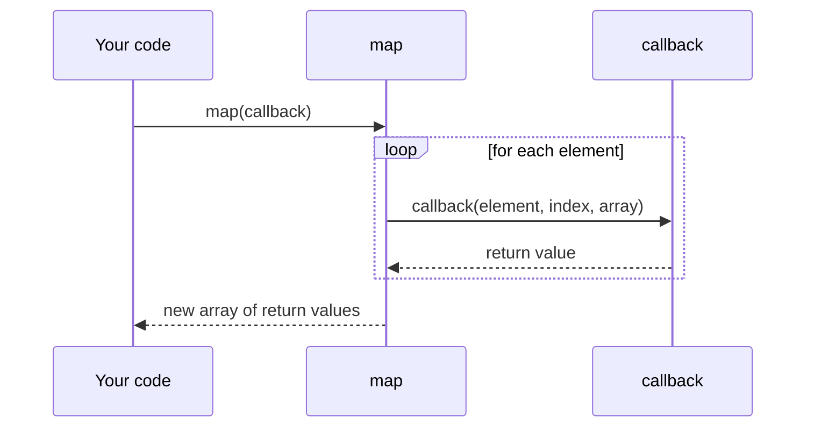

## Introduction

Suppose you write a function that doubles every number in an array, then another that squares every number, then another that converts every price to euros. Each has the same loop — create a result array, visit every element, push something — and differs only in the one line that transforms an element. Copying the loop three times is tedious and error-prone. What you want is to write the loop *once* and hand it the transformation as an input.

JavaScript lets you do exactly that, because **functions are values**. A function can be stored in a variable, put in an array or object, passed as an argument to another function, and returned as a result — anything you can do with a number or a string. A language where functions have all these abilities is said to have **first-class functions**.

```javascript
function transform(items, fn) {
  const result = [];
  for (const item of items) {
    result.push(fn(item));
  }
  return result;
}

console.log(transform([1, 2, 3], (n) => n * 2));
console.log(transform([1, 2, 3], (n) => n * n));
console.log(transform([10, 20], (usd) => `€${(usd * 0.9).toFixed(2)}`));
```

```output
[ 2, 4, 6 ]
[ 1, 4, 9 ]
[ '€9.00', '€18.00' ]
```

`transform` is a **higher-order function**: a function that takes a function as an argument or returns one. The function you pass in, which `transform` calls for you, is a **callback**. JavaScript's built-in `Array.prototype.map` is exactly this `transform`, and the same idea runs through the whole platform — event listeners, timers, promises, React event handlers and hooks, Express middleware. If you understand functions as values, most of the JavaScript ecosystem's APIs stop looking like special syntax and start looking like ordinary function calls.

This lesson covers first-class functions and higher-order functions, then the nested topic of [[b1-callbacks-sync|callbacks]], including when a callback runs immediately and when it runs later.

## Before you start

- **Function expressions and arrow functions** — the usual way to create a function value inline. See [[b1-function-expression]] and [[b1-arrow-functions]].
- **Objects as values and references** — functions are objects, compared by reference. See [[b1-objects-as-values]] and [[b1-primitive-vs-reference]].
- **Closures** — functions returned from functions remember variables from where they were created. See [[b1-closures]]; this lesson uses closures and explains what it needs.

## The intuition

Think of a function as a set of written instructions on a card, rather than as the act of following them. Because it is a card, you can file it in a drawer (store it in a variable), hand it to a colleague so they can follow it when needed (pass it as an argument), or write a new card and give it back to someone (return it). The person holding the card decides when to follow the instructions.

A higher-order function is a colleague who works *with* cards: "give me your instructions for one item, and I'll apply them to the whole pile" (`map`), or "give me what to do when the doorbell rings, and I'll do it then" (`addEventListener`). The distinction that causes most bugs is the difference between handing over the card (`fn`) and following the instructions yourself right now and handing over the result (`fn()`).

## Functions are values, and values are objects

In JavaScript, a function is a special kind of object: an object that can be called. `typeof` reports it as `"function"`, but it is an object in every other sense — it has properties, it can be given new ones, and it is compared by reference:

```javascript
function greet() {
  return 'hi';
}
greet.calls = 0;                       // functions can carry custom properties

console.log(typeof greet, greet instanceof Object);
console.log(greet.name, greet.length, greet.calls);

const a = function () {};
const b = function () {};
console.log(a === b, a === a, String(a) === String(b));
```

```output
function true
greet 0 0
false true true
```

`name` and `length` are built in: the function's name and its number of declared parameters ([[b1-parameters]]). The last line is important later. Two functions with identical source code are still **two different objects**, so `a === b` is `false` — exactly as two separately created `{}` objects are not equal. A function is equal only to itself.

### The four things you can do with a function value

**Store it** in a variable, array or object property:

```javascript
const ops = {
  add: (x, y) => x + y,
  mul: (x, y) => x * y,
};
const pipeline = [(n) => n + 1, (n) => n * 10];

console.log(ops.mul(3, 4), ops['add'](3, 4));
console.log(pipeline.map((step) => step(5)));
```

```output
12 7
[ 6, 50 ]
```

**Pass it** as an argument, as `transform` did above. **Return it** from another function:

```javascript
function multiplier(factor) {
  return (n) => n * factor;      // a new function, remembering factor
}

const triple = multiplier(3);
console.log(triple(7));
console.log(multiplier(10)(2));
```

```output
21
20
```

`multiplier(3)` does not compute anything with a number yet; it **returns a function** that will multiply by 3 when called. The returned arrow remembers `factor` from the call that created it — a closure. `multiplier(10)(2)` creates a function and calls it immediately.

And **attach properties** to it, as with `greet.calls` above — rarely needed in application code, but libraries use it (for example, a memoized function exposing its `cache`).

## Higher-order functions

A **higher-order function** is any function that takes one or more functions as arguments, returns a function, or both. It is a description of how a function is used, not a special type — `transform` and `multiplier` are ordinary functions.

You already use many built-in ones:

| Higher-order function | The function you pass… |
|---|---|
| `array.map(fn)` | turns each element into a new value |
| `array.filter(fn)` | decides whether to keep each element |
| `array.reduce(fn, initial)` | combines an accumulator with each element |
| `array.sort(fn)` | compares two elements |
| `array.find(fn)`, `some(fn)`, `every(fn)` | tests elements until an answer is known |
| `setTimeout(fn, ms)` | runs once after a delay |
| `element.addEventListener(type, fn)` | runs every time the event fires |
| `promise.then(fn)` | runs with the result when the promise settles |

Higher-order functions let you separate **what varies** from **what stays the same**. The loop in `map`, the scheduling in `setTimeout`, the event dispatch in `addEventListener` are written once by the platform; you supply only the part that is specific to your problem. That is the main reason they exist. The array methods are taught in [[b1-array-map-filter-reduce]].

### Functions that return functions

Returning functions gives you two powerful patterns.

A **function factory** builds specialised functions from parameters, as `multiplier` did. Another example is a comparator factory for sorting, used in the worked example below.

A **wrapper** (also called a decorator) takes a function and returns a new function that adds behaviour around it, without changing the original:

```javascript
function logged(fn) {
  return function (...args) {
    const result = fn(...args);
    console.log(`${fn.name}(${args.join(', ')}) -> ${result}`);
    return result;
  };
}

function addNums(x, y) {
  return x + y;
}

const loggedAdd = logged(addNums);
loggedAdd(2, 3);
```

```output
addNums(2, 3) -> 5
```

`logged` receives `addNums` as a value, and returns a new function that calls it, logs the call, and passes the result through. The rest parameter and spread (`...args`) let the wrapper forward any number of arguments. The same shape gives you `once`, `memoize`, `debounce`, `throttle` and retry helpers. A `once` wrapper, which runs a function at most one time, looks like this:

```javascript
function once(fn) {
  let done = false;
  let result;
  return function (...args) {
    if (!done) {
      done = true;
      result = fn(...args);
    }
    return result;
  };
}

const init = once(() => {
  console.log('initialising');
  return 42;
});
console.log(init(), init());
```

```output
initialising
42 42
```

The flags `done` and `result` live in the closure created by `once`, so they persist between calls of the returned function but are hidden from everything else. Closures are what make returned functions useful; see [[b1-closures]] and, for related techniques, [[b1-currying]], [[b1-compose-pipe]] and [[b1-memoization]].

## Passing a function vs calling it

The single most common first-class-function bug is writing parentheses where you meant to pass the function itself:

```javascript
function getData() {
  return 'data';
}

function render(callback) {
  return typeof callback === 'function' ? callback() : `not a function: ${callback}`;
}

console.log(render(getData));      // passes the function
console.log(render(getData()));    // calls getData now, passes its return value
```

```output
data
not a function: data
```

`getData` (no parentheses) is an expression whose value is the function. `getData()` is an expression whose value is whatever the function *returns*. The difference is invisible in a quick read, and its symptoms vary: `button.addEventListener('click', save())` runs `save` once at startup and then registers `undefined`, so clicks do nothing; `setTimeout(refresh(), 1000)` refreshes immediately instead of after a second; in React, `onClick={handleClick()}` calls the handler during every render.

When you need to pass arguments, wrap the call in a new function: `addEventListener('click', () => save(draft))`. The arrow is the value being passed; `save(draft)` runs only when the arrow is called.

> [!WARNING] Function identity matters
> Because functions compare by reference, `removeEventListener('click', () => save())` cannot remove a listener added with a *different* arrow, even one with the same source text. Keep a reference: `const onClick = () => save(); el.addEventListener('click', onClick); el.removeEventListener('click', onClick);`. The same identity rule is why React re-renders children that receive a new function prop on every render ([[b4-usecallback]]).

## Callbacks {#b1-callbacks-sync}

A **callback** is a function you pass to another function so that the other function can call it — "call it back" — at the right moment. In `[1, 2, 3].map((n) => n * 2)`, the arrow is a callback and `map` is the function that calls it. In `setTimeout(() => console.log('hi'), 100)`, the arrow is a callback and the timer system calls it.

Nothing about the function itself makes it a callback. It is an ordinary function; "callback" describes the role it plays in a particular call. The receiving function decides three things about it: **when** to call it, **how many times**, and **with which arguments** (and which `this`, for regular functions). Your job is to know what that contract is.

### Synchronous callbacks

A **synchronous callback** is called while the higher-order function is still running, before it returns. Array methods, `sort` comparators, `Array.from`'s mapper and `String.prototype.replace` with a function all call their callbacks synchronously:

```javascript
const found = [4, 9, 16].find((n) => {
  console.log('checking', n);
  return n > 5;
});
console.log('found', found);
```

```output
checking 4
checking 9
found 9
```

Everything happens in order, on the current call stack: `find` calls the callback for `4`, then for `9`, sees `true`, stops (it never checks `16`), and returns. Only then does the next line run. This is the same as calling a function directly; the only difference is that the call is made from inside `find`.

Synchronous callbacks have two consequences that are easy to rely on without noticing. **Their return value is used immediately** — `map` puts it in the new array, `filter` uses it as a keep/discard decision, `sort` uses it as a comparison. And **errors they throw propagate to the caller**, exactly like errors in a nested function call:

```javascript
try {
  [1, 2, 3].forEach((n) => {
    if (n === 2) throw new Error(`bad item ${n}`);
  });
} catch (e) {
  console.log('caught:', e.message);
}
```

```output
caught: bad item 2
```

The `throw` happens inside the callback, unwinds through `forEach`, and is caught by the surrounding `try`.

### Asynchronous callbacks

An **asynchronous callback** is called *after* the higher-order function has returned — typically after the current script finishes, when the event loop picks it up. Timers, event listeners, network and file APIs in Node.js, and promise `.then` handlers all call their callbacks asynchronously:

```javascript
function withSync(cb) {
  cb('now');
  console.log('after sync callback');
}

function withAsync(cb) {
  setTimeout(() => cb('later'), 0);
  console.log('after scheduling');
}

withSync((v) => console.log('sync', v));
withAsync((v) => console.log('async', v));
console.log('end of script');
```

```output
sync now
after sync callback
after scheduling
end of script
async later
```

`withSync` runs its callback before its own next line. `withAsync` only *schedules* its callback and returns; the callback runs after every remaining line of the script, even with a delay of `0`. The ordering rules (tasks, microtasks, and why `0` is not "immediately") belong to [[b1-event-loop]] and [[b1-sync-vs-async-callbacks]].

Asynchronous callbacks reverse both properties of synchronous ones. Their **return value goes nowhere useful** — `setTimeout` ignores it — so results must be delivered by calling yet another function, updating state, or resolving a promise. And a `try`/`catch` around the scheduling call **cannot catch** an error thrown later inside the callback, because by then the `try` block has finished. Node.js's older APIs pass errors as the callback's first argument instead (`fs.readFile(path, (err, data) => { … })`), a convention covered in [[b1-error-first-callbacks]]; promises and `async`/`await` were introduced largely to fix this ([[b1-callback-hell]]).

| | Synchronous callback | Asynchronous callback |
|---|---|---|
| Runs | Before the higher-order function returns | After it returns, from the event loop |
| Examples | `map`, `filter`, `sort`, `find`, `forEach`, `reduce` | `setTimeout`, `addEventListener`, `then`, Node.js I/O |
| Return value | Used by the caller | Ignored |
| Thrown errors | Propagate to the surrounding `try`/`catch` | Not catchable by the code that scheduled it |

### Do not assume which kind you have

The syntax is identical, so you must know each API's contract. Two mistakes follow from guessing wrong.

**Expecting array methods to wait for async callbacks.** `map` is synchronous and does not understand promises. Passing an `async` callback gives you an array of promises, immediately:

```javascript
const results = [3, 1, 2].map(async (n) => n * 2);
console.log(results);

Promise.all([3, 1, 2].map(async (n) => n * 2)).then((values) => {
  console.log('all done', values);
});
```

```output
[ Promise { 6 }, Promise { 2 }, Promise { 4 } ]
all done [ 6, 2, 4 ]
```

An `async` function always returns a promise, and `map` stores whatever the callback returns. To wait for all of them, pass the array to `Promise.all` ([[b1-promise-all]]). `forEach` with an `async` callback is worse: it ignores the returned promises entirely, so nothing waits and rejections go unhandled. (The `Promise { 6 }` display is how Node.js prints an already-fulfilled promise; browser consoles format it differently.)

**Writing an API that is sometimes synchronous and sometimes asynchronous.** A function that calls its callback immediately when data is cached, but later when it has to fetch, makes the calling code's behaviour depend on cache state:

```javascript
const cache = new Map();

function getUser(id, cb) {
  if (cache.has(id)) {
    cb(cache.get(id));                       // synchronous on a cache hit
    return;
  }
  setTimeout(() => {                         // asynchronous on a miss
    cache.set(id, { id });
    cb(cache.get(id));
  }, 0);
}

let ready = false;
function demo(label) {
  ready = false;
  getUser(1, () => console.log(label, 'callback sees ready =', ready));
  ready = true;
}

demo('first call:');
setTimeout(() => demo('second call:'), 10);
```

```output
first call: callback sees ready = true
second call: callback sees ready = false
```

The same calling code sees `ready` as `true` the first time (callback ran later) and `false` the second (callback ran immediately from the cache). Bugs like this appear only in some runs and are hard to reproduce. The rule, popularised in the Node.js community as "don't release Zalgo", is: **a callback API should be always synchronous or always asynchronous**. Here, the fix is to defer the cached case too, for example with `queueMicrotask(() => cb(cache.get(id)))` ([[b1-queue-microtask]]) — or to return a promise, which is always asynchronous.

### Matching the callback's parameters

The higher-order function decides which arguments the callback receives. `map`, `filter` and `forEach` call it with **three**: the element, its index and the whole array. Passing a function that has a different meaning for its second parameter causes one of JavaScript's best-known surprises:

```javascript
console.log(['1', '2', '3'].map(parseInt));
console.log(['1', '2', '3'].map((s) => parseInt(s, 10)));
console.log(['1', '2', '3'].map(Number));
```

```output
[ 1, NaN, NaN ]
[ 1, 2, 3 ]
[ 1, 2, 3 ]
```

`map` calls `parseInt('1', 0)`, `parseInt('2', 1)` and `parseInt('3', 2)`, because `parseInt`'s second parameter is the radix. Radix `0` means "work it out" (base 10), radix `1` is invalid, and `'3'` is not a digit in base 2 — hence `NaN` twice. Wrapping the call in an arrow controls exactly which arguments are passed. Passing a named function directly (`map(Number)`) is fine only when you know its extra parameters are harmless.

## How it works internally

In the specification, a function is an object with an internal `[[Call]]` method — that is what "callable" means. Ordinary `function` declarations and expressions, and classes, also have `[[Construct]]`, which `new` uses; arrow functions and method-shorthand functions do not. When you write `fn(x)`, the engine evaluates `fn` to a value, checks that it has `[[Call]]` (otherwise: `TypeError: fn is not a function`), and invokes it. So passing a function around is passing an object reference around; calling it later is the same operation as calling it directly.

Each function object also holds a reference to the scope it was created in (its `[[Environment]]`). When a higher-order function returns an inner function, that reference keeps the outer call's variables alive — which is why `triple` still knows `factor = 3` long after `multiplier` returned. There is no separate "higher-order" machinery; it all follows from functions being objects with a call method and a scope reference.



## Worked example: sorting and filtering with function factories

An online shop's product list needs to be filtered and sorted in different ways. Instead of writing a new loop for every combination, build small functions and combine them.

```javascript title="products.js"
const products = [
  { name: 'Lamp', price: 30, stock: 0 },
  { name: 'Pen', price: 2, stock: 120 },
  { name: 'Desk', price: 250, stock: 4 },
  { name: 'Mug', price: 8, stock: 35 },
];

// Factory: returns a comparator for sort
const by = (key, direction = 'asc') => (a, b) => {
  const diff = a[key] < b[key] ? -1 : a[key] > b[key] ? 1 : 0;
  return direction === 'asc' ? diff : -diff;
};

// Predicates for filter
const inStock = (p) => p.stock > 0;
const cheaperThan = (limit) => (p) => p.price < limit;

const names = (list) => list.map((p) => p.name);

console.log(names(products.filter(inStock).toSorted(by('price'))));
console.log(names(products.filter(cheaperThan(50)).toSorted(by('name', 'desc'))));
console.log(names(products.toSorted(by('stock', 'desc'))));
console.log(products[0].name);
```

```output
[ 'Pen', 'Mug', 'Desk' ]
[ 'Pen', 'Mug', 'Lamp' ]
[ 'Pen', 'Mug', 'Desk', 'Lamp' ]
Lamp
```

Walk through the pieces. `by('price')` does not sort anything; it *returns* a comparator function that `toSorted` calls with pairs of products. A comparator returns a negative number if `a` should come first, positive if `b` should, and `0` if they are equal; flipping the sign reverses the order. `cheaperThan(50)` is a factory too — it returns a predicate that remembers `limit`. `inStock` is a plain predicate. Each line combines these pieces differently, and none of them contains a loop: the loops live in `filter`, `toSorted` and `map`.

The last line shows that the original array is untouched. `toSorted` (ECMAScript 2023, available in Node.js 20+ and current browsers) returns a sorted copy, whereas `sort` sorts in place — a distinction that matters for the next lesson, [[b1-pure-functions]].

## In real systems

**UI event handling.** Every interactive web page registers callbacks: `addEventListener('submit', handleSubmit)` in plain JavaScript, `onClick={handleClick}` in React. Components receive functions as props to report events to their parents ([[b4-child-parent-callbacks]]).

**React hooks.** Hooks are higher-order in shape: `useEffect(() => { … }, deps)` takes a function to run after rendering; `useState(() => expensiveInit())` takes a function to compute the initial value only once; `setCount((c) => c + 1)` takes an updater function.

**Server middleware.** Express and similar frameworks are built from functions passed as values: `app.use(logger)`, `app.get('/users', authenticate, listUsers)`. Each middleware receives `next`, a callback it calls to pass control on.

**Data pipelines.** Transformations over records are chains of `filter`, `map` and `reduce` with small callbacks, often with factories like `by(key)` or `where(field, value)` shared across a codebase.

**Dependency injection and testing.** Passing a function (such as a `fetchUser` or `now` function) into code, instead of calling a global directly, lets tests substitute a fake. This is first-class functions used as a design tool.

## Trade-offs and alternatives

First-class functions make code shorter and more reusable, but they have costs.

**Indirection.** A chain of small functions passed into other functions can be harder to follow than a plain loop, especially when factories return factories. If a reader needs to trace three levels of returned functions to see what happens, a straightforward loop may be clearer.

**Debugging.** Anonymous inline callbacks show up in stack traces without names. Naming important callbacks ([[b1-named-function-expression]]) or defining them as named constants helps.

**Identity.** Creating a new function on every call or render means the "same" callback is a different object each time. That breaks `removeEventListener` and defeats memoization in React unless you keep a stable reference.

**Performance.** Calling a callback costs slightly more than inlining the same code in a loop, and creating closures allocates memory. Modern engines optimise array methods well; for nearly all application code the difference is negligible. In a very hot loop processing millions of items, measure before choosing.

| Approach | Use when |
|---|---|
| Built-in higher-order methods (`map`, `filter`, …) | Transforming or querying collections — the default |
| Plain `for`/`for...of` loop | Early exits with complex logic, very hot code, or when a loop reads more clearly |
| Function factories and wrappers | The same behaviour is needed with different settings, or added around many functions |
| Promises / `async`–`await` instead of callbacks | Asynchronous results, especially sequences of async steps |

## Common mistakes

> [!MISTAKE] Calling the function instead of passing it
> `setTimeout(save(), 1000)` and `onClick={handleClick()}` run the function immediately and pass its result. Pass the function (`save`) or wrap the call (`() => save(id)`).

**Forgetting to return in a `map` callback.** `[1, 2, 3].map((n) => { n * 2; })` gives `[undefined, undefined, undefined]`: a block-bodied arrow needs `return`.

**Using `forEach` when you need a result.** `forEach` always returns `undefined`. Use `map`, `filter` or `reduce` when you want a new value.

**Passing a function with incompatible parameters.** `map(parseInt)` passes the index as the radix. Wrap the call to control the arguments.

**Removing a listener with a new function.** The removal must use the same function object that was added.

**Treating `map`/`forEach` as if they await.** An `async` callback returns a promise; use `Promise.all` with `map`, or a `for...of` loop with `await` for sequential work.

## Interview perspective

Interviewers probe this topic with "implement `map` / `filter` / `once` / `debounce` yourself", with `['1','2','3'].map(parseInt)`, and with questions about callback ordering.

> [!INTERVIEW] What a strong answer sounds like
> "Functions in JavaScript are objects with a call method, so they can be stored, passed and returned like any value. A higher-order function takes or returns functions — `map`, `addEventListener`, or a `once` wrapper I write myself. A callback is a function playing the role of 'call this when ready'; what matters is the contract: synchronous callbacks run before the call returns and their errors propagate, asynchronous ones run later from the event loop."

Questions you should be able to answer:

- **What makes functions first-class in JavaScript?** They can be assigned, stored in data structures, passed as arguments and returned from functions; they are objects with properties.
- **Implement `map` without using `Array.prototype.map`.** Loop, call `fn(element, index, array)`, push the result, return the new array.
- **Why does `['1','2','3'].map(parseInt)` return `[1, NaN, NaN]`?** `map` passes the index as `parseInt`'s radix.
- **Is every callback asynchronous?** No; array method callbacks run synchronously. Asynchrony comes from the API scheduling the call later.
- **Why can't `try`/`catch` around `setTimeout` catch an error from its callback?** The callback runs after the `try` block has completed, on a new call stack.
- **Implement `once(fn)`.** Return a closure that keeps a `done` flag and cached result.

```quiz
Q: What is printed? `const r = [1, 2, 3].map((n) => { n * 2; }); console.log(r);`
- [ ] `[ 2, 4, 6 ]`
- [x] `[ undefined, undefined, undefined ]`
- [ ] `undefined`
- [ ] `[ 1, 2, 3 ]`
> The arrow has a block body, so it needs an explicit `return`. Each call computes `n * 2`, discards it, and returns `undefined`, and `map` collects those return values. A concise body, `(n) => n * 2`, would return the product.

Q: In what order are the lines printed? `setTimeout(() => console.log('A'), 0); [1].forEach(() => console.log('B')); console.log('C');`
- [ ] A, B, C
- [x] B, C, A
- [ ] C, B, A
- [ ] B, A, C
> `forEach` calls its callback synchronously, so `B` prints during the `forEach` call, followed by `C`. `setTimeout` only schedules its callback; it runs after the current script finishes, even with a delay of 0, so `A` prints last.

Q: Why does `el.removeEventListener('click', () => save())` fail to remove a listener added with `el.addEventListener('click', () => save())`?
- [ ] `removeEventListener` only works with named function declarations
- [x] The two arrows are different function objects, and listeners are matched by reference
- [ ] Arrow functions cannot be used as event listeners
- [ ] The listener must be removed inside the click handler
> Every evaluation of an arrow creates a new function object, and functions are compared by identity, not by source text. Store the function in a variable and pass the same reference to both calls.
```

## Practice

1. **Rebuild the basics.** Implement `myFilter(arr, predicate)` and `myReduce(arr, reducer, initial)` without using the built-in versions. Make the callbacks receive `(element, index, array)`.
2. **Factories.** Write `greaterThan(n)` that returns a predicate, and `prop(key)` that returns a function reading `obj[key]`. Use them to get the names of all products priced above 10.
3. **Wrappers.** Write `countCalls(fn)` that returns a wrapped function with a `.count` property incremented on each call.
4. **Sync or async?** For `Array.prototype.sort`, `setTimeout`, `Promise.prototype.then`, `String.prototype.replace` with a function, and `addEventListener`, state whether the callback is synchronous or asynchronous, then verify with `console.log` ordering.
5. **Fix Zalgo.** Rewrite the `getUser` example so the callback is always asynchronous, and confirm that both calls now print the same value of `ready`.

## Quick revision {#quick-revision}

- First-class functions: functions are values — store, pass, return, attach properties.
- Functions are objects (`typeof` gives `"function"`), compared by reference: two identical-looking functions are not equal.
- Higher-order function: takes and/or returns a function (`map`, `filter`, `sort`, `setTimeout`, `addEventListener`, `then`).
- Factories return specialised functions (`multiplier(3)`); wrappers return enhanced versions (`logged`, `once`, `memoize`, `debounce`).
- `fn` passes the function; `fn()` calls it now and passes the result. Wrap to pass arguments: `() => fn(x)`.
- Callback: a function passed to be called by someone else; the receiver controls when, how often and with what arguments.
- Synchronous callbacks run before the call returns; their return values are used; their errors propagate to the caller.
- Asynchronous callbacks run later via the event loop; return values are ignored; outer `try`/`catch` cannot catch their errors.
- `map(async fn)` returns an array of promises; use `Promise.all`. `forEach` never waits.
- Callback APIs should be consistently sync or consistently async ("don't release Zalgo").
- `['1','2','3'].map(parseInt)` → `[1, NaN, NaN]` because the index becomes the radix.
- Listener removal and React memoization depend on keeping the same function reference.

## Key takeaways {#key-takeaways}

- JavaScript functions are callable objects, so they can be stored, passed and returned like any other value.
- Higher-order functions separate the reusable part of an algorithm (looping, scheduling, dispatching) from the part you supply as a function.
- Returning functions, with closures, gives you factories and wrappers such as `once` and `memoize`.
- A callback is a role, not a kind of function: know whether an API calls it synchronously or asynchronously, with which arguments, and what it does with the return value.
- Most bugs in this area come from calling instead of passing, mismatched callback parameters, or creating a new function where the same reference was needed.
